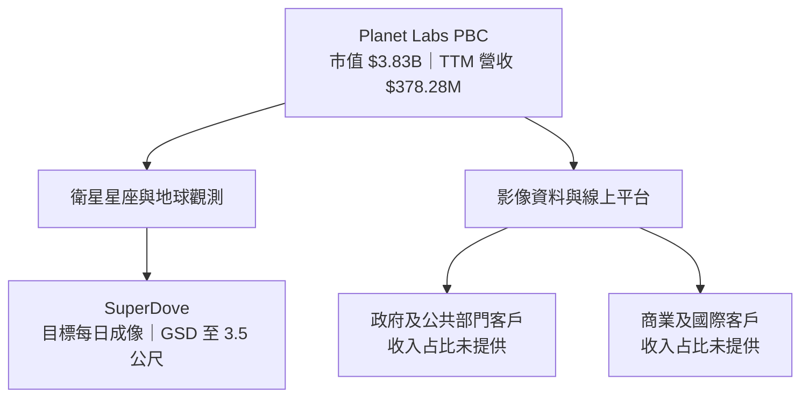
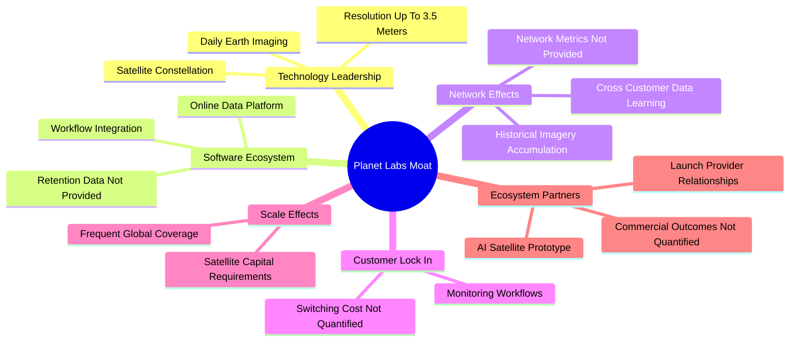
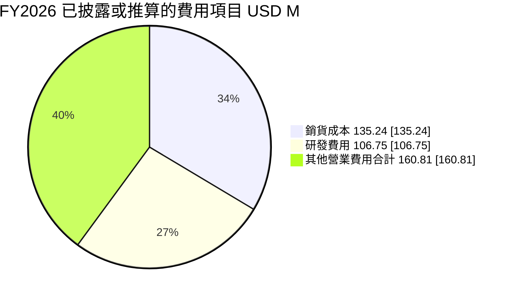
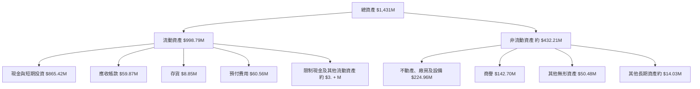
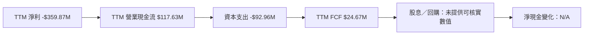
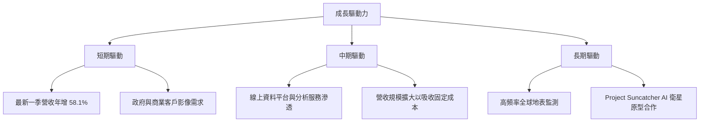
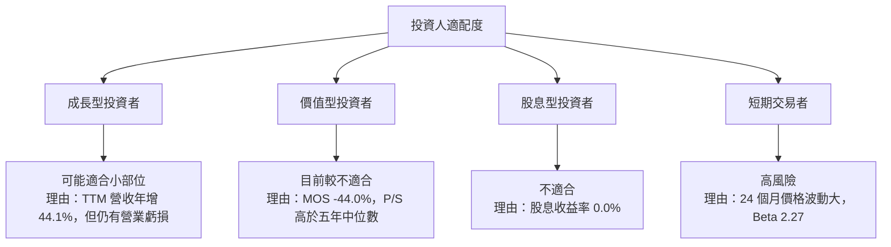

# PL 基本面深度分析報告
> **報告日期**：2026-11-21 ｜ **語言**：繁體中文 ｜ **數據來源**：SEC 申報資料 (XBRL)、Yahoo Finance、Finviz、StockAnalysis、Roic.ai ｜ **分析師**：CFA 級機構研究

## 目錄

| # | 章節 | 核心結論 |
|---|------|----------|
| 1 | 執行摘要 | 賣出；加權合理價值 $7.31，MOS -44.0% |
| 2 | 公司概覽與商業模式 | 每日地球影像與資料平台具有差異化，但部分護城河指標缺少量化證據 |
| 3 | 損益表深度分析 | TTM 營收 $378.28M、年增 44.1%；TTM 營業利益率 -27.2% |
| 4 | 資產負債表分析 | 現金及短期投資 $865.42M；債務欄位有資料差異，需審慎解讀 |
| 5 | 現金流量深度分析 | TTM FCF $24.67M，惟資本支出仍高、現金流品質須持續驗證 |
| 6 | 獲利能力與資本效率 | ROIC 為 N/A；WACC 12.58%，目前營業虧損尚未證明創造經濟價值 |
| 7 | 相對估值分析 | P/S 10.0x，高於自身五年中位數 6.9x；同業 P/S 估值差異大 |
| 8 | DCF 內在價值評估 | DCF N/A：TTM 營業利益為負，不建立負利潤折現模型 |
| 9 | 成長催化劑 | AI、政府與商業地理空間需求具潛力，TAM 數字與實現時間未提供 |
| 10 | 風險矩陣 | 估值、持續虧損與衛星資本需求為主要風險 |
| 11 | 投資建議 | 依規則 20 賣出；以 $7.31 加權合理價值作為估值錨點 |

## 1. 執行摘要

最新收盤價為 **2026-11-20 的 $10.53**。Planet Labs（PL）TTM 營收 **$378.28M**、TTM 營收年增 **44.1%**，最新一季營收年增 **58.1%**，顯示需求與商業化速度改善；但 TTM 營業利益率仍為 **-27.2%**，ROE 為 **-63.8%**，Piotroski F-Score 為 **3/8**，代表營收成長尚未轉化為持續獲利。以同業 P/S 與分析師共識加權得出合理價值 **$7.31**，MOS 為 **-44.0%**，符合規則 20 的**賣出**門檻；即使 TTM FCF 為正 **$24.67M**，FCF Yield 僅 **0.64%**，仍不足以抵銷估值與獲利風險。

### 1.0 一頁式投資儀表板

| 項目 | 內容 |
|------|------|
| **投資論點（3 句）** | ① TTM 營收年增 **44.1%**，最新一季年增 **58.1%**，增長動能加速。② TTM 營業利益率 **-27.2%**，規模成長尚未解決持續虧損。③ 加權合理價值 **$7.31**，低於 2026-11-20 收盤價 **$10.53**，估值緩衝不足。 |
| **綜合評分** | **4.8/10**（引用 1.1 評分卡） |
| **財務健康** | 🟡 現金及短期投資 **$865.42M**；但債務數字來源有差異，需留意口徑。 |
| **ROIC vs WACC** | ROIC：**N/A**；WACC：**12.58%**。營業利益率為負，現階段沒有證據顯示投資資本回報高於資本成本。 |
| **FCF 趨勢** | TTM FCF **$24.67M**；FCF Yield **0.64%**。轉正是改善，但季度間波動仍大。 |
| **估值** | Forward P/E **-8,424.0x**（無獲利時參考性低）｜EV/EBITDA **-71.578x**｜FCF Yield **0.64%** |
| **DCF 內在價值（基準）** | **N/A**；TTM 營業利益為負，依模型規則不建立 DCF。 |
| **安全邊際（MOS）** | **-44.0%**＝($7.31 − $10.53) ÷ $7.31；🔴 不具安全邊際。基準為 8.8 加權合理價值。 |
| **預期報酬（基準情境 12M）** | **-30.6%**，以加權合理價值相對現價計算；非 DCF 情境預測。 |
| **關鍵風險（前二）** | 營業虧損收窄不如預期；高成長估值下修。 |
| **評級 + 信心度** | 🔴 **賣出** ｜ 信心：中（相對估值結論明確；獲利轉折時間仍不確定）。 |

### 1.1 綜合評分卡（全報告唯一）

| 維度 | 評分（1–10） | 主要依據（引用數字與其來源章節） |
|------|--------------|----------------------------------|
| 成長性 | 7.5 | TTM 營收年增 **44.1%**、最新一季年增 **58.1%**（第 3 章）；需求成長明顯，但未提供可核實的分部數字。 |
| 獲利能力 | 2.5 | TTM 營業利益率 **-27.2%**、ROE **-63.8%**、F-Score **3/8**（第 3、6 章）。 |
| 財務健康 | 7.0 | 現金及短期投資 **$865.42M**；流動比率 **2.843**、速動比率 **2.634**，但總債務資料口徑不一致（第 4 章）。 |
| 估值 | 2.0 | 加權合理價值 **$7.31**、MOS **-44.0%**；P/S **10.0x**，高於自身五年中位數 **6.9x**（第 7、8 章）。 |
| 護城河 | 6.0 | 日更地球影像與自有衛星網路具差異化，但市場份額、客戶留存與分部營收占比未提供（第 2 章）。 |
| 管理層與資本配置 | 5.0 | FY2026 SBC **$54.99M**，且稀釋股數測試未通過；公司仍處高投入與虧損階段（第 3、5 章）。 |
| **綜合評分** | **5.0** | 六項算術平均：(7.5 + 2.5 + 7.0 + 2.0 + 6.0 + 5.0) ÷ 6 = **5.0**。 |

### 1.2 五大投資論點 + 三大核心風險

| 類型 | 項目 | 具體依據 | 信心度 |
|------|------|----------|--------|
| 🟢 **投資論點①** | 營收增速加快 | TTM 營收 **$378.28M**、年增 **44.1%**；最新一季年增 **58.1%**。若增速持續，固定成本吸收能力可能改善。 | 🟢 高 |
| 🟢 **投資論點②** | 影像資料具高頻率特性 | 公司以衛星星座提供高頻地表觀測，SuperDove 目標每日成像；資料更新頻率可能提高政府及商業客戶的工作流程黏著度。 | 🟡 中 |
| 🟢 **投資論點③** | TTM FCF 已轉正 | TTM 營業現金流 **$117.63M**、資本支出 **$92.96M**、FCF **$24.67M**。正 FCF 降低短期外部融資依賴，但仍須觀察持續性。 | 🟡 中 |
| 🟢 **投資論點④** | 現金及短期投資提供緩衝 | 現金及短期投資 **$865.42M**，有助支持衛星部署與研發；實際可動用程度仍受營運支出與債務口徑影響。 | 🟡 中 |
| 🟢 **投資論點⑤** | 新興 AI 與太空合作選擇權 | 新聞提及 Project Suncatcher 原型 AI 衛星合作；現有資料未顯示其已形成具規模收入，屬選擇權而非已驗證獲利來源。 | 🟡 中 |
| 🟡 **風險①** | 高估值與回撤風險 | 股價由 2026-05 月收盤 **$51.14** 降至 2026-11-20 **$10.53**；P/S **10.0x**，仍高於五年中位數 **6.9x**。 | 🔴 高衝擊 |
| 🔴 **風險②** | 虧損持續、利潤轉折未證實 | TTM 營業利益率 **-27.2%**；最新一季為 **-11.6%**，雖有改善但仍為負。若費用增速追上營收，營業槓桿將無法兌現。 | 🔴 高 |
| 🟡 **風險③** | SBC 與股數稀釋 | FY2026 SBC **$54.99M**，Piotroski 稀釋股數測試未通過；股東持有比例可能被持續攤薄。 | 🟡 中高 |

### 1.3 快速統計卡片

| 指標 | 公司實際值（期間） | 同業中位數 | 狀態 |
|------|--------------------|------------|------|
| 營收成長（TTM） | **44.1%** | — | 🟢 |
| 營收成長（最新一季年增） | **58.1%** | **72.7%**（SPIR、BKSY、RKLB 中位數） | 🟢 |
| 毛利率（TTM） | **55.5%** | **40.3%**（三家同業中位數） | 🟢 |
| 營業利益率（TTM） | **-27.2%** | — | 🔴 |
| ROIC（TTM） | **N/A** | — | 🟡 |
| Forward P/E | **-8,424.0x** | **-16.5x**（三家同業中位數） | 🔴 |
| FCF Yield（TTM） | **0.64%** | — | 🟡 |
| Piotroski F-Score | **3 / 8** | — | 🔴 |

### 1.4 投資結論

```text
╔══════════════════════════════════════════════════════════════════╗
║                    📊 投資結論摘要                               ║
╠══════════════════════════════════════════════════════════════════╣
║  評級：🔴 賣出（MOS -44.0%，符合規則 20）                        ║
║  價格（2026-11-20 收盤）：$10.53                                 ║
║  DCF 內在價值（基準）：N/A（TTM 營業利益為負）                   ║
║  安全邊際 MOS：-44.0%＝($7.31−$10.53)÷$7.31                     ║
║  加權合理價值（8.8）：$7.31                                      ║
║  綜合評分：5.0/10（引用 1.1）                                    ║
║  適合投資人：能承受高波動、以成長選擇權為主的小部位投資人        ║
╚══════════════════════════════════════════════════════════════════╝
```

## 2. 公司概覽與商業模式

### 2.1 業務結構與收入來源

Planet Labs PBC 設計、建造並發射衛星星座，將地球影像與地理空間資料透過線上平台提供給美國及國際客戶。財務數據未提供各產品、客戶類別或軟體服務的收入拆分，因此不推估部門占比。



### 2.2 市場份額

市場份額數據未提供，亦無可引用的市場總額與年份，故不繪製市占圖。PL TTM 營收為 **$378.28M**，TTM 成長 **44.1%**；SPIR、BKSY、RKLB 最新一季營收年增分別為 **42.1%、118.4%、72.7%**，但業務組合不同，不能直接視為同一市場份額排名。

### 2.3 競爭護城河分析



### 2.4 護城河強度

| 護城河項目 | 強度（強／中／弱） | 證據（引用數字或事實） | 會削弱它的情況 |
|------------|--------------------|------------------------|----------------|
| 技術與資料頻率 | 中 | SuperDove 目標每日成像，最高地面取樣距離約 **3.5 公尺**；公司營收成長較快，但無同產品性能對照數據。 | 競爭者提高成像頻率、解析度或降低單位成本。 |
| 軟體平台 | 中 | 影像資料經線上平台交付；平台收入、續約率與客戶使用深度未提供。 | 競爭者以更易整合的資料平台降低轉換成本。 |
| 網路效應 | 弱至中 | 長期衛星影像理論上可累積資料資產；客戶數、資料使用頻率與網路效應指標未提供。 | 歷史資料不形成客戶端的實質轉換成本。 |
| 客戶鎖定 | 弱至中 | 政府與商業客戶可將地理資料納入監測流程；留存率與合約長度未提供。 | 客戶多源採購或預算削減。 |
| 規模效應 | 中 | 衛星星座需資本、技術與發射安排；現有資料未提供單位影像成本曲線。 | 資本需求持續高於收入成長，規模未帶來成本優勢。 |
| 生態夥伴 | 弱至中 | 新聞提及 Project Suncatcher 原型衛星合作及 Stoke Space 合作消息；相關營收尚未量化。 | 合作停留於研發或未能轉化為商業合約。 |

1.1「護城河」評分 **6.0/10**，主要依據是日更成像與衛星星座能力具差異化，但續約、客戶鎖定、平台收入與成本優勢缺乏可量化披露。

## 3. 損益表深度分析

### 3.1 年度收入成長趨勢（近 4 年）

FY2023 至 FY2026 年營收來自年度損益表；收入 CAGR 為依年度數字計算。條形長度為收入相對視覺化，具體金額列於文字及表格。

```text
╔══════════════════════════════════════════════════════════════════╗
║              Planet Labs 年度收入趨勢（FY2023–FY2026）          ║
╠══════════════════════════════════════════════════════════════════╣
║  FY2023  $191.26M  ███████████████████                         ║
║  FY2024  $220.70M  ██████████████████████                      ║
║  FY2025  $244.35M  ████████████████████████                    ║
║  FY2026  $307.73M  ██████████████████████████████              ║
╠══════════════════════════════════════════════════════════════════╣
║  FY2023–FY2026 營收 CAGR：((307.73÷191.26)^(1÷3))−1 = 17.2%     ║
╚══════════════════════════════════════════════════════════════════╝
```

FY2026 年營收年增 **25.9%**，高於 FY2025 的 **10.7%**；TTM 成長進一步升至 **44.1%**。這顯示最近營收加速，但尚不能直接推論盈利能力同步改善：FY2026 年營業損失仍為 **$95.07M**。

### 3.2 季度收入趨勢分析

| 季度 | 營收 | QoQ 成長 | YoY 成長 | 備註 |
|------|------:|---------:|---------:|------|
| 2025-10-31 | $81.25M | — | 32.63% | 最近四季比較基期。 |
| 2026-01-31 | $86.82M | 6.86% | 41.05% | QoQ＝($86.82M ÷ $81.25M)−1。 |
| 2026-04-30 | $94.15M | 8.44% | 42.08% | QoQ＝($94.15M ÷ $86.82M)−1。 |
| 2026-07-31 | $116.05M | 23.27% | 58.14%（摘要採 **58.1%**） | QoQ＝($116.05M ÷ $94.15M)−1；季增幅度擴大。 |

最新一季營收年增 **58.1%**，且季增 **23.27%**。季度加速可能來自合約交付與客戶需求增加，但單季增長可能受合約時點影響，需用後續季度確認。

### 3.3 利潤率演變分析

年度毛利率、營業利益率及淨利率依年度損益表計算；TTM 指標依 SEC 申報資料所列數字。

| 利潤率指標 | FY2023 | FY2024 | FY2025 | FY2026 | 趨勢 | 評估 |
|------------|-------:|-------:|-------:|-------:|------|------|
| **毛利率** | 49.2% | 51.2% | 57.2% | 56.0% | FY2025 改善，FY2026 小幅回落 | 🟡 |
| **營業利益率** | -91.9% | -75.8% | -45.5% | -30.9% | 逐年收窄；仍為虧損 | 🔴 |
| **淨利率** | -84.7% | -63.7% | -50.4% | -80.2% | FY2026 受較大淨損拖累 | 🔴 |

TTM 毛利率 **55.5%**、營業利益率 **-27.2%**；最新一季營業利益率 **-11.6%**。毛利率較 FY2023 提高，與營收規模與產品組合改善相容，但資料未提供各產品價格或成本明細，不能將改善確定歸因於單一因素。營業虧損率收窄代表營收成長開始吸收部分固定費用；然而最新年度淨損仍達 **$246.86M**，顯示非營業項目、股權薪酬、融資或其他費用仍可能影響 GAAP 盈餘。

### 3.4 費用結構分析

FY2026 收入 **$307.73M**，毛利 **$172.49M**，研發費用 **$106.75M**，營業損失 **$95.07M**。由此計算銷貨成本為 **$135.24M**，其他營業費用合計約 **$160.81M**（營業毛利減研發費用後，再對應營業損失）。其他營業費用未提供細分，以下僅呈現已披露項目與計算出的合併項目，不代表單項科目明細。



> 依 FY2026 數字推算：銷貨成本＝$307.73M−$172.49M＝$135.24M；其他營業費用＝$172.49M−$106.75M−($−95.07M)＝$160.81M。各項合計超過營收，反映公司營業虧損，不是收入占比圓餅。

```text
╔══════════════════════════════════════════════════════════════════╗
║             FY2026 費用與營業結果摘要（USD M）                   ║
╠══════════════════════════════════════════════════════════════════╣
║  營收                 307.73                                      ║
║  ├─ 銷貨成本         135.24  （計算值）                           ║
║  ├─ 研發費用         106.75  （申報數字）                         ║
║  ├─ 其他營業費用     160.81  （合併推算值）                       ║
║  └─ 營業損失         (95.07)                                      ║
╚══════════════════════════════════════════════════════════════════╝
```

### 3.5 季度 EPS 趨勢與盈餘品質（Quality of Earnings）

最近四季 EPS 實際值有列示，但 EPS 預期值皆為缺漏，因此無法判定超預期或不及預期。將缺少預期值的季度標示為 N/A，而非視為 miss。

| 季度 | EPS 實際 | EPS 預期 | 超預期／不及預期 |
|------|---------:|---------:|------------------|
| 2026-07-31 | -$0.03 | N/A | N/A（預期值缺漏） |
| 2026-04-30 | -$0.40 | N/A | N/A（預期值缺漏） |
| 2026-01-31 | -$0.48 | N/A | N/A（預期值缺漏） |
| 2025-10-31 | -$0.19 | N/A | N/A（預期值缺漏） |

| 盈餘品質項目 | 數值／佔比 | 評估 |
|--------------|------------|------|
| 股權薪酬 SBC / 營收 | TTM SBC **$62.51M** ÷ 營收 **$378.28M**＝**16.5%** | 🔴 SBC 占營收比例高，屬真實股東成本；若透過發股支付，會稀釋持股。 |
| SBC / 營業現金流 | **$62.51M ÷ $117.63M＝53.1%** | 🟡 SBC 占營業現金流逾一半；OCF 的現金表現部分依賴非現金薪酬回加。 |
| FCF / 淨利（現金轉換率） | TTM 淨利 **-$359.87M**；FCF **$24.67M**；比率 **-6.9%** | 🔴 因淨利為負，傳統現金轉換率失去通常解讀意義；正 FCF 不等於已建立穩定 GAAP 盈利。 |
| 一次性／非經常性損益 | N/A（無完整調整項明細） | 無法判斷淨損中一次性項目的比重。 |
| 有效稅率異常 | N/A（資料未提供可核實的 TTM 稅前利益與所得稅費用） | 不推算稅率，也不判斷稅務利益是否支撐盈餘。 |
| 資本化支出 vs 費用化 | TTM 資本支出 **$92.96M**；資本化與費用化政策細節 N/A | 衛星及基礎設施需持續資本投入；無法量化是否存在成本遞延。 |

**盈餘品質結論：**目前 GAAP 獲利為負，不能以單季虧損收窄視為盈利轉折已完成。TTM FCF 為正，但 SBC 對營收占比 **16.5%**、占 OCF **53.1%**，而 F-Score 稀釋股數項目未通過，代表部分現金流改善須與股東稀釋及持續投資一併評估。

## 4. 資產負債表分析

### 4.1 資產結構分解

以下按 2026-07-31 資產資料呈現；部分細項為 StockAnalysis 季度資產負債表，合計以其披露總資產 **$1,431M** 為基準。



> 圖中「限制現金及其他流動資產」為 **$1.89M + $2.20M = $4.09M**；此處節點僅為圖示簡寫，流動資產細項合計以披露總數 **$998.79M** 為準。

### 4.2 流動性與營運資金分析

| 流動性指標 | 最新資料 | 評估 |
|------------|----------|------|
| 現金及短期投資 | **$865.42M** | 可提供營運與投資緩衝；但現金消耗取決於未來衛星投資與營業虧損。 |
| 流動比率 | **2.843** | 流動資產覆蓋流動負債能力尚可；前期同口徑數值未提供。 |
| 速動比率 | **2.634** | 扣除存貨後仍高於 1，流動性不單靠存貨支撐。 |

**營運資金天數**（依 QUALITY FIGURES 照列）：

| 指標 | 最新 TTM | 一年前 TTM | 變化 | 解讀 |
|------|----------|------------|------|------|
| DSO 應收帳款天數 | 58 天 | 72 天 | -14 天 | 收款天數縮短，可能反映收款改善或合約組合變動；不能單憑此判斷信用條件變化。 |
| DIO 存貨天數 | 19 天 | N/A | N/A | 一年前公司未報告可比較存貨餘額，不補值。 |
| DPO 應付帳款天數 | 22 天 | 37 天 | -15 天 | 對供應商付款天數下降；可能是付款提早或供應商結構改變，不能直接推論議價力。 |
| CCC 現金轉換週期 | 55 天 | N/A | N/A | 目前週期為 58+19−22＝55 天；去年因 DIO 缺漏不可比較。 |

### 4.3 債務結構分析

財務數據中存在口徑差異：VERIFIED FIGURES 將總債務列為 **N/A**、淨現金列為 **$865.42M**；另一市場資料來源列示總債務 **$498.62M**、淨現金 **$366.79M**。本報告依優先規則保留 VERIFIED FIGURES 的原值，不以來源不一致的債務值重算淨現金；應在正式投資決策前核對最新 SEC 資產負債表與債務附註。

```text
╔══════════════════════════════════════════════════════════════════╗
║                Planet Labs 債務健康診斷                          ║
╠══════════════════════════════════════════════════════════════════╣
║  總債務（VERIFIED FIGURES）：N/A                                 ║
║  總現金及短期投資：           $865.42M                           ║
║  淨現金（VERIFIED FIGURES）： $865.42M                           ║
║  補充市場資料債務值：         $498.62M（口徑不同，未用於重算）    ║
║  Debt/EBITDA：N/A（債務口徑差異且 EBITDA 為負）                  ║
║  Interest Coverage：N/A（利息費用及可比營業利益資料不足）        ║
╚══════════════════════════════════════════════════════════════════╝
```

### 4.4 股東權益趨勢

| 財年結束日 | 股東權益 | 年變化 | 解讀 |
|------------|---------:|-------:|------|
| 2023-01-31 | $576.10M | — | 基期。 |
| 2024-01-31 | $518.02M | -10.1% | 權益下降。 |
| 2025-01-31 | $441.29M | -14.8% | 仍然下降。 |
| 2026-01-31 | $188.43M | -57.3% | 權益大幅減少；與當年淨損、融資及股權項目相關性需以申報附註拆解。 |

```text
╔══════════════════════════════════════════════════════════════════╗
║              股東權益趨勢（USD M）                               ║
╠══════════════════════════════════════════════════════════════════╣
║  FY2023  576.10  ██████████████████████████████                 ║
║  FY2024  518.02  ███████████████████████████                    ║
║  FY2025  441.29  ███████████████████████                        ║
║  FY2026  188.43  ██████████                                     ║
╚══════════════════════════════════════════════════════════════════╝
```

## 5. 現金流量深度分析

### 5.1 現金流量瀑布圖

TTM FCF 依規定使用 OCF 減資本支出：**$117.63M − $92.96M = $24.67M**。淨利與 OCF 的差額受非現金項目及營運資金變化影響，圖表表達的是現金流關係，不代表從淨利到 OCF 僅有單一調整項。



### 5.2 FCF 轉換率趨勢

| 期間 | FCF | 淨利 | FCF／淨利 | 解讀 |
|------|----:|----:|----------:|------|
| FY2023 | -$86.69M | -$161.97M | 53.5% | 兩者皆為負，比例不可等同於正常的現金轉換率。 |
| FY2024 | -$93.12M | -$140.51M | 66.3% | 負 FCF 持續，資本投入高於營運現金流。 |
| FY2025 | -$68.78M | -$123.20M | 55.8% | FCF 虧損幅度收窄，但仍為負。 |
| FY2026 | $51.41M | -$246.86M | -20.8% | FCF 轉正而淨損擴大；反映兩者受不同非現金與資本支出項目影響。 |
| TTM 至 2026-07-31 | $24.67M | -$359.87M | -6.9% | 分母為負，比例不具一般意義。 |

### 5.3 自由現金流趨勢

年度 FCF 使用年度現金流量表；TTM FCF 採 VERIFIED FIGURES 的 **$24.67M**。兩者期間不同，不以 FY2026 數字替代 TTM。

```text
╔══════════════════════════════════════════════════════════════════╗
║                自由現金流趨勢（USD M）                          ║
╠══════════════════════════════════════════════════════════════════╣
║  FY2023  -86.69  ◀████████████████                               ║
║  FY2024  -93.12  ◀█████████████████                              ║
║  FY2025  -68.78  ◀█████████████                                  ║
║  FY2026  +51.41  ██████████▶                                     ║
║  TTM       +24.67  █████▶    FCF Yield：0.64%                    ║
╚══════════════════════════════════════════════════════════════════╝
```

TTM FCF 為正，代表 OCF 已覆蓋當期資本支出；但 TTM 資本支出仍達 **$92.96M**，而 FCF Yield 僅 **0.64%**。若衛星替換、發射或平台建設支出增加，FCF 可能重新轉負。

### 5.4 資本配置評估

資本配置金額中，資料可核實的只有 FY2026 資本支出 **$82.95M**、FY2026 SBC **$54.99M**及股息收益率 **0.0%**。下表不推估回購、收購或留存金額。

| 資本配置項目 | 已知資料 | 評估 |
|--------------|----------|------|
| 資本支出 | FY2026 **$82.95M**；TTM **$92.96M** | 衛星業務需持續投入；資本支出成效須以收入與單位經濟性驗證。 |
| 股權薪酬 | FY2026 **$54.99M** | 對員工激勵有用，但構成股東稀釋成本。 |
| 股息 | 股息收益率 **0.0%** | 未見現金股利支出。 |
| 回購／收購／其他投資 | N/A | 資料不足，不繪製含推估比例的圓餅圖。 |

## 6. 獲利能力與資本效率

### 6.1 ROE / ROA / ROIC 趨勢

| 指標 | 最新可用值 | 歷史趨勢／評估 |
|------|------------:|----------------|
| ROE（TTM） | **-63.8%** | 依 QUALITY FIGURES；負值反映公司仍處虧損狀態。 |
| ROA（TTM） | **-5.0%** | 財務資料列示；公司資產尚未產生正的會計報酬。 |
| ROIC（TTM） | **N/A** | 未提供可照抄的 ROIC 數值；不自行推算。 |
| ROIC 歷史序列 | N/A | 歷史資料缺少一致口徑的投入資本與 NOPAT。 |

### 6.2 ROIC vs WACC 分析（核心價值創造判斷）

```text
╔══════════════════════════════════════════════════════════════════╗
║                 ROIC vs WACC 深度分析                           ║
╠══════════════════════════════════════════════════════════════════╣
║  WACC（Cost of capital 原值）：12.58%                            ║
║  ├── 無風險利率（10Y 美債）：4.91%                               ║
║  ├── 股權風險溢酬 ERP：5.00%                                    ║
║  ├── 原始 Beta：2.27；調整後 Beta：1.85                          ║
║  ├── 股權成本 Ke：14.15%                                        ║
║  ├── 稅前債務成本：0.69%；稅率：21.0%                            ║
║  ├── 股權／債務權重：88.5%／11.5%                               ║
║  └── WACC：12.58%（依資本成本資料原值採用）                      ║
║                                                                  ║
║  ROIC：N/A（資料未提供可核實的同口徑數值）                       ║
║  TTM 營業利益率：-27.2%                                         ║
║                                                                  ║
║  結論：ROIC 與 WACC 的精確利差無法計算；目前營業虧損，尚未證明    ║
║        公司正在創造高於資本成本的經濟價值。                      ║
╚══════════════════════════════════════════════════════════════════╝
```

採用 WACC **12.58%**，與資本成本資料一致；原始 Beta **2.27** 經調整後採用 **1.85**。公司目前營業利益為負，但因 ROIC 未提供，不宣稱可精確計算 EVA 或 ROIC/WACC 倍數。現階段營業虧損與負 ROE 表明價值創造尚未證實，後續關鍵是營業利潤率能否轉正並維持。

### 6.3 杜邦三因素分解

| 因素 | 數值（TTM） | 解讀 |
|------|-------------|------|
| 淨利率 | **-95.1%** | 淨損相對營收顯著，拖累 ROE。 |
| 資產週轉率 | **0.26** | 每單位資產產生的營收有限，與資本密集型衛星業務相容。 |
| 權益乘數 | **2.54** | 有槓桿效果，但 ROE 負值主因是負淨利率，而非槓桿創造回報。 |
| **ROE** | **-63.8%** | QUALITY FIGURES 原值：-95.1% × 0.26 × 2.54 = -63.8%（乘積因四捨五入略有差異）。 |

### 6.4 財務體質：Piotroski F-Score

**Piotroski F-Score：3 / 8**。九項測試中有一項缺少輸入而無法判定，因此分母為 8；以下逐項照列。

| 測試 | 結果 | 解讀 |
|------|------|------|
| ROA > 0 | ❌ 未通過 | 盈利能力尚未轉正。 |
| 營業現金流 > 0 | ✅ 通過 | TTM 營業現金流為正。 |
| ROA 高於一年前 | ❌ 未通過 | 資產回報未改善至通過門檻。 |
| 營業現金流 > 淨利（應計品質） | ✅ 通過 | 現金流相對淨利較佳，但公司仍為淨損。 |
| 長期負債 ÷ 總資產低於一年前 | — 無法判定 | 缺少輸入，不補值。 |
| 流動比率高於一年前 | ✅ 通過 | 流動性指標有所改善。 |
| 稀釋股數未增加 | ❌ 未通過 | 股數增加對每股價值不利。 |
| 毛利率高於一年前 | ❌ 未通過 | 最新比較期未通過該測試。 |
| 資產週轉率高於一年前 | ❌ 未通過 | 資產使用效率未改善至通過門檻。 |

F-Score **3/8** 顯示資產品質與盈利改善尚未全面成形；正營業現金流、較高流動比率是主要正面項，稀釋、毛利率與資產週轉率則為警訊。

## 7. 相對估值分析

### 7.1 同業估值比較表格

同業倍數依 Peer multiples 資料。PL 的 Forward P/E 取市場估值資料所列 **-8,424.0x**；由於 EPS 接近零且仍為負值，該倍數容易失真，不宜單獨作為估值依據。

| 估值指標 | **PL** | **SPIR** | **BKSY** | **RKLB** | PL 評估 |
|----------|-------:|---------:|---------:|---------:|-----------|
| **Trailing P/E** | N/A | N/A | N/A | N/A | 🔴 各公司尚無可用正盈餘倍數。 |
| **Forward P/E** | -8,424.0x | -16.5x | -58.5x | 634.5x | 🔴 PL 預期 EPS 接近零，倍數不具穩健比較性。 |
| **P/S Ratio** | 10.0x | 4.3x | 5.1x | 34.7x | 🟡 PL 高於 SPIR、BKSY，低於 RKLB；業務組合差異大。 |
| **EV/EBITDA** | -71.578x | -3.3x | 607.6x | -140.9x | 🔴 負 EBITDA 或極端值使倍數解讀失真。 |
| **最新一季營收年增** | 58.1% | 42.1% | 118.4% | 72.7% | 🟢 PL 成長快於 SPIR，低於 BKSY 與 RKLB。 |
| **毛利率（TTM）** | 55.5% | 40.3% | 73.4% | 36.2% | 🟢 PL 高於 SPIR、RKLB，但低於 BKSY。 |

同業估值不宜機械套用：SPIR、BKSY、RKLB 的規模、商業模式與盈利狀態不同。第 8.8 節採用的同業 P/S 方法僅使用指定的 **SPIR、BKSY 中位數 4.7x**，不以三家中位數替代既定方法。

### 7.2 歷史估值區間分析

```text
╔══════════════════════════════════════════════════════════════════╗
║                  PL 五年歷史 P/S 區間                            ║
╠══════════════════════════════════════════════════════════════════╣
║  五年低點：2.1x     五年中位數：6.9x     五年高點：38.1x        ║
║  目前：10.0x        歷史百分位：79%                              ║
║                                                                  ║
║  2.1x ───────── 6.9x ──────── [10.0x] ───────────────── 38.1x  ║
║  歷史低位          中位數          現值                         ║
╚══════════════════════════════════════════════════════════════════╝
```

目前 P/S **10.0x** 高於五年中位數 **6.9x**，且位於歷史分布第 **79 百分位**。即使營收增長改善，市場仍已反映相當程度的成長預期；若成長率回落或利潤改善延遲，估值存在均值回歸風險。

### 7.3 情境價值（Bear / Base / Bull）

**N/A（DCF 無法計算：TTM 營業利益不為正，DCF MODEL 未提供情境估值；不自行設定情境目標價）。**

### 7.4 相對估值隱含價格區間

```text
╔══════════════════════════════════════════════════════════════════╗
║             相對估值每股價值與現價位置（USD）                    ║
╠══════════════════════════════════════════════════════════════════╣
║  同業 P/S 方法：$4.87                                            ║
║  加權合理價值：$7.31                                             ║
║  2026-11-20 收盤價：$10.53                                       ║
║  分析師共識平均目標價：$29.23                                    ║
╚══════════════════════════════════════════════════════════════════╝
```

同業 P/S 方法採 **SPIR、BKSY 的同業中位數 4.7x** 乘以 PL TTM 營收，得每股 **$4.87**；分析師共識目標價為 12 位分析師平均 **$29.23**。分析師共識目標與相對估值結果差距很大，可能代表對未來增長及利潤轉折的假設分歧，而不是已被目前獲利數據驗證的價值。

## 8. DCF 內在價值評估（Discounted Cash Flow）

### 8.0 估值推理鏈（Thinking Logic）

現有資料顯示 PL TTM 營業利益率 **-27.2%**，故 DCF MODEL 標記 N/A：以負的 TTM 營業利益作為現金流估值起點，無法建立可稽核且有經濟意義的正向 DCF。

1. **價值來源：**目前可觀察到的核心是衛星影像與線上資料平台；公司未提供分業務收入占比，不能將主業、AI 衛星或其他選擇權拆成可量化價值。
2. **模型選擇：**不建立 DCF。雖然可想像未來營業利潤轉正，但資料未提供管理層長期財測、正向營業利益基礎或可供程式模型使用的完整假設。
3. **拒絕自建模型：**不自行設定預測期、營收 CAGR、期末利潤率、終值成長率、股數或 SBC 處理；DCF 專用假設與計算依規則保留 N/A。
4. **最脆弱的估值環節：**市場對長期利潤率轉正與成長持續期的預期。若營收增速回落而營業虧損未同步收窄，價值方向向下；幅度不能用不存在的 DCF 情境量化。

### 8.1 模型假設總表（Model Inputs）

**N/A（DCF MODEL 未提供；原因：TTM 營業利益為負。依規則不自行建立模型，因此不填寫預測期、營收 CAGR、利潤率、資本支出比率、折舊、營運資金、SBC、稀釋率、永續成長率或終值假設。）**

### 8.2 折現率推導（WACC）

DCF 折現率因 DCF 模型未建立，不進行模型推導；以下列出資本成本資料中已提供的數值，並與第 6.2 節保持一致：

```text
╔══════════════════════════════════════════════════════════════════╗
║              資本成本資料（非自建 DCF 推導）                    ║
╠══════════════════════════════════════════════════════════════════╣
║  無風險利率 Rf（10Y 美債）：4.91%                               ║
║  Equity Risk Premium：5.00%                                     ║
║  原始 Beta：2.27；調整後 Beta：1.85                              ║
║  股權成本 Ke：14.15%                                            ║
║  稅前債務成本：0.69%；稅率：21.0%                                ║
║  股權／債務權重：88.5%／11.5%                                   ║
║  WACC：12.58%（資本成本資料原值）                                ║
║  債務資料口徑有差異；不以其他來源重算 WACC。                     ║
╚══════════════════════════════════════════════════════════════════╝
```

**逐步演算：N/A。**成本資料已給出 WACC 與組成，但債務數值存在來源口徑差異，且本章 DCF 明確為 N/A；不以未確認的債務分母重算或替換 WACC。

### 8.3 逐年自由現金流預測（基準情境）

**N/A（DCF MODEL 未提供：TTM 營業利益為負；不建立逐年營收、EBIT、NOPAT、FCFF 或折現表，也不推估預測期長度。）**

### 8.4 終值計算（Terminal Value）

**N/A（無 DCF 預測期及最後一年 FCFF，無法計算 Gordon Growth 或退出倍數終值。）**

### 8.5 企業價值 → 每股內在價值（Bridge）

**N/A（沒有 DCF 企業價值與終值，不能建立 EV 至每股內在價值橋接）。**本節不計算 MOS；本報告 MOS 僅以 8.8 的加權合理價值作分母。

### 8.6 敏感性分析（WACC × 永續成長率）

**N/A（無 DCF 基準模型，因此沒有可供敏感性分析的 FCFF、終值或每股內在價值；不建立空白或估算矩陣）。**

### 8.7 反推 DCF（Reverse DCF：市場在預期什麼）

**N/A（沒有可複算的 DCF 方程式，無法用現價反解營收 CAGR、利潤率、永續成長率或預測期）。**以現價除以營收得到的 P/S 可以描述市場估值，但不能替代反推 DCF。

### 8.8 估值三角驗證與安全邊際

本公司屬未獲利公司，估值方法與權重依既定規則採同業 P/S **90%**、分析師共識 **10%**。同業 Forward P/E 因無法計算而排除，權重依固定方法分配至其餘估值方法。

| 估值方法 | 隱含每股價值 | 上行空間（÷現價） | 權重 | 說明 |
|----------|--------------:|-------------------:|------:|------|
| 同業 P/S | $4.87 | -53.8% | 90% | SPIR、BKSY 同業中位數 **4.7x** 乘 PL TTM 營收。 |
| 分析師共識目標價 | $29.23 | +177.6% | 10% | 12 位分析師平均目標價；參考價值，不代表已實現獲利。 |
| **加權合理價值** | **$7.31** | **-30.6%** | **100%** | 依未獲利公司固定權重計算。 |

**逐步演算（加權合理價值）：**

- 同業 P/S 部分：$4.87 × 90% = $4.383。
- 分析師共識部分：$29.23 × 10% = $2.923。
- 加總：$4.383 + $2.923 = **$7.306**，四捨五入至美分為 **$7.31**。
- MOS：($7.31 − $10.53) ÷ $7.31 = **-44.0%**。
- 上行空間：($7.31 − $10.53) ÷ $10.53 = **-30.6%**。
- 折溢價指標若以相對估值加權值計算：$10.53 ÷ $7.31 − 1 = **+44.0%**；此處基準是加權合理價值，不是 DCF 值。

```text
╔══════════════════════════════════════════════════════════════════╗
║                  估值區間與安全邊際                              ║
╠══════════════════════════════════════════════════════════════════╣
║  $4.87 ─────── $7.31 ───────── [$10.53] ─────── $29.23          ║
║  同業 P/S       加權合理值       現價             分析師共識       ║
║                                                                  ║
║  安全邊際 MOS = ($7.31 − $10.53) ÷ $7.31 = -44.0%               ║
║  上行空間 = ($7.31 − $10.53) ÷ $10.53 = -30.6%                  ║
║  評級：🔴 賣出（MOS < -25%）                                     ║
║  依 10% MOS 門檻計算的價格參考：$7.31 × (1−10%) = $6.58         ║
╚══════════════════════════════════════════════════════════════════╝
```

> 🔎 **程式複算（Python，依本節各項自動重算）**
>
> 加權合理價值 = $4.87 × 90% + $29.23 × 10% = **$7.31**（權重合計 100%）
>
> 以價格 $10.53 計：MOS = **-44.0%**，上行空間 = **-30.6%**
>
> ✅ 與本節所寫數值一致。

### 8.9 DCF 模型的局限與失效條件

- **終值依賴度：**N/A，因 DCF 未建立，不能量化終值占 EV 比重。
- **最脆弱假設：**長期營業利潤率轉正、營收高成長可維持；目前 TTM 營業利益率 **-27.2%**，因此任何長期盈利假設都需等待實際證據。
- **不適用情境：**公司仍處高再投資與營業虧損期，單靠未來現金流折現的可靠度低；當期相對估值、營收增速、毛利率、單位經濟性及合約續約資料更適合作為追蹤基礎。
- **與第 10 章風險連結：**衛星資本支出上升會壓低 FCF；政府預算或商業客戶需求變弱會降低收入增長；高 SBC 或股數擴張會稀釋每股價值。

### 8.10 複算檢核表（Audit Trail）

| # | 檢核項目 | 結果 |
|---|----------|------|
| 1 | 高／中敏感度 DCF 假設均有推導 | N/A（DCF 未建立） |
| 2 | DCF 假設均有來歷 | N/A（沒有自行填入假設） |
| 3 | WACC 五步計算與乘加重算 | N/A（沿用資本成本資料原值 12.58%，不自建模型） |
| 4 | Kd 與債務權重使用同一計息負債口徑 | ⚠️ 債務口徑來源不一致；不重算 WACC |
| 5 | WACC 與第 6.2 節一致 | ✅ 均列示 **12.58%** |
| 6 | 逐年預測期長度及欄位 | N/A（無 DCF 預測期） |
| 7 | FY+1 九步算式 | N/A |
| 8 | 預測期 PV 加總 | N/A |
| 9 | WACC 與 g 的比較 | N/A（無 g） |
| 10 | 終值基於 FY+N 現金流 | N/A |
| 11 | EV 至每股價值橋接 | N/A |
| 12 | SBC 處理與股數稀釋一致性 | N/A（無 DCF 股數模型；盈餘品質另列 SBC） |
| 13 | 敏感性基準格與 DCF 基準值一致 | N/A |
| 14 | 敏感性矩陣 WACC > g | N/A |
| 15 | 三情境機率與加權 | N/A |
| 16 | 反推 DCF 單變數求解及迭代軌跡 | N/A |
| 17 | MOS 基準、價格及摘要一致 | ✅ MOS 全文採加權合理價值 **$7.31** 為分母 |
| 18 | 已輸出至第 11 章 | ✅ |
| 19 | 加權合理價值加總 | ✅ $4.87×90% + $29.23×10% = $7.306 ≈ **$7.31** |
| 20 | 評級符合 MOS 門檻 | ✅ MOS **-44.0%**，評級 **賣出** |

## 9. 成長催化劑

### 9.1 催化劑時間軸

**N/A（資料未提供可核實的催化劑啟動日期、預計完成時間或商業化時間表）。**近期新聞提及 AI 衛星原型合作與發射夥伴消息，但不足以填入具體日期的 Gantt 圖。

### 9.2 TAM 市場規模分析

**N/A（TAM 數據未提供可引用的市場規模、來源與年份）。**PL TTM 營收 **$378.28M**、年增 **44.1%**，顯示目前營收仍在擴張；但沒有 TAM 分母，不能計算市場滲透率。新聞標題中的市場金額未提供可核實的來源細節，故不作為本報告 TAM 輸入。

### 9.3 成長驅動力結構圖



上述驅動力中，已確認的量化營運證據主要是最新一季營收年增 **58.1%**。AI 衛星合作仍屬早期選擇權；在披露相關客戶、合同金額、營收貢獻及投資回報前，不應把合作消息等同於已實現盈利。

## 10. 風險矩陣

### 10.1 風險評分矩陣

無法從現有資料推導具統計意義的風險發生機率與衝擊數值；為避免把主觀機率偽裝成財務數據，不填入量化 quadrantChart。風險優先順序以可觀察財務事實及其可能影響說明。

### 10.2 風險清單詳細分析

| # | 風險項目 | 發生機率 | 財務衝擊 | 風險評估 | 緩解措施 |
|---|----------|----------|----------|----------|----------|
| 1 | 🔴 **高估值與估值壓縮** | 中高；P/S 位於自身五年區間第 **79 百分位** | 高；價格需依賴高增長及未來獲利轉折支撐 | 🔴 高 | 以加權合理價值 **$7.31** 和營收倍數變化監控；避免只依分析師目標價判斷。 |
| 2 | 🔴 **營業虧損持續** | 中高；TTM 營業利益率 **-27.2%** | 高；若營收成長不能轉化成營業槓桿，資金需求可能上升 | 🔴 高 | 逐季監控營業利益率、毛利率及研發與營業費用增速。 |
| 3 | 🟡 **衛星資本支出與技術執行風險** | 中；TTM Capex **$92.96M** | 中高；若部署、替換或發射成本上升，TTM FCF **$24.67M** 可能轉負 | 🟡 中高 | 追蹤 Capex／營收、衛星部署進度及單位成本披露。 |
| 4 | 🟡 **股權稀釋與 SBC** | 已有稀釋測試未通過；FY2026 SBC **$54.99M** | 中；影響每股價值及股東持有比例 | 🟡 中高 | 追蹤稀釋股數、SBC／營收與每股營收增速。 |
| 5 | 🟡 **客戶預算與合約集中風險** | N/A（客戶集中度未提供） | 中高；政府預算與大客戶採購時點可能造成季度波動 | 🟡 中 | 追蹤政府與商業收入比例、合約續約與訂單能見度；現有披露不足以量化。 |

## 11. 投資建議

### 11.1 最終評級與評分

依 8.8 的 MOS **-44.0%**，規則 20 對應**賣出**，本報告未作質化調整。公司綜合評分為 **5.0/10**；六項原分為成長性 **7.5**、獲利能力 **2.5**、財務健康 **7.0**、估值 **2.0**、護城河 **6.0**、管理層與資本配置 **5.0**。

### 11.2 合理價值與隱含報酬率

| 估值項目 | 每股價值 | 相對 2026-11-20 收盤價 $10.53 | 備註 |
|----------|---------:|----------------------------:|------|
| 加權合理價值 | **$7.31** | **-30.6%** | 同業 P/S 90% + 分析師共識 10%。 |
| DCF 悲觀情境 | N/A | N/A | DCF MODEL 未提供。 |
| DCF 基準情境 | N/A | N/A | TTM 營業利益為負，不自建 DCF。 |
| DCF 樂觀情境 | N/A | N/A | DCF MODEL 未提供。 |

### 11.3 買入時機與觸發因素

```text
╔══════════════════════════════════════════════════════════════════╗
║                  ✅ 買入觸發因素 Checklist                      ║
╠══════════════════════════════════════════════════════════════════╣
║  目前策略：避免以現價追買；加權合理價值低於現價。              ║
║                                                                  ║
║  評級改善條件（需同時檢查）：                                    ║
║  ☐ 營收增長保持正向，且連續季度營業利益率改善                  ║
║  ☐ TTM FCF 持續為正，並非只由單季營運資金波動帶動              ║
║  ☐ SBC／營收及稀釋股數增幅下降                                  ║
║  ☐ 債務、現金與短期投資口徑經 SEC 申報資料核實                  ║
║                                                                  ║
║  價格參考：以 $7.31 加權合理價值計，MOS 10% 對應約 $6.58。     ║
║  這是估值門檻推導值，不是獨立 DCF 目標價。                      ║
║                                                                  ║
║  減碼／退出觸發條件：                                            ║
║  ☐ 最新一季營收成長顯著低於目前 58.1%，且連續兩季走弱          ║
║  ☐ 營業利益率重新惡化或 TTM FCF 轉負                            ║
║  ☐ SBC／營收擴大或稀釋股數持續增加                              ║
╚══════════════════════════════════════════════════════════════════╝
```

### 11.4 投資人適配度分析



### 11.5 每季財報監控清單（Quarterly Watch List）

| 監控指標 | 現況基準 | 加碼觀察條件 | 減碼／重新評估條件 |
|----------|----------|--------------|--------------------|
| 營收年增 | 最新一季 **58.1%**；TTM **44.1%** | 年增維持正成長，且後續季度沒有連續明顯放緩 | 連續兩季低於 **44.1%**，並伴隨訂單或客戶需求轉弱 |
| 毛利率 | TTM **55.5%** | 毛利率穩定或改善，並帶動營業損失收窄 | 相較 TTM 基準持續下滑，或價格與成本壓力擴大 |
| 營業利益率 | TTM **-27.2%**；最新一季 **-11.6%** | 連續改善並朝損益兩平靠近 | 惡化至低於 TTM 基準 **-27.2%** |
| 營業現金流 | TTM **$117.63M** | 持續為正且不以一次性營運資金釋放為主 | 轉負或營收成長但 OCF 明顯走弱 |
| 資本支出與 FCF | TTM Capex **$92.96M**；FCF **$24.67M** | Capex 成長與營收、產能利用相匹配，FCF 持續為正 | FCF 轉負或 Capex 上升而營收未加速 |
| SBC 與稀釋 | FY2026 SBC **$54.99M**；稀釋股數測試未通過 | SBC／營收趨勢下降，稀釋幅度放緩 | SBC／營收高於目前 TTM 約 **16.5%** 且股數持續上升 |
| 流動性與債務 | 現金及短期投資 **$865.42M**；債務口徑不一致 | SEC 申報資料確認現金與債務足以支應計畫 | 淨現金緩衝下降、債務增加或資料差異擴大 |
| 估值 | P/S **10.0x**；歷史中位數 **6.9x** | 估值下降但營收與利潤率趨勢仍改善 | 營收增速放緩而 P/S 仍遠高於歷史中位數 |

### 11.6 反面論證：什麼會證明論點錯誤（What Would Change My Mind）

```text
╔══════════════════════════════════════════════════════════════════╗
║              ⚠️ 論點失效條件（Disconfirming Evidence）           ║
╠══════════════════════════════════════════════════════════════════╣
║  本報告對 PL 成長與估值的判斷，若出現以下情況須重新檢視：       ║
║                                                                  ║
║  ☐ 最新一季營收年增連續兩季低於 TTM 成長率 44.1%                ║
║  ☐ 營業利益率連續兩季惡化，且低於 TTM -27.2%                   ║
║  ☐ TTM FCF 轉負，或營業現金流無法覆蓋資本支出                   ║
║  ☐ SBC／營收高於目前 TTM 約 16.5%，且稀釋股數繼續增加          ║
║  ☐ 現金及短期投資顯著下降，或核實後債務負擔高於目前資料所示    ║
║  ☐ AI／新合作未轉化為可披露收入，且核心業務成長同步減速        ║
╚══════════════════════════════════════════════════════════════════╝
```

> **免責聲明**：本報告為 AI 自動生成，僅供研究參考，不構成投資建議。投資有風險，入市需謹慎。

---

## 資料與來源

| 項目 | 內容 |
|------|------|
| 價格 | 10.53 USD，2026-11-20 收盤（Yahoo Finance 日線） |
| 財務報表 | SEC 10-Q filed 2026-09-03，最新季度 2026-07-31（FY2027 Q2） |
| 有回應的資料來源 | SEC 申報資料 (XBRL)、Yahoo Finance、Finviz、StockAnalysis、Roic.ai |
| 由程式計算 | TTM 數字、WACC、DCF 模型、估值方法與權重、加權合理價值、MOS、評級門檻、F-Score、杜邦分解、營運資金天數、綜合評分 |
| 撰寫模型 | openai / gpt-6-luna |

> 本區塊由產生報告的程式依實際取得的資料填寫，非模型撰寫。「由程式計算」的數字不是模型的估計；其餘判斷（評分、情境、策略）是模型的分析。
