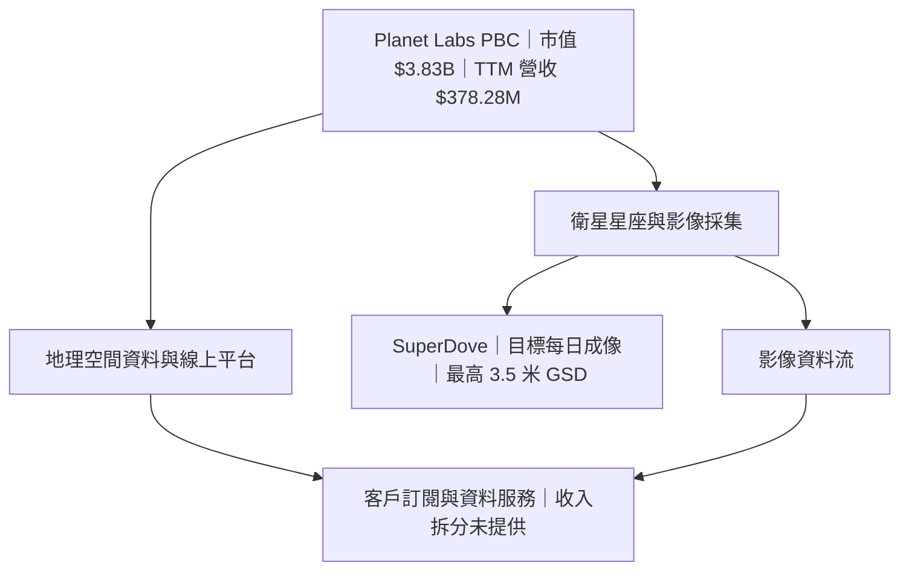
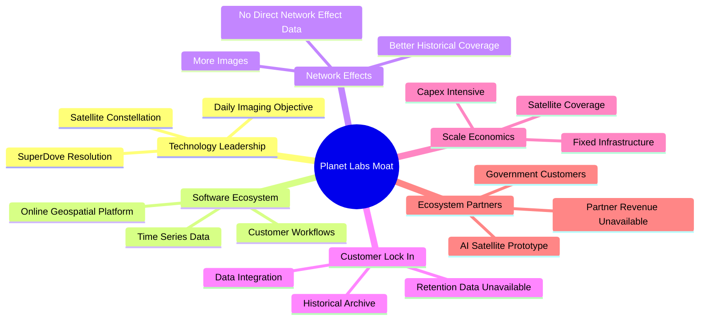
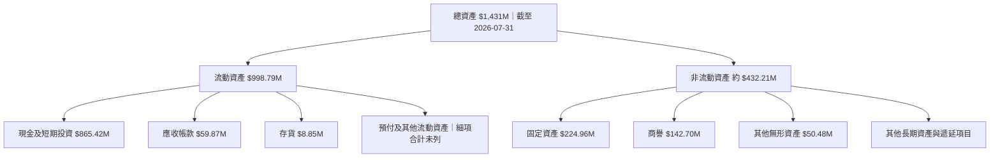
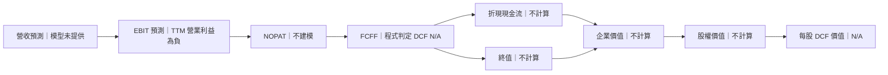
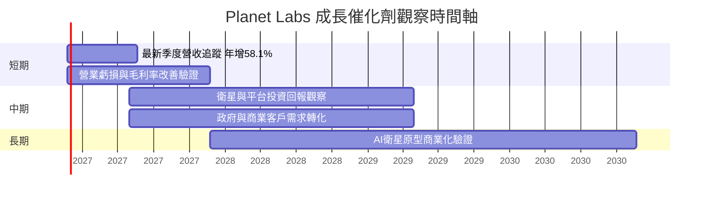
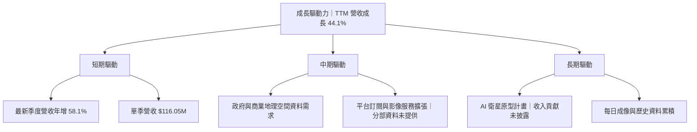
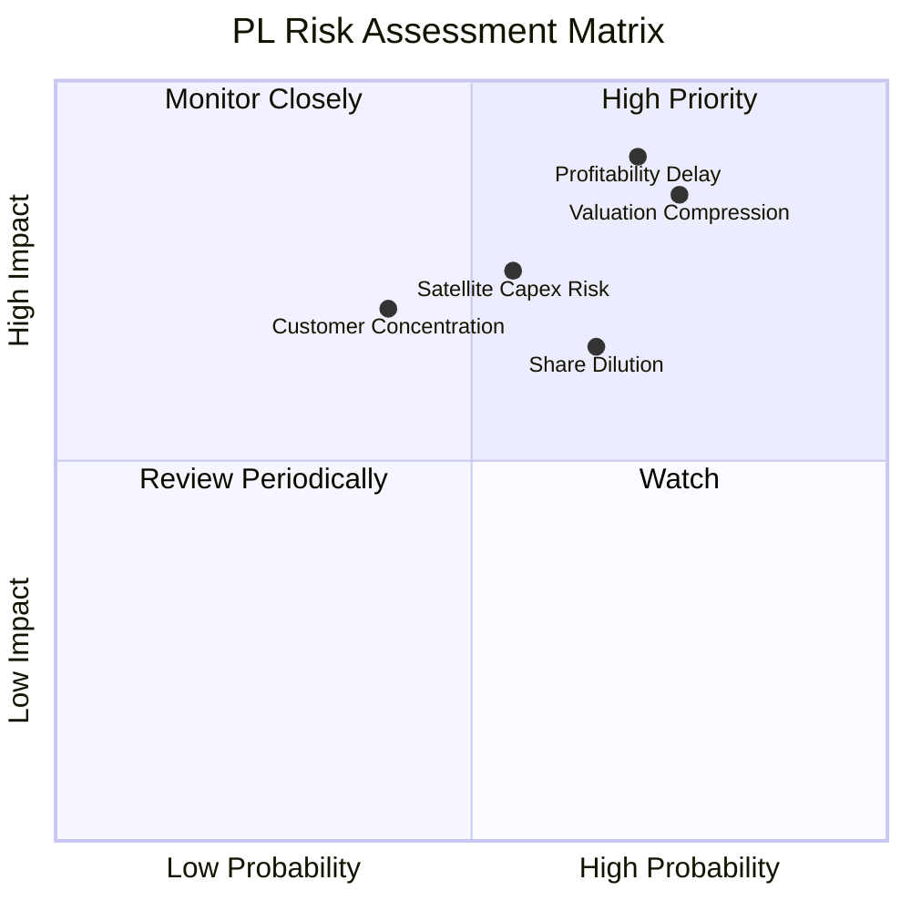
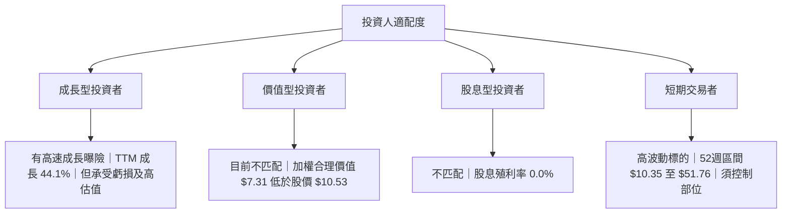

# PL 基本面深度分析報告
> **報告日期**：2026-11-22 ｜ **語言**：繁體中文 ｜ **數據來源**：SEC 申報資料 (XBRL)、Yahoo Finance、Finviz、StockAnalysis、Roic.ai ｜ **分析師**：CFA 級機構研究

## 目錄

| # | 章節 | 核心結論 |
|---|------|----------|
| 1 | 執行摘要 | 賣出；加權合理價值 $7.31，MOS -44.0% |
| 2 | 公司概覽與商業模式 | 衛星影像及地理空間資料平台具有差異化，但細分收入與市場份額未提供 |
| 3 | 損益表深度分析 | TTM 營收 $378.28M、成長 44.1%；TTM 營業利益率 -27.2% |
| 4 | 資產負債表分析 | 現金及短期投資 $865.42M；總債務資料來源不一致 |
| 5 | 現金流量深度分析 | TTM FCF $24.67M；正現金流尚未轉化為穩定營業獲利 |
| 6 | 獲利能力與資本效率 | 營業虧損代表資本報酬承壓；ROIC 精確值未提供，WACC 為 12.58% |
| 7 | 相對估值分析 | PL P/S 10.0x，高於自身五年中位數 6.9x；同業 P/S 估值差異大 |
| 8 | DCF 內在價值評估 | DCF 不適用：TTM 營業利益為負；以固定估值方法交叉驗證 |
| 9 | 成長催化劑 | 成長來自高頻衛星資料、AI 與政府需求，但 TAM 數字未提供 |
| 10 | 風險矩陣 | 估值、盈利轉正與衛星資本投入為主要風險 |
| 11 | 投資建議 | 依 MOS 規則為賣出；追蹤營收、利潤率、FCF 與稀釋 |

## 1. 執行摘要

PL 於 **2026-11-20 收盤價 $10.53**，高於程式計算的加權合理價值 **$7.31**。其加權價值由同業 P/S 法 $4.87（權重 90%）及分析師共識目標價 $29.23（權重 10%）組成；因此 **MOS = -44.0%**，依評級門檻為 **賣出**。基本面方面，TTM 營收 $378.28M、TTM 營收成長 44.1%，最新一季營收年增 58.1%，顯示需求擴張；但 TTM 營業利益率 -27.2%，Piotroski F-Score 3/8，且 DCF 因 TTM 營業虧損不適用。成長性提供長期選擇權，但目前價格已高於相對估值所支持的價值。

### 1.0 一頁式投資儀表板

| 項目 | 內容 |
|------|------|
| **投資論點（3 句）** | ① TTM 營收 $378.28M、年增 44.1%，且最新一季年增 58.1%，業務需求加速。② TTM 營業利益率 -27.2%、ROE -63.8%，擴張尚未轉化為股東獲利。③ 股價 $10.53 高於加權合理價值 $7.31，MOS -44.0%，估值風險偏高。 |
| **綜合評分** | **5.2/10**（引用 1.1 評分卡） |
| **財務健康** | 🟡 現金及短期投資 $865.42M，流動性有緩衝；但財務資料中的總債務與淨現金數字不一致。 |
| **ROIC vs WACC** | ROIC 精確值 N/A；WACC **12.58%**。營業利益為負，現階段未見創造正經濟利潤的證據。 |
| **FCF 趨勢** | 最近年度 FCF $51.41M，最新 TTM FCF **$24.67M**（採 SEC 計算口徑）；TTM FCF Yield **0.64%**。 |
| **估值** | Forward P/E -8,424.0x（負盈利，解讀意義有限）｜EV/EBITDA -71.578x｜FCF Yield 0.64%。 |
| **DCF 內在價值（基準）** | **N/A**；TTM 營業利益為負，不建立 DCF。故 DCF 折溢價亦為 N/A。 |
| **安全邊際（MOS）** | **-44.0%**＝($7.31 − $10.53) ÷ $7.31；🔴 相對加權合理價值呈溢價。 |
| **預期報酬（基準情境 12M）** | DCF 基準情境 N/A；加權合理價值相對現價的上行空間為 **-30.6%**。 |
| **關鍵風險（前二）** | 營業虧損收窄不如預期；市場估值對未來成長與利潤率改善要求過高。 |
| **評級 + 信心度** | 🔴 **賣出**｜信心：中（估值方法明確，但公司仍處於高速成長與虧損並存階段）。 |

### 1.1 綜合評分卡（全報告唯一）

| 維度 | 評分（1–10） | 主要依據（引用數字與其來源章節） |
|------|--------------|----------------------------------|
| 成長性 | 8.5 | TTM 營收年增 44.1%、最新一季年增 58.1%（第 3 章）。 |
| 獲利能力 | 2.5 | TTM 營業利益率 -27.2%、Piotroski 3/8；ROIC 精確值未提供（第 3、6 章）。 |
| 財務健康 | 7.0 | 現金及短期投資 $865.42M、流動比率 2.843；債務資料口徑不一致（第 4 章）。 |
| 估值 | 2.0 | MOS -44.0%；P/S 10.0x，高於自身五年中位數 6.9x（第 7、8 章）。 |
| 護城河 | 6.5 | 每日地球影像與資料平台構成產品差異化；但客戶集中度、續約率與分部數據未提供（第 2 章）。 |
| 管理層與資本配置 | 4.5 | FY2026 SBC $54.99M；股數未通過 Piotroski 稀釋股數測試，持續稀釋需監控（第 3、5 章）。 |
| **綜合評分** | **5.2** | 六項算術平均： (8.5 + 2.5 + 7.0 + 2.0 + 6.5 + 4.5) ÷ 6 = **5.2**。 |

### 1.2 五大投資論點 + 三大核心風險

| 類型 | 項目 | 具體依據 | 信心度 |
|------|------|----------|--------|
| 🟢 **投資論點①** | 高頻衛星影像形成差異化資料供應 | 公司以 SuperDove 衛星為核心，目標每日成像；形成時間序列資料能力，但服務品質與客戶留存率未提供。 | 🟡 中 |
| 🟢 **投資論點②** | 營收增速加快 | TTM 營收年增 44.1%；最新季度營收 $116.05M，年增 58.1%。若新增需求能被重複訂閱化，可提高收入可見度。 | 🟢 高 |
| 🟢 **投資論點③** | 毛利率提供營運槓桿基礎 | TTM 毛利率 55.5%；最新季度毛利率約 56.6%（$65.63M ÷ $116.05M）。毛利可支撐平台研發與銷售投入，但營業費用仍使公司虧損。 | 🟡 中 |
| 🟢 **投資論點④** | 流動性支持衛星與平台投入 | 現金及短期投資 $865.42M，可支撐短期投資和營運；惟資本支出 TTM 已達 $92.96M。 | 🟡 中 |
| 🟢 **投資論點⑤** | AI 與政府應用可能拓展需求 | 新聞提及參與 Project Suncatcher 衛星 AI 原型計畫；目前尚無可量化營收貢獻，宜視為選擇權而非已證實增量。 | 🟡 中 |
| 🟡 **風險①** | 估值對執行要求高 | 股價 $10.53 對應 P/S 10.0x；相對估值加權合理價值 $7.31，MOS -44.0%。 | 🔴 高 |
| 🔴 **風險②** | 虧損與股權稀釋 | TTM 營業利益率 -27.2%，Piotroski 稀釋股數測試未通過；獲利轉正若延後，資金需求可能增加。 | 🔴 高 |
| 🟡 **風險③** | 衛星資本密集及執行風險 | TTM Capex $92.96M，約為營業現金流 $117.63M 的 79.0%；發射、衛星壽命與技術迭代可能造成現金流波動。 | 🟡 中 |

### 1.3 快速統計卡片

| 指標 | 公司實際值（期間） | 同業中位數 | 狀態 |
|------|--------------------|------------|------|
| 營收成長（TTM） | **44.1%** | — | 🟢 |
| 營收成長（最新一季年增） | **58.1%** | 72.7%（SPIR、BKSY、RKLB 中位數） | 🟢 |
| 毛利率（TTM） | **55.5%** | 40.3%（SPIR）、73.4%（BKSY）、36.2%（RKLB）；中位數 40.3% | 🟢 |
| 營業利益率（TTM） | **-27.2%** | — | 🔴 |
| ROIC（TTM） | **N/A** | — | 🟡 |
| Forward P/E | **-8,424.0x** | 不適用；同業報價為 N/A 或負值/極端值 | 🔴 |
| FCF Yield（TTM） | **0.64%** | — | 🟡 |
| Piotroski F-Score | **3 / 8** | — | 🔴 |

### 1.4 投資結論

╔══════════════════════════════════════════════════════════════════╗  
║                    📊 投資結論摘要                               ║  
╠══════════════════════════════════════════════════════════════════╣  
║  評級：🔴 賣出（MOS -44.0%，依規則 20）                         ║  
║  價格（2026-11-20 收盤）：$10.53                                ║  
║  DCF 內在價值（基準）：N/A（TTM 營業利益為負）                  ║  
║  安全邊際 MOS：-44.0%（以加權合理價值 $7.31 為分母）             ║  
║  加權合理價值（8.8）：$7.31                                     ║  
║  綜合評分：5.2/10（引用 1.1）                                   ║  
║  適合投資人：能承受高波動、以多年期成長選擇權為主的投資人；      ║  
║              不適合以低估值、即期獲利或股息為核心者。            ║  
╚══════════════════════════════════════════════════════════════════╝

## 2. 公司概覽與商業模式

### 2.1 業務結構與收入來源

Planet Labs PBC 設計、建造並發射衛星星座，向客戶提供高頻地理空間影像與相關線上平台服務。公司資料只提供整體營收，沒有各產品、政府／商業客戶或軟體服務的收入拆分，因此不能合理計算業務佔比或收入金額。

### 2.2 市場份額

市場份額的可引用數字、年份與來源未提供，因此不列份額或市場佔比。相對同業，PL TTM 營收 $378.28M，單季營收年增 58.1%；其成長快於 SPIR 最新季度年增 42.1%，低於 BKSY 的 118.4% 和 RKLB 的 72.7%。但同業業務範圍並不完全相同，不能直接將增速等同於競爭份額變化。

### 2.3 競爭護城河分析

### 2.4 護城河強度

| 護城河項目 | 強度（強／中／弱） | 證據（引用數字或事實） | 會削弱它的情況 |
|------------|--------------------|------------------------|----------------|
| 技術與資料覆蓋 | 中 | 公司營運衛星星座，目標每日成像；SuperDove 最高 3.5 米 GSD。 | 衛星故障、競爭者提升解析度或重訪頻率。 |
| 軟體生態系統 | 中 | 影像以線上平台交付；平台客戶數、續約率與 ARPU 未提供。 | 客戶改用多來源資料平台或內部自建分析工具。 |
| 網路效應 | 弱至中 | 歷史影像累積可能改善時間序列分析；沒有直接網路效應或使用者數據佐證。 | 資料轉換成本低，或競爭者取得相似歷史資料。 |
| 客戶鎖定 | 中 | 地理空間資料可嵌入客戶工作流程；續約與流失率資料未提供。 | 政府預算變動、客戶集中或採購延後。 |
| 規模效應 | 中 | TTM 營收 $378.28M，單季年增 58.1%；衛星網路存在固定成本。 | Capex 長期快速上升而毛利未改善。 |
| 生態夥伴 | 弱至中 | 新聞提及 Project Suncatcher 原型合作；尚無可量化收入貢獻。 | 原型未能商業化，或合作停留於研發階段。 |

1.1「護城河」評分 6.5/10，反映衛星覆蓋與歷史資料具有差異化，但缺乏續約、客戶留存、產品拆分及單位經濟性資料驗證其防禦力。

## 3. 損益表深度分析

### 3.1 年度收入成長趨勢（近 4 年）

以下年度數據為財報年度截至 1 月 31 日；收入及 YoY 依年度損益表計算。FY2023 至 FY2026 收入 CAGR = \((307.73 ÷ 191.26)^{1/3}-1\) = **17.1%**。此年度 CAGR 低於 TTM 成長 44.1%，顯示近期增長加速，但歷史年度基數仍較低。

╔══════════════════════════════════════════════════════════════════╗  
║              Planet Labs 年度收入趨勢（FY2023–FY2026）          ║  
╠══════════════════════════════════════════════════════════════════╣  
║ FY2023  $191.26M  █████████████░░░░░░░░░░░  YoY +15.4%          ║  
║ FY2024  $220.70M  ███████████████░░░░░░░░░  YoY +15.4%          ║  
║ FY2025  $244.35M  █████████████████░░░░░░░  YoY +10.7%          ║  
║ FY2026  $307.73M  █████████████████████░░░  YoY +25.9%          ║  
╠══════════════════════════════════════════════════════════════════╣  
║ FY2023–FY2026 收入 CAGR：+17.1%                                 ║  
╚══════════════════════════════════════════════════════════════════╝

FY2026 收入增速回升至 25.9%，StockAnalysis 的 TTM 成長率為 44.1%。這可能反映新增客戶、既有訂閱擴大或合約交付節奏，但公司未提供收入分解，不能確定各項因素的具體貢獻。

### 3.2 季度收入趨勢分析

最新四季營收取季度損益表；QoQ 以相鄰季度比較，YoY 僅在有可比去年同期數字時列示。

| 季度 | 營收 | QoQ 成長 | YoY 成長 | 備註 |
|------|------|----------|----------|------|
| 2025-10-31 | $81.25M | +27.8% | N/A | QoQ 對比 2025-07-31 的 $63.60M；該季度數字來自 StockAnalysis。 |
| 2026-01-31 | $86.82M | +6.9% | +41.1% | 對比 2025-01-31 的 $61.55M。 |
| 2026-04-30 | $94.15M | +8.4% | +42.1% | 對比 2025-04-30 的 $66.27M。 |
| 2026-07-31 | $116.05M | +23.3% | +58.1% | 對比 2025-07-31 的 $73.39M；最新一季增長加速。 |

> 備註：季度歷史序列來源間存在差異；例如部分表格列示的 2025-07-31 營收為 $73.39M，而其他摘要未完整列示同一序列。最新季度 $116.05M、最新季度年增 58.1% 採用明確標示的最新季度資料。

最近四季營收由 $81.25M 增至 $116.05M，增幅為 \((116.05 ÷ 81.25)-1\) = **42.8%**。最新季度 QoQ 加速至 23.3%，但單季季節性、合約認列時點及客戶交付節奏可能影響比較，不能直接年化。

### 3.3 利潤率演變分析

| 利潤率指標 | FY2023 | FY2024 | FY2025 | FY2026 | 趨勢 | 評估 |
|------------|--------|--------|--------|--------|------|------|
| **毛利率** | 49.2% | 51.2% | 57.2% | 56.0% | FY2025 擴張後 FY2026 微降 | 🟡 |
| **營業利益率** | -91.8% | -75.8% | -45.5% | -30.9% | 虧損率持續收斂 | 🟡 |
| **淨利率** | -84.7% | -63.7% | -50.4% | -80.2% | FY2026 明顯惡化 | 🔴 |

年度毛利率以年度毛利除以營收計算；營業及淨利率亦依年度損益表計算。FY2026 淨利率因淨損 $246.86M 大幅高於營業虧損 $95.07M 而惡化，顯示非營業項目、估值／一次性項目或稅項可能造成差異；所給資料沒有完整附註，不能將淨損擴大歸因於單一項目。

TTM 利潤率採 VERIFIED FIGURES：毛利率 55.5%、營業利益率 -27.2%、淨利率 -95.1%。另有其他摘要列示最新季度營業利益率 -22.7%，但 SEC 計算區塊列示最新季度 -11.6%；兩者口徑衝突，本報告在需要引用「最新季度營業利益率」時採用 SEC 計算區塊的 -11.6%，不混用其他來源的 -22.7%。

利潤率改善的主要已知特徵是年度營收上升、毛利率較 FY2023 提高；這與固定成本攤薄相容，但費用明細不足以確認規模效應的具體來源。營業利益率仍為負，表示毛利擴張尚不足以覆蓋研發、銷售及管理費用。

### 3.4 費用結構分析

沒有完整、同口徑的營業費用明細可供拆分，因此不繪製費用結構圓餅圖。FY2026 年度資料列示 R&D $106.75M、營業損失 $95.07M；但銷售、一般行政、折舊攤銷及其他項目拆分不完整，不能把剩餘額反推成未披露費用。

### 3.5 季度 EPS 趨勢與盈餘品質（Quality of Earnings）

| 季度 | EPS 實際值 | EPS 預估 | 超預期／不及預期 |
|------|------------|----------|----------------|
| 2026-07-31 | -$0.03 | N/A | N/A：預估資料缺失 |
| 2026-04-30 | -$0.40 | N/A | N/A：預估資料缺失 |
| 2026-01-31 | -$0.48 | N/A | N/A：預估資料缺失 |
| 2025-10-31 | -$0.19 | N/A | N/A：預估資料缺失 |

目前提供的歷史 EPS 驚喜表中估計值均為 NaN，因此不能判定四季是超預期或不及預期。單季淨利分別為 -$9.35M、-$138.87M、-$152.46M、-$59.19M；2026-07-31 季度淨損顯著縮小，但其能否持續需觀察後續季度。

| 盈餘品質項目 | 數值/佔比 | 評估 |
|--------------|-----------|------|
| 股權薪酬 SBC / 營收 | FY2026：$54.99M ÷ $307.73M = **17.9%** | 🔴 比重高；形成對現有股東的經濟稀釋成本。 |
| SBC / 營業現金流 | FY2026：$54.99M ÷ $134.36M = **40.9%** | 🟡 SBC 顯著高於純粹非現金項目可忽略的程度。 |
| FCF / 淨利（現金轉換率） | N/A（TTM 淨利數據口徑衝突，且淨利為負） | 🔴 負淨利時比率解讀有限；不能以正 FCF 認定盈利品質已成熟。 |
| 一次性／非經常性損益 | FY2026 淨損 -$246.86M，營業損失 -$95.07M；細項 N/A | 🟡 淨損與營業損失差額大，需查閱 10-K 附註確認非營業項目。 |
| 有效稅率異常 | N/A | 🟡 稅前損益與所得稅附註未完整提供，無法量化判斷。 |
| 資本化支出 vs 費用化 | TTM Capex $92.96M；資本化政策細節 N/A | 🟡 衛星投資資本密集；資本化可能令當期損益與現金支出時點不同。 |

**盈餘品質結論**：PL 仍處於虧損期，GAAP 獲利尚未形成可持續基礎。TTM FCF 為正，但 FY2026 SBC 佔營收 17.9%，且最新 FCF 對淨利轉換率無法有效解讀。對估值而言，應以可持續現金流、稀釋後每股價值及營業虧損收斂為核心，而非單看營收增速或單季淨損改善。

## 4. 資產負債表分析

### 4.1 資產結構分解

截至 2026-07-31，StockAnalysis 列示總資產 $1,431M；其中流動資產 $998.79M，固定資產及其他非流動資產合計約 $432.21M（總資產減流動資產）。此處只展示提供的科目，不能視為完整會計分類細項。

### 4.2 流動性與營運資金分析

流動比率及速動比率來自財務摘要；營運資金天數則照抄 SEC 財報及 Yahoo 季度資產負債表計算的品質指標。兩來源期點或定義可能不同，應以最新申報表核對。

| 指標 | 最新 TTM | 一年前 TTM | 變化 | 解讀 |
|------|----------|------------|------|------|
| DSO 應收帳款天數 | 58 天 | 72 天 | -14 天 | 收款週期縮短，通常有利營運現金回收；仍需留意合約付款條件變化。 |
| DIO 存貨天數 | 19 天 | N/A | N/A | 一年前未提供存貨，不能推算趨勢。 |
| DPO 應付帳款天數 | 22 天 | 37 天 | -15 天 | 付款速度加快，可能減少供應商融資；資料不足以判斷是供應商條款改變或採購結構變化。 |
| CCC 現金轉換週期 | 55 天 | N/A | N/A | 一年前 CCC 無法計算，不能作年度比較。 |

| 流動性指標 | 數值 | 評估 |
|------------|------|------|
| 流動比率 | 2.843 | 🟢 短期流動資產對流動負債有緩衝。 |
| 速動比率 | 2.634 | 🟢 剔除存貨後仍具流動性。 |
| 現金及短期投資 | $865.42M | 🟢 可支援營運與衛星投入，但需與負債口徑及現金消耗一併追蹤。 |

### 4.3 債務結構分析

SEC 計算區塊列示總債務 N/A，淨現金 $865.42M；財務資料其他摘要則列示總債務 $498.62M、淨現金 $366.79M。因來源定義及期點衝突，本報告按規則優先採用 SEC VERIFIED FIGURES 的債務欄位，並將公司總債務標示為 N/A；不以其他來源數字替換或混算。

╔══════════════════════════════════════════════════════════════════╗  
║                   Planet Labs 債務健康診斷                      ║  
╠══════════════════════════════════════════════════════════════════╣  
║  總債務：        N/A（SEC 計算欄位未提供）                      ║  
║  總現金+投資：   $865.42M                                         ║  
║  淨現金：        $865.42M（依 SEC 計算口徑）                    ║  
║  Debt/EBITDA：   N/A（債務口徑及 EBITDA 為負）                   ║  
║  Interest Coverage：N/A（營業利益為負，利息費用資料不足）         ║  
║  流動比率：      2.843                                             ║  
╚══════════════════════════════════════════════════════════════════╝

### 4.4 股東權益趨勢

年度股東權益由 FY2023 $576.10M 降至 FY2026 $188.43M；FY2026 資產負債表亦列總負債上升至 $957.25M。資料沒有提供完整權益變動表及融資交易拆解，不宜把權益下降全部歸因於單一因素。

╔══════════════════════════════════════════════════════════════════╗  
║              股東權益趨勢（財報年度截至 1 月 31 日）            ║  
╠══════════════════════════════════════════════════════════════════╣  
║ FY2023  $576.10M  ████████████████████████                      ║  
║ FY2024  $518.02M  ██████████████████████                        ║  
║ FY2025  $441.29M  ███████████████████                           ║  
║ FY2026  $188.43M  ████████                                      ║  
╚══════════════════════════════════════════════════════════════════╝

## 5. 現金流量深度分析

### 5.1 現金流量瀑布圖

TTM 淨利資料來源口徑有衝突，圖中不填入推算淨利；股息、回購及淨現金變化資料亦未提供，故相關節點標為未披露。

### 5.2 FCF 轉換率趨勢

| 財報年度 | 營業現金流 | Capex | FCF | 淨利 | FCF / 淨利 |
|---------|-----------:|------:|----:|-----:|------------|
| FY2023 | -$73.93M | $12.76M | -$86.69M | -$161.97M | 53.5%* |
| FY2024 | -$50.71M | $42.41M | -$93.12M | -$140.51M | 66.3%* |
| FY2025 | -$14.37M | $54.40M | -$68.78M | -$123.20M | 55.8%* |
| FY2026 | $134.36M | $82.95M | $51.41M | -$246.86M | -20.8%* |

\* FCF 與淨利同為負時，比率僅是算術結果，不代表通常意義上的正向盈餘轉換。FY2026 FCF 轉正，但淨損擴大，顯示現金流改善未等同會計獲利改善。

### 5.3 自由現金流趨勢

年度 FCF 取年度現金流量表；最新 TTM FCF 則依規則採 SEC 計算值 $24.67M。年度與 TTM 口徑不同，不應將兩者視作同一期間趨勢的連續點。

╔══════════════════════════════════════════════════════════════════╗  
║                FCF 趨勢（年度實際與最新 TTM）                   ║  
╠══════════════════════════════════════════════════════════════════╣  
║ FY2023  -$86.69M  ◀█████████████████░░░░░░░░░░░                ║  
║ FY2024  -$93.12M  ◀██████████████████░░░░░░░░                  ║  
║ FY2025  -$68.78M  ◀█████████████░░░░░░░░░░░░░                  ║  
║ FY2026   $51.41M  ██████████░░░░░░░░░░░░░░░░                   ║  
║ 最新 TTM $24.67M  █████░░░░░░░░░░░░░░░░░░░░░                   ║  
╠══════════════════════════════════════════════════════════════════╣  
║ TTM FCF Yield：0.64%（SEC 計算口徑）                            ║  
╚══════════════════════════════════════════════════════════════════╝

其他彙總資料列示 TTM FCF $18.78M、FCF Yield 0.49%，與 SEC 計算區塊的 $24.67M、0.64% 不一致。本報告依 VERIFIED FIGURES 優先原則採用 $24.67M 與 0.64%；此差異需在後續財報中核對資本支出分類及期間。

### 5.4 資本配置評估

回購、股息及各類投資支出完整拆分未提供，不繪製資本配置比例圓餅圖。已知 FY2026 SBC $54.99M；年度 Capex $82.95M；最新 TTM Capex $92.96M。這些數字反映公司需持續投入衛星與平台，同時股權薪酬可能造成稀釋。

| 資本配置項目 | 可引用數據 | 評估 |
|--------------|------------|------|
| 衛星與其他資本支出 | FY2026 $82.95M；TTM $92.96M | 投資需求高，回報須以後續營收與毛利擴張驗證。 |
| 股權薪酬 | FY2026 $54.99M | 對股東有稀釋成本；約佔 FY2026 營收 17.9%。 |
| 股息 | 殖利率 0.0% | 無現金股息回報。 |
| 回購 | N/A | 資料未提供，亦無法確認是否抵銷股權稀釋。 |
| 留存現金 | 現金及短期投資 $865.42M | 提供投資彈性，但用途與最低營運現金需求未披露。 |

## 6. 獲利能力與資本效率

### 6.1 ROE / ROA / ROIC 趨勢

| 指標 | 最新數值 | 歷史趨勢／限制 | 評估 |
|------|----------|----------------|------|
| ROE（TTM） | -63.8%（QUALITY FIGURES） | 其他摘要列示 -72.0%，來源口徑不一致 | 🔴 負淨利使股東報酬為負。 |
| ROA（TTM） | -5.0%（財務摘要） | Piotroski 測試顯示 ROA 未轉正，且未高於一年前 | 🔴 資產尚未創造正會計報酬。 |
| ROIC（TTM） | N/A | ROIC.AI 歷史 ROIC 指標為缺值 | 🔴 無法給精確 ROIC；營業利益為負表示投資資本回報承壓。 |
| WACC | 12.58% | 成本資本資料區塊提供 | 作為資本成本比較基準。 |

未提供可直接比較的行業均值，因此不列行業均值欄。由於 ROIC 精確值缺漏，不把 ROE 或營業利潤率代替 ROIC。

### 6.2 ROIC vs WACC 分析（核心價值創造判斷）

公司成本資本資料列示 WACC 12.58%。ROIC 未提供精確值，因此不能計算正式 EVA；不過 TTM 營業利益率 -27.2%、ROA -5.0%及 ROE -63.8%均指向目前經濟回報承壓，而非已證實超越資本成本。

╔══════════════════════════════════════════════════════════════════╗  
║                ROIC vs WACC 深度分析                            ║  
╠══════════════════════════════════════════════════════════════════╣  
║  WACC（採用成本資本資料區塊數值）：12.58%                        ║  
║  ├── 無風險利率：4.91%                                           ║  
║  ├── ERP：5.00%                                                  ║  
║  ├── Beta 原始值：2.27；採用調整後 Beta：1.85                   ║  
║  ├── 股權成本：14.15%                                            ║  
║  ├── 稅前債務成本：0.69%；稅率：21.0%                            ║  
║  ├── 資本權重：股權 88.5%；債務 11.5%                            ║  
║  └── WACC：12.58%                                                ║  
║                                                                  ║  
║  ROIC（TTM）：N/A（未提供可核實數值）                             ║  
║  可見獲利證據：營業利益率 -27.2%；ROA -5.0%；ROE -63.8%          ║  
║  EVA：N/A（ROIC 缺值，不能計算 ROIC − WACC）                     ║  
║                                                                  ║  
║  判斷：目前沒有證據證明 PL 已創造高於 WACC 的資本報酬；           ║  
║        營業虧損與負 ROA 顯示股東價值創造尚待驗證。                ║  
╚══════════════════════════════════════════════════════════════════╝

> 成本資本資料區塊的 CAPM 數值為股權成本 14.15%。以顯示至小數兩位的原始資料手算 \(4.91\% + 1.85 \times 5.00\%\) 會得到 14.16%，屬於未四捨五入底層資料造成的尾差；本節及第 8 章採用成本資本資料區塊給定的 14.15% 與 WACC 12.58%，不另建 WACC。

### 6.3 杜邦三因素分解

| 因素 | 數值（TTM） | 解讀 |
|------|-------------|------|
| 淨利率 | -95.1% | 淨損相對營收偏高，為 ROE 負值的主要來源。 |
| 資產週轉率 | 0.26 | 每單位資產產生的營收有限，反映資產密集型營運。 |
| 權益乘數 | 2.54 | 有槓桿效果，但無法抵銷負淨利率。 |
| **ROE** | **-63.8%** | QUALITY FIGURES 原值：-95.1% × 0.26 × 2.54 = -63.8%。 |

ROE 的主要負面驅動因素是 -95.1% 的淨利率，而非單靠權益乘數變化；因此改善 ROE 的首要條件是控制營業費用及提升盈利，而不是增加槓桿。

### 6.4 財務體質：Piotroski F-Score

Piotroski F-Score 為 **3/8**。依品質指標原值，缺少一項負債趨勢輸入，因此可判定測試分母為 8，而不是 9。

| 測試 | 結果 | 解讀 |
|------|------|------|
| ROA > 0 | ❌ 未通過 | 資產仍未產生正報酬。 |
| 營業現金流 > 0 | ✅ 通過 | TTM 營業現金流 $117.63M。 |
| ROA 高於一年前 | ❌ 未通過 | 資產獲利改善尚未確認。 |
| 營業現金流 > 淨利（應計品質） | ✅ 通過 | 現金流相對會計盈餘較佳；公司仍處於虧損階段，解讀應謹慎。 |
| 長期負債 ÷ 總資產低於一年前 | — 無法判定 | 缺少測試所需資料。 |
| 流動比率高於一年前 | ✅ 通過 | 流動性測試改善。 |
| 稀釋股數未增加 | ❌ 未通過 | 股數增加，對每股價值構成稀釋。 |
| 毛利率高於一年前 | ❌ 未通過 | 同比毛利率測試未通過。 |
| 資產週轉率高於一年前 | ❌ 未通過 | 資產效率改善未確認。 |

## 7. 相對估值分析

### 7.1 同業估值比較表格

以下同業倍數採 Yahoo Finance Peer multiples 區塊原值。PL 公司估值採財務摘要中的倍數；Forward P/E 為負數且極端，對虧損公司可比性低。SPIR、BKSY、RKLB 與 PL 均有地理空間或太空產業關聯，但商業模式與成熟度並不完全相同。

| 估值指標 | **PL** | **SPIR** | **BKSY** | **RKLB** | PL 評估 |
|----------|-------:|--------:|--------:|--------:|-----------|
| **Trailing P/E** | N/A | N/A | N/A | N/A | 🔴 均為虧損或未提供，不適合以 P/E 判斷。 |
| **Forward P/E** | -8,424.0x | -16.5x | -58.5x | 634.5x | 🔴 PL 預估 EPS 接近零且為負，倍數不具穩定解讀性。 |
| **P/S Ratio** | 10.0x | 4.3x | 5.1x | 34.7x | 🔴 PL 高於 SPIR、BKSY，但低於成長溢價較高的 RKLB。 |
| **EV/EBITDA** | -71.578x | -3.3x | 607.6x | -140.9x | 🟡 多數公司 EBITDA 為負或接近零，倍數解讀失真。 |
| **最新季度營收年增** | 58.1% | 42.1% | 118.4% | 72.7% | 🟢 PL 增速高於 SPIR，低於 BKSY、RKLB。 |
| **毛利率（TTM）** | 55.5% | 40.3% | 73.4% | 36.2% | 🟢 PL 高於 SPIR、RKLB，低於 BKSY。 |

同業中位數 P/S（SPIR 4.3x、BKSY 5.1x）為 4.7x，估值方法區塊採用的精確計算值為 4.87 美元每股，兩者屬不同呈現精度／計算口徑，估值橋接必須照抄指定的 4.87 美元。

### 7.2 歷史估值區間分析

╔══════════════════════════════════════════════════════════════════╗  
║              PL 自身五年 P/S 歷史區間                           ║  
╠══════════════════════════════════════════════════════════════════╣  
║ 五年低位：2.1x    中位數：6.9x    高位：38.1x                   ║  
║ 目前 P/S：10.0x   歷史百分位：79%                               ║  
║ 目前位置：高於自身中位數約 45%；位於歷史估值區間偏高段。        ║  
╚══════════════════════════════════════════════════════════════════╝

目前 P/S 10.0x 相對歷史中位數 6.9x 的溢價為 \((10.0 ÷ 6.9)-1\) = **44.9%**。百分位 79% 表示目前估值高於自身歷史分布的多數觀察值，但估值區間極寬，單靠歷史百分位不能判斷股價必然回歸中位數。

### 7.3 情境價值（Bear / Base / Bull）

**N/A（DCF 無法計算：TTM 營業利益為負，程式未產生 DCF MODEL Scenarios）。**依規則不自建三情境目標價。

### 7.4 相對估值隱含價格區間

╔══════════════════════════════════════════════════════════════════╗  
║              相對估值與股價位置（每股美元）                     ║  
╠══════════════════════════════════════════════════════════════════╣  
║ 同業 P/S：$4.87 ─────── 現價：$10.53 ─────── 分析師共識：$29.23 ║  
║   同業 P/S 權重 90%                         共識權重 10%         ║  
║  加權合理價值：$7.31                                          ║  
╚══════════════════════════════════════════════════════════════════╝

| 方法 | 每股價值 | 依據 |
|------|---------:|------|
| 同業 P/S | $4.87 | 同業 P/S 中位數法，SPIR、BKSY 之中位數倍數 × PL TTM 營收，估值方法區塊給定每股價值。 |
| 分析師共識目標價 | $29.23 | 12 位分析師平均目標價；低端 $17、高端 $50。 |
| 同業 Forward P/E | 不計算 | 不可計算，因此權重不納入，並由其餘方法按固定規則分配。 |

## 8. DCF 內在價值評估（Discounted Cash Flow）

### 8.0 估值推理鏈（Thinking Logic）

**本節先作適用性判斷：** TTM 營業利益率 -27.2%，TTM 營業利益為負；因此沒有適合由現有營業利潤起算並可稽核的 DCF MODEL。依規則不自行假設預測年數、利潤率、終值或股數，也不編造 DCF 每股價值。

**Step 1 — 價值來源與主導變數**

PL 的長期價值主要取決於現有衛星影像與資料平台收入能否持續成長，以及營收成長能否轉化為正營業利潤與自由現金流。公司沒有提供各產品收入佔比，因此主業、平台服務或新業務的營收比例均為 **N/A**；現階段對估值最重要的可驗證變數是**營業利潤率能否由目前負值持續收斂並轉正**。

**Step 2 — 模型選擇**

| 決策點 | 本報告採用 | 理由（含數字） | 曾考慮但否決 | 否決理由 |
|--------|-----------|----------------|--------------|----------|
| 現金流定義 | FCFF（若適用） | 公司仍有融資與投資需求，理論上 FCFF 可用 WACC 折現。 | FCFE | 融資及負債口徑資料不一致。 |
| 預測期 N | N/A | DCF MODEL 未提供預測期。 | 自行採用 5 年或 10 年 | 缺少正營業利潤起點，且不可自建模型。 |
| 終值方法 | N/A | DCF MODEL 未提供終值。 | Gordon Growth、退出倍數 | 缺少可靠預測現金流與模型輸入。 |
| EBIT 基礎 | N/A | 目前 TTM 營業利益為負，程式判定 DCF 不適用。 | 自行假設非 GAAP EBIT | 會增加不可驗證假設。 |

**Step 3 — 關鍵假設推導鏈**

- 營收 CAGR：N/A；資料提供 TTM 成長 44.1%與最新季度年增 58.1%，但沒有 DCF 模型假設值。不得把單季增速直接外推為多年 CAGR。
- 期末營業利潤率：N/A；目前 TTM 營業利益率 -27.2%，不能在未有模型依據時假設轉正。
- WACC：採用成本資本資料區塊的 **12.58%**；推導組成列於 8.2。
- SBC 處理、Capex、稀釋股數、永續成長率及終值方法：N/A；因官方 DCF MODEL 未生成，不補入自建值。

**Step 4 — 最脆弱環節**

最脆弱的環節是虧損收斂速度與未來資本支出需求；若營業虧損率無法收斂、或衛星投資長期高於可支撐的現金流，DCF 可支持的價值將下修。由於程式未提供 DCF 敏感度，不能量化下修幅度。

**Step 5 — 計算路徑圖**

下圖為 DCF 一般計算關係，不含 PL 自行估算數字；本案在起點營業利益為負時停止估值。

### 8.1 模型假設總表（Model Inputs）

**DCF MODEL：N/A——TTM 營業利益不為正；以負營業利益折現不能提供可靠估值。**依規則不另建 DCF，因此不列自行假設的預測期、營收 CAGR、利潤率、稅率、Capex、D&A、營運資金、SBC、稀釋率或終值。

FCFF 在此不實際建模；不可用 TTM 正 FCF 代替 DCF 的逐年 FCFF 預測，因營業獲利、資本支出及未來增長假設不足。

### 8.2 折現率推導（WACC）

本報告 WACC 直接採用成本資本資料區塊的 **12.58%**，不另行建立不同 WACC。Beta 採調整後 1.85；原始 Beta 為 2.27，調整方式為 \(⅔ × 2.27 + ⅓\)，成本資本區塊已給出調整後值。

╔══════════════════════════════════════════════════════════════════╗  
║                    WACC（折現率）資料                           ║  
╠══════════════════════════════════════════════════════════════════╣  
║  無風險利率 Rf（10Y 美債）：4.91%                                ║  
║  市場風險溢酬 ERP：5.00%                                          ║  
║  Beta 原始值：2.27；採用調整後 Beta：1.85                       ║  
║  股權成本 Ke：14.15%（成本資本資料區塊原值）                    ║  
║  稅前債務成本 Kd：0.69%                                          ║  
║  稅率：21.0%                                                      ║  
║  股權／債務權重：88.5%／11.5%                                    ║  
║  WACC：12.58%（成本資本資料區塊原值）                            ║  
╚══════════════════════════════════════════════════════════════════╝

可檢核的組合算式為：

1. **Ke**：\(4.91\% + 1.85 × 5.00\% = 14.16\%\)（使用已顯示至兩位小數的輸入；底層未四捨五入值造成與區塊 Ke 14.15% 的 0.01 個百分點尾差）。
2. **稅前 Kd**：成本資本區塊直接列示 **0.69%**；利息費用及平均計息負債的同範圍明細未提供，故不另行反推。
3. **稅後 Kd**：\(0.69\% × (1-21.0\%) = 0.5451\%\)，按小數一位呈現為 0.5%。
4. **權重**：股權 88.5% + 債務 11.5% = **100.0%**；E、D 的原始市值與計息負債組成未提供，直接採用資料區塊的權重。
5. **WACC**：以區塊所示輸入檢核：\(88.5\% × 14.15\% + 11.5\% × [0.69\% × (1-21.0\%)] = 12.58545\%\)，四捨五入為 **12.58%**。本報告統一使用資料區塊原值 12.58%。

Rf 的具體觀察日期未提供，ERP 為假設輸入；Beta 來源為 Yahoo Finance。利息費用及債務餘額明細不足，故不聲稱已獨立重建所有成本資本輸入。第 6.2 節使用同一 WACC 12.58%。

### 8.3 逐年自由現金流預測（基準情境）

**N/A（DCF MODEL 未提供逐年模型；原因：TTM 營業利益為負）。**因此無法列示 FY+1 至 FY+N 的年度營收、利潤率、NOPAT、Capex、折舊、ΔWC、FCFF、折現因子或現值，也不提供逐年加總算式。

### 8.4 終值計算（Terminal Value）

**N/A（DCF MODEL 未提供終值及永續成長率）。**由於沒有模型 WACC 與 g 的組合，不能執行 \(WACC>g\) 適用性判斷，也不計算 Gordon Growth 或退出倍數終值。

### 8.5 企業價值 → 每股內在價值（Bridge）

╔══════════════════════════════════════════════════════════════════╗  
║              企業價值 → 每股內在價值 橋接表                      ║  
╠══════════════════════════════════════════════════════════════════╣  
║  預測期 FCF 現值合計            N/A                              ║  
║  終值現值 PV(TV)                N/A                              ║  
║  企業價值 EV                    N/A                              ║  
║  現金及短期投資                 N/A（DCF 橋接未建立）             ║  
║  總債務                         N/A（SEC 計算口徑未提供）         ║  
║  股權價值                       N/A                              ║  
║  稀釋後流通股數                 N/A（DCF MODEL 未提供）           ║  
║  ★ 每股 DCF 內在價值            N/A                              ║  
║  當前股價（2026-11-20）         $10.53                           ║  
║  DCF 折溢價                     N/A                              ║  
║  本節不計算 MOS                 MOS 僅依 8.8 加權合理價值計算      ║  
╚══════════════════════════════════════════════════════════════════╝

### 8.6 敏感性分析（WACC × 永續成長率）

**N/A（DCF MODEL 未提供敏感度矩陣）。**沒有模型基準 FCFF、WACC 與永續成長率，因此不自行建造敏感度矩陣、三情境或機率加權估值。

### 8.7 反推 DCF（Reverse DCF）

**N/A（DCF MODEL 未提供反推結果）。**單一股價方程式不能同時解出多個未知數；且本案沒有可供固定的基準營收 CAGR、營業利潤率、預測期與終值假設，故不反推市場隱含營運條件。

### 8.8 估值三角驗證與安全邊際

| 估值方法 | 隱含每股價值 | 上行空間（÷現價） | 權重 | 說明 |
|----------|--------------|-------------------|------|------|
| 同業 P/S | $4.87 | -53.8% | 90% | Peer 中位數 P/S 方法，估值方法區塊指定每股值；用於虧損公司相對估值。 |
| 分析師共識目標價 | $29.23 | +177.6% | 10% | 12 位分析師平均目標價；權重較低，避免共識值主導估值。 |
| **加權合理價值** | **$7.31** | **-30.6%** | **100%** | 不可計算的同業 Forward P/E 不納入，權重由剩餘方法按固定規則分配。 |

逐步演算：

\[
\text{加權合理價值}
= \$4.87 × 90\% + \$29.23 × 10\%
= \$4.383 + \$2.923
= \$7.306
\approx \mathbf{\$7.31}
\]

中間值 $7.306 四捨五入至美分為 $7.31；權重合計 90% + 10% = 100%。公司類型為未獲利公司，權重依該類型固定；Forward P/E 不可計算，故不列入。

\[
MOS = (加權合理價值-現價)÷加權合理價值
= (\$7.31-\$10.53)÷\$7.31
= -\$3.22÷\$7.31
= -44.0\%
\]

\[
上行空間=(\$7.31-\$10.53)÷\$10.53
=-\$3.22÷\$10.53
=-30.6\%
\]

\[
折溢價_{\text{相對 DCF}}=N/A
\]

DCF 基準價值未提供，故不能計算現價相對 DCF 的折溢價。以下 MOS 評估以 8.8 加權合理價值為唯一基準：

╔══════════════════════════════════════════════════════════════════╗  
║                  估值區間與安全邊際                              ║  
╠══════════════════════════════════════════════════════════════════╣  
║  同業 P/S $4.87 ── 加權合理值 $7.31 ── 現價 $10.53              ║  
║                                                                  ║  
║  安全邊際 MOS = ($7.31 − $10.53) ÷ $7.31 = -44.0%              ║  
║  MOS 評估：🔴 負安全邊際；現價高於加權合理價值                  ║  
║  上行空間 = ($7.31 − $10.53) ÷ $10.53 = -30.6%                 ║  
║  DCF 估值與情境區間：N/A                                         ║  
╚══════════════════════════════════════════════════════════════════╝

> 🔎 **程式複算（Python，依本節各項自動重算）**
>
> 加權合理價值 = $4.87 × 90% + $29.23 × 10% = **$7.31**（權重合計 100%）
>
> 以價格 $10.53 計：MOS = **-44.0%**，上行空間 = **-30.6%**
>
> ✅ 與本節所寫數值一致。

### 8.9 DCF 模型的局限與失效條件

- **終值依賴度**：N/A，DCF MODEL 未建立，不能計算終值佔 EV 比重。
- **最脆弱假設**：若未來營收增長未轉化為利潤率改善，或 Capex 長期維持高位，DCF 估值將下修；因沒有模型數字，無法量化到特定每股價。
- **不適用情境說明**：公司 TTM 營業利益為負，且仍有衛星與平台再投資需求，DCF 可靠度低。現階段應輔以 EV/Sales、同業 P/S、毛利與單位經濟性資料；當營業利益轉正並有穩定現金流後，再考慮 DCF。
- **與第 10 章連結**：營收放緩、毛利率下滑、Capex 上升及稀釋加劇，分別影響收入、營業利潤、FCF 與每股價值。

### 8.10 複算檢核表（Audit Trail）

| # | 檢核項目 | 檢查方式 | 結果 |
|---|----------|----------|------|
| 1 | 高／中敏感度 DCF 輸入均有推導 | DCF MODEL 為 N/A，未列模型假設 | ✅ |
| 2 | 每個採用假設有來歷 | WACC 直接引用成本資本資料區塊；無自建 DCF 輸入 | ✅ |
| 3 | WACC 五步算式與權重 | 權重 88.5% + 11.5% = 100%；四捨五入後 WACC 12.58% | ✅ |
| 4 | Kd 分母與 D 權重範圍一致 | 明細未提供，採用成本資本區塊原值，不宣稱獨立驗證 | ⚠️ 資料限制已揭露 |
| 5 | WACC 與第 6.2 節相同 | 兩處均為 12.58% | ✅ |
| 6 | 預測年度符合 N 且無省略 | N 未提供，因此未列逐年表 | ✅ 不適用 |
| 7 | FY+1 九步算式可複算 | 沒有模型輸入，未作逐年演算 | ✅ 不適用 |
| 8 | 預測期 PV 加總 | DCF MODEL 未提供 | ✅ 不適用 |
| 9 | WACC > g | g 未提供 | ✅ 不適用 |
| 10 | 終值以 FY+N 現金流折現 | DCF MODEL 未提供 | ✅ 不適用 |
| 11 | EV 至每股價值橋接 | DCF 橋接 N/A；沒有跳步或自建數字 | ✅ |
| 12 | SBC 處理三要素相容 | DCF MODEL 未提供組合，不自行聲稱採用 A/B/C | ✅ 不適用 |
| 13 | 矩陣基準格與 DCF 基準價一致 | 敏感度矩陣未提供 | ✅ 不適用 |
| 14 | 敏感度矩陣有效格 | 敏感度矩陣未提供 | ✅ 不適用 |
| 15 | 三情境機率合計 | Scenarios 未提供 | ✅ 不適用 |
| 16 | 反推 DCF 一次只解一個變數 | Reverse DCF 未提供，未自行反推 | ✅ |
| 17 | MOS 及折溢價基準一致 | MOS 以 8.8 加權價值計算；DCF 折溢價 N/A | ✅ |
| 18 | 報告完整至第 11 章 | 章節 1–11 均列示 | ✅ |
| 19 | 加權合理價值可複算 | $4.87×90%+$29.23×10%=$7.306≈$7.31 | ✅ |
| 20 | 評級符合 MOS 門檻 | MOS -44.0% < -25%，評級為賣出 | ✅ |

> DCF 輸入不足的檢核項目以「不適用」處理，而非填入假設數字；Kd、負債與資本結構的底層明細不足，已在 8.2 明確揭露，WACC 仍依指定區塊原值使用。

## 9. 成長催化劑

### 9.1 催化劑時間軸

具體商業化時點未提供，以下按觀察期限分類，不把未披露日期寫成確定里程碑。

### 9.2 TAM 市場規模分析

**N/A（TAM 數據未提供可引用的來源與年份）。**目前已知 TTM 營收為 $378.28M、TTM 成長 44.1%，最新季度年增 58.1%，表明公司正處於擴張期。市場規模與滲透率未量化，因此不以新聞標題中的市場數字代替公司可服務市場的正式估算。

### 9.3 成長驅動力結構圖

## 10. 風險矩陣

### 10.1 風險評分矩陣

以下機率與衝擊位置是研究團隊的質化風險判斷，不是財務數據或公司指引；圖表座標為定性評估。

### 10.2 風險清單詳細分析

| # | 風險項目 | 發生機率 | 財務衝擊 | 風險評分 | 緩解措施 |
|---|----------|----------|----------|----------|----------|
| 1 | 🔴 **估值收縮** | 高（約 65%） | 高；P/S 由 10.0x 向同業中位數 4.7x 靠近將壓低估值 | 🔴 8.5/10 | 以分批持有、估值上限及單一持倉風險預算管理；追蹤營收成長是否足以支持溢價。 |
| 2 | 🔴 **營業虧損轉正延遲** | 高（約 60%） | 高；TTM 營業利益率 -27.2%，若費用增速長期高於毛利增速，正現金流也未必可持續 | 🔴 8.5/10 | 每季追蹤營業利益率、毛利率與營業費用佔營收比。 |
| 3 | 🟡 **資本支出與衛星執行風險** | 中高（約 50%） | 高；TTM Capex $92.96M，約為 OCF $117.63M 的 79.0% | 🟠 7.5/10 | 檢視衛星發射、在軌可用率、Capex 與新增收入的關係。 |
| 4 | 🟡 **股權稀釋** | 中高（約 55%） | 中高；FY2026 SBC $54.99M，Piotroski 稀釋股數測試未通過 | 🟠 7.0/10 | 追蹤稀釋股數、SBC/營收及回購抵銷情況。 |
| 5 | 🟡 **客戶與合約集中風險** | 中（約 40%） | 中高；客戶集中度及政府收入佔比資料未提供 | 🟠 6.5/10 | 要求公司披露客戶集中度、合約期限、續約率及應收帳款變化。 |

## 11. 投資建議

### 11.1 最終評級與評分

MOS 為 -44.0%，低於 -25% 的規則門檻，因此評級為 **🔴 賣出**，未因質化因素調整。1.1 綜合評分為 **5.2/10**；成長性 8.5、獲利能力 2.5、財務健康 7.0、估值 2.0、護城河 6.5、管理層與資本配置 4.5，反映業務成長與估值、盈利品質之間存在明顯落差。

### 11.2 合理價值與隱含報酬率

| 估值參考 | 每股價值 | 相對現價 $10.53 | 備註 |
|----------|---------:|----------------:|------|
| 加權合理價值 | $7.31 | -30.6% 上行空間 | 8.8 節：同業 P/S 90%、分析師共識 10%。 |
| 悲觀 DCF 情境 | N/A | N/A | DCF MODEL 為 N/A。 |
| 基準 DCF 情境 | N/A | N/A | DCF MODEL 為 N/A。 |
| 樂觀 DCF 情境 | N/A | N/A | DCF MODEL 為 N/A。 |

### 11.3 買入時機與觸發因素

╔══════════════════════════════════════════════════════════════════╗  
║                  ✅ 買入觸發因素 Checklist                      ║  
╠══════════════════════════════════════════════════════════════════╣  
║  觀察後再評估（需多數符合）：                                    ║  
║  ☐ TTM 營收成長維持 30% 以上，且訂閱收入或續約指標改善          ║  
║  ☐ TTM 營業利益率連續兩季改善，虧損率逐步收斂                  ║  
║  ☐ TTM FCF 維持正值，且 Capex/營業現金流比例下降               ║  
║  ☐ 稀釋股數增速下降，SBC/營收較 FY2026 的 17.9% 下滑            ║  
║                                                                  ║  
║  加碼觸發條件（需基本面與估值同時配合）：                        ║  
║  ☐ 股價回落至加權合理價值附近或更低，且成長假設未惡化            ║  
║  ☐ 兩季以上毛利率維持約 55% 或更高，營業虧損率持續收窄          ║  
║                                                                  ║  
║  減碼／退出觸發條件：                                            ║  
║  ☐ 最新季度營收年增率低於 30%，且連續兩季未改善                 ║  
║  ☐ 毛利率顯著低於目前 TTM 55.5%，同時營業虧損擴大               ║  
║  ☐ TTM FCF 轉負，或 Capex 長期高於營業現金流                    ║  
║  ☐ 稀釋股數快速增加而每股營收或每股 FCF 未改善                  ║  
╚══════════════════════════════════════════════════════════════════╝

### 11.4 投資人適配度分析

### 11.5 每季財報監控清單（Quarterly Watch List）

| 監控指標 | 最新基準 | 觸發加碼／正向訊號 | 觸發減碼／負向訊號 |
|----------|----------|--------------------|--------------------|
| 營收年增率 | 最新季度 58.1%；TTM 44.1% | 年增率維持 30% 以上，且營收增長不只來自單季認列時點 | 連續兩季低於 30%，且管理層未能說明恢復動能 |
| 毛利率 | TTM 55.5%；最新季度約 56.6% | 維持 55% 以上並伴隨營收擴張 | 顯著低於 50% 並持續兩季 |
| 營業利益率 | TTM -27.2%；SEC 最新季度 -11.6% | 連續兩季改善，且費用增速低於毛利增速 | 回到更深的負值，或虧損率未隨規模改善 |
| 營業現金流 | TTM $117.63M | 維持正值並支持核心投資 | 轉負且現金下降 |
| Capex | TTM $92.96M | Capex 增長能被新增營收和毛利吸收 | Capex 上升但營收增速、毛利率同步下滑 |
| FCF | TTM $24.67M | 保持正值並提升 FCF Yield | 轉負或持續低於營業現金流的可持續水平 |
| SBC 與稀釋 | FY2026 SBC $54.99M；測試未通過 | SBC/營收低於 FY2026 的 17.9%，稀釋股數增速放緩 | SBC/營收上升或股數增加快於營收 |
| 應收帳款／DSO | 58 天；一年前 72 天 | DSO 維持在近期改善區間 | DSO 連續上升並伴隨應收增速高於營收 |
| 現金及短期投資 | $865.42M | 現金穩定、融資需求降低 | 現金快速下降且債務／融資增加 |
| 管理層指引 | 未提供 | 財測增長與盈利路徑可量化、後續實績符合 | 下修收入或獲利目標，且資本支出未隨之調整 |

### 11.6 反面論證：什麼會證明論點錯誤（What Would Change My Mind）

╔══════════════════════════════════════════════════════════════════╗  
║              ⚠️ 論點失效條件（Disconfirming Evidence）           ║  
╠══════════════════════════════════════════════════════════════════╣  
║  多頭論點須在以下情況重新檢視，並按實際情況減碼或退出：        ║  
║  ☐ 最新季度營收年增率連續兩季低於 30%                           ║  
║  ☐ TTM 毛利率低於 50%，且營業虧損率未收窄                       ║  
║  ☐ TTM FCF 轉負，或營業現金流無法覆蓋資本支出                   ║  
║  ☐ SBC/營收高於 FY2026 的 17.9%，且稀釋股數持續上升             ║  
║  ☐ ROIC 可核實後仍低於 WACC 12.58%，且無改善趨勢                ║  
║  ☐ 現金及短期投資持續下降，同時新增債務或股權融資需求上升       ║  
║  ☐ AI／新合作項目未能轉化為可披露的訂單、收入或毛利             ║  
╚══════════════════════════════════════════════════════════════════╝

> **免責聲明**：本報告為 AI 自動生成，僅供研究參考，不構成投資建議。投資有風險，入市需謹慎。

---

## 資料與來源

| 項目 | 內容 |
|------|------|
| 價格 | 10.53 USD，2026-11-20 收盤（Yahoo Finance 日線） |
| 財務報表 | SEC 10-Q filed 2026-09-03，最新季度 2026-07-31（FY2027 Q2） |
| 有回應的資料來源 | SEC 申報資料 (XBRL)、Yahoo Finance、Finviz、StockAnalysis、Roic.ai |
| 由程式計算 | TTM 數字、WACC、DCF 模型、估值方法與權重、加權合理價值、MOS、評級門檻、F-Score、杜邦分解、營運資金天數、綜合評分 |
| 撰寫模型 | openai / gpt-6-luna |

> 本區塊由產生報告的程式依實際取得的資料填寫，非模型撰寫。「由程式計算」的數字不是模型的估計；其餘判斷（評分、情境、策略）是模型的分析。
