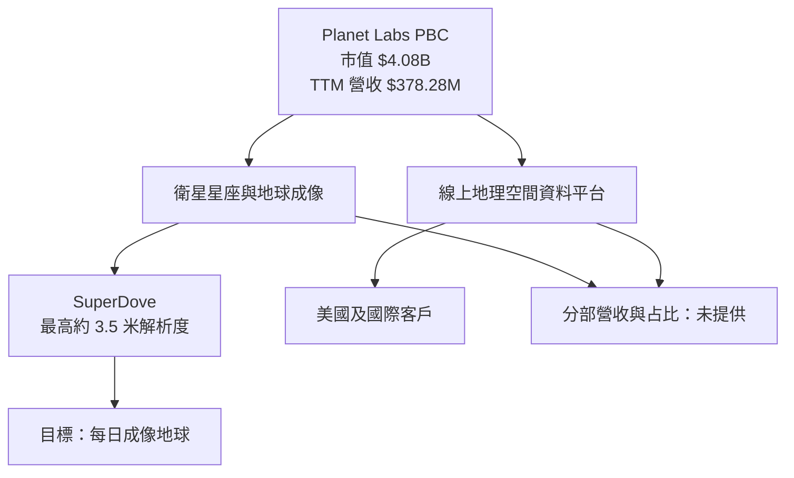
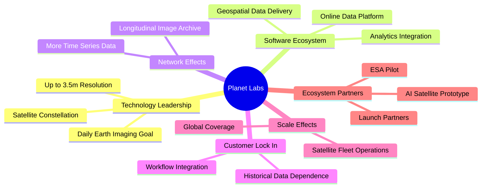
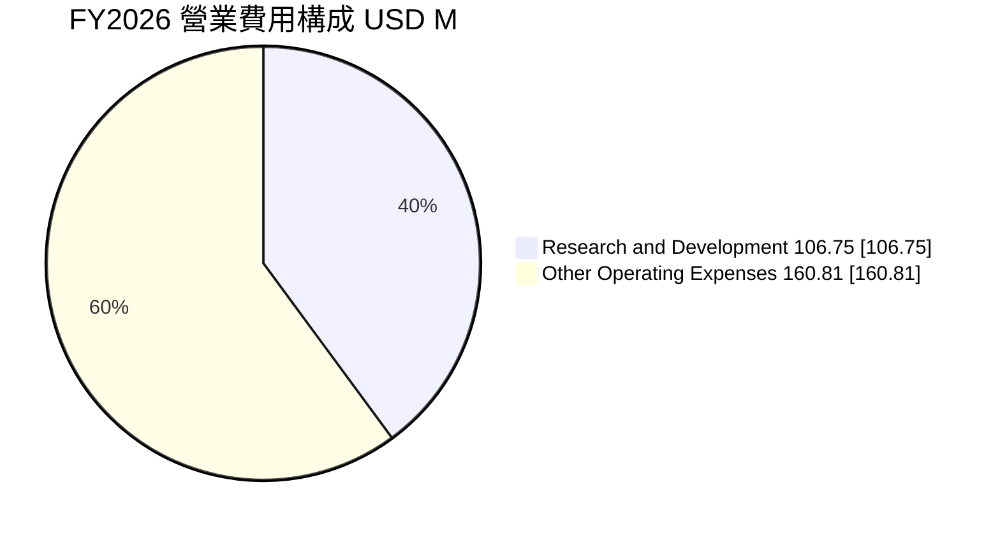
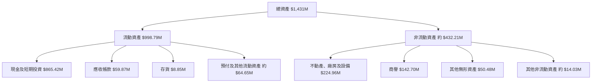
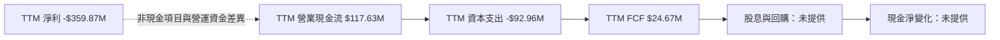
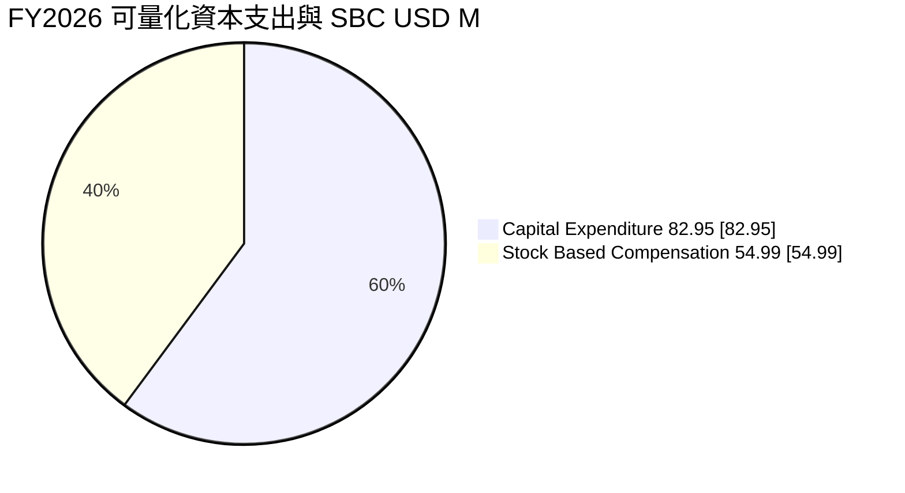
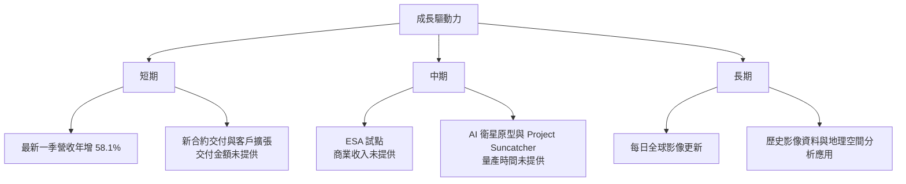
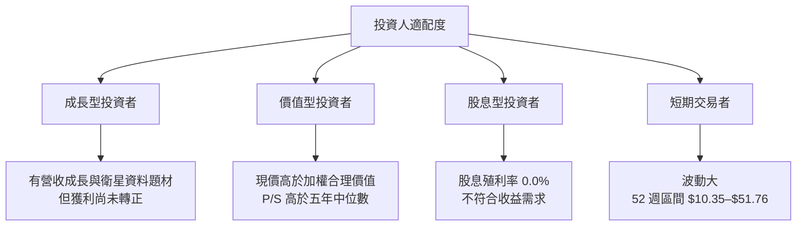

# PL 基本面深度分析報告
> **報告日期**：2026-11-24 ｜ **語言**：繁體中文 ｜ **數據來源**：SEC 申報資料 (XBRL)、Yahoo Finance、Finviz、StockAnalysis、Roic.ai ｜ **分析師**：CFA 級機構研究

## 目錄

| # | 章節 | 核心結論 |
|---|------|----------|
| 1 | 執行摘要 | 賣出；加權合理價值 $7.50，MOS -49.5% |
| 2 | 公司概覽與商業模式 | 衛星影像與地理空間資料平台具差異化，但市場份額與各業務收入占比未提供 |
| 3 | 損益表深度分析 | TTM 營收 $378.28M、成長 44.1%；營業利益率仍為 -27.2% |
| 4 | 資產負債表分析 | 現金及短期投資 $865.42M；債務數據來源不一致，須審慎解讀 |
| 5 | 現金流量深度分析 | TTM FCF $24.67M，營業現金流轉正，但 FCF 對市值殖利率僅 0.60% |
| 6 | 獲利能力與資本效率 | ROIC 未提供；負營業利益率遠低於 12.67% WACC，仍未證明創造價值 |
| 7 | 相對估值分析 | P/S 10.7x，高於自身五年中位數 6.9x；估值方法指向 $5.09–$29.23 |
| 8 | DCF 內在價值評估 | DCF 不適用：TTM 營業利益為負；以指定相對估值法加權得到 $7.50 |
| 9 | 成長催化劑 | 最新一季營收年增 58.1%，但 ESA 試點與 AI 衛星相關消息尚無可量化收入貢獻 |
| 10 | 風險矩陣 | 高估值、持續營業虧損與股權稀釋為主要風險 |
| 11 | 投資建議 | 依 MOS 評級為賣出；若基本面改善，需先觀察利潤率與 FCF 可持續性 |

---

## 1. 執行摘要

### 1.0 一頁式投資儀表板（Portfolio Manager 30 秒速讀）

| 項目 | 內容 |
|------|------|
| **投資論點（3 句）** | ① TTM 營收 $378.28M、年增 44.1%，最新一季營收年增 58.1%，顯示需求與商業化動能加速。② TTM 營業利益率 -27.2%，雖有 $24.67M 正 FCF，但仍未證明成長已轉化為可持續營業獲利。③ P/S 10.7x 高於自身五年中位數 6.9x，依指定方法算出的加權合理價值 $7.50，低於 $11.21 現價。 |
| **綜合評分** | **5.0/10**（引用 1.1 評分卡） |
| **財務健康** | 🟡 現金及短期投資 $865.42M；但債務資料來源不一致，且 TTM 淨利率 -95.1%。 |
| **ROIC vs WACC** | ROIC：N/A；WACC：12.67%。ROIC 未提供，不能量化差額；TTM 營業利益率 -27.2% 顯示營業面仍未覆蓋資本成本。 |
| **FCF 趨勢** | TTM FCF **$24.67M**；FCF Yield **0.60%**。FY2026 年 FCF 為 $51.41M，但季度 FCF 波動明顯。 |
| **估值** | Forward P/E -8,968.0x（因接近零的負 Forward EPS，缺乏經濟解讀力）｜EV/EBITDA -76.69x｜FCF Yield 0.60%。 |
| **DCF 內在價值（基準）** | N/A；TTM 營業利益為負，不適合以虧損基礎建立 DCF。 |
| **安全邊際（MOS）** | **-49.5%**＝($7.50 − $11.21) ÷ $7.50；加權合理價值基準來自 8.8。🔴 無安全邊際。 |
| **預期報酬（基準情境 12M）** | DCF 基準情境 N/A；以加權合理價值作參考，上行空間 **-33.1%**，不等同 12M 報酬預測。 |
| **關鍵風險（前二）** | 🔴 營業虧損尚未收斂至獲利；🔴 P/S 估值與自身歷史中位數相比偏高。 |
| **評級 + 信心度** | 🔴 **賣出** ｜ 信心：中。估值計算可引用，但基本面數據存在債務與部分比率來源差異。 |

### 1.1 綜合評分卡（全報告唯一）

| 維度 | 評分（1–10） | 主要依據（引用數字與其來源章節） |
|------|--------------|----------------------------------|
| 成長性 | 8.0 | TTM 營收年增 44.1%、最新一季年增 58.1%（第 3 章）；動能強，但未提供市場規模或訂單轉收入資料。 |
| 獲利能力 | 2.0 | TTM 營業利益率 -27.2%、淨利率 -95.1%、Piotroski F-Score 3/8（第 3、6 章）。 |
| 財務健康 | 7.0 | 現金及短期投資 $865.42M、流動比率 2.843（第 4 章）；總債務來源不一致，折減評價。 |
| 估值 | 2.0 | MOS -49.5%；P/S 10.7x，高於五年中位數 6.9x（第 7、8 章）。 |
| 護城河 | 7.0 | 每日全球影像重訪、衛星資料平台具差異化，但分部收入與客戶留存數據未提供（第 2 章）。 |
| 管理層與資本配置 | 4.0 | FY2026 SBC $54.99M，最新四季約 $62.51M；稀釋股數測試未通過，暫無回購或股息證據（第 3、5 章）。 |
| **綜合評分** | **5.0** | 六項算術平均：(8.0 + 2.0 + 7.0 + 2.0 + 7.0 + 4.0) ÷ 6 = **5.0**。 |

### 1.2 五大投資論點 + 三大核心風險

| 類型 | 項目 | 具體依據 | 信心度 |
|------|------|----------|--------|
| 🟢 **投資論點①** | 營收動能加速 | TTM 營收 $378.28M、年增 44.1%；最新一季年增 58.1%，連續數季季度年增率由 9.64% 升至 58.14%（StockAnalysis）。 | 🟢 高 |
| 🟢 **投資論點②** | 正向營業現金流 | TTM 營業現金流 $117.63M、資本支出 $92.96M，按指定定義得 FCF $24.67M。營業現金流為正，有助公司維持衛星與平台投資。 | 🟢 中 |
| 🟢 **投資論點③** | 流動性緩衝 | 現金及短期投資 $865.42M，流動比率 2.843；提供短期研發與資本支出緩衝，但不代表已達獲利。 | 🟢 中 |
| 🟡 **投資論點④** | 高頻地球觀測具差異化 | 公司營運衛星星座，目標以最高約 3.5 米地面解析度每日成像；若資料持續更新，可支援變化偵測與時間序列分析。 | 🟡 中 |
| 🟡 **投資論點⑤** | 新應用與夥伴拓展選擇權 | 新聞提及 ESA 試點、Project Suncatcher 與 AI 衛星原型等，但目前未提供可核實的收入、合約金額或量產時間。 | 🟡 低 |
| 🟡 **風險①** | 估值回落風險 | 現價 $11.21，P/S 10.7x，五年中位數 6.9x；相對估值法加權價值 $7.50，MOS -49.5%。 | 🟡 高 |
| 🔴 **風險②** | 獲利及現金轉化不穩 | TTM 營業利益率 -27.2%、淨利率 -95.1%；TTM FCF $24.67M，尚不足以抵銷對未來獲利能力的疑慮。 | 🔴 高 |
| 🔴 **風險③** | 股權稀釋及資料口徑風險 | Piotroski 稀釋股數測試未通過；總債務在不同資料源為 N/A 或 $498.62M，估值與資本結構判讀須留安全邊際。 | 🔴 中高 |

### 1.3 快速統計卡片

| 指標 | 公司實際值（期間） | 同業中位數 | 狀態 |
|------|--------------------|------------|------|
| 營收成長（TTM） | **44.1%** | — | 🟢 |
| 營收成長（最新一季年增） | **58.1%** | **72.7%**（SPIR、BKSY、RKLB 中位數） | 🟢 |
| 毛利率（TTM） | **55.5%** | **40.3%**（三家同業中位數） | 🟢 |
| 營業利益率（TTM） | **-27.2%** | — | 🔴 |
| ROIC（TTM） | **N/A** | — | 🟡 |
| Forward P/E | **-8,968.0x** | **-16.7x**（SPIR、BKSY、RKLB 中位數） | 🔴 |
| FCF Yield（TTM） | **0.60%** | — | 🟡 |
| Piotroski F-Score | **3 / 8** | — | 🔴 |

### 1.4 投資結論

╔══════════════════════════════════════════════════════════════════╗  
║                    📊 投資結論摘要                               ║  
╠══════════════════════════════════════════════════════════════════╣  
║  評級：🔴 賣出（依 MOS 門檻；未作質化調整）                      ║  
║  價格（2026-11-23 收盤）：$11.21                                 ║  
║  DCF 內在價值（基準）：N/A（TTM 營業利益為負）                   ║  
║  折溢價：N/A（無 DCF 基準內在價值）                              ║  
║  安全邊際 MOS：-49.5%（以加權合理價值 $7.50 為分母）             ║  
║  加權合理價值（8.8）：$7.50                                      ║  
║  DCF 情境價值：N/A（DCF 模型未建立）                             ║  
║  綜合評分：5.0/10（引用 1.1）                                    ║  
║  適合投資人：高風險承受度、能接受大幅波動並追蹤財報者；            ║  
║              不適合以現金流折現或股息收入為主要策略者。            ║  
╚══════════════════════════════════════════════════════════════════╝

---

## 2. 公司概覽與商業模式

### 2.1 業務結構與收入來源

Planet Labs PBC 設計、建造並營運衛星星座，將地球影像與地理空間資料透過線上平台交付客戶。公司概覽未提供可分拆的業務收入或各產品占比，因此圖中僅列已知公司總覽，不推估板塊占比。

**商業含義：**衛星網路提供影像供給，平台與資料服務負責交付及分析。若客戶將影像資料納入日常營運流程，頻繁更新可能增加續約與擴充價值；但目前缺少訂閱收入、客戶留存率、合約期限及分部毛利率，無法量化這些效益。

### 2.2 市場份額

市場份額數據未提供，無法提供可稽核的市占率或市場份額圖。以營收看，Planet Labs TTM 營收 $378.28M、年增 44.1%；同業資料中的 SPIR、BKSY、RKLB 最新一季營收年增率分別為 42.1%、118.4%、72.7%。PL 成長快於 SPIR，但低於 BKSY 與 RKLB；三家公司業務組合並不完全相同，這種比較只能反映增速位置，不能直接代表市場份額。

### 2.3 競爭護城河分析

以上屬質化判斷：衛星星座與累積影像資料可能建立進入門檻，但公司未提供可量化的客戶留存、每客戶收入、資料庫規模或轉換成本資料。

### 2.4 護城河強度

| 護城河項目 | 強度（強／中／弱） | 證據（引用數字或事實） | 會削弱它的情況 |
|------------|--------------------|------------------------|----------------|
| 技術與星座 | 中 | SuperDove 目標每日成像，最高約 3.5 米解析度；TTM 營收 $378.28M。 | 競爭者以更高解析度、更低成本或更頻繁重訪提供替代資料。 |
| 資料累積 | 中 | 衛星影像有時間序列價值；但歷史資料庫規模未提供。 | 客戶更重視單次影像或可從其他供應商取得足夠資料。 |
| 軟體平台 | 中 | 資料透過線上平台交付；軟體收入占比與平台毛利未提供。 | 平台未能提高客戶留存或單客戶收入，產品被視為可替換資料來源。 |
| 客戶鎖定 | 弱至中 | 客戶工作流程可能整合地理空間資料，但續約率與合約期限未提供。 | 客戶採多供應商策略或自行建置分析工具。 |
| 規模效應 | 中 | 公司已營運衛星星座，員工 945 人；單位影像成本未提供。 | 衛星替換、發射或維運成本上升，削弱規模經濟。 |
| 生態夥伴 | 弱至中 | 新聞提及 ESA 試點、AI 衛星原型與發射相關合作，尚無收入貢獻數據。 | 試點未轉成正式合約或新技術延遲商用。 |

**1.1 護城河分數為 7.0/10：**每日影像供給、平台交付及累積資料形成潛在差異化；但客戶鎖定、資料庫規模及分部經濟性缺乏公開量化證據，故不評為更高。

---

## 3. 損益表深度分析

### 3.1 年度收入成長趨勢（近4年）

年度營收以公司年度損益表列示值為準；收入條長度為相對於最高年度營收 $307.73M 的視覺化比例。

╔══════════════════════════════════════════════════════════════════╗  
║          Planet Labs 年度收入趨勢（FY2023–FY2026）               ║  
╠══════════════════════════════════════════════════════════════════╣  
║  FY2023  $191.26M  █████████████░░░░░░░░  YoY: +15.4%  🟢      ║  
║  FY2024  $220.70M  ██████████████░░░░░░░  YoY: +15.4%  🟢      ║  
║  FY2025  $244.35M  ████████████████░░░░░  YoY: +10.7%  🟡      ║  
║  FY2026  $307.73M  ████████████████████  YoY: +25.9%  🟢      ║  
╠══════════════════════════════════════════════════════════════════╣  
║  FY2023–FY2026 CAGR = (307.73 ÷ 191.26)^(1/3) − 1 = 約 17.1%    ║  
╚══════════════════════════════════════════════════════════════════╝

收入成長先於 FY2025 放緩，FY2026 再加速至 25.9%。更近期的 TTM 年增 44.1%、最新一季年增 58.1%，顯示近期成長快於過去年度平均；但營業費用仍高於毛利，收入加速尚未轉化為營業獲利。

### 3.2 季度收入趨勢分析

以下 QoQ 由季度營收數值計算；最新一季 YoY 直接引用單季年增數據。其他 YoY 使用 StockAnalysis 季度成長率，以免與未提供的單季比較值混用。

| 季度 | 營收 | QoQ | YoY | 備註 |
|------|------:|----:|----:|------|
| 2025-10-31 | $81.25M | +6.9% | +32.6% | 相較 2025-07 季營收 $73.39M；季度營收持續擴大。 |
| 2026-01-31 | $86.82M | +6.9% | +41.1% | YoY 加速，增速高於 2025-10 季。 |
| 2026-04-30 | $94.15M | +8.4% | +42.1% | 季增與年增同步成長。 |
| 2026-07-31 | $116.05M | +23.3% | +58.1% | 最新一季營收跳升；需觀察是否受大型合約交付時點影響。 |

**QoQ 示例：**($116.05M ÷ $94.15M) − 1 = **23.3%**。由於未提供單季訂單、客戶集中度或合約交付拆分，不能將單季加速直接外推為未來季度持續增長。

### 3.3 利潤率演變分析

| 利潤率指標 | FY2023 | FY2024 | FY2025 | FY2026 | 趨勢 | 評估 |
|------------|--------|--------|--------|--------|------|------|
| **毛利率** | 49.2% | 51.2% | 57.2% | 56.1% | FY2025 擴張，FY2026 小幅回落 | 🟡 |
| **營業利益率** | -91.9% | -75.8% | -45.5% | -30.9% | 虧損幅度逐年收窄 | 🟡 |
| **淨利率** | -84.7% | -63.7% | -50.4% | -80.2% | FY2026 明顯惡化 | 🔴 |

計算以年度損益表收入、毛利、營業利益及淨利相除；不同資料源列示的毛利數字有小幅差異，年度計算使用年度損益表數值。TTM 毛利率為 55.5%，TTM 營業利益率 -27.2%，均以指定 TTM 指標為準。

**利潤率演變深度解析：**

- FY2023 至 FY2026 毛利率約從 49.2% 升至 56.1%，反映直接交付成本相對收入的比例改善；但 FY2026 較 FY2025 回落約 1.1 個百分點，可能涉及產品組合或服務成本變化，資料未提供分部拆解，不能確認單一原因。
- 營業利益率由 FY2023 的 -91.9% 收窄至 FY2026 的 -30.9%，顯示收入規模擴大有助吸收固定研發與平台成本；但 FY2026 仍有 $95.07M 營業虧損，距離盈虧平衡仍遠。
- FY2026 淨利率因淨虧損擴大而降至 -80.2%。季度數據顯示 2026-04-30 季淨虧損 $138.87M、2026-01-31 季淨虧損 $152.46M，顯著高於營業虧損；一次性損益、稅務或非現金項目拆解未提供，不宜將其全數視作核心營運成本。

### 3.4 費用結構分析

FY2026 毛利 $172.49M、營業利益 -$95.07M，因此營業費用合計為 $267.56M。研發費用 $106.75M，其他營業費用以「營業費用合計減研發費用」計算為 $160.81M；細分資料未提供。

╔══════════════════════════════════════════════════════════════════╗  
║             FY2026 營業費用相對營收（$307.73M）                  ║  
╠══════════════════════════════════════════════════════════════════╣  
║  研發費用 $106.75M       ███████░░░░░░░░░░░  34.7% 營收         ║  
║  其他營業費用 $160.81M   ██████████░░░░░░░░  52.3% 營收         ║  
║  營業費用合計 $267.56M   █████████████████  86.9% 營收         ║  
╚══════════════════════════════════════════════════════════════════╝

收入增長能否帶動營業槓桿，取決於營業費用增速是否低於營收增速。FY2026 研發費用 $106.75M，較 FY2025 的 $101.01M 增加，顯示公司仍投入產品與衛星能力；但其他營業費用明細不足，無法判斷銷售及管理成本的效率變化。

### 3.5 季度 EPS 趨勢與盈餘品質（Quality of Earnings）

過去四季 EPS 估值與實際值在 earnings history 均為 NaN，故無法判定超預期或不及預期；季度 EPS 實際值亦不能替代缺失的市場預期。

| 季度 | EPS 預期 | EPS 實際 | 是否超預期 | 可確認資訊 |
|------|----------|----------|------------|------------|
| 2026-07-31 | N/A | N/A | 無法判定 | 季度淨利 -$9.35M；估值及實際 EPS 來源均缺失。 |
| 2026-04-30 | N/A | N/A | 無法判定 | 季度淨利 -$138.87M。 |
| 2026-01-31 | N/A | N/A | 無法判定 | 季度淨利 -$152.46M。 |
| 2025-10-31 | N/A | N/A | 無法判定 | 季度淨利 -$59.19M。 |

| 盈餘品質項目 | 數值/佔比 | 評估 |
|--------------|-----------|------|
| 股權薪酬 SBC / 營收 | 最新四季 SBC 約 $62.51M ÷ TTM 營收 $378.28M = **16.5%** | 🔴 SBC 是顯著股東成本；會以稀釋方式降低既有股東每股經濟權益。 |
| SBC / 營業現金流 | $62.51M ÷ $117.63M = **53.1%** | 🔴 營業現金流中相當大部分對應 SBC 加回，若視為經濟成本，現金獲利品質弱於表面 OCF。 |
| FCF / 淨利（現金轉換率） | $24.67M ÷ -$359.87M = **-6.9%** | 🔴 淨利為負，該比率不宜解讀為一般轉換率；FCF 為正不能掩蓋大額會計虧損。 |
| 一次性/非經常性損益 | 未提供明確拆分 | 🟡 FY2026 年淨虧損 -$246.86M，且部分季度淨利顯著低於營業利益；無資料足以判斷一次性項目方向。 |
| 有效稅率異常 | N/A | 🟡 未提供可稽核的 TTM 有效稅率；DCF 使用的 21% 為資本成本區塊預設值，不代表實際稅率。 |
| 資本化支出 vs 費用化 | TTM 資本支出 $92.96M；資本化政策拆分 N/A | 🟡 衛星資產需資本投入，但無法判斷是否存在成本遞延或資本化政策變動。 |

**盈餘品質結論：**TTM 營業現金流為正且 FCF 為正，提供現金面支撐；但淨利持續為負、SBC 約占 TTM 營收 16.5%，且稀釋股數測試未通過。因而不能將 SBC 加回後的 OCF 等同於完全屬於股東的現金盈餘；估值應優先觀察扣除必要衛星投資後的可持續 FCF。

---

## 4. 資產負債表分析

### 4.1 資產結構分解

採用 StockAnalysis 2026-07-31 資產負債表：總資產約 $1.431B，流動資產 $998.79M。細項合計因四捨五入可能有微差。

### 4.2 流動性與營運資金分析

| 指標 | 最新值 | 歷史參考 | 評估 |
|------|--------|----------|------|
| 流動比率 | 2.843 | FY2026 年度流動資產 $775.36M、流動負債 $469.45M，兩者口徑不同於最新比率 | 🟢 最新流動比率提供短期流動性緩衝；資料源及日期口徑有差異，不宜與年度數據直接混算。 |
| 速動比率 | 2.634 | N/A | 🟢 現金、短期投資與應收帳款對短期負債具覆蓋能力。 |
| 現金及短期投資 | $865.42M | FY2026 年度 $640.09M | 🟢 流動資產緩衝增加；但尚須與實際債務及未來衛星投資需求對照。 |
| 總債務 | VERIFIED 數字為 N/A | 其他資料源列 $498.62M | 🟡 資料來源不一致，不將其中一個數值視為已核實總債務。 |

**營運資金天數（照抄 QUALITY FIGURES）：**

| 指標 | 最新 TTM | 一年前 TTM | 變化 | 解讀 |
|------|----------|------------|------|------|
| DSO 應收帳款天數 | 58 天 | 72 天 | -14 天 | 🟢 收款天數下降；可能代表回款改善，但仍須結合合約結構觀察。 |
| DIO 存貨天數 | 19 天 | N/A | N/A | 🟡 一年前無存貨天數可比；最新存貨天數不高，但不能據此推斷衛星在製成本全數反映於存貨。 |
| DPO 應付帳款天數 | 22 天 | 37 天 | -15 天 | 🟡 付款週期縮短，可能代表付款較快或供應商條款變化；應付帳款明細未提供。 |
| CCC 現金轉換週期 | 55 天 | N/A | N/A | 🟡 一年前缺少 DIO 與 CCC，無法計算同比變化。 |

### 4.3 債務結構分析

╔══════════════════════════════════════════════════════════════════╗  
║                 Planet Labs 債務健康診斷                         ║  
╠══════════════════════════════════════════════════════════════════╣  
║  總債務：          N/A（VERIFIED；其他來源列 $498.62M）            ║  
║  現金+短期投資：   $865.42M                                      ║  
║  淨現金：          $865.42M（依 VERIFIED 欄位原值引用）            ║  
║  Debt/EBITDA：     N/A；TTM EBITDA 為負，倍數無有效解讀             ║  
║  利息保障倍數：    N/A；未提供利息費用與一致口徑債務資料            ║  
║  流動比率：        2.843 🟢                                      ║  
╠══════════════════════════════════════════════════════════════════╣  
║  ⚠️ 另一合併資料來源列總債務 $498.62M、淨現金 $366.79M；           ║  
║     因與核實數字區塊不一致，保留差異，不把兩種口徑混用。           ║  
╚══════════════════════════════════════════════════════════════════╝

### 4.4 股東權益趨勢

╔══════════════════════════════════════════════════════════════════╗  
║             Planet Labs 歷年股東權益（年度）                     ║  
╠══════════════════════════════════════════════════════════════════╣  
║  FY2023  $576.10M  ████████████████████  🟢                    ║  
║  FY2024  $518.02M  ██████████████████░░  🟡                    ║  
║  FY2025  $441.29M  ███████████████░░░░░  🟡                    ║  
║  FY2026  $188.43M  ███████░░░░░░░░░░░░░  🔴                    ║  
╚══════════════════════════════════════════════════════════════════╝

FY2026 股東權益由 FY2025 的 $441.29M 降至 $188.43M；同期總負債增加至 $957.25M（FY2026 年度資產負債表）。但公司現金及短期投資在較新的 2026-07-31 數據為 $865.42M。權益下降反映累積虧損及資本結構變化，應與季度股數、SBC 及融資活動一併追蹤。

---

## 5. 現金流量深度分析

### 5.1 現金流量瀑布圖

以下節點呈現各項已披露數值，不代表從淨利到 FCF 的逐項會計調節；股息、回購及現金淨變化金額未提供。

### 5.2 FCF 轉換率趨勢

| 財年 | FCF | 淨利 | FCF / 淨利 | 解讀 |
|------|----:|-----:|-----------:|------|
| FY2023 | -$86.69M | -$161.97M | 53.5% | 負淨利下的比率僅具方向參考，現金流與虧損同步為負。 |
| FY2024 | -$93.12M | -$140.51M | 66.3% | FCF 較 FY2023 更負，顯示投資支出與營運現金流仍承壓。 |
| FY2025 | -$68.78M | -$123.20M | 55.8% | FCF 虧損收窄，但比率仍不宜當作正向盈餘轉換率。 |
| FY2026 | $51.41M | -$246.86M | -20.8% | FCF 轉正，但淨虧損擴大；兩者背離需追蹤非現金項目及營運資金。 |
| TTM | $24.67M | -$359.87M | -6.9% | TTM FCF 為正，但淨利仍顯著為負。 |

### 5.3 自由現金流趨勢

年度 FCF 使用年度現金流量表；TTM FCF 一律採用營業現金流減資本支出的核實數字 $24.67M。不同資料表的 TTM 資本支出數字有差異，此處不混用非核實口徑。

╔══════════════════════════════════════════════════════════════════╗  
║                  自由現金流趨勢（實際）                          ║  
╠══════════════════════════════════════════════════════════════════╣  
║  FY2023  -$86.69M  ◀████████████████░░░░  FCF 為負              ║  
║  FY2024  -$93.12M  ◀█████████████████░░░  FCF 為負              ║  
║  FY2025  -$68.78M  ◀████████████░░░░░░░░  虧損收窄              ║  
║  FY2026  +$51.41M   █████████░░░░░░░░░░░  FCF 轉正              ║  
║  TTM     +$24.67M   ████░░░░░░░░░░░░░░░░  FCF Yield 0.60%       ║  
╠══════════════════════════════════════════════════════════════════╣  
║  FY2026 FCF = $134.36M OCF − $82.95M Capex = $51.41M            ║  
║  TTM FCF = $117.63M OCF − $92.96M Capex = $24.67M               ║  
╚══════════════════════════════════════════════════════════════════╝

FY2026 年度 FCF 高於 TTM FCF，表示最近四季現金流表現較年度合計弱；TTM FCF Yield 只有 0.60%，以市值衡量的現金回報仍低。年度與 TTM 差異可能來自季度資本支出與營運資金時點，但資料未提供足以拆分的完整季度 TTM 調節。

### 5.4 資本配置評估

可確認的配置資料包括 FY2026 SBC $54.99M、FY2026 資本支出 $82.95M；公司未提供股息、回購的可核實金額。以下不以「現金留存」或未披露項目填補比例。

| 資本配置項目 | 已披露數據 | 評估 |
|--------------|------------|------|
| 資本支出 | FY2026 $82.95M；TTM $92.96M | 🟡 衛星網路需要持續投資，須檢驗增量資本是否帶來增量收入與毛利。 |
| 研發 | FY2026 $106.75M | 🟡 支持衛星與資料產品能力，但尚無投資回報率拆分。 |
| SBC | FY2026 $54.99M；最新四季約 $62.51M | 🔴 相對 TTM 營收占比高，並可能增加股東稀釋。 |
| 股息、回購 | 未提供 | N/A；不假設公司有回購或股息支出。 |

---

## 6. 獲利能力與資本效率

### 6.1 ROE / ROA / ROIC 趨勢

| 指標 | FY2023 | FY2024 | FY2025 | FY2026／TTM | 評估 |
|------|--------|--------|--------|-------------|------|
| ROE | N/A | N/A | N/A | TTM **-63.8%**（QUALITY FIGURES） | 🔴 股東權益回報為負；其他資料源列 -72.0%，本報告以核實指標為準。 |
| ROA | N/A | N/A | N/A | TTM **-5.0%**（營運數據區） | 🔴 資產尚未產生正的會計報酬。 |
| ROIC | N/A | N/A | N/A | **N/A** | 🟡 未提供可直接引用的 ROIC；不自行用不一致資產與負債口徑推算。 |

行業均值資料未提供，故不作數值比較。公司 TTM 營業利益率為 -27.2%，與 WACC 12.67% 相比，營運獲利仍不足以支持資本成本覆蓋。

### 6.2 ROIC vs WACC 分析（核心價值創造判斷）

╔══════════════════════════════════════════════════════════════════╗  
║                ROIC vs WACC 深度分析                            ║  
╠══════════════════════════════════════════════════════════════════╣  
║  WACC（核實資本成本資料）：                                      ║  
║  ├── 無風險利率（10Y 美債）：              4.92%                 ║  
║  ├── 市場風險溢酬（假設值）：              5.00%                 ║  
║  ├── Beta 原始值：                         2.27                  ║  
║  ├── Beta 採用值（調整後）：               1.85                  ║  
║  ├── 股權成本 Ke（提供值）：               14.15%                ║  
║  ├── 稅前債務成本：                        0.69%                 ║  
║  ├── 股權／債務權重：                      89.1% / 10.9%         ║  
║  └── ✅ 採用 WACC：                        12.67%                ║  
║                                                                  ║  
║  ROIC：N/A（資料未提供可核實的 TTM ROIC）                        ║  
║  TTM 營業利益率：-27.2%；ROE：-63.8%                             ║  
║  EVA：N/A（缺 ROIC，不能以營業利益率取代 ROIC 計算 EVA）           ║  
╠══════════════════════════════════════════════════════════════════╣  
║  判斷：無法精確計算 ROIC − WACC；但營業利益為負，且 WACC 為       ║  
║  12.67%，現階段沒有證據顯示 PL 正在創造正的經濟附加價值。         ║  
╚══════════════════════════════════════════════════════════════════╝

**解讀：**原始 Beta 2.27 顯示股價波動風險高；採用的調整後 Beta 1.85，依「2/3 × 原始 Beta + 1/3 × 1」的調整方法。資本成本資料直接引用提供值；其股權成本 CAPM 計算有小幅四捨五入差異，WACC 仍使用指定的 12.67%，不另行改算。ROIC 未提供，故不虛構 ROIC 或 EVA 數字。

### 6.3 杜邦三因素分解

| 因素 | 數值（TTM） | 解讀 |
|------|-------------|------|
| 淨利率 | -95.1% | 虧損是 ROE 為負的主要來源。 |
| 資產週轉率 | 0.26 | 每單位資產產生的營收有限；收入成長若持續，可提高資產使用效率。 |
| 權益乘數 | 2.54 | 槓桿提高 ROE 波動，但不能扭轉負淨利率。 |
| **ROE** | **-63.8%** | QUALITY FIGURES 原值：-95.1% × 0.26 × 2.54 = -63.8%（因四捨五入，乘積可能有尾差）。 |

ROE 為負主要由淨利率驅動，不是由資產週轉率或權益乘數造成；因此改善重點是降低營業虧損、確認非營業損失來源並控制 SBC 稀釋，而非單純提高槓桿。

### 6.4 財務體質：Piotroski F-Score

**Piotroski F-Score：3 / 8**（以 2026-07-31 TTM 對 2025-07-31 TTM 比較；一項因資料缺失不納入分母）。

| 測試 | 結果 | 解讀 |
|------|------|------|
| ROA > 0 | ❌ 未通過 | 會計資產回報仍為負。 |
| 營業現金流 > 0 | ✅ 通過 | TTM 營業現金流 $117.63M。 |
| ROA 高於一年前 | ❌ 未通過 | 資產報酬未改善。 |
| 營業現金流 > 淨利（應計品質） | ✅ 通過 | OCF 高於淨利；但淨利為負，須與 SBC 加回一併評估。 |
| 長期負債 ÷ 總資產低於一年前 | — 無法判定 | 缺少一致口徑資料。 |
| 流動比率高於一年前 | ✅ 通過 | 最新流動比率較一年前改善。 |
| 稀釋股數未增加 | ❌ 未通過 | 股數增加可能稀釋每股經濟價值。 |
| 毛利率高於一年前 | ❌ 未通過 | 該比較期毛利率測試未通過。 |
| 資產週轉率高於一年前 | ❌ 未通過 | 資產使用效率測試未通過。 |

3/8 顯示流動性與營業現金流是相對正面的部分，但獲利、股數及效率指標仍弱；分數不等於破產風險評級。

---

## 7. 相對估值分析

### 7.1 同業估值比較表格

倍數依指定 Peer multiples；PL 的估值倍數採市場資料區所列值。由於各公司盈利均為負或接近零，P/E 及 EV/EBITDA 部分倍數缺乏一般估值解讀力。

| 估值指標 | **PL** | **SPIR** | **BKSY** | **RKLB** | PL 評估 |
|----------|------:|--------:|--------:|--------:|-----------|
| **Trailing P/E** | N/A | N/A | N/A | N/A | 🔴 PL TTM 虧損，無法用 P/E 判斷。 |
| **Forward P/E** | -8,968.0x | -16.7x | -62.9x | 693.4x | 🔴 PL 的近零負 EPS 令倍數失真；不應將負數倍數當成便宜訊號。 |
| **P/S Ratio** | 10.7x | 4.3x | 5.5x | 37.9x | 🔴 PL 高於 SPIR、BKSY；低於高估值 RKLB。 |
| **EV/EBITDA** | -76.69x | -3.3x | 652.2x | -156.3x | 🟡 同業 EBITDA 有正有負，指標不可直接排序。 |
| **最新一季營收 YoY** | 58.1% | 42.1% | 118.4% | 72.7% | 🟢 PL 成長高於 SPIR，低於 BKSY、RKLB。 |
| **TTM 毛利率** | 55.5% | 40.3% | 73.4% | 36.2% | 🟢 PL 高於 SPIR、RKLB，低於 BKSY。 |

SPIR、BKSY、RKLB 的 P/S 中位數為 5.5x；不過 8.8 的相對估值方法依固定規則採 SPIR、BKSY 的同業中位數 4.9x，並非此處三家全體中位數。

### 7.2 歷史估值區間分析

╔══════════════════════════════════════════════════════════════════╗  
║              PL 五年歷史 P/S 估值區間                           ║  
╠══════════════════════════════════════════════════════════════════╣  
║  低點 2.1x  ├──────── 中位數 6.9x ────────● 現值 10.7x ──┤      ║  
║  高點 38.1x                                             　　　   ║  
║  現值歷史百分位：79%（價格資料庫 × SEC 財報計算）                ║  
║  相對中位數溢價：(10.7 ÷ 6.9) − 1 = 55.1%                       ║  
╚══════════════════════════════════════════════════════════════════╝

當前 P/S 位於自身五年歷史第 79 百分位，較歷史中位數高約 55.1%。公司營收成長提升可支持估值溢價，但 TTM 營業利益率仍為 -27.2%，代表估值仍高度依賴未來收入持續增長與虧損收斂。

### 7.3 情境價值（Bear / Base / Bull）

**N/A（DCF 無法計算：TTM 營業利益為負，DCF MODEL 未提供情境表）。**依規則不自設悲觀、基準或樂觀 DCF 目標價。

### 7.4 相對估值隱含價格區間

╔══════════════════════════════════════════════════════════════════╗  
║                   相對估值每股價格參考                           ║  
╠══════════════════════════════════════════════════════════════════╣  
║  $5.09 同業 P/S ───── $11.21 現價 ───────── $29.23 分析師共識    ║  
╚══════════════════════════════════════════════════════════════════╝

| 估值方法 | 每股價值 | 相對現價 | 依據 |
|----------|----------:|---------:|------|
| 同業 P/S | $5.09 | -54.6% | SPIR、BKSY 同業中位數 P/S 約 4.9x × PL TTM 營收，再按公司股數回推；價格由指定估值方法區塊直接引用。 |
| 分析師共識目標價 | $29.23 | +160.7% | 12 位分析師平均目標價；屬外部預期參考，不是獨立現金流估值。 |

相對估值參考範圍跨度很大，反映市場對 PL 遠期營收與獲利轉折的預期分歧。分析師共識與同業 P/S 相差顯著，故不應將共識目標價視為基本面保證。

---

## 8. DCF 內在價值評估（Discounted Cash Flow）

### 8.0 估值推理鏈（Thinking Logic：在算之前先想清楚）

**核心命題：**PL 的價值理論上取決於衛星影像及相關資料服務能否把 $378.28M TTM 營收轉化為正營業利潤與可持續 FCF；目前沒有分部收入占比，不能把主業、平台及新業務拆成可量化價值。

- **Step 1 — 價值變數：**可觀察到 TTM 營收成長 44.1%、最新一季年增 58.1%，但 TTM 營業利益率 -27.2%、FCF $24.67M。真正主導估值的變數是長期營業利潤率與轉化為現金的能力，而不是單看營收增速。
- **Step 2 — 模型選擇：**指定 DCF MODEL 為 N/A，原因是 TTM 營業利益為負；在缺少有效營業獲利基礎時，無法遵循指定模型產生逐年 FCFF、終值及每股價值。不能另行自建 DCF 或自行填入預測假設。
- **Step 3 — 關鍵假設：**DCF 模型未提供預測期、營收 CAGR、期末利潤率、終值成長率、逐年現金流或敏感度；因此均為 N/A，而非採用分析師自行估計值。
- **Step 4 — 最脆弱環節：**若營收加速未能帶動營業利益率收斂，基於銷售倍數的估值也可能繼續下修；第 8.8 的同業 P/S 參考價為 $5.09。
- **Step 5 — 計算路徑：**DCF 未建立，故不提供以假設值繪製的每股價值計算流程圖；估值改依指定相對估值方法。

### 8.1 模型假設總表（Model Inputs）

**N/A（DCF MODEL 未提供）：**依核實資料，TTM 營業利益為負，不建立 DCF。以下模型輸入均不得自行補值。

| 假設項目 | 採用值 | 依據 / 來源 | 敏感度 |
|----------|--------|-------------|--------|
| 預測期長度 N | N/A | DCF MODEL 未提供；不得另建預測期。 | N/A |
| 營收 CAGR | N/A | 實際 TTM 成長 44.1%，但無 DCF 模型假設可照抄。 | N/A |
| 期末營業利潤率 | N/A | TTM 營業利益率 -27.2%；模型未提供期末假設。 | N/A |
| 有效稅率 | N/A | 實際 TTM 稅率未提供；資本成本區塊的 21.0% 是 WACC 預設稅率，非 DCF 已核准輸入。 | N/A |
| Capex / 營收 | N/A | TTM 資本支出 $92.96M 可觀察，但模型比率未提供。 | N/A |
| D&A / 營收 | N/A | 模型未提供。 | N/A |
| 營運資金變動 / 營收增額 | N/A | 模型未提供。 | N/A |
| EBIT 基礎 | N/A | DCF MODEL 未建模。 | N/A |
| SBC 處理 | N/A | 不自設 DCF SBC 組合。 | N/A |
| 年稀釋率 | N/A | 稀釋股數方向測試未通過，但模型未提供稀釋率。 | N/A |
| 永續成長率 g | N/A | 模型未提供。 | N/A |
| 終值方法 | N/A | 模型未提供 Gordon Growth 或退出倍數。 | N/A |
| WACC | **12.67%** | 直接引用資本成本區塊；詳見 8.2。 | 高 |

### 8.2 折現率推導（WACC）

╔══════════════════════════════════════════════════════════════════╗  
║                    WACC 推導（折現率）                           ║  
╠══════════════════════════════════════════════════════════════════╣  
║  股權成本 Ke（核實資本成本資料）：                                ║  
║  ├── 無風險利率 Rf：                     4.92%                   ║  
║  ├── 市場風險溢酬 ERP（假設值）：         5.00%                   ║  
║  ├── 原始 Beta（Yahoo Finance）：          2.27                   ║  
║  ├── 調整後 Beta：                        1.85                   ║  
║  ├── 規模／國別溢酬：                     0.00%（未另加）          ║  
║  └── Ke（提供值）：                       14.15%                  ║  
║                                                                  ║  
║  債務成本：                                                      ║  
║  ├── 稅前 Kd（提供值）：                  0.69%                   ║  
║  ├── 稅率（資本成本預設）：               21.0%                   ║  
║  └── 稅後 Kd = 0.69% × (1−21.0%) = 0.5451%                       ║  
║                                                                  ║  
║  資本結構（提供權重）：                                          ║  
║  ├── 股權權重：                           89.1%                   ║  
║  ├── 債務權重：                           10.9%                   ║  
║  └── ✅ 採用 WACC：                        12.67%                  ║  
╚══════════════════════════════════════════════════════════════════╝

**逐步演算與資料限制：**

1. **Ke（CAPM）**：指定輸入給出 Rf 4.92%、調整後 Beta 1.85、ERP 5.00%、提供的 Ke 14.15%。直接代數相乘可得 `4.92% + 1.85 × 5.00% = 14.17%`，與提供值 14.15% 相差 0.02 個百分點；本報告照指定值 14.15%，不自行替換。
2. **稅前 Kd**：利息費用及平均計息負債分母未提供可複算明細；引用已計算的稅前 Kd **0.69%**，不反推或重算。
3. **稅後 Kd**：`0.69% × (1 − 21.0%) = 0.69% × 0.79 = 0.5451%`。
4. **權重**：股權權重 89.1%、債務權重 10.9%；相加為 100.0%。市值與債務原始權重推導細節缺少一致口徑，故引用提供權重。
5. **WACC**：`89.1% × 14.15% + 10.9% × 0.5451% = 12.6083% + 0.0594% = 12.6677% ≈ 12.67%`。

Beta 調整方式為 `2/3 × 2.27 + 1/3 × 1 = 1.8467 ≈ 1.85`。ERP 5.00% 為假設輸入，未提供其外部來源日期。此處 WACC 與第 6.2 節一致，採用值均為 12.67%。

### 8.3 逐年自由現金流預測（基準情境）

**N/A（DCF MODEL 未提供：TTM 營業利益為負）。**依規則不自行建立逐年營收、EBIT、稅項、FCFF 或折現因子預測；也不以營業現金流作為替代 DCF 現金流。

### 8.4 終值計算（Terminal Value）

**N/A（DCF MODEL 未提供終值假設與預測期最後一年 FCFF；因此無法檢查 WACC 與永續成長率 g 的關係，也不計算 Gordon Growth 或退出倍數終值）。**

### 8.5 企業價值 → 每股內在價值（Bridge）

**N/A（未有 DCF 企業價值、終值現值與股權價值橋接；不得自行使用現金、債務或股數補建 DCF）。**

- DCF 基準內在價值：N/A。
- 相對 DCF 內在價值的折溢價：N/A。
- 本節不計算 MOS；MOS 只以第 8.8 節加權合理價值為分母。

### 8.6 敏感性分析（WACC × 永續成長率）

**N/A（DCF MODEL 未提供敏感度矩陣，亦沒有基準 g、逐年 FCFF 或基準每股價值；不得自行建立矩陣）。**DCF 悲觀、基準、樂觀情境及機率加權價值同樣 N/A。

### 8.7 反推 DCF（Reverse DCF：市場在預期什麼）

**N/A（沒有可用的基準 DCF 模型與每股價值方程式，不能以現價 $11.21 反解單一營運假設）。**因此不提供市場隱含 CAGR、期末營業利潤率、永續成長率、預測期年數或迭代表。

### 8.8 估值三角驗證與安全邊際

| 估值方法 | 隱含每股價值 | 上行空間（÷現價） | 權重 | 說明 |
|----------|--------------:|-------------------:|------:|------|
| 同業 P/S | $5.09 | -54.6% | 90% | 同業中位數 4.9x（SPIR、BKSY）乘以 PL TTM 營收，按固定方法回推每股價值。 |
| 分析師共識目標價 | $29.23 | +160.7% | 10% | 12 位分析師平均目標價；不等同內在價值。 |
| **加權合理價值** | **$7.50** | **-33.1%** | **100%** | 未提供 DCF 價值；Forward P/E 方法不可計算，固定規則下其權重由其餘方法承接。 |

**逐步演算：**

- 加權合理價值 = `$5.09 × 90% + $29.23 × 10%`
- `= $4.581 + $2.923`
- `= $7.504 ≈ $7.50`（金額四捨五入至美分）。
- MOS = `($7.50 − $11.21) ÷ $7.50 = -$3.71 ÷ $7.50 = -49.4667% ≈ -49.5%`。
- 上行空間 = `($7.50 − $11.21) ÷ $11.21 = -$3.71 ÷ $11.21 = -33.095% ≈ -33.1%`。

估值方法權重對應未獲利公司類型。同業 Forward P/E 因不可計算而未納入；權重按指定規則分配至同業 P/S 與分析師共識。MOS 評級依門檻為賣出，且未作質化一級調整。

╔══════════════════════════════════════════════════════════════════╗  
║                  估值區間與安全邊際                              ║  
╠══════════════════════════════════════════════════════════════════╣  
║  $5.09 同業 P/S ─────── $7.50 加權合理值 ─────── $11.21 現價    ║  
║                                                                  ║  
║  安全邊際 MOS = (加權合理價值 − 現價) ÷ 加權合理價值 = -49.5%   ║  
║  MOS 評估：🔴 無安全邊際                                        ║  
║  上行空間 = (合理價值 − 現價) ÷ 現價 = -33.1%                  ║  
║                                                                  ║  
║  參考買入區間：≤ $6.75（以 MOS ≥ 10% 計算）                     ║  
║  合理持有參考區間：$6.75–$8.25                                  ║  
║  減碼參考區間：$8.25–$9.38                                      ║  
║  現價 $11.21 高於上述參考區間，與賣出評級一致。                   ║  
╚══════════════════════════════════════════════════════════════════╝

參考價位由加權合理價值 $7.50 推算：MOS 10% 時價格上限 `$7.50 × (1 − 10%) = $6.75`；MOS -10% 對應價格 `$7.50 × 1.10 = $8.25`；MOS -25% 對應 `$7.50 × 1.25 = $9.375 ≈ $9.38`。這些是估值門檻，不是對價格走勢的預測。

> 🔎 **程式複算（Python，依本節各項自動重算）**
>
> 加權合理價值 = $5.09 × 90% + $29.23 × 10% = **$7.50**（權重合計 100%）
>
> 以價格 $11.21 計：MOS = **-49.5%**，上行空間 = **-33.1%**
>
> ✅ 與本節所寫數值一致。

### 8.9 DCF 模型的局限與失效條件

- **終值依賴度：**N/A；未建立 DCF，無法計算終值占 EV 比重。
- **最脆弱的假設：**沒有可引用的 DCF 假設；基本面上最需驗證的是營收成長能否伴隨營業利潤率改善，以及 SBC 稀釋能否下降。
- **不適用情境說明：**TTM 營業利益為負，未提供可核實 DCF MODEL；此階段以同業 EV/Sales 或 P/S、營收增長品質、單位經濟性與未來獲利轉折較適合交叉觀察。
- **與第 10 章風險矩陣連結：**合約交付延遲會打擊營收增速；衛星維運及發射成本上升會壓低毛利與 FCF；新技術商用延遲會使市場給予的銷售倍數下修。

### 8.10 複算檢核表（Audit Trail）

| # | 檢核項目 | 檢查方式 | 結果 |
|---|----------|----------|------|
| 1 | 所有高／中敏感度 DCF 輸入皆有完整推導 | DCF MODEL 為 N/A，未使用假設輸入 | N/A |
| 2 | 每個模型假設都有來歷 | 未建立 DCF 假設；WACC 來源已列於 8.2 | N/A |
| 3 | WACC 五步算式與權重 | 權重 89.1% + 10.9% = 100%；採用值 12.67% | ✅（利率輸入按提供值；Ke 有 0.02pp rounding 差異已揭露） |
| 4 | Kd 分母與債務權重口徑一致 | Kd 組成及債務權重原始推導未提供，不能獨立核驗 | N/A |
| 5 | WACC 與第 6.2 節一致 | 兩處均採 12.67% | ✅ |
| 6 | 逐年預測年數與省略符號 | DCF 模型 N/A，沒有預測表 | N/A |
| 7 | FY+1 FCFF 九步算式 | DCF 模型 N/A，未作逐年計算 | N/A |
| 8 | 預測期 PV 加總 | DCF 模型 N/A | N/A |
| 9 | WACC > g | g 未提供，無法檢查 | N/A |
| 10 | 終值以 FY+N 現金流折現 | DCF 模型 N/A | N/A |
| 11 | EV 至每股價值橋接 | DCF 模型 N/A | N/A |
| 12 | SBC、EBIT 基礎與股數組合相容 | 未建立 DCF，也未假設股數稀釋率 | N/A |
| 13 | 矩陣基準格等於 DCF 每股價值 | 敏感度矩陣 N/A | N/A |
| 14 | 敏感度矩陣有效格檢查 | 敏感度矩陣 N/A | N/A |
| 15 | 三情境機率加總 | DCF 情境表 N/A | N/A |
| 16 | 反推 DCF 每列只放開一個變數 | 反推 DCF N/A | N/A |
| 17 | MOS 與折溢價基準一致 | MOS 以 $7.50 加權合理價值；DCF 折溢價 N/A | ✅ |
| 18 | 報告完整到第 11 章 | 已完整列出第 1–11 章 | ✅ |
| 19 | 加權合理價值等於方法價值乘權重之和 | $5.09×90%+$29.23×10%=$7.504≈$7.50 | ✅ |
| 20 | 評級符合 MOS 門檻 | MOS -49.5%，低於 -25%，賣出 | ✅ |

---

## 9. 成長催化劑

### 9.1 催化劑時間軸

**N/A（具體發布時間或商業化時間未提供，故不以假設日期繪製 Gantt 圖）。**已披露催化劑包括 ESA 試點、Project Suncatcher 原型及發射合作相關消息，但未有確定里程碑日期。

### 9.2 TAM 市場規模分析

**N/A（TAM 數據未提供）。**PL TTM 營收 $378.28M，TTM 年增 44.1%，最新一季年增 58.1%，顯示公司營收規模仍在擴張；但沒有可引用的市場規模數字，不能據此估算市場滲透率。

### 9.3 成長驅動力結構圖

---

## 10. 風險矩陣

### 10.1 風險評分矩陣

**定量機率與影響資料未提供，故不以主觀座標填入 quadrantChart。**可確認的風險方向是估值、獲利及股權稀釋；其排序與監控門檻見下表。

### 10.2 風險清單詳細分析

| # | 風險項目 | 發生機率 | 財務衝擊 | 風險評估 | 緩解措施 |
|---|----------|----------|----------|----------|----------|
| 1 | 🔴 **估值倍數收縮** | N/A（缺少可量化機率） | P/S 由 10.7x 向五年中位數 6.9x 收斂將造成估值壓力；同業 P/S 參考價 $5.09。 | 🔴 高 | 以營收增速、毛利率與獲利轉折共同評估，不單用市場題材外推。 |
| 2 | 🔴 **營業虧損延續** | N/A | TTM 營業利益率 -27.2%；最新一季營業利益率 -11.6%（核實數值）。若改善停滯，估值對遠期獲利預期的依賴上升。 | 🔴 高 | 每季監控營業利益率、營業費用增速及毛利率。 |
| 3 | 🟠 **SBC 與稀釋** | N/A | 最新四季 SBC 約 $62.51M，占 TTM 營收 16.5%；Piotroski 稀釋股數測試未通過。 | 🟠 中高 | 追蹤稀釋股數、SBC／營收及員工股權獎酬趨勢。 |
| 4 | 🟠 **衛星資本支出與營運執行** | N/A | TTM 資本支出 $92.96M，約為 TTM 營收的 24.6%；發射或衛星供應延遲可能影響服務與現金流。 | 🟠 中高 | 關注資本支出是否轉化為可交付容量、營收與毛利。 |
| 5 | 🟡 **債務與財務數據口徑不一致** | N/A | 核實總債務 N/A，但其他來源列 $498.62M；可能影響淨現金與 EV 判讀。 | 🟡 中 | 以 SEC 10-Q 債務附註核實本金、到期結構與租賃負債，再更新資本結構。 |

---

## 11. 投資建議

### 11.1 最終評級與評分

MOS 為 -49.5%，低於賣出門檻 -25%，因此依規則 20 評級為**賣出**，未作質化一級調整。綜合評分引用 1.1 的 **5.0/10**；六項分數依序為成長性 8.0、獲利能力 2.0、財務健康 7.0、估值 2.0、護城河 7.0、管理層與資本配置 4.0。

### 11.2 合理價值與隱含報酬率

| 估值項目 | 每股價值 | 相對 2026-11-23 收盤價 $11.21 | 機率／權重 |
|----------|---------:|-----------------------------:|-----------:|
| 加權合理價值（第 8.8 節） | **$7.50** | **-33.1% 上行空間；MOS -49.5%** | 100% 方法權重 |
| 悲觀 DCF 情境 | N/A | N/A | N/A |
| 基準 DCF 情境 | N/A | N/A | N/A |
| 樂觀 DCF 情境 | N/A | N/A | N/A |

### 11.3 買入時機與觸發因素

╔══════════════════════════════════════════════════════════════════╗  
║                  ✅ 買入觸發因素 Checklist                       ║  
╠══════════════════════════════════════════════════════════════════╣  
║  轉為可考慮買入的條件（多數符合）：                              ║  
║  ☐ 股價降至 $6.75 或以下，對應加權合理價值的 MOS ≥ 10%           ║  
║  ☐ TTM 營收成長維持正值，且營業利益率連續改善                   ║  
║  ☐ TTM FCF 維持正值，並能清楚解釋營運現金流與 SBC 的關係          ║  
║  ☐ SEC 申報資料確認債務總額、到期結構及現金用途                   ║  
║                                                                  ║  
║  加碼觸發條件（出現以下任一，仍須配合估值）：                    ║  
║  ☐ 最新一季營收年增率維持至少 40%，且毛利率不持續下滑             ║  
║  ☐ 營業利益率較 TTM -27.2% 持續改善，且費用增速低於收入增速       ║  
║  ☐ SBC／營收連續下降，稀釋股數不再增加                           ║  
║                                                                  ║  
║  減碼／停損觸發條件（出現以下任一）：                             ║  
║  ☐ 最新一季營收年增率降至 20% 以下                               ║  
║  ☐ TTM FCF 轉負且連續兩季未恢復                                  ║  
║  ☐ 營業利益率在連續兩季內惡化，或資本支出上升而營收增速放緩       ║  
║  ☐ SEC 申報顯示債務或稀釋高於預期，且流動性覆蓋下降               ║  
╚══════════════════════════════════════════════════════════════════╝

以上數值是投資監控門檻，不是公司財測；若達到門檻，仍須結合當時估值與財報確認。

### 11.4 投資人適配度分析

成長型投資者可關注營收及獲利轉折，但需承受估值波動；以價值投資或股息為核心的投資者，現價與估值指標均不具吸引力。短線交易者則需留意 52 週高低價差及 2.27 原始 Beta 所反映的高波動特徵。

### 11.5 每季財報監控清單（Quarterly Watch List）

| 追蹤指標 | 最新參考值 | 加碼觸發門檻 | 減碼／重新評估門檻 | 觀察理由 |
|----------|-----------:|--------------|-------------------|----------|
| 營收年增率 | 最新一季 58.1% | 維持 ≥40% | 連續兩季 <20% | 確認增長動能是否持續，而非單季交付時點造成。 |
| 毛利率 | TTM 55.5% | 維持 ≥55% | 連續兩季較基期下降 >3 個百分點 | 收入成長需轉為更好的單位經濟性。 |
| 營業利益率 | TTM -27.2%；最新一季 -11.6% | 連續改善 | 連續兩季惡化 | 判斷固定費用吸收與營業槓桿。 |
| TTM FCF | $24.67M | 維持正值且逐季改善 | 轉負並連續兩季未恢復 | 檢查衛星投資後實際可留存現金。 |
| 資本支出 | TTM $92.96M | 增加時需有相應收入／容量證據 | Capex 上升、營收增速跌破 20% | 防止投資需求快於商業化。 |
| SBC／營收 | 約 16.5%（最新四季 SBC 估算） | 連續下降 | 升至 20% 以上 | 衡量股份薪酬對既有股東的稀釋。 |
| 稀釋股數 | F-Score 測試未通過 | 股數增幅收斂 | 股數持續明顯增加 | 追蹤每股經濟價值是否被稀釋。 |
| 現金及短期投資 | $865.42M | 維持充足並有清晰資金用途 | 大幅下降且債務上升 | 監控衛星資本支出與流動性。 |
| 債務資料 | VERIFIED 總債務 N/A；另一來源 $498.62M | 10-Q 明確核實 | 債務到期壓力或淨現金大幅下降 | 修正估值與資本結構的不確定性。 |

### 11.6 反面論證：什麼會證明論點錯誤（What Would Change My Mind）

╔══════════════════════════════════════════════════════════════════╗  
║              ⚠️ 論點失效條件（Disconfirming Evidence）            ║  
╠══════════════════════════════════════════════════════════════════╣  
║  多頭論點需在下列情況下重新檢視：                                ║  
║  ☐ 核心營收年增率連續兩季低於 20%，顯著低於目前 58.1%             ║  
║  ☐ TTM 營業利益率未能從 -27.2% 改善，且連續兩季進一步惡化          ║  
║  ☐ TTM FCF 轉負並連續兩季未恢復，或營業現金流轉負                 ║  
║  ☐ SBC／營收升至 20% 以上，且稀釋股數持續增加                     ║  
║  ☐ 現金及短期投資大幅下降，同時 SEC 申報確認債務增加或到期集中      ║  
║  ☐ ESA、AI 衛星或其他試點未能轉為可確認商業收入，且核心成長放緩    ║  
╚══════════════════════════════════════════════════════════════════╝

> **免責聲明**：本報告為 AI 自動生成，僅供研究參考，不構成投資建議。投資有風險，入市需謹慎。

---

## 資料與來源

| 項目 | 內容 |
|------|------|
| 價格 | 11.21 USD，2026-11-23 收盤（Yahoo Finance 日線） |
| 財務報表 | SEC 10-Q filed 2026-09-03，最新季度 2026-07-31（FY2027 Q2） |
| 有回應的資料來源 | SEC 申報資料 (XBRL)、Yahoo Finance、Finviz、StockAnalysis、Roic.ai |
| 由程式計算 | TTM 數字、WACC、DCF 模型、估值方法與權重、加權合理價值、MOS、評級門檻、F-Score、杜邦分解、營運資金天數、綜合評分 |
| 撰寫模型 | openai / gpt-6-luna |

> 本區塊由產生報告的程式依實際取得的資料填寫，非模型撰寫。「由程式計算」的數字不是模型的估計；其餘判斷（評分、情境、策略）是模型的分析。
