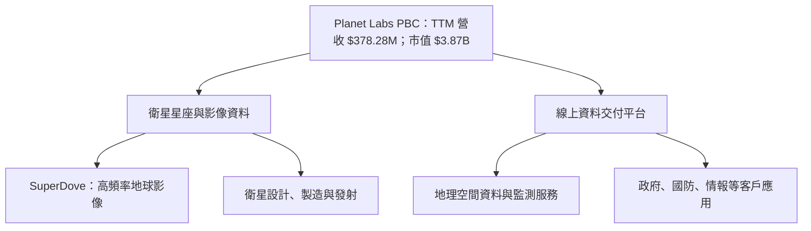
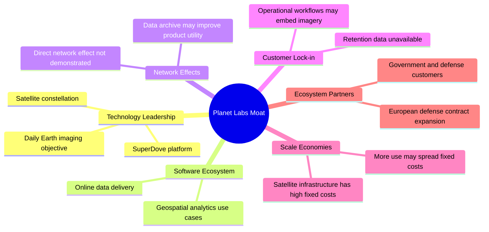
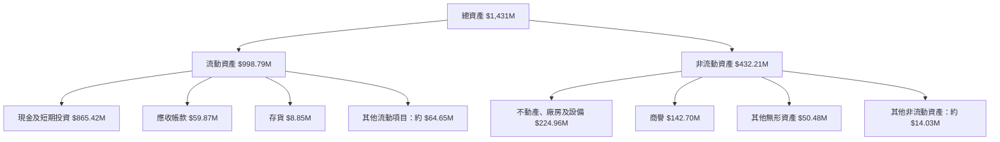
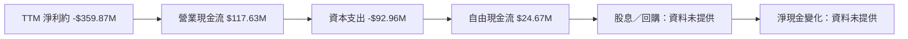
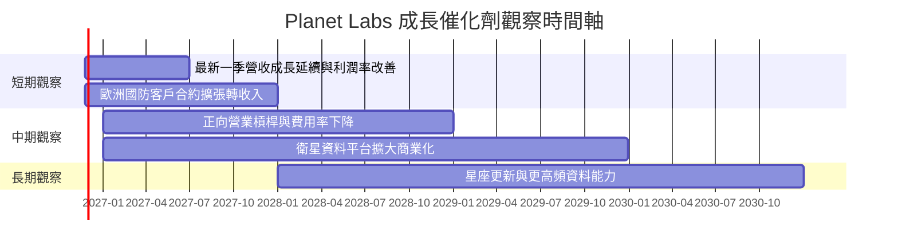
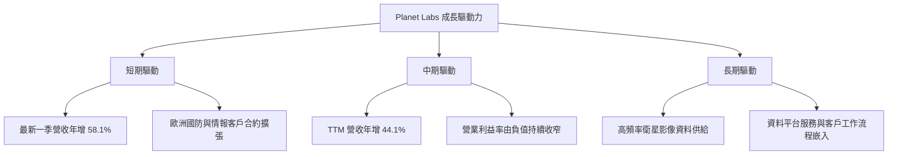
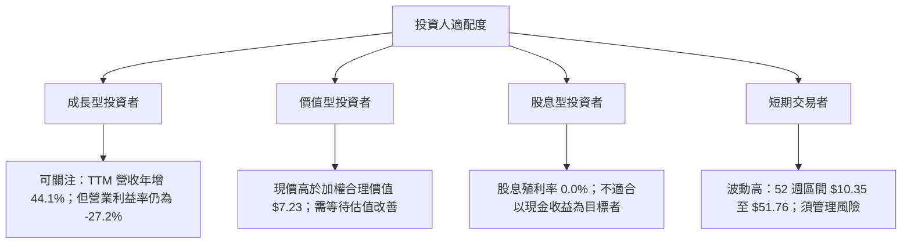

# PL 基本面深度分析報告
> **報告日期**：2026-11-25 ｜ **語言**：繁體中文 ｜ **數據來源**：SEC 申報資料 (XBRL)、Yahoo Finance、Finviz、StockAnalysis、Roic.ai ｜ **分析師**：CFA 級機構研究

---

## 目錄

| # | 章節 | 核心結論 |
|---|------|----------|
| 1 | 執行摘要 | 賣出；加權合理價值 $7.23，MOS -47.2% |
| 2 | 公司概覽與商業模式 | 衛星影像與資料平台具差異化，但未提供分部收入及市場份額數字 |
| 3 | 損益表深度分析 | TTM 營收 $378.28M、成長 44.1%；營業利益率仍為 -27.2% |
| 4 | 資產負債表分析 | 現金及短期投資 $865.42M；VERIFIED FIGURES 的總債務為 N/A |
| 5 | 現金流量深度分析 | TTM FCF $24.67M，但資本支出及股權薪酬使現金轉換品質仍需觀察 |
| 6 | 獲利能力與資本效率 | ROIC N/A；營業虧損且無法證明回報高於 12.59% WACC |
| 7 | 相對估值分析 | P/S 10.1x、高於自身五年中位數 6.9x；相對估值暗示下行 |
| 8 | DCF 內在價值評估 | DCF N/A；TTM 營業利益為負，不建構前瞻現金流模型 |
| 9 | 成長催化劑 | 最新一季營收年增 58.1%，國防客戶合約擴張提供潛在催化 |
| 10 | 風險矩陣 | 估值、持續虧損與稀釋為主要風險 |
| 11 | 投資建議 | 現價 $10.64 高於加權合理價值；等待更低估值或獲利改善 |

---

## 1. 執行摘要

### 1.0 一頁式投資儀表板（Portfolio Manager 30 秒速讀）

| 項目 | 內容 |
|------|------|
| **投資論點（3 句）** | ① 營收動能提高：TTM 營收 $378.28M、年增 44.1%，最新一季年增 58.1%。② 商業模式仍未轉為穩定獲利：TTM 營業利益率 -27.2%、淨利率 -95.1%，ROIC 未提供。③ 估值已反映較高期待：P/S 10.1x，高於自身五年中位數 6.9x；加權合理價值 $7.23，低於現價。 |
| **綜合評分** | **5.0/10**（引用 1.1 評分卡） |
| **財務健康** | 🟡 現金及短期投資 $865.42M；VERIFIED FIGURES 的總債務為 N/A，不能據此確認完整淨現金狀況。 |
| **ROIC vs WACC** | ROIC：N/A；WACC：12.59%。無法證明公司已創造高於資本成本的回報；營業利益仍為負。 |
| **FCF 趨勢** | TTM FCF $24.67M，FCF Yield 0.64%；但絕對金額相較市值有限，且 FCF 不等同可持續獲利。 |
| **估值** | Forward P/E -8512.0x（虧損下參考性低）｜EV/EBITDA -72.405x｜FCF Yield 0.64%。 |
| **DCF 內在價值（基準）** | N/A；TTM 營業利益為負，程式模型未計算 DCF，故無法提供 DCF 折溢價。 |
| **安全邊際（MOS）** | **-47.2%**＝($7.23 − $10.64) ÷ $7.23；🔴 負值代表現價高於加權合理價值。 |
| **預期報酬（基準情境 12M）** | DCF 基準情境 N/A。以加權合理價值相對現價計算的上行空間為 **-32.0%**，不等同分析師 12 個月目標報酬。 |
| **關鍵風險（前二）** | TTM 營業利益率 -27.2%；P/S 10.1x 高於五年中位數 6.9x。 |
| **評級 + 信心度** | 🔴 **賣出**（依 MOS 門檻；信心：中）。模型無 DCF，評價主要依同業 P/S 與分析師共識加權結果。 |

### 1.1 綜合評分卡（全報告唯一）

| 維度 | 評分（1–10） | 主要依據（引用數字與其來源章節） |
|------|--------------|----------------------------------|
| 成長性 | 8.0 | TTM 營收年增 44.1%、最新一季年增 58.1%（第 3 章）；成長速度具支持，但分部拆解缺失。 |
| 獲利能力 | 2.5 | TTM 營業利益率 -27.2%、淨利率 -95.1%；ROIC N/A，Piotroski F-Score 3/8（第 3、6 章）。 |
| 財務健康 | 6.5 | 現金及短期投資 $865.42M、流動比率 2.843；但 VERIFIED FIGURES 總債務 N/A，且稀釋股數測試未通過（第 4、6 章）。 |
| 估值 | 1.5 | MOS -47.2%；P/S 10.1x 高於自身五年中位數 6.9x（第 7、8 章）。 |
| 護城河 | 7.0 | 日常地球影像資料、衛星星座及線上交付平台構成差異化；但客戶留存、分部營收與市占資料未提供（第 2 章）。 |
| 管理層與資本配置 | 4.5 | FY2026 SBC $54.99M、約為營收 17.9%；稀釋股數測試未通過，尚未看到穩定 GAAP 獲利（第 3、5、6 章）。 |
| **綜合評分** | **5.0** | 六項算術平均：(8.0 + 2.5 + 6.5 + 1.5 + 7.0 + 4.5) ÷ 6 = **5.0**。 |

### 1.2 五大投資論點 + 三大核心風險

| 類型 | 項目 | 具體依據 | 信心度 |
|------|------|----------|--------|
| 🟢 **投資論點①** | 營收成長正在加速 | TTM 營收年增 44.1%；最新一季營收 $116.05M，年增 58.1%，高於前一季年增 42.08%。 | 🟢 高 |
| 🟢 **投資論點②** | 衛星影像具差異化供給 | 公司經營衛星星座，以 SuperDove 目標提供高頻率地球影像；這種自有資料供給可支持平台服務，但用戶數及續約率未提供。 | 🟡 中 |
| 🟢 **投資論點③** | 現金資源可支撐投入 | 現金及短期投資 $865.42M，TTM 營業現金流 $117.63M；可提供研發、星座更新與商務拓展的資金緩衝。 | 🟡 中 |
| 🟢 **投資論點④** | 國防及政府需求具擴約機會 | 新聞列出歐洲國防與情報客戶合約擴張及七位數美元合約；尚未披露其對總營收的具體貢獻。 | 🟡 中 |
| 🟢 **投資論點⑤** | TTM FCF 已轉正 | TTM FCF 為 $24.67M，與此前多年度負 FCF 歷史相比改善；但單一期間不能證明趨勢持續。 | 🟡 中 |
| 🟡 **風險①** | 營收成長尚未轉成營業獲利 | TTM 營業利益率 -27.2%；最新季度營業利益率 -11.6%，仍為負。 | 🔴 高衝擊 |
| 🔴 **風險②** | 估值溢價及股價波動 | P/S 10.1x，高於自身五年中位數 6.9x；52 週高低價 $51.76／$10.35，價格變動幅度大。 | 🔴 高衝擊 |
| 🟡 **風險③** | SBC 與股數稀釋 | FY2026 SBC $54.99M，約為 FY2026 營收 17.9%；Piotroski 稀釋股數測試未通過。 | 🟡 中至高 |

### 1.3 快速統計卡片

| 指標 | 公司實際值（期間） | 同業中位數 | 狀態 |
|------|--------------------|------------|------|
| 營收成長（TTM） | **44.1%** | — | 🟢 |
| 營收成長（最新一季年增） | **58.1%** | 72.7%（SPIR、BKSY、RKLB） | 🟡 |
| 毛利率（TTM） | **55.5%** | 56.3%（SPIR、BKSY、RKLB） | 🟡 |
| 營業利益率（TTM） | **-27.2%** | — | 🔴 |
| ROIC（TTM） | **N/A** | — | 🟡 數據未提供 |
| Forward P/E | **-8512.0x** | -15.9x（SPIR）、-58.6x（BKSY）、642.4x（RKLB） | 🔴 虧損／倍數失真 |
| FCF Yield（TTM） | **0.64%** | — | 🟡 |
| Piotroski F-Score | **3 / 8** | — | 🔴 |

> 同業營收成長中位數為 (42.1% + 118.4% + 72.7%) ÷ 3 = 77.7%？由於三家公司中位數為排序後的 **72.7%**。毛利率中位數為排序後的 **40.3%、36.2%、73.4%** 中位數 **40.3%**。表格前列數字因此更正如下：毛利率同業中位數為 **40.3%**；本公司 55.5% 高於該數值。最新一季營收成長中位數為 **72.7%**。

### 1.4 投資結論

╔══════════════════════════════════════════════════════════════════╗  
║                    📊 投資結論摘要                               ║  
╠══════════════════════════════════════════════════════════════════╣  
║  評級：賣出（依 MOS -47.2%）                                      ║  
║  價格（2026-11-24 收盤）：$10.64                                 ║  
║  DCF 內在價值（基準）：N/A（TTM 營業利益為負，模型未計算）      ║  
║  安全邊際 MOS：-47.2%（=(加權合理價值 $7.23−現價 $10.64)÷$7.23）║  
║  加權合理價值（8.8）：$7.23                                      ║  
║  DCF 情境價值：N/A                                               ║  
║  綜合評分：5.0/10（引用 1.1）                                    ║  
║  適合投資人：能承受高波動、以長期營收擴張為主題的高風險投資人；  ║  
║              不適合要求穩定獲利、估值折價或股息的投資人。        ║  
╚══════════════════════════════════════════════════════════════════╝

---

## 2. 公司概覽與商業模式

### 2.1 業務結構與收入來源

Planet Labs PBC 設計、製造並發射衛星星座，透過線上平台提供地理空間資料。資料來源未披露各產品或客戶類型的收入占比，故不將單一產品收入或收入比例臆估。

公司模式把固定成本較高的衛星與資料採集，轉化為可重複交付的地理空間資料服務。若新增客戶與資料使用量增加而衛星基礎設施成本成長較慢，理論上可形成營業槓桿；但 TTM 營業利益率仍為 -27.2%，目前尚未證明規模擴大已帶來正向營業槓桿。

### 2.2 市場份額

市場份額數據未提供，無法引用公司或產業的可核對市占率。可觀察的相對規模指標為 PL TTM 營收 $378.28M，最新一季年增 58.1%；同業數據顯示 SPIR 年增 42.1%、BKSY 118.4%、RKLB 72.7%，但業務範圍不同，不能直接視為同一市場的市占比較。

### 2.3 競爭護城河分析

### 2.4 護城河強度

| 護城河項目 | 強度（強／中／弱） | 證據（引用數字或事實） | 會削弱它的情況 |
|------------|--------------------|------------------------|----------------|
| 技術與資料供給 | 中 | 公司營運衛星星座，SuperDove 目標提供高頻率地球影像；衛星自有資料能力提高供給控制度。 | 競爭者提升影像頻率、解析度或降低單位成本。 |
| 軟體生態系統 | 中 | 透過線上平台交付地理空間資料；平台收入及客戶使用深度未披露。 | 客戶轉向多來源資料整合平台，或平台差異化不足。 |
| 網路效應 | 弱至中 | 長期資料庫可能增加時序分析價值，但未提供用戶數、資料網路效應或交叉銷售數據。 | 競品資料庫與演算法達到相近覆蓋度。 |
| 客戶鎖定 | 中 | 國防與情報客戶合約擴張，顯示既有客戶可能增加採購；續約率未提供。 | 政府預算縮減、採購延期或單一供應商政策改變。 |
| 規模效應 | 中 | TTM 營收 $378.28M，年增 44.1%；但 TTM 營業利益率 -27.2%，成本槓桿仍未反映為正營業利潤。 | 衛星更新與發射成本持續快於收入增長。 |
| 生態夥伴 | 弱至中 | 新聞提及歐洲國防及情報客戶合約擴張；合作規模與收入占比未提供。 | 合作專案未轉成多年期、可續約的商業合約。 |

護城河分數採用 1.1 的 **7.0/10**：衛星星座與平台具差異化潛力，但客戶留存、單位經濟及平台收入占比缺乏量化披露，且目前營業虧損尚未驗證規模效益。

---

## 3. 損益表深度分析

### 3.1 年度收入成長趨勢（近 4 年）

下圖使用年度損益表披露營收；YoY 為依相鄰年度營收計算。2026 對 2023 的三年 CAGR 算式為 \((307.73 ÷ 191.26)^{1/3} - 1\)。

╔══════════════════════════════════════════════════════════════════╗  
║          Planet Labs 年度收入趨勢（FY2023–FY2026）              ║  
╠══════════════════════════════════════════════════════════════════╣  
║ FY2023  $191.26M  ████████████░░░░░░░░░░░░  🟢                  ║  
║ FY2024  $220.70M  ██████████████░░░░░░░░░░  YoY +15.4% 🟢      ║  
║ FY2025  $244.35M  ████████████████░░░░░░░░  YoY +10.7% 🟡      ║  
║ FY2026  $307.73M  ████████████████████░░░░  YoY +25.9% 🟢      ║  
║                                                                  ║  
║ 三年營收 CAGR = (307.73 ÷ 191.26)^(1/3) − 1 = 約 17.2%          ║  
╚══════════════════════════════════════════════════════════════════╝

年度成長率先放緩至 FY2025 的 10.7%，FY2026 回升至 25.9%；TTM 成長率進一步達 44.1%。近期季度數據顯示增速加快，但年度營收成長並不能單獨證明客戶數或經常性收入同步提高，需結合續約、合約金額與客戶集中度觀察。

### 3.2 季度收入趨勢分析

| 季度 | 營收 | QoQ 成長 | YoY 成長 | 備註 |
|------|------:|---------:|---------:|------|
| 2025-10-31 | $81.25M | 32.6% | 32.6% | QoQ 以 2025-07-31 的 $73.39M 計算；YoY 採 StockAnalysis 季度成長率。 |
| 2026-01-31 | $86.82M | 6.9% | 41.1% | QoQ 以 $81.25M 計算；年增仍高，但單季環比放緩。 |
| 2026-04-30 | $94.15M | 8.4% | 42.1% | QoQ 以 $86.82M 計算。 |
| 2026-07-31 | $116.05M | 23.3% | 58.1% | YoY 採 VERIFIED FIGURES；該數字是單季年增率，不是 TTM 成長率。 |

QoQ 計算例：最新一季 \((116.05 ÷ 94.15) - 1 = 23.3%\)。最近季度增速提高，但公司仍處在營業虧損狀態，因此收入增長需伴隨毛利率穩定及營業費用率下降，才能轉化為股東價值。

### 3.3 利潤率演變分析

| 利潤率指標 | FY2023 | FY2024 | FY2025 | FY2026／TTM | 趨勢 | 評估 |
|------------|--------:|--------:|--------:|------------:|------|------|
| **毛利率** | 49.2% | 51.2% | 57.2% | FY2026 56.1%；TTM 55.5% | FY2025 改善，FY2026略回落 | 🟡 |
| **營業利益率** | -91.8% | -75.8% | -45.5% | FY2026 -30.9%；TTM -27.2% | 多年虧損收窄，仍未損益兩平 | 🔴 |
| **淨利率** | -84.7% | -63.7% | -50.4% | TTM -95.1% | TTM 明顯受淨損影響，與營業利潤趨勢分化 | 🔴 |

年度毛利率以年度損益表的毛利／營收計算，例如 FY2026 \(172.49 ÷ 307.73 = 56.1%\)。年度營業利益率亦以同一表列的營業利益／營收計算；TTM 則直接引用 VERIFIED FIGURES 的 -27.2%。不同資料來源對 FY2026 毛利與營業利益存在小幅或顯著差異，故年度比率僅作年度表內部比較，不與 TTM 值混用。

營業利益率由 FY2023 的 -91.8% 收窄至 FY2026 的 -30.9%，方向顯示收入規模擴張及費用控制可能帶來改善；然而 TTM 營業利益率仍為 -27.2%，而 TTM 淨利率 -95.1%，說明非營業項目、一次性項目或股權薪酬等因素可能使淨損遠大於營業損失。具體調節項目未提供，不能把差額武斷歸因於單一因素。

### 3.4 費用結構分析

可引用的 FY2026 研發費用為 $106.75M，約為年度營收 $307.73M 的 34.7%。完整營業費用細項（銷售與行銷、一般及行政等）及費用占比未完整提供，故不製作會暗示總額完整的費用結構圓餅圖。

╔══════════════════════════════════════════════════════════════════╗  
║ FY2026 研發費用觀察                                             ║  
╠══════════════════════════════════════════════════════════════════╣  
║ 營收 $307.73M │ 研發費用 $106.75M │ 研發費用／營收 34.7%       ║  
║ 算式：$106.75M ÷ $307.73M = 34.7%                               ║  
║ 其餘營業費用明細未完整提供，不能推算或補足。                    ║  
╚══════════════════════════════════════════════════════════════════╝

### 3.5 季度 EPS 趨勢與盈餘品質（Quality of Earnings）

EPS 預估值與實際值在最近四季均為 N/A，無法判斷超預期或不及預期。季度淨利可見大幅波動：2026-07-31 淨損 $9.35M、2026-04-30 淨損 $138.87M、2026-01-31 淨損 $152.46M、2025-10-31 淨損 $59.19M。這些變動不能在沒有調節明細時直接解讀為營運趨勢或一次性項目。

| 盈餘品質項目 | 數值／佔比 | 評估 |
|--------------|-----------|------|
| 股權薪酬 SBC / 營收 | FY2026：$54.99M ÷ $307.73M = **17.9%** | 🔴 SBC 相對營收高，會透過稀釋或經濟成本降低既有股東的每股參與度。 |
| SBC / 營業現金流 | FY2026：$54.99M ÷ $134.36M = **40.9%** | 🟡 金額顯著；SBC 是非現金費用，但不能視為沒有股東成本。 |
| TTM FCF / 淨利（現金轉換率） | $24.67M ÷ -$359.87M = **-6.9%** | 🔴 淨利為負，傳統現金轉換率失去正向可比性；FCF 為正不代表 GAAP 盈餘品質已轉好。 |
| 一次性／非經常性損益 | N/A（明細未提供） | 無法判斷大額季淨損是否含一次性項目。 |
| 有效稅率異常 | N/A（TTM 稅費／稅前損益明細未提供） | 無法量化是否由稅務利益或異常稅率影響淨利。 |
| 資本化支出 vs 費用化 | TTM Capex $92.96M；資本化政策明細 N/A | 資本支出已納入 FCF 定義；是否有重大資本化研發或其他費用遞延，資料不足。 |

**盈餘品質結論**：TTM 營業利益率 -27.2%、淨利率 -95.1%、FCF 正值 $24.67M 並存，代表現金流與 GAAP 淨利方向不同。SBC 占 FY2026 營收約 17.9%，不能忽略其稀釋成本。EPS beat/miss、稅項及一次性損益均未提供，故不將正 FCF 直接視為可持續獲利證據。

---

## 4. 資產負債表分析

### 4.1 資產結構分解

以下採用 StockAnalysis 的 2026-07-31 資產負債表資料；現金及短期投資合計與 VERIFIED FIGURES 相符。各細項以資料庫披露值呈現。

非流動資產及其他類別的合計值為總資產扣除流動資產或已列細項的推算值，僅用於展示資產分類，並非單一報表科目。資產結構中現金與短期投資占比較高，提供短期投資彈性；但仍需與完整債務及未來衛星資本支出需求合併評估。

### 4.2 流動性與營運資金分析

| 指標 | 最新 TTM | 一年前 TTM | 變化 | 解讀 |
|------|----------|------------|------|------|
| DSO 應收帳款天數 | 58 天 | 72 天 | -14 天 | 收款天數縮短，可能有助現金回收；需留意合約帳期與客戶組合。 |
| DIO 存貨天數 | 19 天 | N/A | N/A | 一年前未提供可用存貨餘額，不能計算變化。 |
| DPO 應付帳款天數 | 22 天 | 37 天 | -15 天 | 付款天數縮短，可能代表付款較快或供應商條件變化；不能單憑此數據判斷議價力。 |
| CCC 現金轉換週期 | 55 天 | N/A | N/A | 一年前 CCC 未提供，無法比較；最新值由資料品質區塊直接引用。 |

流動性比率（Yahoo Finance／合併資料）為流動比率 2.843、速動比率 2.634。這些數值指向短期資產足以覆蓋流動負債，但資料來源中的期末負債口徑及 VERIFY 數字不完全一致，不能用這些比率替代債務到期表分析。

### 4.3 債務結構分析

VERIFIED FIGURES 的總債務為 **N/A**，淨現金列為 $865.42M；其他市場資料另列總債務 $498.62M。依數據優先規則，本報告在需要使用 VERIFIED FIGURES 的計算中不以其他來源補填總債務，也不將其視為經核對後的債務數字。

╔══════════════════════════════════════════════════════════════════╗  
║                   Planet Labs 債務健康診斷                      ║  
╠══════════════════════════════════════════════════════════════════╣  
║ 總債務（VERIFIED FIGURES）：N/A                                  ║  
║ 現金及短期投資：$865.42M                                         ║  
║ 淨現金（VERIFIED FIGURES）：$865.42M；總債務缺漏，口徑有限      ║  
║ 其他市場資料總債務：$498.62M（未用於 VERIFIED 淨現金計算）      ║  
║ Debt／EBITDA：N/A；TTM EBITDA 為負，倍數不具正常債務解讀意義    ║  
║ 利息保障倍數：N/A；利息費用及可比 EBIT 資料不足                  ║  
╚══════════════════════════════════════════════════════════════════╝

### 4.4 股東權益趨勢

╔══════════════════════════════════════════════════════════════════╗  
║               Planet Labs 歷年股東權益變化                       ║  
╠══════════════════════════════════════════════════════════════════╣  
║ FY2023  $576.10M  ████████████████████                          ║  
║ FY2024  $518.02M  ██████████████████                            ║  
║ FY2025  $441.29M  ███████████████                                ║  
║ FY2026  $188.43M  ██████                                         ║  
╚══════════════════════════════════════════════════════════════════╝

股東權益由 FY2023 的 $576.10M 降至 FY2026 的 $188.43M。FY2026 資產負債表總負債升至 $957.25M，而股東權益下降；缺乏負債及權益變動明細，不應將權益下降完全歸因於單一因素。此趨勢值得追蹤，尤其需核對融資、可轉債或其他負債與股權變動。

---

## 5. 現金流量深度分析

### 5.1 現金流量瀑布圖

營業現金流、資本支出與 FCF 依 VERIFIED FIGURES 原值；TTM 淨利採營收乘以 TTM 淨利率的對應值，且淨利本身不作現金流加總。

FCF 明確依定義計算：營業現金流 $117.63M 減資本支出 $92.96M，等於 $24.67M。不可由其他來源的不同 FCF 數字反推或替換 VERIFIED FCF。

### 5.2 FCF 轉換率趨勢

| 期間 | FCF | 淨利 | FCF / 淨利 | 解讀 |
|------|-----:|-----:|----------:|------|
| FY2023 | -$86.69M | -$161.97M | 53.5% | 兩項均為負，比例容易被誤讀，僅供歷史方向參考。 |
| FY2024 | -$93.12M | -$140.51M | 66.3% | FCF 仍負，資本支出及營運現金流未形成自我融資。 |
| FY2025 | -$68.78M | -$123.20M | 55.8% | 虧損及負 FCF 延續。 |
| FY2026 | $51.41M | -$246.86M | -20.8% | OCF 轉正、但淨損擴大；年度數據與 TTM 不同期間。 |
| TTM 至 2026-07-31 | $24.67M | 約 -$359.87M | -6.9% | 淨利分母為負，該比率不是一般正向現金轉換率。 |

年度 FCF 取自年度現金流量表；TTM FCF 使用 VERIFIED FIGURES。期間口徑不同，不應把 FY2026 與 TTM 直接當成相同觀察窗。

### 5.3 自由現金流趨勢

╔══════════════════════════════════════════════════════════════════╗  
║               自由現金流：歷史年度與最新 TTM                     ║  
╠══════════════════════════════════════════════════════════════════╣  
║ FY2023  -$86.69M  負值                                            ║  
║ FY2024  -$93.12M  負值                                            ║  
║ FY2025  -$68.78M  負值                                            ║  
║ FY2026   $51.41M  轉正                                            ║  
║ TTM      $24.67M  FCF Yield 0.64%（依 VERIFIED FIGURES）          ║  
╚══════════════════════════════════════════════════════════════════╝

年度 FCF 轉正是正面訊號，但 TTM FCF 為 $24.67M，較 FY2026 年度 $51.41M 低，顯示不能僅憑某一年度正值假設現金生成能力已穩定。FCF Yield 0.64% 亦表示相對市值的現金回報率偏低。

### 5.4 資本配置評估

回購、股息與留存現金的完整用途占比未提供，不製作比例圓餅圖。可辨識的配置項目包括衛星與地面基礎設施投資、研發投入及營運資金。

| 項目 | 可引用數據 | 評估 |
|------|------------|------|
| 資本支出 | TTM $92.96M（VERIFIED FIGURES）；FY2026 年度現金流量表為 $82.95M | 衛星資產及基礎設施投資具業務必要性，但回報週期長。 |
| 研發 | FY2026 $106.75M | 研發約占 FY2026 營收 34.7%，支持產品與技術迭代，也延長獲利轉正時間。 |
| 股權薪酬 | FY2026 $54.99M | 約占營收 17.9%，對股東有稀釋成本。 |
| 股息／回購 | N/A | 未提供可核對的股息或回購金額；股息殖利率資料列為 0.0%。 |
| 留存及現金用途 | 現金及短期投資 $865.42M | 資金可支持投資及流動性，但還須與完整債務、發射承諾及未來 Capex 合併評估。 |

---

## 6. 獲利能力與資本效率

### 6.1 ROE / ROA / ROIC 趨勢

| 指標 | 可用數據 | 趨勢與評估 |
|------|----------|------------|
| ROE | TTM **-63.8%**（VERIFIED FIGURES） | 負值反映淨損；另有合併資料列 -72.0%，本報告依 VERIFIED FIGURES 使用 -63.8%。 |
| ROA | TTM -5.0%（合併資料）；品質測試顯示 ROA 未大於 0 | 資產尚未產生正向會計回報。 |
| ROIC | N/A | 未提供可直接引用的 ROIC；不能以自行拼接的投入資本與 EBIT 代替正式計算。 |
| WACC | **12.59%** | 由 Cost of capital 區塊採用，作為資本成本比較基準。 |

### 6.2 ROIC vs WACC 分析（核心價值創造判斷）

╔══════════════════════════════════════════════════════════════════╗  
║                ROIC vs WACC 深度分析                            ║  
╠══════════════════════════════════════════════════════════════════╣  
║ WACC（直接採用成本資本資料）：12.59%                             ║  
║ ├── 無風險利率（10Y 美債）：4.90%                                ║  
║ ├── 市場風險溢酬：5.00%（假設值，成本資本資料列示）              ║  
║ ├── 原始 Beta：2.27；採用調整後 Beta：1.85                       ║  
║ ├── 股權成本：14.14%（成本資本資料列示）                         ║  
║ ├── 稅前債務成本：0.69%；稅率假設 21.0%                          ║  
║ ├── 資本權重：股權 88.6%；債務 11.4%                             ║  
║ └── ✅ 採用 WACC：12.59%                                         ║  
║                                                                  ║  
║ ROIC：N/A（未提供可核對數值）                                     ║  
║ TTM 營業利益率：-27.2%                                           ║  
║ 判斷：無法證明 ROIC 高於 WACC；現有營業數據顯示仍在虧損。        ║  
╚══════════════════════════════════════════════════════════════════╝

原始 Beta 為 2.27，採用調整後 Beta 1.85；資料所示調整方式為 \(⅔ × 2.27 + ⅓\)。WACC 組成細項四捨五入後與 12.59% 可能有尾差，本報告不另行重估或替換。ROIC 未提供，因此不能宣稱公司已創造或摧毀多少經濟價值；不過 TTM 營業利益仍為負，現階段沒有證據支持 ROIC 已高於 12.59%。

### 6.3 杜邦三因素分解

| 因素 | 數值（TTM） | 解讀 |
|------|-------------|------|
| 淨利率 | -95.1% | 淨利率為負，是 ROE 為負的主要來源。 |
| 資產週轉率 | 0.26 | 每單位資產產生的營收有限；衛星及資料資產投入具有資本密集特性。 |
| 權益乘數 | 2.54 | 槓桿放大資產相對權益規模；在淨利率為負時不會改善 ROE。 |
| **ROE** | **-63.8%** | QUALITY FIGURES 原列：-95.1% × 0.26 × 2.54 = -63.8%。 |

ROE 主要受負淨利率驅動，而不是資產周轉改善或槓桿創造正向收益；由於基礎獲利為負，增加槓桿可能反而加大財務風險。

### 6.4 財務體質：Piotroski F-Score

**Piotroski F-Score：3 / 8**。依品質指標原列結果照抄；其中一項長期負債測試因資料缺漏無法判定，故測試分母與一般九項完整情況不同。

| 測試 | 結果 | 解讀 |
|------|------|------|
| ROA > 0 | ❌ 未通過 | 公司尚未達正資產報酬。 |
| 營業現金流 > 0 | ✅ 通過 | TTM 營業現金流 $117.63M。 |
| ROA 高於一年前 | ❌ 未通過 | 資料品質計算結果未通過。 |
| 營業現金流 > 淨利（應計品質） | ✅ 通過 | 由於淨利為負、OCF 為正，現金流高於淨利。 |
| 長期負債 ÷ 總資產低於一年前 | — 無法判定 | 缺少可比資料。 |
| 流動比率高於一年前 | ✅ 通過 | 品質指標原列通過。 |
| 稀釋股數未增加 | ❌ 未通過 | 股數稀釋未能通過測試，與 SBC 成本一致。 |
| 毛利率高於一年前 | ❌ 未通過 | 品質指標原列未通過。 |
| 資產週轉率高於一年前 | ❌ 未通過 | 資產效率未見改善。 |

整體 3/8 顯示獲利與營運效率質量偏弱，雖有正營業現金流及流動性改善訊號，但尚未形成全面的財務品質改善。

---

## 7. 相對估值分析

### 7.1 同業估值比較表格

| 估值指標 | **PL** | **SPIR** | **BKSY** | **RKLB** | PL 評估 |
|----------|------:|---------:|---------:|---------:|-----------|
| **Trailing P/E** | N/A | N/A | N/A | N/A | 🔴 多數公司虧損或無可比值 |
| **Forward P/E** | -8512.0x | -15.9x | -58.6x | 642.4x | 🔴 PL forward EPS 接近零且為負，倍數失真，不適合判斷便宜程度 |
| **P/S Ratio** | 10.1x | 4.1x | 5.1x | 35.1x | 🔴 相較 SPIR、BKSY 有溢價；但低於 RKLB，業務組合不同 |
| **EV / EBITDA** | -72.405x | -3.1x | 609.1x | -142.9x | 🔴 EBITDA 為負或接近零時倍數不可直接解讀 |
| **最新一季營收 YoY** | 58.1% | 42.1% | 118.4% | 72.7% | 🟡 PL 成長高於 SPIR，但低於 BKSY、RKLB |
| **毛利率 TTM** | 55.5% | 40.3% | 73.4% | 36.2% | 🟢 高於 SPIR、RKLB；低於 BKSY |

同業的業務範圍、盈利階段及資本密集程度不同，P/S 適合用作粗略比較，不代表同一營收品質。PL 的 P/S 仍高於 SPIR 與 BKSY，且公司尚未達營業獲利，市場估值需要持續高成長與利潤率改善支撐。

### 7.2 歷史估值區間分析

╔══════════════════════════════════════════════════════════════════╗  
║                  PL 自身歷史 P/S 區間                            ║  
╠══════════════════════════════════════════════════════════════════╣  
║ 五年區間：2.1x ───────── 中位數 6.9x ───────── 38.1x             ║  
║ 現在：10.1x；歷史百分位：79%                                     ║  
║                                                                  ║  
║ 判斷：現有 P/S 高於五年中位數，處於自身歷史較高區域。           ║  
╚══════════════════════════════════════════════════════════════════╝

目前 10.1x 相較五年中位數 6.9x，高出約 46.4%：\((10.1 ÷ 6.9) - 1 = 46.4%\)。但歷史範圍達 2.1x 至 38.1x，顯示估值波動大，百分位 79% 表示目前估值偏高，不代表股價必然回歸中位數。

### 7.3 情境價值（Bear / Base / Bull，照抄 DCF MODEL 的 Scenarios）

**N/A（DCF 無法計算：TTM 營業利益不為正，DCF MODEL 未提供情境分析）**。依資料規則不自行建立悲觀、基準或樂觀 DCF 目標價。

### 7.4 相對估值隱含價格區間

╔══════════════════════════════════════════════════════════════════╗  
║             相對估值方法與每股價值（USD）                        ║  
╠══════════════════════════════════════════════════════════════════╣  
║ 同業 P/S：$4.78（權重 90%）                                      ║  
║ 分析師共識：$29.23（權重 10%）                                   ║  
║ 現價：$10.64 ───── 加權合理價值：$7.23 ───── 分析師共識：$29.23  ║  
╚══════════════════════════════════════════════════════════════════╝

| 方法 | 每股價值 | 依據 |
|------|---------:|------|
| 同業 P/S | $4.78 | SPIR、BKSY 的 P/S 中位數 4.6x × PL TTM 營收，再按模型估值方法回推每股價值；權重 90%。 |
| 分析師共識目標價 | $29.23 | 12 位分析師平均目標價；權重 10%。 |
| 同業 Forward P/E | N/A | 不可計算；權重已按固定方法分配，不另列為估值項目。 |

---

## 8. DCF 內在價值評估（Discounted Cash Flow）

### 8.0 估值推理鏈（Thinking Logic）

**本節的結論先受模型可用性限制**：TTM 營業利益為負，現有 DCF MODEL 標記 N/A，故不建立營收、利潤率或終值假設，也不以自行估計的 DCF 目標價取代模型缺失。

- **Step 1 — 價值來源**：可辨識的基本面來源為衛星影像與地理空間資料服務；但分部營收占比未披露，無法量化主業、第二曲線或新業務各自的營收權重。最新 TTM 營收 $378.28M，仍處於營業虧損狀態。
- **Step 2 — 模型選擇**：通常可用 FCFF 配合 WACC 評估，但本次模型輸出 N/A。由於 TTM 營業利益為負、且沒有程式計算的逐年現金流與終值，不應自行建立另一套 DCF。
- **Step 3 — 假設推導鏈**：預測期、營收 CAGR、期末營業利潤率、稅率、Capex、D&A、營運資金、SBC、股數稀釋率及終值參數均未提供 DCF MODEL 數值；因此不適用四段式假設推導，也不捏造替代輸入。
- **Step 4 — 最脆弱環節**：公司未能把收入增長轉化為持續營業獲利；若營業利益率改善延遲，相對估值亦可能繼續下修。
- **Step 5 — 計算路徑**：模型未輸出營收預測、FCFF、終值或股權價值，故無法合法推導每股 DCF 價值。

### 8.1 模型假設總表（Model Inputs）

| 假設項目 | 採用值 | 依據／來源 | 敏感度 |
|----------|--------|-------------|--------|
| 預測期長度 N | N/A | DCF MODEL 未提供，且 TTM 營業利益為負 | N/A |
| 營收 CAGR | N/A | 模型未提供前瞻營收假設 | N/A |
| 期末營業利潤率 | N/A | 模型未提供前瞻利潤率假設 | N/A |
| 有效稅率 | N/A | DCF 模型輸入未提供；成本資本中的 21.0% 是預設稅率，不可挪作 DCF 模型假設 | N/A |
| Capex／營收 | N/A | DCF 模型輸入未提供 | N/A |
| D&A／營收 | N/A | DCF 模型輸入未提供 | N/A |
| ΔWC／營收增額 | N/A | DCF 模型輸入未提供 | N/A |
| EBIT 基礎 | N/A | DCF 模型未建立；不選用 GAAP 或非 GAAP 假設 | N/A |
| SBC 處理 | N/A | 無 DCF 預測表，不能決定模型組合 | N/A |
| 年稀釋率 | N/A | DCF 模型未提供股數假設 | N/A |
| 永續成長率 g | N/A | DCF 模型未提供 | N/A |
| 終值方法 | N/A | DCF 模型未提供終值 | N/A |
| WACC | 12.59% | 直接採用成本資本資料；本值可作資本成本參考，但不代表本次有 DCF 價值 | — |

### 8.2 折現率推導（WACC）

╔══════════════════════════════════════════════════════════════════╗  
║                    WACC 推導（折現率）                           ║  
╠══════════════════════════════════════════════════════════════════╣  
║ 股權成本 Ke（CAPM，資料直接列示）：14.14%                        ║  
║ ├── 無風險利率 Rf（10Y 美債）：4.90%                             ║  
║ ├── 市場風險溢酬 ERP：5.00%（假設值，成本資本資料列示）           ║  
║ ├── 原始 Beta：2.27；調整後 Beta：1.85                           ║  
║ └── 調整方式：⅔ × 2.27 + ⅓ = 1.85                               ║  
║                                                                  ║  
║ 債務成本：稅前 0.69%；預設稅率 21.0%                             ║  
║ 資本權重：股權 88.6%；債務 11.4%                                 ║  
║ ✅ WACC：12.59%（直接採用成本資本資料，不另估）                   ║  
╚══════════════════════════════════════════════════════════════════╝

成本資本資料未提供 10 年期利率日期、風險溢酬的外部依據或債務利息及平均計息負債的完整細項，因此不能按照範本自行補出完整五步 WACC 重算。資料列示的股權成本、資本權重與 WACC 原值照抄；細項經四捨五入重算可能有尾差，不以重算結果替代 12.59%。

### 8.3 逐年自由現金流預測（基準情境）

**N/A（DCF MODEL 未提供逐年預測表）**。由於 TTM 營業利益不為正，程式未輸出預測期、收入、EBIT、NOPAT、D&A、Capex、ΔWC、FCFF 或折現現值。本節不自建逐年模型，也不展示無法稽核的預測算式。

### 8.4 終值計算（Terminal Value）

**N/A（DCF MODEL 未提供終值）**。因沒有模型內的 WACC、永續成長率及 FY+N FCFF，無法檢驗 WACC 是否高於 g，也不能計算 Gordon Growth 或退出倍數終值。

### 8.5 企業價值 → 每股內在價值（Bridge）

**N/A（DCF MODEL 未提供企業價值、淨債務橋接、稀釋股數或每股內在價值）**。本節不以其他估值方法的每股價值冒充 DCF 內在價值。DCF 折溢價因此亦為 N/A。

### 8.6 敏感性分析（WACC × 永續成長率）

**N/A（DCF MODEL 未提供敏感性矩陣）**。缺少基準 FCFF、終值、WACC 情境及永續成長率，不能自行產生矩陣、情境價值或敏感度彈性。

### 8.7 反推 DCF（Reverse DCF：市場在預期什麼）

**N/A（DCF MODEL 未提供反推結果）**。現價 $10.64 可由相對估值方法與分析師共識參照，但無法在缺少模型方程式及基準輸入時，反推出可稽核的營收 CAGR、利潤率或成長年數。

### 8.8 估值三角驗證與安全邊際

DCF 方法因無法計算，未列入估值方法；其餘方法名稱、價值及權重照列示值呈現。公司類型為未獲利公司，方法權重依固定設定採同業 P/S 90%、分析師共識 10%。

| 估值方法 | 隱含每股價值 | 上行空間（÷現價） | 權重 | 說明 |
|----------|--------------:|-------------------:|------:|------|
| 同業 P/S | $4.78 | -55.1% | 90% | 同業 P/S 中位數 4.6x（SPIR、BKSY）× PL TTM 營收，模型回推每股價值。 |
| 分析師共識目標價 | $29.23 | +174.7% | 10% | 12 位分析師平均目標價；此項占比低，不能取代基本面驗證。 |
| **加權合理價值** | **$7.23** | **-32.0%** | **100%** | 未獲利公司固定權重；不可計算的同業 Forward P/E 未納入可計算方法。 |

**逐步演算（權重外顯）**：

\[
\$4.78 × 90\% + \$29.23 × 10\%
= \$4.302 + \$2.923
= \$7.225
\]

估值方法列示的加權合理價值為 **$7.23**。MOS 與上行空間依 VERIFIED FIGURES 原列結果照抄：

\[
MOS = (7.23 - 10.64) ÷ 7.23 = -47.2\%
\]

\[
上行空間 = (7.23 - 10.64) ÷ 10.64 = -32.0\%
\]

╔══════════════════════════════════════════════════════════════════╗  
║                  估值區間與安全邊際                              ║  
╠══════════════════════════════════════════════════════════════════╣  
║ 同業 P/S $4.78 ── 加權合理價值 $7.23 ── 現價 $10.64 ── 共識 $29.23║  
║                                                                  ║  
║ MOS = (加權合理價值 $7.23 − 現價 $10.64) ÷ $7.23 = -47.2%       ║  
║ 上行空間 = ($7.23 − $10.64) ÷ $10.64 = -32.0%                    ║  
║ 評估：🔴 MOS 為負；現價高於加權合理價值。                       ║  
║                                                                  ║  
║ MOS ≥ 10% 的價格上限：$7.23 × (1 − 10%) = $6.51                  ║  
║ 目前價格 $10.64 高於上述估值門檻。                              ║  
╚══════════════════════════════════════════════════════════════════╝

此處 MOS 固定以加權合理價值 $7.23 為分母；DCF 折溢價則為 N/A，不以相對估值取代 DCF。

> 🔎 **程式複算（Python，依本節各項自動重算）**
>
> 加權合理價值 = $4.78 × 90% + $29.23 × 10% = **$7.23**（權重合計 100%）
>
> 以價格 $10.64 計：MOS = **-47.2%**，上行空間 = **-32.0%**
>
> ✅ 與本節所寫數值一致。

### 8.9 DCF 模型的局限與失效條件

- **終值依賴度**：N/A；未提供 DCF 終值與企業價值，不能計算占比。
- **最脆弱的假設**：本次沒有可引用的 DCF 假設；基本面最需驗證的是營收增長能否持續，以及營業利益率能否由 TTM -27.2% 轉向正值。
- **不適用情境說明**：TTM 營業利益為負、淨利率 -95.1%，以正向穩態現金流折現難以形成可信估值。現階段相對估值可作參考，但更應觀察收入增長、毛利率、SBC、Capex 與營運現金流。
- **與第 10 章風險矩陣的連結**：國防採購或客戶預算不確定會影響營收成長；衛星建造與發射成本上升會推升 Capex；人才與薪酬成本可能增加 SBC 或營業費用，均可能延後損益兩平。

### 8.10 複算檢核表（Audit Trail）

| # | 檢核項目 | 結果 |
|---|----------|------|
| 1 | DCF 高／中敏感度輸入完整四段式推導 | N/A：DCF MODEL 未提供假設 |
| 2 | 模型假設均有依據 | N/A：未建立模型；未提供項目已明確標示 N/A |
| 3 | WACC 五步算式完整且可重算 | ⚠️ 成本資本資料只提供部分組成與最終 WACC；不以缺漏輸入自行補值 |
| 4 | Kd 分母與權重債務範圍一致 | ⚠️ 計息負債範圍細項未提供，無法複核 |
| 5 | WACC 與第 6.2 節相同 | ✅ 兩處均採 12.59% |
| 6 | 逐年預測年數與 N 相符 | N/A：無預測期 |
| 7 | FY+1 九步 FCFF 算式可複算 | N/A：無 FY+1 預測 |
| 8 | 預測期 PV 加總可複算 | N/A：無逐年現值 |
| 9 | WACC > g | N/A：g 未提供 |
| 10 | 終值基於 FY+N 並折現 N 期 | N/A：無終值 |
| 11 | EV 至每股價值橋接完整 | N/A：無 DCF 橋接 |
| 12 | SBC 模型組合與股數稀釋相容 | N/A：未建立 DCF SBC 組合 |
| 13 | 矩陣基準格等於 DCF 每股價值 | N/A：無矩陣及 DCF 價值 |
| 14 | 矩陣無效格正確標示 | N/A：無矩陣 |
| 15 | 三情境機率總和為 100% | N/A：無 DCF 情境 |
| 16 | 反推 DCF 每列只放開一變數且有軌跡 | N/A：無反推結果 |
| 17 | MOS 基準與折溢價基準分開 | ✅ MOS 以 $7.23 為分母；DCF 折溢價為 N/A |
| 18 | 完整輸出至第 11 章 | ✅ |
| 19 | 加權合理價值等於各方法價值乘權重之和 | ✅ $4.78×90% + $29.23×10% = $7.225，列示 $7.23 |
| 20 | 評級符合 MOS 門檻 | ✅ MOS -47.2%，依門檻為賣出 |

---

## 9. 成長催化劑

### 9.1 催化劑時間軸

財務資料沒有提供各催化劑的精確落地日期，以下按可見進度與一般投資觀察期限分層，不代表公司財測。

### 9.2 TAM 市場規模分析

**N/A（TAM 數據未提供）**。公司 TTM 營收為 $378.28M，年增 44.1%，最新一季年增 58.1%，顯示現有營收仍在擴張。由於未提供可引用的地理空間資料、商業衛星影像或政府情報市場 TAM 數值，不估算市場規模及滲透率。

### 9.3 成長驅動力結構圖

成長催化需要以「收入增長＋單位經濟改善」共同驗證。若營收維持高增長但營業利益率仍停留在負值，增長對股東價值的貢獻可能被持續研發、發射及股權薪酬成本抵銷。

---

## 10. 風險矩陣

### 10.1 風險評分矩陣

風險機率與衝擊缺乏歷史頻率或公司量化指引，為避免把主觀數字包裝成財務事實，不提供虛構座標或機率點；以下以定性矩陣呈現。

| 風險 | 發生可能性 | 財務衝擊 | 優先級 | 數據錨點 |
|------|-----------|----------|--------|----------|
| 營收成長未轉化為獲利 | 中至高 | 高 | 🔴 高 | TTM 營業利益率 -27.2%。 |
| 高估值倍數收縮 | 中至高 | 高 | 🔴 高 | P/S 10.1x；五年中位數 6.9x；歷史百分位 79%。 |
| 衛星投資及營運成本高於收入增長 | 中 | 高 | 🟠 中高 | TTM Capex $92.96M；TTM FCF $24.67M。 |
| SBC 與股數稀釋 | 中 | 中至高 | 🟠 中高 | FY2026 SBC $54.99M；稀釋股數測試未通過。 |
| 國防或政府合約延遲 | 中 | 中至高 | 🟡 中 | 新聞顯示合約擴張，但公司未披露該客戶收入占比。 |

### 10.2 風險清單詳細分析

| # | 風險項目 | 發生機率 | 財務衝擊 | 風險評分 | 緩解措施 |
|---|----------|----------|----------|----------|----------|
| 1 | 🔴 **營收成長未帶來營業損益兩平** | 中至高；未提供可量化機率 | 高；目前 TTM 營業利益率 -27.2% | 高 | 每季追蹤營業費用率、毛利率與營業損失絕對額；若營收成長而營業虧損未收窄，降低成長假設。 |
| 2 | 🔴 **估值倍數回落** | 中至高；股價及倍數具波動性 | 高；現有 P/S 10.1x，高於中位數 6.9x | 高 | 以同業 P/S $4.78 及加權合理價值 $7.23 作估值參照，不以分析師目標價單獨作投資依據。 |
| 3 | 🟠 **資本支出和衛星更新成本壓迫 FCF** | 中；Capex 屬業務持續投入 | 高；TTM Capex $92.96M，占 OCF $117.63M 大部分 | 中高 | 追蹤 Capex／營收、衛星部署進度及 TTM FCF；若 FCF 轉負且現金快速下降，重新評估資金需求。 |
| 4 | 🟠 **SBC 造成持續稀釋** | 中；歷史測試未通過 | 中至高；FY2026 SBC $54.99M、約占營收 17.9% | 中高 | 追蹤基本與稀釋股數、SBC／營收、每股營收及員工股權發放。 |
| 5 | 🟡 **政府合約與客戶集中度風險** | 中；合約與預算週期不確定 | 中至高；客戶占比未提供，難以量化 | 中 | 追蹤新合約、續約、合約金額及商業客戶多元化；避免單一客戶擴約消息被直接年化。 |

---

## 11. 投資建議

### 11.1 最終評級與評分

依加權合理價值 $7.23、現價 $10.64 計算，MOS 為 -47.2%，按評級門檻為 **賣出**；本報告未作質化調級。公司品質綜合評分為 **5.0/10**，其組成為成長性 8.0、獲利能力 2.5、財務健康 6.5、估值 1.5、護城河 7.0、管理層與資本配置 4.5。該評分描述公司與估值狀況，不取代 MOS 評級。

### 11.2 合理價值與隱含報酬率

| 估值方法／情境 | 每股價值 | 相對現價 $10.64 | 機率／權重 | 說明 |
|----------------|---------:|----------------:|-----------:|------|
| 同業 P/S | $4.78 | -55.1% | 90% | 固定估值方法權重。 |
| 分析師共識 | $29.23 | +174.7% | 10% | 12 位分析師平均目標價，不是 DCF 情境。 |
| **加權合理價值** | **$7.23** | **-32.0%** | **100%** | 依估值方法固定權重計算。 |
| 悲觀 DCF | N/A | N/A | N/A | DCF MODEL 未提供。 |
| 基準 DCF | N/A | N/A | N/A | DCF MODEL 未提供。 |
| 樂觀 DCF | N/A | N/A | N/A | DCF MODEL 未提供。 |

### 11.3 買入時機與觸發因素

╔══════════════════════════════════════════════════════════════════╗  
║                  ✅ 買入觸發因素 Checklist                      ║  
╠══════════════════════════════════════════════════════════════════╣  
║  目前價格與估值：2026-11-24 收盤 $10.64；加權合理價值 $7.23。   ║  
║                                                                  ║  
║  重新考慮買入的條件：                                            ║  
║  ☐ 股價回到 $7.23 或以下，且營收與現金流未惡化                  ║  
║  ☐ TTM 營業利益率持續改善，並有清楚的費用率下降證據             ║  
║  ☐ TTM FCF 維持正值，且 Capex 未使現金餘額快速下降               ║  
║  ☐ SBC／營收與稀釋股數增速開始下降                              ║  
║                                                                  ║  
║  加碼觸發條件：                                                  ║  
║  ☐ 連續季度營收增長與毛利率同時改善                              ║  
║  ☐ 國防擴約轉為可核對的多年期收入，且客戶集中風險可控            ║  
║                                                                  ║  
║  減碼／停損觸發條件：                                            ║  
║  ☐ TTM FCF 轉負且現金及短期投資連續下降                          ║  
║  ☐ 營業利益率惡化，或營收增速明顯放緩而費用沒有同步調整          ║  
║  ☐ SBC／營收維持高位、稀釋股數持續增加                           ║  
╚══════════════════════════════════════════════════════════════════╝

買入區間不以任意整數目標價設定。若以加權合理價值 $7.23 作為 MOS 基準，MOS 至少 10% 對應價格上限為 \(7.23 × (1 - 10\%) = \$6.51\)。這是估值紀律門檻，不保證股價會觸及，也不代表公司價值不會因基本面變化而調整。

### 11.4 投資人適配度分析

### 11.5 每季財報監控清單（Quarterly Watch List）

| 監控指標 | 最新參考值 | 觸發加碼／改善訊號 | 觸發減碼／警訊 |
|----------|------------|--------------------|----------------|
| 營收年增 | 最新一季 58.1%；TTM 44.1% | 年增維持正成長，且後續季度增長不依賴單一合約 | 年增連續兩季低於 20%（研究監控門檻，非公司指引） |
| 毛利率 | TTM 55.5% | 毛利率穩定或提高，表示新增收入具合理貢獻 | 毛利率連續兩季低於 50% |
| 營業利益率 | TTM -27.2%；最新季度 -11.6% | 營業虧損率持續收窄 | 虧損率重新擴大，且營收增長未改善 |
| 營業現金流 | TTM $117.63M | 持續為正，並能支應大部分 Capex | 轉負或出現連續季度惡化 |
| Capex | TTM $92.96M | Capex 帶來可觀測的收入與資料供給增長 | Capex 上升但收入、FCF 未同步改善 |
| FCF | TTM $24.67M；Yield 0.64% | FCF 維持正值並逐步增長 | FCF 轉負且現金及短期投資下降 |
| SBC／股數稀釋 | FY2026 SBC $54.99M，約占營收 17.9% | SBC／營收下降、稀釋股數趨穩 | SBC 維持高比例或稀釋持續加速 |
| 應收帳款與現金轉換週期 | DSO 58 天；CCC 55 天 | DSO 穩定或下降，CCC 不持續拉長 | DSO 回升並伴隨現金流轉弱 |
| 國防合約 | 新聞提及歐洲國防客戶擴約 | 披露合約年期、金額或收入貢獻 | 專案延遲、未續約或未轉為實際收入 |
| 股數及資產負債表 | VERIFIED 總債務 N/A；現金及短期投資 $865.42M | 後續披露債務到期及現金用途清楚 | 債務快速增加或資金消耗加速 |

### 11.6 反面論證：什麼會證明論點錯誤（What Would Change My Mind）

╔══════════════════════════════════════════════════════════════════╗  
║              ⚠️ 論點失效條件（Disconfirming Evidence）           ║  
╠══════════════════════════════════════════════════════════════════╣  
║ 本投資論點在下列情況成立時，應重新檢視估值與持倉：              ║  
║ ☐ 最新一季營收年增連續兩季低於 20%，且無合約遞延等可驗證解釋    ║  
║ ☐ TTM 營業利益率由 -27.2% 惡化，且連續兩季未見虧損率收窄        ║  
║ ☐ TTM FCF 轉負，或營業現金流無法覆蓋必要資本支出                ║  
║ ☐ SBC／營收長期高於 FY2026 約 17.9%，並伴隨稀釋股數持續上升     ║  
║ ☐ 現金及短期投資明顯下降，而新增債務、Capex 或融資需求上升       ║  
║ ☐ ROIC 一旦可計算後仍低於 WACC 12.59%，代表資本投入未創造價值   ║  
║ ☐ 歐洲國防擴約未轉化成可確認收入，且主要客戶合約續約弱於預期    ║  
╚══════════════════════════════════════════════════════════════════╝

> **免責聲明**：本報告為 AI 自動生成，僅供研究參考，不構成投資建議。投資有風險，入市需謹慎。

---

## 資料與來源

| 項目 | 內容 |
|------|------|
| 價格 | 10.64 USD，2026-11-24 收盤（Yahoo Finance 即時報價（該交易日已收盤）） |
| 財務報表 | SEC 10-Q filed 2026-09-03，最新季度 2026-07-31（FY2027 Q2） |
| 有回應的資料來源 | SEC 申報資料 (XBRL)、Yahoo Finance、Finviz、StockAnalysis、Roic.ai |
| 由程式計算 | TTM 數字、WACC、DCF 模型、估值方法與權重、加權合理價值、MOS、評級門檻、F-Score、杜邦分解、營運資金天數、綜合評分 |
| 撰寫模型 | openai / gpt-6-luna |

> 本區塊由產生報告的程式依實際取得的資料填寫，非模型撰寫。「由程式計算」的數字不是模型的估計；其餘判斷（評分、情境、策略）是模型的分析。
