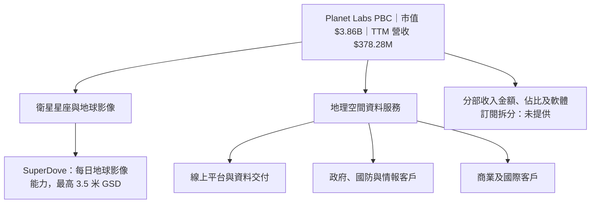
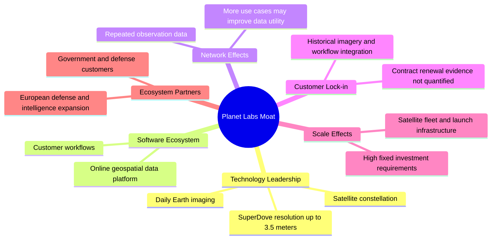
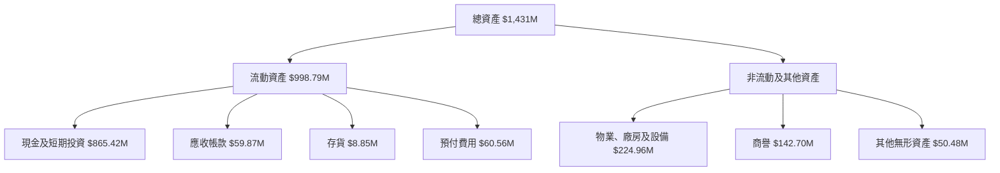
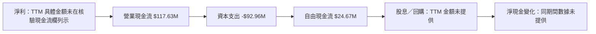
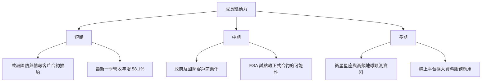
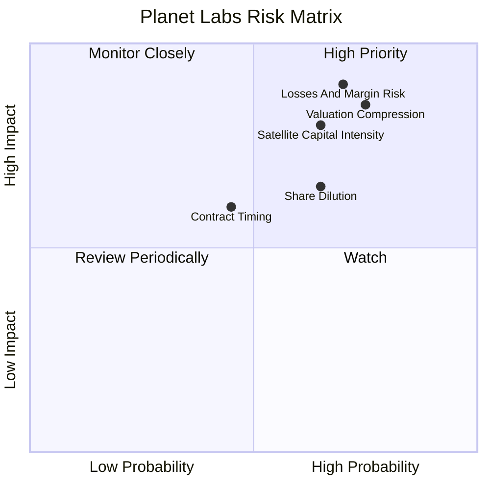
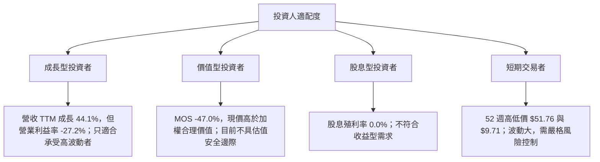

# PL 基本面深度分析報告
> **報告日期**：2026-11-26 ｜ **語言**：繁體中文 ｜ **數據來源**：SEC 申報資料 (XBRL)、Yahoo Finance、Finviz、StockAnalysis、Roic.ai ｜ **分析師**：CFA 級機構研究

> **資料口徑說明**：財務來源存在若干口徑不一致。本報告涉及最新股價、TTM 營收成長、最新季營業利益率、TTM 營業現金流、資本支出、自由現金流、現金及短期投資、ROE、資本成本、Piotroski F-Score、杜邦分解、營運資金天數及規定估值結果時，優先採用程式計算並以 SEC 申報資料為基礎的核驗數字。其他資料若採用，會標示來源或說明為補充口徑；不以未核驗資料替換核驗數字。

## 目錄

| # | 章節 | 核心結論 |
|---|------|----------|
| 1 | 執行摘要 | 賣出；加權合理價值 $7.22，MOS -47.0% |
| 2 | 公司概覽與商業模式 | 衛星影像及地理空間資料平台具差異化，但護城河持續性仍待證明 |
| 3 | 損益表深度分析 | TTM 營收 $378.28M、年增 44.1%；TTM 營業利益率仍為 -27.2% |
| 4 | 資產負債表分析 | 現金及短期投資 $865.42M；核驗資料未提供總債務 |
| 5 | 現金流量深度分析 | TTM FCF $24.67M，來自 OCF $117.63M 減 Capex $92.96M |
| 6 | 獲利能力與資本效率 | ROIC 未提供，不能確認是否高於 12.53% WACC |
| 7 | 相對估值分析 | P/S 高於自身五年中位數；規定加權合理價值低於現價 |
| 8 | DCF 內在價值評估 | N/A：TTM 營業利益為負，不建構自製 DCF |
| 9 | 成長催化劑 | 國防與情報客戶擴約可能帶來增長，合約金額及 TAM 數據不足 |
| 10 | 風險矩陣 | 估值收縮、持續虧損與高資本支出為主要風險 |
| 11 | 投資建議 | 依 MOS 評級賣出；重點追蹤營業槓桿、FCF 與稀釋 |

## 1. 執行摘要

### 1.0 一頁式投資儀表板（Portfolio Manager 30 秒速讀）

| 項目 | 內容 |
|------|------|
| **投資論點（3 句）** | ① TTM 營收 $378.28M、年增 44.1%，顯示商業需求快速擴張，但不等於獲利已成熟。② 最新一季營收年增 58.1%，同期營業利益率仍為 -11.6%，反映營收增長尚未完全轉化為營業獲利。③ TTM FCF 為 $24.67M，但 FCF Yield 僅 0.64%；按規定估值方法，加權合理價值 $7.22，低於 2026-11-25 收盤價 $10.61。 |
| **綜合評分** | **5.0/10**（引用 1.1 六項算術平均） |
| **財務健康** | 🟡 現金及短期投資 $865.42M；核驗資料的總債務為 N/A，故不據此推斷傳統淨現金。 |
| **ROIC vs WACC** | ROIC：N/A；WACC：12.53%。ROIC 未提供，無法判定價值創造或摧毀。 |
| **FCF 趨勢** | FY2026 年度 FCF 為 $51.41M（年度現金流量表），最新 TTM FCF 為 $24.67M；TTM FCF Yield 0.64%。兩者期間不同，不宜直接等同為同一口徑的惡化幅度。 |
| **估值** | Forward P/E -8488.0x（補充市場資料）；EV/EBITDA -72.18x（補充市場資料）；核驗 FCF Yield 0.64%。虧損狀態使 P/E、EV/EBITDA 解讀受限。 |
| **DCF 內在價值（基準）** | N/A（TTM 營業利益為負，不建立 DCF）；因此無 DCF 折溢價。 |
| **安全邊際（MOS）** | **-47.0%**＝($7.22 − $10.61) ÷ $7.22；加權合理價值為 8.8 基準。🔴 無安全邊際。 |
| **預期報酬（基準情境 12M）** | N/A（DCF Scenarios 未提供，且不得另行建構情境目標價）。 |
| **關鍵風險（前二）** | 營業虧損及資本密集型投資未能轉化為持續獲利；估值相對自身歷史及同業偏高。 |
| **評級 + 信心度** | 🔴 **賣出** ｜信心：中低。核驗 MOS 為 -47.0%，符合賣出門檻；DCF 缺失與多來源口徑差異降低估值信心。 |

### 1.1 綜合評分卡（全報告唯一）

| 維度 | 評分（1–10） | 主要依據（引用數字與其來源章節） |
|------|--------------|----------------------------------|
| 成長性 | 8.0 | TTM 營收年增 44.1%、最新一季年增 58.1%（第 3 章）；增長速度高，但未代表利潤同步成熟。 |
| 獲利能力 | 2.0 | TTM 營業利益率 -27.2%、ROE -63.8%、F-Score 3/8（第 3、6 章）；虧損及毛利率年度表現需持續改善。 |
| 財務健康 | 7.0 | 現金及短期投資 $865.42M、TTM OCF $117.63M、TTM FCF $24.67M（第 4、5 章）；但總債務核驗值 N/A。 |
| 估值 | 2.0 | MOS -47.0%；P/S 10.1x，高於自身五年中位數 6.9x（第 7、8 章）。 |
| 護城河 | 7.0 | 日更地球影像能力、衛星星座及線上地理空間平台構成差異化（第 2 章）；缺少市場份額及客戶集中度資料，未給更高分。 |
| 管理層與資本配置 | 4.0 | FY2026 SBC $54.99M、流通股數未通過 F-Score 測試（第 3、6 章）；高投資投入尚待轉化為長期股東回報。 |
| **綜合評分** | **5.0** | 六項算術平均：(8.0 + 2.0 + 7.0 + 2.0 + 7.0 + 4.0) ÷ 6 = 5.0。 |

### 1.2 五大投資論點 + 三大核心風險

| 類型 | 項目 | 具體依據 | 信心度 |
|------|------|----------|--------|
| 🟢 **投資論點①** | 需求增長可觀 | TTM 營收 $378.28M、年增 44.1%；最新一季營收年增 58.1%。若新需求能延續，收入規模可提升固定成本吸收能力。 | 🟢 高 |
| 🟢 **投資論點②** | 高頻衛星影像供給具差異性 | SuperDove 星座以高頻率地球影像為產品基礎，資料可服務政府及商業客戶；但財務資料未量化其收入佔比。 | 🟡 中 |
| 🟢 **投資論點③** | 現金緩衝可支應投資 | 現金及短期投資 $865.42M；相較 TTM FCF $24.67M，具一定資金緩衝，仍須核對總債務及資本投入需求。 | 🟡 中 |
| 🟢 **投資論點④** | 近期營業損失縮小 | FY2023 營業損失 $175.68M，FY2026 為 $95.07M；年度虧損縮小可能反映規模與成本控制改善，但最新 TTM 營業利益率仍為 -27.2%。 | 🟡 中 |
| 🟢 **投資論點⑤** | 國防與情報合約有擴張跡象 | 近期新聞提及歐洲國防與情報客戶合約擴約及七位數合約；未提供完整合約金額、期限或收入確認節奏。 | 🟡 中 |
| 🟡 **風險①** | 高估值容錯低 | P/S 10.1x、五年歷史百分位 79%，而規定加權合理價值為 $7.22，低於現價 $10.61。 | 🔴 高 |
| 🔴 **風險②** | 虧損及資本密集度 | TTM 營業利益率 -27.2%；TTM Capex $92.96M，約為 TTM FCF 的 3.77 倍。若成長放緩，現金流轉正難度上升。 | 🔴 高 |
| 🟡 **風險③** | 股權稀釋 | Piotroski 測試顯示稀釋股數未減少；FY2026 SBC $54.99M，約佔 FY2026 營收 17.9%。 | 🟡 中高 |

### 1.3 快速統計卡片

| 指標 | 公司實際值（期間） | 同業中位數 | 狀態 |
|------|--------------------|------------|------|
| 營收成長（TTM） | **44.1%** | — | 🟢 |
| 營收成長（最新一季年增） | **58.1%** | 72.7%（SPIR、BKSY、RKLB 最新季年增中位數） | 🟢 增長高，但低於該三家公司中位數 |
| 毛利率（TTM） | **55.5%** | 40.3%（SPIR、BKSY、RKLB 中位數） | 🟢 |
| 營業利益率（TTM） | **-27.2%** | — | 🔴 |
| ROIC（TTM） | **N/A** | — | ⚪ 未提供 |
| Forward P/E | **-8488.0x**（補充市場資料） | -16.3x、-57.0x、656.9x（Peer multiples） | 🔴 口徑雜訊高，且公司虧損 |
| FCF Yield（TTM） | **0.64%** | — | 🟡 |
| Piotroski F-Score | **3 / 8** | — | 🔴 |

### 1.4 投資結論

```text
╔══════════════════════════════════════════════════════════════════╗
║                    📊 投資結論摘要                               ║
╠══════════════════════════════════════════════════════════════════╣
║  評級：賣出（MOS -47.0%，符合規則 20）                           ║
║  價格（2026-11-25 收盤）：$10.61                                 ║
║  DCF 內在價值（基準）：N/A（TTM 營業利益為負）                   ║
║  安全邊際 MOS：-47.0%（($7.22−$10.61)÷$7.22）                   ║
║  加權合理價值（8.8）：$7.22                                      ║
║  DCF 情境價值：N/A（DCF MODEL 未提供）                           ║
║  綜合評分：5.0/10（引用 1.1）                                    ║
║  適合投資人：可承受高波動的成長型投資人；不適合追求估值保護者    ║
╚══════════════════════════════════════════════════════════════════╝
```

## 2. 公司概覽與商業模式

### 2.1 業務結構與收入來源

公司資料描述 Planet Labs 設計、建造並發射衛星星座，透過線上平台提供高頻地理空間資料。財務資料未提供按產品、客戶類型或服務模式拆分的營收，因此不推算業務板塊佔比。



核心商業模式的經濟邏輯是先投入衛星、發射與地面系統，再把影像資料透過平台交付給多類客戶；若同一資料可多次銷售，理論上能改善增量毛利，但現有資料未給出重複使用率、訂閱收入佔比或單位經濟性。

### 2.2 市場份額

市場份額數據未提供，無法引用可信的公司或產業份額。公司 TTM 營收為 $378.28M、TTM 成長 44.1%；同業參照中，SPIR 最新一季年增 42.1%、BKSY 118.4%、RKLB 72.7%，但三家公司業務範圍並不完全相同，不能視為同質市場份額比較。

### 2.3 競爭護城河分析



### 2.4 護城河強度

| 護城河項目 | 強度（強／中／弱） | 證據（引用數字或事實） | 會削弱它的情況 |
|------------|--------------------|------------------------|----------------|
| 衛星資料供給與技術 | 中 | SuperDove 提供每日地球影像能力，最高 3.5 米 GSD。 | 競爭者改善重訪頻率、解析度或單位成本。 |
| 軟體平台與工作流程 | 中 | 透過線上平台交付資料；客戶留存、訂閱率及軟體收入拆分未提供。 | 客戶轉向多供應商平台或自建資料處理流程。 |
| 網路效應 | 弱至中 | 長期、重複觀測可能提升資料用途；活躍使用者及資料網路效應指標未提供。 | 資料標準化或替代影像供給降低差異化。 |
| 客戶鎖定 | 中 | 新聞提及歐洲國防與情報客戶擴約；合約期限及流失率未提供。 | 政府預算延遲、重新招標或客戶降低依賴。 |
| 規模效應 | 中 | 擁有衛星星座並承擔發射及維運固定成本；成本曲線未提供。 | 星座更新及發射成本高於新增收入所能吸收。 |
| 生態夥伴 | 弱至中 | 有國際、政府及國防業務訊號；合作夥伴及收入貢獻未提供。 | 合作集中於少數計畫或補助，無法轉成常態商業合約。 |

1.1「護城河」評分為 7.0/10，理由是可持續影像供給與平台交付具差異化，但客戶留存、訂閱收入、成本優勢及市場份額等關鍵證據未提供。

## 3. 損益表深度分析

### 3.1 年度收入成長趨勢（近4年）

年度收入採年度損益表；YoY 依相鄰年度收入計算，四捨五入至一位小數。

```text
╔══════════════════════════════════════════════════════════════════╗
║           Planet Labs 年度收入趨勢（FY2023–FY2026）              ║
╠══════════════════════════════════════════════════════════════════╣
║  FY2023  $191.26M  █████████████░░░░░░░░░░░  YoY: +15.4% 🟢    ║
║  FY2024  $220.70M  ███████████████░░░░░░░░░  YoY: +15.4% 🟢    ║
║  FY2025  $244.35M  █████████████████░░░░░░░  YoY: +10.7% 🟡    ║
║  FY2026  $307.73M  █████████████████████░░░  YoY: +25.9% 🟢    ║
╠══════════════════════════════════════════════════════════════════╣
║  FY2023–FY2026 CAGR： (307.73 ÷ 191.26)^(1/3) − 1 = 17.2%      ║
╚══════════════════════════════════════════════════════════════════╝
```

FY2025 成長降至 10.7%，FY2026 回升至 25.9%；最新 TTM 成長率進一步達 44.1%。季度資料顯示收入加速，但目前營業利益率仍為負，增長能否形成經營槓桿，比單看營收增幅更重要。

### 3.2 季度收入趨勢分析

| 季度 | 營收 | QoQ 成長 | YoY 成長 | 備註 |
|------|------|----------|----------|------|
| 2025-10-31 | $81.25M | N/A（未提供前一季同口徑） | 32.63% | 年增加速，季度環比資料缺少前一季。 |
| 2026-01-31 | $86.82M | 6.86% | 41.05% | QoQ = 86.82 ÷ 81.25 − 1；YoY 取季度歷史資料。 |
| 2026-04-30 | $94.15M | 8.44% | 42.08% | QoQ = 94.15 ÷ 86.82 − 1；年增仍高於前期。 |
| 2026-07-31 | $116.05M | 23.27% | 58.1% | QoQ = 116.05 ÷ 94.15 − 1；58.1% 是單季年增率，不是 TTM。 |

最新季度收入跳升值得關注，但單季環比可能受合約交付或季節性影響；後續應確認高增長是否由重複性服務收入支撐。

### 3.3 利潤率演變分析

毛利率及營業利益率以年度收入、毛利及營業利益計算；期間為 FY2023–FY2026。TTM 與最新季度營業利益率採核驗值。

| 利潤率指標 | FY2023 | FY2024 | FY2025 | FY2026 | 最新 TTM／季度 | 趨勢與評估 |
|------------|--------|--------|--------|--------|----------------|------------|
| **毛利率** | 49.2% | 51.2% | 57.2% | 56.0% | TTM 55.5% | FY2025 上升後 FY2026 稍降；TTM 仍高於 SPIR、BKSY、RKLB 中位數 40.3%。🟢 |
| **營業利益率** | -91.8% | -75.8% | -45.5% | -30.9% | TTM -27.2%；最新季 -11.6% | 虧損率逐年收窄，固定成本吸收改善可能是原因之一，但仍未達營業損益兩平。🔴 |
| **淨利率** | -84.7% | -63.7% | -50.4% | -80.2% | TTM -95.1%（核驗值） | FY2026 淨損擴大，顯示營業改善未充分傳導至最終淨利；TTM 淨利率口徑也受非營業項目影響。🔴 |

FY2026 年度淨利為 -$246.86M，較 FY2025 的 -$123.20M 惡化；不能僅用營業虧損收斂推論整體獲利改善。最新季度營業利益率採用核驗的 -11.6%，與合併市場資料中的 -22.7% 不一致，因此以核驗值為準，並將季度成本結構確認列入監控項目。

### 3.4 費用結構分析

財務資料沒有完整呈現 TTM 研發、銷售管理費用及其他費用的統一拆分；不繪製會暗示比例完整的費用圓餅圖。年度研發費用 FY2026 為 $106.75M，佔營收約 34.7%（106.75 ÷ 307.73）；衛星折舊、發射及地面系統成本亦是經濟模型的重要組成，但未提供可完整分拆的數字。

```text
╔══════════════════════════════════════════════════════════════════╗
║                     FY2026 費用觀察                              ║
╠══════════════════════════════════════════════════════════════════╣
║  年度營收：$307.73M                                               ║
║  研發費用：$106.75M（約佔營收 34.7%）                            ║
║  營業損失：-$95.07M                                               ║
║  其他營業費用細分：未提供；不以不完整數字推算費用結構            ║
╚══════════════════════════════════════════════════════════════════╝
```

### 3.5 季度 EPS 趨勢與盈餘品質（Quality of Earnings）

最近四季 EPS 實際值可由季度淨利資料取得，但 EPS 預估值均為 nan，無法判斷超預期或不及預期；EPS surprise 不能用缺失值替代為零。

| 季度 | EPS 實際／近似值 | EPS 預估 | 超預期／不及預期 | 可觀察原因 |
|------|-------------------|----------|------------------|------------|
| 2026-07-31 | -$0.03（StockAnalysis） | N/A | 無法判斷 | 季度淨損 -$9.35M。 |
| 2026-04-30 | -$0.40（StockAnalysis） | N/A | 無法判斷 | 季度淨損 -$138.87M。 |
| 2026-01-31 | -$0.48（StockAnalysis） | N/A | 無法判斷 | 季度淨損 -$152.46M。 |
| 2025-10-31 | -$0.19（StockAnalysis） | N/A | 無法判斷 | 季度淨損 -$59.19M。 |

| 盈餘品質項目 | 數值／佔比 | 評估 |
|--------------|------------|------|
| 股權薪酬 SBC / 營收 | 最近四季 SBC 合計 $62.51M ÷ TTM 營收 $378.28M = **16.5%** | 🔴 SBC 顯著；以季度 SBC 合計計算，可能造成股東稀釋或需回購抵銷。 |
| SBC / 營業現金流 | $62.51M ÷ $117.63M = **53.1%** | 🟡 OCF 中相當部分與非現金 SBC 相關；OCF 不能完全代表可分配現金。 |
| FCF / 淨利（現金轉換率） | TTM FCF $24.67M；StockAnalysis TTM 淨利 -$359.87M；比率 = **-6.9%** | 🔴 淨利為負，傳統現金轉換率解讀失真；現金流為正不等於 GAAP 獲利已成立。 |
| 一次性／非經常性損益 | N/A（無法從所列資料完整辨識） | 不假定稅務利益或一次性項目美化淨利。 |
| 有效稅率異常 | N/A（有效稅率資料未提供） | 不能判定稅率對淨利的影響。 |
| 資本化支出 vs 費用化 | TTM Capex $92.96M（核驗值）；資本化政策細節 N/A | Capex 不代表損益表全部費用；須持續注意資本化是否掩蓋經濟維護成本。 |

**盈餘品質結論**：目前 GAAP 盈利能力仍弱，TTM 營業利益率 -27.2%、TTM 淨利率 -95.1%；TTM FCF 雖為正，但 SBC / 營收達 16.5%，且 SBC / OCF 達 53.1%。因此，正 FCF 的股東含金量須扣除稀釋成本後再評估，估值不宜只看現金流轉正。

## 4. 資產負債表分析

### 4.1 資產結構分解

採 StockAnalysis 最新 TTM 資產明細，總資產 $1,431M；下列節點僅呈現來源有列出的資產項目，不代表未列項為零。



### 4.2 流動性與營運資金分析

補充市場資料列出流動比率 2.843、速動比率 2.634；核驗營運資金天數如下。

| 指標 | 最新 TTM | 一年前 TTM | 變化 | 解讀 |
|------|----------|------------|------|------|
| DSO 應收帳款天數 | 58 天 | 72 天 | -14 天 | 收款天數下降，可能反映回款改善；未提供帳齡及合約付款條件，不能單獨確定原因。 |
| DIO 存貨天數 | 19 天 | N/A | N/A | 一年前資料未提供，不能計算變化；存貨規模不大，但不等於衛星建置資產已完整反映在存貨。 |
| DPO 應付帳款天數 | 22 天 | 37 天 | -15 天 | 付款天數下降，可能代表付款速度較快或供應商條款改變；不能據此判斷議價力。 |
| CCC 現金轉換週期 | 55 天 | N/A | N/A | 由最新 DSO、DIO、DPO 計算：58 + 19 − 22 = 55 天；前一年 CCC 缺項，不補算。 |

### 4.3 債務結構分析

核驗資料中總債務為 N/A，核驗淨現金欄列 $865.42M；此數字與現金及短期投資相同，不能解讀為已扣除債務後的傳統淨現金。補充市場資料另列總債務 $498.62M、淨現金 $366.79M，但與核驗欄位並不一致，故不混為同一口徑。

```text
╔══════════════════════════════════════════════════════════════════╗
║                   Planet Labs 債務健康診斷                      ║
╠══════════════════════════════════════════════════════════════════╣
║  總債務（核驗值）：N/A；補充市場資料：$498.62M                  ║
║  現金及短期投資：$865.42M（核驗值）                              ║
║  核驗資料淨現金欄：$865.42M；因總債務缺值，不視為扣債後淨額    ║
║  流動比率：2.843（補充市場資料）                                 ║
║  速動比率：2.634（補充市場資料）                                 ║
║  Debt/EBITDA、利息保障倍數：N/A／負 EBITDA 下不具正常解讀性      ║
╚══════════════════════════════════════════════════════════════════╝
```

補充資料顯示現金緩衝充足，但若總債務約 $498.62M 的口徑正確，則資金評估應使用扣除債務後餘額；在債務明細未經同一申報期核對前，本報告不將其與核驗淨現金欄合併。

### 4.4 股東權益趨勢

| 財年 | 股東權益 | 年度變化 | 解讀 |
|------|----------|----------|------|
| FY2023 | $576.10M | — | 歷史基準。 |
| FY2024 | $518.02M | -10.1% | 權益下降。 |
| FY2025 | $441.29M | -14.8% | 淨損與股本相關變化可能共同影響，需以權益變動表拆解。 |
| FY2026 | $188.43M | -57.3% | 年度權益明顯下降；同期總負債及資產結構變動較大。 |

```text
╔══════════════════════════════════════════════════════════════════╗
║                   股東權益趨勢（年度）                          ║
╠══════════════════════════════════════════════════════════════════╣
║  FY2023  $576.10M  ████████████████████                          ║
║  FY2024  $518.02M  ██████████████████                            ║
║  FY2025  $441.29M  ███████████████                                ║
║  FY2026  $188.43M  ██████                                         ║
╚══════════════════════════════════════════════════════════════════╝
```

## 5. 現金流量深度分析

### 5.1 現金流量瀑布圖

以下採用核驗 TTM 數字；無股息、回購及淨現金變化的同一期間完整數字，故不填入金額。



核驗定義為 FCF = OCF − Capex，代入為 $117.63M − $92.96M = **$24.67M**。補充市場資料另列 Capex $98.85M、FCF $18.78M；本報告遵照核驗 TTM 數字，不以補充口徑替代。

### 5.2 FCF 轉換率趨勢

| 財年／期間 | FCF | 淨利 | FCF / 淨利 | 評估 |
|------------|-----|------|------------|------|
| FY2023 | -$86.69M | -$161.97M | 53.5% | 虧損及負現金流。 |
| FY2024 | -$93.12M | -$140.51M | 66.3% | 現金流較淨利少負，但仍為負。 |
| FY2025 | -$68.78M | -$123.20M | 55.8% | 仍未轉正。 |
| FY2026 | $51.41M | -$246.86M | -20.8% | FCF 正、淨利大幅為負，比例方向不適合解讀為獲利轉換。 |
| 最新 TTM | $24.67M | -$359.87M（StockAnalysis） | -6.9% | 正 FCF 與負淨利並存，需分辨營運現金流、SBC 及營運資金影響。 |

### 5.3 自由現金流趨勢

年度 FCF 取年度現金流量表；最新 TTM FCF 取核驗值。不同期間的 FCF Yield 未提供歷史序列，因此只列核驗 TTM Yield。

```text
╔══════════════════════════════════════════════════════════════════╗
║                     自由現金流趨勢                               ║
╠══════════════════════════════════════════════════════════════════╣
║  FY2023  -$86.69M  ◀████████████████                             ║
║  FY2024  -$93.12M  ◀█████████████████                            ║
║  FY2025  -$68.78M  ◀████████████                                 ║
║  FY2026   $51.41M  █████████                                     ║
║  最新TTM  $24.67M  ████                                          ║
╠══════════════════════════════════════════════════════════════════╣
║  最新 TTM FCF Yield：0.64%（核驗值）                             ║
╚══════════════════════════════════════════════════════════════════╝
```

FY2026 FCF 轉正是正面訊號，但最新 TTM FCF 低於 FY2026 年度數字；兩者期間不同，且 Capex 仍高，應以連續多季現金流驗證，而非把單一年度轉正外推。

### 5.4 資本配置評估

沒有完整、同期間的回購、股息、併購及衛星投資拆分，故不畫資本配置圓餅圖。已知 FY2026 年度 Capex 為 $82.95M、SBC 為 $54.99M；最新 TTM Capex 核驗值為 $92.96M。股息殖利率為 0%，資本配置重點仍在衛星／平台投資與支持營運，而非現金回饋。

## 6. 獲利能力與資本效率

### 6.1 ROE / ROA / ROIC 趨勢

| 指標 | 歷史／最新數值 | 評估 |
|------|----------------|------|
| ROE | TTM **-63.8%**（核驗值） | 負值反映公司仍虧損；補充市場欄另列 -72.0%，本報告採核驗值。 |
| ROA | TTM -5.0%（補充市場資料） | 仍為負，資產尚未產生正向淨利回報。 |
| ROIC | N/A | 歷史資料未提供可核驗的 ROIC，不推算代替。 |
| WACC | **12.53%** | 採核驗資本成本資料。 |

### 6.2 ROIC vs WACC 分析（核心價值創造判斷）

ROIC 缺值，因此無法計算 EVA 或判定公司已創造／摧毀多少經濟價值。以下 WACC 及其組成按核驗資本成本輸入原值引用；原始 Beta 2.27，調整後 Beta 1.85。

```text
╔══════════════════════════════════════════════════════════════════╗
║                ROIC vs WACC 深度分析                            ║
╠══════════════════════════════════════════════════════════════════╣
║  WACC（核驗資本成本）：12.53%                                    ║
║  ├── 無風險利率（10Y 美債）：4.85%                               ║
║  ├── 市場風險溢酬 ERP：5.00%                                     ║
║  ├── 原始 Beta：2.27；採用調整後 Beta：1.85                     ║
║  ├── 股權成本 Ke：14.08%（核驗值）                              ║
║  ├── 稅前債務成本：0.69%（核驗值）                              ║
║  ├── 稅率假設：21.0%（核驗資本成本輸入）                        ║
║  ├── 股權／債務權重：88.6%／11.4%                               ║
║  └── WACC：12.53%（核驗值，不另行重算或替換）                   ║
║                                                                  ║
║  ROIC：N/A（缺少可核驗投入資本及相應稅後營業利潤數據）           ║
║  EVA = ROIC − WACC：N/A                                          ║
║  結論：無法量化價值創造；營業利益率仍為負，營運尚未達成熟獲利   ║
╚══════════════════════════════════════════════════════════════════╝
```

WACC 數值採用資本成本區塊提供的 12.53%，不以補充資料自行重算；因 ROIC 未提供，不能宣稱 ROIC 高於或低於 WACC。當前 TTM 營業利益率 -27.2% 支持「營業層面仍在消耗經濟資源」的判斷，但不等同精確 ROIC。

### 6.3 杜邦三因素分解

| 因素 | 數值（TTM） | 解讀 |
|------|-------------|------|
| 淨利率 | -95.1% | 主要拖累項；淨利為負。 |
| 資產週轉率 | 0.26 | 每單位資產產生的營收有限，需倚賴資產利用率提升。 |
| 權益乘數 | 2.54 | 槓桿放大負回報，但不是 ROE 為負的根本原因。 |
| **ROE** | **-63.8%** | -95.1% × 0.26 × 2.54 = -62.8%，與核驗 ROE -63.8% 有四捨五入／基礎口徑差異；照抄核驗杜邦列及 ROE。 |

### 6.4 財務體質：Piotroski F-Score

Piotroski F-Score：**3 / 8**。資料說明若測試缺少輸入則不納入分母；以下按核驗結果原列。

| 測試 | 結果 | 解讀 |
|------|------|------|
| ROA > 0 | ❌ 未通過 | 資產回報仍為負。 |
| 營業現金流 > 0 | ✅ 通過 | TTM OCF 為 $117.63M。 |
| ROA 高於一年前 | ❌ 未通過 | 年比改善未獲支持。 |
| 營業現金流 > 淨利（應計品質） | ✅ 通過 | 現金流高於淨利，但淨利為大額負值時此測試需審慎解讀。 |
| 長期負債 ÷ 總資產低於一年前 | — 無法判定 | 缺少比較所需資料。 |
| 流動比率高於一年前 | ✅ 通過 | 流動性指標比較通過。 |
| 稀釋股數未增加 | ❌ 未通過 | 股數稀釋對每股價值有侵蝕。 |
| 毛利率高於一年前 | ❌ 未通過 | 未通過代表毛利改善尚未延續。 |
| 資產週轉率高於一年前 | ❌ 未通過 | 資產使用效率年比未改善。 |

F-Score 3/8 顯示現金流與流動性有部分正面訊號，但資產回報、股數稀釋、毛利率及資產週轉率仍是弱項。

## 7. 相對估值分析

### 7.1 同業估值比較表格

公司估值資料與 Peer multiples 來源口徑不同時，依要求將同業倍數照核驗同業資料引用；公司欄則採所列市場估值資料。負 EBITDA 或負 EPS 下，相應倍數不宜直接視作可比的獲利估值。

| 估值指標 | **PL** | **SPIR** | **BKSY** | **RKLB** | PL 評估 |
|----------|-------|---------|---------|---------|----------|
| **Trailing P/E** | N/A | N/A | N/A | N/A | 🔴 公司及多數同業虧損，P/E 不適用。 |
| **Forward P/E** | -8488.0x（補充市場資料） | -16.3x | -57.0x | 656.9x | 🔴 分母接近零或獲利不穩定，數字難以提供有效相對估值。 |
| **P/S Ratio** | 10.205265x（補充市場資料；歷史序列核驗為 10.1x） | 4.2x | 5.0x | 35.9x | 🟡 高於 SPIR、BKSY，但低於 RKLB；公司類型與增長預期不同。 |
| **EV/EBITDA** | -72.18x（補充市場資料） | -3.2x | 593.2x | -146.7x | 🔴 多數為負值或極端值，不適合直接排序。 |
| **最新一季營收年增** | 58.1% | 42.1% | 118.4% | 72.7% | 🟢 成長高於 SPIR，低於 BKSY、RKLB。 |
| **毛利率（TTM）** | 55.5% | 40.3% | 73.4% | 36.2% | 🟢 高於 SPIR、RKLB，低於 BKSY。 |

### 7.2 歷史估值區間分析

核驗的 P/S（TTM）歷史資料：目前 10.1x、五年中位數 6.9x、區間 2.1x–38.1x、目前百分位 79%。

```text
╔══════════════════════════════════════════════════════════════════╗
║                 P/S 歷史區間（五年）                            ║
╠══════════════════════════════════════════════════════════════════╣
║  五年低位  2.1x  ├───●──────────────────────────────────────┤  ║
║  五年中位  6.9x  ├────────────●─────────────────────────────┤  ║
║  目前      10.1x ├──────────────────●───────────────────────┤  ║
║  五年高位 38.1x  ├────────────────────────────────────────●┤  ║
╠══════════════════════════════════════════════════════════════════╣
║  目前歷史百分位：79%；現值高於五年中位數，估值偏歷史高位區間    ║
╚══════════════════════════════════════════════════════════════════╝
```

### 7.3 情境價值（Bear / Base / Bull，照抄 DCF MODEL 的 Scenarios）

**N/A（DCF 無法計算：TTM 營業利益不為正，DCF MODEL 未提供情境輸出；不得自行建立情境目標價。）**

### 7.4 相對估值隱含價格區間

```text
╔══════════════════════════════════════════════════════════════════╗
║                    規定估值方法每股價值                          ║
╠══════════════════════════════════════════════════════════════════╣
║  同業 P/S：$4.77 ──────────────● 現價 $10.61                    ║
║  分析師共識：$29.23 ─────────────────────────●                  ║
╠══════════════════════════════════════════════════════════════════╣
║  PL 現價（2026-11-25）：$10.61                                  ║
╚══════════════════════════════════════════════════════════════════╝
```

| 估值方法 | 每股價值 | 依據 |
|----------|----------|------|
| 同業 P/S | $4.77 | 核驗方法列示：SPIR、BKSY 同業中位數 4.6x × TTM 營收，程式輸出每股價值 $4.77。照錄方法輸出，不自行替換估值結果。 |
| 分析師共識目標價 | $29.23 | 12 位分析師平均目標價；屬外部預期，不等於內在價值。 |

## 8. DCF 內在價值評估（Discounted Cash Flow）

### 8.0 估值推理鏈（Thinking Logic）

**適用性結論：N/A。** 核驗 DCF MODEL 明確指出 TTM 營業利益不為正，因此不折現負的當期營業獲利，也不自建營收、利潤率及終值假設。若在缺少模型輸出的情況下自行填入預測期、WACC 敏感度、情境價值或反推結果，將形成不可稽核的黑箱估值。

本公司的長期價值理應由既有影像資料服務、客戶擴約及未來營業槓桿共同決定；但各收入板塊佔比、客戶留存率、長期利潤率目標及 DCF 所需的逐年現金流並未提供。可引用的錨點為 TTM 營收 $378.28M、TTM 營業利益率 -27.2%、TTM FCF $24.67M；這些資料不足以建立合規的完整 DCF 推導鏈。

### 8.1–8.7 DCF 模型、折現率、現金流、終值、橋接、敏感度及反推估值

**N/A（DCF MODEL 未提供）。** 原因：TTM 營業利益為負，程式計算模型拒絕將虧損作為可持續現金流底盤折現。本報告因此不提供下列自製數字：預測年數、營收 CAGR、期末營業利潤率、逐年 FCFF、終值、DCF 每股價值、WACC × g 敏感度矩陣、DCF 三情境、機率加權價值及 Reverse DCF。WACC 12.53% 僅用於資本效率討論，並不代表本報告因此具備可用 DCF。

### 8.8 估值三角驗證與安全邊際

估值方法及權重按核驗估值輸出原值列示。公司類型為虧損公司；同業 Forward P/E 不可計算，權重已依規定分配給可用估值方法。

| 估值方法 | 隱含每股價值 | 上行空間（÷現價） | 權重 | 說明 |
|----------|--------------|-------------------|------|------|
| 同業 P/S | $4.77 | -55.0% | 90% | SPIR、BKSY 的同業中位數 P/S 4.6x，程式估值結果照錄。 |
| 分析師共識目標價 | $29.23 | +175.5% | 10% | 12 位分析師平均目標價，作為低權重參考。 |
| **加權合理價值** | **$7.22** | **-32.0%** | **100%** | 虧損公司固定權重組合；不可與單一分析師目標價混用。 |

**逐步演算（權重與加權價值）**

- 同業 P/S 加權值：$4.77 × 90% = $4.293。
- 分析師共識加權值：$29.23 × 10% = $2.923。
- 加總：$4.293 + $2.923 = $7.216，四捨五入至美分為 **$7.22**。
- 按核驗輸出照錄完整算式：**$4.77 × 90% + $29.23 × 10% = $7.22**。
- 權重合計：90% + 10% = **100%**。
- 同業 Forward P/E 因不可計算而排除；其權重依固定方法規則分配，未另增估值方法。

MOS 與上行空間採不同分母：

- **MOS**＝($7.22 − $10.61) ÷ $7.22 = -$3.39 ÷ $7.22 = **-47.0%**。
- **上行空間**＝($7.22 − $10.61) ÷ $10.61 = -$3.39 ÷ $10.61 = **-32.0%**。

```text
╔══════════════════════════════════════════════════════════════════╗
║                  估值區間與安全邊際                              ║
╠══════════════════════════════════════════════════════════════════╣
║  同業 P/S $4.77 ── [$7.22 加權合理價值] ── $10.61 現價           ║
║  分析師共識 $29.23（參考值；權重 10%）                           ║
║                                                                  ║
║  安全邊際 MOS = ($7.22 − $10.61) ÷ $7.22 = -47.0%               ║
║  上行空間 = ($7.22 − $10.61) ÷ $10.61 = -32.0%                  ║
║  評級：🔴 賣出                                                   ║
║  DCF 基準估值：N/A                                               ║
╚══════════════════════════════════════════════════════════════════╝
```

按加權合理價值計算，MOS 達買入門檻 10% 所對應的價格上限為 $7.22 × (1 − 10%) = **$6.498，約 $6.50**。這是由估值門檻推得的價格參考，不是 DCF 情境目標價。

> 🔎 **程式複算（Python，依本節各項自動重算）**
>
> 加權合理價值 = $4.77 × 90% + $29.23 × 10% = **$7.22**（權重合計 100%）
>
> 以價格 $10.61 計：MOS = **-47.0%**，上行空間 = **-32.0%**
>
> ✅ 與本節所寫數值一致。

### 8.9 DCF 模型的局限與失效條件

- **終值依賴度**：N/A；本報告沒有可用的 DCF 終值。
- **最脆弱的估值前提**：同業 P/S 中位數對 PL 是否適用，以及分析師共識目標價是否能代表可實現價值；兩者在核驗估值方法的權重分別為 90% 與 10%。
- **不適用情境**：公司 TTM 營業利益率為 -27.2%，且 FY2026 淨損 $246.86M，成熟期獲利假設缺少依據。現階段相對估值、營收品質、毛利率與單位經濟性比負利潤 DCF 更有參考價值。
- **與第 10 章風險連結**：營收增速回落會壓低營收倍數；資本支出上升會拖累 FCF；持續稀釋會降低每股價值；國防合約延遲則可能使市場預期落空。

### 8.10 複算檢核表（Audit Trail）

| # | 檢核項目 | 檢查方式 | 結果 |
|---|----------|----------|------|
| 1 | DCF 高／中敏感度假設四段式推導 | DCF MODEL 為 N/A，無模型假設可逐項推導。 | N/A |
| 2 | 每個 DCF 假設都有來歷 | 不自建假設；未以缺值填補模型。 | ✅ |
| 3 | WACC 五步算式完整且重算正確 | 採用核驗 WACC 12.53%，不另建 WACC 推導表。 | N/A |
| 4 | Kd 分母與債務權重範圍一致 | 核驗 DCF 未提供債務橋接及詳細 D 欄位。 | N/A |
| 5 | WACC 與第 6.2 節一致 | 兩處引用核驗 WACC 12.53%。 | ✅ |
| 6 | 逐年預測欄數符合 N 且無省略 | DCF 模型 N/A，無預測表。 | N/A |
| 7 | FY+1 FCFF 代表年度可複算 | 未提供 DCF 逐年現金流。 | N/A |
| 8 | 預測期 PV 合計可複算 | 未提供 DCF 折現值。 | N/A |
| 9 | WACC > g | 模型未提供 g。 | N/A |
| 10 | 終值以 FY+N 現金流為基礎 | 未提供終值模型。 | N/A |
| 11 | EV 至每股價值橋接 | DCF 橋接 N/A；相對估值加權值按核驗輸出列示。 | N/A |
| 12 | SBC 組合經濟相容 | DCF 未建模，未使用可能重複計算的 SBC 調整。 | N/A |
| 13 | 敏感度基準格等於 DCF 每股價值 | DCF 敏感度矩陣未提供。 | N/A |
| 14 | 矩陣無 WACC ≤ g 數值格 | 未提供矩陣。 | N/A |
| 15 | 三情境機率相加為 100% | DCF Scenarios 未提供。 | N/A |
| 16 | Reverse DCF 每列只放開一個變數 | Reverse DCF 未提供，不自行反推。 | N/A |
| 17 | MOS 分母為 8.8 加權合理價值；DCF 折溢價以 8.5 為基準 | MOS 以 $7.22 計算；DCF 值 N/A，故不計 DCF 折溢價。 | ✅ |
| 18 | 完整輸出至第 11 章 | 本報告含 11 章。 | ✅ |
| 19 | 加權合理價值等於價值乘權重之和 | $4.77×90% + $29.23×10% = $7.216 ≈ $7.22。 | ✅ |
| 20 | 評級符合 MOS 門檻 | MOS -47.0%，符合賣出門檻。 | ✅ |

## 9. 成長催化劑

### 9.1 催化劑時間軸

資料列出合約擴約、歐洲國防與情報布局及 ESA pilot 等近期新聞，但沒有完整公告日期、合約生效期與收入確認時間，故不製作帶有未核實日期的甘特圖。

| 時間範圍 | 催化劑 | 可能的財務傳導 | 需要驗證的數據 |
|----------|--------|----------------|----------------|
| 短期 | 歐洲國防與情報客戶合約擴約 | 若按期交付，可能支撐營收成長與客戶黏著。 | 合約金額、期限、收入認列、續約率。 |
| 短中期 | 近期國防客戶合約擴展及七位數合約新聞 | 可能改善政府／國防客戶收入可見度。 | 新增訂單是否轉為營收、毛利與回款。 |
| 中期 | ESA pilot | 試點成功可能開啟新應用，但目前屬早期訊號。 | 試點轉商業合約的比例與時間。 |
| 長期 | 高頻率地球影像及資料平台擴張 | 若資料可多次銷售，平台收入可提升增量毛利。 | 訂閱收入比、活躍客戶、留存與每客戶收入。 |

### 9.2 TAM 市場規模分析

**N/A（TAM 數據未提供）。** 可引用的經營規模是 TTM 營收 $378.28M、TTM 成長 44.1%，最新一季營收年增 58.1%。這些數字支持公司正處於快速擴張階段，但不能代替市場規模或市場滲透率估算。

### 9.3 成長驅動力結構圖



## 10. 風險矩陣

### 10.1 風險評分矩陣

機率及衝擊位置為質化研究判斷，不是財務數據推導值；圖中節點僅表示相對排序。



### 10.2 風險清單詳細分析

| # | 風險項目 | 發生機率 | 財務衝擊 | 風險評分 | 緩解措施 |
|---|----------|----------|----------|----------|----------|
| 1 | 🔴 **估值收縮** | 中高 | P/S 現值 10.1x，高於五年中位數 6.9x；若回歸中位數，股價可能承受倍數壓縮。 | 🔴 高 | 要求營收加速伴隨毛利與營業利益率改善；避免只以營收倍數外推。 |
| 2 | 🔴 **虧損持續、營業槓桿未落地** | 高 | TTM 營業利益率 -27.2%；若費用增速不低於營收，收入成長未必能改善虧損。 | 🔴 高 | 每季追蹤營業利益率及費用增速；檢查最新季 -11.6% 是否持續。 |
| 3 | 🔴 **衛星與發射資本需求** | 中高 | TTM Capex $92.96M；若投資加速但現金回報延後，FCF 可能轉負。 | 🔴 高 | 監測 Capex／營收、衛星投資回收期與 TTM FCF。 |
| 4 | 🟡 **股權稀釋與 SBC** | 中高 | 最近四季 SBC 合計約 $62.51M，相對 TTM 營收約 16.5%；Piotroski 稀釋股數測試未通過。 | 🟡 中高 | 追蹤稀釋股數、SBC／營收及回購是否真正抵銷稀釋。 |
| 5 | 🟡 **政府合約與收入認列時點** | 中 | 新聞提及國防客戶擴約，但缺少金額、期限及收入認列資訊。 | 🟡 中 | 追蹤訂單轉營收、合約續約、客戶集中度及應收帳款。 |

## 11. 投資建議

### 11.1 最終評級與評分

依 MOS -47.0%，本報告評級為 **賣出**，未作質化上調或下調；此評級只由 8.8 加權合理價值 $7.22 與 2026-11-25 收盤價 $10.61 的安全邊際門檻得出。公司綜合評分為 **5.0/10**，六項分數依序為成長性 8.0、獲利能力 2.0、財務健康 7.0、估值 2.0、護城河 7.0、管理層與資本配置 4.0。

### 11.2 合理價值與隱含報酬率

| 估值依據 | 每股價值 | 相對現價 $10.61 | 機率／權重 | 說明 |
|----------|----------|----------------|------------|------|
| 同業 P/S | $4.77 | -55.0% | 90% | 規定估值方法輸出。 |
| 分析師共識目標價 | $29.23 | +175.5% | 10% | 12 位分析師平均目標價。 |
| **加權合理價值** | **$7.22** | **上行空間 -32.0%；MOS -47.0%** | **100%** | 用於評級與 MOS。 |
| DCF 悲觀／基準／樂觀情境 | N/A | N/A | N/A | DCF MODEL 未提供；不自行設定目標價。 |

### 11.3 買入時機與觸發因素

```text
╔══════════════════════════════════════════════════════════════════╗
║                  ✅ 買入觸發因素 Checklist                      ║
╠══════════════════════════════════════════════════════════════════╣
║  目前立場：不追價；現價 $10.61 高於加權合理價值 $7.22          ║
║                                                                  ║
║  重新評估買入條件：                                              ║
║  ☐ 股價回到約 $6.50 以下，對應加權合理價值至少 10% MOS          ║
║  ☐ TTM FCF 持續為正，且 FCF 不再被高額 SBC 大幅稀釋             ║
║  ☐ 營業利益率連續改善，並確認最新季 -11.6% 可延續                ║
║                                                                  ║
║  加碼觸發條件：                                                  ║
║  ☐ 營收增長延續且毛利率不低於目前 TTM 55.5%                     ║
║  ☐ TTM FCF 高於目前 $24.67M，且 Capex 投入可轉化為收入          ║
║  ☐ 國防合約擴約公布可核實的金額、期限及續約／收入認列           ║
║                                                                  ║
║  減碼／退出觸發條件：                                            ║
║  ☐ TTM FCF 轉負並連續兩季未回正                                 ║
║  ☐ 最新季營收年增低於 20%，且營業利益率同步惡化                 ║
║  ☐ SBC／營收持續高於 16.5%，或稀釋股數增速加快                  ║
╚══════════════════════════════════════════════════════════════════╝
```

### 11.4 投資人適配度分析



### 11.5 每季財報監控清單（Quarterly Watch List）

| 監控指標 | 目前基準 | 觸發加碼／改善訊號 | 觸發減碼／惡化訊號 |
|----------|----------|--------------------|--------------------|
| 營收年增 | 最新一季 58.1%；TTM 44.1% | 季度年增維持 40% 以上且合約收入能見度提升。 | 連續兩季低於 20%。 |
| 營業利益率 | TTM -27.2%；最新季 -11.6%（核驗值） | 連續改善並向損益兩平收斂。 | 連續兩季較最新核驗值惡化 5 個百分點以上。 |
| 毛利率 | TTM 55.5% | 持穩或提升，並由高毛利資料服務帶動。 | 跌破 50% 且同時營收增速放緩。 |
| OCF／Capex／FCF | TTM $117.63M／$92.96M／$24.67M | FCF 持續為正且增長快於 Capex。 | FCF 轉負並連續兩季未恢復。 |
| SBC 及稀釋股數 | 最近四季 SBC 合計約 $62.51M；Piotroski 股數測試未通過 | SBC／營收下降、稀釋股數增速減慢。 | SBC／營收高於約 16.5% 且稀釋加速。 |
| DSO／CCC | DSO 58 天；CCC 55 天 | DSO 維持或下降，現金回收穩定。 | DSO 明顯上升且應收帳款增速高於營收。 |
| Capex | TTM $92.96M | 衛星投資轉化為收入及續約。 | Capex 上升但營收、毛利與 FCF 未改善。 |
| 國防與政府合約 | 新聞提及歐洲國防與情報客戶擴約 | 公布可驗證合約金額、期限及收入確認。 | 合約延遲、試點未轉商業化或預算縮減。 |

### 11.6 反面論證：什麼會證明論點錯誤（What Would Change My Mind）

```text
╔══════════════════════════════════════════════════════════════════╗
║              ⚠️ 論點失效條件（Disconfirming Evidence）           ║
╠══════════════════════════════════════════════════════════════════╣
║  多頭投資論點需在下列情況成立時重新檢視或退出：                  ║
║  ☐ 最新一季營收年增連續兩季低於 20%                              ║
║  ☐ 營業利益率連續兩季低於 -20%，或明顯背離改善路徑              ║
║  ☐ TTM FCF 由 $24.67M 轉負，且連續兩季未回正                    ║
║  ☐ SBC／營收高於目前約 16.5%，且稀釋股數持續增加                ║
║  ☐ 毛利率跌破 50%，同時營收增長明顯放緩                         ║
║  ☐ 國防客戶擴約及 ESA 試點未轉為可確認的商業收入                ║
║  ☐ 後續可核驗 ROIC 低於 WACC 12.53%，且長期無改善跡象           ║
╚══════════════════════════════════════════════════════════════════╝
```

> **免責聲明**：本報告為 AI 自動生成，僅供研究參考，不構成投資建議。投資有風險，入市需謹慎。

---

## 資料與來源

| 項目 | 內容 |
|------|------|
| 價格 | 10.61 USD，2026-11-25 收盤（Yahoo Finance 即時報價（該交易日已收盤）） |
| 財務報表 | SEC 10-Q filed 2026-09-03，最新季度 2026-07-31（FY2027 Q2） |
| 有回應的資料來源 | SEC 申報資料 (XBRL)、Yahoo Finance、Finviz、StockAnalysis、Roic.ai |
| 由程式計算 | TTM 數字、WACC、DCF 模型、估值方法與權重、加權合理價值、MOS、評級門檻、F-Score、杜邦分解、營運資金天數、綜合評分 |
| 撰寫模型 | openai / gpt-6-luna |

> 本區塊由產生報告的程式依實際取得的資料填寫，非模型撰寫。「由程式計算」的數字不是模型的估計；其餘判斷（評分、情境、策略）是模型的分析。
