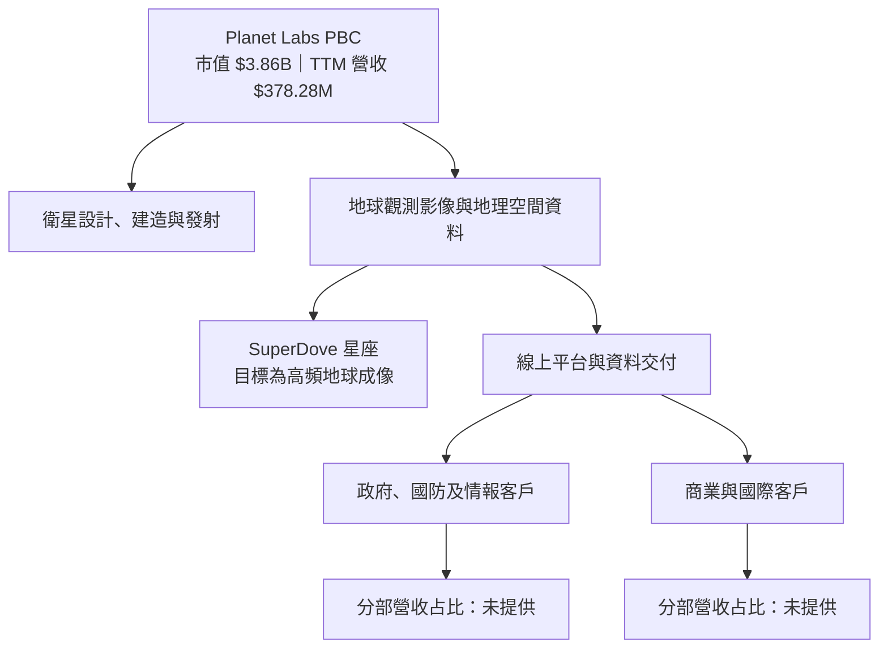
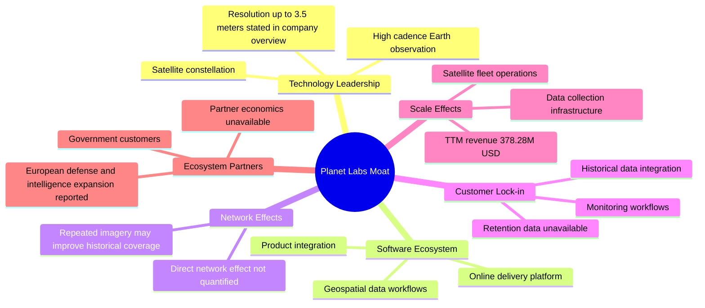
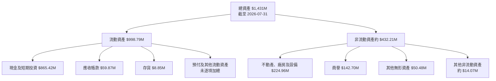
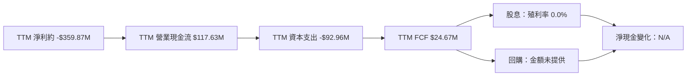
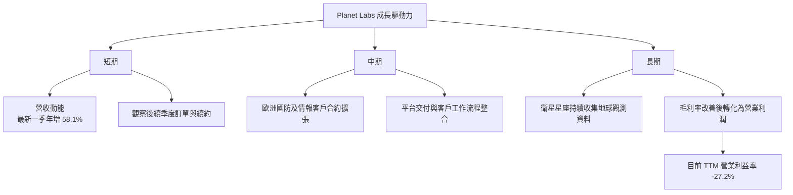
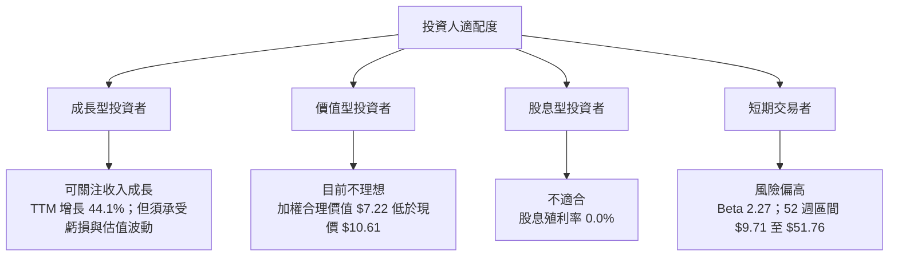

# PL 基本面深度分析報告
> **報告日期**：2026-11-27 ｜ **語言**：繁體中文 ｜ **數據來源**：SEC 申報資料 (XBRL)、Yahoo Finance、Finviz、StockAnalysis、Roic.ai ｜ **分析師**：CFA 級機構研究

## 目錄

| # | 章節 | 核心結論 |
|---|------|----------|
| 1 | 執行摘要 | 賣出；加權合理價值 $7.22，MOS -47.0% |
| 2 | 公司概覽與商業模式 | 地球觀測資料與線上平台具差異化，但收入組成及市場份額未提供 |
| 3 | 損益表深度分析 | TTM 營收 $378.28M、年增 44.1%；TTM 營業利益率 -27.2% |
| 4 | 資產負債表分析 | 現金及短期投資 $865.42M；債務資料來源存在差異 |
| 5 | 現金流量深度分析 | TTM FCF $24.67M，按 OCF 減 Capex 定義；Capex 投入仍高 |
| 6 | 獲利能力與資本效率 | WACC 12.53%；ROIC 未提供，無法證明已創造經濟價值 |
| 7 | 相對估值分析 | P/S 10.1 倍，高於五年中位數 6.9 倍 |
| 8 | DCF 內在價值評估 | DCF N/A；依同業 P/S 與分析師共識加權價值為 $7.22 |
| 9 | 成長催化劑 | 最新一季營收年增 58.1%，歐洲國防合約擴張是可追蹤催化劑 |
| 10 | 風險矩陣 | 高估值、持續營業虧損及衛星投資與執行風險居前 |
| 11 | 投資建議 | 賣出；現價高於加權合理價值，MOS 為負 |

---

## 1. 執行摘要

PL 以衛星星座收集地球觀測影像，並透過線上平台交付地理空間資料。最新可用財報期間為截至 2026-07-31 的 FY2027 Q2，TTM 營收 $378.28M、年增 44.1%，最新一季營收年增 58.1%；但 TTM 營業利益率仍為 -27.2%，ROE 為 -63.8%。以 2026-11-25 收盤價 $10.61 計，程式估值方法給出的加權合理價值為 $7.22，MOS 為 -47.0%，因此依規則 20 評級為**賣出**。此評級反映高估值與虧損，不代表否定其地理空間資料業務的成長潛力。

### 1.0 一頁式投資儀表板（Portfolio Manager 30 秒速讀）

| 項目 | 內容 |
|------|------|
| **投資論點（3 句）** | ① TTM 營收年增 44.1%，最新一季年增 58.1%，成長速度值得追蹤。② TTM 營業利益率 -27.2%，規模擴張尚未轉化為營業獲利。③ P/S 10.1 倍，高於五年中位數 6.9 倍，估值要求高成長與利潤率改善同時延續。 |
| **綜合評分** | **4.8/10**（引用 1.1 評分卡） |
| **財務健康** | 🟡 現金及短期投資 $865.42M，流動比率 2.843；但負債來源資料不一致，且仍有營業虧損。 |
| **ROIC vs WACC** | ROIC：N/A；WACC：12.53%。ROIC 未提供，不能據此證明創造股東價值；負 TTM 營業利益率顯示目前獲利基礎不足。 |
| **FCF 趨勢** | TTM FCF 為正 $24.67M；TTM FCF Yield 為 0.64%。 |
| **估值** | Forward P/E -8488.0 倍（虧損下無實質解讀力）｜EV/EBITDA -72.18 倍｜FCF Yield 0.64%（均按各來源原值引用；FCF Yield 以核實數值為準）。 |
| **DCF 內在價值（基準）** | N/A：TTM 營業利益為負，DCF 模型未計算；折溢價 N/A。 |
| **安全邊際（MOS）** | **-47.0%**＝($7.22 − $10.61) ÷ $7.22；🔴 無安全邊際。分母為第 8.8 節加權合理價值。 |
| **預期報酬（基準情境 12M）** | DCF 基準情境 N/A；以加權合理價值相對現價計算的上行空間為 **-32.0%**，不是 12 個月預測。 |
| **關鍵風險（前二）** | 營業虧損延續；市場估值高於同業 P/S 估值基準及自身歷史中位數。 |
| **評級 + 信心度** | 🔴 **賣出** ｜ 信心：中（估值與財報虧損方向清晰；DCF 無法提供獨立驗證）。 |

### 1.1 綜合評分卡（全報告唯一）

| 維度 | 評分（1–10） | 主要依據（引用數字與其來源章節） |
|------|--------------|----------------------------------|
| 成長性 | 8.0 | TTM 營收年增 44.1%、最新一季年增 58.1%（第 3 章），但季度增速仍需觀察能否持續。 |
| 獲利能力 | 2.0 | TTM 營業利益率 -27.2%、ROE -63.8%、Piotroski F-Score 3/8（第 3、6 章）。 |
| 財務健康 | 7.0 | 現金及短期投資 $865.42M、流動比率 2.843；但債務數據口徑有衝突（第 4 章）。 |
| 估值 | 1.0 | MOS -47.0%，P/S 10.1 倍，處於自身五年估值區間第 79 百分位（第 7、8 章）。 |
| 護城河 | 7.0 | 日常地球觀測與線上資料交付具差異化；但缺少分部營收、留存率及市場份額數據（第 2 章）。 |
| 管理層與資本配置 | 5.0 | FY2026 SBC $54.99M，稀釋股數測試未通過；現有數據不足以判斷回購或資本配置成效（第 3、5 章）。 |
| **綜合評分** | **5.0** | 六項算術平均：\((8.0+2.0+7.0+1.0+7.0+5.0)÷6=5.0\)。 |

### 1.2 五大投資論點 + 三大核心風險

| 類型 | 項目 | 具體依據 | 信心度 |
|------|------|----------|--------|
| 🟢 **投資論點①** | 營收動能加速 | TTM 營收 $378.28M，TTM 年增 44.1%；最新一季收入 $116.05M，單季年增 58.1%。 | 🟢 高 |
| 🟢 **投資論點②** | 衛星資料具高頻更新特性 | 公司以 SuperDove 星座提供高頻地球觀測資料，對需持續監測的客戶具有產品差異化。 | 🟡 中 |
| 🟢 **投資論點③** | 現金資源提供投資緩衝 | 現金及短期投資 $865.42M，可支持衛星、軟體平台與銷售投入；但現金消耗及債務口徑需持續核對。 | 🟡 中 |
| 🟢 **投資論點④** | 國防與政府需求有拓展機會 | 新聞摘要提及歐洲國防與情報客戶合約擴張；未提供合約金額及收入占比，故不能量化對總營收的貢獻。 | 🟡 中 |
| 🟢 **投資論點⑤** | 毛利率高於所列同業中位數 | PL TTM 毛利率 55.5%，SPIR、BKSY、RKLB 的中位數為 40.3%；但較高毛利尚未帶來營業獲利。 | 🟡 中 |
| 🟡 **風險①** | 虧損與估值落差 | TTM 營業利益率 -27.2%、淨利率 -95.1%，P/S 10.1 倍。若營收或利潤率改善不及預期，估值可能下修。 | 🔴 高衝擊 |
| 🔴 **風險②** | 股東稀釋與 SBC | 最近四季 SBC 合計 $62.51M，約占 TTM 營收 16.5%；Piotroski 稀釋股數測試未通過。 | 🔴 高衝擊 |
| 🟡 **風險③** | 高波動及估值回撤 | 股價 52 週高低區間為 $51.76 至 $9.71；Beta 2.27，空頭占流通股 11.6%。 | 🟡 中度 |

### 1.3 快速統計卡片

| 指標 | 公司實際值（期間） | 同業中位數 | 狀態 |
|------|--------------------|------------|------|
| 營收成長（TTM） | **44.1%** | — | 🟢 |
| 營收成長（最新一季年增） | **58.1%** | 72.7% | 🟡 |
| 毛利率（TTM） | **55.5%** | 40.3% | 🟢 |
| 營業利益率（TTM） | **-27.2%** | — | 🔴 |
| ROIC（TTM） | **N/A** | — | 🟡 |
| Forward P/E | **-8488.0 倍** | -16.3 倍、-57.0 倍、656.9 倍；中位數 -16.3 倍 | 🔴 |
| FCF Yield（TTM） | **0.64%** | — | 🟡 |
| Piotroski F-Score | **3 / 8** | — | 🔴 |

> 同業最新一季營收年增率中位數為 72.7%（SPIR 42.1%、BKSY 118.4%、RKLB 72.7%）；毛利率中位數為 40.3%。不同公司業務組合不同，僅作參考。

### 1.4 投資結論

```text
╔══════════════════════════════════════════════════════════════════╗
║                    📊 投資結論摘要                               ║
╠══════════════════════════════════════════════════════════════════╣
║  評級：賣出（MOS -47.0%，依規則 20；未作質化上調或下調）         ║
║  價格（2026-11-25 收盤）：$10.61                                 ║
║  DCF 內在價值（基準）：N/A（TTM 營業利益為負，模型未計算）       ║
║  安全邊際 MOS：-47.0%（＝($7.22−$10.61)÷$7.22）                 ║
║  加權合理價值（8.8）：$7.22                                      ║
║  綜合評分：5.0/10（引用 1.1）                                    ║
║  適合投資人：能承受高波動、願意追蹤成長與利潤率轉折的投資人；    ║
║              不適合以當期盈利或低估值為主要篩選條件者。          ║
╚══════════════════════════════════════════════════════════════════╝
```

---

## 2. 公司概覽與商業模式

### 2.1 業務結構與收入來源

公司設計、建造並發射衛星星座，透過線上平台向美國及國際客戶交付高頻地理空間資料。可核實的公司總覽數字為市值 $3.86B、TTM 營收 $378.28M；但產品、地區、政府與商業客戶收入占比未提供，因此不拆分或推算各業務金額。



### 2.2 市場份額

市場份額的可引用數字及年份未提供，故不繪製份額圖，也不推估市場占比。以已知數據看，PL TTM 營收 $378.28M、年增 44.1%；在所列同業中，其最新一季年增 58.1% 高於 SPIR 的 42.1%，低於 BKSY 的 118.4% 與 RKLB 的 72.7%。

### 2.3 競爭護城河分析



### 2.4 護城河強度

| 護城河項目 | 強度（強／中／弱） | 證據（引用數字或事實） | 會削弱它的情況 |
|------------|--------------------|------------------------|----------------|
| 技術與資料資產 | 中 | 公司部署衛星星座，SuperDove 目標為高頻地球成像，地面採樣距離最高約 3.5 米。 | 競爭者提升解析度、重訪頻率或降低資料價格。 |
| 軟體平台 | 中 | 資料透過線上平台交付；平台收入占比與客戶留存率未提供。 | 客戶轉向多來源資料整合或低成本替代服務。 |
| 客戶鎖定 | 中 | 政府、國防與商業客戶可能將資料整合至工作流程；合約續約率、流失率未提供。 | 服務採購轉向一次性或可替換供應商。 |
| 規模效應 | 中 | TTM 營收 $378.28M，營收成長 44.1%；衛星資產可支援持續資料收集。 | 衛星更新、發射與維運成本增速高於收入增長。 |
| 網路效應 | 弱至中 | 時間序列影像可能提高歷史資料價值，但客戶互相增值的效果沒有量化資料。 | 客戶價值主要來自單一影像，而非累積資料與共享生態。 |
| 生態夥伴 | 中 | 新聞摘要提及歐洲國防與情報客戶合約擴張；夥伴收入和合約價值未提供。 | 政府預算、採購程序或地緣政治變化令合約延遲。 |

> 1.1「護城河」評分為 7.0/10：衛星星座與線上交付具結構性差異，但留存、分部收入及市場份額等量化證據不足以支持更高評價。

---

## 3. 損益表深度分析

### 3.1 年度收入成長趨勢（近 4 年）

FY2023 至 FY2026 營收分別為 $191.26M、$220.70M、$244.35M、$307.73M。年度成長率為 15.39%、10.72%、25.94%（FY2026 為年度表與 StockAnalysis 報告值）。FY2023–FY2026 三年 CAGR 約 17.2%，計算為 \((307.73÷191.26)^{1/3}-1\)。年度成長加速與 TTM 44.1% 的高增速相符，但尚須由訂單及續約情況驗證可持續性。

```text
╔══════════════════════════════════════════════════════════════════╗
║               Planet Labs 年度收入趨勢（FY2023-FY2026）          ║
╠══════════════════════════════════════════════════════════════════╣
║ FY2023  $191.26M  █████████████                  YoY: +15.39%   ║
║ FY2024  $220.70M  ███████████████                YoY: +15.39%   ║
║ FY2025  $244.35M  ████████████████               YoY: +10.72%   ║
║ FY2026  $307.73M  ████████████████████           YoY: +25.94%   ║
╠══════════════════════════════════════════════════════════════════╣
║ FY2023-FY2026 三年營收 CAGR：約 17.2%                            ║
╚══════════════════════════════════════════════════════════════════╝
```

### 3.2 季度收入趨勢分析

| 季度 | 營收 | QoQ 成長 | YoY 成長 | 備註 |
|------|-----:|---------:|---------:|------|
| 2025-10-31 | $81.25M | N/A | 32.63% | QoQ 基期季度未列於最近四季表格。 |
| 2026-01-31 | $86.82M | 6.86% | 41.05% | 相較前季增加 $5.57M。 |
| 2026-04-30 | $94.15M | 8.44% | 42.08% | 相較前季增加 $7.33M。 |
| 2026-07-31 | $116.05M | 23.27% | 58.14% | 單季收入明顯增加；最新一季年增率仍是季度指標，不是 TTM。 |

季度成長率以本季收入除以前季收入減 1 計算；年增率採 StockAnalysis 季度資料。收入增速上升有利於固定成本吸收，但若衛星與研發費用同步增長，收入增長不必然帶來利潤率改善。

### 3.3 利潤率演變分析

| 利潤率指標 | FY2023 | FY2024 | FY2025 | FY2026 | 趨勢 | 評估 |
|------------|-------:|-------:|-------:|-------:|------|------|
| **毛利率** | 49.1% | 51.2% | 57.2% | 56.1% | 先改善、FY2026 略降 | 🟡 |
| **營業利益率** | -91.9% | -75.8% | -45.5% | -30.9% | 虧損率逐年收窄 | 🟡 |
| **淨利率** | -84.7% | -63.7% | -50.4% | -80.2% | FY2026 顯著惡化 | 🔴 |

> 年度毛利率按年度總營收及毛利計算；營業利益率及淨利率依年度財報數字計算。TTM 口徑則以核實數據為準：毛利率 55.5%、營業利益率 -27.2%、淨利率 -95.1%。不同資料來源與期間口徑可能存在差異，不能混為同一期間趨勢。

FY2023 至 FY2026 營業虧損由 $175.68M 收窄至 $95.07M，顯示毛利擴張與營收成長開始吸收固定成本；不過 FY2026 淨損升至 $246.86M，與營業虧損改善方向不一致，暗示營業利益以下項目或非現金項目可能對 GAAP 淨利造成重大影響。現有資料沒有足夠明細把差異完整拆解，不能將淨損惡化簡化歸因於單一項目。

### 3.4 費用結構分析

完整營業費用分項、銷售及管理費用明細未提供，故不製作費用圓餅圖。FY2026 研發費用為 $106.75M，約占當年營收 $307.73M 的 34.7%；研發投入支援衛星與平台能力，但費用占比高也延長轉盈時間。

### 3.5 季度 EPS 趨勢與盈餘品質（Quality of Earnings）

最近四季 EPS 預估與實際值均為 N/A，無法判斷超預期或不及預期。已公布季度淨利分別為 2025-10 $-59.19M、2026-01 $-152.46M、2026-04 $-138.87M、2026-07 $-9.35M；季度淨損大幅波動，並不等同 EPS surprise。

| 盈餘品質項目 | 數值/佔比 | 評估 |
|--------------|-----------|------|
| 股權薪酬 SBC / 營收 | 最近四季 SBC $62.51M ÷ TTM 營收 $378.28M = **16.5%** | 🔴 SBC 金額對股東經濟成本重要；若以股權支付，股數稀釋會削弱每股收益。 |
| SBC / 營業現金流 | $62.51M ÷ $117.63M = **53.1%** | 🟡 營業現金流包含非現金 SBC 加回影響；需將 SBC 視為股東成本理解。 |
| FCF / 淨利（現金轉換率） | TTM FCF $24.67M；TTM 淨利約 -$359.87M；比率約 **-6.9%** | 🔴 淨利為負，比例不適合解讀成正常現金轉換率；正 FCF 與 GAAP 淨利落差大。 |
| 一次性／非經常性損益 | N/A（明細未提供） | 🟡 FY2026 淨損明顯差於營業損失趨勢，但無足夠資料確認一次性項目。 |
| 有效稅率異常 | N/A（TTM 有效稅率未提供） | 🟡 不將預設稅率當成公司實際稅率。 |
| 資本化支出 vs 費用化 | TTM Capex $92.96M；資本化政策細項未提供 | 🟡 Capex 是現金流投入，不應與研發費用混為一談；缺少明細，無法判定是否存在成本遞延。 |

**盈餘品質結論**：TTM FCF 為正，但 GAAP 淨損與營業虧損仍大；且 SBC 約占 TTM 營收 16.5%。因此 FCF 不能單獨視作已成熟、可持續的股東自由現金流，估值應保留對稀釋、資本支出與一次性項目的折價。

---

## 4. 資產負債表分析

### 4.1 資產結構分解

最新可用季度資產資料截至 2026-07-31，總資產 $1,431M。流動資產 $998.79M，非流動資產約 $432.21M（以總資產減流動資產計算；屬衍生值）。下圖列出來源有明確數字的項目，細項未完整涵蓋全部資產。



### 4.2 流動性與營運資金分析

| 指標 | 最新值 | 前期／比較值 | 評估 |
|------|-------:|--------------:|------|
| 流動比率 | 2.843 | — | 🟢 流動資產覆蓋短期負債能力較強；未提供一致歷史季度比率序列。 |
| 速動比率 | 2.634 | — | 🟢 排除存貨後流動性仍充裕。 |
| 現金及短期投資 | $865.42M | FY2026 $640.09M | 🟢 現金資源增加，能支持投資；仍需關注支出速度。 |

**營運資金天數**（照錄品質指標）：

| 指標 | 最新 TTM | 一年前 TTM | 變化 | 解讀 |
|------|----------|------------|------|------|
| DSO 應收帳款天數 | 58 天 | 72 天 | -14 天 | 🟢 收款天數下降，可能反映收款改善；應收帳款及營收季節性仍可能影響比率。 |
| DIO 存貨天數 | 19 天 | N/A | N/A | 一年前公司未報告可用存貨餘額，不能作同比判讀。 |
| DPO 應付帳款天數 | 22 天 | 37 天 | -15 天 | 付款天數下降，可能代表付款較快；不宜單憑該比率推斷議價力變化。 |
| CCC 現金轉換週期 | 55 天 | N/A | N/A | 一年前 CCC 缺資料；最新值反映現金轉換週期約 55 天。 |

### 4.3 債務結構分析

核實財務指標將總債務列為 N/A，並列示淨現金 $865.42M；但其他資產負債表摘要列出總債務 $498.62M、淨現金 $366.79M。兩種來源口徑不一致，故不將後者當作已核實的同一口徑債務數字，也不計算 Debt/EBITDA 或利息保障倍數。

```text
╔══════════════════════════════════════════════════════════════════╗
║                 Planet Labs 債務健康診斷                        ║
╠══════════════════════════════════════════════════════════════════╣
║  核實總債務：    N/A（核實指標未提供）                           ║
║  其他摘要債務：  $498.62M（來源口徑待核對）                      ║
║  現金及短期投資：$865.42M                                        ║
║  核實淨現金：    $865.42M（依核實欄位原值引用）                  ║
║  Debt/EBITDA：   N/A（債務口徑及 EBITDA 為負）                   ║
║  Interest Coverage：N/A（利息費用及一致債務口徑未提供）          ║
╚══════════════════════════════════════════════════════════════════╝
```

### 4.4 股東權益趨勢

| 財年結束日 | 股東權益 |
|------------|---------:|
| 2023-01-31 | $576.10M |
| 2024-01-31 | $518.02M |
| 2025-01-31 | $441.29M |
| 2026-01-31 | $188.43M |

股東權益在 FY2023–FY2026 下降，FY2026 年末為 $188.43M；同期 FY2026 淨損為 $246.86M。權益下降與持續虧損一致，但融資及其他權益變動的完整橋接資料未提供。

---

## 5. 現金流量深度分析

### 5.1 現金流量瀑布圖

TTM 營業現金流為 $117.63M，資本支出為 $92.96M，依固定定義 FCF = OCF − Capex，得 $24.67M。股息殖利率為 0.0%；回購金額及淨現金變化明細未提供。



### 5.2 FCF 轉換率趨勢

| 財年 | FCF | 淨利 | FCF / 淨利 | 解讀 |
|------|----:|-----:|-----------:|------|
| FY2023 | -$86.69M | -$161.97M | 53.5% | 兩者皆負，比例不代表良好現金轉換。 |
| FY2024 | -$93.12M | -$140.51M | 66.3% | FCF 仍為負。 |
| FY2025 | -$68.78M | -$123.20M | 55.8% | FCF 虧損收窄但未轉正。 |
| FY2026 | $51.41M | -$246.86M | -20.8% | 現金流與淨利方向分歧，須查明非現金及營運資金因素。 |
| TTM 至 2026-07-31 | $24.67M | 約 -$359.87M | 約 -6.9% | TTM FCF 正值，但淨利大幅為負，不能視為成熟獲利轉換。 |

### 5.3 自由現金流趨勢

歷史年度 FCF 來自年度現金流資料；TTM FCF 嚴格採用營業現金流減資本支出的核實值。FY2026 年度 FCF $51.41M 與最新 TTM FCF $24.67M 的期間不同，不應直接視為同一季度變化。

```text
╔══════════════════════════════════════════════════════════════════╗
║               自由現金流歷史與最新 TTM                          ║
╠══════════════════════════════════════════════════════════════════╣
║ FY2023  -$86.69M  ◀ 虧損                                        ║
║ FY2024  -$93.12M  ◀ 虧損                                        ║
║ FY2025  -$68.78M  ◀ 虧損                                        ║
║ FY2026  +$51.41M  ▶ 轉正                                        ║
║ TTM     +$24.67M  ▶ 正值；FCF Yield 0.64%                       ║
╚══════════════════════════════════════════════════════════════════╝
```

### 5.4 資本配置評估

資本配置金額目前可明確觀察到研發與 Capex，但沒有完整回購及股息金額明細，故不繪製資本配置圓餅圖。

| 項目 | 已知金額／指標 | 評估 |
|------|----------------|------|
| 研發 | FY2026 $106.75M | 投向衛星與平台能力；占 FY2026 營收約 34.7%。 |
| 資本支出 | TTM $92.96M | 衛星與基礎設施投資需求高；Capex 對 FCF 的影響顯著。 |
| 股息 | 殖利率 0.0% | 無股息投資回報。 |
| 回購 | N/A | 金額未提供，不能據此宣稱股東回報政策。 |
| SBC | FY2026 $54.99M；最近四季約 $62.51M | 股權報酬可保存現金，但會稀釋股東；須與現金流改善一起評估。 |

---

## 6. 獲利能力與資本效率

### 6.1 ROE / ROA / ROIC 趨勢

| 指標 | 最新可引用值 | 歷史／比較 | 評估 |
|------|-------------:|------------|------|
| ROE（TTM） | -63.8% | 年度與其他來源口徑另列有 -72.0%，與核實值不同 | 🔴 負淨利侵蝕股東回報。 |
| ROA（TTM） | -5.0% | ROA 高於一年前測試未通過 | 🔴 資產尚未產生正淨利。 |
| ROIC（TTM） | N/A | 歷史 ROIC 序列未提供 | 🟡 無法精確判斷投入資本回報。 |

### 6.2 ROIC vs WACC 分析（核心價值創造判斷）

ROIC 數值未提供，不能用未核實的 EBIT 或資產負債表項目自建一個 ROIC。公司的 WACC 依資本成本資料為 12.53%；TTM 營業利益率 -27.2%，顯示當期營業獲利仍為負，但這不等於精確的 ROIC 計算。

```text
╔══════════════════════════════════════════════════════════════════╗
║                ROIC vs WACC 深度分析                            ║
╠══════════════════════════════════════════════════════════════════╣
║  資本成本資料（來源：程式計算）                                  ║
║  ├── 無風險利率：4.85%                                           ║
║  ├── 股權風險溢酬：5.00%                                         ║
║  ├── 原始 Beta：2.27；採用調整後 Beta：1.85                     ║
║  ├── 股權成本：14.08%（來源原值；不另以四捨五入輸入重算）        ║
║  ├── 稅前債務成本：0.69%                                         ║
║  ├── 股權／債務權重：88.6%／11.4%                               ║
║  └── WACC：12.53%                                                ║
║                                                                  ║
║  ROIC（TTM）：N/A（未提供，不能自行推導）                        ║
║  TTM 營業利益率：-27.2%                                          ║
║  EVA = ROIC − WACC：N/A                                          ║
║                                                                  ║
║  結論：目前沒有 ROIC 數值可證明回報高於 12.53% WACC；             ║
║        負營業利益率顯示公司尚未以營業利潤覆蓋經營成本。          ║
╚══════════════════════════════════════════════════════════════════╝
```

### 6.3 杜邦三因素分解

| 因素 | 數值（TTM） | 解讀 |
|------|-------------|------|
| 淨利率 | -95.1% | 大幅負值，是 ROE 為負的主要來源。 |
| 資產週轉率 | 0.26 | 每單位資產產生的營收有限；衛星與平台投資需要時間轉化為收入。 |
| 權益乘數 | 2.54 | 槓桿提高資產相對權益倍數，但不能抵消負淨利率。 |
| **ROE** | **-63.8%** | 照錄核實 DuPont：-95.1% × 0.26 × 2.54 = -63.8%。 |

### 6.4 財務體質：Piotroski F-Score

Piotroski F-Score 為 **3/8**；測試中有一項因缺少輸入無法判定，故可判定測試數低於九項。

| 測試 | 結果 | 解讀 |
|------|------|------|
| ROA > 0 | ❌ 未通過 | TTM ROA 為 -5.0%。 |
| 營業現金流 > 0 | ✅ 通過 | TTM 營業現金流 $117.63M。 |
| ROA 高於一年前 | ❌ 未通過 | 資產獲利能力未改善至通過條件。 |
| 營業現金流 > 淨利（應計品質） | ✅ 通過 | 淨利為負而營業現金流為正，現金流指標較會計淨利佳；仍須留意 SBC。 |
| 長期負債 ÷ 總資產低於一年前 | — 無法判定 | 缺少測試所需的可比資料。 |
| 流動比率高於一年前 | ✅ 通過 | 流動比率改善測試通過。 |
| 稀釋股數未增加 | ❌ 未通過 | 股數測試未通過，與 SBC 造成稀釋風險一致。 |
| 毛利率高於一年前 | ❌ 未通過 | 最新比較未達測試條件。 |
| 資產週轉率高於一年前 | ❌ 未通過 | 資產使用效率測試未通過。 |

---

## 7. 相對估值分析

### 7.1 同業估值比較表格

| 估值指標 | **PL** | **SPIR** | **BKSY** | **RKLB** | PL 評估 |
|----------|-------:|---------:|---------:|---------:|---------|
| **Trailing P/E** | N/A | N/A | N/A | N/A | 🔴 PL 無正盈餘；同業資料亦無可比較的 TTM P/E。 |
| **Forward P/E** | -8488.0x | -16.3x | -57.0x | 656.9x | 🔴 PL 預期 EPS 接近零且為負，倍數失去常規解讀意義。 |
| **P/S Ratio** | 10.1x（核實歷史估值口徑） | 4.2x | 5.0x | 35.9x | 🟡 PL 高於 SPIR、BKSY；低於業務模式不同且估值極高的 RKLB。 |
| **EV/EBITDA** | -72.18x | -3.2x | 593.2x | -146.7x | 🔴 多數公司 EBITDA 為負或接近零，倍數比較可靠度低。 |
| **最新一季營收年增** | 58.1% | 42.1% | 118.4% | 72.7% | 🟡 PL 高於 SPIR、低於 BKSY 與 RKLB。 |
| **毛利率（TTM）** | 55.5% | 40.3% | 73.4% | 36.2% | 🟢 高於同業中位數 40.3%，但仍需轉化為營業獲利。 |

Peer multiples 依 Yahoo Finance 列示。PL 的 P/S 10.1 倍為核實歷史估值口徑；市場資料摘要另列 10.205265 倍，存在來源與四捨五入差異，本節按核實估值比較資料引用 10.1 倍。

### 7.2 歷史估值區間分析

| 指標 | PL 現值 | 五年中位數 | 五年區間 | 當前百分位 |
|------|--------:|-----------:|---------:|------------:|
| TTM P/S | 10.1x | 6.9x | 2.1x–38.1x | 第 79 百分位 |

目前 P/S 高於五年中位數約 46.4%，且處於自身歷史區間偏高位置。這代表市場已為成長支付溢價；若成長與利潤率未同步改善，估值收斂風險較大。

```text
╔══════════════════════════════════════════════════════════════════╗
║                     PL 五年 P/S 區間                            ║
╠══════════════════════════════════════════════════════════════════╣
║ 2.1x ───────── 6.9x 中位數 ───────── 10.1x 現值 ───────── 38.1x ║
║                                      ↑                           ║
║                                  第 79 百分位                    ║
╚══════════════════════════════════════════════════════════════════╝
```

### 7.3 情境價值（Bear / Base / Bull）

**N/A（DCF 無法計算：TTM 營業利益為負，DCF MODEL 未生成情境價值）**。依規則不另行設定情境目標價。

### 7.4 相對估值隱含價格區間

| 方法 | 每股價值 | 相對現價 | 依據 |
|------|---------:|---------:|------|
| 同業 P/S | $4.77 | -55.0% | 程式估值方法列示同業 P/S 價值；方法採 SPIR、BKSY 的同業中位數 4.6 倍乘 TTM 營收。 |
| 分析師共識目標價 | $29.23 | +175.5% | 12 位分析師平均目標價。 |

```text
╔══════════════════════════════════════════════════════════════════╗
║                  相對估值與現價位置                              ║
╠══════════════════════════════════════════════════════════════════╣
║ $4.77 同業 P/S ───────── $7.22 加權合理值 ─────── $10.61 現價 ─ $29.23 共識 ║
║                                                              ▲   ║
╚══════════════════════════════════════════════════════════════════╝
```

共識目標價遠高於同業 P/S 推算值，顯示分析師預期與當前營收倍數估值差距很大；共識價格不等同已實現現金流，應以盈利與現金流進展驗證。

---

## 8. DCF 內在價值評估（Discounted Cash Flow）

### 8.0 估值推理鏈（Thinking Logic）

**Step 1 — 價值來源。** PL 價值主要由既有地球觀測資料業務、線上平台擴張及政府／國防客戶拓展決定；目前財務數據沒有分部收入占比，因此不能把三者拆成具體百分比。可驗證的關鍵變數是營收成長能否轉化為營業利潤率改善。

**Step 2 — 模型選擇。** DCF MODEL 標示 N/A，原因是 TTM 營業利益不為正。對虧損且高投資需求企業，直接把負營業收益延伸折現，會把尚未成熟的經營狀態當成穩態，故不另建模型、不提供虛構的預測期、終值或每股價值。相對估值與分析師共識僅按指定方法作交叉檢驗。

| 決策點 | 本報告採用 | 理由 | 曾考慮但否決 | 否決理由 |
|--------|-----------|------|--------------|----------|
| 現金流定義 | DCF N/A | TTM 營業利益為負，提供的程式模型未計算 | 自建 FCFF | 不符合核實 DCF 模型不可自行另建的要求。 |
| 預測期 N | N/A | 模型未提供預測期 | 自行設 5–10 年 | 缺少模型輸入及營運假設，會形成無法核驗的黑箱。 |
| 終值方法 | N/A | 沒有逐年 FCFF 及終值資料 | Gordon Growth／退出倍數 | 無模型數據可代入。 |
| EBIT 基礎 | N/A | DCF 未計算 | 自行採 GAAP EBIT 延伸 | TTM 營業虧損，不代表可以任意設定轉盈路徑。 |

**Step 3 — 關鍵假設推導鏈。** DCF MODEL 未提供營收 CAGR、期末利潤率、g、Capex 比率、稅率、稀釋率或退出倍數；依規則不自行填值。

**Step 4 — 最脆弱環節。** 若以現有收入增長直接假設未來轉盈，估值會高度受利潤率路徑左右；但缺少 DCF 敏感性矩陣，無法量化其對每股價值的影響。

**Step 5 — 計算路徑圖。** 因模型輸入及計算結果為 N/A，不畫未經計算的現金流至每股價值圖。

### 8.1 模型假設總表（Model Inputs）

| 假設項目 | 採用值 | 依據／來源 | 敏感度 |
|----------|--------|-------------|--------|
| 預測期長度 N | N/A | DCF MODEL 未提供預測期 | N/A |
| 營收 CAGR | N/A | 模型未提供；不得自行設定 | N/A |
| 期末營業利潤率 | N/A | TTM 營業利益為負，模型未提供轉盈假設 | N/A |
| 有效稅率 | N/A | 公司實際 TTM 有效稅率及 DCF 假設未提供 | N/A |
| Capex／營收 | N/A | DCF 模型未提供；不可從 FCF 反推 Capex | N/A |
| D&A／營收 | N/A | DCF 模型未提供 | N/A |
| 營運資金變動 | N/A | DCF 模型未提供 | N/A |
| EBIT 基礎 | N/A | DCF MODEL 未生成 | N/A |
| SBC 處理 | N/A | 模型未提供，不能假設已扣或已加回 | N/A |
| 年稀釋率 | N/A | DCF 模型未提供；股數稀釋測試未通過 | N/A |
| 永續成長率 g | N/A | DCF 模型未提供 | N/A |
| 終值方法 | N/A | DCF 模型未生成終值 | N/A |
| WACC | 12.53% | 資本成本資料原值；僅供資本效率分析，不足以自行生成 DCF | N/A |

### 8.2 折現率推導（WACC）

成本資本資料列示 WACC 12.53%、無風險利率 4.85%、ERP 5.00%、原始 Beta 2.27、調整後 Beta 1.85、股權成本 14.08%、稅前債務成本 0.69%、股權／債務權重 88.6%／11.4%。調整後 Beta 按資料所列方式為 \(⅔×2.27+⅓=1.85\)。WACC 直接採用來源原值，不另以顯示精度有限的中間數字重算；資料未提供 10 年期殖利率的觀察日期、利息費用分子、平均計息負債明細或市值與債務權重底層明細，因此不能聲稱已獨立複算五步 WACC。

```text
╔══════════════════════════════════════════════════════════════════╗
║                    WACC 資料引用                                 ║
╠══════════════════════════════════════════════════════════════════╣
║  無風險利率 Rf：4.85%                                            ║
║  ERP：5.00%                                                      ║
║  原始 Beta：2.27；調整後 Beta：1.85                              ║
║  股權成本（來源原值）：14.08%                                    ║
║  稅前債務成本（來源原值）：0.69%                                 ║
║  股權／債務權重：88.6%／11.4%                                    ║
║  WACC（來源原值）：12.53%                                        ║
║  DCF：N/A，未以此 WACC 自建模型                                  ║
╚══════════════════════════════════════════════════════════════════╝
```

### 8.3 逐年自由現金流預測（基準情境）

**N/A（DCF MODEL 未提供逐年營收、EBIT、NOPAT、Capex、折舊、營運資金或折現因子；依規則不自行建立 DCF 預測）。**因此無法提供年度現值加總及逐步演算。

### 8.4 終值計算（Terminal Value）

**N/A（無預測期 FCFF、永續成長率 g 或終值方法輸入；無法檢查 WACC 與 g 的大小關係）。**

### 8.5 企業價值 → 每股內在價值（Bridge）

| 橋接項目 | 數值 |
|----------|------|
| 預測期 FCF 現值合計 | N/A |
| 終值現值 | N/A |
| 企業價值 EV | N/A |
| 現金及短期投資 | $865.42M（2026-07-31） |
| 總債務 | N/A（核實指標未提供） |
| 股權價值 | N/A |
| 稀釋股數 | DCF 模型未提供 |
| **DCF 每股內在價值** | **N/A** |
| 現價 | $10.61（2026-11-25 收盤） |
| 折溢價 | N/A（無 DCF 內在價值） |

**股數與 SBC 口徑：** DCF 模型沒有生成股數或 SBC 處理假設，因此不選用組合 A、B 或 C，也不宣稱 SBC 已在 DCF 中扣除。依規則，本節不計算 MOS；MOS 僅採第 8.8 節加權合理價值。

### 8.6 敏感性分析（WACC × 永續成長率）

**N/A（DCF MODEL 未提供敏感性矩陣、FCFF 或終值，不能自行計算每股敏感度、三情境或機率加權價值）。**

### 8.7 反推 DCF（Reverse DCF）

**N/A（沒有 DCF 模型及逐年現金流，不能由現價反解營收 CAGR、利潤率、g 或預測期）。**僅能觀察相對估值：現價 $10.61 高於同業 P/S 方法價值 $4.77；此比較不是反推 DCF。

### 8.8 估值三角驗證與安全邊際

| 估值方法 | 隱含每股價值 | 上行空間（÷現價） | 權重 | 說明 |
|----------|--------------:|-------------------:|-----:|------|
| 同業 P/S | $4.77 | -55.0% | 90% | 同業估值方法列示值；同業 P/S 中位數 4.6 倍乘 TTM 營收。 |
| 分析師共識目標價 | $29.23 | +175.5% | 10% | 12 位分析師平均目標價，作低權重參考。 |
| **加權合理價值** | **$7.22** | **-32.0%** | **100%** | 虧損公司固定估值權重；同業 Forward P/E 因不可計算而剔除，其權重依方法規則分配。 |

**逐步演算：**

\[
4.77×90\%+29.23×10\%=4.293+2.923=7.216\ \text{美元}
\]

依估值輸出欄位四捨五入，加權合理價值為 **$7.22**。MOS 按指定價格及合理價值計算：

\[
MOS=(7.22-10.61)÷7.22=-3.39÷7.22=-46.95\%\approx-47.0\%
\]

\[
上行空間=(7.22-10.61)÷10.61=-3.39÷10.61=-31.95\%\approx-32.0\%
\]

安全邊際使用加權合理價值作分母；折溢價則應以 DCF 基準內在價值作分母，但 DCF 為 N/A，故不計算折溢價。

```text
╔══════════════════════════════════════════════════════════════════╗
║                  估值區間與安全邊際                              ║
╠══════════════════════════════════════════════════════════════════╣
║  $4.77 同業 P/S ─── $7.22 加權合理值 ─── $10.61 現價 ─── $29.23 共識 ║
║                                                                  ║
║  MOS = ($7.22 − $10.61) ÷ $7.22 = -47.0%                        ║
║  評估：🔴 MOS < -25%，符合賣出門檻                               ║
║  上行空間 = ($7.22 − $10.61) ÷ $10.61 = -32.0%                 ║
║  DCF 基準折溢價：N/A                                             ║
║  MOS 與 1.0 儀表板一致：-47.0%                                   ║
╚══════════════════════════════════════════════════════════════════╝
```

按加權合理價值 $7.22 計算，若投資人要求至少 10% MOS，價格須不高於 \(7.22×(1-10\%)=$6.50\)；此為依固定估值推算的觀察門檻，不是管理層或 DCF 目標價。

> 🔎 **程式複算（Python，依本節各項自動重算）**
>
> 加權合理價值 = $4.77 × 90% + $29.23 × 10% = **$7.22**（權重合計 100%）
>
> 以價格 $10.61 計：MOS = **-47.0%**，上行空間 = **-32.0%**
>
> ✅ 與本節所寫數值一致。

### 8.9 DCF 模型的局限與失效條件

- **終值依賴度**：N/A，因 DCF 未生成終值及企業價值。
- **最脆弱假設**：營收成長能否轉成正營業利潤率，以及衛星 Capex 能否相對營收下降；模型缺少對應敏感度數值。
- **不適用情境**：TTM 營業利益率 -27.2%、淨利率 -95.1%，且資本支出金額高。現階段 DCF 可靠度低，應優先觀察 P/S、毛利率、單位經濟性與營業虧損收斂，而非把未驗證的終值當作確定價格。
- **與第 10 章風險矩陣連結**：政府合約延遲會壓低營收成長；衛星建造及發射成本上升會提高 Capex；競爭或定價壓力會侵蝕毛利率與未來營業利潤率。

### 8.10 複算檢核表（Audit Trail）

| # | 檢核項目 | 檢查結果 |
|---|----------|----------|
| 1 | 高／中敏感度 DCF 輸入均完成四段式推導 | N/A：模型未生成，未自行設輸入。 |
| 2 | 每個 DCF 假設均有來源 | N/A：沒有 DCF 假設。 |
| 3 | WACC 五步獨立算式及權重覆算 | N/A：保留來源 WACC 12.53%，底層資料不足以完整重建。 |
| 4 | Kd 分母與債務權重範圍一致 | N/A：計息負債細項未提供。 |
| 5 | WACC 與第 6.2 節一致 | ✅ 均引用 12.53%。 |
| 6 | 逐年預測年數與宣告 N 一致 | N/A：無預測期。 |
| 7 | FY+1 九步現金流算式可複算 | N/A：沒有 FY+1 預測。 |
| 8 | 預測期 PV 加總 | N/A：沒有預測期 PV。 |
| 9 | WACC 與 g 大小關係 | N/A：沒有 g。 |
| 10 | 終值基於 FY+N 並折現 N 期 | N/A：無終值。 |
| 11 | EV 到每股價值橋接 | N/A：無 DCF 企業價值與股數。 |
| 12 | SBC EBIT、FCF 扣除與稀釋率組合一致 | N/A：DCF 未生成；未宣稱採用任一組合。 |
| 13 | 敏感性矩陣基準格與 DCF 價值一致 | N/A：無矩陣及 DCF 價值。 |
| 14 | 矩陣只對 WACC > g 格計算 | N/A：無矩陣。 |
| 15 | 三情境機率及加權算式 | N/A：無 DCF 情境。 |
| 16 | 反推 DCF 每列只放開一變數且附軌跡 | N/A：未執行反推。 |
| 17 | MOS、折溢價基準及執行摘要一致 | ✅ MOS 以 $7.22 為分母，為 -47.0%；DCF 折溢價列 N/A。 |
| 18 | 報告完整至第 11 章 | ✅ |
| 19 | 加權合理價值為各方法加權總和 | ✅ $4.77×90%+$29.23×10%=$7.216，列示 $7.22。 |
| 20 | 評級符合 MOS 門檻 | ✅ MOS -47.0%，評級賣出。 |

---

## 9. 成長催化劑

### 9.1 催化劑時間軸

財務資料未提供具體產品推出日期或公司財測日期，因此不以未經證實的日期製作 Gantt 圖。可以追蹤的事件包括近期歐洲國防與情報客戶合約擴張，以及下一期財報中營收、毛利率與營業虧損的延續性。

| 時間範圍 | 催化劑 | 可驗證指標 |
|----------|--------|------------|
| 短期：下一次財報 | 最新季度營收增長能否延續 | 最新一季年增 58.1%；追蹤後續季度年增率及訂單／續約披露。 |
| 中期：未來數季 | 歐洲國防與情報客戶合約擴張 | 新聞摘要顯示合約擴大，但合約金額與收入占比未提供。 |
| 長期：持續營運 | 衛星資料與平台規模化 | 追蹤毛利率、營業利益率、Capex 與 FCF；TTM 營業利益率目前為 -27.2%。 |

### 9.2 TAM 市場規模分析

**N/A（TAM 數據未提供）**。目前可引用的公司規模為 TTM 營收 $378.28M，TTM 年增 44.1%；最新一季年增 58.1%。在缺少 TAM 及市場滲透率資料時，不估算可服務市場或滲透率。

### 9.3 成長驅動力結構圖



---

## 10. 風險矩陣

### 10.1 風險評分矩陣

財報與市場資料沒有提供可驗證的風險發生機率或財務衝擊百分比。為避免把主觀評估偽裝成財務數據，不以估算座標繪製 quadrantChart；以下按可量化指標列出主要風險。

### 10.2 風險清單詳細分析

| # | 風險項目 | 發生機率 | 財務衝擊 | 風險評估 | 緩解措施 |
|---|----------|----------|----------|----------|----------|
| 1 | 🔴 **高估值與營業虧損** | 高：TTM 營業利益率 -27.2% 尚未轉正 | 高：P/S 10.1 倍；加權合理價值 $7.22 低於現價 $10.61 | 🔴 高 | 以季度毛利率、營業費用率、營業虧損額及 P/S 估值作同步追蹤，不只看營收增長。 |
| 2 | 🔴 **SBC 與股數稀釋** | 高：最近四季 SBC 約 $62.51M；稀釋股數測試未通過 | 中至高：SBC 約占 TTM 營收 16.5% | 🔴 高 | 追蹤稀釋股數年增、SBC／營收及每股營收，不以調整後獲利取代股東稀釋成本。 |
| 3 | 🟡 **衛星投資與資本支出回報** | 中：TTM Capex $92.96M | 中至高：若新增衛星無法支撐訂單與續約，FCF 可能轉負 | 🟡 中高 | 每季比對 Capex、營收增速、OCF 與 FCF；若營收放緩而 Capex 維持高檔，降低估值假設。 |
| 4 | 🟡 **市場波動與空頭部位** | 高：Beta 2.27、空頭占流通股 11.6% | 高：52 週股價 $9.71–$51.76 | 🟡 中高 | 控制部位規模，避免把短期價格波動當成基本面改善。 |
| 5 | 🟡 **政府合約與採購時點** | 中：新聞提及國防客戶擴約，但金額未披露 | N/A：合約收入占比未知 | 🟡 中 | 追蹤合約金額、履約期限及續約訊息；未披露前不把新聞事件直接折算為營收。 |

---

## 11. 投資建議

### 11.1 最終評級與評分

依加權合理價值 $7.22、現價 $10.61 計算，MOS 為 -47.0%，依規則 20 評級為**賣出**，未作一級質化調整。1.1 綜合評分為 **5.0/10**，六項分數依序為成長性 8.0、獲利能力 2.0、財務健康 7.0、估值 1.0、護城河 7.0、管理層與資本配置 5.0。

### 11.2 合理價值與隱含報酬率

| 方法／情境 | 每股價值 | 相對現價 | 機率／權重 |
|------------|---------:|---------:|-----------:|
| 同業 P/S 方法 | $4.77 | -55.0% | 90% |
| 分析師共識目標價 | $29.23 | +175.5% | 10% |
| **加權合理價值** | **$7.22** | **-32.0% 上行空間** | **100%** |
| DCF 悲觀情境 | N/A | N/A | N/A |
| DCF 基準情境 | N/A | N/A | N/A |
| DCF 樂觀情境 | N/A | N/A | N/A |

DCF 情境未提供，故不列情境目標價。分析師共識目標價 $29.23 遠高於同業 P/S 方法的 $4.77，差距顯示估值對未來成長與轉盈預期高度敏感。

### 11.3 買入時機與觸發因素

```text
╔══════════════════════════════════════════════════════════════════╗
║                  ✅ 買入觸發因素 Checklist                      ║
╠══════════════════════════════════════════════════════════════════╣
║  重新評估買入條件：                                              ║
║  ☐ 股價回落至 $6.50 以下，對應加權合理價值的至少 10% MOS        ║
║  ☐ TTM 營業利益率連續改善，且改善伴隨營收成長而非一次性項目     ║
║  ☐ TTM FCF 維持正值，同時 Capex 不再侵蝕營收增長帶來的現金流    ║
║  ☐ 稀釋股數增幅下降，SBC／營收持續低於目前約 16.5%              ║
║                                                                  ║
║  加碼觸發條件：                                                  ║
║  ☐ 最新一季收入增長維持正向，並有合約或續約資料支持             ║
║  ☐ 營業虧損收窄，且非由大幅削減必要研發或衛星投資造成            ║
║                                                                  ║
║  減碼／退出觸發條件：                                            ║
║  ☐ TTM FCF 轉負且 Capex 持續高於營業現金流                     ║
║  ☐ 營收年增連續兩季下滑，或毛利率明顯低於目前 TTM 55.5%          ║
║  ☐ 稀釋股數快速增加，而每股營收及每股 FCF 未同步改善            ║
╚══════════════════════════════════════════════════════════════════╝
```

### 11.4 投資人適配度分析



### 11.5 每季財報監控清單（Quarterly Watch List）

| 指標 | 最新基準 | 觸發加碼／改善訊號 | 觸發減碼／惡化訊號 |
|------|---------|-------------------|-------------------|
| 營收年增 | 最新一季 58.1%；TTM 44.1% | 成長維持且有合約或續約支持 | 連續兩季年增低於 30%（分析師監控門檻，非公司指引） |
| 毛利率 | TTM 55.5% | 維持或上升，且伴隨營業虧損收窄 | 連續兩季下滑並低於 50% |
| 營業利益率 | TTM -27.2%；最新一季核實值 -11.6% | 虧損率逐季收窄並能持續 | 連續兩季惡化，或單季重新大幅低於目前水準 |
| 營業現金流 | TTM $117.63M | OCF 維持為正並支持 Capex | OCF 轉負或明顯低於資本支出 |
| Capex | TTM $92.96M | Capex 成長伴隨收入、毛利及續約增長 | Capex 持續增加而收入增速放緩 |
| FCF | TTM $24.67M | 維持正值並逐步擴張 | 轉負且連續兩季未改善 |
| SBC／營收 | 最近四季約 16.5% | 比率下降、稀釋股數增速放緩 | 比率上升且每股營收沒有改善 |
| 現金及短期投資 | $865.42M | 現金變化與成長投資回報相稱 | 現金快速下降而營業虧損未收窄 |
| 國防及政府合約 | 金額與收入占比未提供 | 公布合約金額、履約與續約進度 | 合約延遲、取消或收入貢獻不明確 |
| 管理層財測 | 未提供可核實財測 | 實際營收與利潤率達成財測 | 下修展望或實際連續低於指引 |

### 11.6 反面論證：什麼會證明論點錯誤（What Would Change My Mind）

```text
╔══════════════════════════════════════════════════════════════════╗
║              ⚠️ 論點失效條件（Disconfirming Evidence）           ║
╠══════════════════════════════════════════════════════════════════╣
║  本報告對估值與轉盈風險的判斷，若出現以下情況應重新檢視：        ║
║  ☐ 最新一季營收年增連續兩季低於 30%，顯示高增長未能延續          ║
║  ☐ TTM 營業利益率未改善，或連續兩季惡化                         ║
║  ☐ TTM FCF 轉負且兩季內未恢復，Capex 同時維持高檔               ║
║  ☐ SBC／營收高於目前約 16.5%，且稀釋股數持續增加                ║
║  ☐ 毛利率連續兩季低於 50%，顯示定價或成本結構轉差               ║
║  ☐ 政府／國防合約擴張未轉為可確認收入，或出現重大取消與延遲     ║
║  ☐ ROIC 可核實後低於 12.53% WACC，且沒有可信的改善路徑          ║
╚══════════════════════════════════════════════════════════════════╝
```

> **免責聲明**：本報告為 AI 自動生成，僅供研究參考，不構成投資建議。投資有風險，入市需謹慎。

---

## 資料與來源

| 項目 | 內容 |
|------|------|
| 價格 | 10.61 USD，2026-11-25 收盤（Yahoo Finance 日線） |
| 財務報表 | SEC 10-Q filed 2026-09-03，最新季度 2026-07-31（FY2027 Q2） |
| 有回應的資料來源 | SEC 申報資料 (XBRL)、Yahoo Finance、Finviz、StockAnalysis、Roic.ai |
| 由程式計算 | TTM 數字、WACC、DCF 模型、估值方法與權重、加權合理價值、MOS、評級門檻、F-Score、杜邦分解、營運資金天數、綜合評分 |
| 撰寫模型 | openai / gpt-6-luna |

> 本區塊由產生報告的程式依實際取得的資料填寫，非模型撰寫。「由程式計算」的數字不是模型的估計；其餘判斷（評分、情境、策略）是模型的分析。
