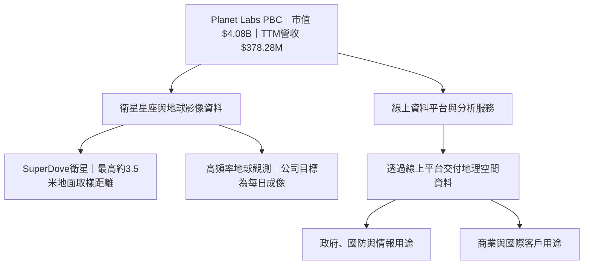
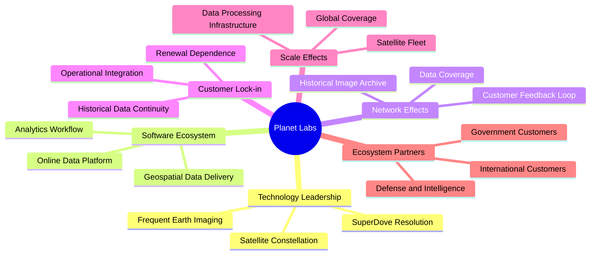
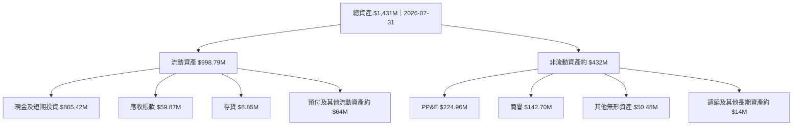
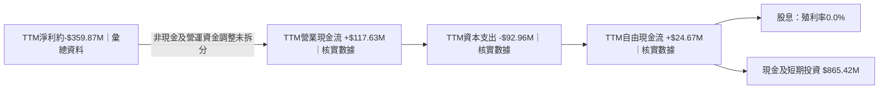
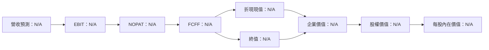
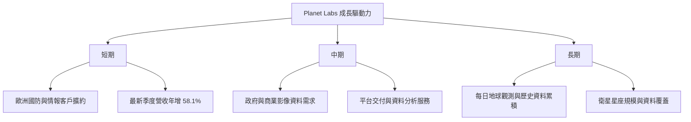
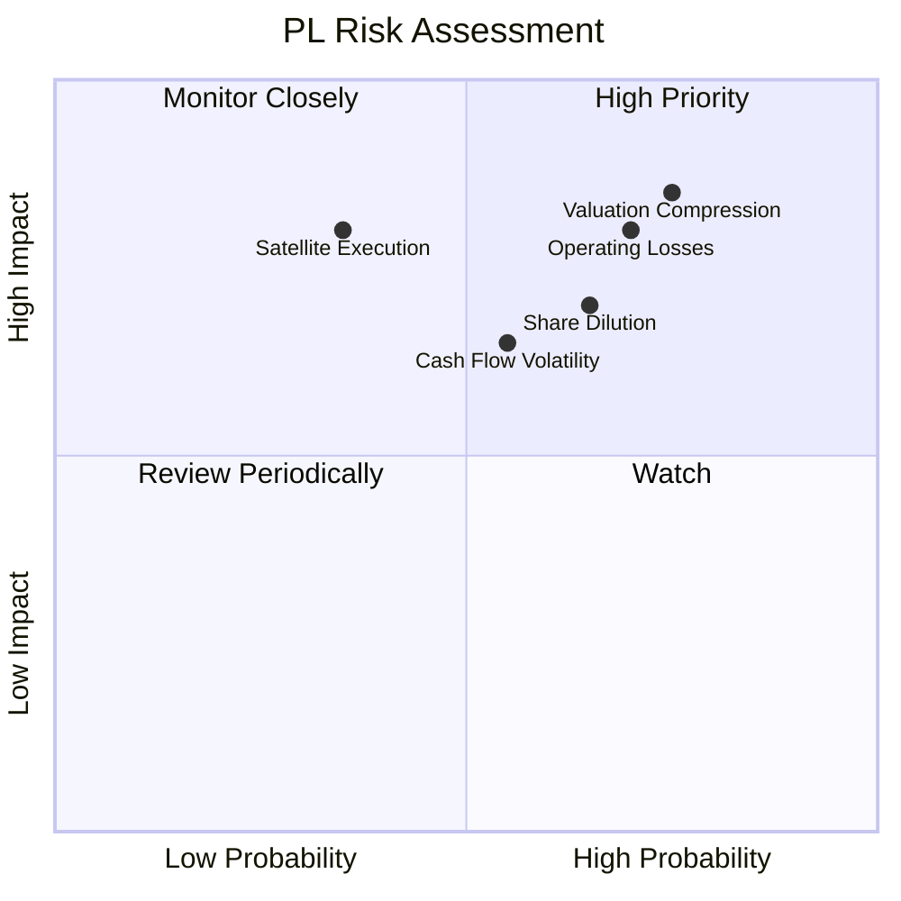
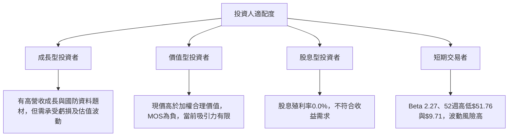

# PL 基本面深度分析報告
> **報告日期**：2026-11-28 ｜ **語言**：繁體中文 ｜ **數據來源**：SEC 申報資料 (XBRL)、Yahoo Finance、Finviz、StockAnalysis、Roic.ai ｜ **分析師**：CFA 級機構研究

## 目錄

| # | 章節 | 核心結論 |
|---|------|----------|
| 1 | 執行摘要 | 依加權合理價值 $7.57、MOS -48.0%，評級為賣出 |
| 2 | 公司概覽與商業模式 | 地球觀測衛星與資料平台具差異化；市場份額數據未提供 |
| 3 | 損益表深度分析 | TTM 營收 $378.28M、年增 44.1%；TTM 營業利益率仍為 -27.2% |
| 4 | 資產負債表分析 | 現金及短期投資 $865.42M；經核對的總債務數據不可用 |
| 5 | 現金流量深度分析 | TTM FCF $24.67M、FCF Yield 0.61%；資本支出仍高 |
| 6 | 獲利能力與資本效率 | WACC 12.68%；ROIC 不可用，現有營業虧損未證明創造經濟價值 |
| 7 | 相對估值分析 | P/S 10.6x，高於自身五年中位數 6.9x；相對估值偏貴 |
| 8 | DCF 內在價值評估 | DCF 模型 N/A；採同業 P/S 與分析師共識計算加權合理價值 |
| 9 | 成長催化劑 | 國防與情報客戶合約擴張具催化可能，TAM 與執行時程數據不足 |
| 10 | 風險矩陣 | 估值、虧損與稀釋為主要風險 |
| 11 | 投資建議 | 依 MOS 評級為賣出；須等待估值與營運里程碑改善 |

## 1. 執行摘要

截至 2026-11-27 收盤，PL 股價為 **$11.20**。TTM 營收 **$378.28M**、TTM 營收年增 **44.1%**，最新一季營收年增 **58.1%**；但 TTM 營業利益率仍為 **-27.2%**，Piotroski F-Score 為 **3/8**，TTM FCF **$24.67M**、FCF Yield **0.61%**。估值端，同業 P/S 與分析師共識加權後的合理價值為 **$7.57**，相對現價安全邊際（MOS）為 **-48.0%**。因此，依規則 20 評級為**賣出**；此結論主要由估值折價方向為負、獲利尚未轉正及稀釋紀錄共同支持，而非否定衛星資料業務的成長性。

### 1.0 一頁式投資儀表板（Portfolio Manager 30 秒速讀）

| 項目 | 內容 |
|------|------|
| **投資論點（3 句）** | ① TTM 營收年增 44.1%，最新一季年增 58.1%，業務需求仍在擴張。② TTM 營業利益率 -27.2%，顯示高成長尚未轉化為營業獲利。③ 加權合理價值 $7.57，低於 $11.20 收盤價，MOS -48.0%。 |
| **綜合評分** | **5.1/10**（引用 1.1 評分卡） |
| **財務健康** | 🟡 現金及短期投資 $865.42M，但總債務經核對數據為 N/A；F-Score 3/8 |
| **ROIC vs WACC** | ROIC：N/A；WACC：12.68%。因 ROIC 不可用，不能確認公司已創造價值；營業虧損顯示當前經營仍未達經濟獲利門檻 |
| **FCF 趨勢** | TTM FCF $24.67M；FCF Yield 0.61%。現金流為正，但資本支出 TTM $92.96M，需持續追蹤 |
| **估值** | Forward P/E：-8,960.0x（虧損下參考價值有限）｜EV/EBITDA：-76.615x｜FCF Yield：0.61% |
| **DCF 內在價值（基準）** | N/A；TTM 營業利益為負，程式計算之 DCF 模型未提供 |
| **安全邊際（MOS）** | **-48.0%＝($7.57 − $11.20) ÷ $7.57**；以 8.8 加權合理價值為基準，🔴 無下檔保護 |
| **預期報酬（基準情境 12M）** | DCF 基準情境 N/A；加權合理價值相對現價隱含上行空間 **-32.4%** |
| **關鍵風險（前二）** | 高估值倍數遇成長放緩而下修；營業虧損與股權薪酬造成獲利及股東稀釋壓力 |
| **評級 + 信心度** | 🔴 **賣出** ｜ 信心：中（估值訊號明確，但成長與來源數據存在不確定性） |

### 1.1 綜合評分卡（全報告唯一）

| 維度 | 評分（1–10） | 主要依據（引用數字與其來源章節） |
|------|--------------|----------------------------------|
| 成長性 | 8.0 | TTM 營收年增 44.1%，最新一季年增 58.1%；見第 3 章 |
| 獲利能力 | 3.0 | TTM 營業利益率 -27.2%、F-Score 3/8，ROIC N/A；見第 3、6 章 |
| 財務健康 | 6.5 | 現金及短期投資 $865.42M、流動比率 2.843；總債務經核對數據不可用；見第 4 章 |
| 估值 | 2.0 | MOS -48.0%；P/S 10.6x，高於五年中位數 6.9x；見第 7、8 章 |
| 護城河 | 6.0 | 自有衛星星座與每日地球影像能力具有差異化，但客戶集中、續約與切換成本數據不足；見第 2 章 |
| 管理層與資本配置 | 5.0 | FY2026 SBC $54.99M、股數測試未通過；未提供可核實回購資料；見第 3、5 章 |
| **綜合評分** | **5.1** | 六項算術平均：(8.0 + 3.0 + 6.5 + 2.0 + 6.0 + 5.0) ÷ 6 = 5.083，四捨五入至一位 |

### 1.2 五大投資論點 + 三大核心風險

| 類型 | 項目 | 具體依據 | 信心度 |
|------|------|----------|--------|
| 🟢 **投資論點①** | 營收增速加快 | TTM 營收 $378.28M、年增 44.1%；最新一季年增 58.1%，顯示近期需求擴張速度提高 | 🟢 高 |
| 🟢 **投資論點②** | 衛星與平台形成資料供給差異化 | 公司營運自有地球觀測星座，目標每日重訪地球，資料可持續更新；有利於監測用途，但經濟效益仍需看毛利和續約 | 🟡 中 |
| 🟢 **投資論點③** | 流動性緩衝充足 | 現金及短期投資 $865.42M、流動比率 2.843；可支持衛星部署與營運投資，惟仍需確認債務與資金消耗趨勢 | 🟡 中 |
| 🟢 **投資論點④** | 毛利率已有一定規模 | TTM 毛利率 55.5%，高於 SPIR 40.3% 及 RKLB 36.2%；但與 BKSY 73.4% 相比仍低 | 🟡 中 |
| 🟢 **投資論點⑤** | 國防與情報需求有擴約訊號 | 近期公司新聞提及歐洲國防與情報客戶合約擴張及七位數合約；新聞未披露可量化的營收貢獻 | 🟡 中 |
| 🟡 **風險①** | 高估值與股價波動 | P/S 10.6x，五年估值百分位 79%；52 週高低為 $51.76 / $9.71，價格波動可能放大估值修正 | 🔴 高衝擊 |
| 🔴 **風險②** | 營業虧損仍大 | TTM 營業利益率 -27.2%，最新一季為 -11.6%；改善方向正面，但尚未轉正 | 🔴 高衝擊 |
| 🔴 **風險③** | 股權薪酬與股數稀釋 | FY2026 SBC $54.99M；Piotroski 稀釋股數測試未通過，將稀釋每股營收及未來每股價值 | 🟡 中至高 |

### 1.3 快速統計卡片

| 指標 | 公司實際值（期間） | 同業中位數 | 狀態 |
|------|--------------------|------------|------|
| 營收成長（TTM） | **44.1%** | — | 🟢 |
| 營收成長（最新一季年增） | **58.1%** | 72.7% | 🟡 |
| 毛利率（TTM） | **55.5%** | 40.3% | 🟢 |
| 營業利益率（TTM） | **-27.2%** | — | 🔴 |
| ROIC（TTM） | **N/A** | — | 🟡 |
| Forward P/E | **-8,960.0x** | -17.5x、-62.1x、710.8x（中位數 -17.5x） | 🔴 |
| FCF Yield（TTM） | **0.61%** | — | 🟡 |
| Piotroski F-Score | **3 / 8** | — | 🔴 |

### 1.4 投資結論

```
╔══════════════════════════════════════════════════════════════════╗
║                    📊 投資結論摘要                               ║
╠══════════════════════════════════════════════════════════════════╣
║  評級：🔴 賣出（依規則 20，MOS = -48.0%）                         ║
║  價格（2026-11-27 收盤）：$11.20                                 ║
║  DCF 內在價值（基準）：N/A（TTM 營業利益為負，DCF 未提供）       ║
║  加權合理價值（8.8）：$7.57                                      ║
║  安全邊際 MOS：-48.0%＝($7.57−$11.20)÷$7.57                     ║
║  綜合評分：5.1/10（引用 1.1）                                    ║
║  適合投資人：能承受高波動、以中長期營收成長為主的投資人；         ║
║              不適合以現金流穩定或估值折價為首要條件者             ║
╚══════════════════════════════════════════════════════════════════╝
```

## 2. 公司概覽與商業模式

### 2.1 業務結構與收入來源

公司資料未提供各產品、客戶類型或軟體服務的營收拆分，因此不能計算業務板塊佔比。已知公司總營收為 TTM **$378.28M**，市值約 **$4.08B**。



商業模式的核心是先投入衛星與地面基礎設施，形成影像資料供給，再以平台方式向客戶交付。若資料被客戶納入日常決策流程，訂閱和續約可能提高收入可預測性；但目前未提供訂閱收入佔比、客戶留存率或單位經濟性數字，不能直接把平台模式等同高毛利或高續約。

### 2.2 市場份額

市場份額數據未提供，且新聞資料沒有可直接引用的整體市場規模或公司市佔率。以營收與同業作質化參考，PL TTM 營收為 $378.28M、年增 44.1%；最新一季成長 58.1%，高於 SPIR 的 42.1%，低於 BKSY 的 118.4% 及 RKLB 的 72.7%。各公司業務組合不同，成長率並非完全同質比較。

### 2.3 競爭護城河分析



以上護城河項目是依商業模式描述的質化分析，不代表已由客戶留存、合約年限或成本曲線數據證實。特別是網路效應與客戶鎖定，目前缺少可量化的客戶數、續約率、資料使用頻率及轉換成本資料。

### 2.4 護城河強度

| 護城河項目 | 強度（強／中／弱） | 證據（引用數字或事實） | 會削弱它的情況 |
|------------|--------------------|------------------------|----------------|
| 技術與衛星星座 | 中 | 自有衛星星座，SuperDove 目標影像解析度最高約 3.5 米，並以高頻率成像為產品特色 | 衛星故障、發射成本上升，或競爭者提供更高解析度、相近重訪率 |
| 軟體與資料平台 | 中 | 透過線上平台交付地理空間資料；TTM 毛利率 55.5% | 平台差異不足、客戶轉向多來源資料或資料被替代 |
| 網路效應 | 弱至中 | 長期影像資料與持續觀測有機會提高資料價值；未提供網路效應或客戶使用數據 | 新競爭者累積資料速度接近，或客戶可輕易跨平台使用 |
| 客戶鎖定 | 中 | 政府、國防及情報場景可能需要歷史資料和持續更新；近期有歐洲客戶擴約消息 | 合約集中、政府預算變動、續約率下降 |
| 規模效應 | 中 | 945 名員工、全球衛星與資料平台營運；TTM 營收 $378.28M | 衛星部署與研發支出長期高於收入成長所帶來的規模效益 |
| 生態夥伴 | 弱至中 | 有國防、情報與國際客戶合作訊號，未提供夥伴收入佔比 | 合作試點未轉成長期訂單或大型客戶自行建置替代能力 |

**1.1「護城河」評分為 6.0/10**：自有星座、資料連續性及 55.5% TTM 毛利率支持一定差異化，但客戶留存、合約可見度與網路效應缺少量化證據。

## 3. 損益表深度分析

### 3.1 年度收入成長趨勢（近4年）

年度收入以公司會計年度列示；年度營收數字來自財報資料，YoY 依相鄰年度營收計算。

```
╔══════════════════════════════════════════════════════════════════╗
║              Planet Labs 年度收入趨勢（FY2023-FY2026）            ║
╠══════════════════════════════════════════════════════════════════╣
║  FY2023  $191.26M  █████████████░░░░░░░░░░░░░  YoY: 基期        ║
║  FY2024  $220.70M  ███████████████░░░░░░░░░░░  YoY: +15.4% 🟡   ║
║  FY2025  $244.35M  █████████████████░░░░░░░░░  YoY: +10.7% 🟡   ║
║  FY2026  $307.73M  █████████████████████░░░░░  YoY: +25.9% 🟢   ║
║                                                                  ║
║  FY2023–FY2026 營收 CAGR：約 17.2%                                ║
║  算式：(307.73 ÷ 191.26)^(1/3) − 1 ≈ 17.2%                       ║
╚══════════════════════════════════════════════════════════════════╝
```

FY2026 營收成長加速至 25.9%，而 TTM 年增進一步提高至 44.1%。這種加速可能反映政府與商業資料需求增加、合約擴張或新產品採用；但公司未提供按產品及客戶類型拆分的增長貢獻，故不能將加速完全歸因於單一催化因素。

### 3.2 季度收入趨勢分析

| 季度 | 營收 | QoQ 成長 | YoY 成長 | 備註 |
|------|------:|---------:|---------:|------|
| 2025-10-31 | $81.25M | — | 32.6% | 與 2025-10-31 前一季營收 $61.25M 比較，成長率由季度資料推算；同比率採公司季度資料 |
| 2026-01-31 | $86.82M | 6.9% | 41.1% | 同比基期為 $61.55M |
| 2026-04-30 | $94.15M | 8.4% | 42.1% | 同比基期為 $66.27M |
| 2026-07-31 | $116.05M | 23.3% | 58.1% | 同比基期為 $73.39M；單季年增率，不是 TTM 成長率 |

QoQ 公式為「本季營收 ÷ 前季營收 − 1」。例如最新一季：$116.05M ÷ $94.15M − 1 = **23.3%**。最新季營收擴張較前季快，若主要來自可續約合約與平台訂閱，較可能形成持續收入；若來自一次性大型專案，則季度增速未必能線性外推。

### 3.3 利潤率演變分析

| 利潤率指標 | FY2023 | FY2024 | FY2025 | FY2026 | 趨勢 | 評估 |
|------------|-------:|-------:|-------:|-------:|------|------|
| **毛利率** | 49.1% | 51.2% | 57.2% | 56.0% | FY2025 上升、FY2026 小幅回落 | 🟡 |
| **營業利益率** | -91.9% | -75.8% | -45.5% | -30.9% | 虧損率逐年收斂 | 🟡 |
| **淨利率** | -84.7% | -63.7% | -50.4% | -80.2% | FY2026 明顯惡化 | 🔴 |

計算口徑：毛利率 = 毛利 ÷ 營收；營業利益率 = 營業利益 ÷ 營收；淨利率 = 淨利 ÷ 營收。FY2026 淨利率惡化，主要因年度淨損擴大至 $246.86M，而營業損失為 $95.07M；兩者差額顯示營業利益以下項目對淨利影響重大，但可用資料未提供完整調節項目，不能將其指定為某一筆一次性損失。

最新季度財務資料另顯示毛利率改善趨勢：TTM 毛利率 55.5%，最新季度毛利 $65.63M、營收 $116.05M，單季毛利率約 56.6%。已核實數據列示最新季度營業利益率為 **-11.6%**，而其他彙總資料出現 -22.7% 的衝突值；本報告依核實數據採 -11.6%。最新季度相對 TTM -27.2% 已收斂，若未來數季維持，代表營收增長開始帶動營業槓桿；但尚未轉正，仍須看費用增幅能否低於營收增幅。

### 3.4 費用結構分析

完整費用科目及 FY2026 營業費用明細不完整，不能將各項費用強行加總製作比例圓餅圖。可核實的 FY2026 研發費用為 **$106.75M**，佔營收 **34.7%**（$106.75M ÷ $307.73M）；研發支出支持衛星、資料與平台能力，但也解釋了公司營收成長尚未轉成營業獲利。

```
╔══════════════════════════════════════════════════════════════════╗
║            FY2026 已披露研發費用與營收之比較                     ║
╠══════════════════════════════════════════════════════════════════╣
║  營收      $307.73M  ██████████████████████████████             ║
║  研發費用  $106.75M  ██████████                                  ║
║  研發/營收  34.7%                                                ║
║  註：其他營業費用科目未完整提供，並非完整費用結構圖。             ║
╚══════════════════════════════════════════════════════════════════╝
```

### 3.5 季度 EPS 趨勢與盈餘品質（Quality of Earnings）

過去四季 EPS 實際值可由財務歷史資料讀取，但 EPS 預估值均為 nan，無法判斷實際 EPS 是否超預期或不及預期。

| 季度 | EPS 實際 | EPS 預估 | 超預期／不及預期 | 季度淨利 |
|------|---------:|---------:|-----------------|---------:|
| 2025-10-31 | -$0.19 | N/A | N/A（預估資料缺漏） | -$59.19M |
| 2026-01-31 | -$0.48 | N/A | N/A（預估資料缺漏） | -$152.46M |
| 2026-04-30 | -$0.40 | N/A | N/A（預估資料缺漏） | -$138.87M |
| 2026-07-31 | -$0.03 | N/A | N/A（預估資料缺漏） | -$9.35M |

| 盈餘品質項目 | 數值／佔比 | 評估 |
|--------------|-----------|------|
| 股權薪酬 SBC / 營收 | 估算 TTM SBC $62.51M ÷ TTM 營收 $378.28M = **16.5%** | 🔴 SBC 佔比高，代表股東承擔顯著稀釋成本 |
| SBC / 營業現金流 | $62.51M ÷ $117.63M = **53.1%** | 🟡 SBC 是現金營運流量的重要調整項，應同時監察股數增幅 |
| FCF / 淨利（現金轉換率） | 估算 TTM 淨利 -$359.87M；$24.67M ÷ -$359.87M = **-6.9%** | 🔴 淨利為負時比率不適合視為正常轉換率；正 FCF 並不代表 GAAP 盈利 |
| 一次性／非經常性損益 | 可用資料未提供可核實拆分 | N/A；FY2026 淨損 -$246.86M 明顯大於營業損失 -$95.07M，但不能推定差額性質 |
| 有效稅率異常 | N/A | 未提供足夠稅前利潤與所得稅明細，無法辨識稅務利益 |
| 資本化支出 vs 費用化 | TTM 資本支出 $92.96M；資本化明細 N/A | 資本支出支持衛星與基礎設施，但缺少資本化政策細節，不能判定是否遞延成本 |

**盈餘品質結論**：PL 目前仍處虧損狀態，不能以 GAAP 淨利作穩態盈利估值。TTM 正 FCF 與負淨利並存，主要反映非現金費用、營運資金及資本支出的不同會計時點；但 SBC 約佔 TTM 營收 16.5%，並且股數稀釋測試未通過，須將稀釋納入每股報酬評估。由於季度 EPS 預估缺漏，本報告不宣稱公司過去四季有超預期或不及預期。

## 4. 資產負債表分析

### 4.1 資產結構分解

截至 2026-07-31，StockAnalysis 資料列示總資產約 **$1,431M**。其中流動資產 $998.79M，另有 PP&E、商譽及無形資產等。



各細項採彙總資料，與總資產可能因四捨五入及分類而有尾差。現金及短期投資佔流動資產比重高，提供部署衛星及支持營運的財務緩衝；同時，應收帳款和合約回款速度仍會影響實際可用現金。

### 4.2 流動性與營運資金分析

| 流動性指標 | 最新資料 | 歷史比較 | 評估 |
|------------|----------|----------|------|
| 現金及短期投資 | $865.42M（2026-07-31） | FY2026 年末 $640.09M | 🟢 資金增加，提升短期投資能力 |
| 流動比率 | 2.843 | FY2026 年末以 $775.36M 流動資產、$469.45M 流動負債計算約 1.65x；時點口徑不同 | 🟢 最新流動比率顯示短期覆蓋能力較好 |
| 速動比率 | 2.634 | 歷史可比值 N/A | 🟢 |
| 總債務 | N/A（核實數據） | 其他彙總來源有不同口徑，未能調和 | 🟡 不應以單一未核實口徑替代 |

營運資金天數依 QUALITY FIGURES 原值列示：

| 指標 | 最新 TTM | 一年前 TTM | 變化 | 解讀 |
|------|----------|------------|------|------|
| DSO 應收帳款天數 | 58 天 | 72 天 | -14 天 | 🟢 收款天數下降；可能代表收款效率改善，但仍需觀察合約付款條件 |
| DIO 存貨天數 | 19 天 | N/A | N/A | 一年前缺少可計算存貨餘額，不作比較 |
| DPO 應付帳款天數 | 22 天 | 37 天 | -15 天 | 對供應商付款較快；可能是供應商條款、採購組合或時點因素，單憑數據不能推定議價力 |
| CCC 現金轉換週期 | 55 天 | N/A | N/A | 一年前 CCC 不可判定；最新數值為 DSO + DIO − DPO |

### 4.3 債務結構分析

核實財務數據列示總債務 **N/A**，因此不以其他彙總來源的債務數字替代，也不計算 Debt/EBITDA 或利息保障倍數。補充資料中另有總債務 $498.62M 的彙總值，惟與核實數據的債務欄位不一致；在未能確認債務分類及時點前，不用該數字計算淨負債。

```
╔══════════════════════════════════════════════════════════════════╗
║                 Planet Labs 債務健康診斷                         ║
╠══════════════════════════════════════════════════════════════════╣
║  總債務：        N/A（核實數據未提供）                            ║
║  現金+短期投資： $865.42M  ████████████████████                  ║
║  淨現金：        $865.42M（核實數據列示；債務為 N/A）             ║
║                                                                  ║
║  Debt/EBITDA：   N/A（債務與 EBITDA 均不足以支持有效比率）        ║
║  Interest Coverage：N/A（利息費用及一致口徑債務未提供）          ║
║  結論：現金資源充足，但不應將未調和的債務數字忽略。               ║
╚══════════════════════════════════════════════════════════════════╝
```

### 4.4 股東權益趨勢

| 會計年度 | 股東權益 | 年度變化 | 解讀 |
|----------|---------:|---------:|------|
| 2023-01-31 | $576.10M | — | 基期 |
| 2024-01-31 | $518.02M | -$58.08M | 虧損與其他權益變動令權益下降 |
| 2025-01-31 | $441.29M | -$76.73M | 權益續降 |
| 2026-01-31 | $188.43M | -$252.86M | 權益降幅加大；與 FY2026 淨損及資本結構變化同時發生 |

```
╔══════════════════════════════════════════════════════════════════╗
║                 股東權益變化（年度期末）                         ║
╠══════════════════════════════════════════════════════════════════╣
║  2023  $576.10M  ██████████████████████████████                  ║
║  2024  $518.02M  ███████████████████████████                     ║
║  2025  $441.29M  ███████████████████████                         ║
║  2026  $188.43M  ██████████                                      ║
╚══════════════════════════════════════════════════════════════════╝
```

## 5. 現金流量深度分析

### 5.1 現金流量瀑布圖

TTM 營業現金流、資本支出及 FCF 採核實數據；因未提供 TTM 淨利核實值，本圖以財務彙總來源的 TTM 淨損作起點，非現金與營運資金調整額不作拆分。



### 5.2 FCF 轉換率趨勢

| 期間 | FCF | 淨利 | FCF／淨利 | 解讀 |
|------|----:|-----:|----------:|------|
| FY2023 | -$86.69M | -$161.97M | 53.5% | FCF 與淨損同為負值，負值比率僅供方向參考 |
| FY2024 | -$93.12M | -$140.51M | 66.3% | 現金流仍為負，尚未達自我融資 |
| FY2025 | -$68.78M | -$123.20M | 55.8% | 虧損及負 FCF 收斂 |
| FY2026 | $51.41M | -$246.86M | -20.8% | FCF 轉正但淨損擴大，會計盈餘與現金流分化 |
| TTM 至 2026-07-31 | $24.67M | -$359.87M（彙總資料） | -6.9% | 正 FCF 不等於盈利品質已改善 |

### 5.3 自由現金流趨勢

| 期間 | 營業現金流 | 資本支出 | FCF | FCF Yield |
|------|-----------:|---------:|----:|----------:|
| FY2023 | -$73.93M | $12.76M | -$86.69M | N/A |
| FY2024 | -$50.71M | $42.41M | -$93.12M | N/A |
| FY2025 | -$14.37M | $54.40M | -$68.78M | N/A |
| FY2026 | $134.36M | $82.95M | $51.41M | N/A |
| TTM 至 2026-07-31 | $117.63M | $92.96M | **$24.67M** | **0.61%** |

TTM FCF 依核實定義為 **營業現金流 − 資本支出**，即 $117.63M − $92.96M = $24.67M。資本支出約佔營業現金流 79.0%（$92.96M ÷ $117.63M），反映衛星星座及基礎設施仍需大量再投資；如果營業現金流無法持續增長，FCF 容易因資本支出維持高位而轉負。

```
╔══════════════════════════════════════════════════════════════════╗
║                 自由現金流：年度實際與 TTM                       ║
╠══════════════════════════════════════════════════════════════════╣
║  FY2023  -$86.69M  ◀████████████████████                         ║
║  FY2024  -$93.12M  ◀██████████████████████                       ║
║  FY2025  -$68.78M  ◀████████████████                              ║
║  FY2026  +$51.41M  ████████████▶                                  ║
║  TTM     +$24.67M  ██████▶    FCF Yield：0.61%                    ║
╚══════════════════════════════════════════════════════════════════╝
```

### 5.4 資本配置評估

資本配置的完整現金用途拆分（回購、併購、留存及各類投資）未提供，無法以比例圓餅圖呈現。已披露數據顯示 FY2026 資本支出 $82.95M、SBC $54.99M；股息殖利率為 0.0%，回購金額資料未提供。

| 資本配置項目 | 可核實數據 | 評估 |
|--------------|------------|------|
| 資本支出 | FY2026 $82.95M；TTM $92.96M | 🟡 支持衛星與平台建置，但需要後續收入和營業槓桿證明回報 |
| 研發 | FY2026 $106.75M | 🟡 支持產品及資料能力，費用負擔仍高 |
| 股權薪酬 | FY2026 $54.99M | 🔴 需以稀釋後每股成長衡量，而非只看公司總營收 |
| 股息 | 殖利率 0.0% | 中性；成長型公司通常留存資金，但無現金回饋 |
| 股票回購 | N/A | 無資料，不對資本配置作肯定判斷 |

## 6. 獲利能力與資本效率

### 6.1 ROE / ROA / ROIC 趨勢

| 指標 | FY2023 | FY2024 | FY2025 | 最新 TTM | 評估 |
|------|-------:|-------:|-------:|---------:|------|
| ROE | N/A | N/A | N/A | -63.8%（QUALITY FIGURES） | 🔴 負淨利及權益下降共同壓低股東回報 |
| ROA | N/A | N/A | N/A | -5.0%（彙總資料） | 🔴 資產尚未產生正回報 |
| ROIC | N/A | N/A | N/A | N/A | 無可核實的 ROIC 歷史序列，不能補算 |
| WACC | — | — | — | 12.68% | 股權與債務資金成本較高，需正 ROIC 才能創造經濟價值 |

行業均值未提供，不列示或以印象補值。彙總資料中另出現 ROE -72.0%，與 QUALITY FIGURES 的 -63.8% 不一致；本節採用品質指標區塊的 ROE 原值。

### 6.2 ROIC vs WACC 分析（核心價值創造判斷）

ROIC 未提供且 TTM 營業利益為負，因此不能以具體 ROIC−WACC 差額判定資本回報；不能把負營業利益率直接冒充 ROIC。WACC 採用核實值 **12.68%**。

```
╔══════════════════════════════════════════════════════════════════╗
║                 ROIC vs WACC 深度分析                            ║
╠══════════════════════════════════════════════════════════════════╣
║  WACC（核實值）：12.68%                                          ║
║  ├── 無風險利率（10Y美債）：4.94%                                 ║
║  ├── 市場風險溢酬（假設）：5.00%                                 ║
║  ├── 原始 Beta：2.27；採用調整 Beta：1.85                        ║
║  ├── 股權成本（區塊原值）：14.17%                                ║
║  ├── 稅前債務成本（區塊原值）：0.69%                             ║
║  ├── 稅率假設：21.0%                                             ║
║  ├── 資本權重 E / D：89.1% / 10.9%                               ║
║  └── WACC（核實原值）：12.68%                                    ║
║                                                                  ║
║  ROIC：N/A（資料未提供，且營業利益為負）                         ║
║  EVA = ROIC − WACC：N/A，不能合法計算                             ║
║                                                                  ║
║  價值判斷：營業虧損顯示當前營運尚未證明能覆蓋資本成本；           ║
║            是否創造股東價值，須等 ROIC 轉正並高於 12.68% 才能確認 ║
╚══════════════════════════════════════════════════════════════════╝
```

原始 Beta 2.27 高於 1.5，資料已採用調整 Beta 1.85，公式為 ⅔ × 2.27 + ⅓；WACC 與股權成本均採用資本成本資料原值。無風險利率的具體觀察日期、ERP 的外部估算依據及債務口徑細節未提供，故不自行替換 WACC 或重建另一個折現率。

### 6.3 杜邦三因素分解

以下照抄 QUALITY FIGURES 原值：

| 因素 | 數值（TTM） | 解讀 |
|------|-------------|------|
| 淨利率 | -95.1% | 大幅虧損是 ROE 為負的主要來源 |
| 資產週轉率 | 0.26 | 資產相對營收週轉偏低，衛星資產需透過多年收入回收 |
| 權益乘數 | 2.54 | 財務槓桿放大淨利率與資產效率影響 |
| **ROE** | **-63.8%** | 品質指標原值；三因素乘積依來源區塊列示 |

解讀上，負 ROE 主要由負淨利率造成，不是正向槓桿帶來的高回報；權益乘數 2.54 反而令虧損對股東權益的影響放大。

### 6.4 財務體質：Piotroski F-Score

**Piotroski F-Score：3/8**。缺少一項長期負債測試輸入，因此來源採可判定測試的分母 8；照原始九項測試列示如下。

| 測試 | 結果 | 解讀 |
|------|------|------|
| ROA > 0 | ❌ 未通過 | 公司仍未產生正資產回報 |
| 營業現金流 > 0 | ✅ 通過 | TTM 營業現金流為 $117.63M |
| ROA 高於一年前 | ❌ 未通過 | 資產回報沒有改善至通過條件 |
| 營業現金流 > 淨利（應計品質） | ✅ 通過 | 現金流高於淨利；但公司淨利為負，不能單獨視為高盈利品質 |
| 長期負債 ÷ 總資產低於一年前 | — 無法判定 | 缺少所需負債輸入 |
| 流動比率高於一年前 | ✅ 通過 | 短期流動性相對改善 |
| 稀釋股數未增加 | ❌ 未通過 | 股數增加會稀釋每股經濟利益 |
| 毛利率高於一年前 | ❌ 未通過 | 指標未達來源測試門檻 |
| 資產週轉率高於一年前 | ❌ 未通過 | 資產效率未改善至通過標準 |

## 7. 相對估值分析

### 7.1 同業估值比較表格

同業倍數依 Yahoo Finance 的 Peer multiples 原值列示。PL 的 Forward P/E、EV/EBITDA 來自補充市場估值彙總資料；同業的負盈餘或極高倍數會降低 P/E 比較的解釋力。

| 估值指標 | **PL** | **SPIR** | **BKSY** | **RKLB** | PL 評估 |
|----------|-------:|---------:|---------:|---------:|---------|
| **Trailing P/E** | N/A | N/A | N/A | N/A | 🔴 多家公司未獲利，不具可比性 |
| **Forward P/E** | -8,960.0x | -17.5x | -62.1x | 710.8x | 🔴 PL Forward EPS 接近零且為負，倍數失真 |
| **P/S Ratio** | 10.6x | 4.5x | 5.4x | 38.8x | 🔴 高於 SPIR、BKSY，低於高估值 RKLB |
| **EV/EBITDA** | -76.615x | -3.5x | 644.9x | -161.0x | 🔴 EBITDA 虧損或異常時倍數難以解讀 |
| **最新一季營收 YoY** | 58.1% | 42.1% | 118.4% | 72.7% | 🟡 PL 成長高於 SPIR，低於 BKSY、RKLB |
| **毛利率（TTM）** | 55.5% | 40.3% | 73.4% | 36.2% | 🟢 高於 SPIR、RKLB，低於 BKSY |

同業中位數只對有可比較數字的項目作描述。P/S 比較顯示 PL 相較 SPIR、BKSY 的估值溢價明顯，但相對 RKLB 仍低；在 PL 尚未有正營業利益及 FCF Yield 僅 0.61% 的情況下，市場已預先反映部分中長期成長。

### 7.2 歷史估值區間分析

核實歷史 P/S 數據：目前 **10.6x**、五年中位數 **6.9x**、區間 **2.1x–38.1x**、目前百分位 **79%**。

```
╔══════════════════════════════════════════════════════════════════╗
║                 PL 歷史 P/S 估值位置（五年）                     ║
╠══════════════════════════════════════════════════════════════════╣
║  五年低位  2.1x  ├──────────────────────────────────────┤ 38.1x ║
║  五年中位  6.9x  ├───────────●──────────────────────────┤       ║
║  目前      10.6x ├────────────────●─────────────────────┤       ║
║  目前百分位：79%                                                   ║
║  判讀：現時 P/S 高於五年中位數，歷史區間內亦處於偏高位置。       ║
╚══════════════════════════════════════════════════════════════════╝
```

### 7.3 情境價值（Bear / Base / Bull）

**N/A（DCF 無法計算：TTM 營業利益不為正，程式未生成 DCF MODEL 情境）**。不自行設定悲觀、基準或樂觀 DCF 目標價。

### 7.4 相對估值隱含價格區間

| 方法 | 每股價值 | 相對現價 | 權重 | 依據 |
|------|---------:|---------:|-----:|------|
| 同業 P/S | $5.16 | -53.9% | 90% | SPIR、BKSY 同業中位數 P/S 約 5.0x × PL TTM 營收，依估值方法區塊原值 |
| 分析師共識目標價 | $29.23 | +161.0% | 10% | 12 位分析師平均目標價 |
| **加權合理價值** | **$7.57** | **-32.4%** | **100%** | 按核實權重加總 |

同業 P/S 估值是相對估值基準，不表示收入倍數必然合理；分析師共識和同業估值分歧很大，因此共識僅佔固定 10% 權重。

## 8. DCF 內在價值評估（Discounted Cash Flow）

### 8.0 估值推理鏈（Thinking Logic）

PL 的價值可由現有地球觀測資料與平台收入、國防及情報客戶擴約，以及未來營業利潤率改善三部分理解；但目前沒有分部收入佔比，不能將任一部分量化為收入權重。估值的關鍵變數理應包括收入成長、利潤率收斂及資本支出效率，然而本次核實 DCF 模型明確標示 N/A，原因是 TTM 營業利益不為正；因此不能以虧損數字作機械式折現，也不能自行補建模型。

| 決策點 | 本報告採用 | 理由（含數字） | 曾考慮但否決 | 否決理由 |
|--------|-----------|----------------|--------------|----------|
| 現金流定義 | N/A | DCF 模型未生成 | 自建 FCFF | 不符合核實模型優先規則 |
| 預測期 N | N/A | 程式模型未提供年數與逐年預測 | 自訂 5–10 年 | 缺少營收、利潤率及資本需求假設 |
| 終值方法 | N/A | DCF 模型未提供 | Gordon Growth／退出倍數 | 缺少可稽核的終值輸入 |
| EBIT 基礎 | N/A | TTM 營業利益為負，模型停止 | GAAP EBIT 推演轉正 | 沒有模型預測或管理層假設支持 |

**Step 3—假設推導鏈：**營收 CAGR、期末營業利潤率、永續成長率、預測期、Capex 比率、D&A、營運資金、SBC 與年稀釋率均未提供 DCF 模型輸入；依規則不建立替代假設，也不給出缺乏依據的數字。

**最脆弱的一環**是未來利潤率能否由目前負值改善至正值；但因模型未提供敏感度矩陣，無法量化其對估值的影響幅度。



### 8.1 模型假設總表（Model Inputs）

**DCF MODEL：N/A。**模型未提供以下假設，且不自行建立替代模型。

| 假設項目 | 採用值 | 依據／來源 | 敏感度 |
|----------|--------|-------------|--------|
| 預測期長度 N | N/A | DCF 模型未提供 | N/A |
| 營收 CAGR | N/A | 無模型假設 | N/A |
| 期末營業利潤率 | N/A | TTM 營業利益率 -27.2%，但模型未設定轉正路徑 | N/A |
| 有效稅率 | N/A | 模型未提供；WACC 資料的 21.0% 為資本成本預設稅率，不能冒充 DCF 稅率 | N/A |
| Capex／營收 | N/A | 模型未提供 | N/A |
| D&A／營收 | N/A | 模型未提供 | N/A |
| ΔWC／營收增額 | N/A | 模型未提供 | N/A |
| EBIT 基礎 | N/A | 模型未提供 | N/A |
| SBC 處理 | N/A | 模型未提供 | N/A |
| 年稀釋率 | N/A | 模型未提供 | N/A |
| 永續成長率 g | N/A | 模型未提供 | N/A |
| 終值方法 | N/A | 模型未提供 | N/A |
| WACC | **12.68%** | 資本成本資料原值；詳見 8.2 | 高 |

### 8.2 折現率推導（WACC）

```
╔══════════════════════════════════════════════════════════════════╗
║                    WACC 推導（折現率）                           ║
╠══════════════════════════════════════════════════════════════════╣
║  股權成本 Ke（CAPM，採資料原值）：14.17%                         ║
║  ├── 無風險利率 Rf（10Y美債）：      4.94%                       ║
║  ├── 市場風險溢酬 ERP（假設）：      5.00%                       ║
║  ├── 原始 Beta：                     2.27                        ║
║  ├── 調整 Beta：                     1.85                        ║
║  └── 股權成本 Ke（資料原值）：       14.17%                      ║
║                                                                  ║
║  債務成本：                                                      ║
║  ├── 稅前債務成本（資料原值）：      0.69%                       ║
║  ├── 預設稅率：                      21.0%                       ║
║  └── WACC 區塊已提供稅後加權結果；不另改算組成數字               ║
║                                                                  ║
║  資本結構權重：股權 89.1%｜債務 10.9%                            ║
║  └── ✅ WACC（核實原值）：12.68%                                 ║
╚══════════════════════════════════════════════════════════════════╝
```

WACC 五步所需完整計算中的市值權重基礎、計息負債期末餘額及平均債務分母未在資本成本欄位完整列示；因此**不重新推導 Ke、Kd、E/D 權重，也不以股東權益帳面值代替市值**。資料所列原始 Beta 為 2.27，調整 Beta 為 1.85，來源提供的調整方式為 ⅔ × 2.27 + ⅓。股權成本 14.17%、資本權重 89.1% / 10.9% 及 WACC 12.68%均照原值引用。由於無風險利率觀察日、ERP 依據及債務口徑細節未提供，無法完整稽核每項輸入；第 6.2 與本節均統一使用 12.68%。

### 8.3 逐年自由現金流預測（基準情境）

**N/A（DCF 模型未提供逐年營收、EBIT、稅、D&A、Capex、營運資金及折現因子；不自建預測表。）**歷史 TTM FCF 為 $24.67M，但單一歷史 FCF 不足以推導預測期現金流或終值。

### 8.4 終值計算（Terminal Value）

**N/A（DCF 模型未提供永續成長率、終值方法與預測期最後一年 FCFF。）**無法檢驗 WACC 與 g 的大小關係，也不計算 Gordon Growth 或退出倍數終值。

### 8.5 企業價值 → 每股內在價值（Bridge）

**N/A（DCF 模型未生成企業價值、現金與債務橋接、稀釋股數或 DCF 每股價值。）**折溢價以 DCF 基準內在價值為分母，故此處亦為 N/A；不以 8.8 加權合理價值冒充 DCF 內在價值。

### 8.6 敏感性分析（WACC × 永續成長率）

**N/A（DCF 模型未提供 WACC × g 敏感性矩陣，亦未提供三情境模型。）**不自行試算矩陣、敏感度斜率或機率加權價值。

### 8.7 反推 DCF（Reverse DCF：市場在預期什麼）

**N/A（DCF 模型未提供反推結果與可供逐項固定的基準輸入。）**現價 $11.20 不能單獨解出多個營運變數；本報告不以單一價格反推出多個無法唯一識別的假設。

### 8.8 估值三角驗證與安全邊際

| 估值方法 | 隱含每股價值 | 上行空間（÷現價） | 權重 | 說明 |
|----------|--------------|-------------------|------|------|
| 同業 P/S | $5.16 | -53.9% | 90% | SPIR、BKSY 同業中位數 P/S 約 5.0x × PL TTM 營收 |
| 分析師共識目標價 | $29.23 | +161.0% | 10% | 12 位分析師平均目標價，作參考而非主要估值支柱 |
| **加權合理價值** | **$7.57** | **-32.4%** | **100%** | 依估值方法區塊原值 |

加權合理價值完整算式：

**$5.16 × 90% + $29.23 × 10% = $4.644 + $2.923 = $7.567 ≈ $7.57**

方法類型為未獲利公司，權重依固定規則採同業 P/S 90%、分析師共識 10%。同業 Forward P/E 因不可計算而排除；估值方法區塊已將其權重安排至可計算方法，不另增減權重。

安全邊際與上行空間分母不同，均以同一加權合理價值計算：

- **MOS** = ($7.57 − $11.20) ÷ $7.57 = **-48.0%**
- **上行空間** = ($7.57 − $11.20) ÷ $11.20 = **-32.4%**

```
╔══════════════════════════════════════════════════════════════════╗
║                  估值區間與安全邊際                              ║
╠══════════════════════════════════════════════════════════════════╣
║  $5.16（同業P/S） ── $7.57（加權合理值） ── $11.20（現價）      ║
║                                                                  ║
║  安全邊際 MOS = ($7.57 − $11.20) ÷ $7.57 = -48.0%               ║
║  上行空間 = ($7.57 − $11.20) ÷ $11.20 = -32.4%                  ║
║  評級依據：MOS < -25%，規則 20 對應賣出                          ║
║                                                                  ║
║  MOS 10%門檻價格：$7.57 × (1 − 10%) = $6.81                     ║
║  此門檻僅表示達到10% MOS所需價格，不代表營運風險已消失。          ║
╚══════════════════════════════════════════════════════════════════╝
```

> 🔎 **程式複算（Python，依本節各項自動重算）**
>
> 加權合理價值 = $5.16 × 90% + $29.23 × 10% = **$7.57**（權重合計 100%）
>
> 以價格 $11.20 計：MOS = **-48.0%**，上行空間 = **-32.4%**
>
> ✅ 與本節所寫數值一致。

### 8.9 DCF 模型的局限與失效條件

- **終值依賴度**：N/A，DCF 模型未提供終值或企業價值拆分。
- **最脆弱的假設**：模型沒有可供檢驗的營收 CAGR、利潤率或資本支出假設，不能量化某假設錯誤時的內在價值跌幅。
- **不適用情境說明**：TTM 營業利益為負且營業利益率 -27.2%，傳統 DCF 對遠期轉正時間高度敏感。現階段應以同業 EV/Sales 或 P/S、毛利與單位經濟性、合約續約及現金消耗速度作交叉檢驗；同業 P/S 估值已納入 8.8。
- **與第 10 章風險矩陣的連結**：營收成長下降會壓低收入倍數；成本改善延遲會延長營業虧損；衛星替換與資本支出增加會降低可分配現金流。

### 8.10 複算檢核表（Audit Trail：輸出前自我驗算）

| # | 檢核項目 | 檢查方式 | 結果 |
|---|----------|----------|------|
| 1 | 所有高／中敏感度輸入都有完整四段式推導 | DCF 假設未提供，未建立替代輸入 | N/A |
| 2 | 每個假設都有來歷 | 8.1 缺值均明確標 N/A | ✅ |
| 3 | WACC 五步算式齊全且正確 | 僅引用核實 WACC 原值，構成資料不足以重建五步 | N/A |
| 4 | Kd 分母與權重 D 為同一範圍 | 計息負債細節未提供，未重算 | N/A |
| 5 | WACC 與第 6.2 節同值 | 兩節均採 12.68% | ✅ |
| 6 | 逐年表格年度數等於 N | DCF 模型未提供 N，未輸出預測表 | N/A |
| 7 | FY+1 九步算式可複算 | 無 FY+1 模型輸入 | N/A |
| 8 | 預測期 PV 加總可核對 | 無預測期 PV | N/A |
| 9 | WACC > g | g 未提供 | N/A |
| 10 | 終值以 FY+N FCFF 為基礎 | N、FCFF、終值均未提供 | N/A |
| 11 | EV 至每股價值橋接可複算 | DCF 橋接未提供 | N/A |
| 12 | SBC 組合與股數假設相容 | DCF 模型未提供 SBC 處理組合 | N/A |
| 13 | 矩陣基準格等於 DCF 每股價值 | 無矩陣與 DCF 基準值 | N/A |
| 14 | 矩陣有效格符合 WACC > g | 無矩陣、g 未提供 | N/A |
| 15 | 三情境機率相加為 100% | DCF 情境未提供 | N/A |
| 16 | 反推 DCF 每列只放開一個變數且有軌跡 | 反推模型未提供 | N/A |
| 17 | MOS 基準與折溢價基準一致 | MOS 採 8.8 加權合理值；DCF 折溢價標 N/A | ✅ |
| 18 | 報告完整輸出至第 11 章 | 章節 1–11 均列示 | ✅ |
| 19 | 加權合理價值等於各項乘權重之和 | $5.16×90% + $29.23×10% = $7.567 ≈ $7.57 | ✅ |
| 20 | 評級符合 MOS 門檻 | MOS -48.0% < -25%，評級賣出 | ✅ |

**說明**：DCF 模型為 N/A，故第 1、3–4、6–16 項中 DCF 專屬檢核不適用；未用自建模型填補缺值。加權價值、MOS、評級及其算式均依原始估值方法數據核對。

## 9. 成長催化劑

### 9.1 催化劑時間軸

公開資料未提供各催化劑的明確季度交付日期、合約營收認列時間或量化目標，因此不以任意年份繪製甘特圖。可觀察的催化方向如下：

| 時間範圍 | 催化劑 | 目前可引用證據 | 後續驗證指標 |
|----------|--------|--------------|--------------|
| 短期 | 歐洲國防與情報客戶合約擴張 | 近期新聞提及合約擴張及七位數合約，未披露擴約總額 | 新合約金額、訂單轉營收速度、續約情況 |
| 中期 | 最新季度營收成長延續 | 最新季度營收 $116.05M，YoY +58.1% | 連續季度營收成長、毛利率與營業費用率 |
| 長期 | 影像資料與平台融入客戶工作流程 | 公司目標每日成像並透過線上平台交付資料 | 客戶留存、訂閱收入、每客戶收入與毛利 |

### 9.2 TAM 市場規模分析

**N/A（TAM 數據未提供）**。PL TTM 營收為 $378.28M、TTM 年增 44.1%，顯示目前仍處於擴張階段；但沒有可引用的 TAM 金額與市場年份，故不估算市場滲透率，也不以產業印象補入規模數字。

### 9.3 成長驅動力結構圖



催化能否轉化為股東價值，關鍵不只在營收增速，也包括擴約後毛利、研發與銷售費用控制、衛星更新所需 Capex 及每股稀釋。

## 10. 風險矩陣

### 10.1 風險評分矩陣

以下機率與衝擊位置為研究分析師的相對風險判斷，並非公司披露的統計機率；風險事項由財務與市場數據推導。



### 10.2 風險清單詳細分析

| # | 風險項目 | 發生機率 | 財務衝擊 | 風險評估 | 緩解措施 |
|---|----------|----------|----------|----------|----------|
| 1 | 🔴 **估值倍數壓縮** | 中高 | P/S 10.6x，若回落至五年中位數 6.9x，收入不變時市銷率相對下修約 34.9%（1 − 6.9 ÷ 10.6） | 🔴 高 | 分批投資、避免僅按營收增速估值，持續比較 P/S 與毛利和營業槓桿 |
| 2 | 🔴 **持續營業虧損** | 高 | TTM 營業利益率 -27.2%；若費用增速持續高於營收，轉盈時間推遲 | 🔴 高 | 每季追蹤營業利益率、研發與銷管費用率，以及最新季度改善是否持續 |
| 3 | 🟡 **股權薪酬與股數稀釋** | 中高 | TTM SBC 估算約佔營收 16.5%；F-Score 稀釋股數測試未通過 | 🟡 高 | 追蹤稀釋股數 YoY、SBC／營收及每股營收成長 |
| 4 | 🟡 **衛星與資料基礎設施執行風險** | 中 | TTM Capex $92.96M，佔營業現金流約 79.0%；衛星故障或替換成本增加可壓低 FCF | 🟡 高 | 追蹤衛星部署進度、Capex、保險及服務可用性 |
| 5 | 🟡 **現金流波動與債務口徑不確定** | 中 | 核實債務為 N/A；補充來源出現不同債務值，數據口徑尚未調和 | 🟡 中高 | 以 SEC 最新申報核對債務期限、利息支出及現金限制 |
| 6 | 🟡 **客戶合約及政府預算風險** | 中 | 近期擴約消息未披露營收金額與認列時點；政府合約可能受預算與採購周期影響 | 🟡 中高 | 追蹤合約 backlog、續約、客戶集中度與預付款情形 |

## 11. 投資建議

### 11.1 最終評級與評分

依加權合理價值 $7.57 與 2026-11-27 收盤價 $11.20 計算，MOS 為 -48.0%，未達規則 20 的減碼區間，屬**賣出**，沒有作一級質化調整。公司綜合評分為 **5.1/10**，引用 1.1 六項評分：成長性 8.0、獲利能力 3.0、財務健康 6.5、估值 2.0、護城河 6.0、管理層與資本配置 5.0。

### 11.2 合理價值與隱含報酬率

| 方法／情境 | 每股價值 | 相對 $11.20 現價 | 權重／機率 | 備註 |
|------------|---------:|-----------------:|------------:|------|
| 同業 P/S | $5.16 | -53.9% | 90% | 估值方法區塊原值 |
| 分析師共識 | $29.23 | +161.0% | 10% | 12 位分析師平均目標價 |
| **加權合理價值** | **$7.57** | **-32.4%** | **100%** | 安全邊際基準 |
| 悲觀 DCF | N/A | N/A | N/A | DCF 模型未提供 |
| 基準 DCF | N/A | N/A | N/A | DCF 模型未提供 |
| 樂觀 DCF | N/A | N/A | N/A | DCF 模型未提供 |

### 11.3 買入時機與觸發因素

```
╔══════════════════════════════════════════════════════════════════╗
║                  ✅ 買入觸發因素 Checklist                      ║
╠══════════════════════════════════════════════════════════════════╣
║  重新評估條件（多數符合後再檢視估值）：                          ║
║  ☐ TTM營業利益率連續改善，且由 -27.2% 朝損益兩平收斂             ║
║  ☐ TTM FCF維持正值，且FCF Yield高於目前0.61%                     ║
║  ☐ SBC/營收下降，稀釋股數增速收斂至低於營收增速                  ║
║  ☐ 最新一季營收年增維持正成長，且毛利率不因擴張而下滑            ║
║                                                                  ║
║  MOS門檻觀察：                                                   ║
║  ☐ 以$7.57加權合理價值計，股價不高於$6.81可達MOS至少10%          ║
║  ☐ 即使達價格門檻，仍須核對債務口徑與營運指標                    ║
║                                                                  ║
║  減碼／退出觸發條件（出現以下任一）：                             ║
║  ☐ TTM FCF轉負且營業現金流同步惡化                               ║
║  ☐ 營收增速連續兩季低於30%，且營業利益率未改善                   ║
║  ☐ SBC/營收持續高於15%，且稀釋股數增速高於營收增速               ║
║  ☐ 大型合約未能續約或衛星故障令服務可用性下降                    ║
╚══════════════════════════════════════════════════════════════════╝
```

買入門檻 $6.81 是由加權合理價值 $7.57 及 10% MOS 反推，算式為 **$7.57 × (1 − 10%) = $6.813 ≈ $6.81**。此價格門檻不等同於公司基本面風險已消失，投資人仍需確認營業虧損、FCF 與稀釋趨勢。

### 11.4 投資人適配度分析



### 11.5 每季財報監控清單（Quarterly Watch List）

| 指標 | 最新基準 | 觸發加碼／重新評估 | 觸發減碼／下修論點 |
|------|----------|--------------------|--------------------|
| 營收年增 | 最新一季 +58.1%；TTM +44.1% | 年增維持 40% 以上且非單一專案造成 | 連續兩季低於 30% |
| 營業利益率 | TTM -27.2%；核實最新季度 -11.6% | 連續改善並朝損益兩平前進 | 重新擴大至 TTM 水準以下，且無明確成本改善 |
| 毛利率 | TTM 55.5% | 維持或改善，收入成長同步轉為毛利額增加 | 明顯下滑且合約擴張未帶來規模效益 |
| FCF | TTM $24.67M | 持續為正且 FCF Yield 高於 0.61% | 轉負並連續兩季未恢復 |
| Capex | TTM $92.96M | Capex 投入帶動營收及營業槓桿改善 | Capex 增加但營收增速與服務能力未改善 |
| SBC | 最近四季合計約 $62.51M（估算） | SBC／營收逐季下降 | SBC／營收維持或高於約 16.5% |
| 稀釋股數 | F-Score 測試未通過 | 稀釋股數增幅低於營收增幅 | 稀釋持續加快，使每股營收停滯 |
| DSO／CCC | DSO 58 天、CCC 55 天 | DSO 維持或下降、回款改善 | DSO 明顯回升或應收帳款增速高於營收 |
| 合約與財測 | 新聞提及歐洲國防與情報客戶擴約 | 公布合約金額、續約率或 backlog 增加 | 試點無法轉商業訂單、續約延遲或財測下修 |

### 11.6 反面論證：什麼會證明論點錯誤（What Would Change My Mind）

```
╔══════════════════════════════════════════════════════════════════╗
║              ⚠️ 論點失效條件（Disconfirming Evidence）           ║
╠══════════════════════════════════════════════════════════════════╣
║  下列情況成立時，應重新檢視成長論點或退出：                      ║
║  ☐ 最新一季營收年增連續兩季低於30%                               ║
║  ☐ TTM營業利益率較目前 -27.2% 再惡化，且連續兩季未改善           ║
║  ☐ TTM FCF轉負並連續兩季未恢復                                   ║
║  ☐ TTM FCF Yield低於0%，同時營業現金流下降                       ║
║  ☐ SBC/營收連續兩季高於目前估算的16.5%                           ║
║  ☐ 稀釋股數增幅連續高於營收增幅                                   ║
║  ☐ DSO由58天持續升高，並伴隨應收帳款增速高於營收                 ║
║  ☐ 重要國防與情報合約未續約，或擴約無法轉成實際認列收入          ║
║  ☐ ROIC可核實後仍低於WACC 12.68%，顯示投入資本長期無法創造價值    ║
╚══════════════════════════════════════════════════════════════════╝
```

> **免責聲明**：本報告為 AI 自動生成，僅供研究參考，不構成投資建議。投資有風險，入市需謹慎。

---

## 資料與來源

| 項目 | 內容 |
|------|------|
| 價格 | 11.20 USD，2026-11-27 收盤（Yahoo Finance 日線） |
| 財務報表 | SEC 10-Q filed 2026-09-03，最新季度 2026-07-31（FY2027 Q2） |
| 有回應的資料來源 | SEC 申報資料 (XBRL)、Yahoo Finance、Finviz、StockAnalysis、Roic.ai |
| 由程式計算 | TTM 數字、WACC、DCF 模型、估值方法與權重、加權合理價值、MOS、評級門檻、F-Score、杜邦分解、營運資金天數、綜合評分 |
| 撰寫模型 | openai / gpt-6-luna |

> 本區塊由產生報告的程式依實際取得的資料填寫，非模型撰寫。「由程式計算」的數字不是模型的估計；其餘判斷（評分、情境、策略）是模型的分析。
