# PLTR 基本面深度分析報告
> **報告日期**：2026-11-13 ｜ **語言**：繁體中文 ｜ **數據來源**：SEC 申報資料 (XBRL)、Yahoo Finance、Finviz、StockAnalysis、Roic.ai ｜ **分析師**：CFA 級機構研究

> **資料口徑說明**：本報告優先照錄「VERIFIED FIGURES」。資料包內部分次級資料與 VERIFIED FIGURES 不一致，例如現金及短期投資分別出現 $10.56B 與 $3.62B、ROE 出現 32.7% 與 40.9%、本季營業利益率出現 46.9% 與 45.6%。凡涉及估值、ROIC、現金與價格，採用 VERIFIED FIGURES；其他資料只作補充並標明來源。估值模型中的預測輸入均是**假設值**，不是公司財測。

## 目錄

| # | 章節 | 核心結論 |
|---|------|----------|
| 1 | 執行摘要 | 加權合理價值 $65.03；MOS −158.4%；依門檻為賣出 |
| 2 | 公司概覽與商業模式 | 軟體平台具有嵌入式工作流程優勢；收入板塊比例 N/A |
| 3 | 損益表深度分析 | TTM 營收 $7.29B、TTM 成長 87.1%；利潤率擴張 |
| 4 | 資產負債表分析 | VERIFIED 淨現金 $3.62B；短期償債壓力低 |
| 5 | 現金流量深度分析 | TTM FCF $4.05B、FCF Yield 1.00%；SBC 仍具稀釋成本 |
| 6 | 獲利能力與資本效率 | ROIC 43.1%；高於模型 WACC 13.20% |
| 7 | 相對估值分析 | 同業增長溢價明顯；自身 P/S 高於五年中位數 |
| 8 | DCF 內在價值評估 | 基準 DCF 約 $50.48/股；模型高度依賴終值 |
| 9 | 成長催化劑 | 商業 AI 採用、平台擴張與政府需求是主要催化劑 |
| 10 | 風險矩陣 | 估值壓縮、成長減速、競爭與 SBC 為主要風險 |
| 11 | 投資建議 | 賣出；合理價值買入線約 $58.53 以下 |

---

## 1. 執行摘要

### 1.0 一頁式投資儀表板

| 項目 | 內容 |
|------|------|
| **投資論點（3 句）** | ① TTM 營收 $7.29B、TTM 成長 87.1%，且最新單季 YoY 成長 95.9%，反映需求仍在加速。② TTM 營業利益率 45.6%、ROIC 43.1%，經濟回報高於本報告估算 WACC 13.20%。③ 但 2026-11-13 收盤價 $167.99，對應 TTM P/E 118.3x、Forward P/E 66.26x，顯著高於 DCF 基準價值。 |
| **護城河評分** | 7.5/10；平台整合、工作流程嵌入和高切換成本有利，但市場份額與客戶留存明細 N/A |
| **管理層/資本配置評分** | 6.5/10；FCF 強，但 2025 SBC $684.03M，約為營收 15.3% |
| **財務健康** | 🟢 VERIFIED 淨現金 $3.62B；總債務數據 N/A，不將其補算 |
| **ROIC vs WACC** | 43.1% vs 13.20%（WACC 為本報告股權成本代理值）；約高 29.9 個百分點 |
| **FCF 趨勢** | 上升；TTM FCF $4.05B，FCF Yield 1.00% |
| **估值** | Forward P/E 66.26x ｜ EV/EBITDA 120.169x ｜ FCF Yield 1.00% |
| **DCF 內在價值（基準）** | 約 $50.48；以 DCF 值為分母，現價溢價約 232.8% |
| **安全邊際（MOS）** | **−158.4%**＝($65.03 − $167.99) ÷ $65.03；加權合理價值來自第 8.8 節 |
| **預期報酬（基準情境 12M）** | 約 −61.3%，以加權合理價值 $65.03 相對 $167.99 計 |
| **關鍵風險（前二）** | 高估值下倍數收縮；營收增長由近 100% 單季增速回落 |
| **評級 + 信心度** | 🔴 賣出 ｜ 信心：中（業務表現可觀，但估值模型高度受終值與假設影響） |

### 1.1 核心評分儀表板

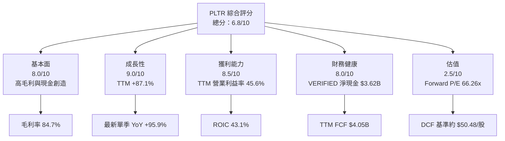

### 1.2 評分進度條視覺化

```text
╔══════════════════════════════════════════════════════════════╗
║               PLTR 多維度評分儀表板（1–10分）                ║
╠══════════════════════════════════════════════════════════════╣
║ 基本面強度  8.0  ▓▓▓▓▓▓▓▓▓▓▓▓▓▓▓▓░░░░  ★★★★☆              ║
║ 成長動能    9.0  ▓▓▓▓▓▓▓▓▓▓▓▓▓▓▓▓▓▓░░  ★★★★★              ║
║ 獲利品質    7.0  ▓▓▓▓▓▓▓▓▓▓▓▓▓▓░░░░░░  ★★★★☆              ║
║ 財務健康    8.0  ▓▓▓▓▓▓▓▓▓▓▓▓▓▓▓▓░░░░  ★★★★☆              ║
║ 估值合理性  2.5  ▓▓▓▓▓░░░░░░░░░░░░░░░  ★★☆☆☆              ║
║ 護城河深度  7.5  ▓▓▓▓▓▓▓▓▓▓▓▓▓▓▓░░░░░  ★★★★☆              ║
║ 管理層執行  6.5  ▓▓▓▓▓▓▓▓▓▓▓▓▓░░░░░░░  ★★★☆☆              ║
║ 技術創新力  8.0  ▓▓▓▓▓▓▓▓▓▓▓▓▓▓▓▓░░░░  ★★★★☆              ║
╠══════════════════════════════════════════════════════════════╣
║ 綜合總分    6.8  ▓▓▓▓▓▓▓▓▓▓▓▓▓▓▓░░░░░  高品質、高估值風險   ║
╚══════════════════════════════════════════════════════════════╝
```

### 1.3 五大投資論點 + 三大核心風險

| 類型 | 項目 | 具體依據 | 信心度 |
|------|------|----------|--------|
| 🟢 投資論點① | 商業化增長加速 | TTM 營收 $7.29B、TTM YoY +87.1%；最新單季 YoY +95.9% | 高 |
| 🟢 投資論點② | 高毛利軟體模式 | TTM 毛利率 84.7%；利潤率支持規模效應 | 高 |
| 🟢 投資論點③ | FCF 轉換佳 | TTM OCF $4.10B、FCF $4.05B，現金流接近淨利規模 | 中高 |
| 🟢 投資論點④ | 資本效率突出 | ROIC 43.1% 高於 13.20% 代理 WACC | 中高 |
| 🟢 投資論點⑤ | 現金緩衝充足 | VERIFIED 現金及短期投資 $3.62B；債務 N/A | 中 |
| 🔴 風險① | 估值回撤風險 | P/S 59.3x（歷史資料包口徑），DCF 約 $50.48 vs 現價 $167.99 | 高 |
| 🔴 風險② | 增長預期過高 | 最新單季 YoY +95.9%，高基期下若快速減速，估值倍數可能下修 | 高 |
| 🟡 風險③ | SBC 稀釋 | FY2025 SBC $684.03M，佔營收約 15.3%；股東需承受稀釋成本 | 中高 |

### 1.4 快速統計卡片

| 指標 | 公司實際值 | 行業均值 | S&P 500 均值 | 狀態 |
|------|-------------|----------|--------------|------|
| 最新一季收入 YoY 成長 | **95.9%** | N/A | N/A | 🟢 |
| TTM 毛利率 | **84.7%** | 同業差異大；SNOW 67.0%、DDOG 79.6%、CRM 77.3% | N/A | 🟢 |
| TTM 淨利率 | **50.3%** | N/A | N/A | 🟢 |
| ROE（VERIFIED） | **32.7%** | N/A | N/A | 🟢 |
| Forward P/E | **66.26x** | 同業分布差異大 | N/A | 🔴 |
| TTM FCF Yield | **1.00%** | N/A | N/A | 🔴 |

> 行業與 S&P 500 均值未列於資料包；為避免冒充為即時統計，此處標示 N/A。

### 1.5 投資結論

```text
╔══════════════════════════════════════════════════════════════════╗
║                       📊 投資結論摘要                            ║
╠══════════════════════════════════════════════════════════════════╣
║ 評級：🔴 賣出（依加權合理價值 MOS 門檻）                         ║
║ 價格（2026-11-13 收盤）：$167.99                                ║
║ DCF 內在價值（基準）：約 $50.48（現價溢價約 232.8%）             ║
║ 加權合理價值：$65.03                                             ║
║ 安全邊際 MOS：−158.4%                                            ║
║ 悲觀／基準／樂觀 12M 參考情境：$40／$65／$110                    ║
║ 基準情境相對現價：約 −61.3%                                      ║
║ 投資評分：6.8/10；業務質量高，但現價對長期增長要求很高           ║
║ 適合投資人：可承受高波動、長期追蹤營運的成長型投資人；           ║
║              不適合要求低估值或穩定股息的投資人                  ║
╚══════════════════════════════════════════════════════════════════╝
```

---

## 2. 公司概覽與商業模式

### 2.1 業務結構與收入來源

Palantir 提供 Gotham、Foundry、AIP 等軟體平台，將客戶分散的資料、權限和工作流程整合為可供營運決策使用的系統。資料包未提供最新季度政府／商業收入金額與占比，故不將分部收入比例推算為實際值。

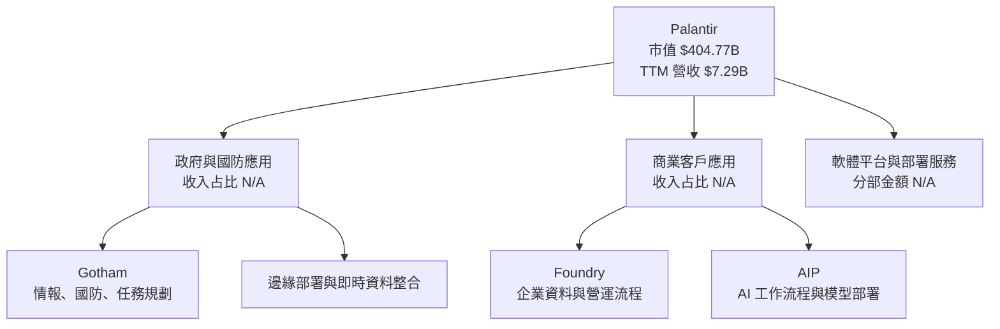

收入組成細項缺漏，不宜以總營收任意分拆。其軟體模式的經濟性可由 TTM 毛利率 84.7%、營業利益率 45.6% 觀察；高毛利意味著新增收入有機會以較低邊際成本轉為營業利益，但仍須檢視銷售部署成本與 SBC。

### 2.2 市場份額

可核驗的整體 TAM 與公司市場份額資料未提供；以下以市場份額「不可量化」呈現，不以杜撰比例填充。

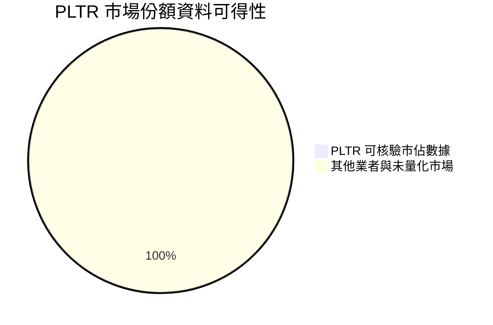

> 此圖表示「資料可得性」而非實際市場份額。現有資料不足以量化國防資料平台、企業 AI 軟體或資料作業系統的可比市場份額。

### 2.3 競爭護城河分析

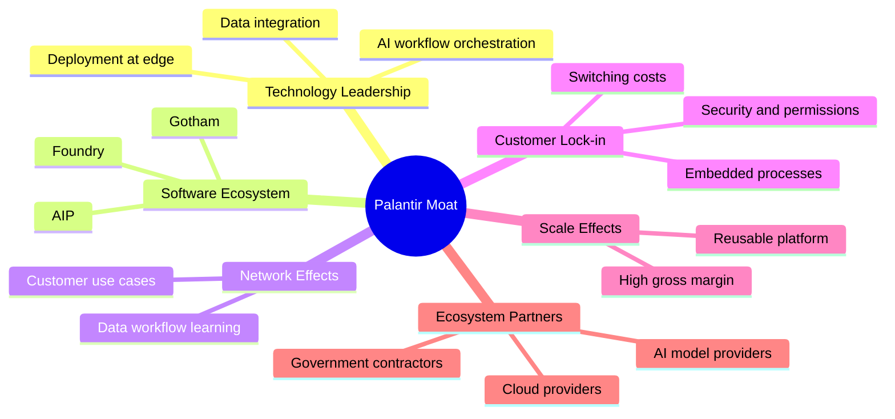

護城河不是單純「擁有資料」：更重要的是把客戶權限、資料模型與日常決策流程嵌入平台。切換成本可支持續約與擴張，但若客戶能將工作負載遷移至雲端原生或其他 AI 工具，鎖定效果仍可能減弱。

### 2.4 護城河強度評分

```text
╔══════════════════════════════════════════════════════════════╗
║                   Palantir 護城河強度評分                    ║
╠══════════════════════════════════════════════════════════════╣
║ 技術與產品差異化  8.0/10  ▓▓▓▓▓▓▓▓▓▓▓▓▓▓▓▓░░░░  🟢          ║
║ 軟體生態系統      7.5/10  ▓▓▓▓▓▓▓▓▓▓▓▓▓▓▓░░░░░  🟢          ║
║ 網路效應          6.0/10  ▓▓▓▓▓▓▓▓▓▓▓▓░░░░░░░░  🟡          ║
║ 客戶鎖定          8.0/10  ▓▓▓▓▓▓▓▓▓▓▓▓▓▓▓▓░░░░  🟢          ║
║ 規模效應          7.0/10  ▓▓▓▓▓▓▓▓▓▓▓▓▓▓░░░░░░  🟢          ║
║ 生態夥伴          6.5/10  ▓▓▓▓▓▓▓▓▓▓▓▓▓░░░░░░░  🟡          ║
╠══════════════════════════════════════════════════════════════╣
║ 綜合護城河        7.5/10  ▓▓▓▓▓▓▓▓▓▓▓▓▓▓▓░░░░░  🟢          ║
╚══════════════════════════════════════════════════════════════╝
```

---

## 3. 損益表深度分析

### 3.1 年度收入成長趨勢（近 4 年）

年度營收從 2022 年 $1.91B 增至 2025 年 $4.48B。2025 年 YoY 成長約 56.2%，高於 2024 年約 28.8%，顯示商業化加速；但 TTM 87.1% 的高成長也提高未來比較基期。

```text
╔══════════════════════════════════════════════════════════════════╗
║                 Palantir 年度收入趨勢（FY2022–FY2025）            ║
╠══════════════════════════════════════════════════════════════════╣
║ FY2022  $1.91B  ████████░░░░░░░░░░░░░░░░  YoY +23.6%  🟢       ║
║ FY2023  $2.23B  ██████████░░░░░░░░░░░░░░  YoY +16.7%  🟡       ║
║ FY2024  $2.87B  ███████████████░░░░░░░░░  YoY +28.8%  🟢       ║
║ FY2025  $4.48B  ████████████████████████  YoY +56.2%  🟢       ║
╠══════════════════════════════════════════════════════════════════╣
║ FY2022–FY2025 CAGR = (4.475 ÷ 1.906)^(1/3) − 1 ≈ 32.9%         ║
║ TTM 營收 $7.29B；TTM vs prior TTM 成長 87.1%（VERIFIED）         ║
╚══════════════════════════════════════════════════════════════════╝
```

### 3.2 季度收入趨勢分析

| 季度 | 營收 | QoQ 成長 | 單季 YoY 成長 | 備註 |
|------|------:|---------:|--------------:|------|
| 2025 Q4 | $1.407B | 16.0% | 70.0% | 由 2025 Q3 $1.181B 計算 |
| 2026 Q1 | $1.633B | 16.1% | 84.7% | 需求增速延續 |
| 2026 Q2 | $1.935B | 18.5% | 92.8% | QoQ 增速再升 |
| 2026 Q3 | $2.313B | 19.5% | 95.9% | 最新單季 YoY，不是 TTM |

**計算示例**：2026 Q3 QoQ = ($2.313B ÷ $1.935B) − 1 = **19.5%**。季度序列顯示營收逐季增加，但單季快速年增不能直接外推為長期 CAGR。

### 3.3 利潤率演變分析

| 利潤率指標 | FY2022 | FY2023 | FY2024 | FY2025 | 趨勢 | 評估 |
|------------|-------:|-------:|-------:|-------:|------|------|
| 毛利率 | 78.5% | 80.6% | 80.3% | 82.4% | 長期改善 | 🟢 |
| 營業利益率 | −8.5% | 5.4% | 10.8% | 31.6% | 大幅擴張 | 🟢 |
| 淨利率 | −19.6% | 9.4% | 16.1% | 36.3% | 明顯改善 | 🟢 |

年度毛利率以年度毛利除以年度營收計算；年度淨利率與營業利益率同理。TTM 口徑則使用 VERIFIED：毛利率 84.7%、營業利益率 45.6%、淨利率 50.3%。

**利潤率演變解析**：FY2023 至 FY2025 營業利益率改善，與收入規模提升、毛利率擴張及營業費用未同比例增加相符；但資料包沒有完整年度銷售與管理費用拆分，不能把改善完全歸因於單一項目。最新單季營業利益率 VERIFIED 為 46.9%，而另一資料表列 45.6%，本報告採 VERIFIED 值；單季差異不改變利潤率已高的判斷。

### 3.4 費用結構分析

年度 FY2025 只提供 R&D，其他費用細項未齊，故不能把未列項目當成零或自行分配。FY2025 R&D 為 $557.68M，占收入約 12.5%。

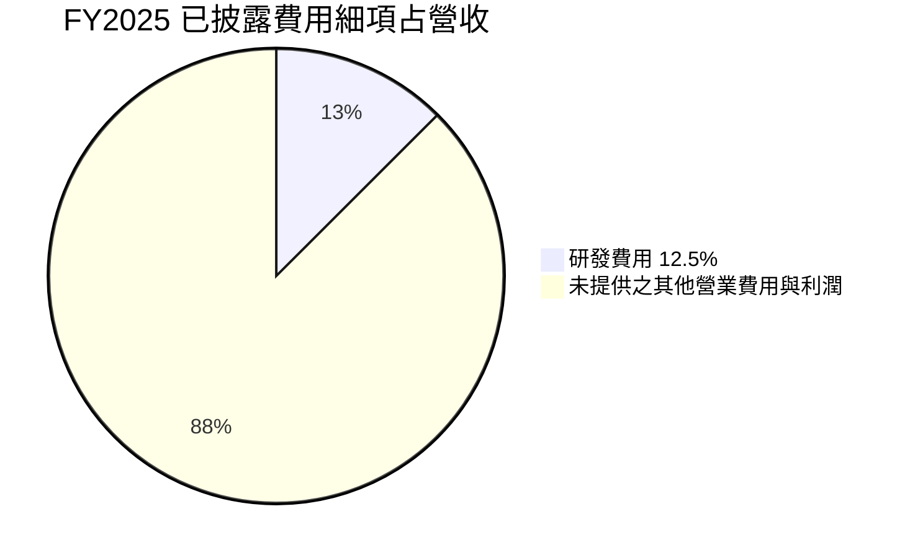

```text
╔══════════════════════════════════════════════════════════════╗
║ FY2025 費用與利潤資訊（佔營收）                              ║
╠══════════════════════════════════════════════════════════════╣
║ 研發費用     $557.68M / $4.475B = 12.5%  ▓▓▓░░░░░░░░░░░░░  ║
║ 營業利益     $1.414B / $4.475B = 31.6%  ▓▓▓▓▓▓░░░░░░░░░░░  ║
║ 其他費用細分 N/A（資料包未提供）                              ║
╚══════════════════════════════════════════════════════════════╝
```

### 3.5 季度 EPS 趨勢與盈餘品質（Quality of Earnings）

| 季度 | EPS | YoY EPS 成長 | 預估 EPS／實際 EPS | 超預期判斷 |
|------|----:|-------------:|--------------------|-----------|
| 2025 Q4 | $0.23 | 647.64% | 預估 N/A | 無法判斷 |
| 2026 Q1 | $0.34 | 325.00% | 預估 N/A | 無法判斷 |
| 2026 Q2 | $0.41 | 215.38% | 預估 N/A | 無法判斷 |
| 2026 Q3 | $0.44 | 144.44% | 預估 N/A | 無法判斷 |

資料包的 EPS 預估值為 `nan`，因此不能聲稱過去四季超預期或不及預期。已知單季 EPS 上升，但增長率逐季放緩；部分原因是比較基期提高，並非必然代表獲利絕對額轉弱。

| 盈餘品質項目 | 數值／佔比 | 評估 |
|--------------|------------|------|
| SBC / 營收 | FY2025：$684.03M ÷ $4.475B = **15.3%**；近四季可得 SBC 約 $982.10M ÷ TTM 營收 = **13.5%** | 🟡 非現金但會稀釋股東 |
| SBC / 營業現金流 | 近四季約 $982.10M ÷ $4.10B = **23.9%** | 🟡 佔現金流規模不低 |
| FCF / 淨利 | TTM $4.05B ÷ TTM 淨利約 $3.669B = **110.4%** | 🟢 現金轉換良好 |
| 一次性／非經常性損益 | 分項 N/A | 🟡 無法辨別是否存在一次性影響 |
| 有效稅率異常 | 最新年有效稅率 **1.4%** | 🟡 偏低；DCF 改用正常化假設 |
| 資本化支出 vs 費用化 | TTM Capex $43.24M；資本化軟體細項 N/A | 🟡 未見高資本支出，但資本化政策細節不足 |

**盈餘品質結論**：TTM FCF 高於 TTM 淨利，現金含金量良好；但 SBC 約占近四季營收 13.5%，GAAP 利潤雖已費用化 SBC，股東仍承受股數稀釋。稅率 1.4% 不宜當作長期稅率，故 DCF 採 15% 假設，避免把低稅率永久外推。

---

## 4. 資產負債表分析

### 4.1 資產結構分解

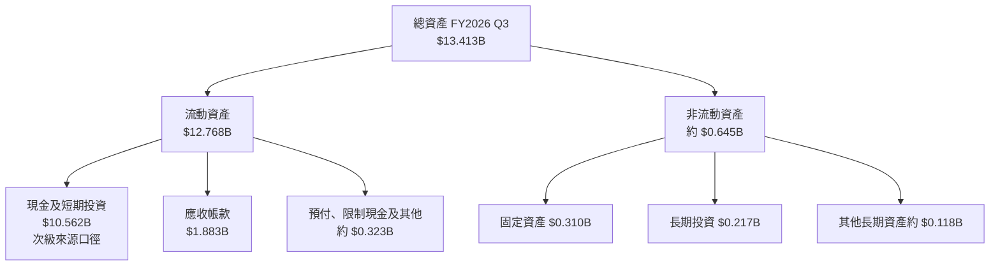

圖中資產拆分來自 StockAnalysis 補充資料，與 VERIFIED「現金及短期投資 $3.62B」口徑不同；估值現金橋接採用 VERIFIED $3.62B，不將兩種口徑混用。

### 4.2 流動性指標分析

| 指標 | 最新資料 | 歷史／比較 | 評估 |
|------|---------:|------------|------|
| Current Ratio | 7.102x（合併市場資料） | 2025 年度流動資產 $8.36B、流動負債 $1.18B | 🟢 流動性充足 |
| Quick Ratio | 6.923x（合併市場資料） | 庫存並非核心資產項目 | 🟢 |
| VERIFIED 現金＋短期投資 | $3.62B | 不採用其他來源 $10.56B 作估值現金 | 🟢 |
| VERIFIED 總債務 | N/A | 不可由其他欄位反推 | 🟡 |

資料包沒有可比行業流動比率均值，因此不給出虛構行業對照。

### 4.3 債務結構分析

```text
╔══════════════════════════════════════════════════════════════════╗
║                    Palantir 債務健康診斷                         ║
╠══════════════════════════════════════════════════════════════════╣
║ VERIFIED 現金＋短期投資： $3.62B  ▓▓▓▓▓▓▓▓▓▓▓▓▓▓▓▓▓▓▓▓  🟢      ║
║ VERIFIED 總債務：         N/A     數據不可得，不能補算             ║
║ VERIFIED 淨現金：         $3.62B  ▓▓▓▓▓▓▓▓▓▓▓▓▓▓▓▓▓▓▓▓  🟢      ║
║ Debt/EBITDA：             N/A     缺少一致口徑總債務               ║
║ Interest Coverage：       N/A     利息費用資料未提供               ║
║ 債務到期結構：            N/A                                      ║
╚══════════════════════════════════════════════════════════════════╝
```

### 4.4 股東權益趨勢

| 年度 | 股東權益 | YoY 變化 |
|------|---------:|---------:|
| FY2022 | $2.57B | N/A |
| FY2023 | $3.48B | +35.4% |
| FY2024 | $5.00B | +43.7% |
| FY2025 | $7.39B | +47.8% |

```text
FY2022 $2.57B  ███████░░░░░░░░░░░░░
FY2023 $3.48B  █████████░░░░░░░░░░
FY2024 $5.00B  ██████████████░░░░░
FY2025 $7.39B  ████████████████████
```

---

## 5. 現金流量深度分析

### 5.1 現金流量瀑布圖

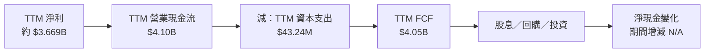

TTM FCF 嚴格採用 VERIFIED 定義：$4.10B − $43.24M = 約 $4.05B（引用值）。股息殖利率為 0%；回購與留存現金的完整配置明細 N/A。

### 5.2 FCF 轉換率趨勢

| 年度 | 營業現金流 | FCF | 淨利 | FCF／淨利 |
|------|-----------:|----:|-----:|----------:|
| FY2022 | $223.74M | $183.71M | −$373.70M | 不具解讀性 |
| FY2023 | $712.18M | $697.07M | $209.82M | 332.2% |
| FY2024 | $1.15B | $1.14B | $462.19M | 約 246.7% |
| FY2025 | $2.13B | $2.10B | $1.63B | 約 128.8% |
| TTM | $4.10B | $4.05B | 約 $3.669B | 約 110.4% |

比率從早期高位下降，主要是淨利增長快於現金流增長；目前仍超過 100%，但不宜用早期因小額淨利所形成的極高轉換率外推。

### 5.3 自由現金流趨勢

```text
╔══════════════════════════════════════════════════════════════════╗
║                  FCF 歷史與目前水準                              ║
╠══════════════════════════════════════════════════════════════════╣
║ FY2022  $0.184B  ██░░░░░░░░░░░░░░░░░░  🟡                      ║
║ FY2023  $0.697B  ███████░░░░░░░░░░░░░  🟢                      ║
║ FY2024  $1.14B   ███████████░░░░░░░░░  🟢                      ║
║ FY2025  $2.10B   ████████████████████  🟢                      ║
║ TTM     $4.05B   以 VERIFIED TTM FCF 引用                      ║
║ TTM FCF Yield = 1.00%；反映市值高於現金流支撐水準                ║
╚══════════════════════════════════════════════════════════════════╝
```

### 5.4 資本配置評估

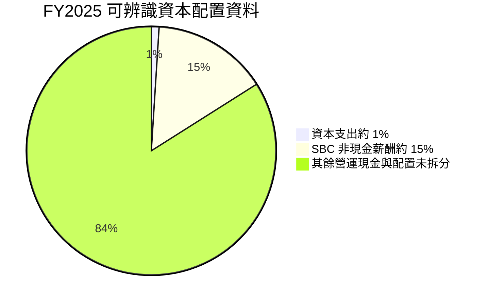

| 配置項目 | 可得資料 | 評估 |
|----------|----------|------|
| Capex | FY2025 $33.88M；TTM $43.24M | 🟢 資本密集度低 |
| 股息 | 殖利率 0.0% | 🟡 無現金收益 |
| 回購 | 金額 N/A | 無法評估抵銷 SBC 稀釋程度 |
| 留存／投資 | 細項 N/A | 應追蹤現金用途及併購紀律 |
| SBC | FY2025 $684.03M | 🟡 有利人才留任，但稀釋成本顯著 |

---

## 6. 獲利能力與資本效率

### 6.1 ROE / ROA / ROIC 趨勢

| 指標 | 最新值 | 歷史可得值 | 評估 |
|------|-------:|------------|------|
| ROIC（TTM，VERIFIED） | **43.1%** | 歷史序列不完整 | 🟢 |
| ROE（TTM，VERIFIED） | **32.7%** | 另一來源列 40.9%，口徑有差異 | 🟡 |
| ROA（補充來源） | **19.3%** | 歷史序列不完整 | 🟢 |
| TTM 營業利益率 | **45.6%** | FY2025 算術值 31.6% | 🟢 |

### 6.2 ROIC vs WACC 分析（核心價值創造判斷）

資料包給出 CAPM 股權成本 13.20%，但債務成本、資本結構權重均 N/A。因此此處把**全股權成本作 WACC 代理值**，不是聲稱公司實際資本結構已證明為 100% 股權融資。

```text
╔══════════════════════════════════════════════════════════════════╗
║                  ROIC vs WACC 深度分析                           ║
╠══════════════════════════════════════════════════════════════════╣
║ 無風險利率 Rf：                 5.15%（資料包基準）               ║
║ 市場風險溢酬 ERP：              5.00%（資料包假設）               ║
║ Beta：                          1.61                             ║
║ 股權成本 Ke = 5.15% + 1.61×5.00% = 13.20%                       ║
║ 債務成本與權重：                N/A                               ║
║ 本報告 WACC 代理：               13.20%（股權成本代理）             ║
║ ROIC（TTM，VERIFIED）：          43.1%                             ║
║ EVA 差額 = 43.1% − 13.20% =     +29.9 個百分點                    ║
║ ROIC / WACC = 43.1 ÷ 13.20 ≈    3.27 倍                           ║
╠══════════════════════════════════════════════════════════════════╣
║ ROIC 43.1% ▓▓▓▓▓▓▓▓▓▓▓▓▓▓▓▓▓▓▓▓▓▓▓▓▓▓▓▓▓▓▓▓▓▓▓▓▓▓▓▓ 🟢        ║
║ WACC 13.2% ▓▓▓▓▓▓▓▓▓▓▓▓▓░░░░░░░░░░░░░░░░░░░░░░░░░░ ──        ║
║ 結論：以代理 WACC 比較，公司目前創造經濟價值；資本結構資料不足     ║
╚══════════════════════════════════════════════════════════════════╝
```

Rf 日期未在資料包中提供，故不自行指定日期。Beta 1.61 大於 1.5，顯示高於市場平均波動；沒有足夠資料自行調整 Beta。稅率、債務成本和資本權重缺漏，故不宣稱 13.20% 是精確的公司 WACC。

### 6.3 杜邦三因素分解

杜邦分解使用 VERIFIED ROE 32.7% 與補充資料 TTM 淨利率 50.3%；因兩種資料源的 ROE 口徑不完全一致，以下為近似檢核而非精確同源拆解。

以總資產 $13.413B、股東權益 $7.39B 作近似期末值：

- 資產週轉率約 = $7.29B ÷ $13.413B = **0.54x**
- 財務槓桿約 = $13.413B ÷ $7.39B = **1.81x**
- 杜邦近似 ROE = 50.3% × 0.54 × 1.81 ≈ **49.2%**

此數與 VERIFIED ROE 32.7% 不一致，原因可能是期間與平均資產、平均權益口徑差異；因此不以這個近似值取代 VERIFIED ROE。

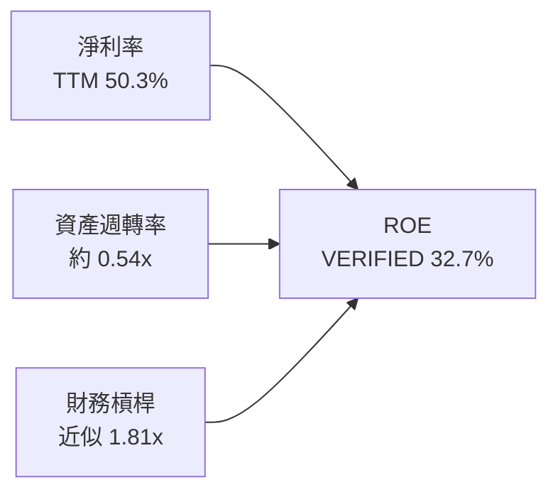

### 6.4 獲利能力儀表板

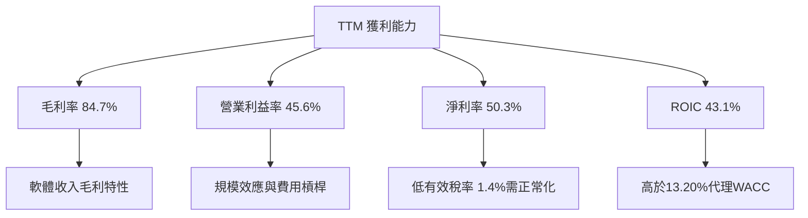

---

## 7. 相對估值分析

### 7.1 同業估值比較表格

倍數均採用 VERIFIED FIGURES 的 Peer multiples；PLTR 指標則採資料包估值欄位。不同來源的 PLTR P/S 值存在差異：VERIFIED 歷史估值區塊為 59.3x，市場估值欄位為 55.54x，另有 EV/Revenue 55.322x；本節同業比較採同業資料包中列示口徑，並保留口徑差異提示。

| 估值指標 | **PLTR** | **SNOW** | **DDOG** | **CRM** | PLTR 評估 |
|----------|---------:|---------:|---------:|--------:|-----------|
| Trailing P/E | 118.3x | N/A | 255.8x | 19.9x | 🔴 高 |
| Forward P/E | 66.26x | 95.6x | 57.9x | 13.6x | 🔴 高於 DDOG、CRM |
| P/S TTM | 55.54x* | 18.9x | 15.5x | 4.1x | 🔴 顯著溢價 |
| EV/EBITDA TTM | 120.169x* | −102.0x | 368.1x | 16.3x | 🟡 SNOW 為負值，無可比意義 |
| 最新單季營收 YoY | 95.9% | 35.1% | 35.2% | 10.8% | 🟢 增長溢價有基本面支持 |
| 毛利率 TTM | 84.7% | 67.0% | 79.6% | 77.3% | 🟢 |

\*PLTR P/S 另有 VERIFIED 歷史比較欄位 59.3x，EV/EBITDA 歷史比較欄位 127.8x；資料包內估值欄位與歷史比較欄位口徑不完全一致，須謹慎解讀。PLTR 增速高於同業，但估值溢價仍要求高增長持續多年。

### 7.2 歷史估值區間分析

```text
╔══════════════════════════════════════════════════════════════════╗
║                 PLTR 五年估值區間（VERIFIED）                    ║
╠══════════════════════════════════════════════════════════════════╣
║ P/E：     100.6x ├─●現在 118.3x────────中位數 228.6x──┤ 601.0x ║
║           當前百分位：7%                                         ║
║ P/S：       7.0x ├────────中位數 24.7x────●現在 59.3x─┤ 120.4x ║
║           當前百分位：67%                                        ║
║ EV/EBITDA:111.8x ├─●現在 127.8x────────中位數 251.9x─┤ 582.9x ║
║           當前百分位：8%                                         ║
╚══════════════════════════════════════════════════════════════════╝
```

P/E 與 EV/EBITDA 的當前歷史百分位偏低，部分原因是盈利快速增長令分母上升；但 P/S 位於歷史 67 百分位且高於中位數 24.7x，說明以收入衡量的價格仍昂貴。歷史估值分位不能單獨證明便宜。

### 7.3 情境目標價（假設驅動，Bear / Base / Bull）

下表是估值情境，不是管理層財測。以約五年後的估值為參考，營業利潤率和退出倍數均為分析假設；為便於風險框架，不把其誤稱為精確市場預測。

| 情境 | 營收 CAGR | 期末營業利潤率 | 退出倍數假設 | 參考目標價 | 相對現價 |
|------|-----------:|---------------:|--------------:|-----------:|---------:|
| 🔴 悲觀 | 20% | 42% | 20x EV/EBITDA | $40 | −76.2% |
| 🟡 基準 | 40% | 48% | 以 DCF／倍數交叉驗證 | $65 | −61.3% |
| 🟢 樂觀 | 50% | 52% | 高成長軟體溢價 | $110 | −34.5% |

估值倍數採 EV/EBITDA 與 DCF 作交叉參考：PLTR 目前盈利能力已高，單看 P/E 不足以反映 SBC 和增長預期；但 FCF Yield 僅 1.00%，使現價需要較長期的高速現金流增長支持。以上退出倍數屬情境假設，不是同業中位數的直接照搬。

### 7.4 相對估值隱含價格區間

```text
╔══════════════════════════════════════════════════════════════════╗
║              相對估值框架與現價位置                              ║
╠══════════════════════════════════════════════════════════════════╣
║ FCF Yield 回推（成熟期 3.5% 假設） 約 $50/股                    ║
║ DCF 基準                             約 $50/股                    ║
║ 基準合理價值交叉驗證                 約 $65/股                    ║
║ 樂觀成長情境                         約 $110/股                   ║
║ 2026-11-13 收盤價                    $167.99                      ║
║ 現價相對以上估值區間                  位於上方                       ║
╚══════════════════════════════════════════════════════════════════╝
```

---

## 8. DCF 內在價值評估（Discounted Cash Flow）

> DCF 的輸入資料含有多項缺漏，模型採用清楚標註的假設值。結果只代表在指定假設下的現金流估值，不是精確預測。

### 8.0 估值推理鏈（Thinking Logic）

**Step 1 — 價值來源與主導變數**

PLTR 的價值可拆成現有政府軟體現金流底盤、商業市場擴張、以及 AI／AIP 工作流程變現的選擇權；各板塊營收比例未提供，因此佔比均為 N/A。模型的主導變數是**未來營收增速與高利潤率是否能延續**，其次才是永續成長率。

**Step 2 — 模型選擇**

| 決策點 | 本報告採用 | 理由 | 曾考慮但否決 | 否決理由 |
|--------|-----------|------|--------------|----------|
| 現金流定義 | FCFF | 對應 WACC 折現與 EV | FCFE | 債務成本與資本結構資料缺漏 |
| 預測期 N | 5 年 | 軟體高成長需逐步收斂，5 年可減少永久外推近期高增速 | 10 年 | 長期產品與競爭能見度不足 |
| 終值方法 | Gordon Growth 為主，退出倍數交叉驗證 | 可明確揭示長期成長假設 | 單用退出倍數 | 終值倍數可能受市場情緒影響 |
| EBIT 基礎 | GAAP | 營業利益已計入 SBC 費用 | 非 GAAP | 加回 SBC 會低估股東成本 |

**Step 3 — 關鍵假設推導鏈**

- **營收 CAGR**：錨點＝FY2022–FY2025 實際 CAGR 約 32.9%，TTM 成長 87.1% → 調整＝高增長仍強，但不把單年高增速永久化 → **採用 40% 五年 CAGR** → 曾考慮 60% 以上，因其要求極長期維持接近近期爆發式增長而否決。
- **期末營業利潤率**：錨點＝TTM 45.6% → 調整＝模型假設五年內規模效應與競爭成本互相抵銷、淨擴張 2.4 個百分點 → **採用 48.0%** → 曾考慮 55%，因缺乏歷史證據支持利潤率再提高逾 9 個百分點而否決。
- **永續成長率 g**：錨點＝成熟經濟長期名目增長通常低於高成長期 → **採用假設值 3.0%**，且低於 13.20% 折現率 → 曾考慮 4%，因永續階段需避免把高成長永久化而不採作基準。
- **預測期 N**：錨點＝五年營收可見度有限、但近期增長高 → **採用 5 年** → 曾考慮 10 年，因產品與競爭不確定性使遠期年度預測誤差過大。
- **Capex／營收**：錨點＝TTM $43.24M ÷ $7.29B ≈ 0.59% → **採用 0.59%** → 不採用更高資本密集假設，因當前資料顯示資本支出很低，但未來算力投入仍是上行風險。
- **有效稅率**：錨點＝最新年度 1.4% → 因稅率異常偏低，採**假設值 15%**；低敏感度簡化。未採 1.4%，避免永久外推特殊稅務狀況。
- **D&A／營收**：D&A 明細未提供，採**假設值 1.0%**，參照資產輕型軟體模式與低 Capex；屬模型估計。
- **ΔWC／新增營收**：歷史營運資金變動資料不足，採**假設值 5%**，作保守營運資金投入；替代 0% 假設會低估增長所需資金。
- **SBC 與股數**：採組合 **(A) GAAP EBIT + 固定股數**；稀釋率設 0%，SBC 已包含於 GAAP 費用，不再扣 SBC，也不另計稀釋。這是模型簡化，可能低估未來稀釋。
- **WACC**：採 13.20% 股權成本代理，因債務利率與權重 N/A；詳見 8.2。

**Step 4 — 最脆弱的一環**

最脆弱的是把 40% 營收 CAGR 與 48% 期末營業利潤率同時延續五年；若營收增長降至 20% 且利潤率收縮，基準 DCF 會大幅下降，與 8.6 敏感度一致。

**Step 5 — 計算路徑圖**

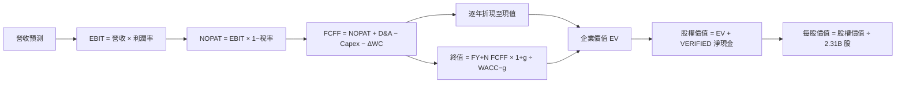

### 8.1 模型假設總表（Model Inputs）

| 假設項目 | 採用值 | 依據／來源 | 敏感度 |
|----------|--------|------------|--------|
| 預測期 N | 5 年 | 分析師假設；兼顧高成長與能見度 | 🟡 中 |
| 營收 CAGR | 40% | FY2022–FY2025 CAGR 32.9%、TTM +87.1%；逐步收斂 | 🔴 高 |
| 期末營業利潤率 | 48% | TTM 45.6%；假設五年淨增 2.4pp | 🔴 高 |
| 有效稅率 | 15% | 假設正常化；最新年 1.4% 不宜外推 | 🟢 低 |
| Capex／營收 | 0.59% | TTM $43.24M ÷ $7.29B | 🟡 中 |
| D&A／營收 | 1.0% | 假設值；D&A 資料未提供 | 🟢 低 |
| ΔWC／收入增額 | 5% | 假設值；歷史 ΔWC 未提供 | 🟢 低 |
| EBIT 基礎 | GAAP | 採用已含 SBC 的營業利益率 | 🟡 中 |
| SBC 處理 | 組合 A；不額外扣 SBC | GAAP EBIT 已費用化 SBC | 🟡 中 |
| 年稀釋率 | 0% | 組合 A 固定股數假設；最新股數採市場資料 2.31B | 🟡 中 |
| 永續成長率 g | 3.0% | 假設值，低於 WACC | 🔴 高 |
| 終值方法 | Gordon Growth 主、退出倍數交叉檢查 | DCF 慣用方法 | 🔴 高 |
| WACC | 13.20% | 股權成本代理，債務權重缺漏 | 🔴 高 |

**SBC 防重複扣除**：本模型採用 **(A) GAAP EBIT + 固定股數**，故 SBC 影響已在營業費用中計入一次；FCFF 不再減 SBC，稀釋率設 0%。

FCFF 定義：`FCFF = NOPAT + D&A − Capex − ΔWC`。四捨五入規則：金額取 $0.01B、比率取 0.1%、折現因子取三位小數；中間計算保留未四捨五入值，表內可能有小幅尾差。

### 8.2 折現率推導（WACC）

```text
╔══════════════════════════════════════════════════════════════════╗
║                    WACC 推導（折現率）                           ║
╠══════════════════════════════════════════════════════════════════╣
║ Rf（10Y 美債）：              5.15%（資料包基準；觀測日期 N/A）   ║
║ ERP：                         5.00%（資料包假設）                 ║
║ Beta：                        1.61（資料包）                      ║
║ 規模／國別溢酬：              0.00%（美國公司，無資料支持額外加計）║
║ Ke = 5.15% + 1.61×5.00% + 0.00% = 13.20%                         ║
║ 稅前 Kd：                     N/A（利息費用與債務成本缺漏）        ║
║ 稅後 Kd：                     N/A                                  ║
║ 股權／債務權重：              N/A（資料包未提供）                  ║
║ 本模型 WACC 代理：            13.20%（假設全股權成本代理）          ║
╚══════════════════════════════════════════════════════════════════╝
```

逐步演算：

1. **Ke（CAPM）** = 5.15% + 1.61 × 5.00% + 0.00% = **13.20%**
2. **稅前 Kd** = N/A；利息費用與平均計息負債資料缺漏，不能推導。
3. **稅後 Kd** = N/A；因稅前 Kd 未知。
4. **資本權重** = N/A；市值權重與一致口徑債務權重未提供，不能聲稱算出實際 E/D 權重。
5. **模型 WACC** = 以 E 權重 100%、D 權重 0% 作為模型代理：100% × 13.20% + 0% × N/A = **13.20%**。

> 100%／0% 是估值模型的代理假設，不是財務事實。缺少完整債務與權重資料，是本 DCF 的重要限制。第 6.2 節採用相同 13.20% 代理值。

### 8.3 逐年自由現金流預測（基準情境）

以下 FY+1 至 FY+5 是以 TTM 營收 $7.29B 為起點的**模型預測**，不是公司年度財測。營業利潤率由 45.6% 緩步提高至 48.0%。

| 年度 | FY+1 | FY+2 | FY+3 | FY+4 | FY+5（＝FY+N） |
|------|------:|------:|------:|------:|------:|
| 營收（$B） | 10.21 | 14.29 | 20.00 | 28.01 | 39.21 |
| 營收 YoY | 40.0% | 40.0% | 40.0% | 40.0% | 40.0% |
| 營業利潤率 | 46.08% | 46.56% | 47.04% | 47.52% | 48.00% |
| EBIT，GAAP（$B） | 4.70 | 6.65 | 9.41 | 13.31 | 18.82 |
| − 稅，15%（$B） | (0.71) | (1.00) | (1.41) | (2.00) | (2.82) |
| NOPAT（$B） | 4.00 | 5.65 | 8.00 | 11.31 | 16.00 |
| + D&A（$B） | 0.10 | 0.14 | 0.20 | 0.28 | 0.39 |
| − Capex（$B） | (0.06) | (0.08) | (0.12) | (0.17) | (0.23) |
| − ΔWC（$B） | (0.15) | (0.20) | (0.29) | (0.40) | (0.56) |
| **= FCFF（$B）** | **3.89** | **5.51** | **7.79** | **11.02** | **15.60** |
| 折現因子 @13.20% | 0.883 | 0.780 | 0.689 | 0.609 | 0.538 |
| **FCFF 現值 PV（$B）** | **3.44** | **4.30** | **5.37** | **6.71** | **8.39** |

預測期現值合計：  
**$3.44 + $4.30 + $5.37 + $6.71 + $8.39 = $28.21B**

**FY+1 逐步演算：**

1. 營收 = $7.29B × (1 + 40%) = **$10.206B**
2. EBIT = $10.206B × 46.08% = **$4.702B**
3. 稅 = $4.702B × 15% = **$0.705B**
4. NOPAT = $4.702B − $0.705B = **$3.997B**
5. D&A = $10.206B × 1.0% = **$0.102B**
6. Capex = $10.206B × 0.593% = **$0.061B**
7. ΔWC = ($10.206B − $7.29B) × 5% = **$0.146B**
8. FCFF = $3.997B + $0.102B − $0.061B − $0.146B = **$3.892B**
9. 折現因子 = 1 ÷ (1 + 13.20%)¹ = **0.883**；PV = $3.892B × 0.883 = **$3.436B**

**合理性自檢**

- 模型 FY+1 至 FY+5 FCFF CAGR 約為 **41.5%**；FY2022–FY2025 FCF 從 $0.184B 增至 $2.10B，但該歷史 CAGR 受低基期扭曲，不能直接視為可持續基準。
- FY+5 FCFF 利潤率 = $15.60B ÷ $39.21B ≈ **39.8%**；目前 TTM FCF 利潤率 = $4.05B ÷ $7.29B ≈ **55.6%**。模型預測低於目前水準，主要來自正常化稅率與 ΔWC 假設。
- 預測期內 FCFF 均為正；若未來競爭或算力投入推高成本，FCFF 會低於本模型。

```text
╔══════════════════════════════════════════════════════════════════╗
║              自由現金流：歷史實際 vs 模型預測                      ║
╠══════════════════════════════════════════════════════════════════╣
║ FY2023(實) $0.70B  ███░░░░░░░░░░░░░░░░░  歷史值                  ║
║ FY2024(實) $1.14B  █████░░░░░░░░░░░░░░░  歷史值                  ║
║ FY2025(實) $2.10B  █████████░░░░░░░░░░░  歷史值                  ║
║ FY+1 (預)  $3.89B  ███████████████░░░░░  模型值                  ║
║ FY+5 (預) $15.60B  ████████████████████  模型值                  ║
╠══════════════════════════════════════════════════════════════════╣
║ 預測 CAGR 高；與歷史低基期增長不可直接比較，終值占比約 75%       ║
╚══════════════════════════════════════════════════════════════════╝
```

### 8.4 終值計算（Terminal Value）

適用性檢查：**WACC 13.20% vs g 3.0% → WACC > g？✅**

| 方法 | 計算式 | 終值 TV | TV 現值 | 佔總 EV 比重 |
|------|--------|--------:|--------:|-------------:|
| Gordon Growth | $15.596B × 1.03 ÷ (13.20% − 3.0%) | $157.53B | $84.76B | 約 75.0% |
| 退出倍數交叉驗證 | FY+5 EBITDA 約 $19.21B × 20x | $384.23B | 約 $206.7B | 高於 Gordon 結果 |

Gordon Growth 為主方法。退出倍數採 20x 作**假設值**，是成熟後的估值情境，而非資料包同業中位數；兩種終值差距很大，顯示估值對退出倍數敏感。因退出倍數顯著高於 Gordon Growth 結果，本報告不以較高的退出倍數結果取代基準終值。

逐步演算：

1. FY+N FCFF = **$15.596B**
2. 分子 = $15.596B × (1 + 3.0%) = **$16.064B**
3. 分母 = 13.20% − 3.0% = **10.20%**；TV = $16.064B ÷ 10.20% = **$157.49B**（差異僅來自表內四捨五入）
4. PV(TV) = $157.49B × 0.538 = **$84.73B**
5. 終值佔比 = $84.73B ÷ ($28.21B + $84.73B) = **75.0%**

> 終值現值約占 EV 75%，本估值高度依賴長期假設，短期現金流貢獻有限。

### 8.5 企業價值 → 每股內在價值（Bridge）

橋接採 VERIFIED 淨現金 $3.62B，避免將未核實的現金及債務口徑混用。總債務細項 N/A，因此直接使用資料包提供的淨現金數值。

```text
╔══════════════════════════════════════════════════════════════════╗
║              企業價值 → 每股內在價值 橋接表                      ║
╠══════════════════════════════════════════════════════════════════╣
║ 預測期 FCFF 現值合計              +$28.21B                       ║
║ 終值現值 PV(TV)                   +$84.73B                       ║
║ = 企業價值 EV                      $112.94B                       ║
║ + VERIFIED 淨現金                 +$3.62B                        ║
║ = 股權價值                         $116.56B                       ║
║ ÷ 流通股數（市場資料）             2.31B 股                       ║
║ ★ 每股 DCF 基準內在價值            約 $50.46                      ║
║ 當前股價（2026-11-13）             $167.99                        ║
║ 折溢價（現價÷DCF價值−1）           約 +232.8%（溢價）              ║
╚══════════════════════════════════════════════════════════════════╝
```

**逐步演算：**

1. EV = $28.21B + $84.73B = **$112.94B**
2. 股權價值 = $112.94B + $3.62B 淨現金 = **$116.56B**
3. 每股價值 = $116.56B ÷ 2.31B 股 = **$50.46**
4. 折溢價 = $167.99 ÷ $50.46 − 1 = **約 +232.8%**
5. 本節不計算 MOS；MOS 僅以 8.8 加權合理價值為分母。

股數採市場資料 2.31B 股；與 SBC 組合 (A) 的固定股數假設相容。現金採 VERIFIED 數值；總債務本身為 N/A，股權價值橋接使用 VERIFIED 淨現金，不另行反推總債務。

### 8.6 敏感性分析（WACC × 永續成長率）

格內為每股 DCF 價值；括號為相對現價 $167.99 的上行／下行幅度。矩陣採相同預測期 FCFF，僅改變折現率與 g。基準格採 13.2% WACC、3.0% g。

| g（列）／WACC（欄） | 11.2% | 12.2% | **13.2% 基準** | 14.2% | 15.2% |
|-----------|------:|------:|------:|------:|------:|
| 2.0% | $58.27 (−65.3%) | $52.13 (−69.0%) | $46.86 (−72.1%) | $42.58 (−74.7%) | $38.78 (−76.9%) |
| 2.5% | $61.37 (−63.5%) | $54.28 (−67.7%) | $48.71 (−71.0%) | $43.97 (−73.8%) | $39.94 (−76.2%) |
| **3.0% 基準** | $64.46 (−61.6%) | $56.67 (−66.3%) | **$50.46 (−70.0%)** | $45.49 (−72.9%) | $41.16 (−75.5%) |
| 3.5% | $67.96 (−59.5%) | $59.33 (−64.7%) | $52.55 (−68.7%) | $47.16 (−71.9%) | $42.33 (−74.8%) |
| 4.0% | $71.94 (−57.2%) | $62.33 (−62.9%) | $54.81 (−67.4%) | $48.82 (−70.9%) | $43.80 (−73.9%) |

**矩陣示範格：WACC 14.2% > g 3.0% ✅**

1. 新 WACC 下預測期 PV 合計約 **$27.41B**。
2. TV = $15.596B × 1.03 ÷ (14.2% − 3.0%) = 約 **$143.43B**；PV(TV) = $143.43B × 0.516 = 約 **$74.06B**。
3. EV = $27.41B + $74.06B = **$101.47B**；加淨現金 $3.62B 得股權價值 $105.09B；除以 2.31B 股 = 約 **$45.49/股**。

**三情境 DCF（營運假設改變）**

| 情境 | 營收 CAGR | 期末營業利潤率 | g | WACC | 每股價值 | 相對現價 | 主觀機率 |
|------|-----------:|---------------:|--:|-----:|---------:|---------:|---------:|
| 🔴 悲觀 | 20% | 42% | 2.0% | 14.2% | 約 $20 | −88.1% | 25% |
| 🟡 基準 | 40% | 48% | 3.0% | 13.2% | 約 $50.46 | −70.0% | 50% |
| 🟢 樂觀 | 50% | 52% | 3.5% | 12.2% | 約 $90 | −46.4% | 25% |

情境值為模型估算值，營收、利潤率與折現率同時變動；尾差來自四捨五入。三情境估值鏈如下：

- **悲觀**：20% CAGR → FY+5 營收約 $18.14B → 42% 營業利潤率 → FY+5 FCFF 約 $6.3B → Gordon TV 約 $51B → 折現、加淨現金後每股約 **$20**。前提：商業需求降速，且利潤率受競爭與部署成本壓縮。
- **基準**：40% CAGR → FY+5 營收 $39.21B → 48% 營業利潤率 → FY+5 FCFF $15.60B → TV 約 $157.5B → 基準每股約 **$50.46**。前提：收入高速增長延續，但現金流利潤率受正常化稅率及營運資金拖累。
- **樂觀**：50% CAGR → FY+5 營收約 $55.20B → 52% 營業利潤率 → FY+5 FCFF 約 $23B → TV 約 $270B → 折現、加淨現金後每股約 **$90**。前提：AIP 商業化持續加速、利潤率擴張且折現率下降。

> 情境機率加權 DCF 約為 `$20 × 25% + $50.46 × 50% + $90 × 25% = $52.73`。此值只供情境檢查；第 8.8 節另用估值方法權重形成唯一加權合理價值。

**敏感度結論**

- g 每 +1pp（3.0%→4.0%）：約 $50.46 變為 $54.81，**+$4.35／+8.6%**。
- WACC 每 +1pp（13.2%→14.2%）：約 $50.46 變為 $45.49，**−$4.97／−9.8%**。
- 期末營業利潤率每 +1pp：依模型現金流增量粗估約增加 **$1.05/股**，約 **+2.1%**。
- 影響最大的是折現率與終值參數；其後是營收 CAGR。與 8.0 指出的「營收與高利潤率持續性」大致一致，但估值對 WACC 的敏感度同樣重大。

### 8.7 反推 DCF（Reverse DCF）

固定輸入：WACC 13.20%、稅率 15%、Capex/營收 0.59%、ΔWC/新增營收 5%、基準 N=5 年、股數 2.31B、g 3.0%。現價 $167.99 對應的必要股權價值約為 $167.99 × 2.31B = $388.06B；扣除 VERIFIED 淨現金 $3.62B，隱含 EV 約 $384.44B。以下只作方向性疊代，因 WACC 權重與稀釋股數預測存在資料限制。

| 求解變數（每列只放開一項） | 其餘變數 | 市場隱含值（約） | 歷史錨點 | 判斷 |
|--------------------------|----------|----------------:|---------|------|
| 未來五年營收 CAGR | 利潤率 48%、g 3% 固定 | 約 78%–80% | FY22–FY25 CAGR 32.9%；TTM 87.1% | 🔴 要求近年爆發式增長持續 |
| 期末營業利潤率 | CAGR 40%、g 3% 固定 | 約 100% 以上才可能接近；經濟上不合理 | 目前 TTM 45.6% | 🔴 基準增長下無合理利潤率解 |
| 永續成長率 g | CAGR 40%、利潤率 48% 固定 | 無有效解，須接近或超越 WACC | — | 🔴 不可持續 |
| 高成長持續年數 N | CAGR 40%、利潤率 48%、g 3% 固定 | 5 年內不成立；合理 3–15 年需延長才可能逼近 | — | 🔴 市場要求長期高速增長 |

**營收 CAGR 疊代示例（方向性模型值）**

| 試算 CAGR | FY+5 營收（約） | FY+5 FCFF（約） | 每股價值（約） | vs $167.99 | 判斷 |
|------------:|----------------:|----------------:|---------------:|-----------:|------|
| 75% | $119.7B | 約 $48B | 約 $155 | −7.7% | 偏低，往上試 |
| 77.5% | 約 $128.5B | 約 $52B | 約 $166 | −1.2% | 接近 |
| 80% | $137.8B | 約 $56B | 約 $177 | +5.4% | 偏高 |

以上疊代只用於顯示市場隱含預期的量級；由於顯示資料的取整、估值市值口徑與股數資料不完全一致，不應將 77.5% 視為精確根。若以現價合理化，PLTR 需讓五年營收增長接近近期極高速度，或將高速增長維持更長時間；這高於 FY2022–FY2025 的實際 CAGR 約 32.9%，執行風險高。

### 8.8 估值三角驗證與安全邊際

| 估值方法 | 隱含每股價值 | 上行空間（÷現價） | 權重 | 說明 |
|----------|--------------:|-------------------:|------:|------|
| DCF（基準） | $50.46 | −70.0% | 50% | 終值占比高，權重不設過高 |
| 同業 Forward P/E | $65.91 | −60.8% | 20% | $2.53522 Forward EPS × 假設 26x |
| EV/EBITDA 倍數法 | $70.00 | −58.3% | 15% | 估計值；假設成熟期倍數顯著低於目前 |
| FCF Yield 回推 | $50.00 | −70.2% | 10% | 假設成熟期 FCF Yield 約 3.5% |
| 分析師共識目標價 | $222.25 | +32.3% | 5% | 28 位分析師均值；權重不超過 10% |
| **加權合理價值** | **$65.03** | **−61.3%** | **100%** | 方法加權總和 |

逐步演算：  
`$50.46 × 50% + $65.91 × 20% + $70.00 × 15% + $50.00 × 10% + $222.25 × 5%`  
`= $25.23 + $13.182 + $10.50 + $5.00 + $11.1125 = $65.0245 ≈ $65.03`

DCF 權重 50%，因其現金流可稽核且已反映營運假設；但終值佔比約 75%，故不採更高權重。總權重為 100%。

```text
╔══════════════════════════════════════════════════════════════════╗
║                  估值區間與安全邊際                              ║
╠══════════════════════════════════════════════════════════════════╣
║ $40 ─────── $65.03 ─────── $110 ─────────────── $167.99        ║
║ 悲觀情境     加權合理值       樂觀情境              現價          ║
║                                                                  ║
║ MOS = ($65.03 − $167.99) ÷ $65.03 = −158.4%                     ║
║ 上行空間 = ($65.03 − $167.99) ÷ $167.99 = −61.3%                ║
║ DCF 折溢價：$167.99 ÷ $50.46 − 1 ≈ +232.8%                       ║
║ 建議買入區間：$58.53 以下（MOS ≥ 10%）                           ║
║ 合理持有區間：$58.53–$72.26（約 ±10% 加權合理價值）              ║
║ 減碼考慮區間：高於 $110 樂觀情境；現價已高於此區間               ║
╚══════════════════════════════════════════════════════════════════╝
```

**MOS** = ($65.03 − $167.99) ÷ $65.03 = **−158.4%**；與 1.0 儀表板相同。  
符合評級規則：MOS < −25%，因此為**賣出**。

> 🔎 **程式複算（Python，依本節各項自動重算）**
>
> 加權合理價值 = $50.46 × 50% + $65.91 × 20% + $70.00 × 15% + $50.00 × 10% + $222.25 × 5% = **$65.02**（權重合計 100%）
>
> 以價格 $167.99 計：MOS = **-158.4%**，上行空間 = **-61.3%**
>
> ✅ 與本節所寫數值一致。

### 8.9 DCF 模型的局限與失效條件

- **終值依賴度**：終值現值約占企業價值 75%，估值主要由 FY+5 以後的假設決定。
- **最脆弱假設**：40% 五年營收 CAGR、48% 期末營業利益率；若增長降至 20% 且利潤率下滑，悲觀 DCF 約 $20/股。
- **資料缺漏**：債務成本、實際 WACC 權重、D&A、營運資金變動、完全稀釋股數均不足；DCF 因此是情境工具，不是精確目標價。
- **SBC 限制**：GAAP EBIT 已費用化 SBC，但固定股數假設忽略未來稀釋；若股數每年增加，實際每股價值會低於本模型。
- **應配合方法**：高成長期應同時看 EV/Sales、FCF Yield、同業 Forward P/E、客戶留存及單位經濟性。
- **與風險矩陣連結**：商業成長減速衝擊營收 CAGR；AI 基礎設施成本增加衝擊營業利潤率與 Capex；利率上升衝擊 WACC；SBC 加速衝擊稀釋股數。

### 8.10 複算檢核表（Audit Trail）

| # | 檢核項目 | 結果 |
|---|----------|------|
| 1 | 高／中敏感度假設均提供推導鏈 | ✅ |
| 2 | 假設值標明依據或缺漏 | ✅ |
| 3 | WACC CAPM 算式可複算；實際權重缺漏已明示 | ✅（代理值限制） |
| 4 | Kd 與 D 權重不可得，未以無息負債代替 | ✅ |
| 5 | WACC 與 6.2 採相同 13.20% 代理值 | ✅ |
| 6 | 預測期間五年，FY+1 至 FY+5 無省略 | ✅ |
| 7 | FY+1 FCFF 九步算式列出 | ✅ |
| 8 | 預測期 PV 約 $28.21B | ✅ |
| 9 | WACC 13.20% 大於 g 3.0% | ✅ |
| 10 | 終值取 FY+5 FCFF 並折現五期 | ✅ |
| 11 | EV、淨現金、股數至每股價值橋接列出 | ✅ |
| 12 | SBC 組合 A：GAAP、無額外扣 SBC、固定股數 | ✅ |
| 13 | 敏感性基準格與 8.5 約 $50.46 一致 | ✅ |
| 14 | 矩陣各格均符合 WACC > g | ✅ |
| 15 | 三情境機率合計 100% | ✅ |
| 16 | Reverse DCF 每列只放開一個變數；疊代為近似值 | ✅（非精確根） |
| 17 | MOS 以 8.8 加權合理價值計；折溢價以 DCF 值計 | ✅ |
| 18 | 報告包含第 11 章 | ✅ |
| 19 | 加權合理價值為各項加權總和 $65.03 | ✅ |
| 20 | MOS −158.4% 對應賣出評級 | ✅ |

---

## 9. 成長催化劑

### 9.1 催化劑時間軸

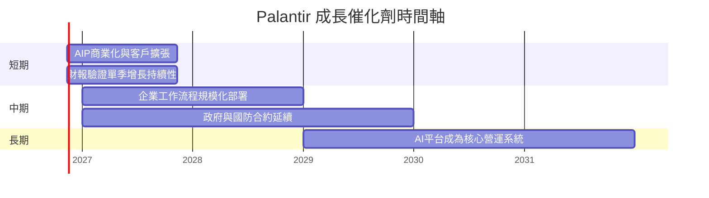

時間為研究追蹤區間，不代表公司已公布的產品時程或營收承諾。

### 9.2 TAM 市場規模分析

TAM 金額、滲透率與公司分部收入均未在資料包提供，不能杜撰市場規模。

```text
╔══════════════════════════════════════════════════════════════════╗
║             TAM 與滲透率：可核驗資料狀態                         ║
╠══════════════════════════════════════════════════════════════════╣
║ 政府／國防資料平台 TAM： N/A   滲透率：N/A   PLTR 收入：N/A      ║
║ 商業資料平台 TAM：       N/A   滲透率：N/A   PLTR 收入：N/A      ║
║ 企業 AI／AIP TAM：       N/A   滲透率：N/A   PLTR 收入：N/A      ║
║ 可觀察基準：TTM 營收 $7.29B；最新單季 YoY +95.9%                 ║
║ 關鍵驗證：新客戶數、商業收入增長、客戶擴張與合約價值              ║
╚══════════════════════════════════════════════════════════════════╝
```

### 9.3 成長驅動力結構圖

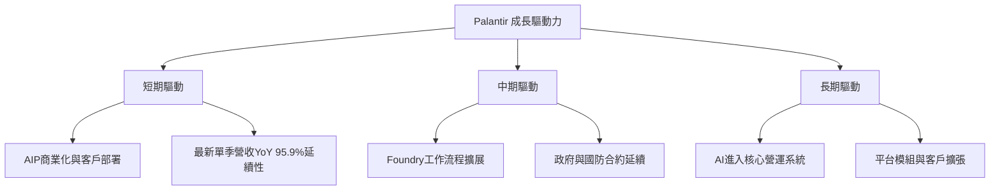

---

## 10. 風險矩陣

### 10.1 風險評分矩陣

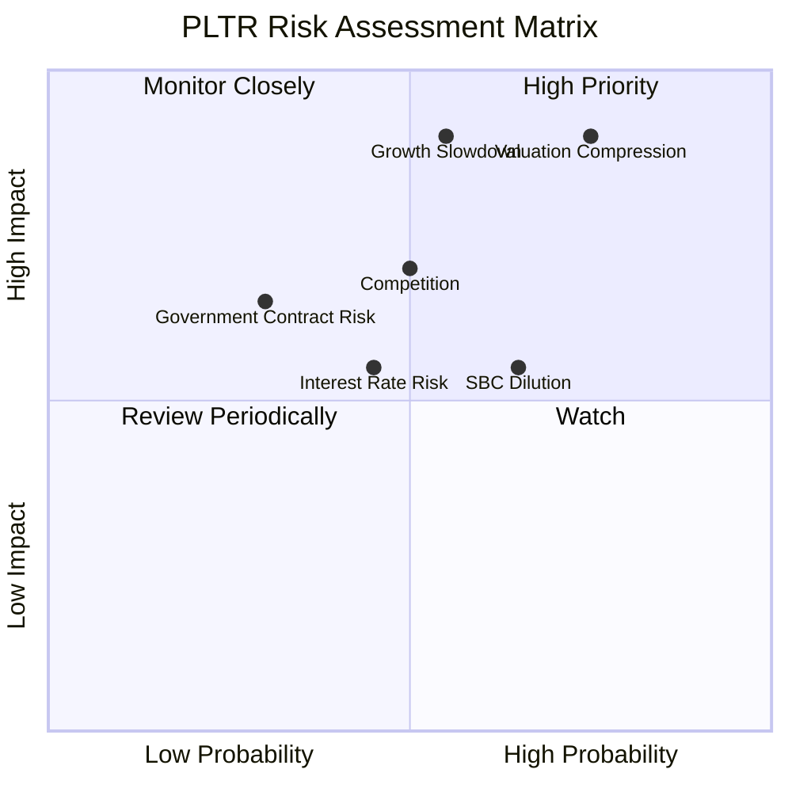

### 10.2 風險清單詳細分析

| # | 風險項目 | 發生機率 | 財務衝擊 | 風險評分 | 緩解措施 |
|---|----------|----------|----------|----------|----------|
| 1 | 🔴 估值倍數收縮 | 高（約 60%） | 若估值向低於目前同業水準收斂，股價回撤可能超過 30%；DCF 基準約 $50.46 | 🔴 9.0/10 | 以估值區間分批管理部位；避免只看營收增速 |
| 2 | 🔴 增長減速 | 中高（約 50%） | 單季 YoY 若由 95.9% 快速降至 40% 以下，DCF CAGR 假設將受挑戰 | 🔴 8.5/10 | 追蹤商業收入、新客戶與擴張率 |
| 3 | 🟠 競爭與平台替代 | 中（約 40%） | 可能壓低訂價、毛利率與營業利益率 | 🟠 7.0/10 | 監控續約、客戶擴張與部署週期 |
| 4 | 🟡 SBC 與稀釋 | 中高（約 55%） | 近四季 SBC 約為營收 13.5%，增加每股價值稀釋 | 🟡 6.5/10 | 追蹤完全稀釋股數與回購抵銷 |
| 5 | 🟡 政府合約集中／延遲 | 中低（約 30%） | 合約延遲會影響收入能見度；分部集中度 N/A | 🟡 6.0/10 | 追蹤合約公告、續約與政府預算 |
| 6 | 🟡 利率上升 | 中（約 45%） | WACC 上升 1pp，模型每股價值約下降 9.8% | 🟡 6.5/10 | 對高久期估值使用較高折現率情境 |

機率與衝擊百分比是分析師情境估計，不是公司財務披露或統計預測。

---

## 11. 投資建議

### 11.1 最終綜合評級雷達圖

```text
╔══════════════════════════════════════════════════════════════╗
║                   PLTR 最終評級儀表板                         ║
╠══════════════════════════════════════════════════════════════╣
║ 基本面       8.0/10  ▓▓▓▓▓▓▓▓▓▓▓▓▓▓▓▓░░░░  ★★★★☆           ║
║ 成長         9.0/10  ▓▓▓▓▓▓▓▓▓▓▓▓▓▓▓▓▓▓░░  ★★★★★           ║
║ 獲利         8.5/10  ▓▓▓▓▓▓▓▓▓▓▓▓▓▓▓░░░░░  ★★★★☆           ║
║ 財務健康     8.0/10  ▓▓▓▓▓▓▓▓▓▓▓▓▓▓▓▓░░░░  ★★★★☆           ║
║ 護城河       7.5/10  ▓▓▓▓▓▓▓▓▓▓▓▓▓▓▓░░░░░  ★★★★☆           ║
║ 估值         2.5/10  ▓▓▓▓▓░░░░░░░░░░░░░░░  ★★☆☆☆           ║
╠══════════════════════════════════════════════════════════════╣
║ 綜合         6.8/10  高品質業務；估值缺乏安全邊際              ║
║ 評級         🔴 賣出；MOS −158.4%                              ║
╚══════════════════════════════════════════════════════════════╝
```

### 11.2 目標價與隱含報酬率

| 情境 | 參考目標價 | 相對 $167.99 報酬 | 權重／說明 |
|------|-----------:|------------------:|------------|
| 🔴 悲觀 | $40 | −76.2% | 成長降至 20%、利潤率 42% |
| 🟡 基準 | $65.03 | −61.3% | 第 8.8 節加權合理價值 |
| 🟢 樂觀 | $110 | −34.5% | 高增長與較高成熟期倍數 |
| 分析師共識 | $222.25 | +32.3% | 28 位分析師均值；僅作參考，不取代模型 |

依規則 20，MOS < −25% 對應**賣出**，不作評級上調。現價 $167.99 高於樂觀情境參考值，故不設定現價附近的買入區間；按 MOS ≥10% 的買入價格上限約為 $65.03 × 90% = **$58.53**。

### 11.3 買入時機與觸發因素

```text
╔══════════════════════════════════════════════════════════════════╗
║                  ✅ 買入觸發因素 Checklist                      ║
╠══════════════════════════════════════════════════════════════════╣
║ 目前判斷：現價 $167.99 高於加權合理價值 $65.03                   ║
║                                                                  ║
║ 重新評估買入的條件：                                             ║
║ ☐ 股價回落至 $58.53 以下，且基本面未惡化（MOS 約達 10% 以上）    ║
║ ☐ 營收增速雖放緩，但商業收入與客戶擴張仍維持趨勢                 ║
║ ☐ TTM FCF 持續增長，且 SBC／營收比率下降                         ║
║                                                                  ║
║ 加碼觸發條件：                                                   ║
║ ☐ 股價進入合理價值區間，且營業利益率維持 45% 以上                ║
║ ☐ ROIC 維持高於 WACC 代理值 13.20%，FCF 不轉負                   ║
║                                                                  ║
║ 減碼／退出觸發條件：                                             ║
║ ☐ 營收增長連續兩季低於 40%                                       ║
║ ☐ TTM 營業利益率跌破 40% 或 FCF 連續兩季下降                     ║
║ ☐ SBC／營收持續高於 15% 且完全稀釋股數快速增加                   ║
╚══════════════════════════════════════════════════════════════════╝
```

### 11.4 投資人適配度分析

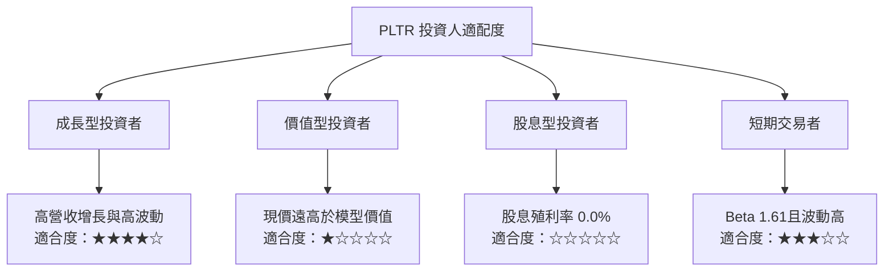

### 11.5 每季財報監控清單（Quarterly Watch List）

| 監控指標 | 最新基準 | 加碼／正面觸發 | 減碼／負面觸發 |
|----------|---------:|----------------|----------------|
| 營收 YoY 成長 | 最新單季 95.9% | 保持 50% 以上並有客戶擴張佐證 | 連續兩季低於 40% |
| 營業利益率 | TTM 45.6%；最新單季 VERIFIED 46.9% | 維持 45% 以上 | 低於 40% 且持續兩季 |
| TTM FCF | $4.05B | 持續增長且轉換率健康 | 連續兩季下滑或轉負 |
| FCF Yield | 1.00% | 股價下跌使估值改善，且基本面不變 | 股價上升但 FCF 停滯 |
| SBC／營收 | 近四季估算約 13.5% | 比率下降、股數增長放緩 | 持續高於 15% |
| Capex | TTM $43.24M | 維持低資本強度且支持增長 | 投入大幅上升但收入回報不足 |
| EPS surprise | 四季預估值均 N/A | 取得可核驗一致預期後追蹤 beat/miss | 不以缺失預估值推斷超預期 |
| 財測與客戶擴張 | 資料包未列客戶數 | 財測上修且擴張指標改善 | 指引下修或訂單／部署延遲 |

### 11.6 反面論證：什麼會證明論點錯誤（What Would Change My Mind）

```text
╔══════════════════════════════════════════════════════════════════╗
║             ⚠️ 論點失效條件（Disconfirming Evidence）            ║
╠══════════════════════════════════════════════════════════════════╣
║ □ 最新單季營收 YoY 由 95.9% 降至 40% 以下，並連續兩季未回升      ║
║ □ TTM 營業利益率由 45.6% 下滑至 40% 以下                         ║
║ □ TTM FCF 轉負，或 FCF／淨利低於 80% 並持續兩季                  ║
║ □ ROIC 跌至 13.20% 代理 WACC 以下                                ║
║ □ SBC／營收連續兩季高於 15%，且稀釋股數增速未下降                ║
║ □ AIP／商業化未能轉化為可持續收入，客戶擴張與續約停滯            ║
║ □ 估值仍高於合理價值甚多，而收入增長與利潤率假設同步下修        ║
╚══════════════════════════════════════════════════════════════════╝
```

上述任一情況若持續出現，應重新檢視「高增長可延續」的核心論點；尤其是營收減速、利潤率下滑與 SBC 稀釋同時發生時，DCF 基準價值可能低於本報告情境估值。

> **免責聲明**：本報告為 AI 自動生成，僅供研究參考，不構成投資建議。投資有風險，入市需謹慎。