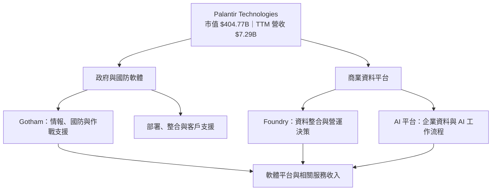
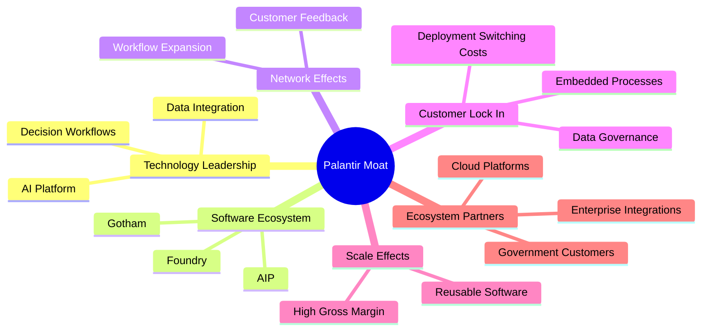
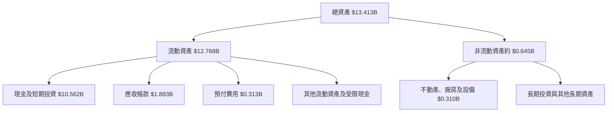
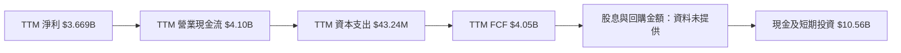
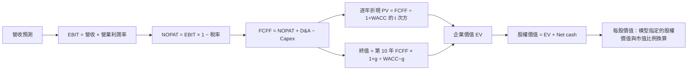
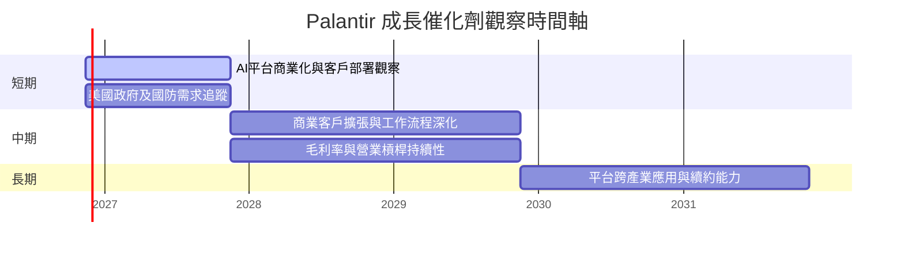
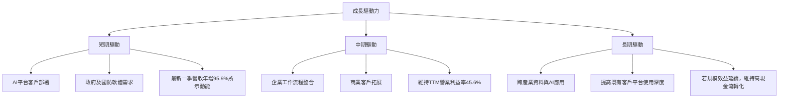
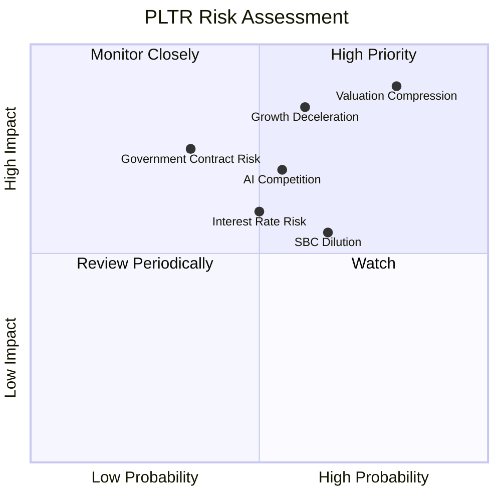
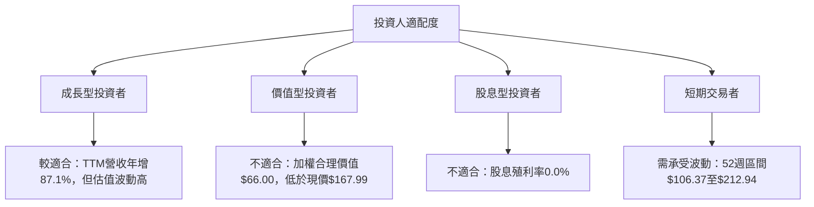

# PLTR 基本面深度分析報告
> **報告日期**：2026-11-14 ｜ **語言**：繁體中文 ｜ **數據來源**：SEC 申報資料 (XBRL)、Yahoo Finance、Finviz、StockAnalysis、Roic.ai ｜ **分析師**：CFA 級機構研究

## 目錄

| # | 章節 | 核心結論 |
|---|------|----------|
| 1 | 執行摘要 | 賣出；加權合理價值 $66.00，MOS -154.5% |
| 2 | 公司概覽與商業模式 | 軟體平台具較強客戶整合特性；分部營收占比未提供 |
| 3 | 損益表深度分析 | TTM 營收 $7.29B、TTM 成長 87.1%；最新一季年增 95.9% |
| 4 | 資產負債表分析 | 現金及短期投資 $10.56B；債務數據來源有差異 |
| 5 | 現金流量深度分析 | TTM FCF $4.05B，FCF Yield 1.00%；SBC 稀釋仍需關注 |
| 6 | 獲利能力與資本效率 | ROIC 492.3% 高於 WACC 12.18%，但 ROIC 分母敏感 |
| 7 | 相對估值分析 | PLTR 倍數高於所列同業；P/S 高於自身五年中位數 |
| 8 | DCF 內在價值評估 | 基準 DCF $21.87；相對現價溢價 667.9% |
| 9 | 成長催化劑 | AI 軟體商業化與政府需求可支持成長；TAM 數據未提供 |
| 10 | 風險矩陣 | 估值回落、成長降速、SBC 稀釋為主要風險 |
| 11 | 投資建議 | 依 MOS 為賣出；以估值與成長品質指標設監控門檻 |

---

## 1. 執行摘要

截至 2026-11-13 收盤，PLTR 股價為 **$167.99**。SEC 申報資料與程式計算顯示，公司 TTM 營收 **$7.29B**、TTM 營收年增 **87.1%**、最新一季營收年增 **95.9%**、TTM 營業利益率 **45.6%**、TTM FCF **$4.05B**；營運基本面迅速改善。另一方面，基準 DCF 每股價值為 **$21.87**，加權合理價值為 **$66.00**，以加權合理價值計算的 MOS 為 **-154.5%**；公司自身 TTM P/S 為 **59.3x**，高於五年中位數 **24.7x**。因此，儘管 ROIC（TTM）為 **492.3%**、高於 **12.18%** 的 WACC，估值所要求的未來現金流仍顯著高於基準模型所支持的水準，依規則 20 評級為 **賣出**。

### 1.0 一頁式投資儀表板（Portfolio Manager 30 秒速讀）

| 項目 | 內容 |
|------|------|
| **投資論點（3 句）** | ① TTM 營收 $7.29B、年增 87.1%，最新一季年增 95.9%，顯示需求仍在加速。② TTM 營業利益率 45.6%、FCF $4.05B，盈利與現金流轉化具規模效益。③ 現價 $167.99 對比加權合理價值 $66.00，MOS -154.5%，估值風險遠高於基本面優勢。 |
| **綜合評分** | **7.0/10**（引用 1.1 評分卡） |
| **財務健康** | 🟢 現金及短期投資 $10.56B、流動比率 7.102；但債務數據在不同資料來源間有差異。 |
| **ROIC vs WACC** | **492.3% vs 12.18%**；表面上為正利差，但 ROIC 分母很小且對現金扣除敏感。 |
| **FCF 趨勢** | 上升；TTM FCF $4.05B、FCF Yield **1.00%**。 |
| **估值** | Forward P/E **66.17x** ｜ EV/EBITDA（TTM）**117.59x** ｜ FCF Yield **1.00%** |
| **DCF 內在價值（基準）** | **$21.87** ｜ 現價相對 DCF 溢價 **667.9%**（第 8.5 節） |
| **安全邊際（MOS）** | **-154.5%**＝($66.00 − $167.99) ÷ $66.00；🔴 <10%，無安全邊際（分母為加權合理價值） |
| **預期報酬（基準情境 12M）** | DCF 基準情境每股 $21.87，相對現價 **-87.0%**；此為模型情境值，不等同分析師共識。 |
| **關鍵風險（前二）** | 極高估值使未來成長稍低於預期即可觸發倍數收縮；SBC 持續造成稀釋。 |
| **評級 + 信心度** | 🔴 **賣出** ｜ 信心：中（基本面強，估值模型與市場價格差距極大） |

### 1.1 綜合評分卡（全報告唯一）

| 維度 | 評分（1–10） | 主要依據（引用數字與其來源章節） |
|------|--------------|----------------------------------|
| 成長性 | 9.0 | TTM 營收年增 87.1%、最新一季年增 95.9%（第 3 章）；高成長能否延續仍有不確定性。 |
| 獲利能力 | 9.0 | TTM 營業利益率 45.6%、淨利率 50.3%、FCF $4.05B、ROIC 492.3%（第 3、5、6 章）。 |
| 財務健康 | 9.0 | 現金及短期投資 $10.56B、流動比率 7.102、F-Score 7/8（第 4、6 章）。 |
| 估值 | 1.0 | 加權合理價值 $66.00、MOS -154.5%；P/S 59.3x 高於五年中位數 24.7x（第 7、8 章）。 |
| 護城河 | 8.0 | 政府及企業資料工作流程整合、TTM 毛利率 84.7%；但客戶留存、續約率等資料未提供（第 2 章）。 |
| 管理層與資本配置 | 6.0 | 維持高現金、資本支出低；FY2025 SBC $684.03M，稀釋股數測試未通過（第 3、5、6 章）。 |
| **綜合評分** | **7.0** | 六項算術平均： (9.0 + 9.0 + 9.0 + 1.0 + 8.0 + 6.0) ÷ 6 = **7.0**。 |

### 1.2 五大投資論點 + 三大核心風險

| 類型 | 項目 | 具體依據 | 信心度 |
|------|------|----------|--------|
| 🟢 **投資論點①** | 營收動能高 | TTM 營收 $7.29B、年增 87.1%；最新一季營收 $2.31B、年增 95.9%。 | 🟢 高 |
| 🟢 **投資論點②** | 營運槓桿明顯 | FY2025 營業利益 $1.41B，高於 FY2024 的 $310.40M；TTM 營業利益率 45.6%。 | 🟢 高 |
| 🟢 **投資論點③** | 現金流轉換佳 | TTM 營業現金流 $4.10B、FCF $4.05B；FCF 高於 TTM 淨利 $3.669B。 | 🟢 高 |
| 🟢 **投資論點④** | 流動性充足 | 現金及短期投資 $10.56B、流動比率 7.102。 | 🟢 高 |
| 🟢 **投資論點⑤** | 終端需求可擴張 | 平台涵蓋政府與商業資料分析應用；當前商業化速度由營收年增 87.1% 提供佐證，但分部資料不足以辨認各板塊貢獻。 | 🟡 中 |
| 🟡 **風險①** | 估值回落 | 加權合理價值 $66.00，相對現價 $167.99 的 MOS 為 -154.5%；基準 DCF $21.87。 | 🔴 高衝擊 |
| 🔴 **風險②** | 成長預期過高 | 現價隱含市場價值超出基準 DCF；DCF 情境基準值相對現價為 -87.0%。 | 🔴 高 |
| 🟡 **風險③** | SBC 與股數稀釋 | FY2025 SBC $684.03M；品質測試中的「稀釋股數未增加」未通過。 | 🟡 中 |

### 1.3 快速統計卡片

| 指標 | 公司實際值（期間） | 同業中位數 | 狀態 |
|------|--------------------|------------|------|
| 營收成長（TTM） | **87.1%** | — | 🟢 |
| 營收成長（最新一季年增） | **95.9%** | 35.1% | 🟢 |
| 毛利率（TTM） | **84.7%** | 77.3% | 🟢 |
| 營業利益率（TTM） | **45.6%** | — | 🟢 |
| ROIC（TTM） | **492.3%** | — | 🟢* |
| Forward P/E | **66.17x** | 35.7x | 🔴 |
| FCF Yield（TTM） | **1.00%** | — | 🟡 |
| Piotroski F-Score | **7 / 8** | — | 🟢 |

\* ROIC 數值顯著高於一般穩態水準，可能受投入資本分母較小影響；詳見第 6.2 節。

### 1.4 投資結論

```text
╔══════════════════════════════════════════════════════════════════╗
║                    📊 投資結論摘要                               ║
╠══════════════════════════════════════════════════════════════════╣
║  評級：🔴 賣出（依規則 20 的 MOS 評級）                          ║
║  價格（2026-11-13 收盤）：$167.99                                ║
║  DCF 內在價值（基準）：$21.87（現價溢價 667.9%）                 ║
║  安全邊際 MOS：-154.5%（加權合理價值作為分母）                  ║
║  加權合理價值（8.8）：$66.00                                     ║
║  DCF 情境價值：                                                   ║
║    悲觀情境：$13.02（-92.3%）                                    ║
║    基準情境：$21.87（-87.0%）                                    ║
║    樂觀情境：$38.01（-77.4%）                                    ║
║  綜合評分：7.0/10（引用 1.1）                                   ║
║  適合投資人：可承受高波動的長線成長型投資人；不適合以價值折價為 ║
║              首要條件的投資人。                                  ║
╚══════════════════════════════════════════════════════════════════╝
```

---

## 2. 公司概覽與商業模式

### 2.1 業務結構與收入來源

公司提供資料整合、分析與決策支援軟體，主要產品包括面向政府及國防場景的 Gotham，以及可供商業與政府客戶使用的資料平台。財務資料未提供各產品或政府／商業板塊的收入分拆，因此不推估收入占比。



### 2.2 市場份額

**市場份額數據未提供**，因此不列市場占比或繪製市場份額圖。可觀察到的相對規模是 PLTR TTM 營收 $7.29B、營收年增 87.1%；所列同業中 Snowflake、Datadog、Salesforce 最新一季年增率分別為 35.1%、35.2%、10.8%。這些公司業務範圍並不完全相同，成長率比較僅作相對參考，不代表市場份額比較。

### 2.3 競爭護城河分析



### 2.4 護城河強度

| 護城河項目 | 強度（強／中／弱） | 證據（引用數字或事實） | 會削弱它的情況 |
|------------|--------------------|------------------------|----------------|
| 技術與產品整合 | 強 | TTM 毛利率 84.7%；平台涵蓋資料整合、分析及決策工作流程。 | 雲端平台或新 AI 工具提供更低成本、可替代的功能。 |
| 軟體生態系統 | 中至強 | Gotham、Foundry、AIP 服務政府及企業工作流程；各產品收入未分拆。 | 客戶改採多供應商或自建方案，降低平台整體依賴。 |
| 網路效應 | 中 | 客戶使用經驗可能改善部署與產品流程；客戶數及留存數據未提供。 | 客戶間經驗無法轉化成明顯產品改善，網路效應有限。 |
| 客戶鎖定 | 中至強 | 系統與資料工作流程整合通常帶來轉換成本；合約續約率與流失率未提供。 | 導入時間下降、資料可攜性提升，或客戶縮減大型部署。 |
| 規模效應 | 中至強 | TTM 營業利益率 45.6%、毛利率 84.7%，顯示軟體業務有營運槓桿。 | 成長需要增加大量部署與客戶成功人力，成本上升抵銷規模效應。 |
| 生態夥伴 | 中 | 公司面向政府及商業客戶，並可整合不同資料來源；合作夥伴收入資料未提供。 | 雲端或 AI 夥伴改為競爭者，或改變平台分潤與客戶取得方式。 |

1.1 的護城河評分為 **8.0/10**，依據是高毛利、工作流程嵌入與平台整合特性；客戶留存、續約與各業務收入分拆未提供，因此未給予更高評分。

---

## 3. 損益表深度分析

### 3.1 年度收入成長趨勢（近4年）

| 財年 | 營收 | YoY 成長 | 評估 |
|------|------|----------|------|
| FY2022 | $1.91B | +23.61% | 🟢 |
| FY2023 | $2.23B | +16.74% | 🟢 |
| FY2024 | $2.87B | +28.79% | 🟢 |
| FY2025 | $4.48B | +56.18% | 🟢 |

```text
╔══════════════════════════════════════════════════════════════════╗
║              Palantir 年度收入趨勢（FY2022–FY2025）              ║
╠══════════════════════════════════════════════════════════════════╣
║  FY2022  $1.91B  █████████░░░░░░░░░░░░░  YoY: +23.61% 🟢       ║
║  FY2023  $2.23B  ███████████░░░░░░░░░░░  YoY: +16.74% 🟢       ║
║  FY2024  $2.87B  ██████████████░░░░░░░░  YoY: +28.79% 🟢       ║
║  FY2025  $4.48B  ██████████████████████  YoY: +56.18% 🟢       ║
║                                                                  ║
║  三年 CAGR = (4.48 ÷ 1.91)^(1/3) − 1 ≈ 32.9%                   ║
╚══════════════════════════════════════════════════════════════════╝
```

近三年營收 CAGR 約 **32.9%**；FY2025 成長加速至 56.18%，而 TTM 成長進一步升至 87.1%。這代表近期需求與客戶部署速度高於過往年度，但 TTM 基期與季度成長變化也提高了外推風險。

### 3.2 季度收入趨勢分析

| 季度 | 營收 | QoQ 成長 | YoY 成長 | 備註 |
|------|------|----------|----------|------|
| 2025-12-31 | $1.407B | 21.8% | 70.0% | 以 2025 Q3 $1.181B 為 QoQ 基期。 |
| 2026-03-31 | $1.633B | 16.1% | 84.7% | 以 2025 Q4 為 QoQ 基期。 |
| 2026-06-30 | $1.935B | 18.5% | 92.8% | 成長率繼續擴大。 |
| 2026-09-30 | $2.313B | 19.5% | 95.9% | 最新季度年增率為單季 YoY，不是 TTM。 |

QoQ 依相鄰季度營收計算；2026 Q3 營收 $2.313B 相較 Q2 的 $1.935B 增加約 19.5%。連續季度的營收擴張支持近期動能仍在，但若高成長集中於特定大型合約，季度波動可能較大；合約分布資料未提供。

### 3.3 利潤率演變分析

| 利潤率指標 | FY2022 | FY2023 | FY2024 | FY2025 | 趨勢 | 評估 |
|------------|--------|--------|--------|--------|------|------|
| **毛利率** | 78.5% | 80.6% | 80.3% | 82.4% | 整體上升，FY2024 小幅回落 | 🟢 |
| **營業利益率** | -8.5% | 5.4% | 10.8% | 31.6% | 由負轉正，FY2025 大幅擴張 | 🟢 |
| **淨利率** | -19.6% | 9.4% | 16.1% | 36.3% | 獲利轉正且逐年擴大 | 🟢 |

利潤率以各年度財務報表的毛利、營業利益及淨利除以營收計算，四捨五入至小數一位。TTM 毛利率為 **84.7%**、營業利益率為 **45.6%**、淨利率為 **50.3%**；TTM 與單一財年的期間不同，不應直接視為同一年度序列。

**利潤率演變深度解析：**毛利率從 FY2022 的 78.5% 升至 FY2025 的 82.4%，與軟體平台收入占比及交付效率可能有關，但分部組合資料未提供，不能將變化歸因於單一產品。營業利益率由 FY2024 的 10.8% 升至 FY2025 的 31.6%，營收增加至 $4.48B，而營業利益增至 $1.41B，顯示營收增長快於營業費用。TTM 營業利益率再升至 45.6%，代表近期營運槓桿延續；若銷售、部署及研發費用重新加速，該擴張可能放緩。

### 3.4 費用結構分析

FY2025 研發費用為 **$557.68M**，相當於營收約 **12.5%**（$557.68M ÷ $4.475B）。其他營業費用明細未完整提供，故不畫完整費用結構圓餅圖，以免推估未披露項目。

```text
╔══════════════════════════════════════════════════════════════════╗
║                 FY2025 可量化費用項目                            ║
╠══════════════════════════════════════════════════════════════════╣
║  研發費用：$557.68M ÷ $4.475B 營收 ≈ 12.5%                     ║
║  其他營業費用細項：未提供                                        ║
╚══════════════════════════════════════════════════════════════════╝
```

### 3.5 季度 EPS 趨勢與盈餘品質（Quality of Earnings）

提供的 EPS surprise 歷史中，2026 Q3、Q2、Q1 及 2025 Q4 的估計 EPS 均為 NaN，故**不能判定最近四季是否超預期或不及預期**。可確認的季度實際 EPS 與年增率為：2026 Q3 $0.44、年增 144.44%；2026 Q2 $0.41、年增 215.38%；2026 Q1 $0.34、年增 325.00%；2025 Q4 $0.23、年增 647.64%。年增率大幅變化部分受到基期影響，不能替代分析師預期比較。

| 盈餘品質項目 | 數值/佔比 | 評估 |
|--------------|-----------|------|
| 股權薪酬 SBC / 營收 | TTM SBC 約 $982.10M；約 **13.5%** | 🔴 SBC 以非現金方式加入營業現金流，但對股東造成稀釋成本。 |
| SBC / 營業現金流 | 約 **24.0%** | 🟡 約每 $4.17 營業現金流有 $1 為 SBC 加回前的非現金費用；不可將 OCF 視為完全不含稀釋成本的現金收益。 |
| FCF / 淨利（現金轉換率） | $4.05B ÷ $3.669B ≈ **110.4%** | 🟢 高於 100%，顯示現金流轉換強；FCF 為 OCF 減 Capex。 |
| 一次性／非經常性損益 | 未提供可量化拆分 | 🟡 不足以判定一次性項目是否顯著美化盈餘。 |
| 有效稅率異常 | **1.4%** | 🟡 稅率很低，可能使淨利高於常態稅率下水準；DCF 沿用模型指定稅率。 |
| 資本化支出 vs 費用化 | TTM Capex $43.24M；研發費用 FY2025 $557.68M | 🟢 Capex 相對營收低；資本化成本的完整附註資料未提供，無法判定費用遞延風險。 |

TTM SBC 由 2025 Q4 至 2026 Q3 季度資料加總：$196.41M + $201.59M + $265.21M + $318.89M = $982.10M。**盈餘品質結論：**現金流轉換強，FCF 為淨利的約 110.4%；但 SBC 達 TTM 營收約 13.5%，且稀釋股數未增加測試未通過，故 GAAP 盈餘的現金含量不錯，但每股經濟報酬仍須扣除股權稀釋的影響。

---

## 4. 資產負債表分析

### 4.1 資產結構分解

截至 2026-09-30，總資產為 **$13.413B**，流動資產為 **$12.768B**，非流動資產約 **$0.645B**。其中現金及短期投資合計 $10.562B、應收帳款 $1.883B、預付費用 $0.313B；各數字依 StockAnalysis 資產負債表。



### 4.2 流動性與營運資金分析

| 指標 | 最新 TTM | 一年前 TTM | 變化 | 解讀 |
|------|----------|------------|------|------|
| 流動比率 | 7.102 | 一年前數值未提供 | N/A | 流動資產相對流動負債充足；不能計算同比變化。 |
| 速動比率 | 6.923 | 一年前數值未提供 | N/A | 短期償付能力高。 |
| DSO 應收帳款天數 | 94 天 | 94 天 | 0 天 | 應收帳款天數持平；未見收款週期在指標上惡化。 |
| DIO 存貨天數 | N/A | N/A | N/A | 公司未報告存貨餘額，不推估。 |
| DPO 應付帳款天數 | 29 天 | 33 天 | -4 天 | 支付供應商速度較一年前快；可能代表付款週期縮短，不能單憑此推斷議價能力。 |
| CCC 現金轉換週期 | N/A | N/A | N/A | 因 DIO 未提供，CCC 無法計算。 |

資料來源：QUALITY FIGURES，計算方式為期末餘額 ÷ TTM 流量 × 365。DSO 持平、DPO 減少四天，方向上代表收款天數未變、付款天數下降；公司無存貨餘額，故不可補算 CCC。

### 4.3 債務結構分析

債務數據存在來源差異：SEC 衍生的 VERIFIED FIGURES 將 total debt 列為 N/A、net cash 為 $10.56B；市場資料另列總債務 $225.27M、淨現金 $10.34B。依本報告規則，DCF 與核心淨現金引用 VERIFIED FIGURES，並將債務列為不可得，不用其他來源反向替代。

```text
╔══════════════════════════════════════════════════════════════════╗
║                   Palantir 債務健康診斷                           ║
╠══════════════════════════════════════════════════════════════════╣
║  VERIFIED FIGURES 總債務：N/A                                    ║
║  市場資料另列總債務：$225.27M（與 SEC 衍生數據口徑有差異）       ║
║  現金及短期投資：$10.56B                                         ║
║  VERIFIED net cash：$10.56B                                      ║
║  流動比率：7.102x                                                ║
║  Debt/EBITDA、利息保障倍數：N/A（利息費用與一致債務口徑不足）     ║
╚══════════════════════════════════════════════════════════════════╝
```

### 4.4 股東權益趨勢

| 年度 | 股東權益 |
|------|----------|
| 2022 | $2.57B |
| 2023 | $3.48B |
| 2024 | $5.00B |
| 2025 | $7.39B |

```text
╔══════════════════════════════════════════════════════════════════╗
║                 股東權益趨勢（年度）                              ║
╠══════════════════════════════════════════════════════════════════╣
║  2022  $2.57B  ████████░░░░░░░░░░░░░░░░                          ║
║  2023  $3.48B  ███████████░░░░░░░░░░░░░                          ║
║  2024  $5.00B  ████████████████░░░░░░░░                          ║
║  2025  $7.39B  ████████████████████████                          ║
╚══════════════════════════════════════════════════════════════════╝
```

股東權益持續增加，與獲利累積及股權相關項目相符；但若考慮每股回報，還須同步追蹤股數變化，因稀釋股數未增加測試未通過。

---

## 5. 現金流量深度分析

### 5.1 現金流量瀑布圖



### 5.2 FCF 轉換率趨勢

| 年度 | FCF | 淨利 | FCF / 淨利 |
|------|-----|------|------------|
| 2022 | $183.71M | -$373.70M | 不具解讀性（淨利為負） |
| 2023 | $697.07M | $209.82M | 約 332.2% |
| 2024 | $1.14B | $462.19M | 約 246.7% |
| 2025 | $2.10B | $1.63B | 約 128.8% |
| TTM 至 2026-09-30 | $4.05B | $3.669B | 約 110.4% |

FY2023–FY2025 的比率高於 100%，但逐年下降，反映淨利增長速度快於 FCF，或非現金費用及營運資金轉換的相對貢獻改變。TTM 仍維持約 110.4%，現金轉換整體良好。

### 5.3 自由現金流趨勢

| 年度 | FCF | 評估 |
|------|-----|------|
| 2022 | $183.71M | 🟡 |
| 2023 | $697.07M | 🟢 |
| 2024 | $1.14B | 🟢 |
| 2025 | $2.10B | 🟢 |
| TTM | $4.05B | 🟢 |

```text
╔══════════════════════════════════════════════════════════════════╗
║                  自由現金流趨勢                                  ║
╠══════════════════════════════════════════════════════════════════╣
║  FY2022  $0.184B  ██░░░░░░░░░░░░░░░░░░░░  FCF Yield：N/A       ║
║  FY2023  $0.697B  ████░░░░░░░░░░░░░░░░░░  FCF Yield：N/A       ║
║  FY2024  $1.14B   ██████░░░░░░░░░░░░░░░░  FCF Yield：N/A       ║
║  FY2025  $2.10B   ███████████░░░░░░░░░░░  FCF Yield：N/A       ║
║  TTM     $4.05B   ██████████████████████  FCF Yield：1.00%     ║
╚══════════════════════════════════════════════════════════════════╝
```

年度 FCF Yield 缺少一致期間的市值，不在圖中推估；TTM FCF Yield 依財務數據為 1.00%。

### 5.4 資本配置評估

| 資本用途 | 可用資料 | 評估 |
|----------|----------|------|
| 資本支出 | TTM $43.24M | 相對 $7.29B TTM 營收低，現金流資本密集度不高。 |
| 股息 | 殖利率 0.0%、派息率 0.0% | 未以股息回饋股東。 |
| 回購 | 金額與股數變化拆分未提供 | 無法評估回購對稀釋的抵銷程度。 |
| 研發 | FY2025 $557.68M | 持續投入產品與平台研發。 |
| 現金留存 | 現金及短期投資 $10.56B | 提供流動性與未來投資彈性。 |

資本配置明細不足以做有數字支持的比例圓餅圖；目前可確認的是低 Capex、無股息及現金部位高。股東報酬評估仍須納入 SBC 稀釋，不能僅由帳面現金增加推斷每股價值創造。

---

## 6. 獲利能力與資本效率

### 6.1 ROE / ROA / ROIC 趨勢

| 指標 | 歷史數據 | 評估 |
|------|----------|------|
| ROE | TTM 32.7%（QUALITY FIGURES）；其他資料來源列 40.9%，口徑不同 | 🟢 獲利能力高；本報告品質指標採用指定的 32.7%。 |
| ROA | TTM 19.3%（市場資料） | 🟢 資產獲利能力具吸引力。 |
| ROIC | TTM 492.3%（指定公式） | 🟢* 遠高於資本成本，但分母較小使比率對計算口徑高度敏感。 |

同期間、同口徑的歷史 ROIC／ROE／ROA 序列與行業均值未提供，不列空缺比較欄。ROE 的兩個來源數值不一致，故以下杜邦分析依 QUALITY FIGURES 的 ROE 32.7%。

### 6.2 ROIC vs WACC 分析（核心價值創造判斷）

WACC 依成本資本資料直接採用 **12.18%**；不另建立折現率。ROIC 依指定公式為 **492.3%**。兩者的差為 **480.12 個百分點**（492.3% − 12.18%），但 ROIC 受投入資本分母影響，不能將如此高的比率直接理解為可長期維持的報酬率。

```text
╔══════════════════════════════════════════════════════════════════╗
║                ROIC vs WACC 深度分析                             ║
╠══════════════════════════════════════════════════════════════════╣
║  WACC（採用程式計算值）：12.18%                                 ║
║  ├── 無風險利率：5.15%                                           ║
║  ├── ERP：5.00%（假設值）                                        ║
║  ├── 原始 Beta：1.61；採用調整後 Beta：1.41                     ║
║  ├── 股權成本：12.19%                                            ║
║  ├── 稅前債務成本：7.15%（假設代理值）                           ║
║  ├── 股權／債務權重：99.9%／0.1%                                 ║
║  └── WACC：12.18%                                                ║
║                                                                  ║
║  ROIC（TTM）：492.3%                                             ║
║  ROIC − WACC：492.3% − 12.18% = 480.12 個百分點                 ║
║                                                                  ║
║  判斷：按指定公式，ROIC 高於 WACC，顯示正向價值創造；            ║
║        但 ROIC 分母受現金扣除與投入資本規模影響，需審慎解讀。     ║
╚══════════════════════════════════════════════════════════════════╝
```

估值模型的 WACC 組成採用指定數字。因利息費用未報告，7.15% 稅前債務成本是以無風險利率加信用價差的假設值；且債務權重只有 0.1%，對 WACC 影響有限。ROIC 明顯高於 WACC，方向上支持公司創造經濟價值，但超高 ROIC 可能源於投入資本分母偏小，不宜外推成固定倍數。

### 6.3 杜邦三因素分解

| 因素 | 數值（TTM） | 解讀 |
|------|-------------|------|
| 淨利率 | 50.3% | 高淨利率是 ROE 的主要貢獻來源。 |
| 資產週轉率 | 0.54 | 每單位資產對應的營收相對有限，受大量現金及投資資產影響。 |
| 權益乘數 | 1.19 | 槓桿不高，ROE 不是主要靠財務槓桿撐起。 |
| **ROE** | **32.7%** | **50.3% × 0.54 × 1.19 = 32.7%**（按指定數據列示，四捨五入可能有尾差）。 |

### 6.4 財務體質：Piotroski F-Score

Piotroski F-Score 為 **7/8**；其中一項因缺少輸入資料無法判定，故可判定分母為 8，並非常見的 9 項完整評分。

| 測試 | 結果 | 解讀 |
|------|------|------|
| ROA > 0 | ✅ 通過 | 公司具正向資產報酬。 |
| 營業現金流 > 0 | ✅ 通過 | TTM OCF 為 $4.10B。 |
| ROA 高於一年前 | ✅ 通過 | 資產獲利能力改善。 |
| 營業現金流 > 淨利 | ✅ 通過 | 支持現金盈餘品質。 |
| 長期負債 ÷ 總資產低於一年前 | — 無法判定 | 缺少資料，不補推。 |
| 流動比率高於一年前 | ✅ 通過 | 流動性指標改善。 |
| 稀釋股數未增加 | ❌ 未通過 | 股數稀釋是每股價值的實際拖累。 |
| 毛利率高於一年前 | ✅ 通過 | 毛利率趨勢改善。 |
| 資產週轉率高於一年前 | ✅ 通過 | 資產使用效率改善。 |

---

## 7. 相對估值分析

### 7.1 同業估值比較表格

同業倍數採 Yahoo Finance 提供的 Peer multiples；PLTR 倍數依指定的估值資料。SNOW 的負 EV/EBITDA 表示該指標在負值基礎下不適合直接作成熟度比較。

| 估值指標 | **PLTR** | **SNOW** | **DDOG** | **CRM** | PLTR 評估 |
|----------|----------|---------|---------|---------|-----------|
| **Trailing P/E** | 118.3x | N/A | 255.8x | 19.9x | 🔴 高於 CRM，低於 DDOG；同業差異大。 |
| **Forward P/E** | 66.17x | 95.0x | 57.9x | 13.6x | 🔴 高於同業中位數 35.7x。 |
| **P/S Ratio** | 59.3x | 18.9x | 15.5x | 4.1x | 🔴 顯著高於三家同業。 |
| **EV/EBITDA** | 125.7x | -99.4x | 367.4x | 16.3x | 🔴 高於 CRM；SNOW 負值不可作一般倍數比較。 |
| **最新一季營收 YoY** | 95.9% | 35.1% | 35.2% | 10.8% | 🟢 成長顯著較快，但不足以單獨證明估值合理。 |
| **毛利率（TTM）** | 84.7% | 67.0% | 79.6% | 77.3% | 🟢 高於所列同業。 |

同業 Forward P/E 中位數按所列 DDOG 57.9x 與 CRM 13.6x 計算，為約 35.7x；估值方法採用的同業中位數倍數依指定數據為 **35.7x**。高於同業的成長與毛利可支持一定溢價，但 PLTR 的 P/S、Forward P/E 及 EV/EBITDA 已要求持續高成長與高利潤率，估值對成長落差敏感。

### 7.2 歷史估值區間分析

| 倍數 | 目前 | 五年中位數 | 五年區間 | 目前百分位 |
|------|------|------------|----------|------------|
| P/E | 118.3x | 228.6x | 100.6x–601.0x | 7% |
| P/S | 59.3x | 24.7x | 7.0x–120.4x | 67% |
| EV/EBITDA | 125.7x | 233.4x | 109.0x–574.4x | 8% |

```text
╔══════════════════════════════════════════════════════════════════╗
║                 自身歷史估值區間（五年）                          ║
╠══════════════════════════════════════════════════════════════════╣
║  P/E：       100.6x ──●118.3x──────── 228.6x ──────── 601.0x   ║
║                         目前百分位 7%                             ║
║  P/S：         7.0x ───────── 24.7x ──●59.3x─────── 120.4x   ║
║                         目前百分位 67%                            ║
║  EV/EBITDA： 109.0x ──●125.7x─────── 233.4x ─────── 574.4x   ║
║                         目前百分位 8%                             ║
╚══════════════════════════════════════════════════════════════════╝
```

P/E 及 EV/EBITDA 目前位於自身五年區間較低百分位，但 P/S 仍高於五年中位數且位於第 67 百分位。由於倍數會受盈餘快速成長影響，歷史百分位低不等同絕對便宜。

### 7.3 情境價值（Bear / Base / Bull，照抄 DCF MODEL 的 Scenarios）

| 情境 | 第 1 年營收成長 | 期末營業利潤率 | WACC | 每股價值 | 相對現價 | 機率 | 會發生的條件 |
|------|----------------|----------------|------|----------|----------|------|--------------|
| 🔴 悲觀 | 15.0% | 9.2% | 13.18% | $13.02 | -92.3% | 25% | 商業化成長顯著放緩、利潤率逐步回落且風險溢價上升。 |
| 🟡 基準 | 30.0% | 10.8% | 12.18% | $21.87 | -87.0% | 50% | 成長從目前高位有序放緩、長期利潤率回歸五年中位數。 |
| 🟢 樂觀 | 45.0% | 11.9% | 11.18% | $38.01 | -77.4% | 25% | 商業需求延續加速、利潤率維持較高、折現率下行。 |

三情境每股價值及假設均採用 DCF 模型所列數字。即使樂觀情境相對現價仍為 -77.4%，顯示現價不僅依賴營運增長，也包含遠高於三情境估值所支持的市場預期。

### 7.4 相對估值隱含價格區間

```text
╔══════════════════════════════════════════════════════════════════╗
║                 相對估值與參考價格                               ║
╠══════════════════════════════════════════════════════════════════╣
║  DCF 基準：             $21.87                                   ║
║  同業 Forward P/E：     $90.71                                   ║
║  分析師共識目標價：     $222.25                                  ║
║  PLTR 現價：            $167.99                                  ║
║                                                                  ║
║  $21.87 ───── $90.71 ───── $167.99 ───────── $222.25           ║
║  DCF         Forward P/E     現價              共識目標價         ║
╚══════════════════════════════════════════════════════════════════╝
```

- **同業 Forward P/E：$90.71**＝同業中位數 35.7x × PLTR Forward EPS $2.54。
- **分析師共識目標價：$222.25**＝28 位分析師平均目標價；屬外部參考，不是內在價值的直接推導。
- 同業 EV/EBITDA 因指定方法無法計算而未列入，不能用公司自身倍數替代同業中位數。

---

## 8. DCF 內在價值評估（Discounted Cash Flow）

> 本節只呈現指定 DCF MODEL 的數字，不另建模型。金額單位為 USD billions，除每股數值外皆為十億美元；表內金額取兩位小數、折現因子取三位小數。因底層模型可能使用未四捨五入數值，展示值相乘或相加會有小幅尾差。

### 8.0 估值推理鏈（Thinking Logic：在算之前先想清楚）

**Step 1 — 價值來源與主導變數**

PLTR 的價值主要由既有軟體平台現金流與商業 AI／資料平台的持續擴張所決定；政府與商業收入占比未提供，不能把營收拆成虛構比例。現有可量化起點是 TTM 營收 $7.29B、營業利益率 45.6%、TTM FCF $4.05B。模型中營收成長由第一年 30.0% 線性降至第十年 3.0%，而營業利益率由 45.6% 降至 10.8%。因此，估值主導變數是長期成長與利潤率能否同時維持，而不是短期 Capex。

**Step 2 — 模型選擇**

| 決策點 | 本報告採用 | 理由（含數字） | 曾考慮但否決 | 否決理由 |
|--------|-----------|----------------|--------------|----------|
| 現金流定義 | FCFF | 對應 WACC 折現並先求 EV；模型指定 FCFF = NOPAT + D&A − Capex。 | FCFE | 模型給定 WACC 與企業價值橋接，不改用 FCFE。 |
| 預測期 N | 10 年 | 直接採用模型；營收成長由 30.0% 逐步衰減至 3.0%。 | 5 年 | 不符合指定模型預測期，且會改變估值。 |
| 終值方法 | Gordon Growth | 指定永續成長率 3.0%，WACC 12.18%。 | 退出倍數 | DCF 模型未提供退出倍數輸入，不自建。 |
| EBIT 基礎 | GAAP | 模型明示採用 GAAP EBIT。 | 非 GAAP EBIT | 會改變 SBC 處理及現金流定義。 |

**Step 3 — 關鍵假設推導鏈**

- **預測期 N**：錨點＝DCF 模型指定 10 年 → 調整理由＝營收成長與利潤率需要時間逐步衰減至長期穩態 → **採用 10 年** → 不採用 5 年，因會更改模型設定及終值起算時間。
- **營收成長**：錨點＝TTM 年增 87.1%、最新一季年增 95.9% → 調整＝高成長基期可能難以維持，模型將第一年限制於 30.0%，並線性衰減至第十年的 3.0% → **採用第 1 年 30.0%、第 10 年 3.0%** → 不採用 87.1% 作第一年永久基準，因該成長率可能受近期加速及基期影響。
- **營業利益率**：錨點＝TTM 45.6%，過去五年中位數依模型為 10.8% → 調整＝以目前高利潤率起步，長期回歸歷史中位數 → **採用 45.6% 逐步下降至 10.8%** → 不假設長期維持 45.6%，因模型採用的歷史中位數明顯較低。
- **永續成長率 g**：錨點＝模型採用 3.0% → 調整理由＝長期成熟企業成長應低於折現率並避免終值無限外推 → **採用 3.0%** → 不採用高於 3.0% 的基準值，以避免永久成長假設過度推升終值。
- **Capex／營收**：錨點＝TTM Capex $43.24M ÷ TTM 營收 $7.29B 約 0.6% → 模型由 0.6% 逐步降至 0.4% → **採用模型逐年假設** → 不另反推 Capex，因指定模型已給定逐年輸入。
- **EBIT 基礎與 SBC**：錨點＝指定模型明示採 GAAP EBIT；GAAP EBIT 已含 SBC 費用 → **採用組合 (A)：GAAP EBIT、FCFF 不再減 SBC、股數不再額外稀釋** → 不採用非 GAAP 加回，避免改變模型及重複／漏計成本。
- **年稀釋率**：錨點＝指定模型明示股數不再額外稀釋 → **採用固定股數處理** → 不另放大股數，因模型已選定組合 (A)。
- **WACC**：錨點＝成本資本資料的 12.18% → **採用 12.18%** → 不重算替代 WACC，因指定要求以成本資本資料為準。
- **終值方法**：錨點＝模型以 Gordon Growth 計算終值 → **採用 Gordon Growth** → 不採用退出倍數，因模型未提供該方法輸入及退出倍數。
- **有效稅率、D&A／營收、營運資金**：錨點＝模型稅率 1.4%、D&A／營收 0.4%；營運資金未建模 → 採用模型原值，並保留未建模限制。

**Step 4 — 最脆弱環節**

最脆弱的一環是現價與基準 DCF 之間極大的差距，以及營收與長期利潤率能否在較高基礎上延續；若營收與利潤率優於基準假設，價值向上，若成長回落或毛利與營業槓桿減弱，價值將向下，情境模型的樂觀值仍只有 $38.01。

**Step 5 — 計算路徑圖**



### 8.1 模型假設總表（Model Inputs）

| 假設項目 | 採用值 | 依據／來源 | 敏感度 |
|----------|--------|-------------|--------|
| 預測期長度 **N** | 10 年 | DCF MODEL 指定；成長率由 30.0% 衰減至 3.0%。 | 🟡 中 |
| 營收成長 | 第 1 年 30.0%，第 10 年 3.0% | TTM 成長 87.1%，模型將首年成長限制在 0%–30%，之後線性下降。 | 🔴 高 |
| 營業利潤率 | 45.6% 降至 10.8% | 起點為 TTM 營業利益率，終點為模型指定近五年中位數。 | 🔴 高 |
| 有效稅率 | 1.4% | 指定成本資本資料列出的最新年度有效稅率。 | 🟢 低 |
| Capex／營收 | 第 1 年 0.6%，第 10 年 0.4% | TTM 比率約 0.6%，模型逐步降至 1.1 倍 D&A。 | 🟡 中 |
| D&A／營收 | 0.4% | DCF MODEL 指定 TTM 比率並固定。 | 🟢 低 |
| 營運資金變動 | 未建模 | DCF MODEL 明示 working capital is not modelled。 | 🟢 低 |
| EBIT 基礎 | GAAP | DCF MODEL 指定 GAAP EBIT。 | 🟡 中 |
| SBC 處理 | GAAP EBIT 已含 SBC；不再扣 SBC | DCF MODEL 指定組合 (A)。 | 🟡 中 |
| 年稀釋率 | 不額外稀釋 | 模型組合 (A) 指定固定股數處理；每股換算依模型給定公式。 | 🟡 中 |
| 永續成長率 g | 3.0% | DCF MODEL 指定；低於 WACC 12.18%。 | 🔴 高 |
| 終值方法 | Gordon Growth | 模型直接提供 Gordon Growth 終值。 | 🔴 高 |
| WACC | 12.18% | 成本資本資料的指定值。 | 🔴 高 |

**FCFF 定義：**使用 FCFF 對應 WACC 折現，指定模型不包含營運資金變動列。**本模型採用組合 (A)，故 GAAP EBIT 已反映 SBC 影響一次；FCFF 不再扣 SBC，股數不再逐年放大。**

### 8.2 折現率推導（WACC）

```text
╔══════════════════════════════════════════════════════════════════╗
║                    WACC 推導（折現率）                            ║
╠══════════════════════════════════════════════════════════════════╣
║  股權成本 Ke（CAPM）：                                            ║
║  ├── 無風險利率 Rf：5.15%                                         ║
║  ├── ERP：5.00%（假設值）                                         ║
║  ├── 原始 Beta：1.61；採用調整後 Beta：1.41                      ║
║  ├── 規模／國別溢酬：0.00%（成本資本輸入未提供額外溢酬）          ║
║  └── Ke：指定成本資本資料為 12.19%                                ║
║                                                                  ║
║  債務成本：                                                       ║
║  ├── 稅前 Kd：7.15%（Rf + 信用價差假設；利息費用未報告）          ║
║  ├── 有效稅率：1.4%                                               ║
║  └── 稅後 Kd：7.15% × (1 − 1.4%) ≈ 7.05%                        ║
║                                                                  ║
║  資本結構權重（指定值）：股權 99.9%；債務 0.1%                   ║
║  WACC（指定值）：12.18%                                           ║
╚══════════════════════════════════════════════════════════════════╝
```

逐步演算與數據來歷：

1. **Ke（CAPM）**：採用調整後 Beta 1.41；按已列示的 Rf 與 ERP 代入為 5.15% + 1.41 × 5.00% = 12.20%。成本資本資料列示的股權成本為 **12.19%**；此 0.01 個百分點差異可能來自底層未四捨五入 Beta 或輸入值，本報告不替換指定值。
2. **稅前 Kd**：利息費用未報告；指定成本資本資料採用假設值 7.15%（Rf + 信用價差代理），因此不能由利息費用 ÷ 平均計息負債重算。
3. **稅後 Kd**：7.15% × (1 − 1.4%) = 約 7.05%。
4. **資本權重**：採用指定權重 E/D = 99.9%/0.1%。計算所用市值與計息負債的完整一致餘額未在成本資本區塊另列，故不另重建權重。
5. **WACC**：依指定 WACC **12.18%**；本報告第 6.2 與 DCF 均使用此值。由於輸入權重、利率採用未四捨五入數值，展示值乘算可能出現尾差。

Rf 為成本資本資料提供的 10 年期美債利率 5.15%，未提供觀察日期以外的更細來源時間；ERP 5.00% 為假設值；Beta 使用調整後 1.41，調整方式為 ⅔ × 1.61 + ⅓。以上是資料指定的 WACC 推導，不構成獨立重算。

### 8.3 逐年自由現金流預測（基準情境）

金額單位：$B。以下數字逐格照錄 DCF MODEL；`Tax`、`NOPAT`、`FCFF` 等列亦保留模型顯示值。ΔWC 未建模，SBC 不另列。

| 年度 | FY+1 | FY+2 | FY+3 | FY+4 | FY+5 | FY+6 | FY+7 | FY+8 | FY+9 | FY+10 |
|------|------|------|------|------|------|------|------|------|------|-------|
| 營收 | 9.47 | 12.03 | 14.92 | 18.05 | 21.30 | 24.50 | 27.44 | 29.91 | 31.70 | 32.65 |
| 營收 YoY | 30.0% | 27.0% | 24.0% | 21.0% | 18.0% | 15.0% | 12.0% | 9.0% | 6.0% | 3.0% |
| 營業利潤率 | 45.6% | 41.8% | 37.9% | 34.0% | 30.2% | 26.3% | 22.4% | 18.6% | 14.7% | 10.8% |
| 營業利益 EBIT（GAAP） | 4.32 | 5.03 | 5.66 | 6.14 | 6.43 | 6.44 | 6.16 | 5.55 | 4.66 | 3.54 |
| − 稅 | (0.06) | (0.07) | (0.08) | (0.08) | (0.09) | (0.09) | (0.08) | (0.08) | (0.06) | (0.05) |
| = NOPAT | 4.26 | 4.96 | 5.58 | 6.06 | 6.34 | 6.36 | 6.07 | 5.48 | 4.60 | 3.49 |
| + D&A | 0.04 | 0.05 | 0.06 | 0.07 | 0.08 | 0.10 | 0.11 | 0.12 | 0.13 | 0.13 |
| − Capex | (0.06) | (0.07) | (0.08) | (0.10) | (0.11) | (0.12) | (0.13) | (0.14) | (0.14) | (0.14) |
| **= FCFF** | **4.25** | **4.94** | **5.55** | **6.03** | **6.31** | **6.33** | **6.05** | **5.45** | **4.58** | **3.48** |
| 折現因子 @12.18% | 0.891 | 0.795 | 0.708 | 0.631 | 0.563 | 0.502 | 0.447 | 0.399 | 0.355 | 0.317 |
| **FCFF 現值 PV** | **3.79** | **3.92** | **3.93** | **3.81** | **3.55** | **3.17** | **2.70** | **2.17** | **1.63** | **1.10** |

**預測期 FCF 現值合計：**

$3.79 + $3.92 + $3.93 + $3.81 + $3.55 + $3.17 + $2.70 + $2.17 + $1.63 + $1.10 = **$29.78B**（依模型未四捨五入數字加總後列示）。

**逐步演算（FY+1，使用模型展示值）：**

1. **營收**＝$7.29B × (1 + 30.0%)＝模型列示 **$9.47B**；按展示值直接乘算會有四捨五入差異。
2. **EBIT**＝$9.47B × 45.6%＝模型列示 **$4.32B**。
3. **稅**＝$4.32B × 1.4%＝模型列示 **$0.06B**。
4. **NOPAT**＝模型列示 EBIT $4.32B − 稅 $0.06B＝模型列示 **$4.26B**。
5. **D&A**＝營收 × 0.4%＝模型列示 **$0.04B**。
6. **Capex**＝營收 × 模型第一年 Capex 比率＝模型列示 **$0.06B**。
7. **ΔWC**＝模型未建模；SBC 已含於 GAAP EBIT，不重複扣除。
8. **FCFF**＝模型列示 NOPAT + D&A − Capex＝**$4.25B**。因各輸入值只顯示至兩位小數，直接用展示值相減可能得到不同尾數。
9. **折現**＝模型列示折現因子 0.891；PV 列示 **$3.79B**。

**合理性自檢：**

- 預測期 FCF 由 FY+1 $4.25B 增至 FY+10 $3.48B，10 年 FCF CAGR 不能以期初至期末顯示值作一般正成長解讀；其路徑先升至 FY+6 $6.33B，再因營業利潤率下滑而回落。
- FY+10 FCFF 利潤率＝$3.48B ÷ $32.65B ≈ **10.7%**；目前 TTM FCF 利潤率＝$4.05B ÷ $7.29B ≈ **55.6%**。同業最佳可比較 FCF 利潤率未提供。
- 模型各年 FCFF 為正；營運資金未建模，若未來應收帳款或合約資產吸收更多現金，實際 FCFF 將低於模型。

```text
╔══════════════════════════════════════════════════════════════════╗
║            自由現金流：歷史實際 vs 模型預測                      ║
╠══════════════════════════════════════════════════════════════════╣
║  FY2023(實)  $0.697B  ████░░░░░░░░░░░░░░░░░  FCF 約 0.697B     ║
║  FY2024(實)  $1.14B   ██████░░░░░░░░░░░░░░░  FCF 約 1.14B      ║
║  FY2025(實)  $2.10B   ███████████░░░░░░░░░░  FCF 約 2.10B      ║
║  FY+1 (預)   $4.25B   ██████████████████████  模型值             ║
║  FY+10(預)   $3.48B   ██████████████████░░░░  模型值             ║
╠══════════════════════════════════════════════════════════════════╣
║  歷史 FCF 快速擴張，但模型後段利潤率回歸，FCF 由 FY+6 高點回落。║
╚══════════════════════════════════════════════════════════════════╝
```

### 8.4 終值計算（Terminal Value）

**適用性檢查：**WACC **12.18%** vs g **3.0%** → **WACC > g？✅**

| 方法 | 計算式 | 終值 TV | TV 現值 | 佔總 EV 比重 |
|------|--------|---------|---------|--------------|
| Gordon Growth | 3.48 × (1 + 3.0%) ÷ (12.18% − 3.0%) | $38.98B | $12.35B | 29.3% |
| 退出倍數法 | N/A（DCF MODEL 未提供退出倍數） | N/A | N/A | N/A |

**逐步演算（Gordon Growth，依指定模型數字）：**

1. FY+N FCFF＝FY+10 **$3.48B**。
2. 分子＝模型列示 $3.48B × (1 + 3.0%)；模型終值採其底層未四捨五入輸入。
3. 分母＝12.18% − 3.0%＝9.18%；模型列示終值 **$38.98B**。
4. PV(TV)＝$38.98B × 第 10 年折現因子 0.317＝模型列示 **$12.35B**。
5. 終值佔比＝$12.35B ÷ $42.13B＝模型列示 **29.3%**。

依未四捨五入的底層模型輸入，模型結果為 $38.98B；展示數字的直接乘除可能因四捨五入產生尾差。終值 PV 占 EV 29.3%，並非估值的絕大部分，但永續成長假設仍影響長期價值。

### 8.5 企業價值 → 每股內在價值（Bridge）

```text
╔══════════════════════════════════════════════════════════════════╗
║              企業價值 → 每股內在價值 橋接表                      ║
╠══════════════════════════════════════════════════════════════════╣
║  預測期 FCF 現值合計            +$29.78B                         ║
║  終值現值 PV(TV)                +$12.35B                         ║
║  ─────────────────────────────────────────────                  ║
║  = 企業價值 EV                   $42.13B                         ║
║  + Net cash                     +$10.56B                         ║
║  = 股權價值                      $52.69B                         ║
║  每股價值（模型指定換算）        $21.87                          ║
║  當前股價（2026-11-13 收盤）     $167.99                         ║
║  折溢價（現價 ÷ DCF 價值 − 1）   +667.9%（溢價）                 ║
╚══════════════════════════════════════════════════════════════════╝
```

逐步演算：

1. **EV**＝預測期 PV $29.78B + PV(TV) $12.35B＝模型列示 **$42.13B**（合計以未四捨五入底層數字為準）。
2. **股權價值**＝EV $42.13B + Net cash $10.56B＝模型列示 **$52.69B**。
3. **每股內在價值**＝按模型指定公式「股權價值 × 價格 ÷ 市值」＝模型列示 **$21.87**；DCF MODEL 未以一般股權價值除稀釋股數表達，故不另換算股數。
4. **折溢價**＝($167.99 ÷ $21.87) − 1＝**+667.9%**（現價相對 DCF 基準價值溢價）。
5. **本節不計算 MOS**：MOS 僅以第 8.8 節加權合理價值為分母。

模型橋接使用的 Net cash 為 $10.56B，引用 2026-09-30 資產負債表衍生數據；DCF 每股價值依模型提供的換算方式照錄。股數欄位與幣別換算的底層計算細節未提供，因此不自行補造稀釋股數。

### 8.6 敏感性分析（WACC × 永續成長率）

| g（列）／WACC（欄） | 10.18% | 11.18% | **12.18%（基準）** | 13.18% | 14.18% |
|-----------|------:|------:|------------------:|------:|------:|
| 2.0% | $24.64 | $22.82 | $21.32 | $20.06 | $18.99 |
| 2.5% | $25.12 | $23.17 | $21.58 | $20.26 | $19.15 |
| **3.0%（基準）** | $25.67 | $23.56 | **$21.87** | $20.48 | $19.31 |
| 3.5% | $26.30 | $24.00 | $22.19 | $20.72 | $19.50 |
| 4.0% | $27.03 | $24.50 | $22.55 | $20.99 | $19.70 |

所有矩陣格子的 WACC 均高於 g。該矩陣數字依指定 DCF MODEL 照錄。模型未提供矩陣代表格的逐步 PV 重算明細，也不允許另建模型，因此不以未提供的中間值重建一格。

**三情境 DCF：**

| 情境 | 營收成長假設 | 期末營業利潤率 | 永續成長 g | WACC | 每股價值 | 相對現價 | 主觀機率 |
|------|--------------|----------------|------------|------|----------|----------|----------|
| 🔴 悲觀 | 第 1 年 15.0% | 9.2% | 依模型情境 | 13.18% | $13.02 | -92.3% | 25% |
| 🟡 基準 | 第 1 年 30.0% | 10.8% | 依模型情境 | 12.18% | $21.87 | -87.0% | 50% |
| 🟢 樂觀 | 第 1 年 45.0% | 11.9% | 依模型情境 | 11.18% | $38.01 | -77.4% | 25% |
| **機率加權** | — | — | — | — | **$23.69** | **-85.9%** | **100%** |

情境 DCF MODEL 未列各情境的 FY+10 營收、FCFF、終值及逐項橋接，因此依規則不自行生成中間值。機率加權算式按模型指定權重為 **$23.69**（模型照錄值；底層未四捨五入數據未提供）。

**敏感度結論（依模型矩陣）：**

- g 由 2.0% 升至 3.0%，WACC 固定 12.18%：每股價值由 $21.32 變為 $21.87，增加 **$0.55**。
- WACC 由 11.18% 升至 12.18%，g 固定 3.0%：每股價值由 $23.56 變為 $21.87，減少 **$1.69**。
- 期末營業利潤率每 +1pp 的每股價值敏感度：模型未提供單變數敏感度矩陣，故 **N/A**。
- 在所列敏感度範圍內，WACC 對價值的絕對影響較 g 明顯；估值主導因素仍包括長期成長與利潤率路徑，與 8.0 的判斷方向一致，但模型沒有提供利潤率單變數敏感度供量化比較。

### 8.7 反推 DCF（Reverse DCF：市場在預期什麼）

DCF 模型提供的反推結果為：固定其他變數時，年 1 營收成長率在 **-10% 至 100%** 範圍內無解；固定營業利潤率在 **0.5% 至 95%** 範圍內亦無解。這表示在模型其他基準假設不變時，單獨調整其中一個變數不足以令 DCF 價值達到現價。模型沒有提供可複現的逐點試算軌跡及逐項固定值，故不臆造收斂路徑。

| 求解的變數（一次一個） | 其餘變數設定 | 市場隱含值（令 DCF = 現價） | 公司歷史實際 | 判斷 |
|------------------------|--------------|------------------------------|--------------|------|
| 年 1 營收成長率 | 其餘基準輸入固定 | **-10% 至 100% 範圍內無解** | TTM 成長 87.1%；最新一季 YoY 95.9% | 🔴 單一變數無法解釋現價 |
| 固定營業利潤率 | 其餘基準輸入固定 | **0.5% 至 95% 範圍內無解** | TTM 營業利益率 45.6% | 🔴 單一變數無法解釋現價 |
| 永續成長率 g | 未提供求解結果 | 未計算 | — | N/A |
| 高成長持續年數 N | 未提供求解結果 | 未計算 | — | N/A |

**反推結論：**在指定 DCF 基準模型下，現價無法由單獨提高營收成長或固定營業利潤率解釋；市場價格隱含多項假設同時優於基準，或市場願意支付遠高於 DCF 模型的倍數。這不是由該模型能反推出的單一可驗證營運里程碑。

### 8.8 估值三角驗證與安全邊際

| 估值方法 | 隱含每股價值 | 上行空間（÷現價） | 權重 | 說明 |
|----------|--------------|-------------------|------|------|
| DCF（基準） | $21.87 | -87.0% | 55% | 10 年 FCFF、WACC 12.18%、終值成長 3.0%。 |
| 同業 Forward P/E | $90.71 | -46.0% | 35% | 同業中位數 35.7x × PLTR Forward EPS $2.54。 |
| 分析師共識目標價 | $222.25 | +32.3% | 10% | 28 位分析師平均目標價，作參考。 |
| **加權合理價值** | **$66.00** | **-60.7%** | **100%** | 盈利型公司權重依指定方法配置。 |

**逐步演算（權重）：**

$21.87 × 55% + $90.71 × 35% + $222.25 × 10%  
= $12.0285 + $31.7485 + $22.225  
= **$66.002 ≈ $66.00**。

估值方法權重依「profitable」公司類型固定。EV/EBITDA 因無法計算而剔除，剩餘權重由指定方法配置；不增加其他方法或調整權重。

```text
╔══════════════════════════════════════════════════════════════════╗
║                  估值區間與安全邊際                              ║
╠══════════════════════════════════════════════════════════════════╣
║  DCF 悲觀      現價           加權合理值        基準 DCF         ║
║  $13.02 ──── $167.99 ─────── [$66.00] ─────── $21.87           ║
║                                                                  ║
║  MOS = ($66.00 − $167.99) ÷ $66.00 = -154.5%                   ║
║  MOS 評估：🔴 <10%，無安全邊際                                   ║
║  上行空間 = ($66.00 − $167.99) ÷ $167.99 = -60.7%               ║
║  DCF 折溢價 = $167.99 ÷ $21.87 − 1 = +667.9%                    ║
║                                                                  ║
║  建議買入區間：N/A（MOS 為負且評級為賣出，不列買入區間）         ║
║  合理持有區間：依基本面與估值重新評估；無可由指定模型支持的區間   ║
║  減碼考慮：現價顯著高於加權合理價值與基準 DCF                    ║
╚══════════════════════════════════════════════════════════════════╝
```

> 🔎 **程式複算（Python，依本節各項自動重算）**
>
> 加權合理價值 = $21.87 × 55% + $90.71 × 35% + $222.25 × 10% = **$66.00**（權重合計 100%）
>
> 以價格 $167.99 計：MOS = **-154.5%**，上行空間 = **-60.7%**
>
> ✅ 與本節所寫數值一致。

### 8.9 DCF 模型的局限與失效條件

- **終值依賴度：**終值現值占 EV **29.3%**；估值有相當部分來自第 10 年以後，但不是模型 EV 的多數。
- **最脆弱假設：**第一年營收成長 30.0% 相對目前 TTM 87.1% 已大幅下修；長期營業利益率由 45.6% 回歸至 10.8%。若公司實際利潤率長期高於模型終點，價值可能高於 DCF；若成長急降或利潤率快速壓縮，則估值將低於基準值。
- **模型適用性：**公司目前 FCF 為正且快速增長，DCF 可作現金流錨點；但因未建模營運資金、未提供營運部門細分，並以 1.4% 低稅率外推，模型可靠度受限。相對估值與每股稀釋分析應作補充。
- **第 10 章連結：**AI 競爭或政府採購減速會影響營收成長；部署成本或價格競爭會影響營業利潤率；SBC 增加會影響每股價值；利率上升會提高 WACC。

### 8.10 複算檢核表（Audit Trail：輸出前自我驗算）

| # | 檢核項目 | 檢查方式 | 結果 |
|---|----------|----------|------|
| 1 | 所有 🔴高／🟡中敏感度輸入都有推導 | 逐項對照 8.0 與 8.1；部分只可依指定模型解釋，未有底層逐項歷史資料。 | ⚠️ 來源限制 |
| 2 | 每個假設都有來歷 | 8.1 每列列出模型或財務錨點；營運資金未建模。 | ⚠️ ΔWC 未提供 |
| 3 | WACC 五步算式齊全且相乘相加正確 | 採用指定 WACC；利息費用、債務餘額與權重底層細節未提供，無法獨立完整重建。 | ⚠️ 使用指定值 |
| 4 | Kd 分母與權重的 D 為同一範圍 | 利息費用缺漏，且 SEC 衍生債務列 N/A；不以無息負債補算。 | ⚠️ 無法獨立驗證 |
| 5 | WACC 與第 6.2 節同值 | 兩處均為 12.18%。 | ✅ |
| 6 | 逐年表格年度數 = N，且無省略符號 | N=10，已列 FY+1 至 FY+10。 | ✅ |
| 7 | 代表年度九步算式可複算 | 依模型展示數字呈現；兩位小數舍入導致逐格乘算有尾差。 | ⚠️ 底層未四捨五入值未提供 |
| 8 | 預測期 PV 逐項相加 | 展示值加總約 $29.77B；模型列示 $29.78B，差異來自未四捨五入底層值。 | ⚠️ 尾差來源已說明 |
| 9 | WACC > g | 12.18% > 3.0%。 | ✅ |
| 10 | 終值以 FY+N FCFF 為基礎並折現 N 期 | 以 FY+10 FCFF $3.48B、折現因子 0.317。 | ✅ |
| 11 | EV → 每股價值橋接 | 模型提供 EV、Net cash、equity value 及 per-share 結果；每股公式依模型列示。 | ⚠️ 股數換算細節未提供 |
| 12 | SBC 三要素組合相容 | GAAP EBIT、不另扣 SBC、不額外放大股數，採組合 (A)。 | ✅ |
| 13 | 矩陣基準格 = 8.5 每股內在價值 | 兩處均為 $21.87。 | ✅ |
| 14 | 矩陣有效格 WACC > g | 全部 25 格均符合 WACC > g。 | ✅ |
| 15 | 三情境機率相加 | 25% + 50% + 25% = 100%；加權結果照錄模型 $23.69。 | ✅ |
| 16 | 反推每列只放開一個變數且有疊代軌跡 | 模型只提供無解區間，未提供試算軌跡；未自行補造。 | ⚠️ 模型輸出不足 |
| 17 | MOS 基準、折溢價基準正確 | MOS 使用 $66.00；DCF 折溢價使用 $21.87。 | ✅ |
| 18 | 已完整輸出至第 11 章 | 本報告含 11 章。 | ✅ |
| 19 | 加權合理價值等於價值 × 權重之和 | $21.87×55% + $90.71×35% + $222.25×10% = $66.002 ≈ $66.00。 | ✅ |
| 20 | 評級符合 MOS 門檻 | MOS -154.5% < -25%，依規則為賣出。 | ✅ |

---

## 9. 成長催化劑

### 9.1 催化劑時間軸

下表為基於現有產品與財務動能的觀察框架，不代表公司已公布特定日期或營收承諾。



### 9.2 TAM 市場規模分析

**N/A（TAM 數據未提供）**。公司 TTM 營收 $7.29B、TTM 成長 87.1%，最新一季年增 95.9%，顯示近期滲透與商業化速度提升；但缺乏可引用 TAM 數字及政府／商業分部收入，不能量化市場滲透率。

### 9.3 成長驅動力結構圖



---

## 10. 風險矩陣

### 10.1 風險評分矩陣

下列位置為定性風險判斷，不代表市場統計機率；因財務資料沒有事件發生機率，圖中座標僅用於風險排序。



### 10.2 風險清單詳細分析

| # | 風險項目 | 發生機率 | 財務衝擊 | 風險評分 | 緩解措施 |
|---|----------|----------|----------|----------|----------|
| 1 | 🔴 **估值倍數收縮** | 高（定性，無客觀機率資料） | 高；現價較加權合理價值高約 154.5%（按 MOS 定義） | 🔴 高 | 分批持有、設定估值上限；追蹤營收成長與利潤率是否足以支持倍數。 |
| 2 | 🔴 **成長率回落** | 中高（定性） | 高；最新一季營收 YoY 95.9%，若降速會影響成長預期 | 🔴 高 | 監控連續季度營收成長、商業需求及管理層指引；若連續兩季低於 30%，重新評估估值。 |
| 3 | 🟠 **AI 競爭與產品替代** | 中（定性） | 中高；可能壓低新增客戶、定價與利潤率 | 🟠 中高 | 追蹤毛利率、營業利益率及客戶擴張；若毛利率較 TTM 84.7% 下滑超過 5pp，檢視競爭壓力。 |
| 4 | 🟠 **SBC 與稀釋** | 中高 | 中；TTM SBC 約為營收 13.5%，稀釋股數測試未通過 | 🟠 中高 | 追蹤稀釋股數年增、SBC／營收；若 SBC／營收連續兩季高於 15%，下修每股價值。 |
| 5 | 🟡 **政府採購及合約集中風險** | 中（定性） | 中高；政府合約時點與預算可能造成波動，集中度資料未提供 | 🟡 中 | 追蹤政府與商業收入拆分、合約延期及訂單轉收入情況。 |

---

## 11. 投資建議

### 11.1 最終評級與評分

依加權合理價值 $66.00、現價 $167.99 計算，MOS 為 -154.5%，低於規則 20 的 -25% 門檻，評級為 **賣出**；未作質化一級調整。1.1 綜合評分為 **7.0/10**，六項分數依序為成長性 9.0、獲利能力 9.0、財務健康 9.0、估值 1.0、護城河 8.0、管理層與資本配置 6.0。

### 11.2 合理價值與隱含報酬率

| 估值參考 | 每股價值 | 相對現價 | 機率／權重 |
|----------|----------|----------|------------|
| 加權合理價值 | $66.00 | 上行空間 -60.7%；MOS -154.5% | 權重 100% |
| DCF 悲觀情境 | $13.02 | -92.3% | 25% |
| DCF 基準情境 | $21.87 | -87.0% | 50% |
| DCF 樂觀情境 | $38.01 | -77.4% | 25% |
| DCF 機率加權參考值 | $23.69 | -85.9% | 情境加權 |

### 11.3 買入時機與觸發因素

```text
╔══════════════════════════════════════════════════════════════════╗
║                  ✅ 買入觸發因素 Checklist                       ║
╠══════════════════════════════════════════════════════════════════╣
║  重新考慮建立部位的條件：                                        ║
║  ☐ 股價回落至接近加權合理價值 $66.00，並確認基本面未惡化         ║
║  ☐ 營收成長維持在 30% 以上，且營業利益率維持 40% 以上            ║
║  ☐ SBC／營收連續改善，且稀釋股數年增停止                         ║
║                                                                  ║
║  加碼觸發條件：                                                  ║
║  ☐ 最新一季營收 YoY ≥ 50%，且 FCF 維持正值                       ║
║  ☐ TTM 營業利益率維持 ≥ 40%，FCF Yield 較目前 1.00% 改善         ║
║                                                                  ║
║  減碼／重新檢視條件：                                            ║
║  ☐ 連續兩季營收 YoY < 30%                                       ║
║  ☐ 營業利益率較 TTM 45.6% 收縮超過 5pp                           ║
║  ☐ FCF 轉負，或 SBC／營收連續兩季高於 15%                        ║
╚══════════════════════════════════════════════════════════════════╝
```

上述門檻為可持續追蹤的研究條件，不代表在任何特定價格下必然買入或賣出。

### 11.4 投資人適配度分析



### 11.5 每季財報監控清單（Quarterly Watch List）

| 監控指標 | 最新參考值 | 觸發加碼條件 | 觸發減碼／重估條件 |
|----------|------------|--------------|--------------------|
| 營收年增率 | 最新一季 95.9% | 維持 ≥50% 且合約轉收入穩定 | 連續兩季 <30% |
| 營業利益率 | TTM 45.6%；最新季資料來源另列 46.9% | 維持 ≥40% | 較 TTM 45.6% 下滑超過 5pp |
| 毛利率 | TTM 84.7% | 維持 ≥80% | 低於 79.7% 並確認非短期組合因素 |
| FCF | TTM $4.05B | 維持正值且轉換率不惡化 | TTM FCF 轉負 |
| SBC／營收 | TTM 約 13.5% | 逐季下降 | 連續兩季 >15% |
| 稀釋股數 | Piotroski 測試未通過 | 年增趨近 0% | 稀釋加速且回購未抵銷 |
| 政府／商業營收拆分 | 未提供 | 公司開始提供可追蹤分部數據且兩端均成長 | 任一主要板塊持續收縮 |
| Capex | TTM $43.24M | 維持低資本密集度且不影響交付 | Capex 增長快於營收且 FCF 下降 |
| 財測與合約轉收入 | 具體財測未提供 | 指引及實際營收持續上修 | 指引下修或合約轉換延遲 |

### 11.6 反面論證：什麼會證明論點錯誤（What Would Change My Mind）

```text
╔══════════════════════════════════════════════════════════════════╗
║              ⚠️ 論點失效條件（Disconfirming Evidence）            ║
╠══════════════════════════════════════════════════════════════════╣
║  若以下任一趨勢成立，應重新檢視成長與估值假設：                  ║
║  ☐ 最新一季營收年增連續兩季低於 30%                              ║
║  ☐ TTM 營業利益率較目前 45.6% 收縮超過 5 個百分點                ║
║  ☐ TTM FCF 轉負，或 FCF／淨利低於 80%                            ║
║  ☐ SBC／營收連續兩季高於 15%，且稀釋股數持續增加                 ║
║  ☐ ROIC 跌至 WACC 12.18% 以下，且非單季或計算口徑所致            ║
║  ☐ 政府與商業客戶需求同步減速，平台擴張無法維持營收增長           ║
╚══════════════════════════════════════════════════════════════════╝
```

> **免責聲明**：本報告為 AI 自動生成，僅供研究參考，不構成投資建議。投資有風險，入市需謹慎。

---

## 資料與來源

| 項目 | 內容 |
|------|------|
| 價格 | 167.99 USD，2026-11-13 收盤（Yahoo Finance 日線） |
| 財務報表 | SEC 10-Q filed 2026-11-03，最新季度 2026-09-30（FY2026 Q3） |
| 有回應的資料來源 | SEC 申報資料 (XBRL)、Yahoo Finance、Finviz、StockAnalysis、Roic.ai |
| 由程式計算 | TTM 數字、WACC、DCF 模型、估值方法與權重、加權合理價值、MOS、評級門檻、F-Score、杜邦分解、營運資金天數、綜合評分 |
| 撰寫模型 | openai / gpt-6-luna |

> 本區塊由產生報告的程式依實際取得的資料填寫，非模型撰寫。「由程式計算」的數字不是模型的估計；其餘判斷（評分、情境、策略）是模型的分析。
