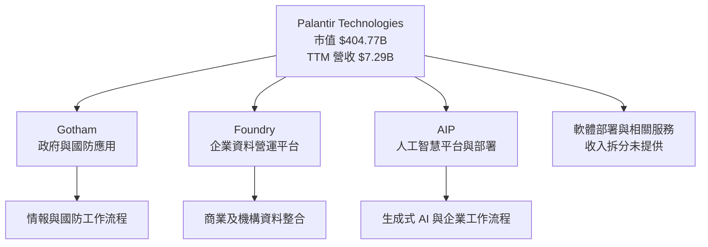
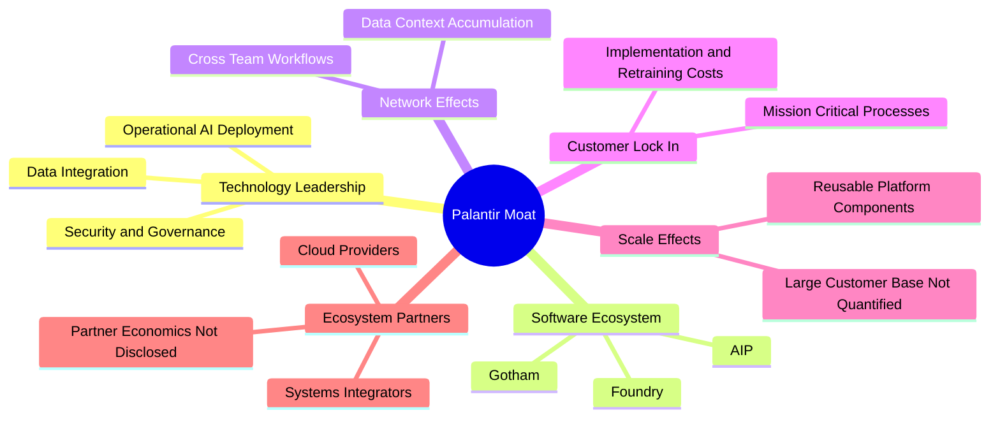
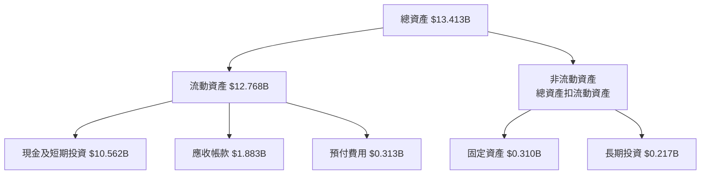
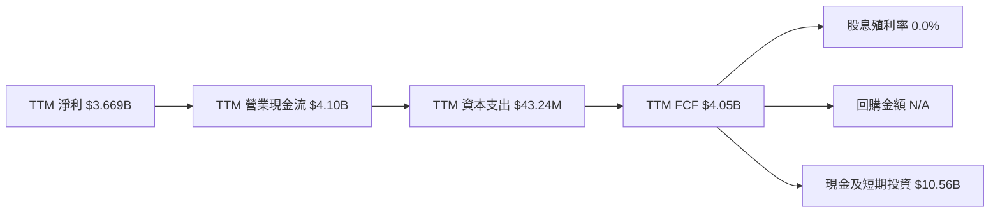
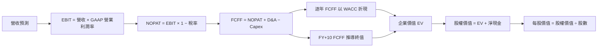
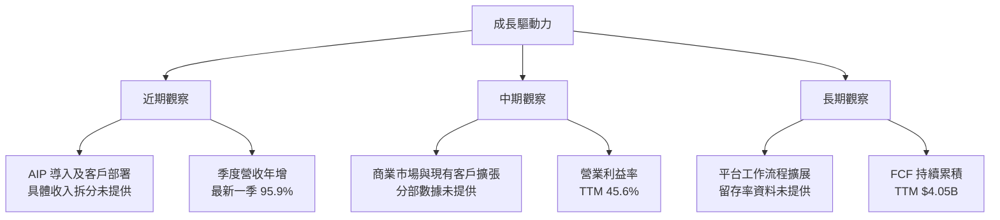
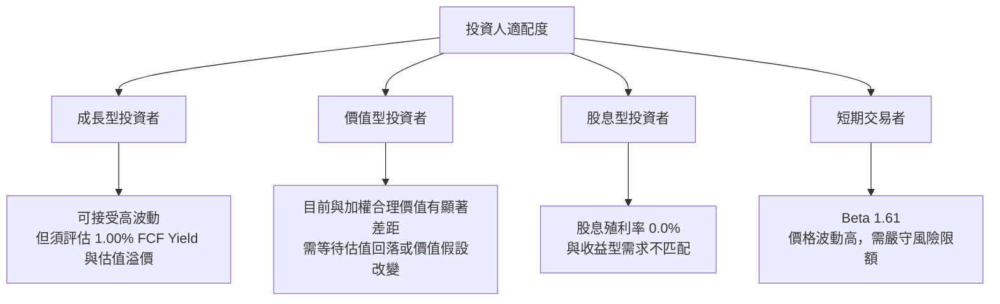

# PLTR 基本面深度分析報告
> **報告日期**：2026-11-15 ｜ **語言**：繁體中文 ｜ **數據來源**：SEC 申報資料 (XBRL)、Yahoo Finance、Finviz、StockAnalysis、Roic.ai ｜ **分析師**：CFA 級機構研究

## 目錄

| # | 章節 | 核心結論 |
|---|------|----------|
| 1 | 執行摘要 | 賣出；加權合理價值 $65.96，MOS -154.7% |
| 2 | 公司概覽與商業模式 | 軟體平台具客戶鎖定潛力，市場份額數據未提供 |
| 3 | 損益表深度分析 | TTM 營收 $7.29B，TTM 成長 87.1%，單季年增 95.9% |
| 4 | 資產負債表分析 | 現金及短期投資 $10.56B；資產負債表整體流動性充足 |
| 5 | 現金流量深度分析 | TTM FCF $4.05B，FCF Yield 1.00%；SBC 仍是重要股東成本 |
| 6 | 獲利能力與資本效率 | ROIC 492.3% 高於 WACC 12.18%，但 ROIC 受投入資本分母影響 |
| 7 | 相對估值分析 | 估值高於同業；DCF 與加權合理價值均顯著低於現價 |
| 8 | DCF 內在價值評估 | 基準 DCF $21.87；模型輸入經四捨五入，部分算式無法精確複算 |
| 9 | 成長催化劑 | AI 平台商業化與美國商業市場擴張為主要觀察方向 |
| 10 | 風險矩陣 | 估值回撤、成長持續性及客戶集中／政府合約風險居前 |
| 11 | 投資建議 | 依 MOS 評級為賣出；以估值、營運成長及稀釋作持續監控 |

---

## 1. 執行摘要

截至 2026-11-13 收盤價 **$167.99**，PLTR 的 TTM 營收為 **$7.29B**、TTM 營收年增 **87.1%**、最新一季營收年增 **95.9%**，TTM 營業利益率 **45.6%**、TTM FCF **$4.05B**，展現出高速成長並已具備現金獲利能力。然而，FCF Yield 僅 **1.00%**，Forward P/E 為 **66.3x**，基準 DCF 每股價值 **$21.87**，加權合理價值僅 **$65.96**。按加權合理價值計算，MOS 為 **-154.7%**；ROIC **492.3%** 雖高於 WACC **12.18%**，但 ROIC 極高可能受到淨現金扣除後投入資本分母較小影響。依 MOS 門檻應為**賣出**，本報告未因質化因素調整評級。

### 1.0 一頁式投資儀表板

| 項目 | 內容 |
|------|------|
| **投資論點（3 句）** | ① TTM 營收年增 **87.1%**，最新一季年增 **95.9%**，商業化速度是最重要多頭依據。② TTM 營業利益率 **45.6%**、FCF **$4.05B**，顯示高成長已轉化為實際現金。③ 現價 **$167.99** 對比加權合理價值 **$65.96**，MOS **-154.7%**，估值風險遠高於基本面安全墊。 |
| **綜合評分** | **7.0/10**（引用 1.1 評分卡） |
| **財務健康** | 🟢 現金及短期投資 **$10.56B**、流動比率 **7.102**；總債務在驗證數據中為 N/A。 |
| **ROIC vs WACC** | **492.3% vs 12.18%**；表面上高於資本成本，但 ROIC 對投入資本分母敏感。 |
| **FCF 趨勢** | TTM FCF **$4.05B**；FCF Yield **1.00%**。過去數年 FCF 上升，但 SBC 尚未消失。 |
| **估值** | Forward P/E **66.3x** ｜ EV/EBITDA **117.6x** ｜ FCF Yield **1.00%** |
| **DCF 內在價值（基準）** | **$21.87** ｜ 現價相對 DCF 溢價 **+668.0%**（按折溢價定義） |
| **安全邊際（MOS）** | **-154.7%**＝($65.96 − $167.99) ÷ $65.96；🔴 無安全邊際 |
| **預期報酬（基準情境）** | DCF 基準情境價值相對現價 **-87.0%**；這是模型隱含重估幅度，不是 12 個月價格預測。 |
| **關鍵風險（前二）** | ① 高估值與低 FCF Yield；② 高成長能否延續、以及股權薪酬造成的稀釋。 |
| **評級 + 信心度** | 🔴 **賣出** ｜ 信心：中；對估值結論信心較高，DCF 精確值因模型四捨五入輸入而有複算限制。 |

### 1.1 綜合評分卡（全報告唯一）

| 維度 | 評分（1–10） | 主要依據（引用數字與其來源章節） |
|------|--------------|----------------------------------|
| 成長性 | 9.0 | TTM 營收成長 **87.1%**、最新一季年增 **95.9%**（第 3 章）。 |
| 獲利能力 | 9.0 | TTM 營業利益率 **45.6%**、ROIC **492.3%** 高於 WACC **12.18%**，F-Score **7/8**（第 6 章）。 |
| 財務健康 | 9.0 | 現金及短期投資 **$10.56B**、流動比率 **7.102**；稀釋股數測試未通過（第 4、6 章）。 |
| 估值 | 1.0 | MOS **-154.7%**；Forward P/E **66.3x**，DCF 基準價值 **$21.87**（第 7、8 章）。 |
| 護城河 | 8.0 | TTM 毛利率 **84.7%**、TTM 營業利益率 **45.6%**，但市場份額與客戶留存數據未提供（第 2 章）。 |
| 管理層與資本配置 | 6.0 | FY2025 SBC **$684.03M**，最新四季 SBC 合計約 **$982.10M**；稀釋股數測試未通過，股息殖利率 **0%**（第 3、5 章）。 |
| **綜合評分** | **7.0** | 六項算術平均：(**9+9+9+1+8+6**) ÷ 6 = **7.0**。 |

### 1.2 五大投資論點 + 三大核心風險

| 類型 | 項目 | 具體依據 | 信心度 |
|------|------|----------|--------|
| 🟢 **投資論點①** | 營收成長加速 | TTM 營收 **$7.29B**、TTM 年增 **87.1%**；最新一季營收年增 **95.9%**，顯示近年成長動能尚未降速。 | 🟢 高 |
| 🟢 **投資論點②** | 高毛利與營業槓桿 | TTM 毛利率 **84.7%**、營業利益率 **45.6%**；若產品導入與交付效率提升，新增營收有機會轉化為利潤。 | 🟢 高 |
| 🟢 **投資論點③** | 現金流品質具支撐 | TTM 營業現金流 **$4.10B**、FCF **$4.05B**；FCF 高於 TTM 淨利 **$3.669B**。 | 🟢 高 |
| 🟢 **投資論點④** | 資產負債表有韌性 | 現金及短期投資 **$10.56B**，提供產品投資、併購或景氣下行時的財務緩衝。 | 🟢 高 |
| 🟢 **投資論點⑤** | 軟體產品可能形成工作流程鎖定 | Gotham、Foundry、AIP 與客戶資料及工作流程整合；若客戶把平台擴大用於生產流程，轉換成本可能上升。量化客戶留存資料未提供。 | 🟡 中 |
| 🟡 **風險①** | 估值回撤 | Forward P/E **66.3x**、FCF Yield **1.00%**，而加權合理價值 **$65.96** 低於現價。估值即使在基本面仍成長時，也可能因倍數收縮而下跌。 | 🔴 高衝擊 |
| 🔴 **風險②** | 高成長基期與續航 | 最新一季營收年增 **95.9%**；若成長率從高位快速回落，現價隱含的長期成長預期可能難以支撐。 | 🔴 高衝擊 |
| 🟡 **風險③** | SBC 與稀釋 | 最新四季 SBC 約 **$982.10M**，相當於 TTM 營收約 **13.5%**；品質指標顯示稀釋股數未通過年度改善測試。 | 🟡 中高 |

### 1.3 快速統計卡片

| 指標 | 公司實際值（期間） | 同業中位數 | 狀態 |
|------|--------------------|------------|------|
| 營收成長（TTM） | **87.1%** | — | 🟢 |
| 營收成長（最新一季年增） | **95.9%** | **35.2%**（DDOG、SNOW、CRM 中位數） | 🟢 |
| 毛利率（TTM） | **84.7%** | **77.3%**（三家同業中位數） | 🟢 |
| 營業利益率（TTM） | **45.6%** | — | 🟢 |
| ROIC（TTM） | **492.3%** | — | 🟢* |
| Forward P/E | **66.3x** | **57.9x**（可計算同業中位數；SNOW 95.0x、DDOG 57.9x、CRM 13.6x 的中位數為 57.9x） | 🔴 |
| FCF Yield（TTM） | **1.00%** | — | 🔴 |
| Piotroski F-Score | **7 / 8** | — | 🟢 |

\*ROIC 數值依驗證數據引用；由於淨現金扣除後投入資本可能較小，不應將極高 ROIC 直接外推。

### 1.4 投資結論

```text
╔══════════════════════════════════════════════════════════════════╗
║                    📊 投資結論摘要                               ║
╠══════════════════════════════════════════════════════════════════╣
║  評級：🔴 賣出（按加權合理價值計算的 MOS 門檻）                 ║
║  價格（2026-11-13 收盤）：$167.99                               ║
║  DCF 內在價值（基準）：$21.87（現價溢價 +668.0%）               ║
║  安全邊際 MOS：-154.7%（以加權合理價值 $65.96 為分母）          ║
║  加權合理價值（8.8）：$65.96                                    ║
║  DCF 情境價值：                                                  ║
║    悲觀情境：$13.02（-92.3%）                                   ║
║    基準情境：$21.87（-87.0%）                                   ║
║    樂觀情境：$38.01（-77.4%）                                   ║
║  綜合評分：7.0/10（引用 1.1）                                    ║
║  適合投資人：能承受高波動、以長期成長為主且重視估值紀律者；     ║
║              不適合以現金殖利率或低估值為主要目標者。           ║
╚══════════════════════════════════════════════════════════════════╝
```

---

## 2. 公司概覽與商業模式

### 2.1 業務結構與收入來源

公司資料描述 Palantir 提供 Gotham、Foundry 與相關軟體平台，服務政府及商業客戶。最新 TTM 營收 **$7.29B**，市值 **$404.77B**。現有資料未提供政府／商業收入金額、各產品收入占比或軟體與服務拆分，因此不繪製虛構的收入占比圖。



### 2.2 市場份額

市場份額數據未提供，無法可靠計算 Palantir 在資料平台、AI 軟體或政府分析市場中的占比。可觀察到的相對位置是：TTM 營收年增 **87.1%**、最新一季年增 **95.9%**，高於資料所列 SNOW **35.1%**、DDOG **35.2%**、CRM **10.8%** 的單季年增率；但不同公司產品範圍並不完全相同，成長率差異不能直接視為市場份額變化。

### 2.3 競爭護城河分析



### 2.4 護城河強度

| 護城河項目 | 強度（強／中／弱） | 證據（引用數字或事實） | 會削弱它的情況 |
|------------|--------------------|------------------------|----------------|
| 技術整合與資料工作流程 | 強 | TTM 毛利率 **84.7%**、營業利益率 **45.6%**，顯示軟體型經濟特徵；產品涵蓋資料整合與 AI 部署。 | 雲端平台或競爭者提供更低成本的整合與模型部署工具。 |
| 軟體生態系統 | 中至強 | Gotham、Foundry、AIP 涵蓋政府、商業與 AI 使用場景；各產品收入占比未提供。 | 產品間整合效果未能轉化為交叉銷售或更高續約。 |
| 網路效應 | 中 | 客戶間或資料網路效應未有可量化客戶資料，主要是工作流程與資料上下文累積。 | 客戶資料隔離、各部署高度客製化，導致經驗難以跨客戶複用。 |
| 客戶鎖定 | 中至強 | 若平台嵌入任務關鍵流程，替換成本可能較高；客戶留存率及合約年限資料未提供。 | 導入週期長、專案交付成本高或客戶轉向內建方案。 |
| 規模效應 | 中 | TTM 營收 **$7.29B**，員工 **4,634**；營運利潤率達 **45.6%**。 | 成長需要同步增加銷售、部署與客製化資源。 |
| 生態夥伴 | 弱至中 | 財務資料未提供夥伴營收、轉介或交付占比。 | 對少數雲端、硬體或整合夥伴形成依賴。 |

1.1「護城河」評分 **8.0/10**，主要依據高毛利、高營業利益率與多平台工作流程整合；因市場份額、客戶留存及產品收入拆分未提供，未將其視為已被全面量化驗證的護城河。

---

## 3. 損益表深度分析

### 3.1 年度收入成長趨勢（近 4 年）

FY2022–FY2025 營收分別為 **$1.906B、$2.225B、$2.866B、$4.475B**。2022 至 2025 三年 CAGR 約 **32.9%**，反映營收擴張；FY2025 成長加速至 **56.2%**。下圖以營收呈現相對規模，百分比為年度年增率。

```text
╔══════════════════════════════════════════════════════════════════╗
║              Palantir 年度收入趨勢（FY2022-FY2025）              ║
╠══════════════════════════════════════════════════════════════════╣
║ FY2022  $1.906B  ████████░░░░░░░░░░░░░░░░  YoY +23.6%          ║
║ FY2023  $2.225B  █████████░░░░░░░░░░░░░░░  YoY +16.7%          ║
║ FY2024  $2.866B  █████████████░░░░░░░░░░░  YoY +28.8%          ║
║ FY2025  $4.475B  ████████████████████░░░░  YoY +56.2%          ║
╠══════════════════════════════════════════════════════════════════╣
║ 2022–2025 營收 CAGR：約 +32.9%                                  ║
╚══════════════════════════════════════════════════════════════════╝
```

計算：FY2023 成長 = $2.225B ÷ $1.906B − 1 ≈ **16.7%**；FY2024 = $2.866B ÷ $2.225B − 1 ≈ **28.8%**；FY2025 = $4.475B ÷ $2.866B − 1 ≈ **56.2%**。FY2022 的年增率使用公司年度資料列示的 **23.6%**。

### 3.2 季度收入趨勢分析

| 季度 | 營收 | QoQ 成長 | YoY 成長 | 備註 |
|------|------:|---------:|---------:|------|
| 2025 Q4 | $1.407B | 19.1% | 70.0% | 較 2025 Q3 的 $1.181B 增加。 |
| 2026 Q1 | $1.633B | 16.1% | 84.7% | 高於 2025 Q1 的 $883.86M。 |
| 2026 Q2 | $1.935B | 18.5% | 92.8% | 高於 2025 Q2 的 $1.004B。 |
| 2026 Q3 | $2.313B | 19.5% | 95.9% | 高於 2025 Q3 的 $1.181B；單季年增，不是 TTM 成長率。 |

QoQ 成長以相鄰季度營收相除計算，例如 2026 Q3 QoQ = $2.313B ÷ $1.935B − 1 ≈ **19.5%**。連續四季 QoQ 成長顯示季度營收持續擴大，但季度營收不可直接等同未來年化成長。

### 3.3 利潤率演變分析

| 利潤率指標 | FY2022 | FY2023 | FY2024 | FY2025 | 趨勢 | 評估 |
|------------|-------:|-------:|-------:|-------:|------|------|
| **毛利率** | 78.5% | 80.6% | 80.2% | 82.4% | 整體上升 | 🟢 |
| **營業利益率** | -8.5% | 5.4% | 10.8% | 31.6% | 逐年改善 | 🟢 |
| **淨利率** | -19.6% | 9.4% | 16.1% | 36.3% | 由虧轉盈並擴張 | 🟢 |

毛利率按年度毛利÷營收計算；FY2025 營業利益率按 $1.414B ÷ $4.475B ≈ **31.6%**。營業利潤改善幅度大於毛利率變化，說明規模增長與營業費用控制可能是主要槓桿；但僅依年度彙總資料，無法精確拆分費用率改善、產品組合或人力效率的各自貢獻。TTM 營業利益率為 **45.6%**，高於 FY2025，反映最近四季營運利潤進一步擴張。

### 3.4 費用結構分析

提供的最新資料沒有完整 TTM 營業費用分類及收入占比，不畫費用結構圓餅圖，以免把年度研發費用誤當成完整 TTM 費用結構。已知 FY2025 研發費用 **$557.68M**，約為 FY2025 營收 **12.5%**；該比率為年度研發費用除以年度營收，不能代表銷售、管理及其他費用的完整分布。

### 3.5 季度 EPS 趨勢與盈餘品質（Quality of Earnings）

| 季度 | EPS 實際 | EPS YoY | 預期與實際比較 |
|------|---------:|-------:|----------------|
| 2025 Q4 | $0.23 | 647.6% | EPS Est 為 nan，無法判定超預期或不及預期。 |
| 2026 Q1 | $0.34 | 325.0% | EPS Est 為 nan，無法判定超預期或不及預期。 |
| 2026 Q2 | $0.41 | 215.4% | EPS Est 為 nan，無法判定超預期或不及預期。 |
| 2026 Q3 | $0.44 | 144.4% | EPS Est 為 nan，無法判定超預期或不及預期。 |

目前可確認 EPS 連續上升，但四季分析師預估值缺失，因此不能把季度結果標為「超預期」或「不及預期」。YoY 成長率下降是因基期抬高，並不等於 EPS 絕對值轉弱。

| 盈餘品質項目 | 數值/佔比 | 評估 |
|--------------|-----------|------|
| 股權薪酬 SBC / 營收 | 約 **13.5%** | 🟡 最新四季 SBC 約 $982.10M ÷ TTM 營收 $7.288B；SBC 為真實股東成本，會稀釋每股經濟利益。 |
| SBC / 營業現金流 | 約 **23.9%** | 🟡 最新四季 SBC 約 $982.10M ÷ TTM OCF $4.10B；比例不低。 |
| FCF / 淨利（現金轉換率） | 約 **110.4%** | 🟢 TTM FCF $4.05B ÷ TTM 淨利 $3.669B；營運現金流高於會計淨利。 |
| 一次性/非經常性損益 | N/A | SEC 摘要未提供足以辨認一次性項目的明細；不能斷言沒有。 |
| 有效稅率異常 | **1.4%** | 🟡 稅率偏低，可能使當期稅後獲利偏高；DCF 依指定模型採用該稅率，不另行替換。 |
| 資本化支出 vs 費用化 | TTM Capex **$43.24M** | 🟢 相對 TTM 營收低；資本化支出明細及內部軟體資本化資料未提供，不能據此判定是否有費用遞延。 |

**盈餘品質結論**：現金轉換率約 **110.4%**，支持 GAAP 盈利有現金流 backing；但 SBC 約占 TTM 營收 **13.5%**，若只看淨利或 FCF 而忽略稀釋，會高估既有股東的每股回報。估值時應同步監控 SBC、稀釋股數與每股 FCF。

---

## 4. 資產負債表分析

### 4.1 資產結構分解

最新 TTM 資產負債表資料列示總資產 **$13.413B**、流動資產 **$12.768B**。下圖只展示有明確數據的分項；現金及短期投資依公司資料合計為 **$10.562B**。



其他資產明細未全部呈列，因此上述項目不是完整加總分解；不可將各已列分項當成全部流動或非流動資產。

### 4.2 流動性與營運資金分析

| 指標 | 最新值 | 歷史／比較 | 評估 |
|------|------:|------------|------|
| 流動比率 | **7.102** | Yahoo Finance 摘要值 | 🟢 流動性充裕。 |
| 速動比率 | **6.923** | Yahoo Finance 摘要值 | 🟢 高流動資產緩衝。 |
| 現金及短期投資 | **$10.56B** | 2025 年底 $7.177B | 🟢 資金規模上升。 |
| 應收帳款 | **$1.883B** | 一年前資料未用於本表比較 | 🟡 隨營收擴張，應持續追蹤收款週期。 |

| 指標 | 最新 TTM | 一年前 TTM | 變化 | 解讀 |
|------|----------|------------|------|------|
| DSO 應收帳款天數 | **94 天** | **94 天** | **0 天** | 收款天數持平；未見天數惡化，但應收帳款絕對額隨業務擴大。 |
| DIO 存貨天數 | **N/A** | **N/A** | N/A | 公司未報告該存貨餘額，不以其他資料反推。 |
| DPO 應付帳款天數 | **29 天** | **33 天** | **-4 天** | 付款天數下降；可能是支付節奏或供應商結構變化，不能單憑此判定議價力。 |
| CCC 現金轉換週期 | **N/A** | **N/A** | N/A | 因 DIO 缺失，依數據定義不計算 CCC。 |

### 4.3 債務結構分析

驗證數據中的 Total debt 為 **N/A**，Net cash 為 **$10.56B**；其他彙整財務區塊另列總債務 **$225.27M**、淨現金 **$10.34B**。因兩組來源口徑不一致，本節不以未驗證債務數字覆寫驗證數據，也不計算 Debt/EBITDA 或利息保障倍數。

```text
╔══════════════════════════════════════════════════════════════════╗
║                 Palantir 債務健康診斷                           ║
╠══════════════════════════════════════════════════════════════════╣
║  驗證數據總債務：N/A          資料未能確認計息債務總額           ║
║  現金及短期投資：$10.56B      🟢 提供高額流動性緩衝             ║
║  驗證數據淨現金：$10.56B      🟢 淨現金                          ║
║  Debt/EBITDA：N/A             債務口徑不一致，不作反推           ║
║  Interest Coverage：N/A       利息費用及計息負債資料不足         ║
╚══════════════════════════════════════════════════════════════════╝
```

### 4.4 股東權益趨勢

| 年度 | 股東權益 | 年增幅 |
|------|---------:|-------:|
| 2022 | $2.57B | — |
| 2023 | $3.48B | 約 +35.4% |
| 2024 | $5.00B | 約 +43.7% |
| 2025 | $7.39B | 約 +47.8% |

```text
╔══════════════════════════════════════════════════════════════════╗
║                  股東權益趨勢（年度）                            ║
╠══════════════════════════════════════════════════════════════════╣
║ 2022  $2.57B  ███████░░░░░░░░░░░░░░░                           ║
║ 2023  $3.48B  █████████░░░░░░░░░░░░                             ║
║ 2024  $5.00B  ██████████████░░░░░░                              ║
║ 2025  $7.39B  ████████████████████                              ║
╚══════════════════════════════════════════════════════════════════╝
```

股東權益上升與盈利累積一致；但股東權益增長不等於每股價值同比增長，仍需對照股份稀釋與 SBC。

---

## 5. 現金流量深度分析

### 5.1 現金流量瀑布圖



資料沒有提供股息金額、回購金額與現金變化的完整現金流橋接，故圖中只列可核實數據，不能把 FCF 全部視為留存現金或股東分配。

### 5.2 FCF 轉換率趨勢

| 年度 | 營業現金流 | 資本支出 | FCF | 淨利 | FCF/淨利 |
|------|-----------:|---------:|----:|-----:|---------:|
| 2022 | $223.74M | $40.03M | $183.71M | -$373.70M | 不適用（淨利為負） |
| 2023 | $712.18M | $15.11M | $697.07M | $209.82M | 332.2% |
| 2024 | $1.15B | $12.63M | $1.14B | $462.19M | 約 246.6% |
| 2025 | $2.13B | $33.88M | $2.10B | $1.63B | 約 128.8% |
| 最新 TTM | $4.10B | $43.24M | **$4.05B** | $3.669B | 約 **110.4%** |

2023–2025 的高轉換率部分反映低資本支出與現金流高於淨利；年度數字存在彙整口徑與四捨五入差異，因此使用表列 FCF 和淨利計算近似比率，不把近似值視為 SEC 精確比率。

### 5.3 自由現金流趨勢

```text
╔══════════════════════════════════════════════════════════════════╗
║              自由現金流趨勢（歷史實際）                          ║
╠══════════════════════════════════════════════════════════════════╣
║ FY2022  $0.184B  ██░░░░░░░░░░░░░░░░░░░  FCF Yield：N/A         ║
║ FY2023  $0.697B  ████░░░░░░░░░░░░░░░░░  FCF Yield：N/A         ║
║ FY2024  $1.14B   ██████░░░░░░░░░░░░░░░  FCF Yield：N/A         ║
║ FY2025  $2.10B   ███████████░░░░░░░░░░  FCF Yield：N/A         ║
║ TTM     $4.05B   ████████████████████   FCF Yield：1.00%       ║
╚══════════════════════════════════════════════════════════════════╝
```

年度歷史市值與各年 FCF Yield 未提供，因此不補填歷史殖利率。TTM FCF 以 **OCF − Capex** 定義。

### 5.4 資本配置評估

股息殖利率 **0.0%**、派息率 **0.0%**；回購與併購現金金額未提供，不能以圓餅圖推測資本配置比例。

| 項目 | 可確認資料 | 評估 |
|------|------------|------|
| 研發 | FY2025 **$557.68M** | 維持平台與 AI 產品研發；金額約為 FY2025 營收 12.5%。 |
| 資本支出 | TTM **$43.24M** | 相對營收低，資產較偏輕。 |
| 股息 | 殖利率 **0.0%** | 沒有現金股息回報。 |
| 回購 | N/A | 回購金額與股數淨變化拆分未提供。 |
| SBC | FY2025 **$684.03M**；最新四季約 **$982.10M** | 需視為股東成本；EPS 成長應與稀釋股數同步觀察。 |

---

## 6. 獲利能力與資本效率

### 6.1 ROE / ROA / ROIC 趨勢

歷史 ROE、ROA 與 ROIC 未提供同一計算口徑的完整年度序列，因此不補造年度比較值。可直接引用的最新指標如下：

| 指標 | 最新值 | 證據與評估 |
|------|-------:|------------|
| ROE（品質數據口徑） | **32.7%** | DuPont 資料列示；另一財務摘要列出 ROE 40.9%，口徑不一致，本報告採品質數據指定值。 |
| ROA | **19.3%** | 財務摘要值；Piotroski 資料確認 ROA 為正且高於一年前。 |
| ROIC | **492.3%** | 驗證數據值；遠高於 WACC，但投入資本可能受淨現金扣除影響。 |

### 6.2 ROIC vs WACC 分析（核心價值創造判斷）

```text
╔══════════════════════════════════════════════════════════════════╗
║                ROIC vs WACC 深度分析                            ║
╠══════════════════════════════════════════════════════════════════╣
║  WACC（驗證值）：                                                ║
║  ├── 無風險利率 Rf（10Y 美債）：     5.15%                       ║
║  ├── 市場風險溢酬 ERP：              5.00%                       ║
║  ├── Beta 原始值：                   1.61                        ║
║  ├── Beta 採用值：                   1.41                        ║
║  ├── 股權成本 Ke：                   12.19%                      ║
║  ├── 稅前債務成本（假設）：          7.15%                       ║
║  ├── 股權／債務權重：                99.9%／0.1%                 ║
║  └── ✅ WACC：                       12.18%                      ║
║                                                                  ║
║  ROIC（TTM）：                         492.3%                     ║
║  EVA 差額：                            492.3% − 12.18%            ║
║                                        = 480.12 個百分點          ║
║                                                                  ║
║  ROIC 492.3%  ▓▓▓▓▓▓▓▓▓▓▓▓▓▓▓▓▓▓▓▓▓▓▓▓▓▓▓▓▓▓  🟢              ║
║  WACC  12.18% ▓░░░░░░░░░░░░░░░░░░░░░░░░░░░░░  ──              ║
╠══════════════════════════════════════════════════════════════════╣
║  結論：按提供的 ROIC 口徑，ROIC 明顯高於 WACC，表示資本回報    ║
║  高於資本成本；但 492.3% 對投入資本分母極敏感，不宜線性外推。 ║
╚══════════════════════════════════════════════════════════════════╝
```

原始 Beta **1.61** 經指定調整：Beta = **⅔ × 1.61 + ⅓ × 1 = 1.41**。股權成本算式為 **5.15% + 1.41 × 5.00% = 12.20%**，與資料列示 **12.19%** 的細微差異來自未四捨五入 Beta 或輸入精度；本報告 WACC 依指定值採 **12.18%**，不另行重算替換。債務成本為假設值，來源口徑是無利息費用資料時採用的無風險利率加信用利差。

ROIC 的差額計算：**492.3% − 12.18% = 480.12 個百分點**。這代表依該口徑公司創造價值；但其高數值可能由「股東權益 + 債務 − 現金」投入資本分母較低造成，故結論應重視方向而非將 492.3% 當作可持續常態回報。

### 6.3 杜邦三因素分解

| 因素 | 數值（TTM） | 解讀 |
|------|-------------|------|
| 淨利率 | **50.3%** | 高淨利率是 ROE 的主要來源之一。 |
| 資產週轉率 | **0.54** | 每單位資產產生約 0.54 單位營收。 |
| 權益乘數 | **1.19** | 財務槓桿不高，ROE 並非主要由高槓桿撐起。 |
| **ROE** | **32.7%** | 指定資料列示：50.3% × 0.54 × 1.19 ≈ 32.7%；差異為輸入數字四捨五入。 |

### 6.4 財務體質：Piotroski F-Score

**Piotroski F-Score：7 / 8**。九項測試中一項因缺少輸入無法判定，因此可判定分母為八項。

| 測試 | 結果 | 解讀 |
|------|------|------|
| ROA > 0 | ✅ 通過 | 盈利能力為正。 |
| 營業現金流 > 0 | ✅ 通過 | 核心營運產生現金。 |
| ROA 高於一年前 | ✅ 通過 | 資產獲利改善。 |
| 營業現金流 > 淨利 | ✅ 通過 | 支持應計品質。 |
| 長期負債 ÷ 總資產低於一年前 | — 無法判定 | 缺少相應輸入，不補算。 |
| 流動比率高於一年前 | ✅ 通過 | 流動性改善。 |
| 稀釋股數未增加 | ❌ 未通過 | 股數稀釋是現有股東需要持續監控的成本。 |
| 毛利率高於一年前 | ✅ 通過 | 毛利率改善。 |
| 資產週轉率高於一年前 | ✅ 通過 | 資產使用效率改善。 |

整體分數偏正面，但未通過項目指向稀釋，且 F-Score 不涵蓋估值高低。

---

## 7. 相對估值分析

### 7.1 同業估值比較表格

| 估值指標 | **PLTR** | **SNOW** | **DDOG** | **CRM** | 本公司評估 |
|----------|---------:|---------:|---------:|--------:|-----------|
| **Trailing P/E** | **118.3x** | N/A | 255.8x | 19.9x | 🟡 高於 CRM、低於 DDOG；商業模式與成長差異大。 |
| **Forward P/E** | **66.3x** | 95.0x | 57.9x | 13.6x | 🔴 高於 DDOG、CRM；低於 SNOW，但相對成長預期仍高。 |
| **P/S Ratio** | **55.5x** | 18.9x | 15.5x | 4.1x | 🔴 明顯高於三家同業。 |
| **EV/EBITDA** | **117.6x** | -99.4x | 367.4x | 16.3x | 🟡 高於 CRM；SNOW EBITDA 為負、此倍數無直接可比性。 |
| **最新一季營收年增** | **95.9%** | 35.1% | 35.2% | 10.8% | 🟢 PLTR 成長率較高，但成長不保證估值倍數合理。 |
| **TTM 毛利率** | **84.7%** | 67.0% | 79.6% | 77.3% | 🟢 高於所列三家。 |

PLTR 的 P/S 使用估值摘要所列 **55.5x**；自身五年歷史估值區間資料另列當前 **59.3x**，兩個來源口徑不一致，本報告在 7.2 依要求照用歷史區間數據，不混用。SNOW 的負 EV/EBITDA 不宜用作正常盈利公司倍數比較。

### 7.2 歷史估值區間分析

```text
╔══════════════════════════════════════════════════════════════════╗
║                 PLTR 歷史估值位置（TTM）                         ║
╠══════════════════════════════════════════════════════════════════╣
║ P/E：       100.6x ├────● 現在 118.3x ───────────┤ 601.0x       ║
║                        五年中位數 228.6x ｜ 百分位 7%             ║
║ P/S：         7.0x ├────────────────● 現在 59.3x┤ 120.4x        ║
║                        五年中位數 24.7x ｜ 百分位 67%             ║
║ EV/EBITDA： 109.0x ├─● 現在 125.7x ────────────┤ 574.4x       ║
║                        五年中位數 233.4x ｜ 百分位 8%             ║
╚══════════════════════════════════════════════════════════════════╝
```

P/E 與 EV/EBITDA 在五年歷史區間偏低百分位，但仍是高絕對倍數；P/S 位於歷史第 **67** 百分位且高於五年中位數 **24.7x**。歷史倍數低於自身區間中位數，不等同於相對基本面便宜。

### 7.3 情境價值（Bear / Base / Bull，照抄 DCF MODEL 的 Scenarios）

| 情境 | 第 1 年營收成長 | 期末營業利潤率 | WACC | 每股價值 | 相對現價 | 機率 | 會發生的條件 |
|------|----------------:|----------------:|-----:|---------:|---------:|-----:|--------------|
| 🔴 悲觀 | 15.0% | 9.2% | 13.18% | **$13.02** | **-92.3%** | 25% | 商業化成長顯著降速、競爭或部署成本侵蝕長期利潤率。 |
| 🟡 基準 | 30.0% | 10.8% | 12.18% | **$21.87** | **-87.0%** | 50% | 成長由高基期逐步正常化，並依模型假設利潤率往成熟期水平收斂。 |
| 🟢 樂觀 | 45.0% | 11.9% | 11.18% | **$38.01** | **-77.4%** | 25% | 高成長延續、長期利潤率較基準高，折現率也較低。 |

### 7.4 相對估值隱含價格區間

```text
╔══════════════════════════════════════════════════════════════════╗
║                估值方法隱含每股價值（美元）                      ║
╠══════════════════════════════════════════════════════════════════╣
║ DCF 基準                $21.87                                   ║
║ 同業 Forward P/E        $90.58                                   ║
║ 分析師共識目標價        $222.25                                  ║
║ 現價                    $167.99                                  ║
╚══════════════════════════════════════════════════════════════════╝
```

DCF 依據為十年 FCFF、WACC **12.18%**、永續成長率 **3.0%**；同業 Forward P/E 依 **DDOG、CRM** 中位倍數 **35.7x** 乘公司 Forward EPS **$2.54**，得 **$90.58**；分析師共識為 **28 位分析師**平均目標價 **$222.25**。相對估值方法顯示估值分歧大，分析師共識不是現金流推導價值。

---

## 8. DCF 內在價值評估（Discounted Cash Flow）

### 8.0 估值推理鏈（Thinking Logic）

**Step 1 — 價值由何而來？**  
模型把 PLTR 價值拆成現有平台現金流底盤、商業及 AI 平台的增長，以及更長期的終值。資料未提供 Gotham、Foundry、AIP 各自收入占比，因此不能把第二成長曲線或選擇權價值獨立量化。就模型而言，主導估值的變數是營收成長與營業利潤率路徑；敏感度矩陣直接顯示 WACC 和永續成長率也會影響每股價值。

**Step 2 — 模型選擇**

| 決策點 | 本報告採用 | 理由（含數字） | 曾考慮但否決 | 否決理由 |
|--------|-----------|----------------|--------------|----------|
| 現金流定義 | FCFF | 以 WACC **12.18%** 折現，先得企業價值，再加淨現金。 | FCFE | 指定模型以企業自由現金流及 WACC 建模。 |
| 預測期 N | **10 年** | 模型明確列示十年逐年預測，之後接終值。 | 5 年 | 不符合指定模型輸入。 |
| 終值方法 | Gordon Growth | 指定永續成長率 **3.0%**、WACC **12.18%**。 | 退出倍數 | DCF MODEL 未提供退出倍數結果，不另建模型。 |
| EBIT 基礎 | GAAP EBIT | TTM 營業利益率 **45.6%**；指定模型採 GAAP。 | 非 GAAP EBIT | 避免把 SBC 加回後又未計入股東成本。 |

**Step 3 — 關鍵假設推導鏈**

- **營收成長**：錨點＝TTM 成長 **87.1%** → 調整＝模型將第一年成長限制在 **0%–30%**，並線性降至第十年 **3.0%**，考慮基期擴大及增速正常化 → **採用第一年 30.0%、第十年 3.0%** → 曾考慮將 87.1% 延續，否決理由是單一 TTM 成長率不能視為十年常態。
- **營業利潤率**：錨點＝TTM **45.6%** → 調整＝模型逐年收斂至近五個財政年度中位數 **10.8%** → **採用第十年 10.8%** → 曾考慮長期維持 45.6%，否決理由是模型採成熟期歷史中位數作終點，避免把近期高利潤率永久化。
- **永續成長率 g**：錨點＝模型採 **3.0%** → 調整＝維持低於 WACC 的長期成長假設 → **採用 3.0%** → 不採與 WACC 接近或高於 WACC 的數值，因 Gordon Growth 分母將收窄或失效。
- **預測期 N**：錨點＝指定模型 **10 年** → 調整＝不額外縮短或延長 → **採用 10 年** → 否決 5 年，因為本次唯一模型已採十年，擅自改年期等於另建模型。
- **Capex／營收**：錨點＝TTM Capex 約占營收 **0.6%** → 調整＝模型逐步降至第十年 **0.4%** → **採用第一年 0.6%、第十年 0.4%** → 不假設 Capex 長期低於模型終點，避免額外抬高 FCF。
- **EBIT 基礎、SBC 與股數**：錨點＝GAAP EBIT 已包含 SBC 費用；最新四季 SBC 約 **$982.10M** → 調整＝遵守指定模型組合 A，不再從 FCFF 扣 SBC、不另增加稀釋股數 → **採用 GAAP EBIT、固定股數、年稀釋率 0%** → 否決「GAAP EBIT 再扣 SBC」或再計稀釋，避免同一成本重複計算。
- **WACC**：錨點＝資本成本資料列示 **12.18%** → 調整＝不另行重算或更換指定折現率 → **採用 12.18%** → 否決自行以其他 Beta 或債務權重重建 WACC，避免與模型不一致。
- **有效稅率**：錨點＝最新年度有效稅率 **1.4%** → 採用 **1.4%**；稅率較低，可能推高模型 NOPAT，屬需質疑的輸入。
- **D&A／營收**：錨點＝TTM **0.4%** → 採用 **0.4%**，模型固定不變。
- **營運資金變動**：模型明確不建模 ΔWC；此處不填假設比率、不反推現金流。

**Step 4 — 最脆弱一環**  
最脆弱的是高現金流利潤率與成熟期利潤率收斂路徑；若未來增長及利潤率同時偏離基準，價值可能更接近 DCF 悲觀情境 **$13.02**。反之，即使採用模型樂觀情境，價值仍為 **$38.01**，低於現價。

**Step 5 — 計算路徑圖**



### 8.1 模型假設總表（Model Inputs）

| 假設項目 | 採用值 | 依據 / 來源 | 敏感度 |
|----------|--------|-------------|--------|
| 預測期長度 **N** | **10 年** | 指定 DCF 模型預測 FY+1 至 FY+10。 | 🟡 中 |
| 營收成長 | FY+1 **30.0%**，FY+10 **3.0%**，逐年線性下降 | 起點 TTM 成長 **87.1%**；模型將第一年限制在 30%，並於第十年降至 3%。 | 🔴 高 |
| 營業利潤率 | FY+1 **45.6%** → FY+10 **10.8%** | TTM 營業利潤率 **45.6%**；第十年為近五年財政年度中位數。 | 🔴 高 |
| 有效稅率 | **1.4%** | 最新年度有效稅率。 | 🟢 低 |
| Capex / 營收 | FY+1 **0.6%** → FY+10 **0.4%** | TTM Capex／營收約 **0.6%**，模型逐步降至 0.4%。 | 🟡 中 |
| D&A / 營收 | **0.4%** | TTM 比率，模型固定。 | 🟢 低 |
| 營運資金變動 / 營收增額 | **不建模** | DCF MODEL 指定 Working capital is not modelled；不是假設為零後再另行計算。 | 🟢 低 |
| EBIT 基礎 | **GAAP** | 模型以 GAAP EBIT 為基礎。 | 🟡 中 |
| 股權薪酬 SBC 處理 | 不另扣 SBC；SBC 已包含於 GAAP EBIT | 模型明示 GAAP EBIT 已為費用化處理。 | 🟡 中 |
| 年稀釋率（股數） | **0%** | 模型組合 A；固定股數，不另放大稀釋。 | 🟡 中 |
| 永續成長率 g | **3.0%** | 指定模型終值輸入；低於 WACC。 | 🔴 高 |
| 終值方法 | Gordon Growth | DCF MODEL 提供 Gordon Growth 終值；未提供退出倍數結果。 | 🔴 高 |
| WACC | **12.18%** | 資本成本資料指定值。 | 🔴 高 |

FCFF 定義為 **NOPAT + D&A − Capex**，依指定模型不含營運資金變動列。**本模型採用 (A)：GAAP EBIT + 固定股數；SBC 影響已計入一次**，所以 8.3 不另扣 SBC，年稀釋率為 0%。

### 8.2 折現率推導（WACC）

```text
╔══════════════════════════════════════════════════════════════════╗
║                    WACC 推導（折現率）                           ║
╠══════════════════════════════════════════════════════════════════╣
║  股權成本 Ke（CAPM）：                                           ║
║  ├── 無風險利率 Rf（10Y 美債）：      5.15%                     ║
║  ├── 市場風險溢酬 ERP：               5.00%                     ║
║  ├── 原始 Beta（Yahoo）：              1.61                      ║
║  ├── 調整 Beta：                       1.41                      ║
║  ├── 規模／國別溢酬：                  0.00%（未另加）           ║
║  └── Ke（資料列示）：                 12.19%                     ║
║                                                                  ║
║  債務成本 Kd：                                                   ║
║  ├── 稅前 Kd（假設值）：               7.15%                     ║
║  ├── 有效稅率：                         1.4%                     ║
║  └── 稅後 Kd 約：                      7.05%                     ║
║                                                                  ║
║  資本結構（資料列示權重）：                                      ║
║  ├── 股權 E 權重：                    99.9%                      ║
║  ├── 債務 D 權重：                     0.1%                      ║
║  └── ✅ WACC（指定值）：              12.18%                     ║
╚══════════════════════════════════════════════════════════════════╝
```

Beta 調整：**⅔ × 1.61 + ⅓ × 1 = 1.41**。指定股權成本：**5.15% + 1.41 × 5.00% = 12.20%**，與資料列示 **12.19%** 有 0.01 個百分點差異，可能來自未四捨五入 Beta；依規則採用列示的 WACC **12.18%**。稅後債務成本按指定數字計算約為 **7.15% × (1 − 1.4%) = 7.05%**。原始利息費用與平均計息負債未提供，所以 **7.15% 是假設值**，其來源是指定的無風險利率加信用利差，不是由利息費用反推的實際成本。

指定權重算式為 **99.9% + 0.1% = 100.0%**；指定 WACC 與第 6.2 節相同。因總債務驗證欄為 N/A，且市場資料的債務口徑有差異，無法可靠列出股權市值與計息債務金額重建權重；本節保留指定權重與 WACC，不以不一致的債務金額替代。

**逐步演算（WACC）**

1. **Ke（CAPM）**：按指定未四捨五入輸入計算，資料列示 **12.19%**；以可見兩位 Beta 重算為 **5.15% + 1.41 × 5.00% = 12.20%**，有 **0.01 個百分點**精度差異。
2. **稅前 Kd**：利息費用與平均計息負債未提供，故採用指定假設 **7.15%**，不虛構分子或分母。
3. **稅後 Kd**：**7.15% × (1 − 1.4%) = 7.0499% ≈ 7.05%**。
4. **權重**：股權 **99.9%**、債務 **0.1%**，合計 **100.0%**；金額重建資料不足。
5. **WACC**：採用指定結果 **12.18%**；由已四捨五入顯示輸入重新計算會有微小差異，故不以重算值取代指定值。

### 8.3 逐年自由現金流預測（基準情境）

單位：**$B**；表內數字照錄模型，金額以兩位小數顯示，折現因子三位小數。模型列出的逐年 FCFF 現值合計 **$29.78B**。

| 年度 | FY+1 | FY+2 | FY+3 | FY+4 | FY+5 | FY+6 | FY+7 | FY+8 | FY+9 | FY+10 |
|------|-----:|-----:|-----:|-----:|-----:|-----:|-----:|-----:|-----:|------:|
| 營收 | 9.47 | 12.03 | 14.92 | 18.05 | 21.30 | 24.50 | 27.44 | 29.91 | 31.70 | 32.65 |
| 營收 YoY | 30.0% | 27.0% | 24.0% | 21.0% | 18.0% | 15.0% | 12.0% | 9.0% | 6.0% | 3.0% |
| 營業利潤率 | 45.6% | 41.8% | 37.9% | 34.0% | 30.2% | 26.3% | 22.4% | 18.6% | 14.7% | 10.8% |
| EBIT（GAAP） | 4.32 | 5.03 | 5.66 | 6.14 | 6.43 | 6.44 | 6.16 | 5.55 | 4.66 | 3.54 |
| − 稅 | (0.06) | (0.07) | (0.08) | (0.08) | (0.09) | (0.09) | (0.08) | (0.08) | (0.06) | (0.05) |
| = NOPAT | 4.26 | 4.96 | 5.58 | 6.06 | 6.34 | 6.36 | 6.07 | 5.48 | 4.60 | 3.49 |
| + D&A | 0.04 | 0.05 | 0.06 | 0.07 | 0.08 | 0.10 | 0.11 | 0.12 | 0.13 | 0.13 |
| − Capex | (0.06) | (0.07) | (0.08) | (0.10) | (0.11) | (0.12) | (0.13) | (0.14) | (0.14) | (0.14) |
| **= FCFF** | **4.25** | **4.94** | **5.55** | **6.03** | **6.31** | **6.33** | **6.05** | **5.45** | **4.58** | **3.48** |
| 折現因子 @12.18% | 0.891 | 0.795 | 0.708 | 0.631 | 0.563 | 0.502 | 0.447 | 0.399 | 0.355 | 0.317 |
| **FCFF 現值 PV** | **3.79** | **3.92** | **3.93** | **3.81** | **3.55** | **3.17** | **2.70** | **2.17** | **1.63** | **1.10** |

**預測期現值合計**：  
**$3.79 + $3.92 + $3.93 + $3.81 + $3.55 + $3.17 + $2.70 + $2.17 + $1.63 + $1.10 = $29.77B**。  
模型列示合計為 **$29.78B**；相差 **$0.01B**，低於 1%，為各年度數字四捨五入造成的尾差，橋接依模型列示合計 **$29.78B**。

**逐步演算（FY+1，模型表中數字已四捨五入）**

1. **營收**＝上年營收 **$7.29B × (1 + 30.0%)**；未四捨五入結果約 $9.48B，模型列示 **$9.47B**。
2. **EBIT**＝營收 **$9.47B × 45.6%**＝約 **$4.32B**。
3. **稅**＝按模型稅率 **1.4%** 對未四捨五入 EBIT 計算，模型列示 **$0.06B**。
4. **NOPAT**＝未四捨五入 EBIT − 稅；模型列示 **$4.26B**。
5. **D&A**＝營收 × **0.4%**；模型列示 **$0.04B**。
6. **Capex**＝營收 × 模型第一年 Capex 比率；模型列示 **$0.06B**。
7. **ΔWC**＝模型未建模，不另列數值。
8. **FCFF**＝NOPAT + D&A − Capex；模型以未四捨五入輸入計算並列示 **$4.25B**。
9. **折現因子**＝**1 ÷ (1 + 12.18%)¹ = 0.891**；模型 PV＝**$4.25B × 0.891 ≈ $3.79B**。

模型公開輸入只顯示兩位小數，FY+1 可見四捨五入項目 **4.26 + 0.04 − 0.06 = 4.24**，與列示 FCFF **4.25** 不相等；這表示模型以未顯示精度計算。因禁止改動模型輸出，本報告保留模型值並揭露無法以展示精度完全複算的限制。

**合理性自檢**

- 預測 FCFF 由 **$4.25B** 增至 **$3.48B**；十年期 FCFF CAGR 約 **-2.0%**（以首末年 FCFF 計算），而歷史 FY2022–FY2025 FCF 由 **$0.184B** 增至 **$2.10B**，歷史增幅遠高於預測期末方向，因模型假設營業利潤率大幅收斂。
- FY+10 FCFF 利潤率＝**$3.48B ÷ $32.65B ≈ 10.7%**；目前 TTM FCF 利潤率＝**$4.05B ÷ $7.29B ≈ 55.6%**。同業最佳數據未提供可比 FCF 利潤率，故不作同業最佳比較。
- 模型每年 FCFF 均為正；但十年後終值仍對企業價值有重要貢獻，見 8.4。

```text
╔══════════════════════════════════════════════════════════════════╗
║            自由現金流：歷史實際 vs 模型預測                      ║
╠══════════════════════════════════════════════════════════════════╣
║ FY2023(實)  $0.697B  ███░░░░░░░░░░░░░░░░░  歷史實際             ║
║ FY2024(實)  $1.14B   █████░░░░░░░░░░░░░░░  歷史實際             ║
║ FY2025(實)  $2.10B   █████████░░░░░░░░░░░  歷史實際             ║
║ FY+1 (預)   $4.25B   ██████████████████░░  模型預測             ║
║ FY+10(預)   $3.48B   ███████████████░░░░░  模型預測             ║
╠══════════════════════════════════════════════════════════════════╣
║ 預測期末 FCF 低於 FY+1：主要由營業利潤率收斂假設所致。          ║
╚══════════════════════════════════════════════════════════════════╝
```

### 8.4 終值計算（Terminal Value）

**適用性檢查：WACC 12.18% vs g 3.0% → WACC > g？✅**

| 方法 | 計算式 | 終值 TV | TV 現值 | 佔總 EV 比重 |
|------|--------|---------:|--------:|-------------:|
| Gordon Growth | FY+10 FCFF × (1+g) ÷ (WACC−g) | **$38.98B**（模型值） | **$12.35B** | **29.3%** |
| 退出倍數法 | N/A（DCF MODEL 未提供退出倍數結果） | N/A | N/A | N/A |

**模型所列終值算式**：**$3.48B × (1 + 3.0%) ÷ (12.18% − 3.0%) = $38.98B**（照錄模型結果）。但以展示的四捨五入輸入重算，分母為 **9.18%**，算式結果約 **$39.05B**，與模型列示 **$38.98B** 有差異；應是模型使用未展示精度。由於不能擅自替換指定模型數值，後續橋接沿用模型列示的 TV 現值 **$12.35B** 及 EV **$42.13B**。

逐項照錄模型折現：**$38.98B × 0.317 = $12.35B**（展示數字乘積與列示值有四捨五入尾差）。終值現值占 EV **29.3%**，低於 75% 警戒線，但終值假設仍重要。

### 8.5 企業價值 → 每股內在價值（Bridge）

```text
╔══════════════════════════════════════════════════════════════════╗
║              企業價值 → 每股內在價值 橋接表                      ║
╠══════════════════════════════════════════════════════════════════╣
║  預測期 FCF 現值合計            +$29.78B                         ║
║  終值現值 PV(TV)                +$12.35B                         ║
║  ─────────────────────────────────────────────                  ║
║  = 企業價值 EV                   $42.13B                         ║
║  + 淨現金                       +$10.56B                         ║
║  = 股權價值                      $52.69B                         ║
║  ÷ 股數代理                      約 2.409B 股                    ║
║  ─────────────────────────────────────────────                  ║
║  ★ 每股內在價值                  $21.87                          ║
║    當前股價                      $167.99                         ║
║    折溢價（現價÷DCF內在價值−1）  +668.0%（溢價）                 ║
║  本節不計算 MOS；MOS 只在 8.8 以加權合理價值為分母。            ║
╚══════════════════════════════════════════════════════════════════╝
```

**逐步演算（橋接）**

1. **EV**＝模型列示預測期 PV **$29.78B + PV(TV) $12.35B = $42.13B**。
2. **股權價值**＝**$42.13B + $10.56B = $52.69B**。
3. **每股價值**＝模型公式為股權價值乘價格再除市值；採用市值約 **$404.77B**、價格 **$167.99**：**$52.69B × $167.99 ÷ $404.77 ≈ $21.87**。此等價於約 **2.409B 股**的股數代理。
4. **折溢價**＝**$167.99 ÷ $21.87 − 1 ≈ +668.0%**。
5. **本節不計算 MOS**；安全邊際只使用 8.8 加權合理價值。

股數代理與 2026 Q3 資料所列約 **2.409B** 股相符；模型採固定股數組合 A。現金採最新 TTM 現金及短期投資 **$10.56B**；總債務驗證數據為 N/A，因此依 DCF MODEL 以淨現金 **$10.56B** 橋接，不另推導缺失債務。

### 8.6 敏感性分析（WACC × 永續成長率）

格內為每股價值；括號為相對 **$167.99** 現價的上行／下行空間。

| g（列）／WACC（欄） | 10.18% | 11.18% | **12.18%（基準）** | 13.18% | 14.18% |
|-----------|------:|------:|------------------:|------:|------:|
| **2.0%** | $24.64 (-85.3%) | $22.82 (-86.4%) | $21.32 (-87.3%) | $20.06 (-88.1%) | $18.99 (-88.7%) |
| **2.5%** | $25.12 (-85.0%) | $23.17 (-86.2%) | $21.58 (-87.2%) | $20.26 (-87.9%) | $19.15 (-88.6%) |
| **3.0%** | $25.67 (-84.7%) | $23.56 (-86.0%) | **$21.87 (-87.0%)** | $20.48 (-87.8%) | $19.31 (-88.5%) |
| **3.5%** | $26.30 (-84.3%) | $24.00 (-85.7%) | $22.19 (-86.8%) | $20.72 (-87.7%) | $19.50 (-88.4%) |
| **4.0%** | $27.03 (-83.9%) | $24.50 (-85.4%) | $22.55 (-86.6%) | $20.99 (-87.5%) | $19.70 (-88.3%) |

**逐步演算（矩陣有效格）**：所選格 **WACC 13.18% > g 3.0% ✅**。資料未提供此格的逐年 FCFF 折現明細；指定敏感度矩陣列示 **$20.48/股**。為避免另建模型或以四捨五入中間值替換程式計算，本報告照錄該格結果，不能獨立完整重算其新 PV 合計與 TV。

**三情境 DCF（改變營運假設）**

| 情境 | 第 1 年營收成長 | 期末營業利潤率 | g | WACC | 每股內在價值 | 相對現價 | 主觀機率 |
|------|----------------:|----------------:|---:|-----:|-------------:|---------:|---------:|
| 🔴 悲觀 | 15.0% | 9.2% | 未另列 | 13.18% | **$13.02** | **-92.3%** | 25% |
| 🟡 基準 | 30.0% | 10.8% | 3.0% | 12.18% | **$21.87** | **-87.0%** | 50% |
| 🟢 樂觀 | 45.0% | 11.9% | 未另列 | 11.18% | **$38.01** | **-77.4%** | 25% |
| **機率加權** | — | — | — | — | **$23.69** | **-85.9%** | **100%** |

情境模型未提供悲觀、樂觀各自逐年營收、期末 FCFF 及終值分項，故不能完整重建「營收→FCFF→TV」算式；只照錄模型輸出，避免臆造中間數字。機率加權算式：**$13.02 × 25% + $21.87 × 50% + $38.01 × 25% = $23.6925 ≈ $23.69**。

**敏感度結論**

- g 從 **3.0%** 增至 **4.0%**、WACC 維持 **12.18%**：**$22.55 − $21.87 = +$0.68/股**，約 **+3.1%**。
- WACC 從 **12.18%** 增至 **13.18%**、g 維持 **3.0%**：**$20.48 − $21.87 = -$1.39/股**，約 **-6.4%**。
- 期末營業利潤率每增加 1 個百分點的價值變動：N/A（模型未提供該項敏感度，依規則不另建模）。
- 在可直接引用的矩陣中，WACC ±1 個百分點造成的變動大於 g +1 個百分點的變動；這說明折現率對所列測試區間更敏感，但營收與利潤率路徑仍是模型核心營運假設。

### 8.7 反推 DCF（Reverse DCF：市場在預期什麼）

模型以現價 **$167.99** 反推時，固定其他基準變數後，指定反推結果如下：

| 求解的變數（一次一個） | 其餘變數設定 | 市場隱含值 | 公司歷史實際 | 判斷 |
|------------------------|--------------|------------|--------------|------|
| 第 1 年營收成長 | 其他假設固定基準值 | 在 -10% 至 100% 範圍內無解 | TTM 成長 **87.1%** | 🔴 現價超出此變數可解釋範圍 |
| 固定營業利潤率 | 其他假設固定基準值 | 在 0.5% 至 95% 範圍內無解 | TTM 營業利益率 **45.6%** | 🔴 現價超出此變數可解釋範圍 |
| 永續成長率 g | 未提供反解 | 未計算 | — | N/A |
| 預測期長度 N | 未提供反解 | 未計算 | — | N/A |

DCF MODEL 明確指出前兩項在指定範圍內「no solution」。由於逐點試算表與其他反推變數未提供，本節不偽造迭代軌跡，也不把無解寫成可行的市場隱含 CAGR。反推結果的含義是：在其餘基準假設不變時，單獨放大營收成長或固定營業利潤率，仍不足以使模型價值等於現價；現價依賴多個基準假設同時改變、或估值框架未捕捉的額外成長價值。

### 8.8 估值三角驗證與安全邊際

| 估值方法 | 隱含每股價值 | 上行空間（÷現價） | 權重 | 說明 |
|----------|--------------:|-------------------:|-----:|------|
| DCF（基準） | **$21.87** | **-87.0%** | **55%** | 十年 FCFF、WACC 12.18%、g 3.0%。 |
| 同業 Forward P/E | **$90.58** | **-46.1%** | **35%** | 同業中位數倍數 **35.7x** × Forward EPS **$2.54**。 |
| 分析師共識目標價 | **$222.25** | **+32.3%** | **10%** | 28 位分析師平均目標價，僅作參考。 |
| **加權合理價值** | **$65.96** | **-60.7%** | **100%** | 固定估值方法權重。 |

**逐步演算（權重外顯）**：  
**$21.87 × 55% + $90.58 × 35% + $222.25 × 10% = $12.0285 + $31.703 + $22.225 = $65.9565 ≈ $65.96**。  
權重合計：**55% + 35% + 10% = 100%**。公司類型為盈利公司；同業 EV/EBITDA 因無法計算而排除，其權重依固定方法分配後形成上述列示權重。

**MOS 與價格比較**

- **MOS＝($65.96 − $167.99) ÷ $65.96 = -154.7%**。
- **上行空間＝($65.96 − $167.99) ÷ $167.99 = -60.7%**。
- **折溢價（DCF 基準）＝$167.99 ÷ $21.87 − 1 = +668.0%**。
- 按規則 20，MOS 低於 -25%，評級為 **賣出**。

```text
╔══════════════════════════════════════════════════════════════════╗
║                  估值區間與安全邊際                              ║
╠══════════════════════════════════════════════════════════════════╣
║  悲觀 DCF $13.02 ─ 基準 DCF $21.87 ─ 加權合理值 $65.96          ║
║                                     ─ 現價 $167.99 ─ 樂觀 DCF $38.01 ║
║                                                                  ║
║  MOS = ($65.96 − $167.99) ÷ $65.96 = -154.7%                    ║
║  MOS 評估：🔴 無安全邊際                                          ║
║  上行空間 = ($65.96 − $167.99) ÷ $167.99 = -60.7%               ║
║                                                                  ║
║  若以 MOS ≥ 10% 作為估值篩選，上限價格：                         ║
║  $65.96 × (1 − 10%) = $59.36                                    ║
║  價值參考買入區：不高於 $59.36；非短期價格預測。                 ║
║  合理持有區間／減碼區間：無獨立模型數據，不另定價位。            ║
╚══════════════════════════════════════════════════════════════════╝
```

> 🔎 **程式複算（Python，依本節各項自動重算）**
>
> 加權合理價值 = $21.87 × 55% + $90.58 × 35% + $222.25 × 10% = **$65.96**（權重合計 100%）
>
> 以價格 $167.99 計：MOS = **-154.7%**，上行空間 = **-60.7%**
>
> ✅ 與本節所寫數值一致。

### 8.9 DCF 模型的局限與失效條件

- **終值依賴度**：終值現值占 EV **29.3%**，即約三成企業價值來自 FY+10 之後的假設。
- **最脆弱假設**：營收成長由第一年 **30.0%** 線性降至第十年 **3.0%**；營業利潤率由 **45.6%** 降至 **10.8%**。若成長降速更快、利潤率更低，價值將低於基準 **$21.87**，並可能接近悲觀情境 **$13.02**。
- **FCF 與 SBC**：GAAP EBIT 已計 SBC，模型固定股數；實際股數若持續增加，模型固定股數假設會高估每股價值。
- **有效稅率**：**1.4%** 低於常態可能水平；若未來稅率升高，NOPAT 及估值將下降。模型已按指定輸入採用 1.4%，未自行改寫。
- **資料限制**：Working capital 未建模，且終值、FCFF 表格多項輸入只提供四捨五入數字。模型結果可作方向性估值，不宜視為精確目標價。
- **與第 10 章連結**：AI 商業化不及預期將衝擊營收成長；價格競爭或高交付成本將衝擊營業利潤率；稀釋擴大將削弱固定股數假設；利率上升會推高 WACC、降低現值。

### 8.10 複算檢核表（Audit Trail）

| # | 檢核項目 | 檢查方式 | 結果 |
|---|----------|----------|------|
| 1 | 所有 🔴高 / 🟡中敏感度輸入都有四段式推導 | 對照 8.0 Step 3；已逐項交代主要輸入與否決理由。 | ✅ |
| 2 | 每個假設都有來歷 | 8.1 依據欄列出資料或明示模型假設。 | ✅ |
| 3 | WACC 五步算式齊全且相乘相加正確 | 由已四捨五入 Beta 重算 Ke 有 0.01pp 差異；指定 WACC 為 12.18%。 | ⚠️ 輸入精度限制，保留指定值 |
| 4 | Kd 分母與權重的 D 範圍一致 | 利息費用、平均計息負債與驗證總債務缺資料，不能完成金額重建。 | ⚠️ 採指定 WACC，降低複算信心 |
| 5 | WACC 與第 6.2 節同值 | 兩處均為 12.18%。 | ✅ |
| 6 | 逐年表格年度數等於 N，無省略 | FY+1 至 FY+10 共 10 年。 | ✅ |
| 7 | FY+1 九步計算可複算 | 模型只提供四捨五入中間值；表面四捨五入數相減為 4.24，模型 FCFF 為 4.25。 | ⚠️ 未顯示精度差異 |
| 8 | 預測期 PV 逐項相加 | 表列各年相加為 $29.77B，模型合計 $29.78B，差 $0.01B。 | ✅ 尾差低於 1% |
| 9 | WACC > g | 12.18% > 3.0%。 | ✅ |
| 10 | 終值以 FY+10 FCFF 為基礎並折現 10 期 | 模型指定以 FY+10 FCFF、折現因子 0.317 計算。 | ✅ |
| 11 | EV、股權價值與每股價值橋接 | $29.78B + $12.35B = $42.13B；加 $10.56B 得 $52.69B；模型每股 $21.87。 | ✅* |
| 12 | SBC 組合相容 | GAAP EBIT、無 SBC 再扣、固定股數、年稀釋率 0%。 | ✅ |
| 13 | 矩陣基準格等於 8.5 | 12.18%、g 3.0% 為 $21.87。 | ✅ |
| 14 | 矩陣有效格與 WACC/g 關係 | 所列矩陣格皆 WACC 高於 g。 | ✅ |
| 15 | 三情境機率相加與加權 | 25%+50%+25%=100%；加權為 $23.69。 | ✅ |
| 16 | 反推 DCF 每列只放開一個變數 | 模型列出兩項無解，其他變數未提供解。 | ✅ |
| 17 | MOS 基準與折溢價基準一致 | MOS 以 $65.96；折溢價以 DCF $21.87。 | ✅ |
| 18 | 報告完整至第 11 章 | 章節 1–11 均有輸出。 | ✅ |
| 19 | 加權合理價值未事後調整 | 加權總和 $65.9565，四捨五入為 $65.96。 | ✅ |
| 20 | 評級符合 MOS 門檻 | MOS -154.7%，符合賣出門檻，未調整評級。 | ✅ |

\*橋接金額採模型列示值；其每股股數代理約 2.409B。模型的終值算式以展示的四捨五入輸入重算約為 $39.05B，而模型列 $38.98B；故橋接可按模型列示值核對，但無法以展示精度完全複現。此項限制已在 8.4 揭露，不擅自更改程式提供的 DCF 數值。

---

## 9. 成長催化劑

### 9.1 催化劑時間軸

財務資料與新聞摘要未提供可驗證的未來催化劑發生日或合約時間表，因此不繪製帶有虛構日期的 Mermaid gantt。追蹤期間可按下一次季度申報、其後數季及更長期觀察，但具體公告日期以公司正式發布為準。

| 時間範圍 | 觀察項目 | 可量化指標 |
|----------|----------|------------|
| 近期財報 | AI 商業化與新客戶導入是否延續 | 單季營收年增率是否維持高於 **35.2%** 的同業中位數參考值。 |
| 未來數季 | 營業槓桿能否維持 | TTM 營業利益率是否維持在 **45.6%** 附近，並同步檢查 SBC。 |
| 長期 | 平台在企業流程中的拓展 | 收入成長、FCF、客戶留存與稀釋；客戶留存數據目前未提供。 |

### 9.2 TAM 市場規模分析

**N/A（TAM 數據未提供）**。目前資料沒有可引用的市場規模金額、來源與年份，不能自行填入 TAM 或滲透率。公司 TTM 營收 **$7.29B**、TTM 年增 **87.1%**，加上最新一季年增 **95.9%**，顯示營收仍快速擴張；但缺少 TAM 基準，無法判斷成長空間還有多大。

### 9.3 成長驅動力結構圖



---

## 10. 風險矩陣

### 10.1 風險評分矩陣

所提供財務資料未包含可驗證的事件機率及損失分布；依規則不以主觀數字製作機率—衝擊象限圖。以下按風險類型列出可量化監控指標，機率以高／中／低表達，不偽裝成統計概率。

### 10.2 風險清單詳細分析

| # | 風險項目 | 發生機率 | 財務衝擊 | 風險評估 | 緩解措施 |
|---|----------|----------|----------|----------|----------|
| 1 | 🔴 估值倍數收縮 | 中至高 | 現價 **$167.99** 對比加權合理價值 **$65.96**；DCF 基準價值 **$21.87**。 | 🔴 極高 | 分批配置、以合理價值設定風險預算；避免只因營收高增而忽略估值。 |
| 2 | 🔴 成長回落 | 中 | 最新一季年增 **95.9%**；若連續兩季低於 35.2% 同業中位數參考，成長溢價需重新評估。 | 🔴 高 | 追蹤單季營收、指引、商業與政府業務拆分；分部數字未披露時不推定來源。 |
| 3 | 🟡 利潤率回落 | 中 | TTM 營業利益率 **45.6%**；DCF 假設長期收斂至 **10.8%**。 | 🟠 高 | 追蹤毛利率、營業費用率、交付成本及新客戶導入效率。 |
| 4 | 🟡 SBC 與稀釋 | 中 | 最新四季 SBC 約 **$982.10M**，約占 TTM 營收 **13.5%**；F-Score 稀釋股數測試未通過。 | 🟡 中高 | 追蹤稀釋股數年增率、每股 FCF、SBC／營收。 |
| 5 | 🟡 客戶／合約與政府需求 | 中 | 政府與商業收入分布、最大客戶占比及合約續約率未提供。 | 🟡 中高 | 逐季核查政府預算、合約公告、商業客戶擴張及收入分布。 |
| 6 | 🟡 折現率上升 | 中 | WACC 基準 **12.18%**；敏感度矩陣中 WACC 升至 **13.18%** 時基準 g 下每股價值降至 **$20.48**。 | 🟠 中高 | 將利率變化納入估值情境，不把高久期現金流按單一折現率定價。 |

---

## 11. 投資建議

### 11.1 最終評級與評分

MOS **-154.7%** 低於 -25% 的門檻，故依規則 20 評級為**賣出**；未作質化調整。公司綜合評分為 **7.0/10**，六項分數依序為成長性 **9.0**、獲利能力 **9.0**、財務健康 **9.0**、估值 **1.0**、護城河 **8.0**、管理層與資本配置 **6.0**。評分反映公司品質與估值的分歧，不取代 MOS 評級。

### 11.2 合理價值與隱含報酬率

| 價值參考 | 每股價值 | 相對現價 | 機率／權重 | 說明 |
|----------|---------:|---------:|-----------:|------|
| 加權合理價值 | **$65.96** | **-60.7%** | 權重合計 100% | MOS **-154.7%** 的唯一估值基準。 |
| 悲觀 DCF 情境 | **$13.02** | **-92.3%** | 25% | 第一年度成長 15.0%、期末營業利潤率 9.2%、WACC 13.18%。 |
| 基準 DCF 情境 | **$21.87** | **-87.0%** | 50% | 第一年度成長 30.0%、期末營業利潤率 10.8%、WACC 12.18%。 |
| 樂觀 DCF 情境 | **$38.01** | **-77.4%** | 25% | 第一年度成長 45.0%、期末營業利潤率 11.9%、WACC 11.18%。 |

### 11.3 買入時機與觸發因素

```text
╔══════════════════════════════════════════════════════════════════╗
║                  ✅ 買入觸發因素 Checklist                      ║
╠══════════════════════════════════════════════════════════════════╣
║  估值觀察條件：                                                  ║
║  ☐ 股價回到加權合理價值 $65.96 以下，重新評估預期報酬與風險。    ║
║  ☐ 若要求 MOS 至少 10%，價格需不高於 $59.36。                   ║
║                                                                  ║
║  基本面確認條件：                                                ║
║  ☐ 營收成長保持同時，TTM 營業利益率仍接近 45.6%。               ║
║  ☐ TTM FCF 維持正值，FCF／淨利不低於 100% 附近。                ║
║  ☐ SBC／營收下降，且稀釋股數不再持續增加。                      ║
║                                                                  ║
║  加碼觸發條件：                                                  ║
║  ☐ 價格低於 $59.36，且成長、利潤率及現金轉換指標未惡化。        ║
║                                                                  ║
║  減碼／退出觸發條件：                                            ║
║  ☐ 連續兩季營收年增低於 35.2%，且管理層指引同步下修。           ║
║  ☐ 營業利益率較 45.6% 收縮超過 5 個百分點，且無短期改善證據。  ║
║  ☐ FCF 轉負、稀釋加速，或 ROIC 低於 WACC 12.18%。               ║
╚══════════════════════════════════════════════════════════════════╝
```

### 11.4 投資人適配度分析



### 11.5 每季財報監控清單（Quarterly Watch List）

| 指標 | 最新基準 | 觸發加碼／正面條件 | 觸發減碼／負面條件 |
|------|---------:|--------------------|--------------------|
| 單季營收年增 | **95.9%** | 維持高於 **35.2%** 同業中位數參考，且未連續下滑。 | 連續兩季低於 **35.2%**，或管理層下修指引。 |
| TTM 營收成長 | **87.1%** | 實際成長保持高於模型長期成熟假設，並有現金流支持。 | 快速下滑且新合約、商業客戶擴張無法補足。 |
| TTM 營業利益率 | **45.6%** | 穩定或改善，且非單靠一次性項目。 | 較 45.6% 收縮超過 5 個百分點並持續兩季。 |
| TTM FCF | **$4.05B** | 維持正值、現金轉換率不低於 100% 附近。 | 轉負，或連續兩季低於淨利且應收款週期惡化。 |
| SBC／營收 | 約 **13.5%** | 比率下降且稀釋股數趨穩。 | 比率持平或上升、稀釋股數持續增加。 |
| DSO | **94 天** | 維持約 94 天，或營收增長快於應收增長。 | 明顯高於 94 天並伴隨現金轉換惡化。 |
| Capex | TTM **$43.24M** | 投資增加能帶動營收與 FCF 成長。 | Capex 上升但營收與 FCF 未改善。 |
| 稅率 | **1.4%** | 核查較低有效稅率是否可持續。 | 稅率回升造成淨利與每股收益下修。 |
| 客戶與業務組合 | 分部資料未提供 | 公司揭露商業／政府收入、留存及合約成長改善。 | 合約取消、集中風險或新增業務無法轉成收入。 |

### 11.6 反面論證：什麼會證明論點錯誤（What Would Change My Mind）

```text
╔══════════════════════════════════════════════════════════════════╗
║              ⚠️ 論點失效條件（Disconfirming Evidence）           ║
╠══════════════════════════════════════════════════════════════════╣
║  本報告的成長與獲利論點在下列情況成立時應重新檢視：              ║
║  ☐ 營收年增連續兩季低於 35.2%，且新增客戶或指引未改善。         ║
║  ☐ TTM 營業利益率由 45.6% 下滑超過 5 個百分點並持續兩季。       ║
║  ☐ TTM FCF 轉負，或 FCF／淨利持續低於 100%。                     ║
║  ☐ ROIC 跌破 WACC 12.18%，且非短期投入或會計口徑造成。          ║
║  ☐ SBC／營收高於約 13.5% 且稀釋股數仍增加。                     ║
║  ☐ DSO 高於目前 94 天並持續上升，現金流增速落後淨利。           ║
║  ☐ 商業化或 AI 產品導入未能轉成收入，導致基準成長假設失效。     ║
╚══════════════════════════════════════════════════════════════════╝
```

> **免責聲明**：本報告為 AI 自動生成，僅供研究參考，不構成投資建議。投資有風險，入市需謹慎。

---

## 資料與來源

| 項目 | 內容 |
|------|------|
| 價格 | 167.99 USD，2026-11-13 收盤（Yahoo Finance 日線） |
| 財務報表 | SEC 10-Q filed 2026-11-03，最新季度 2026-09-30（FY2026 Q3） |
| 有回應的資料來源 | SEC 申報資料 (XBRL)、Yahoo Finance、Finviz、StockAnalysis、Roic.ai |
| 由程式計算 | TTM 數字、WACC、DCF 模型、估值方法與權重、加權合理價值、MOS、評級門檻、F-Score、杜邦分解、營運資金天數、綜合評分 |
| 撰寫模型 | openai / gpt-6-luna |

> 本區塊由產生報告的程式依實際取得的資料填寫，非模型撰寫。「由程式計算」的數字不是模型的估計；其餘判斷（評分、情境、策略）是模型的分析。
