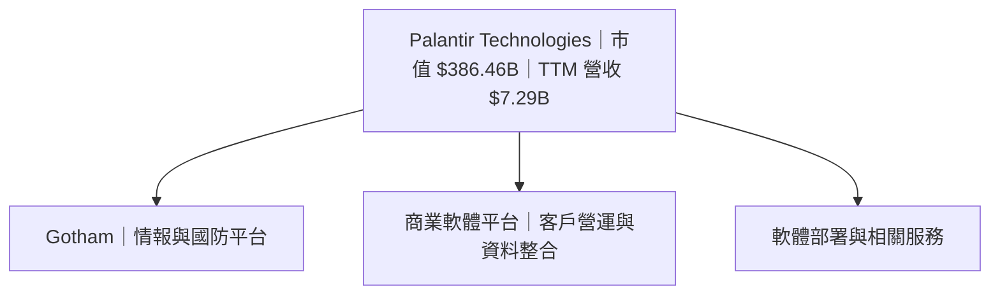
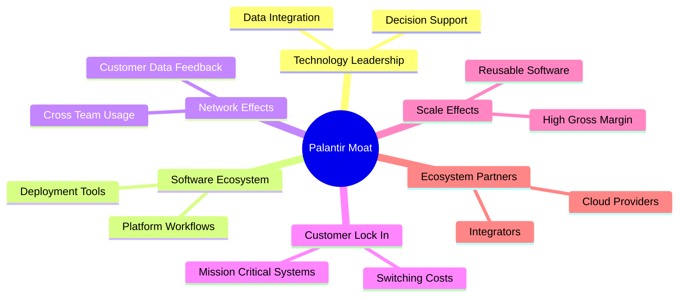
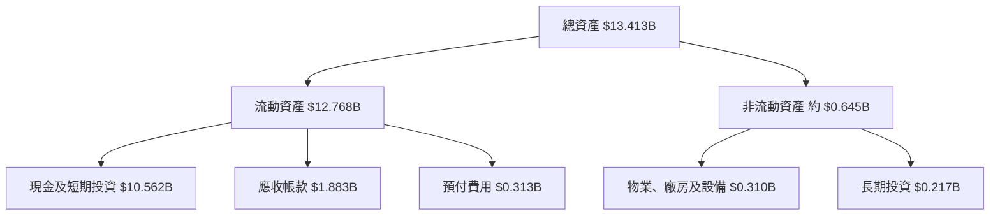
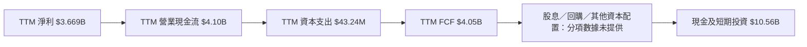
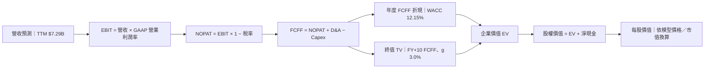
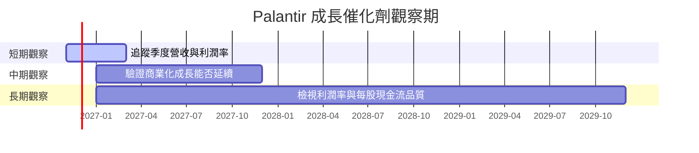
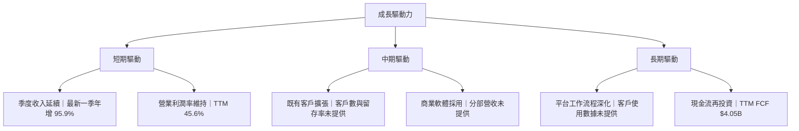
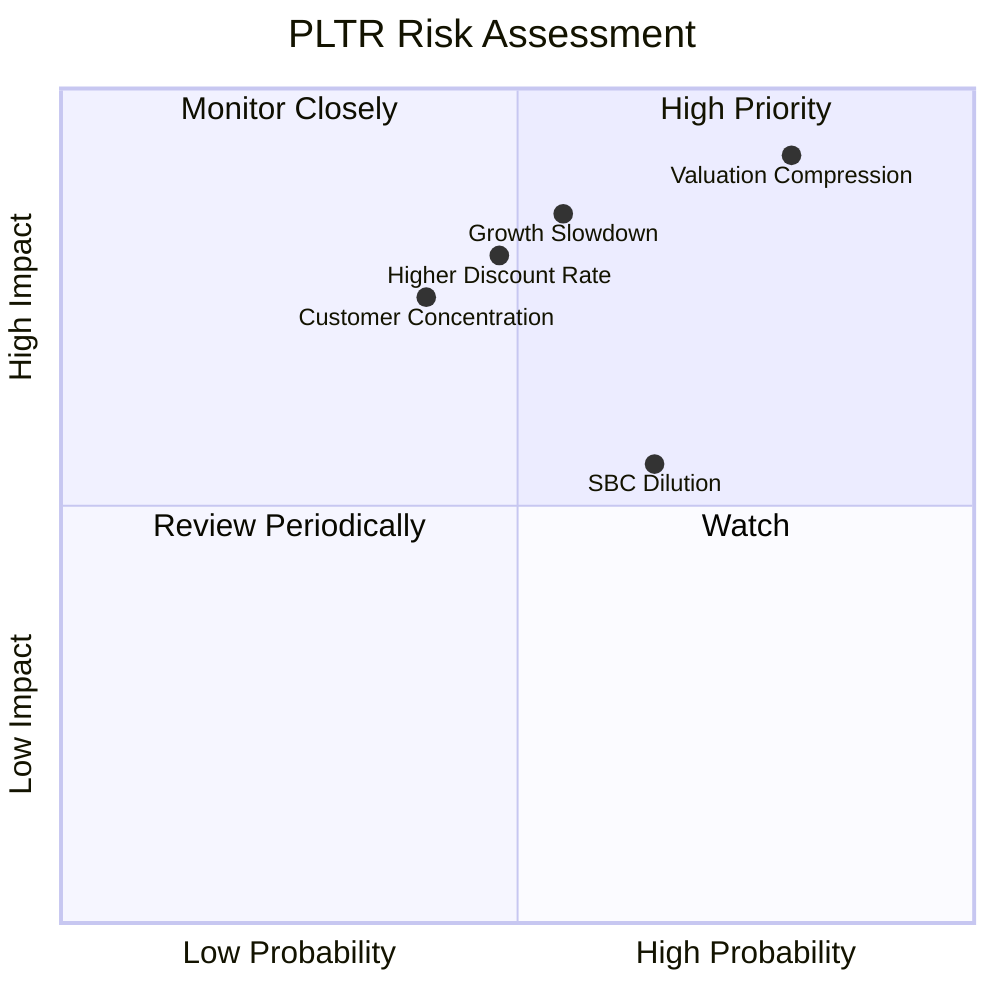
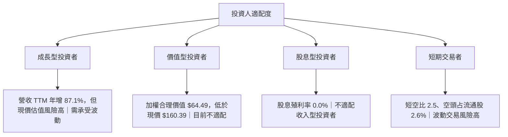

# PLTR 基本面深度分析報告
> **報告日期**：2026-11-17 ｜ **語言**：繁體中文 ｜ **數據來源**：SEC 申報資料 (XBRL)、Yahoo Finance、Finviz、StockAnalysis、Roic.ai ｜ **分析師**：CFA 級機構研究

## 目錄

| # | 章節 | 核心結論 |
|---|------|----------|
| 1 | 執行摘要 | 🟠賣出；加權合理價值 $64.49，MOS -148.7% |
| 2 | 公司概覽與商業模式 | 軟體平台定位清楚；市場份額與業務組合數據未提供 |
| 3 | 損益表深度分析 | TTM 營收 $7.29B、成長 87.1%；利潤率擴張明顯 |
| 4 | 資產負債表分析 | 現金及短期投資 $10.56B，流動性充裕 |
| 5 | 現金流量深度分析 | TTM FCF $4.05B，FCF Yield 1.05%；SBC 仍具稀釋成本 |
| 6 | 獲利能力與資本效率 | 報表 ROIC 492.3% 高於 WACC 12.15%，但分母使 ROIC 失真風險高 |
| 7 | 相對估值分析 | 相較同業及自身歷史，營收倍數仍高；估值對成長延續要求嚴苛 |
| 8 | DCF 內在價值評估 | 基準 DCF 每股 $21.92；加權合理價值 $64.49 |
| 9 | 成長催化劑 | 商業化、AI 平台採用及既有客戶擴張是主要觀察方向 |
| 10 | 風險矩陣 | 估值壓縮、成長降速、競爭與股權稀釋為主要風險 |
| 11 | 投資建議 | 依 MOS 評級賣出；以營運里程碑與估值重估為監控重點 |

## 1. 執行摘要

Palantir TTM 營收為 **$7.29B**，TTM 年增 **87.1%**、最新一季年增 **95.9%**；TTM 營業利益率 **45.6%**、FCF **$4.05B**，顯示成長已伴隨顯著現金創造。不過，2026-11-16 收盤價 **$160.39** 對應 TTM P/E 約 **113.0x**，且 DCF 基準價值僅 **$21.92**，估值方法加權後合理價值為 **$64.49**。依加權合理價值計算，MOS 為 **-148.7%**，符合規則 20 的 **賣出**門檻；高成長與高獲利尚不足以抵銷現價相對估值的風險。

### 1.0 一頁式投資儀表板

| 項目 | 內容 |
|------|------|
| **投資論點（3 句）** | ① TTM 營收成長 **87.1%**，最新一季年增 **95.9%**，商業需求仍快。② TTM 營業利益率 **45.6%**、FCF **$4.05B**，營運槓桿與現金轉換有實績。③ 加權合理價值 **$64.49**，相對現價 **$160.39** 的 MOS **-148.7%**，估值風險主導投資結論。 |
| **綜合評分** | **7.0/10**（引用 1.1；公司品質與估值分開看） |
| **財務健康** | 🟢 現金及短期投資 **$10.56B**；流動比率 **7.102**。 |
| **ROIC vs WACC** | **492.3% vs 12.15%**；表面上大幅高於資本成本，但 ROIC 分母扣除現金後可能偏小，不宜視為穩定經濟回報率。 |
| **FCF 趨勢** | 上升；TTM FCF **$4.05B**、FCF Yield **1.05%**。 |
| **估值** | Forward P/E **63.2x**（市場數據）；EV/EBITDA TTM **112.1x**（市場數據）；FCF Yield **1.05%**。 |
| **DCF 內在價值（基準）** | **$21.92**；相對 DCF 折價／溢價 = $160.39 ÷ $21.92 − 1 = **+631.5% 溢價**。 |
| **安全邊際（MOS）** | **-148.7%**＝($64.49 − $160.39) ÷ $64.49；以 8.8 加權合理價值為基準。🔴 |
| **預期報酬（基準情境）** | DCF 基準情境價值 $21.92，相對現價 **-86.3%**；這是模型情境，不是 12 個月價格預測。12M 目標報酬資料未提供。 |
| **關鍵風險（前二）** | 市場估值倍數收縮；營收成長從高基期快速降速。 |
| **評級 + 信心度** | 🔴 **賣出** ｜信心：中。財務品質數據強，但估值輸入及 ROIC 分母存在重大限制。 |

### 1.1 綜合評分卡

| 維度 | 評分（1–10） | 主要依據（引用數字與其來源章節） |
|------|--------------|----------------------------------|
| 成長性 | 9.0 | TTM 營收年增 **87.1%**、最新一季年增 **95.9%**（第 3 章）；成長速度高，但未來能否延續仍有不確定性。 |
| 獲利能力 | 9.0 | TTM 營業利益率 **45.6%**、FCF **$4.05B**、F-Score **7/8**（第 3、5、6 章）。 |
| 財務健康 | 9.0 | 現金及短期投資 **$10.56B**、流動比率 **7.102**；債務資料口徑存在差異（第 4 章）。 |
| 估值 | 1.0 | 加權 MOS **-148.7%**；P/S 自身歷史百分位 **67%**（第 7、8 章）。 |
| 護城河 | 8.0 | 平台嵌入客戶流程的特性及高毛利率 **84.7%** 提供支持；市場份額及留存率數據未提供（第 2 章）。 |
| 管理層與資本配置 | 6.0 | 現金累積、無股息；FY2025 SBC **$684.03M**，且 F-Score 的稀釋股數測試未通過（第 3、5 章）。 |
| **綜合評分** | **7.0** | 六項算術平均：(9+9+9+1+8+6) ÷ 6 = **7.0**。 |

### 1.2 五大投資論點 + 三大核心風險

| 類型 | 項目 | 具體依據 | 信心度 |
|------|------|----------|--------|
| 🟢 **投資論點①** | 營收增速仍高 | TTM 營收 **$7.29B**，年增 **87.1%**；最新一季年增 **95.9%**。若採用持續擴張，收入基礎仍可快速增厚。 | 🟢 高 |
| 🟢 **投資論點②** | 利潤率擴張 | TTM 營業利益率 **45.6%**，最新一季 **46.9%**；相較 FY2024 約 **10.8%**，顯示規模效應與費用控制改善。 | 🟢 高 |
| 🟢 **投資論點③** | 現金流轉換能力 | TTM 營業現金流 **$4.10B**、資本支出 **$43.24M**、FCF **$4.05B**。 | 🟢 高 |
| 🟢 **投資論點④** | 資產負債表有緩衝 | 現金及短期投資 **$10.56B**；相較總資產 **$13.41B**，短期資金儲備充足。 | 🟢 高 |
| 🟢 **投資論點⑤** | 毛利率反映軟體經濟性 | TTM 毛利率 **84.7%**，與低資本支出、正向 FCF 相互呼應。 | 🟡 中 |
| 🟡 **風險①** | 估值與基本面脫節 | 加權合理價值 **$64.49**，現價 **$160.39**；MOS **-148.7%**。 | 🔴 高衝擊 |
| 🔴 **風險②** | 成長預期回落 | DCF 基準假設首年成長 **30%**，已低於目前 TTM 成長 **87.1%**；若商業需求放緩，估值仍可能低於基準模型。 | 🔴 高衝擊 |
| 🟡 **風險③** | SBC 與股數稀釋 | FY2025 SBC **$684.03M**；Piotroski 稀釋股數測試未通過，長期會稀釋每股經濟利益。 | 🟡 中高 |

### 1.3 快速統計卡片

| 指標 | 公司實際值（期間） | 同業中位數 | 狀態 |
|------|--------------------|------------|------|
| 營收成長（TTM） | **87.1%** | — | 🟢 |
| 營收成長（最新一季年增） | **95.9%** | **35.2%**（SNOW、DDOG、CRM 中位數） | 🟢 |
| 毛利率（TTM） | **84.7%** | **77.3%**（SNOW、DDOG、CRM 中位數） | 🟢 |
| 營業利益率（TTM） | **45.6%** | — | 🟢 |
| ROIC（TTM） | **492.3%** | — | 🟡（分母可能失真） |
| Forward P/E | **63.2x** | **54.3x**（SNOW、DDOG、CRM 中位數） | 🔴 |
| FCF Yield（TTM） | **1.05%** | — | 🔴 |
| Piotroski F-Score | **7 / 8** | — | 🟢 |

### 1.4 投資結論

```text
╔══════════════════════════════════════════════════════════════════╗
║                    📊 投資結論摘要                               ║
╠══════════════════════════════════════════════════════════════════╣
║  評級：🔴 賣出（依 MOS 規則 20）                                 ║
║  價格（2026-11-16 收盤）：$160.39                                ║
║  DCF 內在價值（基準）：$21.92（現價溢價 +631.5%）                ║
║  安全邊際 MOS：-148.7%（分母為加權合理價值）                     ║
║  加權合理價值（8.8）：$64.49                                    ║
║  DCF 情境價值：                                                  ║
║    悲觀情境：$13.04（-91.9%）                                   ║
║    基準情境：$21.92（-86.3%）                                   ║
║    樂觀情境：$38.13（-76.2%）                                   ║
║  綜合評分：7.0/10（引用 1.1）                                    ║
║  適合投資人：能承受高波動的成長型投資人；不適合重視估值保護者    ║
╚══════════════════════════════════════════════════════════════════╝
```

## 2. 公司概覽與商業模式

Palantir Technologies 為美國軟體基礎設施公司，提供 Gotham 等平台，服務情報、國防及商業營運場景。公司概要提及將資料整合後支援使用者分析與決策；產品、客戶合約與服務的詳細分部收入數字並未提供，以下不推估收入占比。

### 2.1 業務結構與收入來源



各業務板塊收入占比、金額及軟體／服務拆分資料未提供，因此不繪製比例圖或填入未披露的金額。

### 2.2 市場份額

市場份額數據未提供。以已知數據比較，Palantir TTM 營收成長 **87.1%**、最新一季年增 **95.9%**，高於 SNOW、DDOG、CRM 最新一季年增率中位數 **35.2%**；但這只能說明成長速度相對較快，不能直接推導市場份額或市場領先程度。

### 2.3 競爭護城河分析



### 2.4 護城河強度

| 護城河項目 | 強度（強／中／弱） | 證據（引用數字或事實） | 會削弱它的情況 |
|------------|--------------------|------------------------|----------------|
| 技術與平台整合 | 中至強 | TTM 毛利率 **84.7%**；產品聚焦資料整合與決策工作流程。 | 競爭者複製功能、客戶轉向通用雲端或自建方案。 |
| 軟體生態系統 | 中 | 公司產品跨國防與商業場景；平台使用與部署細節數據未提供。 | 客戶採購分散、平台整合成本下降。 |
| 網路效應 | 中偏弱 | 客戶擴大使用有機會改善工作流程，但客戶間資料網絡效應數據未提供。 | 客戶資料隔離，產品價值不隨其他客戶增加。 |
| 客戶鎖定 | 中至強 | 軟體嵌入作業流程可能提高切換成本；留存率與續約率未提供。 | 合約到期、遷移簡化或採購改由大型雲端廠商統包。 |
| 規模效應 | 強 | TTM 營業利益率 **45.6%**、毛利率 **84.7%**。 | 高成長需增加人力交付，或競爭使價格下降。 |
| 生態夥伴 | 中 | 相關合作夥伴收入貢獻與依賴度未提供。 | 主要雲端／系統整合夥伴自建競品或改變通路優先順序。 |

1.1 評分卡的「護城河」為 **8.0/10**：高毛利率與營業利潤率支持平台經濟性，但缺少留存率、市占率、客戶集中度及業務分部資料，限制評分上限。

## 3. 損益表深度分析

### 3.1 年度收入成長趨勢（近 4 年）

年度營收來自 SEC／StockAnalysis 彙整數據。2022 至 2025 三年 CAGR 約 **32.9%**，計算為 \((4.475 ÷ 1.906)^{1/3} - 1\)。年度收入單位為美元。

```text
╔══════════════════════════════════════════════════════════════════╗
║             Palantir 年度收入趨勢（FY2022-FY2025）                ║
╠══════════════════════════════════════════════════════════════════╣
║ FY2022  $1.91B  ████████░░░░░░░░░░░░░░░░░░  YoY: +23.6%       ║
║ FY2023  $2.23B  ██████████░░░░░░░░░░░░░░░░  YoY: +16.7%       ║
║ FY2024  $2.87B  ██████████████░░░░░░░░░░░░  YoY: +28.8%       ║
║ FY2025  $4.48B  ██████████████████████░░░░  YoY: +56.2%       ║
╠══════════════════════════════════════════════════════════════════╣
║ 2022–2025 營收 CAGR：+32.9%                                      ║
║ TTM 至 2026-09-30 營收 $7.29B，較前一 TTM 成長 87.1%             ║
╚══════════════════════════════════════════════════════════════════╝
```

年度成長由 FY2024 **28.8%** 加速至 FY2025 **56.2%**，其後 TTM 成長進一步升至 **87.1%**。最新速度顯著高於歷史常態，因此模型不宜直接外推；DCF 將第一年成長限制在 **30.0%**，比當前 TTM 成長保守。

### 3.2 季度收入趨勢分析

| 季度 | 營收 | QoQ 成長 | YoY 成長 | 備註 |
|------|------:|---------:|---------:|------|
| 2025 Q4 | $1.407B | 19.1% | 70.0% | 相較 2025 Q3 $1.181B；年度成長仍高。 |
| 2026 Q1 | $1.633B | 16.1% | 84.7% | QoQ 增速略低於前季，YoY 加速。 |
| 2026 Q2 | $1.935B | 18.5% | 92.8% | 營收增速與季增均維持高位。 |
| 2026 Q3 | $2.313B | 19.5% | 95.9% | 最新單季年增率，不可與 TTM 成長混稱。 |

QoQ 以季度營收連續相除計算，例如 2026 Q3：\((2.313 ÷ 1.935)-1 = 19.5\%\)。連續季增顯示收入動能延續，但資料未提供收入拆分，無法判斷增長來自新客、既有客擴張、價格或合約時點。

### 3.3 利潤率演變分析

| 利潤率指標 | FY2022 | FY2023 | FY2024 | FY2025 | 趨勢 | 評估 |
|------------|-------:|-------:|-------:|-------:|------|------|
| **毛利率** | 78.5% | 80.6% | 80.3% | 82.4% | 整體上升 | 🟢 |
| **營業利益率** | -8.5% | 5.4% | 10.8% | 31.6% | 快速擴張 | 🟢 |
| **淨利率** | -19.6% | 9.4% | 16.1% | 36.3% | 顯著改善 | 🟢 |

毛利率以年度毛利除年度營收計算；營業利益率以年度營業利益除年度營收計算。FY2025 毛利率較 FY2024 上升，營業利益率更由 **10.8%** 升至 **31.6%**，反映營收規模增長時費用增幅低於營收增幅。TTM 營業利益率進一步升至 **45.6%**，最新一季為 **46.9%**（以 VERIFIED FIGURES 單季值為準）。若新增收入不必同比增加交付成本，利潤率仍有維持空間；但費用拆分及部門毛利數據未提供，不能將改善完全歸因於某一單獨因素。

### 3.4 費用結構分析

R&D 年度支出由 FY2022 **$359.68M** 增至 FY2025 **$557.68M**；同期 FY2025 營收為 **$4.48B**，R&D 約占年度營收 **12.5%**。完整營業費用明細未提供，因此不製作費用結構圓餅圖，以免將缺漏項目誤畫為完整結構。

### 3.5 季度 EPS 趨勢與盈餘品質（Quality of Earnings）

EPS estimates／actuals 歷史表的分析師預期值均為缺漏，因此不能判斷最近四季實際 EPS 是超預期或不及預期。可觀察到的每股盈餘實際值來源有口徑差異，以下使用 StockAnalysis 季度序列：2025 Q4 **$0.26**、2026 Q1 **$0.36**、Q2 **$0.44**、Q3 **$0.47**；同期最新季度 EPS 年增資料為 **144.4%**。估計值缺漏時，不以其他來源拼造「超預期」結論。

| 盈餘品質項目 | 數值／佔比 | 評估 |
|--------------|-----------|------|
| 股權薪酬 SBC / 營收 | TTM SBC 約 **$982.10M** ÷ $7.29B = **13.5%** | 🔴 比例不低，SBC 雖非當期現金支出，仍形成股權稀釋與經濟成本。 |
| SBC / 營業現金流 | $982.10M ÷ $4.10B = **23.9%** | 🟡 現金流品質佳，但 SBC 約相當於營業現金流四分之一。 |
| FCF / 淨利（現金轉換率） | $4.05B ÷ $3.669B = **110.4%** | 🟢 FCF 高於 TTM 淨利；但 FCF 仍受 SBC 加回影響，需與稀釋並看。 |
| 一次性／非經常性損益 | N/A（缺少可核實明細） | 無法判斷單次項目對 TTM 盈利的貢獻。 |
| 有效稅率異常 | **1.4%** | 🟡 有效稅率偏低，DCF 嚴格照用該模型輸入；長期稅率正常化可能壓低價值。 |
| 資本化支出 vs 費用化 | TTM Capex **$43.24M**；資本化支出金額低 | 目前資料顯示資本支出有限；其他資本化政策與軟體開發資本化明細未提供。 |

TTM SBC 依最近四季現金流量資料加總：$318.89M + $265.21M + $201.59M + $196.41M = **$982.10M**。FCF／淨利使用 TTM 淨利 **$3.669B**（StockAnalysis）。整體看，GAAP 盈利有營業現金流及 FCF 支持，但 SBC 對每股盈餘含金量的折損不可忽略；現金流轉換率超過 100% 不等於股東不承擔稀釋成本。

## 4. 資產負債表分析

### 4.1 資產結構分解

截至 2026-09-30，StockAnalysis 資料列示總資產 **$13.413B**、流動資產 **$12.768B**。以下僅展示有明確數字的分類；部分細項不必然涵蓋所有資產。



非流動資產為總資產減流動資產的差額 **$0.645B**；所列 PPE、長期投資與其他項目不構成完整細項對帳，因此不將其餘差額任意分配。

### 4.2 流動性與營運資金分析

| 指標 | 最新 TTM／期末 | 一年前 | 變化 | 解讀 |
|------|--------------:|-------:|------:|------|
| 流動比率 | 7.102 | N/A | N/A | 流動資產對短期負債的覆蓋充足；缺少同口徑歷史季度比率。 |
| 速動比率 | 6.923 | N/A | N/A | 現金與應收資產提供流動性緩衝。 |
| DSO 應收帳款天數 | **94 天** | **94 天** | **0 天** | 收款天數持平；未見明顯惡化訊號，但 DSO 水準需持續追蹤。 |
| DIO 存貨天數 | **N/A** | **N/A** | N/A | 公司未報告此項存貨餘額；不得補估。 |
| DPO 應付帳款天數 | **29 天** | **33 天** | **-4 天** | 付款週期縮短；可能代表付款時點或採購結構變動，不能單憑此推論議價力。 |
| CCC 現金轉換週期 | **N/A** | **N/A** | N/A | DIO 缺資料，依來源不計算 CCC。 |

### 4.3 債務結構分析

資料來源間的債務口徑並不完全一致：VERIFIED FIGURES 中總債務為 **N/A**、淨現金為 **$10.56B**；另一彙整區塊列總債務 **$225.27M**、淨現金 **$10.34B**。估值模型使用 VERIFIED FIGURES 的淨現金 **$10.56B**；本節不將兩組口徑混用。

```text
╔══════════════════════════════════════════════════════════════════╗
║                   Palantir 債務健康診斷                          ║
╠══════════════════════════════════════════════════════════════════╣
║  總債務（VERIFIED FIGURES）：N/A，未提供可用數字                 ║
║  現金及短期投資：$10.56B  ████████████████████  🟢               ║
║  淨現金（估值區塊口徑）：$10.56B                    🟢             ║
║  其他彙整口徑總債務：$225.27M（非估值模型口徑）                  ║
║  Debt/EBITDA：N/A（總債務口徑不一致）                             ║
║  Interest Coverage：N/A（利息支出資料未提供）                   ║
╚══════════════════════════════════════════════════════════════════╝
```

### 4.4 股東權益趨勢

| 財政年度 | 股東權益 | 年增變化 |
|----------|---------:|---------:|
| 2022 | $2.57B | — |
| 2023 | $3.48B | +35.4% |
| 2024 | $5.00B | +43.7% |
| 2025 | $7.39B | +47.8% |

FY2025 權益增加反映累積獲利及資本項目變化；但完整權益變動表與回購／發行拆分未提供，無法將全部增幅歸因於單一項目。

## 5. 現金流量深度分析

### 5.1 現金流量瀑布圖



瀑布圖中的淨利、現金流及資本支出依各自來源引用；分配至股息、回購或其他投資的完整 TTM 數據未提供，故不將未披露流量畫成數值。

### 5.2 FCF 轉換率趨勢

| 財政年度 | 營業現金流 | Capex | FCF | 淨利 | FCF / 淨利 |
|----------|-----------:|------:|----:|-----:|-----------:|
| 2022 | $223.74M | $40.03M | $183.71M | -$373.70M | 不具可比性（淨利為負） |
| 2023 | $712.18M | $15.11M | $697.07M | $209.82M | 332.2% |
| 2024 | $1.15B | $12.63M | $1.14B | $462.19M | 約 245.9% |
| 2025 | $2.13B | $33.88M | $2.10B | $1.63B | 約 128.8% |
| TTM 至 2026-09-30 | $4.10B | $43.24M | $4.05B | $3.669B | 110.4% |

FCF／淨利比率從 FY2023 高位逐年下降，主要是淨利增長快於 FCF 增長；即使如此，TTM 仍高於 100%。SBC 作為非現金費用會推高營業現金流，因此現金轉換率必須與 SBC 佔比及股數稀釋一併評估。

### 5.3 自由現金流趨勢

```text
╔══════════════════════════════════════════════════════════════════╗
║                 自由現金流歷史及 TTM                             ║
╠══════════════════════════════════════════════════════════════════╣
║ FY2022  $0.184B  ██░░░░░░░░░░░░░░░░░░  FCF Yield：N/A            ║
║ FY2023  $0.697B  ████░░░░░░░░░░░░░░░░  FCF Yield：N/A            ║
║ FY2024  $1.14B   ███████░░░░░░░░░░░░░  FCF Yield：N/A            ║
║ FY2025  $2.10B   █████████████░░░░░░░  FCF Yield：N/A            ║
║ TTM     $4.05B   ██████████████████████  FCF Yield：1.05%        ║
╚══════════════════════════════════════════════════════════════════╝
```

年度 FCF Yield 未提供同口徑歷史市值，故不計算；TTM FCF Yield 直接引用 **1.05%**。FCF 金額擴張支持營運質量，但現價要求投資者接受較低現金流收益率。

### 5.4 資本配置評估

公司無股息，股息殖利率 **0.0%**；年度 SBC 可見，FY2025 為 **$684.03M**。回購、併購、研發以外投資與淨留存資金的同口徑資本配置金額未提供，因此不繪製圓餅圖。資本配置觀察重點是：現金持續累積的同時，股權薪酬是否能轉化為足以抵銷稀釋的每股現金流增長。

## 6. 獲利能力與資本效率

### 6.1 ROE / ROA / ROIC 趨勢

| 指標 | 可用期間 | 數值 | 評估 |
|------|----------|-----:|------|
| ROE | TTM（QUALITY FIGURES） | **32.7%** | 獲利能力高；採用此處品質指標，不以其他資料來源的 40.9% 替代。 |
| ROA | TTM | **N/A（Quality Figures 未提供數值）** | 其他彙整資料列 ROA 19.3%，但不能替代指定品質區塊口徑。 |
| ROIC | TTM | **492.3%** | 顯著高於 WACC，但投入資本分母可能偏小，解讀需保守。 |
| ROIC 歷史趨勢 | 可比歷史序列 | **N/A** | 歷史資料不完整，無法建立一致 TTM 序列。 |

行業均值資料未提供，不列行業均值比較。

### 6.2 ROIC vs WACC 分析（核心價值創造判斷）

```text
╔══════════════════════════════════════════════════════════════════╗
║                ROIC vs WACC 深度分析                            ║
╠══════════════════════════════════════════════════════════════════╣
║  WACC（VERIFIED FIGURES 原值）：12.15%                           ║
║  ├── 無風險利率（10Y 美債）：5.12%                               ║
║  ├── 市場風險溢酬 ERP：5.00%                                     ║
║  ├── 原始 Beta：1.61；採用調整後 Beta：1.41                      ║
║  ├── 股權成本（指定值）：12.15%                                 ║
║  ├── 稅前債務成本（假設）：7.12%                                ║
║  ├── 資本權重 E/D：99.9% / 0.1%                                 ║
║  └── WACC：12.15%                                                ║
║                                                                  ║
║  ROIC（TTM）：492.3%                                              ║
║  EVA 利差：492.3% − 12.15% = 480.15 個百分點                    ║
║  ROIC / WACC：492.3% ÷ 12.15% = 約 40.5 倍                      ║
║                                                                  ║
║  評估：報表指標顯示 ROIC 遠高於 WACC；但現金扣除後的投入資本    ║
║  分母很小，492.3% 不宜直接外推為長期可持續的經濟回報率。       ║
╚══════════════════════════════════════════════════════════════════╝
```

Beta 調整方式：\(⅔ × 1.61 + ⅓ = 1.4067\)，四捨五入為 **1.41**。CAPM 以列示四捨五入輸入直接相乘會與程式提供的股權成本 **12.15%** 有小幅差異；本報告依規則採用指定 WACC，**不另建或替換折現率**。WACC 組成權重和債務成本均沿用程式計算輸入；由於利息費用及一致口徑計息負債資料不足，不自行重算 Kd。

### 6.3 杜邦三因素分解

| 因素 | 數值（TTM） | 解讀 |
|------|-------------|------|
| 淨利率 | **50.3%** | 獲利率高，是 ROE 的主要正向來源。 |
| 資產週轉率 | **0.54** | 每單位資產產生的營收量有限，較高 ROE 並非由高週轉單獨驅動。 |
| 權益乘數 | **1.19** | 槓桿程度不高，ROE 並非主要靠財務槓桿撐起。 |
| **ROE** | **32.7%** | 依指定杜邦數據：50.3% × 0.54 × 1.19 = 約 32.3%，與指定 ROE 32.7% 有四捨五入／底層精度差異；報告照抄指定 ROE。 |

### 6.4 財務體質：Piotroski F-Score

**Piotroski F-Score：7/8**。有一項因缺少輸入而不納入分母，故分母不是九項完整測試。

| 測試 | 結果 | 解讀 |
|------|------|------|
| ROA > 0 | ✅ 通過 | 獲利為正。 |
| 營業現金流 > 0 | ✅ 通過 | 營運產生正現金流。 |
| ROA 高於一年前 | ✅ 通過 | 獲利能力改善。 |
| 營業現金流 > 淨利（應計品質） | ✅ 通過 | 現金流高於淨利，提供獲利佐證，但需留意 SBC 加回。 |
| 長期負債 ÷ 總資產低於一年前 | — 無法判定 | 缺少可比較輸入。 |
| 流動比率高於一年前 | ✅ 通過 | 流動性相對改善。 |
| 稀釋股數未增加 | ❌ 未通過 | 股數稀釋未能通過測試，SBC 對每股價值構成成本。 |
| 毛利率高於一年前 | ✅ 通過 | 毛利率改善。 |
| 資產週轉率高於一年前 | ✅ 通過 | 資產使用效率改善。 |

## 7. 相對估值分析

### 7.1 同業估值比較表格

公司倍數使用市場估值區塊；同業倍數使用 Yahoo Finance 的 Peer multiples。由於來源口徑不完全相同，應視為估值參考而非精確可比。

| 估值指標 | **PLTR** | **SNOW** | **DDOG** | **CRM** | 本公司評估 |
|----------|---------:|---------:|---------:|--------:|-----------|
| **Trailing P/E** | 113.0x | N/A | 240.1x | 19.7x | 🟡 盈利倍數高；同業差異大。 |
| **Forward P/E** | 63.2x | 91.5x | 54.3x | 13.4x | 🔴 高於同業中位數 54.3x。 |
| **P/S Ratio** | 56.6x（歷史估值區塊口徑） | 18.2x | 14.6x | 4.0x | 🔴 遠高於同業。 |
| **EV/EBITDA** | 119.9x（歷史估值區塊口徑） | -95.8x | 343.5x | 16.1x | 🔴 同業分布極不均，SNOW 負值不可作正常倍數解讀。 |
| **最新一季營收年增** | 95.9% | 35.1% | 35.2% | 10.8% | 🟢 增速高於同業，但成長溢價已很高。 |
| **毛利率（TTM）** | 84.7% | 67.0% | 79.6% | 77.3% | 🟢 高於三家同業。 |

公司 P/S 存在不同來源值：市場估值彙整為 **53.0x**，估值歷史區塊為 **56.6x**。依要求，涉及自身歷史比較及本表對照時採用指定的歷史估值區塊數值 **56.6x**，不將兩個口徑混為一談。

### 7.2 歷史估值區間分析

```text
╔══════════════════════════════════════════════════════════════════╗
║                PLTR 五年估值位置（TTM 倍數）                     ║
╠══════════════════════════════════════════════════════════════════╣
║ P/E        100.6x ├─● 113.0x ─────────── 228.6x ───── 601.0x   ║
║                         現值百分位：7%                           ║
║ P/S          7.0x ├────────── 24.7x ───── ● 56.6x ── 120.4x    ║
║                         現值百分位：67%                          ║
║ EV/EBITDA  109.0x ├─● 119.9x ─────────── 233.4x ──── 574.4x    ║
║                         現值百分位：8%                           ║
╚══════════════════════════════════════════════════════════════════╝
```

P/E 與 EV/EBITDA 的歷史百分位分別為 **7%** 與 **8%**，表示低於自身五年中位數，但目前倍數仍高；P/S 百分位 **67%**，反而高於歷史中位數 **24.7x**。不同指標方向不一致，顯示盈利快速擴張壓低部分盈利倍數，卻未使營收估值便宜。

### 7.3 情境價值（Bear / Base / Bull，依 DCF MODEL）

| 情境 | 第 1 年營收成長 | 期末營業利潤率 | WACC | 每股價值 | 相對現價 | 機率 | 會發生的條件 |
|------|----------------:|----------------:|-----:|----------:|----------:|-----:|--------------|
| 🔴 悲觀 | 15.0% | 9.2% | 13.15% | **$13.04** | -91.9% | 25% | 成長快速回落，競爭或交付成本使成熟利潤率低於基準。 |
| 🟡 基準 | 30.0% | 10.8% | 12.15% | **$21.92** | -86.3% | 50% | 高成長逐步淡出，營業利潤率回落至模型長期水準。 |
| 🟢 樂觀 | 45.0% | 11.9% | 11.15% | **$38.13** | -76.2% | 25% | 高成長延續且資本成本較低，長期利潤率略高於基準。 |

三個 DCF 情境均低於現價；樂觀情境也不代表上行，反映模型基準與當前股價之間的巨大估值落差。

### 7.4 相對估值隱含價格區間

```text
╔══════════════════════════════════════════════════════════════════╗
║                 估值方法每股價值與現價位置                       ║
╠══════════════════════════════════════════════════════════════════╣
║ DCF 基準             $21.92 ── 同業 Forward P/E $85.97           ║
║          分析師共識 $223.43 ── 現價 $160.39                      ║
║                                                                  ║
║ 依方法列示價格：$21.92 ｜ $85.97 ｜ $223.43                      ║
╚══════════════════════════════════════════════════════════════════╝
```

- **同業 Forward P/E：$85.97**，依據為 SNOW、DDOG、CRM 的同業中位數 Forward P/E **33.9x** 乘 PLTR Forward EPS **$2.54**。
- **同業 EV/EBITDA：未計算**，依估值方法區塊因無法計算而剔除，不自行補算。
- **分析師共識：$223.43**，28 位分析師平均目標價；屬市場參考值，非模型推導的內在價值。

## 8. DCF 內在價值評估（Discounted Cash Flow）

### 8.0 估值推理鏈（Thinking Logic）

**核心命題：** Palantir 的價值主要由既有軟體業務現金流與未來商業化擴張決定；資料未提供國防／商業收入拆分，因此不能替兩者填入收入占比。估值中最主導的變數是長期收入與營業利潤率的路徑，其次是 WACC 與終值成長率；敏感度矩陣顯示在已提供範圍內，改變 g 與 WACC 的影響有限於每股約數美元，但基準估值仍遠低於股價。

| 決策點 | 本報告採用 | 理由（含數字） | 曾考慮但否決 | 否決理由 |
|--------|-----------|----------------|--------------|----------|
| 現金流定義 | FCFF | 以 GAAP EBIT、NOPAT、D&A、Capex 推導，並以 WACC 折現至 EV。 | FCFE | 債務與融資資訊不足，且官方模型指定 FCFF。 |
| 預測期 N | 10 年 | DCF MODEL 固定為 10 年；可容納收入成長逐年由 30% 降至 3%。 | 5 年 | 會縮短成長衰減與終值銜接期間，非程式模型設定。 |
| 終值方法 | Gordon Growth | WACC **12.15%** 大於 g **3.0%**，公式適用；PV(TV) 佔 EV **29.4%**。 | 另以退出倍數替換 | 官方模型未提供可用退出倍數估值，不自行增補。 |
| EBIT 基礎 | GAAP EBIT | 模型明確採 GAAP EBIT。 | 非 GAAP EBIT | 避免將 SBC 加回後漏計股東成本。 |

**高／中敏感度輸入推導鏈：**

- **營收成長路徑**：錨點＝TTM 營收年增 **87.1%**、FY2022–FY2025 CAGR **32.9%** → 調整＝現有超高速成長難以十年維持，基期也已擴大 → **採用首年 30.0%，線性降至第十年 3.0%** → 曾考慮直接沿用 87.1%，因遠高於三年歷史 CAGR、且缺少管理層十年財測，予以否決。
- **期末營業利潤率**：錨點＝TTM **45.6%** → 調整＝模型將利潤率逐年淡化至近五年財政年度中位數 → **FY+10 採用 10.8%** → 曾考慮維持 45.6%，因高成長期利潤率不宜直接視為成熟期水準，予以否決。
- **永續成長率 g**：錨點＝模型採 **3.0%**，且低於 WACC **12.15%** → 調整＝採用長期穩態假設而非近期高成長 → **採用 3.0%** → 不採用接近 WACC 的高 g，因會令終值對折現率極度敏感。
- **預測期 N**：錨點＝公司仍處快速擴張，TTM 成長 **87.1%** → 調整＝採十年逐步衰減路徑 → **採用 10 年** → 不採較短期限，因無法呈現成長與利潤率正常化；也不延至更長期間，因缺少長期財測。
- **Capex／營收**：錨點＝TTM 資本支出 **$43.24M**、TTM 營收 **$7.29B**，約 **0.6%** → 調整＝模型由 **0.6%** 漸降至 **0.4%** → **採用該路徑** → 不採更高比例，因過去支出比率偏低；仍須留意軟體平台未來投資需求。
- **SBC、EBIT 基礎及年稀釋**：錨點＝TTM SBC 約 **$982.10M**、約佔 TTM 營收 **13.5%** → 調整＝模型選用 GAAP EBIT，避免重複扣 SBC → **採用組合 (A)：GAAP EBIT、FCFF 不另扣 SBC、年稀釋率 0%** → 不採非 GAAP EBIT，因要另行設定 SBC 扣除或股數稀釋，模型未提供相應完整路徑。
- **WACC**：錨點＝指定成本資本模型 WACC **12.15%** → 調整＝不調整程式所採資本結構與資本成本 → **採用 12.15%** → 不採用自行估算的不同折現率，以保持與官方 DCF 模型一致。

**最脆弱一環：** 十年營收與利潤率的衰減路徑缺少管理層長期財測及分部營運數據；若成長或利潤率高於模型，價值將上升，但模型提供的樂觀情境 **$38.13** 仍遠低於現價。



### 8.1 模型假設總表（Model Inputs）

| 假設項目 | 採用值 | 依據／來源 | 敏感度 |
|----------|--------|-------------|--------|
| 預測期長度 N | **10 年** | DCF MODEL 固定預測 FY+1 至 FY+10。 | 🟡 中 |
| 營收成長 | FY+1 **30.0%**，FY+10 **3.0%**，逐年線性下降 | TTM 成長 **87.1%**；模型限定首年 0%–30%，十年淡化。 | 🔴 高 |
| 營業利潤率 | FY+1 **45.6%** → FY+10 **10.8%** | 起點為 TTM 營業利益率；終點為近五年財政年度中位數（含 TTM）。 | 🔴 高 |
| 有效稅率 | **1.4%** | 指定最新年度有效稅率。 | 🟢 低 |
| Capex / 營收 | FY+1 **0.6%** → FY+10 **0.4%** | TTM 水準漸淡至 1.1 倍 D&A 的模型設定。 | 🟡 中 |
| D&A / 營收 | **0.4%** | TTM 比率，模型固定。 | 🟢 低 |
| 營運資金變動 | **未建模** | DCF MODEL 說明未納入 working capital；不是零的實際事實。 | 🟢 低 |
| EBIT 基礎 | **GAAP** | 模型指定 GAAP EBIT。 | 🟡 中 |
| SBC 處理 | **組合 (A)**；不另扣 SBC | SBC 已含於 GAAP EBIT；FCFF 不另扣，股數不再稀釋。 | 🟡 中 |
| 年稀釋率 | **0%（模型設定）** | 組合 (A) 固定股數；不代表公司實際股數未增加。 | 🟡 中 |
| 永續成長率 g | **3.0%** | DCF MODEL 指定，低於 WACC。 | 🔴 高 |
| 終值方法 | Gordon Growth | DCF MODEL 計算終值；不自行增加退出倍數。 | 🔴 高 |
| WACC | **12.15%** | Cost of capital 指定值。 | 🔴 高 |

本模型採用 FCFF：**FCFF = NOPAT + D&A − Capex**，不含 ΔWC 列。SBC 只反映一次：採用 **(A) GAAP EBIT + 固定股數**，不再扣 SBC、不再施加額外稀釋率。

### 8.2 折現率推導（WACC）

```text
╔══════════════════════════════════════════════════════════════════╗
║                    WACC 推導（折現率）                           ║
╠══════════════════════════════════════════════════════════════════╣
║  股權成本 Ke（CAPM，依指定輸入）：                               ║
║  ├── 無風險利率 Rf（10Y 美債）：5.12%                            ║
║  ├── 市場風險溢酬 ERP（假設值）：5.00%                           ║
║  ├── 原始 Beta（Yahoo）：1.61                                    ║
║  ├── 調整後 Beta：⅔×1.61 + ⅓×1 = 1.41                          ║
║  └── 指定股權成本 Ke：12.15%                                    ║
║                                                                  ║
║  債務成本：                                                      ║
║  ├── 稅前 Kd（假設值）：7.12%                                    ║
║  ├── 有效稅率：1.4%                                              ║
║  └── 稅後 Kd = 7.12% × (1 − 1.4%) = 7.0203%（約 7.02%）         ║
║                                                                  ║
║  資本結構：股權 99.9%；債務 0.1%                                 ║
║  指定 WACC：12.15%                                               ║
╚══════════════════════════════════════════════════════════════════╝
```

成本資本輸入中的 10Y 美債殖利率日期未提供，因此不另填日期；ERP **5.00%** 為假設值，無額外來源明細。債務成本 **7.12%** 為以無風險利率加信用利差的假設值，利息費用未報告。原始 Beta **1.61** 高於 1.5，故採用調整後 Beta **1.41**。未加計額外規模或國別溢酬。依成本資本資料，WACC **12.15%** 為本章及第 6.2 節唯一採用值；不自行用市場市值或債務數重建另一個 WACC。

### 8.3 逐年自由現金流預測（基準情境）

金額單位 **$B**；折現因子依模型列示至三位小數。DCF MODEL 中逐年數值均照抄。

| 年度 | FY+1 | FY+2 | FY+3 | FY+4 | FY+5 | FY+6 | FY+7 | FY+8 | FY+9 | FY+10 |
|------|-----:|-----:|-----:|-----:|-----:|-----:|-----:|-----:|-----:|------:|
| 營收 | 9.47 | 12.03 | 14.92 | 18.05 | 21.30 | 24.50 | 27.44 | 29.91 | 31.70 | 32.65 |
| 營收 YoY | 30.0% | 27.0% | 24.0% | 21.0% | 18.0% | 15.0% | 12.0% | 9.0% | 6.0% | 3.0% |
| 營業利潤率 | 45.6% | 41.8% | 37.9% | 34.0% | 30.2% | 26.3% | 22.4% | 18.6% | 14.7% | 10.8% |
| EBIT（GAAP） | 4.32 | 5.03 | 5.66 | 6.14 | 6.43 | 6.44 | 6.16 | 5.55 | 4.66 | 3.54 |
| − 稅（1.4%） | (0.06) | (0.07) | (0.08) | (0.08) | (0.09) | (0.09) | (0.08) | (0.08) | (0.06) | (0.05) |
| = NOPAT | 4.26 | 4.96 | 5.58 | 6.06 | 6.34 | 6.36 | 6.07 | 5.48 | 4.60 | 3.49 |
| + D&A | 0.04 | 0.05 | 0.06 | 0.07 | 0.08 | 0.10 | 0.11 | 0.12 | 0.13 | 0.13 |
| − Capex | (0.06) | (0.07) | (0.08) | (0.10) | (0.11) | (0.12) | (0.13) | (0.14) | (0.14) | (0.14) |
| − ΔWC | 未建模 | 未建模 | 未建模 | 未建模 | 未建模 | 未建模 | 未建模 | 未建模 | 未建模 | 未建模 |
| **= FCFF** | **4.25** | **4.94** | **5.55** | **6.03** | **6.31** | **6.33** | **6.05** | **5.45** | **4.58** | **3.48** |
| 折現因子 @12.15% | 0.892 | 0.795 | 0.709 | 0.632 | 0.564 | 0.503 | 0.448 | 0.400 | 0.356 | 0.318 |
| **FCFF 現值 PV** | **3.79** | **3.92** | **3.94** | **3.81** | **3.56** | **3.18** | **2.71** | **2.18** | **1.63** | **1.10** |

預測期 PV 加總的完整算式：

**$3.79 + $3.92 + $3.94 + $3.81 + $3.56 + $3.18 + $2.71 + $2.18 + $1.63 + $1.10 = $29.82B**

**逐步演算（FY+1，依模型列值）：**

1. 營收 = $7.29B × (1 + 30.0%) = $9.477B，模型表列 **$9.47B**（底層精度與顯示值存在四捨五入差異）。
2. EBIT = 模型營收 $9.47B × 45.6% = $4.3183B，模型列 **$4.32B**。
3. 稅 = 模型 EBIT $4.32B × 1.4% = $0.0605B，模型列 **$0.06B**。
4. NOPAT = $4.32B − $0.06B = **$4.26B**（模型列值）。
5. D&A = $9.47B × 0.4% = $0.0379B，模型列 **$0.04B**。
6. Capex = $9.47B × 0.6% = $0.0568B，模型列 **$0.06B**。
7. ΔWC = **未建模**，此處不假設為實際零值。
8. FCFF 依未四捨五入模型值列 **$4.25B**；僅以表中已四捨五入數字相加會得到 $4.26B，差異來自各項獨立四捨五入，不改寫程式原值。
9. 折現因子 = \(1 ÷ (1+12.15\%)^1\) = **0.892**；PV = 模型未四捨五入 FCFF × 未四捨五入折現因子，列示 **$3.79B**。

- 預測期 FCFF 從 FY+1 **$4.25B** 增至 FY+10 **$3.48B**，不是單調增加；這是利潤率由 **45.6%** 淡化至 **10.8%** 的結果。
- FY+10 FCFF 利潤率約為 **3.48 ÷ 32.65 = 10.7%**；目前 TTM FCF／營收約 **4.05 ÷ 7.29 = 55.6%**。兩者口徑並非完全相同，且模型未納入營運資金。
- 歷史 FCF 由 FY2022 **$0.184B** 增至 FY2025 **$2.10B**；模型 FCFF 並非歷史 FCF 的直接延長。FCFF 未出現負值。
- 模型已給預測期 PV 合計 **$29.82B**；歷史 FCF CAGR 與預測 FCFF CAGR 因基期與口徑差異，不以單一 CAGR 作直接對比。

```text
╔══════════════════════════════════════════════════════════════════╗
║            自由現金流：歷史實際 vs 模型預測                      ║
╠══════════════════════════════════════════════════════════════════╣
║ FY2023(實)  $0.697B  ███░░░░░░░░░░░░░░░░░░░                     ║
║ FY2024(實)  $1.14B   █████░░░░░░░░░░░░░░░░░░                    ║
║ FY2025(實)  $2.10B   █████████░░░░░░░░░░░░                     ║
║ FY+1 (預)   $4.25B   ██████████████████░░                       ║
║ FY+10(預)   $3.48B   ███████████████░░░░░                       ║
╠══════════════════════════════════════════════════════════════════╣
║ 模型預測的後期現金流受營業利潤率下降影響；並非直線外推歷史增長。║
╚══════════════════════════════════════════════════════════════════╝
```

### 8.4 終值計算（Terminal Value）

適用性檢查：**WACC 12.15% vs g 3.0% → WACC > g？✅**

| 方法 | 計算式 | 終值 TV | TV 現值 | 佔總 EV 比重 |
|------|--------|--------:|--------:|-------------:|
| Gordon Growth | $3.48 × (1 + 3.0%) ÷ (12.15% − 3.0%) | **$39.12B** | **$12.43B** | **29.4%** |
| 退出倍數法 | N/A | N/A | N/A | N/A |

**逐步演算：**

1. FY+N 的 FCFF = **$3.48B**（FY+10）。
2. 分子 = $3.48B × (1 + 3.0%) = **$3.5844B**。
3. 分母 = 12.15% − 3.0% = **9.15%**；程式列示 TV **$39.12B**。直接以顯示後的 $3.48B 計算，結果與列示 TV 有小幅差異，反映底層未四捨五入數值；本報告依要求保留模型原值。
4. PV(TV) = 模型終值 $39.12B × FY+10 折現因子 0.318 = **$12.43B**（依未四捨五入因子）。
5. 終值佔比 = $12.43B ÷ $42.25B = **29.4%**（四捨五入）。

程式未提供退出倍數法的倍數與估值結果，因此不自行估算或增加交叉驗證數字。

### 8.5 企業價值 → 每股內在價值（Bridge）

```text
╔══════════════════════════════════════════════════════════════════╗
║              企業價值 → 每股內在價值 橋接表                      ║
╠══════════════════════════════════════════════════════════════════╣
║  預測期 FCF 現值合計            +$29.82B                         ║
║  終值現值 PV(TV)                +$12.43B                         ║
║  = 企業價值 EV                   $42.25B                         ║
║  + 淨現金                       +$10.56B                         ║
║  = 股權價值                      $52.81B                         ║
║  每股換算：股權價值 × 現價 ÷ 市值                                 ║
║  ★ DCF 基準每股內在價值          $21.92                          ║
║  現價（2026-11-16 收盤）         $160.39                         ║
║  折溢價：現價 ÷ DCF 價值 − 1     +631.5%（溢價）                ║
╚══════════════════════════════════════════════════════════════════╝
```

橋接算式：

1. **EV** = $29.82B + $12.43B = **$42.25B**。
2. **股權價值** = $42.25B + $10.56B = **$52.81B**。總債務在該估值區塊為 N/A，因此沿用模型直接提供的淨現金橋接，不另拆債務。
3. **每股內在價值** = 模型指定公式「股權價值 × 價格 ÷ 市值」= **$21.92**（照抄模型結果；市值與股數的精確換算基礎依模型處理）。
4. **折溢價** = $160.39 ÷ $21.92 − 1 = **+631.5%**。
5. **本節不計算 MOS**；MOS 統一以 8.8 加權合理價值為分母。

股數處理：模型使用固定股數邏輯，與 SBC 組合 (A) 一致；股權價值至每股價值採程式指定的價格／市值換算公式。現金及淨現金依模型區塊列示 **$10.56B**；模型未另列期末債務扣除項。

### 8.6 敏感性分析（WACC × 永續成長率）

以下每格先列 DCF 模型的每股價值，再列相對 $160.39 現價的報酬空間；百分比依顯示的價值計算並四捨五入至一位小數。

| g（列）／WACC（欄） | 10.15% | 11.15% | **12.15%（基準）** | 13.15% | 14.15% |
|-----------|------:|------:|------------------:|------:|------:|
| **2.0%** | $24.71（-84.6%） | $22.87（-85.7%） | $21.37（-86.7%） | $20.10（-87.5%） | $19.03（-88.1%） |
| **2.5%** | $25.20（-84.3%） | $23.22（-85.5%） | $21.63（-86.5%） | $20.30（-87.3%） | $19.18（-88.0%） |
| **3.0%** | $25.75（-83.9%） | $23.62（-85.3%） | **$21.92（-86.3%）** | $20.52（-87.2%） | $19.35（-87.9%） |
| **3.5%** | $26.38（-83.6%） | $24.07（-85.0%） | $22.24（-86.1%） | $20.76（-87.1%） | $19.53（-87.8%） |
| **4.0%** | $27.12（-83.1%） | $24.58（-84.7%） | $22.61（-85.9%） | $21.03（-86.9%） | $19.74（-87.7%） |

**非基準格演算示例**：選格 **WACC 11.15% > g 3.0% ✅**。該格 DCF 模型價值為 **$23.62**。模型已提供該 WACC 下的年度現金流折現、終值及每股換算結果；沒有提供該格各中間步驟的完整未四捨五入數字，故不反向拼湊 PV、TV 或股權價值，以免偏離指定模型。格內結果直接照抄敏感度矩陣。

**三情境 DCF**

| 情境 | 營收成長假設 | 期末營業利潤率 | 永續成長率 | WACC | 每股內在價值 | 相對現價 | 機率 |
|------|-------------:|----------------:|-----------:|-----:|--------------:|----------:|-----:|
| 🔴 悲觀 | 首年 15.0% | 9.2% | DCF MODEL 情境輸入未另列 | 13.15% | **$13.04** | -91.9% | 25% |
| 🟡 基準 | 首年 30.0% | 10.8% | **3.0%** | 12.15% | **$21.92** | -86.3% | 50% |
| 🟢 樂觀 | 首年 45.0% | 11.9% | DCF MODEL 情境輸入未另列 | 11.15% | **$38.13** | -76.2% | 25% |
| **機率加權** | — | — | — | — | **$23.75** | -85.2% | 100% |

DCF MODEL 僅提供三情境的輸入摘要及每股價值，沒有提供每個情境的 FY+10 收入、FCFF 與 TV 中間計算值；因此不臆造三條額外計算鏈。情境價值照抄模型結果。機率加權可複算為：**$13.04 × 25% + $21.92 × 50% + $38.13 × 25% = $23.7525 ≈ $23.75**。

**敏感度結論：**

- g 由 2.0% 升至 3.0%（基準 WACC 12.15%）：每股價值由 **$21.37** 升至 **$21.92**，增加 **$0.55**，約 **2.6%**。
- WACC 由 11.15% 升至 12.15%（g 3.0%）：每股價值由 **$23.62** 降至 **$21.92**，減少 **$1.70**，約 **7.2%**。
- 期末營業利潤率每 +1pp 的邊際價值：程式未提供獨立敏感度，**N/A**；不另建模型。
- 在已提供的矩陣範圍中，WACC 一個百分點變化的價值影響大於 g 一個百分點變化。對估值最重要的長期營運變數仍是利潤率與收入路徑，與 8.0 的定性判斷一致；但該矩陣只變動 g、WACC，不能直接驗證營運變數彈性。

### 8.7 反推 DCF（Reverse DCF）

固定基準輸入應包括 WACC **12.15%**、有效稅率 **1.4%**、Capex 比率模型路徑、未建模 ΔWC、預測期 **10 年**、固定股數邏輯。反推結果依 DCF MODEL：

| 求解的變數（一次一個） | 其餘變數設定 | 市場隱含值（令 DCF = 現價） | 公司歷史實際 | 判斷 |
|------------------------|--------------|------------------------------|--------------|------|
| 年 1 營收成長 | 其餘採基準值 | **在 -10% 至 100% 間無解** | TTM 成長 87.1%；FY2022–FY2025 CAGR 32.9% | 市場價格超出此單一變數模型可解釋範圍。 |
| 固定營業利潤率 | 其餘採基準值 | **在 0.5% 至 95% 間無解** | TTM 營業利益率 45.6% | 單一固定利潤率無法匹配現價。 |
| 永續成長率 g | 其餘採基準值 | 未計算 | — | 模型沒有提供解，且 g 必須低於 WACC。 |
| 高成長持續年數 N | 其餘採基準值 | 未計算 | — | 模型未提供該變數的反推結果。 |

**反推結論：** 在官方模型的單變數範圍內，無法僅靠提高第一年營收成長或固定營業利潤率解釋 $160.39 現價；這代表市場價格反映了模型未涵蓋的更高成長／更長成長期／不同估值框架，不能把它解讀為可複算的精確營運門檻。模型未提供反推疊代軌跡與收斂值，故不另造試算點。

### 8.8 估值三角驗證與安全邊際

| 估值方法 | 隱含每股價值 | 上行空間（÷現價） | 權重 | 說明 |
|----------|--------------:|-------------------:|-----:|------|
| DCF（基準） | **$21.92** | **-86.3%** | 55% | 10 年 FCFF、WACC 12.15%、終值成長 3.0%。 |
| 同業 Forward P/E | **$85.97** | **-46.4%** | 35% | 同業中位數 33.9x × Forward EPS $2.54。 |
| 分析師共識目標價 | **$223.43** | **+39.3%** | 10% | 28 位分析師平均目標價。 |
| **加權合理價值** | **$64.49** | **-59.8%** | **100%** | 依公司類型 profitable 的固定權重。 |

加權值演算：  
**$21.92 × 55% + $85.97 × 35% + $223.43 × 10%**  
= **$12.056 + $30.0895 + $22.343**  
= **$64.4885 ≈ $64.49**。

權重總和 = **55% + 35% + 10% = 100%**。EV/EBITDA 因無法計算而剔除；權重按固定規則分配至其餘估值方法，不自行增加或調整方法。

```text
╔══════════════════════════════════════════════════════════════════╗
║                  估值區間與安全邊際                              ║
╠══════════════════════════════════════════════════════════════════╣
║ $13.04 ─── $21.92 ─── $38.13 ─── $64.49 ─── $160.39 ─ $223.43 ║
║ 悲觀DCF     基準DCF     樂觀DCF    加權合理值     現價    共識價 ║
║                                                                  ║
║ MOS = ($64.49 − $160.39) ÷ $64.49 = -148.7%                     ║
║ 上行空間 = ($64.49 − $160.39) ÷ $160.39 = -59.8%                ║
║ 折溢價（相對 DCF）= $160.39 ÷ $21.92 − 1 = +631.5%              ║
║                                                                  ║
║ 建議買入區間：按 MOS ≥10% 推算，價格 ≤ $58.04；非目前評級觸發。║
║ 合理持有區間：$58.04–$71.66（約對應 MOS +10% 至 -10%）          ║
║ 減碼考慮區間：高於 $71.66；現價 $160.39 已遠高於此區間。         ║
╚══════════════════════════════════════════════════════════════════╝
```

買入上限計算：$64.49 × (1 − 10%) = **$58.041 ≈ $58.04**。MOS 與儀表板一致，均以加權合理價值 $64.49 作分母；依 MOS 為 **賣出**，不調整評級。

> 🔎 **程式複算（Python，依本節各項自動重算）**
>
> 加權合理價值 = $21.92 × 55% + $85.97 × 35% + $223.43 × 10% = **$64.49**（權重合計 100%）
>
> 以價格 $160.39 計：MOS = **-148.7%**，上行空間 = **-59.8%**
>
> ✅ 與本節所寫數值一致。

### 8.9 DCF 模型的局限與失效條件

- **終值依賴度：** PV(TV) 佔企業價值 **29.4%**。終值並非價值的主要部分，但仍對長期現金流和 g 敏感。
- **最脆弱的假設：** 營業利潤率由 TTM **45.6%** 線性降至 FY+10 **10.8%**，以及首年營收成長採 **30.0%**。若成長或利潤率高於模型，價值可高於 $21.92；如市場預期，模型無法在指定單變數區間反推出現價。
- **SBC／股數處理限制：** 組合 (A) 將 SBC 納入 GAAP EBIT，但固定股數、不再稀釋；與實際 Piotroski 稀釋股數未通過的現象不完全一致。這是模型設定，不代表未來股東稀釋不存在。
- **營運資金限制：** 模型未納入 ΔWC；應收帳款 DSO **94 天**，若營收擴張帶動應收增加，實際 FCFF 可能低於模型。
- **適用性：** 公司 TTM FCF 為正，DCF 可用作分析框架；但當前成長極高、有效稅率只有 **1.4%**，且公司股價與模型價值差距極大，應同時參考相對估值、單位經濟性及實際續約／客戶擴張數據。
- **風險連結：** 成長降速影響收入路徑；價格競爭影響利潤率；利率上升推高 WACC；應收款惡化增加營運資金需求，均可能使 DCF 價值下修。

### 8.10 複算檢核表（Audit Trail）

| # | 檢核項目 | 檢查方式 | 結果 |
|---|----------|----------|------|
| 1 | 高／中敏感度輸入有四段式推導 | 對照 8.0 Step 3；部分項目缺獨立模型細節，已指出資料限制。 | 🟡 部分可核實 |
| 2 | 每個假設都有來歷 | 對照 8.1 依據欄。 | ✅ |
| 3 | WACC 五步算式及權重重算 | 依指定成本資本輸入；未另算 Ke／WACC。 | 🟡 依原值採用；顯示輸入的四捨五入值與程式原值存在微差 |
| 4 | Kd 分母與權重 D 範圍一致 | 利息費用及同範圍計息負債明細不足，不能獨立核對。 | 🟡 未能獨立驗證 |
| 5 | WACC 與第 6.2 同值 | 兩處均為 **12.15%**。 | ✅ |
| 6 | 逐年表格年度數 = N，無省略 | 10 欄 FY+1 至 FY+10。 | ✅ |
| 7 | FY+1 算式可複算 | 原模型使用未四捨五入內部數；顯示數加總有尾差，已揭露。 | 🟡 顯示精度尾差 |
| 8 | 預測期 PV 逐項加總 | $3.79 + $3.92 + $3.94 + $3.81 + $3.56 + $3.18 + $2.71 + $2.18 + $1.63 + $1.10 = **$29.82B**。 | ✅ |
| 9 | WACC > g | 12.15% > 3.0%。 | ✅ |
| 10 | 終值基於 FY+N、折現 N 期 | FY+10 FCFF、折現因子 0.318。 | ✅ |
| 11 | EV 橋接與每股值 | EV $42.25B、股權價值 $52.81B、每股值照抄模型。 | 🟡 每股換算依模型價格／市值公式 |
| 12 | SBC 組合相容 | GAAP EBIT、不另扣 SBC、固定股數（組合 A）。 | ✅（模型設定） |
| 13 | 敏感度矩陣基準格 = DCF 基準 | 基準格 **$21.92**。 | ✅ |
| 14 | 矩陣有效性 | 所列 25 格均 WACC > g。 | ✅ |
| 15 | 情境機率合計 | 25% + 50% + 25% = 100%；加權值 $23.75。 | ✅ |
| 16 | 反推每列只放開一個變數且有軌跡 | 模型僅提供兩項無解區間，未提供試算軌跡。 | 🟡 軌跡未提供，未補造 |
| 17 | MOS／折溢價分母正確 | MOS 用 $64.49；DCF 折溢價用 $21.92。 | ✅ |
| 18 | 完整至第 11 章 | 本報告包含 11 個章節。 | ✅ |
| 19 | 加權合理價值等於加權和 | 未四捨五入和 $64.4885，四捨五入 $64.49。 | ✅ |
| 20 | 評級符合 MOS 門檻 | MOS -148.7%，規則 20 對應賣出。 | ✅ |

主要限制已在表中標記：DCF 模型顯示值經四捨五入後，個別年度現金流與終值公式存在小幅尾差；本報告照抄模型原值並揭露精度問題，不以自行重算值替換官方輸入。

## 9. 成長催化劑

### 9.1 催化劑時間軸

財務資料未提供已確認的未來產品發布、合約里程碑或具體日期；以下以公司營運觀察節點呈現，不代表已公告事件。



### 9.2 TAM 市場規模分析

**N/A（TAM 數據未提供）**。公司未提供可引用的 TAM 金額、來源與年份，因此不估算市場總額或滲透率。可觀察的現況為 TTM 營收 **$7.29B**、TTM 年增 **87.1%**；未來成長空間應以實際客戶增加、續約及單客擴張數據驗證，而非以未披露 TAM 推算。

### 9.3 成長驅動力結構圖



## 10. 風險矩陣

### 10.1 風險評分矩陣

機率與衝擊座標為分析師定性判斷，不是公司財務申報數據；衡量的是未來數年風險，不代表精確統計機率。



### 10.2 風險清單詳細分析

| # | 風險項目 | 發生機率 | 財務衝擊 | 風險評分 | 緩解措施 |
|---|----------|----------|----------|----------|----------|
| 1 | 🔴 **估值倍數收縮** | 高（分析師估計 70%） | 高：基準 DCF $21.92，低於現價 $160.39 | 🔴 高 | 以估值分批控管部位；避免以短期動能替代估值紀律。 |
| 2 | 🔴 **營收成長降速** | 中高（估計 55%） | 高：目前 TTM 成長 87.1%，DCF 首年僅採 30.0% | 🔴 高 | 每季追蹤單季年增、客戶擴張與管理層財測；若連續減速應重估成長期。 |
| 3 | 🟠 **利潤率與競爭壓力** | 中（估計 40%） | 中高：TTM 營業利益率 45.6%，模型長期降至 10.8% | 🟠 中高 | 追蹤營業利益率、毛利率與交付成本；關注折扣或服務人力增長。 |
| 4 | 🟡 **SBC 股權稀釋** | 中高（估計 60%） | 中：TTM SBC 約佔營收 13.5%，稀釋股數測試未通過 | 🟠 中高 | 追蹤稀釋股數同比、SBC／營收及回購是否實質抵銷稀釋。 |
| 5 | 🟡 **利率與折現率上升** | 中（估計 45%） | 中高：WACC 上升 1pp，DCF 基準矩陣價值約由 $21.92 降至 $20.52 | 🟠 中高 | 追蹤 10Y 美債、股權風險溢酬與估值對利率的敏感度。 |
| 6 | 🟡 **應收帳款與營運資金** | 中（估計 35%） | 中：DSO **94 天**；模型未納入營運資金 | 🟡 中 | 追蹤 DSO 與應收款增速是否持續高於營收增速。 |

## 11. 投資建議

### 11.1 最終評級與評分

依加權合理價值 **$64.49** 與現價 **$160.39** 得 MOS **-148.7%**，規則 20 對應 **賣出**；未因質化因素調整評級。1.1 綜合評分為 **7.0/10**，其中成長性、獲利能力與財務健康分別為 **9.0、9.0、9.0**，估值僅 **1.0**；品質與價格評估呈現明顯分歧。

### 11.2 合理價值與隱含報酬率

| 估值依據 | 每股價值 | 相對現價報酬空間 | 機率／權重 |
|----------|---------:|----------------:|-----------:|
| 加權合理價值（8.8） | **$64.49** | **-59.8%** | 方法權重合計 100% |
| 悲觀 DCF 情境 | **$13.04** | **-91.9%** | 25% |
| 基準 DCF 情境 | **$21.92** | **-86.3%** | 50% |
| 樂觀 DCF 情境 | **$38.13** | **-76.2%** | 25% |
| DCF 機率加權值（情境參考） | **$23.75** | **-85.2%** | 100% |

### 11.3 買入時機與觸發因素

```text
╔══════════════════════════════════════════════════════════════════╗
║                  ✅ 買入觸發因素 Checklist                      ║
╠══════════════════════════════════════════════════════════════════╣
║  目前判斷：現價 $160.39 高於加權合理價值 $64.49，MOS -148.7%。   ║
║                                                                  ║
║  重新評估買入條件（需多數符合）：                                ║
║  ☐ 股價回落至 $58.04 或以下，對應加權價值至少 10% MOS。          ║
║  ☐ 最新一季營收年增仍達 30% 以上，且未連續兩季明顯下滑。        ║
║  ☐ 營業利益率維持 40% 以上，FCF 保持正值。                       ║
║  ☐ 稀釋股數增速放緩，SBC／營收較 TTM 約 13.5% 持續下降。         ║
║                                                                  ║
║  加碼觸發條件：                                                  ║
║  ☐ 價格低於 $58.04，且營收成長、利潤率及 FCF 均符合上述條件。   ║
║  ☐ 應收帳款 DSO 不高於目前 94 天，且應收增速不持續超越營收。    ║
║                                                                  ║
║  減碼／退出觸發條件：                                            ║
║  ☐ 營收最新一季年增連續兩季低於 30%。                            ║
║  ☐ 營業利益率跌破 35%，或 FCF 轉負。                             ║
║  ☐ SBC／營收升至 15% 以上，且稀釋股數持續增加。                 ║
╚══════════════════════════════════════════════════════════════════╝
```

上述買入條件是風險管理門檻，不是對公司已發生情況的描述。賣出評級下不建議僅因營運成長快速而在現價追買。

### 11.4 投資人適配度分析



### 11.5 每季財報監控清單（Quarterly Watch List）

| 監控指標 | 目前基準 | 觸發加碼／改善訊號 | 觸發減碼／惡化訊號 |
|----------|----------|------------------|------------------|
| 單季營收年增 | 最新 **95.9%** | 維持 **30% 以上**，且未連續降速 | 連續兩季低於 **30%** |
| TTM 營收成長 | **87.1%** | 高於 **30%** 且收入質量維持 | 顯著低於模型首年 **30%** |
| 營業利益率 | TTM **45.6%**；最新季度官方值 **46.9%** | 維持 **40% 以上** | 低於 **35%** 或連續兩季收縮 |
| 毛利率 | TTM **84.7%** | 維持 **80% 以上** | 低於 **80%** 且收入成長同步減速 |
| 營業現金流及 FCF | TTM OCF **$4.10B**；FCF **$4.05B** | FCF 持續為正，現金轉換率維持約 100% 以上 | FCF 轉負或連續兩季大幅落後淨利 |
| Capex | TTM **$43.24M** | 增加後仍帶來營收／現金流增長 | Capex 上升但營收與 FCF 同時降速 |
| SBC／營收 | TTM 約 **13.5%**（依季 SBC 加總估算） | 比率下降、稀釋股數增速放緩 | 升至 **15% 以上**且股數持續增加 |
| DSO | **94 天** | 持平或下降 | 高於 **105 天**，或連續上升且應收快於營收 |
| 流動性 | 流動比率 **7.102**；現金及短期投資 **$10.56B** | 保持充足流動性 | 現金顯著下降且伴隨 FCF 惡化 |
| 管理層財測 | 本資料未提供完整數值 | 實際結果符合或超過當季財測 | 連續下修或實際低於財測 |

### 11.6 反面論證：什麼會證明論點錯誤（What Would Change My Mind）

```text
╔══════════════════════════════════════════════════════════════════╗
║              ⚠️ 論點失效條件（Disconfirming Evidence）           ║
╠══════════════════════════════════════════════════════════════════╣
║ 本報告的公司品質判斷在下列情況成立時應重新檢視：                ║
║ ☐ 最新一季營收年增連續兩季低於 30%，低於 DCF 首年成長假設。     ║
║ ☐ TTM 營業利益率由 45.6% 降至 35% 以下，且無短期恢復跡象。      ║
║ ☐ TTM FCF 轉負，或 FCF／淨利連續兩季低於 80%。                  ║
║ ☐ SBC／營收升至 15% 以上，稀釋股數持續增長且未被回購抵銷。     ║
║ ☐ DSO 超過 105 天並持續上升，應收增長明顯快於營收。            ║
║ ☐ ROIC 降至 WACC 12.15% 以下；須先確認 ROIC 分母口徑一致。      ║
║ ☐ 核心商業化或國防業務出現合約流失，令成長與利潤率假設同時下修。║
╚══════════════════════════════════════════════════════════════════╝
```

> **免責聲明**：本報告為 AI 自動生成，僅供研究參考，不構成投資建議。投資有風險，入市需謹慎。

---

## 資料與來源

| 項目 | 內容 |
|------|------|
| 價格 | 160.39 USD，2026-11-16 收盤（Yahoo Finance 即時報價（該交易日已收盤）） |
| 財務報表 | SEC 10-Q filed 2026-11-03，最新季度 2026-09-30（FY2026 Q3） |
| 有回應的資料來源 | SEC 申報資料 (XBRL)、Yahoo Finance、Finviz、StockAnalysis、Roic.ai |
| 由程式計算 | TTM 數字、WACC、DCF 模型、估值方法與權重、加權合理價值、MOS、評級門檻、F-Score、杜邦分解、營運資金天數、綜合評分 |
| 撰寫模型 | openai / gpt-6-luna |

> 本區塊由產生報告的程式依實際取得的資料填寫，非模型撰寫。「由程式計算」的數字不是模型的估計；其餘判斷（評分、情境、策略）是模型的分析。
