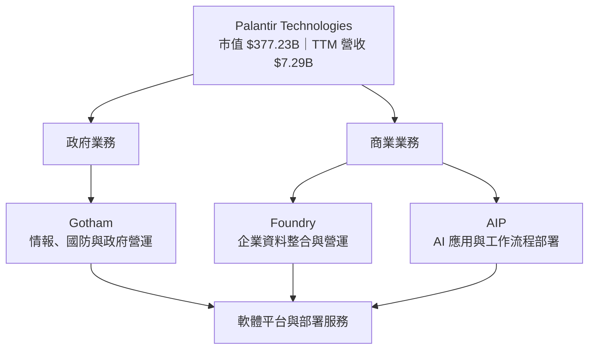
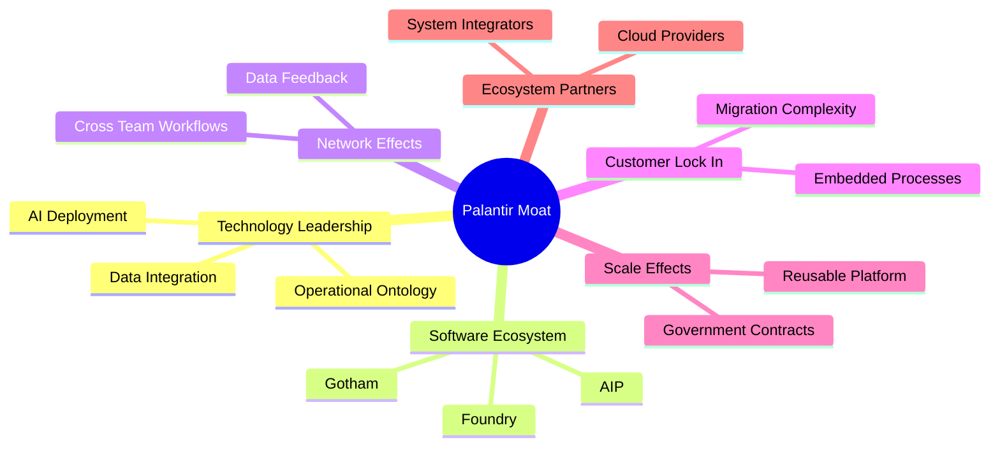
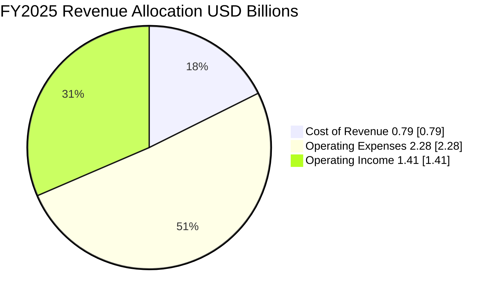
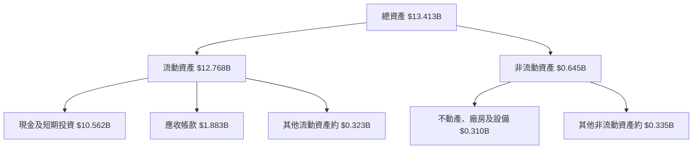
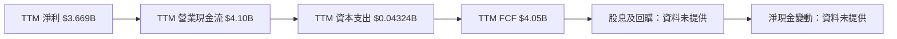
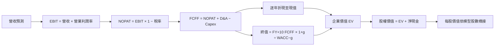
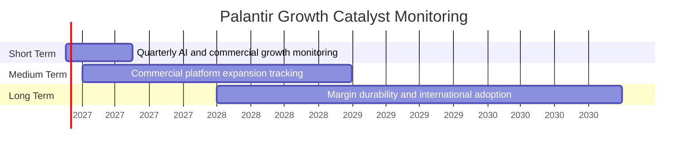
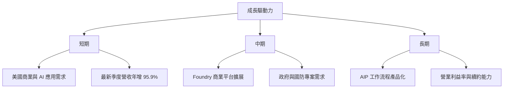
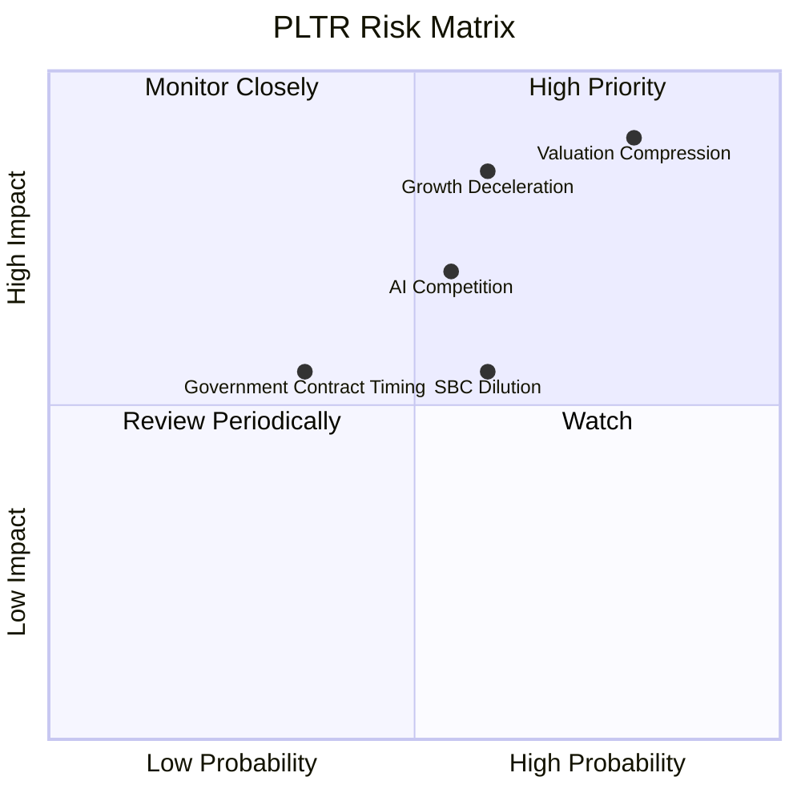
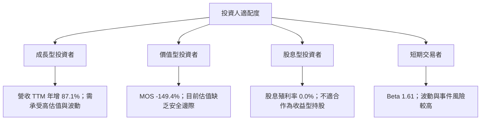

# PLTR 基本面深度分析報告
> **報告日期**：2026-11-18 ｜ **語言**：繁體中文 ｜ **數據來源**：SEC 申報資料 (XBRL)、Yahoo Finance、Finviz、StockAnalysis、Roic.ai ｜ **分析師**：CFA 級機構研究

## 目錄

| # | 章節 | 核心結論 |
|---|------|----------|
| 1 | 執行摘要 | 賣出；加權合理價值 $62.78，MOS -149.4% |
| 2 | 公司概覽與商業模式 | 軟體平台具整合與轉換成本，但市場份額數據未提供 |
| 3 | 損益表深度分析 | TTM 營收 $7.29B、年增 87.1%，獲利率快速提升 |
| 4 | 資產負債表分析 | 淨現金 $10.56B，流動性充裕 |
| 5 | 現金流量深度分析 | TTM FCF $4.05B，現金轉換良好；SBC 仍是重要稀釋成本 |
| 6 | 獲利能力與資本效率 | ROIC 492.3% 遠高於 WACC 12.13%，但 ROIC 分母需審慎解讀 |
| 7 | 相對估值分析 | 相對同業與自身歷史，營收倍數仍高 |
| 8 | DCF 內在價值評估 | DCF 基準值 $21.95；加權合理價值 $62.78 |
| 9 | 成長催化劑 | 美國商業市場與 AI 產品需求是主要潛在驅動 |
| 10 | 風險矩陣 | 估值、成長延續與競爭為前三大風險 |
| 11 | 投資建議 | 依 MOS 評級賣出；須以成長與利潤率數據驗證投資論點 |

## 1. 執行摘要

### 1.0 一頁式投資儀表板

| 項目 | 內容 |
|------|------|
| **投資論點（3 句）** | ① TTM 營收 $7.29B、年增 87.1%，最新一季年增 95.9%，顯示商業需求加速。② TTM 營業利益率 45.6%、FCF $4.05B，現金創造能力已具規模。③ 但 2026-11-17 收盤價 $156.56，對應加權合理價值 $62.78，估值折讓缺乏，市場須持續兌現極高成長預期。 |
| **綜合評分** | **7.2/10**（引用 1.1 評分卡） |
| **財務健康** | 🟢 現金與短期投資 $10.56B；流動比率 7.10。 |
| **ROIC vs WACC** | 492.3% vs 12.13%；依提供之 ROIC 指標為創造價值，但 ROIC 極高可能受投入資本分母偏小影響。 |
| **FCF 趨勢** | 上升；TTM FCF $4.05B，FCF Yield 1.07%。 |
| **估值** | Forward P/E 61.8x ｜ EV/EBITDA 109.4x ｜ FCF Yield 1.07%。 |
| **DCF 內在價值（基準）** | $21.95 ｜ 現價較 DCF 溢價 **613.5%**（現價÷DCF價值−1）。 |
| **安全邊際（MOS）** | **-149.4%**＝($62.78−$156.56)÷$62.78；🔴 無安全邊際。基準為 8.8 加權合理價值。 |
| **預期報酬（基準情境 12M）** | DCF 基準情境相對現價 **-86.0%**；非分析師共識目標價。 |
| **關鍵風險（前二）** | 現價對基準估值溢價極高；若美國商業與 AI 成長放緩，獲利成長與估值倍數可能同步收縮。 |
| **評級 + 信心度** | 🔴 **賣出** ｜ 信心：中（營運數據明確，DCF 對長期利潤率與成長路徑敏感）。 |

### 1.1 綜合評分卡（全報告唯一）

| 維度 | 評分（1–10） | 主要依據（引用數字與其來源章節） |
|------|--------------|----------------------------------|
| 成長性 | 9.0 | TTM 營收年增 87.1%、最新一季年增 95.9%（第 3 章），但高速成長能否延續仍待驗證。 |
| 獲利能力 | 9.0 | TTM 營業利益率 45.6%、ROIC 492.3%、F-Score 7/8（第 6 章）；ROIC 需留意分母偏小問題。 |
| 財務健康 | 9.0 | 淨現金 $10.56B、流動比率 7.10、速動比率 6.92（第 4 章）。 |
| 估值 | 2.0 | MOS -149.4%、Forward P/E 61.8x；P/S 55.3x 高於自身五年中位數 24.7x（第 7、8 章）。 |
| 護城河 | 8.0 | TTM 毛利率 84.7%、高續約與導入整合可能提高轉換成本；但未提供留存率、客戶集中度及市場份額（第 2 章）。 |
| 管理層與資本配置 | 6.0 | 現金持續累積、Capex 僅 $43.24M；但稀釋股數測試未通過，SBC 約佔 TTM 營收 13.5%（第 3、5 章）。 |
| **綜合評分** | **7.2** | 六項算術平均：(9+9+9+2+8+6)÷6 = 7.3。 |

### 1.2 五大投資論點 + 三大核心風險

| 類型 | 項目 | 具體依據 | 信心度 |
|------|------|----------|--------|
| 🟢 **投資論點①** | 營收成長加速 | TTM 營收年增 87.1%；最新一季營收年增 95.9%，且連續四季季度營收上升。 | 🟢 高 |
| 🟢 **投資論點②** | 營運槓桿擴大 | TTM 營業利益率 45.6%，2025 年營業利益 $1.41B，高於 2024 年 $310.4M。 | 🟢 高 |
| 🟢 **投資論點③** | FCF 產生能力 | TTM 營業現金流 $4.10B，資本支出 $43.24M，FCF $4.05B。 | 🟢 高 |
| 🟢 **投資論點④** | 淨現金提供抗風險能力 | 現金及短期投資 $10.56B，總債務在財務資料中列為 N/A；現金可支持研發與市場拓展。 | 🟢 高 |
| 🟢 **投資論點⑤** | 商業平台可跨產業部署 | Gotham、Foundry、AIP 等平台可服務政府及商業客戶；最新季度成長顯示需求擴散，但分部營收未提供。 | 🟡 中 |
| 🟡 **風險①** | 估值與成長脫節 | Forward P/E 61.8x、DCF 基準價 $21.95，現價 $156.56；市場定價要求成長長期高於模型基準。 | 🔴 高衝擊 |
| 🔴 **風險②** | AI 軟體競爭加劇 | 大型雲端供應商與資料平台均可能提供替代方案；一旦差異化下降，續約、定價與毛利率可能受壓。 | 🟡 中 |
| 🟡 **風險③** | SBC 與股數稀釋 | 近四季 SBC 約 $982.1M，約為 TTM 營收 13.5%；Piotroski 稀釋股數測試未通過。 | 🟡 中 |

### 1.3 快速統計卡片

| 指標 | 公司實際值（期間） | 同業中位數 | 狀態 |
|------|--------------------|------------|------|
| 營收成長（TTM） | **87.1%** | — | 🟢 |
| 營收成長（最新一季年增） | **95.9%** | 35.2% | 🟢 |
| 毛利率（TTM） | **84.7%** | 77.3% | 🟢 |
| 營業利益率（TTM） | **45.6%** | — | 🟢 |
| ROIC（TTM） | **492.3%** | — | 🟢* |
| Forward P/E | **61.8x** | 32.0x | 🔴 |
| FCF Yield（TTM） | **1.07%** | — | 🟡 |
| Piotroski F-Score | **7 / 8** | — | 🟢 |

\*ROIC 為資料庫計算值，因投入資本分母偏小，應避免將 492.3% 當作可持續的常態報酬率。

### 1.4 投資結論

╔══════════════════════════════════════════════════════════════════╗  
║                    📊 投資結論摘要                               ║  
╠══════════════════════════════════════════════════════════════════╣  
║  評級：🔴 賣出（依規則 20；MOS -149.4%）                         ║  
║  價格（2026-11-17 收盤）：$156.56                                ║  
║  DCF 內在價值（基準）：$21.95（現價溢價 613.5%）                ║  
║  安全邊際 MOS：-149.4%（基於加權合理價值）                       ║  
║  加權合理價值（8.8）：$62.78                                     ║  
║  DCF 情境價值：悲觀 $13.05（-91.7%）｜基準 $21.95（-86.0%）     ║  
║               樂觀 $38.20（-75.6%）                              ║  
║  綜合評分：7.2/10（引用 1.1）                                    ║  
║  適合投資人：能承受高波動、重視長期營收成長且接受估值風險者；   ║  
║              不適合以現金殖利率或安全邊際為優先者。             ║  
╚══════════════════════════════════════════════════════════════════╝

## 2. 公司概覽與商業模式

### 2.1 業務結構與收入來源

公司介紹指出 Palantir 提供資料整合、決策與行動支援軟體，核心平台包含 Gotham、Foundry 與 AIP。資料未提供各平台收入占比或分部營收，故不以估計比例拆分。

### 2.2 市場份額

市場份額數據未提供，且可引用資料中沒有可核實的 TAM 或市占率。Palantir TTM 營收 $7.29B、TTM 年增 87.1%，最新一季年增 95.9%；其成長高於所列 SNOW、DDOG、CRM 的最新一季營收年增率，但不能據此推導市場份額。

### 2.3 競爭護城河分析

### 2.4 護城河強度

| 護城河項目 | 強度（強／中／弱） | 證據（引用數字或事實） | 會削弱它的情況 |
|------------|--------------------|------------------------|----------------|
| 技術與產品整合 | 強 | TTM 毛利率 84.7%；產品整合資料與工作流程，理論上提高部署黏著度。 | 競品提供更簡單、低成本的整合方案。 |
| 軟體生態系統 | 中至強 | Gotham、Foundry、AIP 覆蓋政府、企業與 AI 應用；未提供各產品收入占比。 | 產品互通性不足或客戶偏好單一雲端原生工具。 |
| 網路效應 | 中 | 客戶數據與跨部門工作流程可提高平台效用；客戶層級留存率數據未提供。 | 資料效果無法跨客戶複製、部署停留在個別專案。 |
| 客戶鎖定 | 中至強 | 政府與企業工作流程整合通常涉及高轉換成本；資料未提供淨留存率或續約率。 | 導入成本高、客戶逐步內部化或合約不續約。 |
| 規模效應 | 中 | TTM 營收 $7.29B、營業利益率 45.6%，顯示規模擴大後具營運槓桿。 | 交付仍高度依賴人力，新增營收須同步增加部署成本。 |
| 生態夥伴 | 中 | 平台型產品可與客戶既有系統整合；夥伴貢獻與渠道收入未提供。 | 雲端平台商向上整合，直接競爭應用層。 |

護城河評分卡分數為 **8.0/10**：依據是 84.7% 毛利率、平台跨場景部署與高營業利益率；但缺少留存率、客戶集中度和市場份額數據，限制了判斷確定性。

## 3. 損益表深度分析

### 3.1 年度收入成長趨勢（近 4 年）

| 財年 | 營收 | YoY |
|------|------|-----|
| FY2022 | $1.91B | +23.6% |
| FY2023 | $2.23B | +16.7% |
| FY2024 | $2.87B | +28.8% |
| FY2025 | $4.48B | +56.2% |

╔══════════════════════════════════════════════════════════════════╗  
║              Palantir 年度收入趨勢 FY2022–FY2025                ║  
╠══════════════════════════════════════════════════════════════════╣  
║  FY2022  $1.91B  ██████████░░░░░░░░░░  YoY +23.6% 🟢            ║  
║  FY2023  $2.23B  ████████████░░░░░░░░  YoY +16.7% 🟡            ║  
║  FY2024  $2.87B  ███████████████░░░░░  YoY +28.8% 🟢            ║  
║  FY2025  $4.48B  ████████████████████  YoY +56.2% 🟢            ║  
║                                                                  ║  
║  FY2022–FY2025 營收 CAGR：32.9%                                  ║  
╚══════════════════════════════════════════════════════════════════╝

CAGR 算式：(4.475÷1.906)^(1/3)−1 = 32.9%。2025 年增速上升，代表需求與商業擴張速度加快；但 TTM 年增 87.1% 明顯高於三年 CAGR，預測時不宜直接外推。

### 3.2 季度收入趨勢分析

| 季度 | 營收 | QoQ | YoY | 備註 |
|------|------|-----|-----|------|
| 2025 Q4 | $1.407B | +19.0% | +70.0% | 以 2025 Q3 $1.181B 為 QoQ 基期。 |
| 2026 Q1 | $1.633B | +16.1% | +84.7% | 同比加速，且連續季度擴張。 |
| 2026 Q2 | $1.935B | +18.5% | +92.8% | 營收增量達 $302M。 |
| 2026 Q3 | $2.313B | +19.5% | +95.9% | 最新季度年增率，不是 TTM 成長率。 |

QoQ 算式示例：($2.313B÷$1.935B)−1 = 19.5%。四季營收逐季增加，支持需求擴張；但未提供客戶數、合約價值與分部拆分，無法區分新增客戶、擴約及政府合約時點對成長的貢獻。

### 3.3 利潤率演變分析

| 利潤率指標 | FY2022 | FY2023 | FY2024 | FY2025 | 趨勢 | 評估 |
|------------|--------|--------|--------|--------|------|------|
| **毛利率** | 78.5% | 80.6% | 80.3% | 82.4% | 整體上升 | 🟢 |
| **營業利益率** | -8.5% | 5.4% | 10.8% | 31.6% | 明顯改善 | 🟢 |
| **淨利率** | -19.6% | 9.4% | 16.1% | 36.3% | 明顯改善 | 🟢 |

毛利率以毛利÷營收計算；營業利益率與淨利率亦由年度報表數據計算。FY2025 營業利益率提升，與營收擴張、毛利增加及費用增速低於營收相符；目前 TTM 營業利益率為 45.6%，最新季度經核實的營業利益率為 46.9%。需留意 2025 年以後的利潤率能否維持，因快速擴張可能帶來銷售、部署與研發投入。

### 3.4 費用結構分析

以下是 FY2025 損益表的營收分配，金額由營收、毛利及營業利益推算，非現金流用途的預算配置。

╔══════════════════════════════════════════════════════════════════╗  
║ FY2025 營收 $4.48B 分配                                         ║  
╠══════════════════════════════════════════════════════════════════╣  
║ 營收成本 $0.79B      ████░░░░░░░░░░░░░░░░  17.6%               ║  
║ 營業費用 $2.28B      ██████████░░░░░░░░░░  50.9%               ║  
║ 營業利益 $1.41B      ███████░░░░░░░░░░░░░  31.6%               ║  
╚══════════════════════════════════════════════════════════════════╝

營業費用包含研發、銷售及管理等項目；FY2025 研發費用 $557.68M，約占營收 12.5%。其他費用細項未完整提供，不進一步拆分。

### 3.5 季度 EPS 趨勢與盈餘品質（Quality of Earnings）

| 季度 | EPS 實際值 | YoY EPS 成長 | 超預期／不及預期 |
|------|------------|--------------|------------------|
| 2025 Q4 | $0.26 | +647.6% | N/A；市場預估值缺失 |
| 2026 Q1 | $0.36 | +325.0% | N/A；市場預估值缺失 |
| 2026 Q2 | $0.44 | +215.4% | N/A；市場預估值缺失 |
| 2026 Q3 | $0.47 | +144.4% | N/A；市場預估值缺失 |

來源列出的四季 EPS Est 均為 nan，不能判定財報超預期或不及預期。實際 EPS 連續上升，但同比成長率下降反映比較基期提高，不等於盈餘轉弱。

| 盈餘品質項目 | 數值／佔比 | 評估 |
|--------------|-----------|------|
| 股權薪酬 SBC / 營收 | 約 $982.1M÷$7.288B = **13.5%** | 🔴 佔比仍高，SBC 是股東經濟成本；稀釋股數測試未通過。 |
| SBC / 營業現金流 | 約 $982.1M÷$4.10B = **23.9%** | 🟡 現金流品質尚可，但 SBC 不應被視為沒有成本。 |
| FCF / 淨利 | $4.05B÷$3.669B = **110.4%** | 🟢 現金轉換高於淨利，具現金支持。 |
| 一次性／非經常性損益 | N/A；資料未提供足夠明細 | 無法判斷一次性項目對盈餘的影響。 |
| 有效稅率異常 | 1.4% | 🟡 稅率偏低，未來正常化可能壓低淨利；DCF 亦採 1.4% 假設。 |
| 資本化支出 vs 費用化 | TTM Capex $43.24M；資本化政策細節 N/A | 資本支出低，但不能據此判斷是否存在成本遞延。 |

SBC 近四季合計算式：$196.41M+$201.59M+$265.21M+$318.89M=$982.10M。FCF 與淨利的期間口徑採 TTM 資料。整體 GAAP 盈餘有較高現金轉換支持，但低稅率與 SBC 稀釋成本使其不宜直接等同於完全可分配的股東盈餘。

## 4. 資產負債表分析

### 4.1 資產結構分解

最新 TTM 結束日為 2026-09-30。總資產及流動資產來自 StockAnalysis；非流動資產與流動資產細項按列報數字呈現。

其他流動資產約為 $12.768B−$10.562B−$1.883B=$0.323B；其他非流動資產約為 $0.645B−$0.310B=$0.335B，屬資料差額計算。

### 4.2 流動性與營運資金分析

| 指標 | 最新值 | 歷史值 | 評估 |
|------|--------|--------|------|
| 流動比率 | 7.10 | N/A；可比歷史序列未提供 | 🟢 流動資產遠高於流動負債。 |
| 速動比率 | 6.92 | N/A；可比歷史序列未提供 | 🟢 短期償付能力充足。 |
| 現金及短期投資 | $10.56B | 2025 年末 $7.18B | 🟢 現金資源上升；可支持營運投入。 |

| 指標 | 最新 TTM | 一年前 TTM | 變化 | 解讀 |
|------|----------|------------|------|------|
| DSO 應收帳款天數 | 94 天 | 94 天 | 0 天 | 🟡 持平，應收帳款天數未見惡化；應收帳款金額仍需配合營收成長觀察。 |
| DIO 存貨天數 | N/A | N/A | N/A | 公司未報告此項存貨餘額；不適用。 |
| DPO 應付帳款天數 | 29 天 | 33 天 | -4 天 | 🟡 付款天數下降，可能代表付款速度加快；單憑天數不能證明供應商議價力變化。 |
| CCC 現金轉換週期 | N/A | N/A | N/A | 缺少存貨天數，不可計算 CCC。 |

### 4.3 債務結構分析

VERIFIED FIGURES 對總債務列為 N/A，故此處以不同來源列示的現金及短期投資和帳面債務補充，但不替換第 8 章採用的淨現金數字。

╔══════════════════════════════════════════════════════════════════╗  
║                   Palantir 債務健康診斷                          ║  
╠══════════════════════════════════════════════════════════════════╣  
║  總債務：              $0.225B  ▏                    🟢          ║  
║  現金及短期投資：     $10.562B  ████████████████████  🟢          ║  
║  淨現金（市場資料）：約 $10.34B  ███████████████████  🟢          ║  
║  流動比率：              7.10x  ████████████████████  🟢          ║  
║  Debt/EBITDA：          N/A；未使用不一致口徑推算                ║  
║  利息保障倍數：         N/A；利息費用未提供                      ║  
╚══════════════════════════════════════════════════════════════════╝

### 4.4 股東權益趨勢

| 財年 | 股東權益 |
|------|----------|
| 2022 | $2.57B |
| 2023 | $3.48B |
| 2024 | $5.00B |
| 2025 | $7.39B |

╔══════════════════════════════════════════════════════════════════╗  
║                  股東權益變化 FY2022–FY2025                     ║  
╠══════════════════════════════════════════════════════════════════╣  
║ FY2022  $2.57B  ███████░░░░░░░░░░░░░                           ║  
║ FY2023  $3.48B  █████████░░░░░░░░░░░                           ║  
║ FY2024  $5.00B  ██████████████░░░░░░                           ║  
║ FY2025  $7.39B  ████████████████████                           ║  
╚══════════════════════════════════════════════════════════════════╝

權益增加與獲利留存相符；但缺乏完整權益變動表，無法把累積變化精確拆為淨利、SBC、回購與其他項目。

## 5. 現金流量深度分析

### 5.1 現金流量瀑布圖

提供的資料沒有完整股息、回購及淨現金變動明細，故僅呈現可確認的現金流環節。

### 5.2 FCF 轉換率趨勢

| 財年 | FCF | 淨利 | FCF / 淨利 |
|------|-----|------|------------|
| 2022 | $183.71M | -$373.70M | 不具解讀意義；淨利為負 |
| 2023 | $697.07M | $209.82M | 332.2% |
| 2024 | $1.14B | $462.19M | 約 246.7% |
| 2025 | $2.10B | $1.63B | 約 129.1% |
| TTM 至 2026-09-30 | $4.05B | $3.669B | 約 110.4% |

FCF 高於淨利的部分可能受到非現金費用及營運資金變動影響；因現金流量明細不完整，不能把差額全歸因於特定項目。轉換率由高位下降並不必然是惡化，部分是淨利基數快速上升所致。

### 5.3 自由現金流趨勢

| 財年／期間 | FCF | FCF Yield |
|------------|-----|-----------|
| 2022 | $183.71M | N/A |
| 2023 | $697.07M | N/A |
| 2024 | $1.14B | N/A |
| 2025 | $2.10B | N/A |
| TTM | $4.05B | 1.07% |

╔══════════════════════════════════════════════════════════════════╗  
║                  自由現金流趨勢                                 ║  
╠══════════════════════════════════════════════════════════════════╣  
║ FY2022  $0.184B  █░░░░░░░░░░░░░░░░░░░                         ║  
║ FY2023  $0.697B  ████░░░░░░░░░░░░░░░                         ║  
║ FY2024  $1.14B   ██████░░░░░░░░░░░░░                         ║  
║ FY2025  $2.10B   ███████████░░░░░░░░                         ║  
║ TTM     $4.05B   ████████████████████  Yield 1.07%            ║  
╚══════════════════════════════════════════════════════════════════╝

### 5.4 資本配置評估

資料未提供完整回購、股息及投資支出拆分，不畫沒有數字依據的資本配置圓餅圖。

| 項目 | 已知數據 | 評估 |
|------|----------|------|
| 資本支出 | TTM $43.24M | 相對營收 $7.29B 低；平台業務可能較少依賴實體資產，但研發與人力投入仍是重要再投資。 |
| 股息 | 殖利率 0.0% | 目前沒有股息回報。 |
| 回購 | N/A | 未提供足以核實的回購金額。 |
| SBC | 2025 年 $684.03M；近四季約 $982.10M | 可能造成股數稀釋，必須納入股東回報評估。 |
| 現金留存 | 現金及短期投資 $10.56B | 為研發、併購或市場拓展保留財務彈性；資本配置回報需後續觀察。 |

## 6. 獲利能力與資本效率

### 6.1 ROE / ROA / ROIC 趨勢

| 指標 | FY2023 | FY2024 | FY2025／TTM | 評估 |
|------|--------|--------|-------------|------|
| ROE | N/A（品質指標 TTM 32.7%） | N/A | TTM 32.7%（品質數據） | 🟢 高；與另一合併資料源 40.9% 不一致，採用品質指標計算值。 |
| ROA | N/A | N/A | TTM 19.3%（市場資料）；品質測試顯示 ROA 為正且高於去年 | 🟢 |
| ROIC | N/A | N/A | TTM 492.3% | 🟢* |

\*ROIC 使用提供的計算值，不自行重算；超高數值可能源於投入資本計算分母較小，解讀上宜輔以營業利潤與現金流。

### 6.2 ROIC vs WACC 分析（核心價值創造判斷）

╔══════════════════════════════════════════════════════════════════╗  
║                ROIC vs WACC 深度分析                            ║  
╠══════════════════════════════════════════════════════════════════╣  
║  WACC 估算（採資本成本資料）：                                   ║  
║  ├── 無風險利率（10Y 美債）： 5.10%                             ║  
║  ├── 股權風險溢酬 ERP：       5.00%                             ║  
║  ├── 原始 Beta：              1.61                               ║  
║  ├── 調整後 Beta：            1.41                               ║  
║  ├── 股權成本（資料列示）：   12.14%                            ║  
║  ├── 稅前債務成本（假設）：   7.10%                             ║  
║  ├── 股權／債務權重：         99.9%／0.1%                       ║  
║  └── WACC：                  12.13%                             ║  
║                                                                  ║  
║  ROIC（TTM）：492.3%                                             ║  
║  EVA spread = ROIC − WACC = 492.3% − 12.13% = 480.17 pp         ║  
║                                                                  ║  
║  ROIC 492.3%  ████████████████████  🟢                          ║  
║  WACC  12.13% ▌░░░░░░░░░░░░░░░░░░░                             ║  
║                                                                  ║  
║  結論：依所列 ROIC 指標遠高於資金成本，顯示價值創造；但 ROIC    ║  
║  的極高幅度可能受投入資本分母偏小影響，不宜線性外推。           ║  
╚══════════════════════════════════════════════════════════════════╝

股權成本列示值 12.14% 依據成本資本資料；以已四捨五入的 Rf 5.10%、調整後 Beta 1.41、ERP 5.00% 直接計算為 5.10%+1.41×5.00%=12.15%，與來源列示差 0.01 個百分點，可能來自未四捨五入輸入。WACC 直接採來源數值 12.13%，不另行替換。

### 6.3 杜邦三因素分解

| 因素 | 數值（TTM） | 解讀 |
|------|-------------|------|
| 淨利率 | 50.3% | 高獲利是 ROE 的主要支撐。 |
| 資產週轉率 | 0.54 | 每單位資產創造的收入低於一倍，但軟體商業模式通常不需重資產。 |
| 權益乘數 | 1.19 | 槓桿程度溫和，ROE 並非主要靠財務槓桿推動。 |
| **ROE** | **32.7%** | 50.3% × 0.54 × 1.19 = 約 32.3%；品質指標列示 ROE 為 32.7%，差異來自乘數四捨五入。 |

### 6.4 財務體質：Piotroski F-Score

F-Score **7 / 8**；有一項因輸入缺失而未納入分母，不能寫成 7/9。

| 測試 | 結果 | 解讀 |
|------|------|------|
| ROA > 0 | ✅ 通過 | TTM 資產報酬為正。 |
| 營業現金流 > 0 | ✅ 通過 | TTM OCF $4.10B。 |
| ROA 高於一年前 | ✅ 通過 | 獲利能力改善。 |
| 營業現金流 > 淨利 | ✅ 通過 | 指標計算期間內現金流高於淨利。 |
| 長期負債／總資產低於一年前 | — 無法判定 | 缺少可比較的長期負債輸入。 |
| 流動比率高於一年前 | ✅ 通過 | 流動性測試改善。 |
| 稀釋股數未增加 | ❌ 未通過 | 反映股數稀釋風險，與 SBC 佔營收約 13.5% 一致。 |
| 毛利率高於一年前 | ✅ 通過 | 毛利率改善支持平台經濟性。 |
| 資產週轉率高於一年前 | ✅ 通過 | 資產利用效率改善。 |

## 7. 相對估值分析

### 7.1 同業估值比較

| 估值指標 | **PLTR** | **SNOW** | **DDOG** | **CRM** | PLTR 評估 |
|----------|----------|---------|---------|---------|-----------|
| **Trailing P/E** | 110.3x | N/A | 229.4x | 17.8x | 🟡 盈利倍數介於同業之間，但仍高。 |
| **Forward P/E** | 61.8x | 89.1x | 51.9x | 12.1x | 🔴 高於 DDOG、CRM，低於 SNOW。 |
| **P/S Ratio** | 55.3x* | 17.7x | 13.9x | 3.6x | 🔴 顯著高於三家同業。 |
| **EV/EBITDA** | 117.0x* | -93.2x | 327.2x | 14.8x | 🟡 倍數很高；SNOW EBITDA 為負，不具可比性。 |
| **最新一季營收年增** | 95.9% | 35.1% | 35.2% | 10.8% | 🟢 成長明顯較快。 |
| **TTM 毛利率** | 84.7% | 67.0% | 79.6% | 77.3% | 🟢 高於所列同業。 |

\*表中 PLTR 倍數採同業比較區塊的歷史估值資料；其他估值概覽資料中的 P/S 51.8x、EV/EBITDA 109.4x 口徑略異，估值倍數須留意資料日期與計算口徑。Peer P/E 中位數 32.0x 由 DDOG 與 CRM 的 Forward P/E 計算；SNOW 倍數不納入此中位數。

### 7.2 歷史估值區間分析

╔══════════════════════════════════════════════════════════════════╗  
║               PLTR 五年估值區間（TTM）                          ║  
╠══════════════════════════════════════════════════════════════════╣  
║ P/E：       100.6x ├─● 110.3x ───── 中位數 228.6x ─── 601.0x  ║  
║ 現在分位：7%                                                     ║  
║ P/S：         7.0x ├──────── 中位數 24.7x ─────● 55.3x ─120.4x ║  
║ 現在分位：67%                                                    ║  
║ EV/EBITDA：109.0x ├─● 117.0x ─── 中位數 233.4x ─── 574.4x     ║  
║ 現在分位：8%                                                     ║  
╚══════════════════════════════════════════════════════════════════╝

P/E 與 EV/EBITDA 相較自身五年中位數偏低，但仍位於高估值區間；P/S 則高於歷史中位數，顯示營收倍數沒有因獲利改善而同步回落至中位數。

### 7.3 情境價值（Bear / Base / Bull）

| 情境 | 第 1 年營收成長 | 期末營業利潤率 | WACC | 每股價值 | 相對現價 | 機率 | 會發生的條件 |
|------|----------------|----------------|------|----------|----------|------|--------------|
| 🔴 悲觀 | 15.0% | 9.2% | 13.13% | $13.05 | -91.7% | 25% | 美國商業市場成長顯著降速，競爭增加且長期利潤率下滑。 |
| 🟡 基準 | 30.0% | 10.8% | 12.13% | $21.95 | -86.0% | 50% | 初期高成長逐步放緩，長期利潤率回落至模型假設。 |
| 🟢 樂觀 | 45.0% | 11.9% | 11.13% | $38.20 | -75.6% | 25% | 高成長持續較久，利潤率高於基準，資金成本下降。 |

### 7.4 相對估值隱含價格區間

╔══════════════════════════════════════════════════════════════════╗  
║               估值方法隱含每股價值                               ║  
╠══════════════════════════════════════════════════════════════════╣  
║ DCF（基準）             $21.95                                    ║  
║ 同業 Forward P/E        $81.18                                    ║  
║ 分析師共識目標價        $222.90                                   ║  
║ 現價                    $156.56                                   ║  
╚══════════════════════════════════════════════════════════════════╝

- DCF：10 年 FCFF、WACC 12.13%、永續成長率 3.0%。
- 同業 Forward P/E：DDOG、CRM 中位數 32.0x × 公司 Forward EPS $2.54 = $81.18。
- EV/EBITDA：模型無法計算，依規則不增加此估值方法。
- 分析師共識：29 位分析師平均目標價 $222.90，屬市場參考，不代表內在價值。

## 8. DCF 內在價值評估（Discounted Cash Flow）

### 8.0 估值推理鏈（Thinking Logic）

**核心命題**：PLTR 的企業價值主要由現有軟體平台現金流底盤與其後續成長能力決定；政府與商業分部營收占比未提供，無法量化拆出第二曲線或選擇權價值。估值的主導變數是營收成長與長期營業利潤率；利率亦重要，但 DCF 敏感度表顯示所列 WACC/g 範圍內估值均遠低於現價。

| 決策點 | 本報告採用 | 理由（含數字） | 曾考慮但否決 | 否決理由 |
|--------|-----------|----------------|--------------|----------|
| 現金流定義 | FCFF | 使用 WACC 折現並得到 EV；模型定義為 NOPAT+D&A−Capex | FCFE | 需要股權融資與債務現金流預測，模型未提供。 |
| 預測期 N | 10 年 | DCF 模型固定 10 年；適合逐步把高成長放緩納入估值 | 5 年 | 無法反映長期成長淡出路徑；且不可改動模型。 |
| 終值方法 | Gordon Growth | 模型採 g=3.0%，WACC=12.13% | 退出倍數 | 模型未提供可採用的退出倍數終值，不自建。 |
| EBIT 基礎 | GAAP EBIT | DCF 模型明示 GAAP EBIT | 非 GAAP EBIT | 加回 SBC 會改變模型定義，且可能造成 SBC 成本漏算。 |

**高／中敏感度假設推導鏈**

- **營收成長**：錨點＝TTM 成長 87.1%、FY2025 成長 56.2%、近三財年 CAGR 32.9% → 調整＝避免將單一高速 TTM 外推十年，並以線性放緩反映基期擴大及競爭 → **FY+1 採用 30.0%，FY+10 降至 3.0%** → 曾考慮把 87.1% 延伸至多年度，因不符合逐步成熟假設而否決。
- **期末營業利潤率**：錨點＝TTM 營業利益率 45.6%、五年歷史中位數由模型設定為 10.8% → 調整＝按成熟期競爭及費用回升逐年淡出 → **FY+10 採用 10.8%** → 曾考慮延續 45.6%，但模型採長期均值回歸，故不採。
- **永續成長率 g**：錨點＝長期成熟企業名目增長需低於折現率；模型採用 3.0% → 調整＝與 WACC 12.13% 保持 9.13 個百分點差距 → **採用 3.0%** → 曾考慮更高 g，因永久增長率不宜接近高於經濟長期增長的水平而否決。
- **預測期 N**：錨點＝模型設定 10 年，營收由 $7.29B 預測至 FY+10 的 $32.65B → 調整＝期間內成長率由 30.0% 線性降至 3.0% → **採用 10 年** → 5 年期限會壓縮成長淡出期；15 年則超出既定模型，均不替代。
- **Capex／營收**：錨點＝TTM Capex $43.24M÷TTM 營收 $7.29B 約 0.6% → 調整＝模型令資本支出率逐步降至 0.4%，約為 D&A/營收 0.4% 的 1.1 倍 → **FY+1 0.6% 降至 FY+10 0.4%** → 不採長期 Capex 高於模型路徑，因資料顯示現有資產需求低且模型已固定。
- **EBIT 基礎、SBC 與股數**：錨點＝FY2025 SBC $684.03M、稀釋股數測試未通過 → 模型採 GAAP EBIT，且明確設定固定股數、不再另行稀釋 → **採用組合 (A)** → 不採非 GAAP EBIT 加回 SBC，避免成本被漏算。
- **年稀釋率**：在組合 (A) 中，模型將稀釋率設為 **0%**，因模型把 SBC 作為 GAAP 費用反映，股數不再逐年放大；這是模型約定，不代表實際稀釋停止。
- **終值方法**：錨點＝模型以 FY+10 FCFF 及 3.0% g 計算 → **採 Gordon Growth** → 退出倍數法未提供必要模型輸入，因此不自行估算。
- **WACC**：錨點＝成本資本資料列示 WACC 12.13% → **直接採 12.13%** → 不以其他自行估算的資本成本替換。

**最脆弱的一環**：成熟期營業利潤率與成長淡出路徑；若商業化變現低於基準，DCF 估值會下移，且基準價本已遠低於現價。

### 8.1 模型假設總表（Model Inputs）

| 假設項目 | 採用值 | 依據／來源 | 敏感度 |
|----------|--------|-------------|--------|
| 預測期長度 N | 10 年 | DCF 模型固定預測期 | 🟡 中 |
| 營收成長率 | FY+1 30.0%，FY+10 3.0%，線性淡出 | TTM 成長 87.1%；模型把第一年成長限制在 0%–30%，再逐年淡出 | 🔴 高 |
| 營業利潤率 | FY+1 45.6% → FY+10 10.8% | 起點為 TTM 營業利益率；終點為模型指定近五年中位數 | 🔴 高 |
| 有效稅率 | 1.4% | 最近年度有效稅率 | 🟢 低 |
| Capex／營收 | 0.6% → 0.4% | TTM 資本支出率約 0.6%；模型淡出至 D&A 的 1.1 倍 | 🟡 中 |
| D&A／營收 | 0.4% | TTM 模型輸入，保持不變 | 🟢 低 |
| 營運資金變動 | 未建模 | DCF 模型明示 Working capital is not modelled；不是假設為零 | 🟢 低 |
| EBIT 基礎 | GAAP EBIT | DCF 模型指定 | 🟡 中 |
| SBC 處理 | GAAP EBIT 已含 SBC，不再扣除 SBC | 模型組合 (A) | 🟡 中 |
| 年稀釋率 | 0% | 模型固定股數；與組合 (A) 相容 | 🟡 中 |
| 永續成長率 g | 3.0% | DCF 模型固定，低於 WACC | 🔴 高 |
| 終值方法 | Gordon Growth | DCF 模型提供 Gordon Growth 終值 | 🔴 高 |
| WACC | 12.13% | 資本成本區塊 | 🔴 高 |

本模型採用 **(A) GAAP EBIT + 固定股數**，故 SBC 影響已計入一次；FCFF 不再減 SBC，股數不再另行稀釋。使用 FCFF＝NOPAT+D&A−Capex；營運資金未建模。

### 8.2 折現率推導（WACC）

╔══════════════════════════════════════════════════════════════════╗  
║                    WACC 推導（折現率）                           ║  
╠══════════════════════════════════════════════════════════════════╣  
║ 股權成本 Ke（CAPM）：                                            ║  
║ ├── 無風險利率 Rf：5.10%                                        ║  
║ ├── ERP：5.00%（假設值，成本資本資料輸入）                       ║  
║ ├── 原始 Beta：1.61（Yahoo Finance）                             ║  
║ ├── 調整後 Beta：⅔×1.61+⅓×1 = 1.41                             ║  
║ ├── 股權成本資料列示：12.14%                                     ║  
║                                                                  ║  
║ 債務成本 Kd：                                                    ║  
║ ├── 稅前 Kd：7.10%（假設值：Rf 5.10% + 信用利差 2.00%）         ║  
║ ├── 稅率：1.4%                                                   ║  
║ └── 稅後 Kd = 7.10%×(1−1.4%) = 7.0006% ≈ 7.00%                  ║  
║                                                                  ║  
║ 資本權重：股權 99.9%／債務 0.1%                                  ║  
║ WACC（資料列示）：12.13%                                         ║  
╚══════════════════════════════════════════════════════════════════╝

1. **Ke**：資料列示為 12.14%；用顯示後輸入重算為 5.10%+1.41×5.00%=12.15%，差異 0.01pp，應為原始未四捨五入輸入造成。
2. **稅前 Kd**：7.10%，假設值（依據：10 年期無風險利率 5.10% 加 2.00% 信用利差）；利息費用未提供，不能用實際利息費用反算。
3. **稅後 Kd**：7.10%×(1−1.4%)=7.0006%。
4. **權重**：資本成本資料列示股權 99.9%、債務 0.1%；其市場價值基礎權重直接採該區塊，未另以帳面股東權益代替市值。
5. **WACC**：12.13% 為成本資本資料列示值，按要求直接使用。顯示後權重與輸入僅能近似複算：99.9%×12.14%+0.1%×7.0006%=12.1349%≈12.13%。

無風險利率日期未單獨列明；成本資本資料只提供 10Y Treasury 5.10%。分析不加計額外規模或國別溢酬。第 6.2 節與 DCF 同用 12.13%。

### 8.3 逐年自由現金流預測（基準情境）

金額單位：$B。模型各列分別四捨五入至 $0.01B；折現因子保留三位小數。未提供的 ΔWC 不加列，因模型未納入營運資金。

| 年度 | FY+1 | FY+2 | FY+3 | FY+4 | FY+5 | FY+6 | FY+7 | FY+8 | FY+9 | FY+10 |
|------|------|------|------|------|------|------|------|------|------|-------|
| 營收 | 9.47 | 12.03 | 14.92 | 18.05 | 21.30 | 24.50 | 27.44 | 29.91 | 31.70 | 32.65 |
| 營收 YoY | 30.0% | 27.0% | 24.0% | 21.0% | 18.0% | 15.0% | 12.0% | 9.0% | 6.0% | 3.0% |
| 營業利潤率 | 45.6% | 41.8% | 37.9% | 34.0% | 30.2% | 26.3% | 22.4% | 18.6% | 14.7% | 10.8% |
| EBIT | 4.32 | 5.03 | 5.66 | 6.14 | 6.43 | 6.44 | 6.16 | 5.55 | 4.66 | 3.54 |
| − 稅 | (0.06) | (0.07) | (0.08) | (0.08) | (0.09) | (0.09) | (0.08) | (0.08) | (0.06) | (0.05) |
| NOPAT | 4.26 | 4.96 | 5.58 | 6.06 | 6.34 | 6.36 | 6.07 | 5.48 | 4.60 | 3.49 |
| + D&A | 0.04 | 0.05 | 0.06 | 0.07 | 0.08 | 0.10 | 0.11 | 0.12 | 0.13 | 0.13 |
| − Capex | (0.06) | (0.07) | (0.08) | (0.10) | (0.11) | (0.12) | (0.13) | (0.14) | (0.14) | (0.14) |
| **= FCFF** | **4.25** | **4.94** | **5.55** | **6.03** | **6.31** | **6.33** | **6.05** | **5.45** | **4.58** | **3.48** |
| 折現因子 | 0.892 | 0.795 | 0.709 | 0.633 | 0.564 | 0.503 | 0.449 | 0.400 | 0.357 | 0.318 |
| **FCFF 現值 PV** | **3.79** | **3.93** | **3.94** | **3.82** | **3.56** | **3.18** | **2.71** | **2.18** | **1.63** | **1.11** |

FCFF 現值合計：  
$3.79+$3.93+$3.94+$3.82+$3.56+$3.18+$2.71+$2.18+$1.63+$1.11 = **$29.85B**。

**FY+1 逐步演算**

1. 營收：$7.29B×(1+30.0%)=$9.477B，模型列示 **$9.47B**（使用模型原值）。
2. EBIT：模型以未四捨五入營收計算，列示 **$4.32B**（營業利潤率 45.6%）。
3. 稅：模型列示 **$0.06B**（有效稅率 1.4%）。
4. NOPAT：模型列示 **$4.26B**。
5. D&A：模型列示 **$0.04B**（D&A/營收 0.4%）。
6. Capex：模型列示 **$0.06B**（Capex/營收 0.6%）。
7. ΔWC：未建模，模型 FCFF 不含此列。
8. FCFF：模型原值 **$4.25B**；顯示位數下 4.26+0.04−0.06=4.24，差額來自各項以 $0.01B 獨立四捨五入，沿用模型未四捨五入計算結果。
9. 折現因子：1÷(1+12.13%)^1=0.8918≈**0.892**；PV＝模型未四捨五入 FCFF×折現因子，列示 **$3.79B**。

**合理性自檢**

- 預測 FCF CAGR：由 $4.25B 至 $3.48B，10 年期間為負成長；端點計算約 -2.0% CAGR。與歷史 2022–2025 FCF 由 $0.184B 增至 $2.10B 的高成長差異，來自模型營業利潤率由 45.6% 淡出至 10.8%。
- FY+10 FCFF 利潤率：$3.48B÷$32.65B=10.7%；目前 TTM FCF 利潤率約 $4.05B÷$7.29B=55.6%。模型顯著保守地降低長期利潤率。
- 模型內每年 FCFF 均為正，未出現負現金流。

╔══════════════════════════════════════════════════════════════════╗  
║            自由現金流：歷史實際 vs 模型預測                      ║  
╠══════════════════════════════════════════════════════════════════╣  
║ FY2023（實） $0.697B  ███░░░░░░░░░░░░░░░  YoY +279.3%           ║  
║ FY2024（實） $1.14B   █████░░░░░░░░░░░░░  YoY +63.1%            ║  
║ FY2025（實） $2.10B   █████████░░░░░░░░░  YoY +84.2%            ║  
║ FY+1（預）   $4.25B   ██████████████████░  模型值                ║  
║ FY+10（預）  $3.48B   ███████████████░░░░  期末利潤率 10.8%     ║  
╠══════════════════════════════════════════════════════════════════╣  
║ FY+1 到 FY+10 FCF 回落，主要源於營業利潤率假設逐步正常化。       ║  
╚══════════════════════════════════════════════════════════════════╝

### 8.4 終值計算（Terminal Value）

適用性檢查：**WACC 12.13% vs g 3.0% → WACC > g ✅**

| 方法 | 計算式 | 終值 TV | TV 現值 | 佔總 EV 比重 |
|------|--------|---------|---------|--------------|
| Gordon Growth | $3.48×(1+3.0%)÷(12.13%−3.0%) | $39.20B | $12.47B | 29.5% |
| 退出倍數法 | N/A；DCF 模型未提供退出倍數 | N/A | N/A | N/A |

**逐步演算**

1. FY+N FCFF：**$3.48B**（FY+10）。
2. 分子：$3.48×(1+3.0%)=$3.5844B；模型按未四捨五入值計算。
3. 分母：12.13%−3.0%=9.13%；模型列示 TV：$3.48×1.03÷0.0913 = **$39.20B**。
4. PV(TV)：$39.20×0.318=**$12.47B**。
5. 終值佔 EV：$12.47÷$42.32=**29.5%**。

終值占比未超過 75%，但估值仍對長期成長率與折現率敏感。退出倍數法所需輸入沒有提供，不另建模型。

### 8.5 企業價值 → 每股內在價值（Bridge）

╔══════════════════════════════════════════════════════════════════╗  
║              企業價值 → 每股內在價值 橋接表                      ║  
╠══════════════════════════════════════════════════════════════════╣  
║ 預測期 FCF 現值合計          +$29.85B                            ║  
║ 終值現值 PV(TV)              +$12.47B                            ║  
║ = 企業價值 EV                 $42.32B                            ║  
║ + 淨現金                     +$10.56B                            ║  
║ = 股權價值                   $52.88B                            ║  
║ 每股內在價值（模型值）        $21.95                             ║  
║ 2026-11-17 收盤價            $156.56                             ║  
║ 折溢價：156.56÷21.95−1       +613.5%（溢價）                    ║  
╚══════════════════════════════════════════════════════════════════╝

逐步算式：

1. EV：$29.85B+$12.47B=**$42.32B**。
2. 股權價值：$42.32B+$10.56B=**$52.88B**。
3. 每股內在價值：DCF 模型直接列示 **$21.95**。模型指定按「股權價值×價格÷市值」進行每股橋接；其市場資本化輸入與顯示股數資料口徑不完全一致，故不以市值或股數重建替代模型值。
4. 折溢價：$156.56÷$21.95−1=**613.5%**。
5. 本節不計算 MOS；MOS 只在 8.8 以加權合理價值為分母計算一次。

淨現金及股數橋接採 DCF 模型列值；模型將 SBC 納入 GAAP EBIT，固定股數，不另計年稀釋率。

### 8.6 敏感性分析（WACC × 永續成長率）

以下每股價值照抄 DCF 模型；括號為相對 $156.56 現價的上行空間，按顯示數字計算，四捨五入至一位小數。

| g／WACC | 10.13% | 11.13% | **12.13% 基準** | 13.13% | 14.13% |
|-----------|--------|--------|----------------|--------|--------|
| 2.0% | $24.75 (-84.2%) | $22.90 (-85.4%) | $21.39 (-86.3%) | $20.12 (-87.1%) | $19.04 (-87.8%) |
| 2.5% | $25.24 (-83.9%) | $23.26 (-85.1%) | $21.65 (-86.2%) | $20.32 (-87.0%) | $19.20 (-87.7%) |
| **3.0% 基準** | $25.79 (-83.5%) | $23.65 (-84.9%) | **$21.95 (-86.0%)** | $20.54 (-86.9%) | $19.37 (-87.6%) |
| 3.5% | $26.43 (-83.1%) | $24.10 (-84.6%) | $22.27 (-85.8%) | $20.79 (-86.7%) | $19.55 (-87.5%) |
| 4.0% | $27.18 (-82.6%) | $24.62 (-84.3%) | $22.64 (-85.5%) | $21.06 (-86.5%) | $19.76 (-87.4%) |

**逐步演算限制**：DCF 模型提供敏感度矩陣成品，但未提供各格重新折現後的預測期 PV 明細。為遵守不得自建或改動 DCF 的規則，不另行重算某個非基準格；矩陣價值照抄，不能將缺失的中間值偽裝成模型輸出。

**三情境 DCF**

| 情境 | 成長假設 | 期末營業利潤率 | WACC | 每股價值 | 相對現價 | 機率 |
|------|----------|----------------|------|----------|----------|------|
| 🔴 悲觀 | 第 1 年 15.0% | 9.2% | 13.13% | $13.05 | -91.7% | 25% |
| 🟡 基準 | 第 1 年 30.0% | 10.8% | 12.13% | $21.95 | -86.0% | 50% |
| 🟢 樂觀 | 第 1 年 45.0% | 11.9% | 11.13% | $38.20 | -75.6% | 25% |
| **機率加權** | — | — | — | **$23.78** | **-84.8%** | **100%** |

三情境的終值成長率、逐年營收與 FCFF 中間值未在模型輸出中提供，不自行拼造推導鏈。機率加權算式：$13.05×25%+$21.95×50%+$38.20×25%=$23.7875，模型列示 **$23.78**（按未四捨五入底層情境值計算）。

敏感度結論：在 g 3.0% 的矩陣列，WACC 由 11.13% 升至 12.13%，價值由 $23.65 降至 $21.95，減少 $1.70；由 12.13% 升至 13.13%，價值由 $21.95 降至 $20.54，減少 $1.41。g 由 2.0% 升至 3.0%、WACC 固定 12.13%，價值由 $21.39 升至 $21.95，增加 $0.56；由 3.0% 升至 4.0% 增加 $0.69。此矩陣未測營收及營業利潤率變化，不能據此宣稱哪項假設整體最敏感；模型推理鏈仍認為成長與長期利潤率是主導營運假設。

### 8.7 反推 DCF（Reverse DCF）

資料庫給出的反推結果是在其他基準輸入固定後，對指定變數逐一求解：

| 求解變數 | 固定其他條件 | 市場隱含值 | 歷史／基準參考 | 判斷 |
|----------|--------------|--------------|----------------|------|
| 第 1 年營收成長 | 其餘基準輸入固定 | 在 -10% 至 100% 範圍內無解 | TTM 成長 87.1%；基準模型第 1 年 30.0% | 現價超出單一營收成長變數可解釋範圍。 |
| 固定營業利潤率 | 其餘基準輸入固定 | 在 0.5% 至 95% 範圍內無解 | TTM 45.6% | 現價不是單靠固定利潤率變數即可合理化。 |

完整 Reverse DCF 的股數、逐年營收／FCFF 迭代軌跡未提供；不得虛構一組試算結果。反推資料顯示，在模型限定的單一變數調整下，即使把成長或利潤率調至極端範圍，仍找不到等於現價的解，代表市場估值包含基準 DCF 未捕捉的長期選擇權、超額成長或更高成熟期經濟性。

### 8.8 估值三角驗證與安全邊際

| 估值方法 | 隱含每股價值 | 上行空間（÷現價） | 權重 | 說明 |
|----------|--------------|-------------------|------|------|
| DCF（基準） | $21.95 | -86.0% | 55% | 10 年 FCFF、WACC 12.13%、g 3.0%。 |
| 同業 Forward P/E | $81.18 | -48.1% | 35% | 同業中位數 32.0x × Forward EPS $2.54。 |
| 分析師共識目標價 | $222.90 | +42.4% | 10% | 29 位分析師平均目標價，作為參考。 |
| **加權合理價值** | **$62.78** | **-59.9%** | **100%** | 公司類型為 profitable；EV/EBITDA 無法計算，依規則剔除。 |

加權算式：  
$21.95×55%+$81.18×35%+$222.90×10%  
=$12.0725+$28.4130+$22.2900  
=$62.7755≈**$62.78**。

MOS 算式：($62.78−$156.56)÷$62.78 = −$93.78÷$62.78 = **-149.4%**。  
上行空間算式：($62.78−$156.56)÷$156.56 = −$93.78÷$156.56 = **-59.9%**。  
DCF 折溢價固定以 DCF 基準值為分母：$156.56÷$21.95−1=**+613.5%**。

╔══════════════════════════════════════════════════════════════════╗  
║                  估值區間與安全邊際                              ║  
╠══════════════════════════════════════════════════════════════════╣  
║ 悲觀 DCF $13.05 ─ 現價 $156.56 ─ 加權合理值 $62.78 ─ 樂觀 DCF $38.20 ║  
║                                                                  ║  
║ MOS = ($62.78−$156.56)÷$62.78 = -149.4%                          ║  
║ 上行空間 = ($62.78−$156.56)÷$156.56 = -59.9%                    ║  
║ 評估：🔴 無安全邊際；評級依 MOS 為賣出                         ║  
║ 建議買入區間：$21.95–$56.50（上限約為加權價值的 90%）           ║  
║ 合理持有區間：$56.50–$62.78                                     ║  
║ 減碼考慮區間：高於 $62.78；現價 $156.56 已遠高於該區間           ║  
╚══════════════════════════════════════════════════════════════════╝

> 🔎 **程式複算（Python，依本節各項自動重算）**
>
> 加權合理價值 = $21.95 × 55% + $81.18 × 35% + $222.90 × 10% = **$62.78**（權重合計 100%）
>
> 以價格 $156.56 計：MOS = **-149.4%**，上行空間 = **-59.9%**
>
> ✅ 與本節所寫數值一致。

### 8.9 DCF 模型的局限與失效條件

- **終值依賴度**：PV(TV) 佔 EV 29.5%，主要價值仍來自十年預測期現金流。
- **最脆弱假設**：FY+1 營收成長 30.0%與利潤率由 45.6%下滑至 10.8%。模型已呈現基準 $21.95、悲觀 $13.05、樂觀 $38.20；三者均低於現價。
- **稅率局限**：1.4% 有效稅率偏低，若未來稅率回升，NOPAT 與 DCF 可能下降；模型未提供不同稅率情境。
- **SBC 與股數局限**：採 GAAP EBIT 已扣 SBC，但固定股數；若實際股份持續稀釋，模型每股價值可能偏高。
- **營運資金局限**：模型未納入 ΔWC；若應收帳款增長占用更多現金，FCFF 會低於模型。
- **與第 10 章連結**：商業成長放慢會影響營收路徑；價格競爭或部署成本上升會壓低長期利潤率；利率上升會提高 WACC，降低終值與現值。

### 8.10 複算檢核表（Audit Trail）

| # | 檢核項目 | 檢查方式 | 結果 |
|---|----------|----------|------|
| 1 | 高／中敏感度輸入有推導邏輯 | 對照 8.0 Step 3 與 8.1 | ✅ 已逐項說明；模型固定的細項不改值。 |
| 2 | 假設均有來歷 | 核對 8.1 依據欄 | ✅ 缺項明示未建模或 N/A。 |
| 3 | WACC 推導及算術 | 核對來源 WACC 與顯示精度 | ⚠️ 原始輸入未四捨五入值不可得；採用來源 WACC 12.13%。 |
| 4 | Kd 分母及債務權重範圍一致 | 核對利息與計息負債資料 | ⚠️ 利息費用與完整計息負債細節未提供，沿用來源假設。 |
| 5 | WACC 與第 6.2 節相同 | 兩節比對 | ✅ 12.13%。 |
| 6 | 逐年年度數等於 N | 核對 FY+1 至 FY+10 | ✅ 共 10 年，無省略年度。 |
| 7 | FY+1 代表年度可複算 | 核對未四捨五入模型列值 | ⚠️ 顯示數字獨立四捨五入，列示 FCFF 有 $0.01B 尾差。 |
| 8 | 預測期 PV 合計 | $3.79+$3.93+$3.94+$3.82+$3.56+$3.18+$2.71+$2.18+$1.63+$1.11 | ✅ 合計 $29.85B。 |
| 9 | WACC > g | 12.13% vs 3.0% | ✅ |
| 10 | 終值以 FY+10 現金流並折現 10 期 | 核對 DCF 模型 | ✅ |
| 11 | EV 與股權價值橋接 | $29.85B+$12.47B=$42.32B；+$10.56B=$52.88B | ✅ |
| 12 | SBC 組合合法 | GAAP EBIT、無 −SBC 列、股數固定 | ✅ 組合 (A)。 |
| 13 | 敏感性基準格與 8.5 DCF 值 | 12.13%、g 3.0% | ✅ $21.95。 |
| 14 | 敏感性矩陣有效性 | WACC 均高於 g | ✅ |
| 15 | 三情境機率 | 25%+50%+25% | ✅ 100%；模型機率加權值 $23.78。 |
| 16 | Reverse DCF 僅解一個變數 | 引用模型的兩項無解結果 | ✅ 未虛構疊代軌跡。 |
| 17 | MOS 與基準一致 | 以 $62.78 加權價值作分母 | ✅ -149.4%；DCF 折溢價以 $21.95 為基準。 |
| 18 | 報告章節完整 | 核對至第 11 章 | ✅ |
| 19 | 加權價值算術 | 55%、35%、10%加權相加 | ✅ $62.7755≈$62.78。 |
| 20 | 評級符合規則 20 | MOS -149.4% < -25% | ✅ 賣出；未作質化調整。 |

## 9. 成長催化劑

### 9.1 催化劑時間軸

實際催化劑發生日期未提供，故時間軸表示監控期間而非公司已公告日期。

### 9.2 TAM 市場規模分析

N/A（TAM 數據未提供）。可核實的營收指標為 TTM $7.29B、年增 87.1%，最新季度年增 95.9%；高成長代表目前商業化擴張迅速，但缺少市場總量與分部營收，不能計算滲透率。

### 9.3 成長驅動力結構圖

近期新聞提及美國商業營收成長、AI 需求與國防預算等主題，但未提供可核實的訂單金額、合約收入或分部增長數字；因此把它們列作待驗證催化因素，而非已納入估值的確定收益。

## 10. 風險矩陣

### 10.1 風險評分矩陣

機率與衝擊座標為分析師的質化排序，不是公司財務數據或程式計算結果。

### 10.2 風險清單詳細分析

| # | 風險項目 | 發生機率 | 財務衝擊 | 風險評分 | 緩解措施 |
|---|----------|----------|----------|----------|----------|
| 1 | 🔴 **估值倍數收縮** | 高（質化） | 高；DCF 基準相對現價 -86.0% | 🔴 高 | 逐季檢視營收、EPS、FCF 是否足以支持估值；分批交易並限制單一持倉暴露。 |
| 2 | 🔴 **成長率回落** | 中高（質化） | 高；TTM 成長 87.1%若明顯放緩，將影響預期與估值 | 🔴 高 | 追蹤各分部收入、客戶擴約、合約轉收入速度；連續兩季低於監控門檻時重估。 |
| 3 | 🟠 **長期利潤率下滑** | 中（質化） | 高；模型期末營業利益率 10.8%，顯著低於目前 TTM 45.6% | 🟠 中高 | 監控營業利益率、銷售與部署費用率、毛利率。 |
| 4 | 🟡 **SBC 與股份稀釋** | 中（質化） | 中；近四季 SBC 約佔營收 13.5% | 🟡 中 | 追蹤稀釋股數增幅及 SBC／營收比例，要求營收成長抵銷每股稀釋。 |
| 5 | 🟡 **政府合約時點與預算** | 中（質化） | 中；收入確認可能受預算或專案時點影響 | 🟡 中 | 追蹤政府收入、合約續約與應收帳款天數；目前 DSO 94 天。 |

## 11. 投資建議

### 11.1 最終評級與評分

2026-11-17 收盤價 $156.56，相較加權合理價值 $62.78，MOS 為 -149.4%；依規則 20 評級為**賣出**，未作質化調整。公司綜合評分為 **7.2/10**，六項分數依序為成長性 9.0、獲利能力 9.0、財務健康 9.0、估值 2.0、護城河 8.0、管理層與資本配置 6.0。

### 11.2 合理價值與隱含報酬率

| 方法／情境 | 每股價值 | 機率 | 相對現價 $156.56 |
|------------|----------|------|-----------------|
| 加權合理價值 | $62.78 | 固定權重估值 | -59.9% 上行空間 |
| DCF 悲觀 | $13.05 | 25% | -91.7% |
| DCF 基準 | $21.95 | 50% | -86.0% |
| DCF 樂觀 | $38.20 | 25% | -75.6% |

### 11.3 買入時機與觸發因素

╔══════════════════════════════════════════════════════════════════╗  
║                  ✅ 買入觸發因素 Checklist                      ║  
╠══════════════════════════════════════════════════════════════════╣  
║  目前評級為賣出；不以營收成長單一指標作立即買入依據。            ║  
║                                                                  ║  
║  重新評估買入的條件：                                            ║  
║  ☐ 股價回落至加權合理價值的 90% 以下，即約 $56.50 或以下         ║  
║  ☐ 營收持續成長，且季度營業利益率維持 40% 以上                  ║  
║  ☐ FCF 維持正值，FCF Yield 隨股價與現金流變化改善                ║  
║                                                                  ║  
║  加碼觸發條件：                                                  ║  
║  ☐ 最新一季營收年增率維持 50% 以上，且營業利益率未收縮           ║  
║  ☐ SBC／營收比例連續下降，稀釋股數增速減緩                       ║  
║                                                                  ║  
║  減碼／重新檢視條件：                                            ║  
║  ☐ 股價繼續上升但營收成長與 EPS 成長持續放緩                     ║  
║  ☐ FCF 轉負，或營業利益率連續兩季較 46.9% 明顯收縮               ║  
╚══════════════════════════════════════════════════════════════════╝

買入區間上限約 $56.50，對應加權合理價值 $62.78 的 90%；該區間是估值門檻推導，不代表公司股價必然回落至此。

### 11.4 投資人適配度分析

### 11.5 每季財報監控清單（Quarterly Watch List）

| 指標 | 最新基準 | 加碼觀察門檻 | 減碼／重估門檻 |
|------|----------|--------------|----------------|
| 營收年增 | 最新一季 95.9% | 維持 50% 以上且連續季度增長 | 連續兩季低於 30% |
| 營業利益率 | TTM 45.6%；最新季度資料列示 46.9% | 維持 40% 以上 | 連續兩季低於 35% |
| 毛利率 | TTM 84.7% | 維持 80% 以上 | 連續兩季低於 75% |
| 營業現金流 | TTM $4.10B | 持續為正、成長不落後營收 | 轉負或明顯低於淨利 |
| FCF | TTM $4.05B | 保持正值且擴張 | 轉負或連續兩季下滑 |
| SBC／營收 | 近四季約 13.5% | 逐步下降 | 持續高於 15% 或股數加速增加 |
| DSO | 94 天 | 持平或下降 | 持續升至 110 天以上 |
| Capex | TTM $43.24M | 配合營收增長，投資回報可見 | 資本支出大幅增加但 FCF 未增長 |
| EPS | 最新季度 $0.47 | EPS 成長維持且現金流支持 | EPS 增長放緩並伴隨利潤率下滑 |
| 財測與合約 | 可核實指引數據未提供 | 關注管理層指引及實際轉收入 | 指引下修、續約或合約轉收入延遲 |

### 11.6 反面論證：什麼會證明論點錯誤（What Would Change My Mind）

╔══════════════════════════════════════════════════════════════════╗  
║              ⚠️ 論點失效條件（Disconfirming Evidence）           ║  
╠══════════════════════════════════════════════════════════════════╣  
║ 本報告對營運品質的正面判斷，若出現以下情況應重新檢視：          ║  
║                                                                  ║  
║ ☐ 最新季度營收年增率連續兩季低於 30%                             ║  
║ ☐ TTM 營業利益率由 45.6%回落至 35%以下並持續兩季                ║  
║ ☐ TTM FCF 轉負，或 FCF／淨利低於 80%且無明確營運資金原因          ║  
║ ☐ SBC／營收連續兩季高於 15%，且稀釋股數增速未改善                 ║  
║ ☐ ROIC 回落至 WACC 12.13%以下                                    ║  
║ ☐ DSO 持續高於 110 天，且應收帳款增長快於營收                    ║  
║ ☐ AI／商業平台需求成長未能轉化為收入或利潤，且管理層下修指引      ║  
║                                                                  ║  
║ 若以上條件成立，應重新評估成長可持續性、盈餘品質及估值假設。     ║  
╚══════════════════════════════════════════════════════════════════╝

> **免責聲明**：本報告為 AI 自動生成，僅供研究參考，不構成投資建議。投資有風險，入市需謹慎。

---

## 資料與來源

| 項目 | 內容 |
|------|------|
| 價格 | 156.56 USD，2026-11-17 收盤（Yahoo Finance 即時報價（該交易日已收盤）） |
| 財務報表 | SEC 10-Q filed 2026-11-03，最新季度 2026-09-30（FY2026 Q3） |
| 有回應的資料來源 | SEC 申報資料 (XBRL)、Yahoo Finance、Finviz、StockAnalysis、Roic.ai |
| 由程式計算 | TTM 數字、WACC、DCF 模型、估值方法與權重、加權合理價值、MOS、評級門檻、F-Score、杜邦分解、營運資金天數、綜合評分 |
| 撰寫模型 | openai / gpt-6-luna |

> 本區塊由產生報告的程式依實際取得的資料填寫，非模型撰寫。「由程式計算」的數字不是模型的估計；其餘判斷（評分、情境、策略）是模型的分析。
