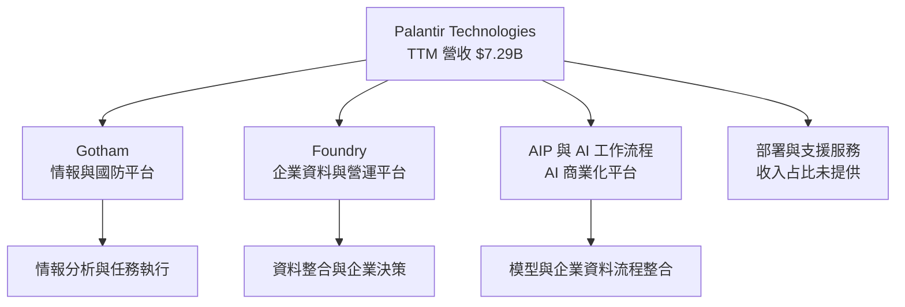
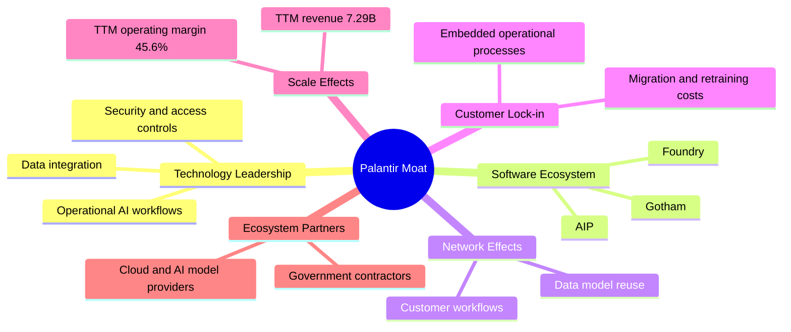
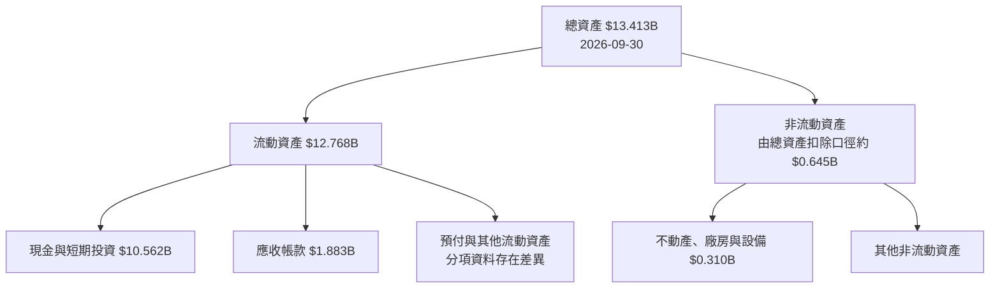
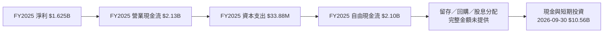
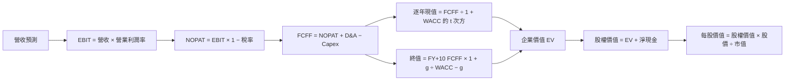
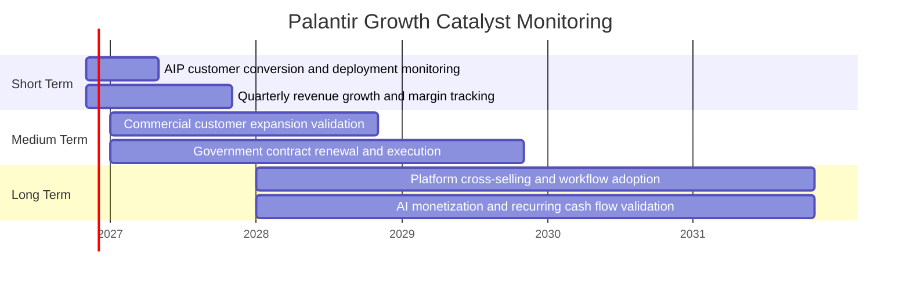
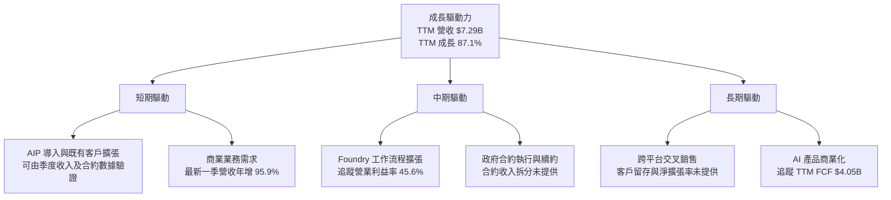
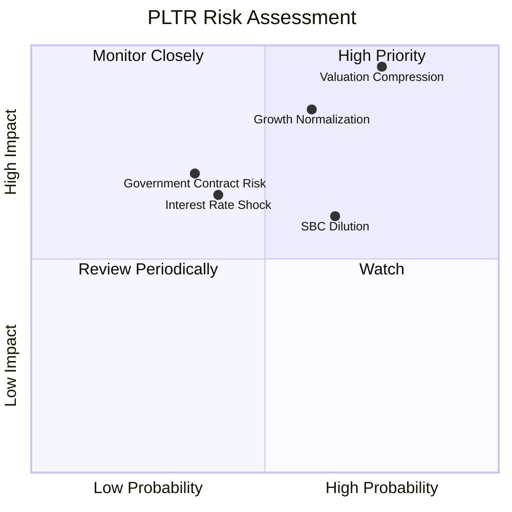
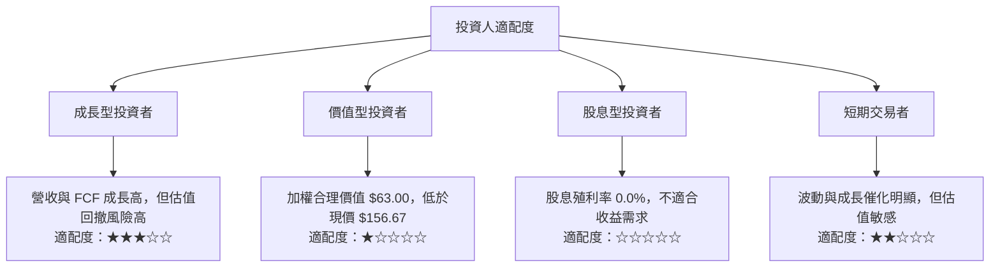

# PLTR 基本面深度分析報告
> **報告日期**：2026-11-19 ｜ **語言**：繁體中文 ｜ **數據來源**：SEC 申報資料 (XBRL)、Yahoo Finance、Finviz、StockAnalysis、Roic.ai ｜ **分析師**：CFA 級機構研究

## 目錄

| # | 章節 | 核心結論 |
|---|------|----------|
| 1 | 執行摘要 | 賣出；加權合理價值 $63.00，MOS −148.7% |
| 2 | 公司概覽與商業模式 | 軟體平台具客戶導入與工作流程嵌入優勢；部分護城河證據屬質化 |
| 3 | 損益表深度分析 | TTM 營收 $7.29B、TTM 成長 87.1%；營業利益率 45.6% |
| 4 | 資產負債表分析 | 現金與短期投資 $10.56B；流動性充裕，債務資料來源有差異 |
| 5 | 現金流量深度分析 | TTM FCF $4.05B，FCF Yield 1.07%；SBC 仍是重要股東成本 |
| 6 | 獲利能力與資本效率 | ROIC 492.3% 高於 WACC 12.10%，但 ROIC 受投入資本分母偏小影響 |
| 7 | 相對估值分析 | PLTR 倍數顯著高於可比公司；歷史 P/S 亦高於五年中位數 |
| 8 | DCF 內在價值評估 | DCF 基準價值 $22.00；與加權合理價值及現價差距極大 |
| 9 | 成長催化劑 | AI 商業化與既有平台擴張可支撐成長；TAM 數據未提供 |
| 10 | 風險矩陣 | 估值收縮、成長放緩、SBC 稀釋為主要風險 |
| 11 | 投資建議 | 依 MOS 評級為賣出；設定估值與營運指標監控門檻 |

---

## 1. 執行摘要

Palantir 的營運數據顯示加速成長：TTM 營收為 **$7.29B**、TTM 年增 **87.1%**，最新一季年增 **95.9%**；TTM 營業利益率 **45.6%**、FCF **$4.05B**。但 2026-11-18 收盤價 **$156.67**，相對程式計算的基準 DCF 每股價值 **$22.00** 溢價 **612.1%**，而依估值方法加權後合理價值為 **$63.00**，MOS **−148.7%**。依規則 20，評級為 **🔴 賣出**；高成長、高現金流尚不足以抵銷現價所要求的極高未來預期。

### 1.0 一頁式投資儀表板（Portfolio Manager 30 秒速讀）

| 項目 | 內容 |
|------|------|
| **投資論點（3 句）** | ① TTM 營收年增 **87.1%**、最新一季年增 **95.9%**，反映需求仍快速擴張。 ② TTM 營業利益率 **45.6%**、FCF **$4.05B**，顯示高毛利軟體模式具現金產出能力。 ③ 現價 **$156.67** 高於加權合理價值 **$63.00**，MOS **−148.7%**，估值風險主導風險報酬。 |
| **綜合評分** | **6.8/10**（引用 1.1 評分卡） |
| **財務健康** | 🟢 現金與短期投資 **$10.56B**，流動比率 **7.102**；債務資料來源存在差異 |
| **ROIC vs WACC** | **492.3% vs 12.10%**；按報表口徑高於資本成本，但 ROIC 極高主要受投入資本分母偏小影響 |
| **FCF 趨勢** | 上升；TTM FCF **$4.05B**、FCF Yield **1.07%** |
| **估值** | Forward P/E **61.71x** ｜ EV/EBITDA **109.46x**（估值資料表）｜ FCF Yield **1.07%** |
| **DCF 內在價值（基準）** | **$22.00** ｜ 現價相對 DCF 溢價 **612.1%**（第 8 章） |
| **安全邊際（MOS）** | **−148.7%**＝($63.00 − $156.67) ÷ $63.00；🔴 <10% 無（分母為第 8.8 節加權合理價值） |
| **預期報酬（基準情境 12M）** | **−86.0%**（DCF MODEL 基準情境 $22.00 相對現價） |
| **關鍵風險（前二）** | ① 高估值倍數收縮；② 美國商業業務成長及 AI 需求低於現價預期 |
| **評級 + 信心度** | 🔴 **賣出** ｜ 信心：中（估值訊號明確，但 DCF 長期假設與資料精度有限） |

### 1.1 綜合評分卡（全報告唯一）

| 維度 | 評分（1–10） | 主要依據（引用數字與其來源章節） |
|------|--------------|----------------------------------|
| 成長性 | 8 | TTM 營收成長 **87.1%**、最新一季年增 **95.9%**（第 3 章）；但高速成長的持續性尚未被完整週期驗證 |
| 獲利能力 | 9 | TTM 營業利益率 **45.6%**、ROIC **492.3%**、F-Score **7/8**（第 3、6 章）；ROIC 分母偏小，需審慎解讀 |
| 財務健康 | 9 | 現金與短期投資 **$10.56B**、流動比率 **7.102**、淨現金口徑 **$10.56B**（第 4 章） |
| 估值 | 1 | 加權合理價值 **$63.00**、MOS **−148.7%**；Forward P/E **61.71x**（第 7、8 章） |
| 護城河 | 8 | TTM 毛利率 **84.7%**、高營業利益率與平台化交付模式支持客戶黏著；缺少客戶留存率與分部收入數據（第 2 章） |
| 管理層與資本配置 | 6 | 現金累積與 FCF 有利；但稀釋股數未通過 F-Score 測試，2025 年 SBC **$684.03M**（第 3、5 章） |
| **綜合評分** | **6.8** | 六項算術平均：(**8 + 9 + 9 + 1 + 8 + 6**) ÷ 6 = **6.8**（四捨五入至小數一位） |

### 1.2 五大投資論點 + 三大核心風險

| 類型 | 項目 | 具體依據 | 信心度 |
|------|------|----------|--------|
| 🟢 **投資論點①** | 成長動能仍高 | TTM 營收 **$7.29B**、年增 **87.1%**；最新一季年增 **95.9%** | 🟢 高 |
| 🟢 **投資論點②** | 軟體毛利與營運槓桿 | TTM 毛利率 **84.7%**、營業利益率 **45.6%**，具備高毛利與規模效益 | 🟢 高 |
| 🟢 **投資論點③** | 現金流覆蓋獲利 | TTM OCF **$4.10B**、FCF **$4.05B**，FCF／TTM 淨利約 **110.4%** | 🟢 高 |
| 🟢 **投資論點④** | 資產負債表流動性高 | 現金與短期投資 **$10.56B**、流動比率 **7.102** | 🟢 高 |
| 🟢 **投資論點⑤** | 營運效率指標改善 | F-Score **7/8**；DSO **94 天**與一年前相同，DPO 由 **33 天**降至 **29 天** | 🟡 中 |
| 🟡 **風險①** | 估值顯著高於現金流支持的價值 | DCF **$22.00**、加權價值 **$63.00**，相對現價 **$156.67** 均有大幅折價差距 | 🔴 高衝擊 |
| 🔴 **風險②** | 成長預期可能快速重估 | 最新季度收入年增 **95.9%**，但同業 Snowflake、Datadog 約 **35%**；若 PLTR 成長向同業靠攏，倍數支撐可能弱化 | 🔴 高衝擊 |
| 🟡 **風險③** | SBC 與稀釋 | FY2025 SBC **$684.03M**；F-Score 的稀釋股數測試未通過，股東每股價值可能被稀釋 | 🟡 中至高 |

### 1.3 快速統計卡片

| 指標 | 公司實際值（期間） | 同業中位數 | 狀態 |
|------|--------------------|------------|------|
| 營收成長（TTM） | **87.1%** | — | 🟢 |
| 營收成長（最新一季年增） | **95.9%** | **35.2%**（SNOW、DDOG、CRM 中位數） | 🟢 |
| 毛利率（TTM） | **84.7%** | **77.3%**（三家同業中位數） | 🟢 |
| 營業利益率（TTM） | **45.6%** | — | 🟢 |
| ROIC（TTM） | **492.3%** | — | 🟢＊ |
| Forward P/E | **61.71x** | **52.5x**（DDOG、CRM 中位數） | 🔴 |
| FCF Yield（TTM） | **1.07%** | — | 🔴 |
| Piotroski F-Score | **7 / 8** | — | 🟢 |

＊ROIC 遠高於 WACC，但因淨現金與投入資本計算使分母偏小，不宜將此百分比直接外推。

### 1.4 投資結論

```text
╔══════════════════════════════════════════════════════════════════╗
║                    📊 投資結論摘要                               ║
╠══════════════════════════════════════════════════════════════════╣
║  評級：🔴 賣出（依規則 20；MOS −148.7%）                         ║
║  價格（2026-11-18 收盤）：$156.67                                ║
║  DCF 內在價值（基準）：$22.00（現價溢價 612.1%）                ║
║  安全邊際 MOS：−148.7%（＝($63.00−$156.67)÷$63.00）              ║
║  加權合理價值（8.8）：$63.00                                     ║
║  DCF 情境價值：                                                  ║
║    悲觀情境：$13.07（−91.7%）                                   ║
║    基準情境：$22.00（−86.0%）                                   ║
║    樂觀情境：$38.33（−75.5%）                                   ║
║  綜合評分：6.8/10（引用 1.1）                                    ║
║  適合投資人：能承受高波動、以營運成長為主題的投資人；不適合估值  ║
║  導向或以股息收入為主的投資人。                                  ║
╚══════════════════════════════════════════════════════════════════╝
```

---

## 2. 公司概覽與商業模式

### 2.1 業務結構與收入來源

公司概況資料指出，Palantir 提供 Gotham、Foundry 與相關平台服務，應用涵蓋國防與情報、企業營運及資料整合。公司總營收為 TTM **$7.29B**；可取得的資料沒有各產品、政府／商業業務或軟體／服務收入占比，因此不分配不存在的收入比例。



公司將資料整合、權限控管、模型與業務流程置於同一平台，客戶價值不只來自軟體授權，也取決於部署後能否持續嵌入日常工作流。收入拆分、訂閱／服務比例及客戶集中度未提供，限制了對可重複收入品質的量化判斷。

### 2.2 市場份額

市場份額數據未提供，亦無可引用的 TAM 金額與年份。以相對規模觀察，PLTR TTM 營收 **$7.29B**，高於單一小型軟體供應商的規模；其最新一季營收年增 **95.9%**，也高於提供數據的 SNOW **35.1%**、DDOG **35.2%** 與 CRM **10.8%**。但不同產品定位、客戶結構與會計口徑使此比較不能直接視為市占率排名。

### 2.3 競爭護城河分析



### 2.4 護城河強度

| 護城河項目 | 強度（強／中／弱） | 證據（引用數字或事實） | 會削弱它的情況 |
|------------|--------------------|------------------------|----------------|
| 技術與資料整合 | 強 | Gotham、Foundry、AIP 跨資料源與工作流程；TTM 毛利率 **84.7%** | 雲端平台或 AI 廠商提供更低成本且足夠完整的替代方案 |
| 軟體生態系統 | 中至強 | 多平台覆蓋情報、企業營運與 AI 流程；TTM 營收 **$7.29B** | 產品模組無法形成整體採購，或客戶只購買單一功能 |
| 網路效應 | 中 | 客戶工作流程與資料模型可能提高平台實用性；直接網路效應數據未提供 | 客戶之間資料不可共享，網路效應不如平台型消費產品直接 |
| 客戶鎖定 | 強 | 部署與流程嵌入可能提高遷移成本；DSO **94 天**但續約率未提供 | 導入成本過高、客戶難以量化 ROI，或轉換工具降低遷移成本 |
| 規模效應 | 中至強 | 營業利益率 **45.6%**，TTM FCF **$4.05B** | 人力密集部署未能隨收入擴張而降低邊際成本 |
| 生態夥伴 | 中 | 需與政府、雲端及 AI 模型供應商協同；合作收入比例未提供 | 供應商自建競品，或合作夥伴掌握客戶入口與定價權 |

1.1 護城河評分 **8/10** 的依據是高毛利、平台工作流程嵌入及高營業利潤率；客戶留存、客戶集中度及分部收入資料未提供，因此不給滿分。

---

## 3. 損益表深度分析

### 3.1 年度收入成長趨勢（近 4 年）

FY2022 至 FY2025 營收由 **$1.91B** 增至 **$4.48B**。FY2022、FY2023 成長相對溫和；FY2025 增速升至 **56.2%**，TTM 數據顯示截至 2026-09-30 的成長再加速至 **87.1%**。近三年 CAGR 約 **32.9%**：\((4.475 ÷ 1.906)^{1/3}-1\)。

```text
╔══════════════════════════════════════════════════════════════════╗
║           Palantir 年度收入趨勢（FY2022–FY2025）                  ║
╠══════════════════════════════════════════════════════════════════╣
║  FY2022  $1.91B  ██████████░░░░░░░░░░░░░░░  YoY: 基期            ║
║  FY2023  $2.23B  ████████████░░░░░░░░░░░░░  YoY: +16.7% 🟡      ║
║  FY2024  $2.87B  ███████████████░░░░░░░░░░  YoY: +28.8% 🟢      ║
║  FY2025  $4.48B  ████████████████████████░  YoY: +56.2% 🟢      ║
║                                                                  ║
║  FY2022–FY2025 營收 CAGR：約 +32.9%                               ║
╚══════════════════════════════════════════════════════════════════╝
```

FY2025 成長加快與商業化需求、企業 AI 導入及既有政府業務擴張相符；但資料未提供各業務線收入，因此無法精確拆分各驅動因素的貢獻。TTM 成長 **87.1%** 高於 FY2025，若主要來自低基期或少數大額合約，未來增長率可能正常化。

### 3.2 季度收入趨勢分析

| 季度 | 營收 | QoQ | YoY | 備註 |
|------|------:|----:|----:|------|
| 2025 Q4 | $1.407B | +19.1% | +70.0% | 由 2025 Q3 $1.181B 計算 |
| 2026 Q1 | $1.633B | +16.1% | +84.7% | YoY 取 StockAnalysis 單季數據 |
| 2026 Q2 | $1.935B | +18.5% | +92.8% | 增速高於 2025 年全年成長 |
| 2026 Q3 | $2.313B | +19.5% | +95.9% | 最新一季；YoY 是單季成長率，不是 TTM |

季度營收連續上升，最近四季 QoQ 均為正，且單季 YoY 由 70.0% 升至 95.9%。這顯示收入動能擴大，但季度成長也可能受合約認列時點影響；應與未來訂單、剩餘履約義務及客戶數據共同檢驗，相關數字未提供。

### 3.3 利潤率演變分析

| 利潤率指標 | FY2022 | FY2023 | FY2024 | FY2025 | 趨勢 | 評估 |
|------------|-------:|-------:|-------:|-------:|------|------|
| **毛利率** | 78.5% | 80.6% | 80.2% | 82.4% | 總體上行 | 🟢 |
| **營業利益率** | −8.5% | 5.4% | 10.8% | 31.6% | 快速擴張 | 🟢 |
| **淨利率** | −19.6% | 9.4% | 16.1% | 36.3% | 顯著改善 | 🟢 |

表中年度利潤率以年度收入、毛利、營業利益及淨利計算。最新 TTM 毛利率 **84.7%**、營業利益率 **45.6%**、淨利率 **50.3%**，高於 FY2025 年度值；最新季度營業利益率依 SEC 最新季資料為 **46.9%**。

改善的主要會計表現是營收擴張快於費用增長：FY2025 營業利益 **$1.41B**，高於 FY2024 **$310.40M**；TTM 營業利益率升至 **45.6%**。軟體收入的高毛利有助於營業槓桿，但資料沒有費用細項的最新 TTM 拆分，不能把利潤率提升全部歸因於單一費用控制或產品組合。

### 3.4 費用結構分析

現有資料沒有完整、同期間的 TTM 銷售與行銷、一般管理及研發費用拆分，不繪製可能誤導的費用圓餅圖。已知 FY2025 研發費用 **$557.68M**，約為 FY2025 營收 **$4.475B** 的 **12.5%**；FY2025 SBC **$684.03M**。上述金額不能直接代表完整費用結構，也不能與 TTM 利潤率直接相加。

```text
╔══════════════════════════════════════════════════════════════════╗
║                    已知 FY2025 費用項目                          ║
╠══════════════════════════════════════════════════════════════════╣
║  研發費用：$557.68M（約為 FY2025 營收的 12.5%）                  ║
║  股權薪酬：$684.03M（另為獲利品質與稀釋需追蹤的項目）            ║
║  其他費用分類：資料未提供完整可比拆分                            ║
╚══════════════════════════════════════════════════════════════════╝
```

### 3.5 季度 EPS 趨勢與盈餘品質（Quality of Earnings）

| 季度 | 實際 EPS | QoQ 變化 | YoY EPS 成長 | 超預期／不及預期 |
|------|---------:|---------:|-------------:|----------------|
| 2025 Q4 | $0.23 | +27.8% | +647.6% | N/A（分析師預估 EPS 缺漏） |
| 2026 Q1 | $0.34 | +47.8% | +325.0% | N/A（分析師預估 EPS 缺漏） |
| 2026 Q2 | $0.41 | +20.6% | +215.4% | N/A（分析師預估 EPS 缺漏） |
| 2026 Q3 | $0.44 | +7.3% | +144.4% | N/A（分析師預估 EPS 缺漏） |

實際 EPS 逐季增加，但增速由低基期高增長逐步回落。Earnings History 的 EPS Est 欄為 NaN，因此不能判定最近四季究竟超預期或不及預期；把此數據稱作 beat／miss 會造成未經支持的結論。

| 盈餘品質項目 | 數值／佔比 | 評估 |
|--------------|-----------|------|
| 股權薪酬 SBC / 營收 | 約 **13.5%**（四季 SBC 合計約 $982.10M ÷ TTM 營收 $7.29B） | 🟡 SBC 是實質股東成本，股數稀釋亦反映於 F-Score 未通過項目 |
| SBC / 營業現金流 | 約 **23.9%**（$982.10M ÷ $4.10B） | 🟡 OCF 含 SBC 加回；不能把全部 OCF 視為不需稀釋代價的現金獲利 |
| FCF / 淨利 | 約 **110.4%**（$4.05B ÷ TTM 淨利 $3.669B） | 🟢 現金轉換率高於 100%；但 FCF 受 SBC 非現金加回影響 |
| 一次性／非經常性損益 | N/A（明細未提供） | 🟡 無法判定是否有重大一次性項目影響淨利 |
| 有效稅率異常 | **1.4%** | 🟡 偏低稅率提高當期 NOPAT；若稅率正常化，估值會下降 |
| 資本化支出 vs 費用化 | TTM Capex **$43.24M**；資本化軟體及其他項目明細 N/A | 🟡 Capex 低有利於 FCF，但無法據此判斷所有開發成本的資本化政策 |

**盈餘品質結論：**GAAP 獲利有 OCF、FCF 支持，且 TTM FCF／淨利約 **110.4%**；但 SBC 佔 TTM 營收約 **13.5%**、佔 OCF 約 **23.9%**，且最新 F-Score 顯示稀釋股數未通過。GAAP 營業利益已將 SBC 作為費用處理，然而投資者仍應把持續稀釋視為經濟成本。1.4% 有效稅率亦使當期淨利與 DCF NOPAT 偏高，故不能只以現金轉換率判定盈餘品質完全無疑慮。

---

## 4. 資產負債表分析

### 4.1 資產結構分解

截至 2026-09-30，StockAnalysis 顯示總資產 **$13.413B**、流動資產 **$12.768B**，其中現金與短期投資合計 **$10.562B**；應收帳款 **$1.883B**。資料所列總資產與分項可能因四捨五入或分類而有差異，不以圖表推算缺漏項目。



### 4.2 流動性與營運資金分析

| 指標 | 最新 TTM | 一年前 TTM | 變化 | 解讀 |
|------|----------|------------|------|------|
| 流動比率 | **7.102** | N/A | N/A | 流動資產遠高於流動負債，短期流動性充足 |
| 速動比率 | **6.923** | N/A | N/A | 即使排除存貨等項目，短期償付能力仍高 |
| DSO 應收帳款天數 | **94 天** | **94 天** | **0 天** | 收款天數持平；須留意應收帳款絕對值隨收入增長 |
| DIO 存貨天數 | **N/A** | **N/A** | N/A | 公司未報告此項存貨餘額，不能補值 |
| DPO 應付帳款天數 | **29 天** | **33 天** | **−4 天** | 對供應商付款天數下降；可能反映付款節奏改變，不能僅據此判定議價力 |
| CCC 現金轉換週期 | **N/A** | **N/A** | N/A | 缺少 DIO，依品質指標資料不計算 |

流動比率與速動比率支持公司能以流動資產應付短期義務；DSO 持平則表示收款天數未見惡化，但 TTM 應收帳款 **$1.883B** 的絕對額高於前期，需持續與收入增速及合約資產一併追蹤。

### 4.3 債務結構分析

財務數據中的總債務欄位存在來源差異：SEC 計算的 VERIFIED FIGURES 將總債務列為 **N/A**，Yahoo／其他摘要另列 **$225.27M**。本報告不以缺漏債務數字反推，也不把兩種口徑混為一談；DCF 採用 VERIFIED FIGURES 的淨現金 **$10.56B**。

```text
╔══════════════════════════════════════════════════════════════════╗
║                   Palantir 債務健康診斷                           ║
╠══════════════════════════════════════════════════════════════════╣
║  總債務（VERIFIED FIGURES）：N/A；其他摘要列 $225.27M             ║
║  現金及短期投資：              $10.56B                            ║
║  淨現金（VERIFIED FIGURES）：  $10.56B                  🟢        ║
║  流動比率：                    7.102x                   🟢        ║
║  Debt/EBITDA：                 N/A（總債務來源口徑不一致）        ║
║  Interest Coverage：           N/A（利息費用資料未提供）          ║
╚══════════════════════════════════════════════════════════════════╝
```

### 4.4 股東權益趨勢

年度股東權益由 FY2022 **$2.57B** 增至 FY2025 **$7.39B**。2026-09-30 年度期中股東權益未在一致口徑表格提供，因此不延伸繪製。

```text
╔══════════════════════════════════════════════════════════════════╗
║                  股東權益趨勢（年度）                            ║
╠══════════════════════════════════════════════════════════════════╣
║  FY2022  $2.57B  ████████░░░░░░░░░░░░░░░░                       ║
║  FY2023  $3.48B  ███████████░░░░░░░░░░░░░                       ║
║  FY2024  $5.00B  ████████████████░░░░░░░░                       ║
║  FY2025  $7.39B  ████████████████████████                       ║
╚══════════════════════════════════════════════════════════════════╝
```

股東權益成長與累積獲利相符，但權益增長不等同每股價值同比增長；需同時追蹤 SBC、稀釋股數與股東回報。

---

## 5. 現金流量深度分析

### 5.1 現金流量瀑布圖

FY2025 淨利為 **$1.625B**，FY2025 OCF **$2.13B**、FCF **$2.10B**；季度 OCF 與 FCF 數據顯示截至 2026 Q3 現金產出進一步擴大。股息、回購及淨現金變化的完整同期間分解未提供，不繪製金額不明的流向。



### 5.2 FCF 轉換率趨勢

| 年度 | FCF | 淨利 | FCF／淨利 | 評估 |
|------|----:|----:|---------:|------|
| FY2022 | $183.71M | −$373.70M | −49.2% | 🔴 淨利為負，比例不宜作為常態轉換能力解讀 |
| FY2023 | $697.07M | $209.82M | 332.2% | 🟢 高於淨利，可能含營運資金與非現金項目影響 |
| FY2024 | $1.14B | $462.19M | 246.7% | 🟢 現金轉換高，但非現金 SBC 加回需注意 |
| FY2025 | $2.10B | $1.63B | 129.2% | 🟢 現金流仍高於淨利 |
| TTM 至 2026-09-30 | $4.05B | $3.669B | 約 110.4% | 🟢 現金轉換持續高於 100% |

TTM FCF 與淨利相比略高，支持獲利轉化為現金；但 SBC 是非現金費用，會提高 OCF／FCF，並可能透過股份稀釋轉嫁給股東。

### 5.3 自由現金流趨勢

```text
╔══════════════════════════════════════════════════════════════════╗
║             自由現金流趨勢（FCF = OCF − Capex）                   ║
╠══════════════════════════════════════════════════════════════════╣
║  FY2022  $0.184B  ██░░░░░░░░░░░░░░░░░░░░░░░  FCF Yield：N/A     ║
║  FY2023  $0.697B  █████░░░░░░░░░░░░░░░░░░░░  FCF Yield：N/A     ║
║  FY2024  $1.14B   █████████░░░░░░░░░░░░░░░░  FCF Yield：N/A     ║
║  FY2025  $2.10B   ███████████████░░░░░░░░░░  FCF Yield：N/A     ║
║  TTM     $4.05B   ████████████████████████  FCF Yield：1.07%    ║
╚══════════════════════════════════════════════════════════════════╝
```

歷年 FCF Yield 未提供一致的年度市值分母，因此只列 VERIFIED FIGURES 的 TTM FCF Yield **1.07%**。TTM FCF 高於 FY2025，與營收和季度現金流擴張一致；但該收益率偏低，表明現價已包含大量未來成長預期。

### 5.4 資本配置評估

| 配置項目 | 可得數據 | 評估 |
|----------|----------|------|
| 資本支出 | TTM **$43.24M** | 相對 TTM FCF **$4.05B** 很低；軟體公司資本需求低，但不能忽略人力與 SBC 成本 |
| 股息 | 殖利率 **0.0%** | 現金未透過股息返還 |
| 回購 | 金額未提供 | 不假設有足以抵銷稀釋的回購 |
| 現金留存／投資 | 現金與短期投資 **$10.56B** | 為收購、研發與營運保留彈性 |
| 股權薪酬 | FY2025 **$684.03M**；最近四季合計約 **$982.10M** | 需視為對既有股東的經濟成本 |

沒有可按同一時點拆分回購、股息、收購與其他投資的完整數字，因此不畫資本配置比例圖。資本配置優點是高現金累積及低資本支出；主要不足是 SBC 與稀釋股數變動需要持續被每股價值檢驗。

---

## 6. 獲利能力與資本效率

### 6.1 ROE / ROA / ROIC 趨勢

| 指標 | FY2023 | FY2024 | FY2025 | TTM 至 2026-09-30 | 評估 |
|------|-------:|-------:|-------:|------------------:|------|
| ROE | N/A | N/A | N/A | **32.7%**（QUALITY FIGURES） | 🟢 高；與其他資料來源的 TTM 40.9% 有差異，採品質指標區塊值 |
| ROA | N/A | N/A | N/A | **19.3%**（公司摘要） | 🟢 資產獲利能力高 |
| ROIC | N/A | N/A | N/A | **492.3%** | 🟢 遠高於資本成本，但投入資本分母偏小 |
| WACC | — | — | — | **12.10%** | 折現率與資本成本基準 |

ROIC 使用 NOPAT 除以「權益＋債務−現金」的投入資本口徑。當公司現金規模接近或大於帳面投入資本時，分母可能很小，令 ROIC 出現異常高值；因此應把 ROIC 高於 WACC 視為方向性訊號，不將 492.3% 視為可持續的常態回報率。

### 6.2 ROIC vs WACC 分析（核心價值創造判斷）

```text
╔══════════════════════════════════════════════════════════════════╗
║                ROIC vs WACC 深度分析                            ║
╠══════════════════════════════════════════════════════════════════╣
║  WACC（VERIFIED FIGURES）：12.10%                               ║
║  ├── 無風險利率（10Y 美債）：5.07%                              ║
║  ├── 市場風險溢酬（假設）：5.00%                                ║
║  ├── 原始 Beta：1.61；調整後 Beta：1.41                         ║
║  ├── 股權成本：12.10%                                           ║
║  ├── 稅前債務成本（假設）：7.07%                                ║
║  ├── 資本結構：股權 99.9%，債務 0.1%                            ║
║  └── WACC：12.10%                                               ║
║                                                                  ║
║  ROIC（TTM，VERIFIED FIGURES）：492.3%                           ║
║  ├── EVA spread = ROIC − WACC = 492.3% − 12.10% = 480.2 pp     ║
║  └── ROIC / WACC = 492.3% ÷ 12.10% = 約 40.7 倍                ║
║                                                                  ║
║  ROIC  492.3%  ▓▓▓▓▓▓▓▓▓▓▓▓▓▓▓▓▓▓▓▓▓▓▓▓  🟢                   ║
║  WACC   12.1%  ▓░░░░░░░░░░░░░░░░░░░░░░░░  ──                   ║
╠══════════════════════════════════════════════════════════════════╣
║  結論：按提供口徑，ROIC 高於 WACC，顯示價值創造；但 ROIC 的極高值 ║
║  受現金扣除後投入資本分母偏小影響，經濟意義低於表面倍率。        ║
╚══════════════════════════════════════════════════════════════════╝
```

WACC 直接採用計算資料所列 **12.10%**，不另行估算。資本成本組成與股權、債務權重見第 8.2 節。因利息費用與平均計息負債資料缺漏，債務成本 **7.07%** 是以無風險利率加信用利差的假設值。

### 6.3 杜邦三因素分解

| 因素 | 數值（TTM） | 解讀 |
|------|-------------|------|
| 淨利率 | **50.3%** | 高淨利率是 ROE 的主要來源 |
| 資產週轉率 | **0.54x** | 每單位資產產生約 0.54 單位營收 |
| 權益乘數 | **1.19x** | 槓桿幅度有限，ROE 不是由高槓桿撐起 |
| **ROE** | **32.7%** | **50.3% × 0.54 × 1.19 = 32.7%**（依 QUALITY FIGURES，四捨五入） |

ROE 主要由淨利率推動，權益乘數僅 **1.19x**，財務槓桿不是關鍵來源。杜邦公式顯示值為程式按期末資產負債表與 TTM 流量計算；四捨五入後乘積可能有小幅尾差。

### 6.4 財務體質：Piotroski F-Score

Piotroski F-Score 為 **7/8**。資料指出，缺一項輸入的測試不計入分母，因此不應把它誤讀為 7/9。

| 測試 | 結果 | 解讀 |
|------|------|------|
| ROA > 0 | ✅ 通過 | 資產報酬為正 |
| 營業現金流 > 0 | ✅ 通過 | 營運現金流為正 |
| ROA 高於一年前 | ✅ 通過 | 獲利能力改善 |
| 營業現金流 > 淨利 | ✅ 通過 | 現金流高於會計淨利，支持應計品質 |
| 長期負債／總資產低於一年前 | — 無法判定 | 缺少可比輸入，不納入分母 |
| 流動比率高於一年前 | ✅ 通過 | 流動性改善 |
| 稀釋股數未增加 | ❌ 未通過 | 股數稀釋是每股獲利與股東回報需追蹤的成本 |
| 毛利率高於一年前 | ✅ 通過 | 毛利率改善 |
| 資產週轉率高於一年前 | ✅ 通過 | 資產使用效率改善 |

主要扣分項是稀釋股數未能保持不增；另一項負債測試缺資料，不能視為通過或失敗。總體體質良好，但應以每股 FCF 與稀釋後股數衡量，而非只看公司層級 FCF。

---

## 7. 相對估值分析

### 7.1 同業估值比較表格

公司倍數取財務摘要；同業倍數取 Yahoo Finance Peer multiples。不同來源對 PLTR P/S、EV/EBITDA 的口徑有差異，表中依指定同業比較欄所列公司數據呈現 PLTR **P/S 51.8x、EV/EBITDA 109.5x**；歷史估值章節則使用其專屬 VERIFIED FIGURES 數值。

| 估值指標 | **PLTR** | **SNOW** | **DDOG** | **CRM** | PLTR 評估 |
|----------|---------:|---------:|---------:|---------:|-----------|
| **Trailing P/E** | 110.3x | N/A | 232.1x | 17.4x | 🟡 同業差異大；公司目前獲利能力高，但倍數仍高 |
| **Forward P/E** | 61.7x | 90.9x | 52.5x | 11.9x | 🔴 高於 DDOG、CRM，低於 SNOW |
| **P/S Ratio** | 51.8x | 18.2x | 14.1x | 3.6x | 🔴 顯著高於同業 |
| **EV/EBITDA** | 109.5x | −95.5x | 331.3x | 14.5x | 🔴 高；SNOW 為負值不具傳統獲利倍數可比性 |
| **最新一季營收 YoY** | 95.9% | 35.1% | 35.2% | 10.8% | 🟢 成長溢價有一定業務依據，但不能證明估值合理 |
| **TTM 毛利率** | 84.7% | 67.0% | 79.6% | 77.3% | 🟢 毛利率優於同業 |

同業中位數：Forward P/E **52.5x**（DDOG、CRM 中位數；SNOW 數字為 90.9x，三者整體中位數實為 52.5x）；P/S 三家中位數 **14.1x**；最新一季成長中位數 **35.2%**；毛利率中位數 **77.3%**。高成長與毛利率可支持溢價，但 PLTR 的 P/S 約為上述三家中位數的 **3.7 倍**，將遠期執行風險放大。

### 7.2 歷史估值區間分析

```text
╔══════════════════════════════════════════════════════════════════╗
║              PLTR 五年歷史估值位置（TTM 倍數）                    ║
╠══════════════════════════════════════════════════════════════════╣
║  P/E：       100.6x ├──── 現值 110.3x ────┤ 中位數 228.6x       ║
║              範圍 100.6x–601.0x；現值百分位：7%                 ║
║  P/S：         7.0x ├──────── 中位數 24.7x ───── 現值 55.3x ┤120.4x║
║              現值百分位：67%                                     ║
║  EV/EBITDA：109.0x├ 現值 117.0x ──────┤ 中位數 233.4x         ║
║              範圍 109.0x–574.4x；現值百分位：8%                 ║
╚══════════════════════════════════════════════════════════════════╝
```

P/E 與 EV/EBITDA 相對五年中位數較低，但兩者百分位仍只有 7% 與 8%，主要反映歷史區間曾極端偏高；P/S 仍高於五年中位數 **24.7x**，處於第 **67** 百分位。歷史倍數回落不代表絕對估值便宜。

### 7.3 情境價值（Bear / Base / Bull，照抄 DCF MODEL 的 Scenarios）

| 情境 | 第 1 年營收成長 | 期末營業利潤率 | WACC | 每股價值 | 相對現價 | 機率 | 會發生的條件 |
|------|----------------:|----------------:|-----:|----------:|---------:|-----:|--------------|
| 🔴 悲觀 | 15.0% | 9.2% | 13.10% | **$13.07** | −91.7% | 25% | AI 導入或商業化放慢、競爭壓低利潤率，資本成本上升 |
| 🟡 基準 | 30.0% | 10.8% | 12.10% | **$22.00** | −86.0% | 50% | 成長由高位逐步回落、營業利益率向五年中位數收斂 |
| 🟢 樂觀 | 45.0% | 11.9% | 11.10% | **$38.33** | −75.5% | 25% | 初期成長高於基準且利潤率維持較佳、資本成本下降 |

三情境內部逐年營收與 FCFF 細節未提供，故不重建模型或臆造各情境 FY+10 中間值；情境價值、成長、利潤率、WACC 與機率依 DCF MODEL 原值引用。即便樂觀情境，模型價值仍低於現價，顯示現價要求的成長／利潤組合高於該組情境範圍。

### 7.4 相對估值隱含價格區間

```text
╔══════════════════════════════════════════════════════════════════╗
║                 相對估值與參考價值（每股）                       ║
╠══════════════════════════════════════════════════════════════════╣
║  $22.00 DCF ── $63.00 加權合理價值 ── $81.74 同業 Forward P/E   ║
║                                   │                              ║
║                    現價 $156.67 ──┴── 分析師共識 $222.90        ║
╚══════════════════════════════════════════════════════════════════╝
```

- **同業 Forward P/E：$81.74**；Peer 中位數 **32.2x**（DDOG、CRM）× PLTR Forward EPS **$2.54**。相對現價為 **−47.8%**。
- **同業 EV/EBITDA：N/A，無法計算**，依照程式列示不納入權重。
- **分析師共識目標價：$222.90**，29 位分析師平均值；此為外部參考，不代表獨立內在價值模型。
- **DCF 基準：$22.00**；相對現價為 **−86.0%**（按每股價值相對現價計算）。

---

## 8. DCF 內在價值評估（Discounted Cash Flow）

### 8.0 估值推理鏈（Thinking Logic：在算之前先想清楚）

**Step 1 — 價值由哪些變數決定？**  
本模型的核心是現有業務的可持續 FCFF：Gotham、Foundry、AIP 共同支撐 TTM 營收 **$7.29B**，但各平台收入占比未提供，不能把任何一項單獨視為某個確定百分比的成長曲線。價值主要由未來營收成長、GAAP 營業利潤率，以及 WACC 與永續成長率之差決定。模型終值現值占 EV **29.6%**，因此短期現金流亦有顯著價值，但折現率與成長路徑仍十分重要。

**Step 2 — 模型選擇**

| 決策點 | 本報告採用 | 理由（含數字） | 曾考慮但否決 | 否決理由 |
|--------|-----------|----------------|--------------|----------|
| 現金流定義 | FCFF | 配合 WACC 折現，先得 EV；TTM OCF **$4.10B**、FCF **$4.05B** | FCFE | 資本結構對企業估值權重不大，成本資本資料採 WACC |
| 預測期 N | **10 年** | DCF MODEL 固定預測期；公司 TTM 成長 **87.1%**，需容納逐步正常化 | 5 年 | 對高成長軟體公司較難呈現終值前的漸進收斂；但不重建替代模型 |
| 終值方法 | Gordon Growth | 模型採 g **3.0%**、WACC **12.10%** | 退出倍數 | DCF MODEL 未提供退出倍數終值，不另行建立 |
| EBIT 基礎 | GAAP EBIT | TTM 營業利益率 **45.6%**；GAAP 已將 SBC 作為費用 | 非 GAAP EBIT | 會提高 EBIT，需另扣 SBC，與現有模型不一致 |

**Step 3 — 主要假設的推導鏈**

- **營收成長**：錨點＝TTM 年增 **87.1%**、FY2025 年增 **56.18%** → 調整＝以高成長為起點，考慮基期放大及逐步成熟，使年成長從模型上限向長期水準線性收斂 → **採用 FY+1 30.0%、FY+10 3.0%** → 曾考慮延續 TTM **87.1%**，但此等同假設極高增速長期不正常化，予以否決。30% 是模型限制上限，不是管理層指引。
- **期末營業利潤率**：錨點＝TTM 營業利益率 **45.6%**，FY2025 年度 **31.6%** → 調整＝模型令利潤率隨成熟逐年下滑，反映成長放緩、競爭及規模效應不可能無限提高 → **FY+10 採用 10.8%**，即 DCF MODEL 所列近五財年中位數 → 曾考慮長期維持 45.6%，但那會忽略模型自身採用的歷史中位數回歸。
- **永續成長率 g**：錨點＝一般長期名目經濟增長常以低個位數作估值參照；精確 GDP 假設未提供 → 調整＝採模型給定 **3.0%**，且低於 WACC **12.10%** → **採用 3.0%** → 曾考慮更高成長率，但會提高終值且欠缺資料支持。
- **預測期 N**：錨點＝模型固定 **10 年**；公司目前 TTM 成長 **87.1%**，但尚無公司長期成熟期實績可直接套用 → 調整＝讓成長率逐年由 30.0% 降到 3.0% → **採用 10 年** → 曾考慮更短預測期，但不符合指定模型，亦會減少可見期間。
- **Capex／營收**：錨點＝TTM Capex **$43.24M** ÷ TTM 營收 **$7.29B**，約 **0.6%** → 調整＝模型逐步降至 D&A 的 1.1 倍相關水準 → **FY+1 0.6%、FY+10 0.4%** → 曾考慮將當前比例固定於全部預測期，但模型採成熟期調整。
- **D&A／營收**：錨點＝模型以 TTM **0.4%** 為依據 → **全期採 0.4%**；缺少更完整資產折舊明細，維持模型設定。
- **EBIT 基礎、SBC 與股數**：錨點＝TTM GAAP 營業利益率 **45.6%**；FY2025 SBC **$684.03M** → 調整＝模型採 GAAP EBIT，使 SBC 已反映於營業費用，不另減 SBC，股數不再逐年放大 → **採用 (A) GAAP EBIT + 固定股數 + 0% 年稀釋率** → 否決 GAAP EBIT 再扣 SBC或再加股數稀釋，避免重複計成本；但固定股數可能低估未來稀釋。
- **WACC**：錨點＝程式計算的資金成本 **12.10%**，詳見 8.2 → **採用 12.10%** → 不另採用較低折現率，因無風險利率已為 **5.07%**、Beta 調整後仍為 **1.41**，降低折現率會推高估值。
- **營運資金變動**：模型明示不建模；因此 FCFF 不含 ΔWC。這是資料及模型簡化，不等於營運資金需求為零。

**Step 4 — 最脆弱環節**  
最脆弱的是成長與利潤率的十年收斂路徑及低稅率假設；若可持續成長低於基準或正常稅率高於 **1.4%**，DCF 價值將向下，反之改善會向上，但提供的情境表中即使樂觀值也只有 **$38.33**。

**Step 5 — 計算路徑圖**



### 8.1 模型假設總表（Model Inputs）

| 假設項目 | 採用值 | 依據／來源 | 敏感度 |
|----------|--------|-------------|--------|
| 預測期長度 **N** | **10 年** | DCF MODEL 固定預測長度；由 FY+1 至 FY+10 | 🟡 中 |
| 營收成長 | FY+1 **30.0%**；FY+10 **3.0%**，線性遞減 | TTM 成長 **87.1%**，模型將 FY+1 封頂 30.0%，再逐年收斂 | 🔴 高 |
| 營業利潤率（期末） | FY+1 **45.6%** → FY+10 **10.8%** | TTM **45.6%**，期末回落至模型採用的近五財年中位數 | 🔴 高 |
| 有效稅率 | **1.4%** | 最新年度有效稅率 | 🟢 低；但稅率異常偏低 |
| Capex／營收 | FY+1 **0.6%** → FY+10 **0.4%** | TTM Capex／營收約 **0.6%**，模型逐步收斂 | 🟡 中 |
| D&A／營收 | **0.4%** | DCF MODEL 的 TTM 比例 | 🟢 低 |
| 營運資金變動／營收增額 | **未建模** | DCF MODEL 明示 Working capital is not modelled | 🟢 低＊ |
| EBIT 基礎 | **GAAP** | GAAP 營業利益已含 SBC 費用 | 🟡 中 |
| SBC 處理 | **組合 (A)**：不另扣 SBC | GAAP EBIT 已計費；避免再扣一次 | 🟡 中 |
| 年稀釋率（股數） | **0%** | 模型採固定股數，視為 SBC 已反映於 GAAP 費用 | 🟡 中 |
| 永續成長率 g | **3.0%** | DCF MODEL 設定，低於 WACC | 🔴 高 |
| 終值方法 | **Gordon Growth** | DCF MODEL 指定；未提供退出倍數終值計算 | 🔴 高 |
| WACC | **12.10%** | Cost of capital 數據 | 🔴 高 |

＊模型未計 ΔWC，不代表實際需求必然為零。**FCFF 定義**：FCFF = NOPAT + D&A − Capex；不另列 ΔWC。**本模型採用 (A)，故 SBC 影響已計入一次**：GAAP EBIT 已含 SBC、不再減 SBC，股數固定且不另作稀釋調整。

### 8.2 折現率推導（WACC）

```text
╔══════════════════════════════════════════════════════════════════╗
║                    WACC 推導（折現率）                           ║
╠══════════════════════════════════════════════════════════════════╣
║  股權成本 Ke（CAPM）：                                           ║
║  ├── 無風險利率 Rf（10Y 美債）：5.07%                            ║
║  ├── 市場風險溢酬 ERP（假設）：5.00%                            ║
║  ├── 原始 Beta（Yahoo）：1.61                                    ║
║  ├── 調整後 Beta：2/3×1.61 + 1/3×1.00 = 1.41                   ║
║  ├── 規模／國別溢酬：0.00%（資料未提供加計依據）                 ║
║  └── Ke = 5.07% + 1.41×5.00% = 12.10%                           ║
║                                                                  ║
║  債務成本 Kd：                                                   ║
║  ├── 利息費用：N/A                                               ║
║  ├── 稅前 Kd（假設）：Rf 5.07% + 信用利差 2.00% = 7.07%         ║
║  ├── 有效稅率：1.4%                                              ║
║  └── 稅後 Kd = 7.07%×(1−1.4%) = 6.97%                           ║
║                                                                  ║
║  資本結構（程式計算權重）：                                      ║
║  ├── 股權權重 E：99.9%                                           ║
║  ├── 債務權重 D：0.1%                                            ║
║  └── WACC = 99.9%×12.10% + 0.1%×7.07% = 12.09497% ≈ 12.10%      ║
╚══════════════════════════════════════════════════════════════════╝
```

**逐步演算（WACC）：**

1. **Ke（CAPM）** = Rf + β × ERP = **5.07% + 1.41 × 5.00% = 12.12%**（按顯示數字算術）；程式提供的 Ke 為 **12.10%**，兩者有約 **0.02 個百分點**的精度尾差，本報告 WACC 仍採 VERIFIED FIGURES 的 **12.10%**。
2. **稅前 Kd**：利息費用及平均計息負債未提供，使用假設代理 **5.07% + 2.00% = 7.07%**。信用利差 **2.00%** 是依成本資本輸入的隱含值；不是由公司利息費用推導。
3. **稅後 Kd** = **7.07% × (1 − 1.4%) = 6.97102% ≈ 6.97%**。
4. **權重** = 股權 **99.9%**；債務 **0.1%**；兩者相加 **100.0%**。市場市值為 **$377.50B**（2026-11-18 收盤價），但來源沒有提供與此 WACC 權重完全同口徑的計息負債分解，故權重直接採用程式計算值，不反推債務金額。補充摘要列有總債務 **$225.27M**，與債務權重存在四捨五入／來源口徑差異。
5. **WACC** = **99.9% × 12.10% + 0.1% × 7.07% = 12.08997% + 0.00707% = 12.09704% ≈ 12.10%**。成本資本區塊的完整精度未提供；模型採用其原值 **12.10%**，與第 6.2 節一致。

Rf 的觀察日期未在資料中提供，因此無法標註具體殖利率日期；ERP 為假設值。Beta 使用調整後 **1.41**，調整方式為 ⅔ 原始 Beta 加 ⅓ 的 1.0。由於債務成本及權重已由成本資本輸入提供，以上算術尾差不取代模型指定 WACC。

### 8.3 逐年自由現金流預測（基準情境）

金額單位 **$B**。下表逐年抄錄 DCF MODEL；模型未建模營運資金，故不列 ΔWC 行；SBC 已含於 GAAP EBIT，不另扣。折現因子取三位小數。原模型表格數字經四捨五入，單格間可能有小幅加總尾差。

| 年度 | FY+1 | FY+2 | FY+3 | FY+4 | FY+5 | FY+6 | FY+7 | FY+8 | FY+9 | FY+10 |
|------|-----:|-----:|-----:|-----:|-----:|-----:|-----:|-----:|-----:|------:|
| 營收 | 9.47 | 12.03 | 14.92 | 18.05 | 21.30 | 24.50 | 27.44 | 29.91 | 31.70 | 32.65 |
| 營收 YoY | 30.0% | 27.0% | 24.0% | 21.0% | 18.0% | 15.0% | 12.0% | 9.0% | 6.0% | 3.0% |
| 營業利潤率 | 45.6% | 41.8% | 37.9% | 34.0% | 30.2% | 26.3% | 22.4% | 18.6% | 14.7% | 10.8% |
| 營業利益 EBIT（GAAP） | 4.32 | 5.03 | 5.66 | 6.14 | 6.43 | 6.44 | 6.16 | 5.55 | 4.66 | 3.54 |
| − 稅（1.4%） | (0.06) | (0.07) | (0.08) | (0.08) | (0.09) | (0.09) | (0.08) | (0.08) | (0.06) | (0.05) |
| = NOPAT | 4.26 | 4.96 | 5.58 | 6.06 | 6.34 | 6.36 | 6.07 | 5.48 | 4.60 | 3.49 |
| + D&A | 0.04 | 0.05 | 0.06 | 0.07 | 0.08 | 0.10 | 0.11 | 0.12 | 0.13 | 0.13 |
| − Capex | (0.06) | (0.07) | (0.08) | (0.10) | (0.11) | (0.12) | (0.13) | (0.14) | (0.14) | (0.14) |
| **= FCFF（模型值）** | **4.25** | **4.94** | **5.55** | **6.03** | **6.31** | **6.33** | **6.05** | **5.45** | **4.58** | **3.48** |
| 折現因子 @12.10% | 0.892 | 0.796 | 0.710 | 0.633 | 0.565 | 0.504 | 0.450 | 0.401 | 0.358 | 0.319 |
| **FCFF 現值 PV** | **3.79** | **3.93** | **3.94** | **3.82** | **3.57** | **3.19** | **2.72** | **2.19** | **1.64** | **1.11** |

**預測期 FCF 現值合計：**  
**$3.79 + $3.93 + $3.94 + $3.82 + $3.57 + $3.19 + $2.72 + $2.19 + $1.64 + $1.11 = $29.90B**；DCF MODEL 原值為 **$29.89B**。兩者差異 **$0.01B**，來自逐年現值顯示至小數點後兩位的四捨五入；估值使用模型原值 **$29.89B**。

**逐步演算（FY+1，使用模型列示值）：**

1. **營收** = TTM 營收基數約 **$7.29B × (1 + 30.0%) ≈ $9.47B**（模型使用未四捨五入基數）。
2. **EBIT** = 模型營收約 **$9.47B × 45.6% ≈ $4.32B**。
3. **稅** = 模型 EBIT 約 **$4.32B × 1.4% ≈ $0.06B**。
4. **NOPAT** = 模型列示 NOPAT **$4.26B**。
5. **+ D&A** = 模型列示 **$0.04B**。
6. **− Capex** = 模型列示 **$0.06B**。
7. **− ΔWC** = **$0.00B（未建模，並非資料證明營運資金變動為零）**。
8. **FCFF** = 模型列示 **$4.25B**。以表中四捨五入後 NOPAT、D&A、Capex 相減會得 **$4.24B**，與模型 FCFF **$4.25B** 有 **$0.01B**尾差；不可用已四捨五入的中間值反改模型值。
9. **折現因子** = **1 ÷ (1 + 12.10%)¹ ≈ 0.892**；**PV** = **$4.25B × 0.892 ≈ $3.79B**。

**合理性自檢：**
- FY+1 至 FY+10 FCFF 由 **$4.25B** 到 **$3.48B**；十年端點年化變化約 **−2.1%**，不是十年 FCF CAGR 的完整複合計算，因中間先升至 FY+6 峰值 **$6.33B**。
- FY+10 FCF 利潤率 = **$3.48B ÷ $32.65B ≈ 10.7%**；目前 TTM FCF 利潤率 = **$4.05B ÷ $7.29B ≈ 55.6%**。兩者差異主要來自模型營業利潤率由 **45.6%** 收斂至 **10.8%**；同業最佳可比 FCF 利潤率資料未提供。
- 預測年度 FCFF 均為正值；模型中期 FCFF 先升後降，反映營收持續增長但營業利潤率逐步收縮。

```text
╔══════════════════════════════════════════════════════════════════╗
║            自由現金流：歷史實際 vs 模型預測                      ║
╠══════════════════════════════════════════════════════════════════╣
║  FY2023(實)  $0.70B  ███░░░░░░░░░░░░░░░░░░░  YoY: +279%         ║
║  FY2024(實)  $1.14B  █████░░░░░░░░░░░░░░░░░░  YoY: +63%          ║
║  FY2025(實)  $2.10B  █████████░░░░░░░░░░░░░  YoY: +84%           ║
║  FY+1 (預)   $4.25B  ██████████████████░░░  模型 FCFF            ║
║  FY+6 (預)   $6.33B  ██████████████████████  模型高點            ║
║  FY+10(預)   $3.48B  ████████████░░░░░░░░░░  模型期末            ║
╠══════════════════════════════════════════════════════════════════╣
║  預測並非直線成長：先因高營收成長增加，再受營業利益率收斂影響。  ║
╚══════════════════════════════════════════════════════════════════╝
```

歷史 FCF YoY 以年度現金流數字計算，因 FY2022 FCF 基數很低，FY2023 增幅尤其容易受基期放大。

### 8.4 終值計算（Terminal Value）

**適用性檢查：** WACC **12.10%** vs g **3.0%** → **WACC > g ✅**

DCF MODEL 只提供 Gordon Growth 終值，未提供可直接照抄的退出倍數終值；依規則不另建第二個終值模型。

| 方法 | 計算式 | 終值 TV | TV 現值 | 佔總 EV 比重 |
|------|--------|---------|---------|--------------|
| Gordon Growth | FY+10 FCFF × (1+g) ÷ (WACC−g) | **$39.36B** | **$12.56B** | **29.6%** |
| 退出倍數法 | N/A（DCF MODEL 未提供） | N/A | N/A | N/A |

**逐步演算（模型原值與顯示精度）：**

1. **FY+N FCFF** = FY+10 **$3.48B**。
2. **分子** = **$3.48B × (1 + 3.0%) = $3.5844B**。
3. **分母** = **12.10% − 3.0% = 9.10%**；以顯示值計，TV 約 **$3.5844B ÷ 9.10% = $39.39B**。DCF MODEL 原值為 **$39.36B**，差異來自未提供的未四捨五入底層 FCFF 與參數精度；估值沿用模型原值。
4. **PV(TV)** = DCF MODEL **$39.36B × 0.319 = $12.56B**（以模型內部折現精度計）。
5. **終值佔比** = **$12.56B ÷ $42.46B = 29.6%**。

終值佔企業價值約 **29.6%**，低於 75% 警示門檻，但仍對長期現金流與折現率敏感。

### 8.5 企業價值 → 每股內在價值（Bridge）

```text
╔══════════════════════════════════════════════════════════════════╗
║              企業價值 → 每股內在價值 橋接表                      ║
╠══════════════════════════════════════════════════════════════════╣
║  預測期 FCF 現值合計            +$29.89B                         ║
║  終值現值 PV(TV)                +$12.56B                         ║
║  ─────────────────────────────────────────────                  ║
║  = 企業價值 EV                    $42.46B                        ║
║  + 淨現金（模型口徑）           +$10.56B                         ║
║  ─────────────────────────────────────────────                  ║
║  = 股權價值                       $53.02B                        ║
║  每股模型換算                    $22.00                          ║
║  當前股價（2026-11-18）          $156.67                         ║
║  折溢價（現價÷DCF價值−1）        +612.1%（溢價）                 ║
╚══════════════════════════════════════════════════════════════════╝
```

**逐步演算（橋接）：**

1. **EV** = 模型預測期 PV **$29.89B** + 模型 PV(TV) **$12.56B** = **$42.46B**（兩項顯示值相加為 $42.45B，$0.01B 尾差來自模型內部未四捨五入數字）。
2. **股權價值** = 模型 EV **$42.46B** + 淨現金 **$10.56B** = **$53.02B**。
3. **每股內在價值** = **$53.02B × $156.67 ÷ $377.50B = $22.00**（依模型指定換算方式）。
4. **折溢價** = **$156.67 ÷ $22.00 − 1 = 612.1%**（現價相對 DCF 基準值的溢價）。
5. **本節不計算 MOS**；MOS 固定以 8.8 加權合理價值為分母。

**股數與資產負債表來歷：**模型以市值與價格換算每股價值，等效約 **2.409B 股**（$377.50B ÷ $156.67；市值為 2026-11-18 價格資料）。採模型指定的 GAAP EBIT 與固定股數組合 (A)，未另加年稀釋率。淨現金採 DCF MODEL 原值 **$10.56B**；SEC 財務欄位中的總債務為 N/A，未另行扣除債務。

### 8.6 敏感性分析（WACC × 永續成長率）

每格括號內為相對現價 **$156.67** 的上行空間。數值取 DCF MODEL 原矩陣；上行空間依每股價值除現價計算，四捨五入至一位小數。

| g（列）／WACC（欄） | 10.10% | 11.10% | **12.10%（基準）** | 13.10% | 14.10% |
|-----------|------:|------:|-------------------:|------:|------:|
| **2.0%** | $24.83（−84.2%） | $22.96（−85.3%） | $21.44（−86.3%） | $20.17（−87.1%） | $19.08（−87.8%） |
| **2.5%** | $25.32（−83.8%） | $23.32（−85.1%） | $21.71（−86.1%） | $20.37（−87.0%） | $19.24（−87.7%） |
| **3.0%（基準）** | $25.88（−83.5%） | $23.72（−84.9%） | **$22.00（−86.0%）** | $20.59（−86.9%） | $19.41（−87.6%） |
| **3.5%** | $26.53（−83.1%） | $24.18（−84.6%） | $22.33（−85.8%） | $20.84（−86.7%） | $19.60（−87.5%） |
| **4.0%** | $27.29（−82.6%） | $24.70（−84.2%） | $22.70（−85.5%） | $21.11（−86.5%） | $19.80（−87.4%） |

**逐步演算（選取非基準格）：**  
所選格 **WACC = 11.10% > g = 2.5% ✅**。DCF MODEL 該格每股價值 **$23.32**；模型未提供此格的預測期 PV、TV 與股權價值逐項未四捨五入數字。若按矩陣原值複算，可確認方向：WACC 低於基準且 g 稍低於基準，結果高於基準格 **$22.00**。依規則 19，不重建或替換該格模型數字。

**三情境 DCF（營運假設與折現率同時變動）**

| 情境 | 第 1 年營收成長 | 期末營業利潤率 | g | WACC | 每股內在價值 | 相對現價 | 主觀機率 |
|------|----------------:|----------------:|--:|-----:|--------------:|---------:|---------:|
| 🔴 悲觀 | 15.0% | 9.2% | 3.0%（基準 g，其他情境細節未提供） | 13.10% | $13.07 | −91.7% | 25% |
| 🟡 基準 | 30.0% | 10.8% | 3.0% | 12.10% | $22.00 | −86.0% | 50% |
| 🟢 樂觀 | 45.0% | 11.9% | 3.0%（基準 g，其他情境細節未提供） | 11.10% | $38.33 | −75.5% | 25% |
| **機率加權** | — | — | — | — | **$23.85** | **−84.8%** | **100%** |

情境完整 FY+N 營收、FCFF 與終值明細未提供；因此不能寫出可稽核的「CAGR → FY+N 營收 → FCFF → TV」數值鏈，也不以基準模型數字冒充悲觀或樂觀情境輸入。加權值依模型原值為 **$23.85**；第 8.8 節估值方法權重明確要求使用基準 DCF **$22.00**，不以機率加權值替換。

**敏感度結論：**

- **g +1pp**：基準 WACC 12.10% 下由 g 2.0% 的 **$21.44** 至 g 3.0% 的 **$22.00**，即 **+$0.56／+2.6%**。
- **WACC +1pp**：g 3.0% 下由 WACC 12.10% 的 **$22.00** 至 13.10% 的 **$20.59**，即 **−$1.41／−6.4%**。
- **期末營業利潤率每 +1pp**：DCF MODEL 未提供固定其他條件下的利潤率敏感度，不能量化為每股美元值。
- 在已提供矩陣的範圍內，WACC 對價格的影響大於 g；這與 8.0 指出的折現率與現金流路徑共同主導估值相符。營業利潤率亦重要，但缺少獨立敏感度矩陣。

### 8.7 反推 DCF（Reverse DCF：市場在預期什麼）

DCF MODEL 將變數逐一求解的結果如下。模型明確顯示營收成長及固定營業利潤率在指定範圍內均無解，不提供可據以建立迭代軌跡的中間試算值；因此不虛構收斂過程。

| 求解的變數（一次一個） | 其餘變數設定 | 市場隱含值（令 DCF = 現價） | 公司歷史實際 | 判斷 |
|------------------------|--------------|------------------------------|--------------|------|
| 年 1 營收成長 | 其他輸入維持基準 | **−10% 至 100% 內無解** | TTM 成長 **87.1%** | 🔴 不能由此模型單靠年 1 成長率解釋現價 |
| 固定營業利潤率 | 其他輸入維持基準 | **0.5% 至 95% 內無解** | TTM 營業利益率 **45.6%** | 🔴 單一固定利潤率不足以解釋現價 |
| 永續成長率 g | 其他輸入維持基準 | 未計算 | — | N/A；模型未提供此變數的可解結果 |
| 預測期 N | 其他輸入維持基準 | 未計算 | — | N/A；模型未提供此變數的可解結果 |

固定值基準為 WACC **12.10%**、稅率 **1.4%**、Capex／營收由 **0.6%** 降至 **0.4%**、營運資金未建模、預測期 **10 年**、固定股數約 **2.409B**。反推 DCF 的結果意味著：在既定營收、利潤率、WACC 與終值框架下，單獨提高年 1 成長或固定利潤率，均無法在模型指定的求解範圍內使價值達到 **$156.67**。這表示現價隱含多項基準假設同步大幅超越、或模型範圍外的長期現金流預期。

### 8.8 估值三角驗證與安全邊際

| 估值方法 | 隱含每股價值 | 上行空間（÷現價） | 權重 | 說明 |
|----------|--------------:|-------------------:|------:|------|
| DCF（基準） | $22.00 | −86.0% | 55% | 10 年 FCFF、WACC 12.10%、g 3.0% |
| 同業 Forward P/E | $81.74 | −47.8% | 35% | 同業中位數 **32.2x** × PLTR Forward EPS **$2.54** |
| 分析師共識目標價 | $222.90 | +42.3% | 10% | 29 位分析師平均目標價；僅作參考 |
| **同業 EV/EBITDA** | **未計算** | — | **不適用** | 程式列示無法計算；不新增方法、不另分配數值 |
| **加權合理價值** | **$63.00** | **−59.8%** | **100%** | 成熟獲利公司固定權重 |

**逐步演算（權重外顯）：**  
**$22.00 × 55% + $81.74 × 35% + $222.90 × 10% = $12.10 + $28.609 + $22.29 = $62.999 ≈ $63.00**。權重為 **55% + 35% + 10% = 100%**。公司類型為 profitable；同業 EV/EBITDA 因無法計算而排除，沿用程式規則所給的其他方法權重，沒有事後調整估值。

```text
╔══════════════════════════════════════════════════════════════════╗
║                  估值區間與安全邊際                              ║
╠══════════════════════════════════════════════════════════════════╣
║  $13.07 ── $22.00 ── [$63.00] ── $81.74 ── $156.67 ── $222.90  ║
║  悲觀DCF   基準DCF   加權合理值   同業P/E    現價       共識價     ║
║                                                                  ║
║  安全邊際 MOS = ($63.00−$156.67)÷$63.00 = −148.7%              ║
║  MOS 評估：🔴 低於 10%，無安全邊際                               ║
║  上行空間 = ($63.00−$156.67)÷$156.67 = −59.8%                   ║
║                                                                  ║
║  依 MOS ≥10% 的價格上限：$63.00×(1−10%) = $56.70               ║
║  強烈買入條件（MOS ≥25%）：$63.00×(1−25%) = $47.25              ║
║  估值觀察區間：$47.25–$56.70；現價遠高於此區間                  ║
╚══════════════════════════════════════════════════════════════════╝
```

**評級門檻：**加權合理價值 **$63.00** 下，MOS **−148.7%**，依規則 20 為 **🔴 賣出**。ROIC 高於 WACC，但不足以改變依 MOS 計算的評級。建議買入區間的上限依 MOS 10%門檻計算為 **$56.70**；低於 **$47.25** 時 MOS 達 25%，且在 ROIC > WACC 條件成立時符合強烈買入門檻。

> 🔎 **程式複算（Python，依本節各項自動重算）**
>
> 加權合理價值 = $22.00 × 55% + $81.74 × 35% + $222.90 × 10% = **$63.00**（權重合計 100%）
>
> 以價格 $156.67 計：MOS = **-148.7%**，上行空間 = **-59.8%**
>
> ✅ 與本節所寫數值一致。

### 8.9 DCF 模型的局限與失效條件

- **終值依賴度：**PV(TV) **$12.56B** ÷ EV **$42.46B** = **29.6%**，代表接近三成 EV 由 FY+10 後的假設決定。
- **最脆弱假設一：**稅率 **1.4%**。若未來現金稅率提高，NOPAT 與 FCF 都會下降；模型未提供稅率敏感度，不能給出未經模型支持的每股折價金額。
- **最脆弱假設二：**營收及營業利潤率逐年收斂的形狀。DCF 基準每股 **$22.00**，樂觀情境 **$38.33**；若成長放緩或利潤率低於假設，價值向下，反之向上。
- **SBC／股數：**組合 (A) 將 SBC 納入 GAAP EBIT，但固定股數假設為 **0%** 年稀釋率；若未來稀釋延續，模型每股價值會高估。
- **營運資金：**模型不計 ΔWC。DSO 為 **94 天**，應收帳款增加時可能需要額外營運資金，忽略變動可能高估 FCFF。
- **終值方法：**只提供 Gordon Growth；沒有退出倍數交叉驗證。DCF 模型對成熟期利潤率及永續成長假設敏感。
- **適用性：**公司目前 FCF 為正，現金流改善使 DCF 具有參考性；但公司處於高速成長階段，過去增速與未來十年正常化落差大，應與同業倍數及現金流品質交叉檢查。
- **與第 10 章連結：**企業 AI 需求或商業化轉弱直接衝擊營收成長；價格競爭、部署成本及 SBC 增加衝擊營業利潤率／每股 FCFF；利率上升則提高 WACC、壓低現值。

### 8.10 複算檢核表（Audit Trail：輸出前自我驗算）

| # | 檢核項目 | 檢查方式 | 結果 |
|---|----------|----------|------|
| 1 | 所有 🔴高／🟡中敏感度輸入都有推導 | 對照 8.0 Step 3；情境逐年明細缺漏已明示 | 🟡 |
| 2 | 每個假設都有來歷 | 8.1 依據欄逐項列出；部分數值為模型固定值 | ✅ |
| 3 | WACC 五步算式及資本權重 | 顯示計算與程式原值有小幅精度差異，採用 12.10% | 🟡 |
| 4 | Kd 分母與債務權重口徑一致 | 利息費用、平均計息債務缺漏，成本資本採假設代理；權重採程式原值 | 🟡 |
| 5 | WACC 與第 6.2 節相同 | 均採 **12.10%** | ✅ |
| 6 | 逐年表格年度數等於 N | FY+1 至 FY+10 共 **10 年**，無年度省略 | ✅ |
| 7 | FY+1 算式可複算 | 四捨五入後分項推得 $4.24B、模型 FCFF $4.25B，保留尾差說明 | 🟡 |
| 8 | 預測期 PV 加總 | 顯示值合計 $29.90B，模型原值 $29.89B，差 $0.01B | ✅（顯示精度尾差） |
| 9 | WACC > g | 12.10% > 3.0% | ✅ |
| 10 | 終值基於 FY+N、折現 N 期 | FY+10 FCFF、折現因子 0.319 | ✅ |
| 11 | EV 至每股價值橋接 | 模型原值橋接；EV 加總顯示尾差 $0.01B 已說明 | 🟡 |
| 12 | SBC 組合經濟一致 | GAAP EBIT、不另扣 SBC、年稀釋率 0% | ✅ |
| 13 | 敏感性基準格等於基準 DCF | g 3.0%、WACC 12.10% 格為 **$22.00** | ✅ |
| 14 | 敏感性矩陣格有效 | 所列各格均 WACC > g | ✅ |
| 15 | 三情境機率加總 | 25% + 50% + 25% = 100% | ✅ |
| 16 | 反推每列只放開一個變數 | 僅照抄模型求解結果；兩項無解，不造試算軌跡 | ✅ |
| 17 | MOS 與折溢價基準分別一致 | MOS 用 $63.00；DCF 折溢價用 $22.00 | ✅ |
| 18 | 報告完整至第 11 章 | 全部 11 章均列出 | ✅ |
| 19 | 加權合理價值算式無事後調整 | $62.999 四捨五入為 $63.00，未作估值折讓 | ✅ |
| 20 | 評級符合規則 20 | MOS −148.7%，採賣出；未作質化調級 | ✅ |

主要未能完全核對的是模型表格的四捨五入中間值、DCF 未四捨五入底層數字，以及 WACC 債務成本輸入；已保留 DCF MODEL 原始結果並標示差異，沒有替換模型估值。

---

## 9. 成長催化劑

### 9.1 催化劑時間軸

沒有可量化的合約起始日期或管理層財測，以下時間軸採短、中、長期監控區間，不代表已確認的特定事件日期。



催化劑能否轉化為營收與每股自由現金流，需以商業收入增速、營業利潤率、續約率與稀釋後股數驗證。目前可引用的財務錨點是最新一季收入年增 **95.9%**、TTM 營業利益率 **45.6%**、TTM FCF **$4.05B**。

### 9.2 TAM 市場規模分析

**N/A（TAM 數據未提供）。**公司營收已達 TTM **$7.29B**，TTM 年增 **87.1%**，顯示目前商業化增長空間仍在擴大；但缺少市場規模、滲透率與分部營收數字，不能計算 TAM 或市占率。

### 9.3 成長驅動力結構圖



---

## 10. 風險矩陣

### 10.1 風險評分矩陣

以下機率與衝擊座標屬研究判斷，不是財務報表數字；財務影響以現有估值差距與營運指標作定性定位。



### 10.2 風險清單詳細分析

| # | 風險項目 | 發生機率 | 財務衝擊 | 風險評分 | 緩解措施 |
|---|----------|----------|----------|----------|----------|
| 1 | 🔴 **估值倍數收縮** | 高（研究判斷） | 高；基準 DCF **$22.00**，加權價值 **$63.00**，皆低於現價 **$156.67** | 🔴 高 | 分批建倉、設定 MOS 門檻；避免以高成長單一假設支持全部估值 |
| 2 | 🔴 **成長率正常化** | 中高（研究判斷） | 高；最新一季 YoY **95.9%**，同業最新一季約 **35%**，高基期後成長減速可能壓縮倍數 | 🔴 高 | 每季追蹤收入 YoY、商業收入、訂單與合約指標；相關分部數據目前未提供 |
| 3 | 🟡 **SBC 與股份稀釋** | 中高 | 中高；最近四季 SBC 約 **$982.10M**，約佔 TTM 營收 **13.5%** | 🟠 中高 | 追蹤稀釋股數、每股 FCF、SBC／收入比；若稀釋加速則降低估值假設 |
| 4 | 🟡 **利率與折現率上升** | 中 | 高；WACC 每上升 1pp，基準 g 3.0% 的矩陣價值由 **$22.00** 降至 **$20.59** | 🟠 中高 | 以 WACC 11.10%–14.10% 的模型敏感度檢查倉位 |
| 5 | 🟡 **政府合約與採購週期** | 中 | 中高；政府合約延後可能帶來收入時點波動，部門拆分未提供 | 🟡 中 | 追蹤合約續約、客戶集中度與政府／商業收入拆分 |
| 6 | 🟡 **低有效稅率正常化** | 中 | 中；模型稅率 **1.4%**，稅率上升會降低 NOPAT | 🟡 中 | 逐季檢查稅率、稅務利益與現金稅支出 |
| 7 | 🟡 **應收帳款與收款週期** | 中 | 中；DSO **94 天**，持平但應收帳款達 **$1.883B** | 🟡 中 | 追蹤 DSO、應收帳款成長是否持續快於收入 |

---

## 11. 投資建議

### 11.1 最終評級與評分

依加權合理價值 **$63.00**、現價 **$156.67** 計算，MOS 為 **−148.7%**，規則 20 評級為 **🔴 賣出**；未因質化因素調整評級。1.1 綜合評分為 **6.8/10**，六項分數依序為成長性 **8**、獲利能力 **9**、財務健康 **9**、估值 **1**、護城河 **8**、管理層與資本配置 **6**。

### 11.2 合理價值與隱含報酬率

| 估值參考 | 每股價值 | 相對現價 | 機率／權重 | 解讀 |
|----------|---------:|---------:|-----------:|------|
| 加權合理價值（8.8） | **$63.00** | **−59.8%** 上行空間 | 估值方法加權 100% | MOS 基準；MOS **−148.7%** |
| DCF 悲觀情境 | **$13.07** | **−91.7%** | 25% | 成長及利潤率弱化、WACC 上升 |
| DCF 基準情境 | **$22.00** | **−86.0%** | 50% | DCF 基準估值 |
| DCF 樂觀情境 | **$38.33** | **−75.5%** | 25% | 高成長延續且 WACC 下降 |

### 11.3 買入時機與觸發因素

```text
╔══════════════════════════════════════════════════════════════════╗
║                  ✅ 買入觸發因素 Checklist                       ║
╠══════════════════════════════════════════════════════════════════╣
║  目前結論：現價 $156.67 高於加權合理價值 $63.00，MOS −148.7%。   ║
║                                                                  ║
║  重新評估買入條件（應同時檢視）：                                ║
║  ☐ 股價降至 $56.70 或以下，對應加權價值 $63 的 MOS ≥10%。        ║
║  ☐ 最近兩季營收年增維持在 30% 以上，且非依賴單一合約。           ║
║  ☐ TTM 營業利益率維持在 40% 以上，且未靠異常稅務利益支撐淨利。  ║
║  ☐ SBC／營收下降，稀釋股數增幅低於營收與每股 FCF 增幅。          ║
║                                                                  ║
║  加碼觸發條件：                                                  ║
║  ☐ 股價降至 $47.25 或以下，對應 MOS 約 25%（其他假設不變）。    ║
║  ☐ TTM FCF 持續增長且 FCF Yield 明顯高於目前 1.07%。             ║
║                                                                  ║
║  減碼／退出觸發條件：                                            ║
║  ☐ 營收年增連續兩季低於 30%。                                    ║
║  ☐ TTM 營業利益率較 45.6% 收縮超過 5 個百分點。                  ║
║  ☐ FCF 轉負，或 FCF／淨利低於 80%。                              ║
║  ☐ 稀釋股數持續增加，導致每股 FCF 停滯或下降。                   ║
╚══════════════════════════════════════════════════════════════════╝
```

### 11.4 投資人適配度分析



### 11.5 每季財報監控清單（Quarterly Watch List）

| 指標 | 最新基準 | 加碼／正面訊號 | 減碼／負面訊號 |
|------|----------|----------------|----------------|
| 營收年增 | 最新一季 **95.9%**；TTM **87.1%** | 單季年增維持 **≥30%**，多季連續 | 連續兩季低於 **30%** |
| 營業利益率 | TTM **45.6%**；最新一季 **46.9%** | 維持 **≥40%** | 低於 **40%** 或較 TTM 基準收縮逾 5pp |
| 毛利率 | TTM **84.7%** | 維持 **≥80%** | 低於 **80%** 且持續下降 |
| OCF | TTM **$4.10B** | TTM OCF 同比增加，且高於淨利 | OCF 低於淨利或轉負 |
| FCF | TTM **$4.05B** | FCF 持續增長、FCF Yield 改善 | FCF 轉負；或 FCF／淨利 < **80%** |
| SBC／收入 | 約 **13.5%**（最近四季 SBC 合計） | 比率逐年下降 | 比率上升且稀釋股數加速 |
| DSO | **94 天** | 維持或下降 | 高於 **105 天**且應收款成長快於收入 |
| Capex | TTM **$43.24M** | Capex 上升仍帶動 FCF 與營收提升 | 資本支出上升但收入與 FCF 無相應回報 |
| EPS | 最新季 **$0.44** | 實際 EPS 持續 QoQ 增加；待可取得估計值後檢驗 beat/miss | EPS 下滑且與收入、利潤率同步轉弱 |
| 稀釋股數 | F-Score 測試未通過 | 股數增長低於每股 FCF 增長 | 股數增加使每股 FCF 停滯 |
| 財測／訂單 | 管理層財測與可比訂單資料未提供 | 財測支持當期成長且履約能力提升 | 下修財測或合約延後 |

### 11.6 反面論證：什麼會證明論點錯誤（What Would Change My Mind）

```text
╔══════════════════════════════════════════════════════════════════╗
║              ⚠️ 論點失效條件（Disconfirming Evidence）           ║
╠══════════════════════════════════════════════════════════════════╣
║  若出現以下條件，應重新評估營運與估值假設：                      ║
║  ☐ 營收年增連續兩季低於 30%，且管理層未能說明可恢復的訂單來源。  ║
║  ☐ TTM 營業利益率低於 40%，或較目前 45.6% 收縮超過 5pp。         ║
║  ☐ TTM FCF 轉負，或 FCF／淨利低於 80% 且持續兩季。               ║
║  ☐ 稀釋股數持續增加，使每股 FCF 同比停滯或下降。                 ║
║  ☐ 有效稅率由 1.4% 上升後，GAAP 淨利與現金流轉換顯著惡化。       ║
║  ☐ ROIC 降至 WACC 12.10% 以下，且並非單季投入資本變化造成。      ║
║  ☐ DSO 高於 105 天並伴隨應收帳款增速持續高於營收增速。           ║
║                                                                  ║
║  相反地，若營收成長、每股 FCF 與稀釋控制長期優於基準，且估值    ║
║  回落至合理區間，本報告的賣出判斷應重新檢驗。                    ║
╚══════════════════════════════════════════════════════════════════╝
```

> **免責聲明**：本報告為 AI 自動生成，僅供研究參考，不構成投資建議。投資有風險，入市需謹慎。

---

## 資料與來源

| 項目 | 內容 |
|------|------|
| 價格 | 156.67 USD，2026-11-18 收盤（Yahoo Finance 日線） |
| 財務報表 | SEC 10-Q filed 2026-11-03，最新季度 2026-09-30（FY2026 Q3） |
| 有回應的資料來源 | SEC 申報資料 (XBRL)、Yahoo Finance、Finviz、StockAnalysis、Roic.ai |
| 由程式計算 | TTM 數字、WACC、DCF 模型、估值方法與權重、加權合理價值、MOS、評級門檻、F-Score、杜邦分解、營運資金天數、綜合評分 |
| 撰寫模型 | openai / gpt-6-luna |

> 本區塊由產生報告的程式依實際取得的資料填寫，非模型撰寫。「由程式計算」的數字不是模型的估計；其餘判斷（評分、情境、策略）是模型的分析。
