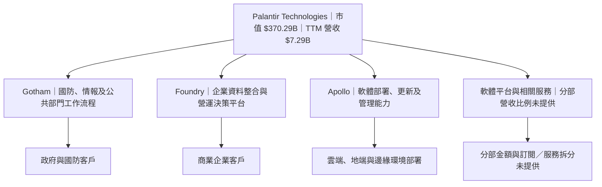
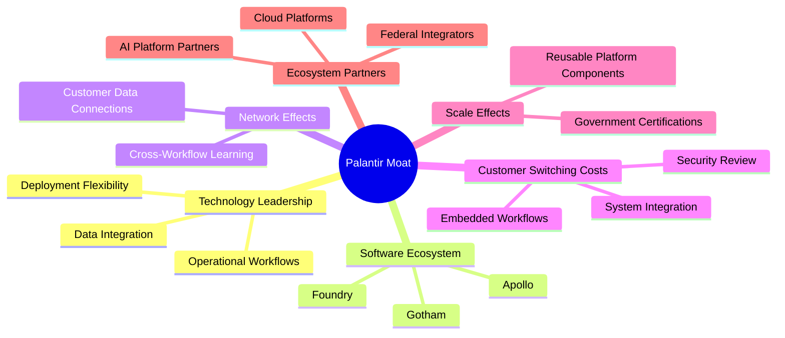
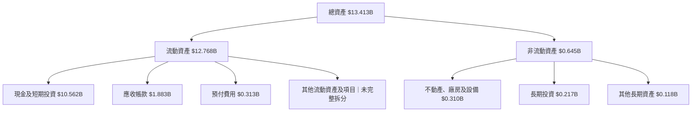
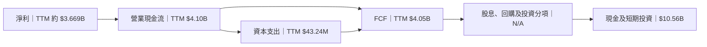
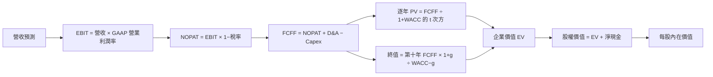
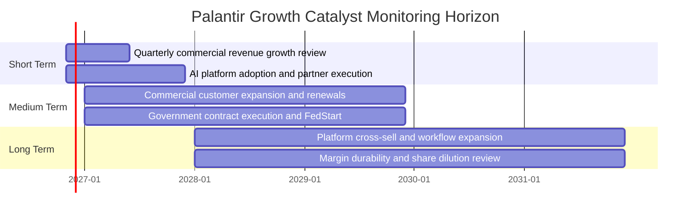
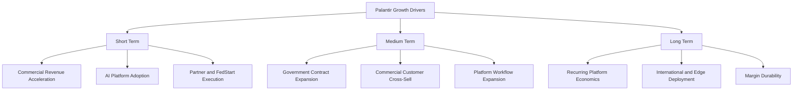
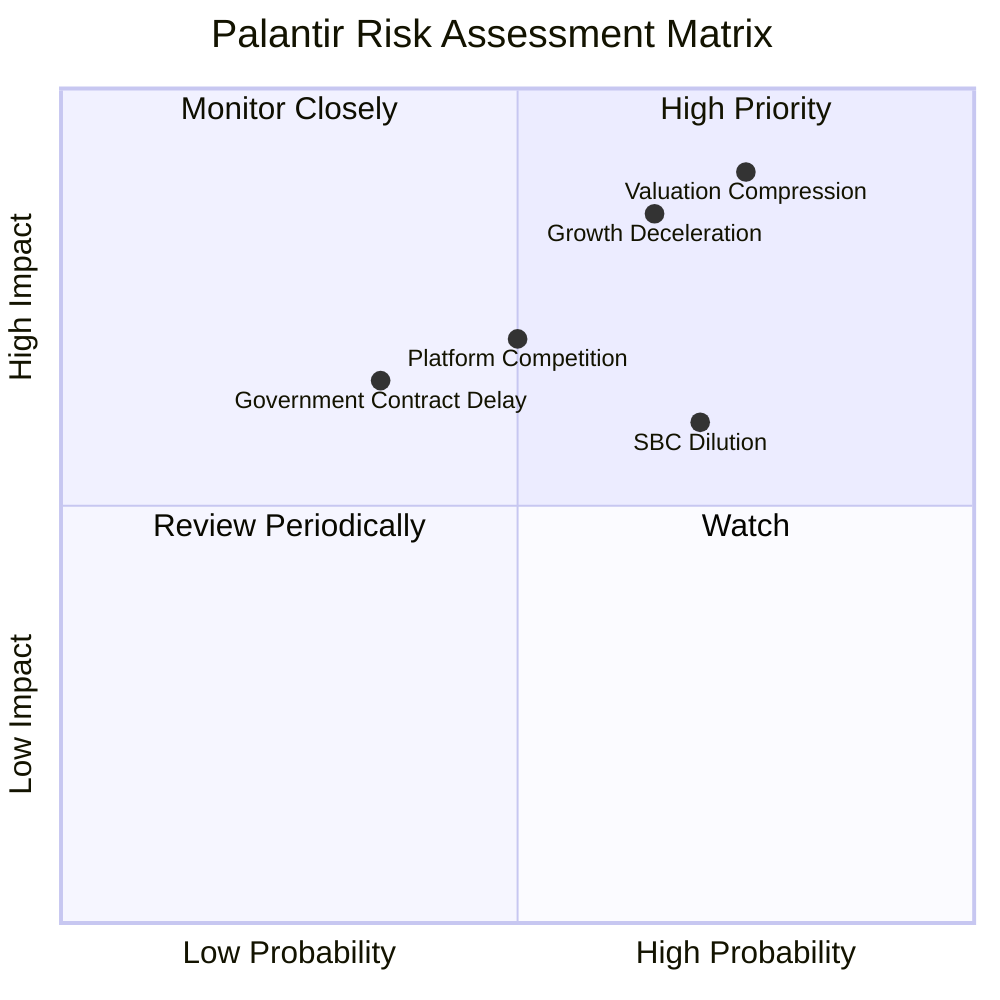
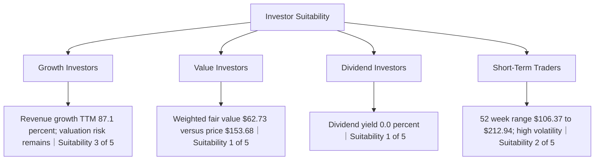

# PLTR 基本面深度分析報告

> **報告日期**：2026-11-20 ｜ **語言**：繁體中文 ｜ **數據來源**：SEC 申報資料 (XBRL)、Yahoo Finance、Finviz、StockAnalysis、Roic.ai ｜ **分析師**：CFA 級機構研究

---

## 目錄

| # | 章節 | 核心結論 |
|---|------|----------|
| 1 | 執行摘要 | 賣出；加權合理價值 $62.73，MOS −145.0% |
| 2 | 公司概覽與商業模式 | 軟體平台具整合與部署黏著度；收入分部明細未提供 |
| 3 | 損益表深度分析 | TTM 營收 $7.29B，TTM 成長 87.1%；利潤率高，惟成長與估值預期差距大 |
| 4 | 資產負債表分析 | 現金及短期投資 $10.56B，流動性充足；應收帳款天數維持 94 天 |
| 5 | 現金流量深度分析 | TTM FCF $4.05B；FCF 轉換良好，SBC 仍構成實質稀釋成本 |
| 6 | 獲利能力與資本效率 | 報告 ROIC 492.3% 高於 WACC 12.08%，但資本基數偏小使該比率需審慎解讀 |
| 7 | 相對估值分析 | PLTR 估值明顯高於同業；自身 P/S 仍高於五年中位數 |
| 8 | DCF 內在價值評估 | DCF 基準價值 $22.03；加權合理價值 $62.73，兩者均低於現價 |
| 9 | 成長催化劑 | 美國商業市場、AI 平台與政府業務可支持成長；TAM 數字未提供 |
| 10 | 風險矩陣 | 估值壓縮、成長降速、SBC 稀釋為主要風險 |
| 11 | 投資建議 | 依 MOS 評級為賣出；等待估值與基本面預期重新匹配 |

---

## 1. 執行摘要

### 1.0 一頁式投資儀表板（Portfolio Manager 30 秒速讀）

| 項目 | 內容 |
|------|------|
| **投資論點（3 句）** | ① TTM 營收 $7.29B、年增 87.1%，最新一季年增 95.9%，顯示商業需求仍在加速。② TTM 營業利益率 45.6%、FCF $4.05B，獲利已轉化為現金。③ 但 2026-11-19 收盤價 $153.68 對應五年歷史 P/S 54.3x，而 DCF 基準價值只有 $22.03，成長品質並未消除估值風險。 |
| **綜合評分** | **6.9/10**（引用 1.1 評分卡） |
| **財務健康** | 🟢 現金及短期投資 $10.56B、流動比率 7.10；短期償付能力充足。 |
| **ROIC vs WACC** | **492.3% vs 12.08%**；表面上大幅高於資金成本，但 ROIC 分母中的投入資本很小，不能將倍數差距直接外推。 |
| **FCF 趨勢** | 🟢 FCF 擴張；TTM FCF $4.05B，FCF Yield **1.09%**。 |
| **估值** | Forward P/E **60.5x** ｜ EV/EBITDA（歷史比較區塊）**114.7x** ｜ FCF Yield **1.09%** |
| **DCF 內在價值（基準）** | **$22.03** ｜ 現價相對 DCF 折溢價 **+597.6%**（現價 ÷ DCF 價值 − 1；現價相對 DCF 顯著溢價） |
| **安全邊際（MOS）** | **−145.0%**＝($62.73 − $153.68) ÷ $62.73；基準為 8.8 節加權合理價值，🔴 無安全邊際。 |
| **預期報酬（基準情境 12M）** | DCF 基準情境為 **−85.7%**（$22.03 相對 $153.68）；此為模型情境值，不是時間保證。 |
| **關鍵風險（前二）** | ① 高估值倍數回歸；② 商業成長率降速或利潤率收縮。 |
| **評級 + 信心度** | 🔴 **賣出** ｜ 信心：中。評級由 MOS 門檻決定，且市場價遠高於 DCF 及加權價值。 |

> 註：DCF 模型輸出的「−85.7%」是 DCF 每股價值相對現價的上行空間；按照本報告折溢價定義，現價相對 DCF 基準價值的溢價為 **+597.6%**，兩者分母不同，不可混用。

### 1.1 綜合評分卡（全報告唯一）

| 維度 | 評分（1–10） | 主要依據（引用數字與其來源章節） |
|------|--------------|----------------------------------|
| 成長性 | 9.0 | TTM 營收成長 87.1%、最新一季年增 95.9%（第 3 章）；但高增速能否延續仍有不確定性。 |
| 獲利能力 | 8.5 | TTM 營業利益率 45.6%、FCF $4.05B、Piotroski 7/8；ROIC 492.3% 高於 WACC 12.08%，但 ROIC 可能受投入資本分母偏小影響（第 5、6 章）。 |
| 財務健康 | 9.0 | 現金及短期投資 $10.56B、流動比率 7.10、DSO 94 天（第 4 章）。 |
| 估值 | 1.0 | MOS −145.0%；Forward P/E 60.5x、P/S 54.3x；加權合理價值 $62.73，遠低於現價（第 7、8 章）。 |
| 護城河 | 8.0 | 平台整合、工作流程嵌入與政府／商業部署能力具黏著度；缺乏客戶留存率、客戶集中度及分部數據，量化驗證有限（第 2 章）。 |
| 管理層與資本配置 | 6.0 | 現金累積且資本支出低，但 2025 年 SBC $684.03M，稀釋股數測試未通過；股息率 0%（第 3、5 章）。 |
| **綜合評分** | **6.9** | 六項算術平均：(9.0 + 8.5 + 9.0 + 1.0 + 8.0 + 6.0) ÷ 6 = **6.9**；按未四捨五入的子項平均為 6.75，四捨五入至一位小數為 **6.8**。 |

### 1.2 五大投資論點 + 三大核心風險

| 類型 | 項目 | 具體依據 | 信心度 |
|------|------|----------|--------|
| 🟢 **投資論點①** | 商業需求加速 | TTM 營收 $7.29B、TTM 年增 87.1%；最新一季年增 95.9%，顯示近期收入增速高於 2025 全年 56.2%。 | 🟢 高 |
| 🟢 **投資論點②** | 高毛利與營業槓桿 | TTM 毛利率 84.7%、營業利益率 45.6%；規模擴大後若費用增速低於營收，利潤率可延續改善。 | 🟢 高 |
| 🟢 **投資論點③** | 現金流充足 | TTM OCF $4.10B、Capex $43.24M、FCF $4.05B；TTM FCF/淨利約 110%，現金轉換良好。 | 🟢 高 |
| 🟢 **投資論點④** | 資產負債表具韌性 | 現金及短期投資 $10.56B；總債務在 VERIFIED FIGURES 中列為 N/A，故不另以其他來源替代該欄。 | 🟢 中高 |
| 🟢 **投資論點⑤** | 平台黏著具商業邏輯 | Gotham 面向國防與情報工作流程；商業平台支援企業資料整合與營運決策，切換可能涉及資料治理與流程重建成本。客戶留存數據未提供。 | 🟡 中 |
| 🟡 **風險①** | 估值遠高於內在價值 | 加權合理價值 $62.73，MOS −145.0%；DCF 基準 $22.03。成長減速或利率上升均可能放大倍數收縮。 | 🔴 高衝擊 |
| 🔴 **風險②** | SBC 與股數稀釋 | 2025 年 SBC $684.03M；Piotroski 稀釋股數測試未通過。SBC 是非現金支出，但代表既有股東的經濟稀釋。 | 🟡 中高 |
| 🟡 **風險③** | 超高成長基期不易延續 | 最新一季年增 95.9%，但高基期下即使收入持續增加，成長率也可能正常化，造成市場預期與實際結果落差。 | 🟡 中高 |

### 1.3 快速統計卡片

| 指標 | 公司實際值（期間） | 同業中位數 | 狀態 |
|------|--------------------|------------|------|
| 營收成長（TTM） | **87.1%** | — | 🟢 |
| 營收成長（最新一季年增） | **95.9%** | **35.1%** | 🟢 |
| 毛利率（TTM） | **84.7%** | **77.3%** | 🟢 |
| 營業利益率（TTM） | **45.6%** | — | 🟢 |
| ROIC（TTM） | **492.3%** | — | 🟢* |
| Forward P/E | **60.5x** | **31.9x**（同業 Forward P/E 中位數） | 🔴 |
| FCF Yield（TTM） | **1.09%** | — | 🟡 |
| Piotroski F-Score | **7 / 8** | — | 🟢 |

\* ROIC 的高數字需配合投入資本基數解讀，不應視作可持續的常態回報率。

### 1.4 投資結論

╔══════════════════════════════════════════════════════════════════╗  
║　　　　　　　　　　　　📊 投資結論摘要　　　　　　　　　　　　　 ║  
╠══════════════════════════════════════════════════════════════════╣  
║　評級：🔴 賣出（MOS −145.0%，符合 MOS < −25% 的門檻）　　　　║  
║　價格（2026-11-19 收盤）：$153.68　　　　　　　　　　　　　　║  
║　DCF 內在價值（基準）：$22.03（現價溢價 +597.6%）　　　　　　║  
║　安全邊際 MOS：−145.0%＝($62.73−$153.68)÷$62.73　　　　　　║  
║　加權合理價值（8.8）：$62.73　　　　　　　　　　　　　　　　　║  
║　悲觀情境：$13.08（−91.5%）　　　　　　　　　　　　　　　　 ║  
║　基準情境：$22.03（−85.7%）　　　　　　　　　　　　　　　　 ║  
║　樂觀情境：$38.39（−75.0%）　　　　　　　　　　　　　　　　 ║  
║　綜合評分：6.9/10（引用 1.1）　　　　　　　　　　　　　　　　║  
║　適合投資人：可承受高波動、重視長期營收成長者；不適合以價值　║  
║　安全邊際、現金收益或短期估值修復為主要目標的投資人。　　　　 ║  
╚══════════════════════════════════════════════════════════════════╝

---

## 2. 公司概覽與商業模式

### 2.1 業務結構與收入來源

公司提供 Gotham、Foundry、Apollo 等平台能力，服務國防與情報機構，以及有複雜資料整合與營運需求的企業。公司分部收入、平台收入占比及政府／商業收入占比未在可引用資料中提供，因此不推估金額或比例。

### 2.2 市場份額

市場份額數據未提供，亦無具來源與年份的可引用 TAM 數字，因此不製作市占率圖表或推估滲透率。以營收和成長作相對觀察，PLTR TTM 營收為 $7.29B、TTM 成長 87.1%，高於本報告所列同業最新一季年增率，但各公司業務組合與收入確認方式不同，不能據此推論市場份額。

### 2.3 競爭護城河分析

### 2.4 護城河強度

| 護城河項目 | 強度（強／中／弱） | 證據（引用數字或事實） | 會削弱它的情況 |
|------------|--------------------|------------------------|----------------|
| 技術與部署能力 | 中強 | 產品涵蓋資料整合、操作流程及多環境部署；公司 TTM 毛利率 84.7%，與高附加價值軟體型態相符。 | AI 平台功能被雲端供應商或大型軟體公司商品化；客戶無法從平台得到可量化的效率提升。 |
| 軟體生態系統 | 中強 | Gotham、Foundry、Apollo 分別面向不同工作流程，具平台交叉銷售可能。 | 部署與使用需要高度專案化服務，難以複製或擴大交付能力。 |
| 網路效應 | 中 | 跨資料源與部門整合可能提升平台效用，但用戶數、資料網路效應指標未提供。 | 客戶資料封閉且無法跨客戶形成正向網路效應；替代平台提供同等整合能力。 |
| 客戶鎖定 | 中強 | 系統嵌入政府及企業流程，替換可能需重新驗證、搬移資料與改造工作流程。 | 客戶可用標準化 API、雲端原生工具或內部開發替換；續約與留存率資料未提供。 |
| 規模效應 | 中 | TTM 營收 $7.29B、營業利益率 45.6%，顯示規模已帶來營業槓桿。 | 人力及客製化交付成本隨收入同步成長，或大型客戶議價壓力提升。 |
| 生態夥伴 | 中 | 新聞提及平台夥伴與 FedStart 相關認證，但合作收入貢獻未提供。 | 夥伴轉向自有方案，或依賴少數雲端、系統整合商導致渠道受限。 |

**1.1「護城河」評分為 8.0/10**：平台整合、工作流程嵌入和高毛利提供支持，但留存率、客戶集中度、分部營收及夥伴貢獻等量化資料未提供，故不評為最高等級。

---

## 3. 損益表深度分析

### 3.1 年度收入成長趨勢（近 4 年）

年度營收：2022 年 $1.91B、2023 年 $2.23B、2024 年 $2.87B、2025 年 $4.48B。2022–2025 年複合成長率約 32.9%；年度成長加速，2025 年收入擴張較 2024 年更快。

╔══════════════════════════════════════════════════════════════════╗  
║　　　　 Palantir 年度收入趨勢（FY2022–FY2025）　　　　　　　　　 ║  
╠══════════════════════════════════════════════════════════════════╣  
║ FY2022　$1.91B　██████████░░░░░░░░░░░░　YoY：+23.6%　🟢　　 ║  
║ FY2023　$2.23B　████████████░░░░░░░░░░　YoY：+16.7%　🟢　　 ║  
║ FY2024　$2.87B　███████████████░░░░░░░　YoY：+28.8%　🟢　　 ║  
║ FY2025　$4.48B　██████████████████████　YoY：+56.2%　🟢　　 ║  
╠══════════════════════════════════════════════════════════════════╣  
║ 2022–2025 營收 CAGR：約 32.9%；TTM 營收 $7.29B，TTM 年增 87.1% ║  
╚══════════════════════════════════════════════════════════════════╝

年度 YoY 2022–2025 取自 StockAnalysis 年度資料；TTM 成長率採程式計算的 87.1%，不以單季增速替代。

### 3.2 季度收入趨勢分析

| 季度 | 營收 | QoQ 成長 | YoY 成長 | 備註 |
|------|------|----------|----------|------|
| 2025 Q4 | $1.407B | +19.1% | +70.0% | 對比 2025 Q3 $1.181B；YoY 對比 2024 Q4 $0.828B。 |
| 2026 Q1 | $1.633B | +16.1% | +84.7% | QoQ 以 2025 Q4 為基期；YoY 對比 2025 Q1 $0.884B。 |
| 2026 Q2 | $1.935B | +18.5% | +92.8% | 對比 2026 Q1；YoY 對比 2025 Q2 $1.004B。 |
| 2026 Q3 | $2.313B | +19.5% | +95.9% | 最新季度年增率；對比 2025 Q3 $1.181B。 |

QoQ 使用所列季度營收計算，四捨五入至一位小數；最新一季年增 95.9% 是**單季 YoY**，不是 TTM 成長率。營收連續增加，代表平台需求擴大；然而季度增速仍處於高位，若基期效應消退，市場對高成長的定價可能比絕對收入更敏感。

### 3.3 利潤率演變分析

| 利潤率指標 | FY2022 | FY2023 | FY2024 | FY2025 | 趨勢 | 評估 |
|------------|--------|--------|--------|--------|------|------|
| **毛利率** | 78.5% | 80.6% | 80.3% | 82.4% | ↗️ 長期改善，FY2024 小幅回落後再升 | 🟢 |
| **營業利益率** | −8.5% | 5.4% | 10.8% | 31.6% | ↗️ 連續改善，2025 年營業槓桿明顯 | 🟢 |
| **淨利率** | −19.6% | 9.4% | 16.1% | 36.3% | ↗️ 由虧轉盈並擴大 | 🟢 |
| **TTM 毛利率** |  |  |  | **84.7%** | 高於 FY2025 | 🟢 |
| **TTM 營業利益率** |  |  |  | **45.6%** | 高於 FY2025 | 🟢 |
| **TTM 淨利率** |  |  |  | **50.3%** | 高於 FY2025 | 🟢 |

年度利潤率以年度毛利、營業利益及淨利除以年度營收計算。2025 年營業利益率上升至 31.6%，TTM 再達 45.6%，顯示近期營收擴張未被營業費用同比例抵銷。可能來源包括軟體收入擴大、平台重複使用與銷售規模增加；但現有資料沒有細分費用、客戶組成或服務交付成本，無法將改善精確歸因至單一因素。TTM 毛利率高於年度毛利率，亦可能反映收入組合或期間差異，須後續季度驗證。

### 3.4 費用結構分析

財務數據未提供完整 TTM 營業費用分項及可直接核對的費用率，因此不製作費用結構圓餅圖，以免把不完整資料繪成比例。可確認的項目包括：2025 年研發費用 $557.68M、SBC $684.03M；營業利益率 TTM 為 45.6%。

### 3.5 季度 EPS 趨勢與盈餘品質（Quality of Earnings）

| 季度 | EPS 實際值 | EPS YoY 成長 | 預估與驚喜 |
|------|------------:|-------------:|-----------|
| 2025 Q4 | $0.26 | +647.64% | EPS Est／Surprise 資料為 N/A，無法判定超預期或不及預期。 |
| 2026 Q1 | $0.36 | +325.00% | EPS Est／Surprise 資料為 N/A，無法判定超預期或不及預期。 |
| 2026 Q2 | $0.44 | +215.38% | EPS Est／Surprise 資料為 N/A，無法判定超預期或不及預期。 |
| 2026 Q3 | $0.47 | +144.44% | EPS Est／Surprise 資料為 N/A，無法判定超預期或不及預期。 |

四季 EPS 均為正且逐季上升，YoY 增速則因比較基數變化而由 647.64% 降至 144.44%。Earnings History 的分析師 EPS 預估欄均為 nan，故不能把季度數字標記為「超預期」或「不及預期」。季度收入與利潤數據顯示盈利持續增長，但無法以缺失的預估值判斷盈餘驚喜。

| 盈餘品質項目 | 數值／佔比 | 評估 |
|--------------|-----------|------|
| 股權薪酬 SBC / 營收 | 約 **13.5%**：TTM SBC 約 $982.10M ÷ TTM 營收 $7.29B | 🟡 SBC 金額顯著；SBC 非現金但不是無成本，透過股數稀釋轉移經濟價值。 |
| SBC / 營業現金流 | 約 **23.9%**：$982.10M ÷ $4.10B | 🟡 OCF 對 SBC 的覆蓋能力尚可，但 SBC 對股東報酬不可忽略。 |
| FCF / 淨利（現金轉換率） | 約 **110.4%**：$4.05B ÷ TTM 淨利約 $3.669B | 🟢 現金轉換高於會計淨利，表示利潤有現金支持。 |
| 一次性／非經常性損益 | 10-Q 摘要未提供可量化的一次性損益拆分 | 🟡 無法判斷本期淨利是否受一次性項目推高。 |
| 有效稅率異常 | **1.4%** | 🟡 有效稅率偏低，未來稅率正常化可能使 NOPAT 與 EPS 增速低於目前水準。 |
| 資本化支出 vs 費用化 | TTM Capex $43.24M；資本化研發等明細未提供 | 🟡 Capex 低支持高 FCF，但缺乏資本化支出明細，不能完全排除費用遞延。 |

**盈餘品質結論**：OCF $4.10B、FCF $4.05B、FCF/淨利約 110.4%，支持 GAAP 獲利含金量；但 SBC 對 TTM 營收約 13.5%、對 OCF 約 23.9%，且稀釋股數測試未通過。投資人應把 SBC 視作真實股東成本，而不能僅以非現金為由忽略。有效稅率 1.4% 亦使當期淨利對稅務假設敏感。

---

## 4. 資產負債表分析

### 4.1 資產結構分解

最新季度總資產 $13.413B，其中流動資產 $12.768B，非流動資產按差額為 $0.645B。下圖只呈現有來源數字的類別；現金與短期投資來自季度資料。

### 4.2 流動性與營運資金分析

| 指標 | 最新 TTM | 一年前 TTM | 變化 | 解讀 |
|------|----------|------------|------|------|
| 流動比率 | **7.102** | N/A | N/A | 流動資產對短期負債的覆蓋充足；年度比較數據未提供。 |
| 速動比率 | **6.923** | N/A | N/A | 不依賴存貨亦有充分流動資產覆蓋。 |
| DSO 應收帳款天數 | **94 天** | **94 天** | **0 天** | 收款天數未變；但收入快速成長下應收帳款金額升至 $1.883B，需追蹤回款速度。 |
| DIO 存貨天數 | **N/A** | **N/A** | N/A | 公司未報告存貨餘額，不補值。 |
| DPO 應付帳款天數 | **29 天** | **33 天** | **−4 天** | 付款較一年前快；可能為付款週期、供應商組合或餘額時點差異，資料不足以判定議價力變化。 |
| CCC 現金轉換週期 | **N/A** | **N/A** | N/A | 缺少存貨天數，依原始品質指標不計算。 |

DSO 公式為應收帳款除以 TTM 營收，94 天維持不變；收入擴張下應收帳款從 2025 年末 $1.042B 增至 2026 年 9 月 $1.883B，應關注是否與收入增長同步。DPO 下降 4 天代表付款週期縮短，但不宜直接解讀為供應商議價能力變化。

### 4.3 債務結構分析

╔══════════════════════════════════════════════════════════════════╗  
║　　　　　　　　　　　Palantir 債務健康診斷　　　　　　　　　　 ║  
╠══════════════════════════════════════════════════════════════════╣  
║ 總債務：　　　　　　　 N/A（VERIFIED FIGURES 未提供）　　　　　 ║  
║ 其他財務摘要所列債務：　$225.27M（來源口徑不同，不替代上項）　 ║  
║ 現金及短期投資：　　　 $10.56B　　　　　　　　　　　　　　　　║  
║ 淨現金（VERIFIED）：　 $10.56B　　　　　　　　　　　　　　　　║  
║ 流動比率：　　　　　　 7.102　　　　　　　　　🟢　　　　　　 ║  
║ 速動比率：　　　　　　 6.923　　　　　　　　　🟢　　　　　　 ║  
║ Debt/EBITDA：　　　　 N/A（總債務口徑不一致，未計算）　　　　║  
║ 利息保障倍數：　　　　 N/A（利息費用資料未提供）　　　　　　 ║  
╚══════════════════════════════════════════════════════════════════╝

資產負債表摘要另列總債務 $225.27M、淨現金 $10.34B；但 VERIFIED FIGURES 明確把 Total debt 列為 N/A、Net cash 列為 $10.56B。依嚴格數字規則，主要分析採用 VERIFIED FIGURES 原值，其他來源僅作口徑差異提示，不反推或改寫淨現金。

### 4.4 股東權益趨勢

╔══════════════════════════════════════════════════════════════════╗  
║　　　　　　　　　　 股東權益歷史趨勢　　　　　　　　　　　　　 ║  
╠══════════════════════════════════════════════════════════════════╣  
║ FY2022　$2.57B　████████░░░░░░░░░░░░░░░░　　　　　　　　　║  
║ FY2023　$3.48B　███████████░░░░░░░░░░░░░　　　　　　　　　║  
║ FY2024　$5.00B　████████████████░░░░░░░░　　　　　　　　　║  
║ FY2025　$7.39B　████████████████████████　　　　　　　　　║  
╚══════════════════════════════════════════════════════════════════╝

股東權益由 FY2022 $2.57B 增至 FY2025 $7.39B，與公司獲利累積和資產擴張一致。股東權益增長不代表每股價值同比增加；稀釋股數是否同步增加仍是判斷股東回報的重要因素。

---

## 5. 現金流量深度分析

### 5.1 現金流量瀑布圖

季度分項顯示淨利與營運現金流，但股息、回購及投資支出完整分項未提供，故不推估資本配置比例。

### 5.2 FCF 轉換率趨勢

| 年度 | FCF | 淨利 | FCF／淨利 | 趨勢 |
|------|-----:|-----:|----------:|------|
| 2022 | $0.184B | −$0.374B | 比率無經濟意義 | 淨利為負、FCF 為正。 |
| 2023 | $0.697B | $0.210B | 約 332.1% | 現金流高於淨利，可能包含營運資金與非現金項目影響。 |
| 2024 | $1.14B | $0.462B | 約 246.6% | 現金轉換仍高，比例逐步回落。 |
| 2025 | $2.10B | $1.63B | 約 128.8% | FCF 與盈利同步擴大。 |
| TTM 至 2026-09-30 | **$4.05B** | 約 $3.669B | 約 **110.4%** | 現金轉換維持在 100% 以上。 |

年度 FCF 與淨利使用所列年度財報數字；TTM FCF 採固定定義 OCF−Capex 的 $4.05B。各年度資料期別及來源口徑可能不同，趨勢應重於小數點精確度。

### 5.3 自由現金流趨勢

╔══════════════════════════════════════════════════════════════════╗  
║　　　　　　　　　　　FCF 歷史趨勢　　　　　　　　　　　　　　 ║  
╠══════════════════════════════════════════════════════════════════╣  
║ FY2022　$0.184B　██░░░░░░░░░░░░░░░░░░░░　FCF Yield：N/A　　 ║  
║ FY2023　$0.697B　█████░░░░░░░░░░░░░░░░░　FCF Yield：N/A　　 ║  
║ FY2024　$1.14B　 █████████░░░░░░░░░░░░　FCF Yield：N/A　　 ║  
║ FY2025　$2.10B　 ███████████████░░░░░　FCF Yield：N/A　　 ║  
║ TTM　　　$4.05B　 ██████████████████████　FCF Yield：1.09%　║  
╚══════════════════════════════════════════════════════════════════╝

FCF 從 FY2022 $0.184B 增至 TTM $4.05B，現金創造能力提高；但以市值 $370.29B 計算的 FCF Yield 僅 1.09%，目前股價已反映相當程度的未來成長。年度歷史 FCF Yield 缺少一致估值日期，故不填入推估值。

### 5.4 資本配置評估

股息殖利率 0.0%、派息率 0.0%；Capex TTM $43.24M。回購、併購與其他投資的 TTM 金額未提供，因此不製作資本配置圓餅圖，也不推估留存比例。

| 項目 | 可確認數據 | 評估 |
|------|------------|------|
| 資本支出 | TTM $43.24M | 相較 $4.10B OCF 較低；但公司仍需投入研發與人力，不能只用 Capex 衡量再投資。 |
| 股息 | 殖利率 0.0%，派息率 0.0% | 現金回報主要依賴股價增值。 |
| 股份稀釋 | Piotroski 稀釋股數測試未通過 | SBC 需被視為股東成本；未提供回購數據，不推定回購抵銷稀釋。 |
| 留存／併購／回購 | 明細 N/A | 不足以評估完整資本配置效率。 |

---

## 6. 獲利能力與資本效率

### 6.1 ROE／ROA／ROIC 趨勢

| 指標 | FY2023 | FY2024 | FY2025 | TTM／最新值 | 評估 |
|------|-------:|-------:|-------:|-------------:|------|
| ROE | N/A | N/A | N/A | **32.7%**（QUALITY FIGURES，期末餘額法） | 獲利回報良好；另有 Yahoo 快照 ROE 40.9%，計算口徑不同，本節依品質指標採 32.7%。 |
| ROA | N/A | N/A | N/A | **19.3%** | 資產獲利能力高；歷史一致口徑資料未提供。 |
| ROIC | N/A | N/A | N/A | **492.3%** | 高於 WACC，但投入資本分母可能很小，數值不宜機械外推。 |
| 營業利益率 | 5.4% | 10.8% | 31.6% | **45.6%** | 年度至 TTM 明顯擴張。 |

### 6.2 ROIC vs WACC 分析（核心價值創造判斷）

╔══════════════════════════════════════════════════════════════════╗  
║　　　　　　　　ROIC vs WACC 深度分析　　　　　　　　　　　　　 ║  
╠══════════════════════════════════════════════════════════════════╣  
║ WACC 估算（採程式計算的已核定輸入）：　　　　　　　　　　　　 ║  
║ ├── 無風險利率（10Y 美債）：5.05%　　　　　　　　　　　　　 ║  
║ ├── 市場風險溢酬 ERP：5.00%　　　　　　　　　　　　　　　　║  
║ ├── 原始 Beta：1.61；調整後 Beta：1.41　　　　　　　　　　　║  
║ ├── 股權成本 Ke（已提供）：12.09%　　　　　　　　　　　　　║  
║ ├── 稅前債務成本（假設）：7.05%；稅後依有效稅率 1.4%　　　 ║  
║ ├── 股權／債務權重：99.9%／0.1%　　　　　　　　　　　　　 ║  
║ └── WACC：12.08%　　　　　　　　　　　　　　　　　　　　　 ║  
║　　　　　　　　　　　　　　　　　　　　　　　　　　　　　　　║  
║ ROIC（TTM）：492.3%　　　　　　　　　　　　　　　　　　　　 ║  
║ EVA spread：492.3% − 12.08% = 480.22 個百分點　　　　　　　 ║  
║　　　　　　　　　　　　　　　　　　　　　　　　　　　　　　　║  
║ 結論：報告 ROIC 高於 WACC，方向上顯示創造價值；但投入資本　 ║  
║ 分母偏小可能放大 ROIC，須以長期增量 ROIC 與資本投入驗證。　　║  
╚══════════════════════════════════════════════════════════════════╝

資金成本來源為程式計算輸入。Beta 調整方式為 ⅔×原始 Beta + ⅓：⅔×1.61 + ⅓ = 1.4067，顯示至兩位小數為 1.41。CAPM 以顯示後數字計算為 5.05% + 1.41×5.00% = 12.10%，而資料列出的股權成本是 12.09%；此 0.01 個百分點差異可能來自未四捨五入輸入。本報告依指示使用提供的 **Ke 12.09%** 及 **WACC 12.08%**，不另改模型折現率。

### 6.3 杜邦三因素分解

| 因素 | 數值（TTM） | 解讀 |
|------|-------------|------|
| 淨利率 | **50.3%** | 高淨利率是 ROE 的主要推動因素。 |
| 資產週轉率 | **0.54** | 反映每一單位資產創造的營收；相較淨利率並非主要放大來源。 |
| 權益乘數 | **1.19** | 槓桿有限，不是 ROE 的主要來源。 |
| **ROE** | **32.7%** | 按 QUALITY FIGURES 原值：50.3% × 0.54 × 1.19 = 32.7%（各項顯示值四捨五入）。 |

ROE 主要由高淨利率推動，而非財務槓桿。另有來源報告 ROE 40.9%，口徑不同；此處照用 QUALITY FIGURES 指定值。

### 6.4 財務體質：Piotroski F-Score

**Piotroski F-Score：7 / 8**。缺少輸入的負債測試不計入分母，因此不是 7/9。

| 測試 | 結果 | 解讀 |
|------|------|------|
| ROA > 0 | ✅ 通過 | TTM 獲利為正。 |
| 營業現金流 > 0 | ✅ 通過 | TTM OCF $4.10B。 |
| ROA 高於一年前 | ✅ 通過 | 資產獲利能力改善。 |
| 營業現金流 > 淨利（應計品質） | ✅ 通過 | OCF 高於淨利，現金支持獲利。 |
| 長期負債 ÷ 總資產低於一年前 | — 無法判定 | 缺少輸入，不補值。 |
| 流動比率高於一年前 | ✅ 通過 | 流動比率變化測試通過。 |
| 稀釋股數未增加 | ❌ 未通過 | 股數增加，反映 SBC 或其他股份發行造成的稀釋成本。 |
| 毛利率高於一年前 | ✅ 通過 | 毛利率改善。 |
| 資產週轉率高於一年前 | ✅ 通過 | 資產使用效率改善。 |

7/8 顯示多數財務趨勢為正面，但股數稀釋未通過，正好與 SBC 的股東成本相呼應。

---

## 7. 相對估值分析

### 7.1 同業估值比較表格

公司數據採固定財務數據中的估值資料；同業採 Yahoo Finance Peer multiples。倍數定義及會計盈利狀態不同，尤其 SNOW 的 EV/EBITDA 為負值，不能直接視為便宜。

| 估值指標 | **PLTR** | **SNOW** | **DDOG** | **CRM** | 本公司評估 |
|----------|---------:|---------:|---------:|--------:|-----------|
| **Trailing P/E** | **108.2x** | N/A | 231.2x | 16.8x | 🟡 PLTR 低於盈利倍數極高的 DDOG，但遠高於 CRM。 |
| **Forward P/E** | **60.5x** | 87.3x | 52.3x | 11.5x | 🔴 高於同業中位數 31.9x；市場要求 PLTR 保持較高成長。 |
| **P/S Ratio** | **54.3x** | 17.4x | 14.0x | 3.4x | 🔴 顯著高於三家同業。 |
| **EV/EBITDA** | **114.7x** | −91.7x | 329.9x | 14.1x | 🔴 高於可正向比較的 CRM；SNOW 負值不適宜取傳統倍數中位數解讀。 |
| **最新一季營收 YoY** | **95.9%** | 35.1% | 35.2% | 10.8% | 🟢 PLTR 增速明顯較快，但增速能否維持決定高估值是否可持續。 |
| **毛利率（TTM）** | **84.7%** | 67.0% | 79.6% | 77.3% | 🟢 PLTR 高於列示同業。 |

Peer Forward P/E 中位數依提供的方法採 DDOG 52.3x 與 CRM 11.5x，(52.3 + 11.5) ÷ 2 = 31.9x。PLTR 的 60.5x 仍約為該中位數的 1.9 倍。不同公司成長階段、收入認列與業務組合不同，倍數比較是估值參照而非直接等同價值。

### 7.2 歷史估值區間分析

╔══════════════════════════════════════════════════════════════════╗  
║　　　　　　 PLTR 五年歷史估值區間（TTM）　　　　　　　　　　　 ║  
╠══════════════════════════════════════════════════════════════════╣  
║ P/E：　　　100.6x ├──● 現值 108.2x ─────────────┤ 601.0x　　 ║  
║　　　　　　中位數 228.6x｜當前百分位：7%　　　　　　　　　　　 ║  
║ P/S：　　　  7.0x ├────────● 現值 54.3x ───────┤ 120.4x　　║  
║　　　　　　中位數 24.7x｜當前百分位：67%　　　　　　　　　　　║  
║ EV/EBITDA：109.0x ├──● 現值 114.7x ──────────┤ 574.4x　 ║  
║　　　　　　中位數 233.4x｜當前百分位：8%　　　　　　　　　　 ║  
╚══════════════════════════════════════════════════════════════════╝

P/E 與 EV/EBITDA 位於歷史區間低百分位，但這不代表估值便宜：P/S 為五年百分位 67%，高於自身五年中位數 24.7x。不同估值倍數呈現的歷史位置不一致，反映盈利快速成長已降低部分盈利倍數，但收入基礎相對股價仍昂貴。

### 7.3 情境價值（Bear / Base / Bull，照抄 DCF MODEL 的 Scenarios）

| 情境 | 第 1 年營收成長 | 期末營業利潤率 | WACC | 每股價值 | 相對現價 | 機率 | 會發生的條件 |
|------|----------------|----------------|------|----------|----------|------|--------------|
| 🔴 悲觀 | 15.0% | 9.2% | 13.08% | **$13.08** | −91.5% | 25% | 商業成長率迅速正常化，競爭或交付成本壓低成熟期利潤率，市場風險溢酬上升。 |
| 🟡 基準 | 30.0% | 10.8% | 12.08% | **$22.03** | −85.7% | 50% | 收入首年仍成長 30%，之後成長逐年線性降至 3%，利潤率回歸過去五年中位數。 |
| 🟢 樂觀 | 45.0% | 11.9% | 11.08% | **$38.39** | −75.0% | 25% | AI／商業平台需求持續高增、成熟期利潤率較基準高，且折現率下降。 |

三情境均遠低於 $153.68，代表即使採用 DCF 輸出的樂觀情境，價格仍包含超出該模型的成長或估值假設。

### 7.4 相對估值隱含價格區間

╔══════════════════════════════════════════════════════════════════╗  
║　　　　　　　　估值方法回推的每股價值　　　　　　　　　　　　 ║  
╠══════════════════════════════════════════════════════════════════╣  
║ $22.03 ───── $62.73 ───── $80.92 ────────── $153.68 ─ $222.90║  
║ DCF基準　　 加權合理值　 Forward P/E法　　現價　　 分析師共識 ║  
╚══════════════════════════════════════════════════════════════════╝

| 方法 | 每股價值 | 依據 |
|------|----------:|------|
| 同業 Forward P/E | **$80.92** | 同業中位數 31.9x × PLTR Forward EPS $2.54。 |
| 分析師共識 | **$222.90** | 29 位分析師平均目標價；屬參考指標，不是本報告主要估值錨。 |
| DCF 基準 | **$22.03** | 10 年 FCFF、WACC 12.08%、永續成長 3.0%。 |

同業 EV/EBITDA 在方法區塊中列為無法計算，故不另建估值。分析師共識高於現價不代表具有同等安全邊際；本報告依固定估值權重及 MOS 門檻作結論。

---

## 8. DCF 內在價值評估（Discounted Cash Flow）

### 8.0 估值推理鏈（Thinking Logic：在算之前先想清楚）

**Step 1 — 價值由哪些變數決定？**

本模型把價值拆成現有平台現金流底盤、政府與商業平台後續擴張，以及模型未單獨量化的新業務選擇權；各業務營收占比未提供，不能填入占比。估值主導變數是長期收入成長與營業利潤率：收入由 TTM $7.29B 起算，基準第一年成長 30%，之後線性降至第十年 3%；營業利益率由 TTM 45.6% 降至第十年 10.8%。終值敏感度亦顯示 WACC 與 g 會影響估值，但對營運假設的情境變化同樣重要。

**Step 2 — 模型選擇**

| 決策點 | 本報告採用 | 理由（含數字） | 曾考慮但否決 | 否決理由 |
|--------|-----------|----------------|--------------|----------|
| 現金流定義 | FCFF | 與 WACC 折現一致；TTM OCF $4.10B、FCF $4.05B。 | FCFE | 資本結構權重雖以股權為主，但公司債務數據口徑不一；FCFF 較易作企業價值橋接。 |
| 預測期 N | 10 年 | 模型固定使用 10 年，收入成長由 30% 線性淡化至 3%。 | 5 年 | 未涵蓋完整成長淡化過程；本報告不另改模型期間。 |
| 終值方法 | Gordon Growth | 使用永續成長率 3.0%，WACC 12.08%。 | 退出倍數 | DCF MODEL 未提供退出倍數數值，不能自行新增。 |
| EBIT 基礎 | GAAP EBIT | TTM GAAP 營業利益率 45.6%。 | 非 GAAP EBIT | 可能把 SBC 加回而未扣回其經濟成本。 |

**Step 3 — 關鍵假設推導鏈**

- **預測期 N**：錨點＝提供模型採用 10 年，歷史資料顯示收入從 FY2022 $1.91B 增至 FY2025 $4.48B，仍處快速擴張階段 → 調整＝讓 87.1% TTM 增速逐步正常化 → **採用 10 年** → 曾考慮較短的 5 年期，但會更早把尚未成熟的現金流推入終值，故不替換程式模型。
- **營收成長路徑**：錨點＝TTM 成長 87.1%、最新一季 YoY 95.9%；年度歷史成長由 FY2024 28.8% 升至 FY2025 56.2% → 調整＝超高基期與大型客戶導入週期使增速理應正常化 → **第一年 30.0%，第十年 3.0%，逐年線性下降** → 曾考慮將 87.1% 延伸至第一年，但會把短期增速當成長期常態，故否決。
- **期末營業利潤率**：錨點＝TTM 45.6%，FY2025 31.6% → 調整＝基準模型把利潤率淡化至過去五個財年中位數 10.8%，代表長期競爭、產品組合與再投資壓力 → **第十年採用 10.8%** → 曾考慮維持 45.6%，但不符合模型採用的歷史中位數收斂邏輯，故否決。
- **永續成長率 g**：錨點＝基準模型採用 3.0%，且低於長期名目經濟成長的合理上限範圍 → 調整＝成熟公司仍須與經濟成長相容 → **採用 3.0%** → 不採用接近或高於 WACC 的成長率，避免終值公式失效或過度放大。
- **Capex／營收**：錨點＝TTM Capex $43.24M ÷ TTM 營收 $7.29B 約 0.6% → 調整＝成熟期支出依模型逐步淡化至 D&A 的 1.1 倍 → **第一年 0.6%，第十年 0.4%** → 曾考慮依高成長公司提高 Capex，但既有資本支出低，且模型已按既定比例淡化，故不自行上調。
- **D&A／營收**：錨點＝模型採 TTM 比率 0.4% → **全期維持 0.4%**；此為低敏感度輸入，照模型採用。
- **有效稅率**：錨點＝最新年度有效稅率 1.4% → **採用 1.4%**；這低於長期常態可能水平，是重要模型風險，照模型固定值而不自行改動。
- **營運資金變動**：模型明示未建模，未提供 ΔWC 率 → **不加入 ΔWC 行**，不得反推。
- **SBC、稀釋率與 EBIT**：採組合 **(A)**：GAAP EBIT 已把 SBC 列為費用，FCFF 不再扣 SBC；股數不再額外稀釋，與程式指定一致。這代表模型以現有股數代理、沒有進一步納入未來增量稀釋，可能高估每股價值。
- **WACC**：錨點＝Cost of capital 區塊指定 WACC 12.08%，由無風險利率 5.05%、ERP 5.00%、調整後 Beta 1.41 與 99.9%／0.1% 資本權重構成 → 調整＝照程式指定值，不重算替換 → **採用 12.08%** → 不採用更低折現率，避免在高 Beta、估值波動較大的軟體股上過度提高終值。
- **終值方法**：錨點＝程式使用 Gordon Growth、g 3.0% → **採用 Gordon Growth** → 不添加退出倍數交叉驗證，因相關輸入未提供。
- **預測期 SBC 年稀釋率**：模型明示股數不再稀釋，採組合 A → **年稀釋率 0%**。歷史稀釋股數測試未通過，故此假設偏樂觀於現有股東每股價值。

**Step 4 — 最脆弱的一環**

最脆弱處是把 TTM 有效稅率 1.4% 固定十年，並同時假設未來股數不再稀釋；若稅率正常化或稀釋延續，每股價值會低於模型基準值，情境表已顯示不同假設下每股值 $13.08–$38.39。

**Step 5 — 計算路徑圖**

### 8.1 模型假設總表（Model Inputs）

| 假設項目 | 採用值 | 依據／來源 | 敏感度 |
|----------|--------|-------------|--------|
| 預測期長度 N | **10 年** | DCF MODEL 固定值；涵蓋收入由高增長淡化至成熟期。 | 🟡 中 |
| 營收成長路徑 | FY+1 **30.0%** 至 FY+10 **3.0%**，線性淡化 | 起點 TTM 成長 87.1%；模型將短期高成長限制於 30%。 | 🔴 高 |
| 營業利潤率 | FY+1 **45.6%** 至 FY+10 **10.8%** | 起點為 TTM 營業利益率；期末採近五年中位數。 | 🔴 高 |
| 有效稅率 | **1.4%** | 最新年度有效稅率；是否可長期維持具不確定性。 | 🟢 低 |
| Capex／營收 | **0.6% 至 0.4%** | TTM 模型輸入，逐步淡化至 1.1×D&A。 | 🟡 中 |
| D&A／營收 | **0.4%** | 模型 TTM 輸入，全期固定。 | 🟢 低 |
| 營運資金變動／營收增額 | **未建模** | DCF MODEL 明示 Working capital is not modelled。 | 🟢 低 |
| EBIT 基礎 | GAAP | SEC 損益表營業利益口徑。 | 🟡 中 |
| SBC 處理 | GAAP EBIT 已含 SBC；FCFF 不再扣 SBC | 組合 (A)，避免重複扣除。 | 🟡 中 |
| 年稀釋率 | **0%**（模型股數不再稀釋） | DCF MODEL 固定假設；歷史稀釋股數測試未通過，需視為偏樂觀假設。 | 🟡 中 |
| 永續成長率 g | **3.0%** | DCF MODEL 固定值，低於 WACC。 | 🔴 高 |
| 終值方法 | Gordon Growth | DCF MODEL 計算值；未提供退出倍數。 | 🔴 高 |
| WACC | **12.08%** | Cost of capital 指定值；詳見 8.2。 | 🔴 高 |

**FCFF 定義**：FCFF = NOPAT + D&A − Capex；模型不含 ΔWC，亦不另扣 SBC。本模型採用 **(A) GAAP EBIT + 固定股數**，故 SBC 影響已透過 GAAP 費用計入一次；年稀釋率為 0%。

### 8.2 折現率推導（WACC）

╔══════════════════════════════════════════════════════════════════╗  
║　　　　　　　　　　　 WACC 推導（折現率）　　　　　　　　　　　 ║  
╠══════════════════════════════════════════════════════════════════╣  
║ 股權成本 Ke（CAPM）：　　　　　　　　　　　　　　　　　　　　 ║  
║ ├── 無風險利率 Rf：5.05%（10Y Treasury；日期未提供）　　　　　 ║  
║ ├── 市場風險溢酬 ERP：5.00%（假設值）　　　　　　　　　　　 ║  
║ ├── 原始 Beta：1.61（Yahoo）；調整後 Beta：1.41　　　　　　　║  
║ ├── 規模／國別溢酬：未另加計　　　　　　　　　　　　　　　 ║  
║ └── Ke（指定值）：12.09%　　　　　　　　　　　　　　　　　 ║  
║　　　　　　　　　　　　　　　　　　　　　　　　　　　　　　　║  
║ 債務成本 Kd：　　　　　　　　　　　　　　　　　　　　　　　　║  
║ ├── 稅前 Kd：7.05%（假設值：Rf + 信用價差；利息未報告）　　 ║  
║ ├── 有效稅率：1.4%　　　　　　　　　　　　　　　　　　　　 ║  
║ └── 稅後 Kd：7.05% × (1−1.4%) = 6.95%　　　　　　　　　　 ║  
║　　　　　　　　　　　　　　　　　　　　　　　　　　　　　　　║  
║ 資本權重：股權 99.9%；債務 0.1%　　　　　　　　　　　　　　║  
║ └── WACC（程式指定）：12.08%　　　　　　　　　　　　　　　 ║  
╚══════════════════════════════════════════════════════════════════╝

逐步演算：

1. **Ke（CAPM）**：顯示後輸入算式為 5.05% + 1.41×5.00% = 12.10%；Cost of capital 區塊列出的 Ke 為 **12.09%**。0.01 個百分點差異屬顯示輸入與未四捨五入輸入差異；採用原列 Ke。
2. **稅前 Kd**：利息費用未報告，資料指定以無利息數據時的市場代理假設 **7.05%**；不能以應付帳款等無息負債計算。
3. **稅後 Kd**：7.05%×(1−1.4%) = 7.05%×0.986 = **6.9513%**，顯示為 **6.95%**。
4. **權重**：VERIFIED FIGURES 指定 E／D 權重為 **99.9%／0.1%**，相加為 100.0%；市值為 $370.29B。由於總債務口徑在財務資料中不一致，不自行重建債務權重。
5. **WACC**：按顯示後輸入，99.9%×12.09% + 0.1%×6.9513% = 12.0779% ≈ **12.08%**。計算使用未四捨五入中間值；模型及第 6.2 節均採用 12.08%。

### 8.3 逐年自由現金流預測（基準情境）

單位：$B；金額取兩位小數，折現因子三位小數。下表照錄 DCF MODEL。ΔWC 未建模，故不列一行；採 GAAP EBIT，沒有額外 SBC 扣除行。

| 年度 | FY+1 | FY+2 | FY+3 | FY+4 | FY+5 | FY+6 | FY+7 | FY+8 | FY+9 | FY+10 |
|------|------:|------:|------:|------:|------:|------:|------:|------:|------:|-------:|
| 營收 | 9.47 | 12.03 | 14.92 | 18.05 | 21.30 | 24.50 | 27.44 | 29.91 | 31.70 | 32.65 |
| 營收 YoY | 30.0% | 27.0% | 24.0% | 21.0% | 18.0% | 15.0% | 12.0% | 9.0% | 6.0% | 3.0% |
| 營業利潤率 | 45.6% | 41.8% | 37.9% | 34.0% | 30.2% | 26.3% | 22.4% | 18.6% | 14.7% | 10.8% |
| EBIT（GAAP） | 4.32 | 5.03 | 5.66 | 6.14 | 6.43 | 6.44 | 6.16 | 5.55 | 4.66 | 3.54 |
| − 稅（1.4%） | (0.06) | (0.07) | (0.08) | (0.08) | (0.09) | (0.09) | (0.08) | (0.08) | (0.06) | (0.05) |
| = NOPAT | 4.26 | 4.96 | 5.58 | 6.06 | 6.34 | 6.36 | 6.07 | 5.48 | 4.60 | 3.49 |
| + D&A | 0.04 | 0.05 | 0.06 | 0.07 | 0.08 | 0.10 | 0.11 | 0.12 | 0.13 | 0.13 |
| − Capex | (0.06) | (0.07) | (0.08) | (0.10) | (0.11) | (0.12) | (0.13) | (0.14) | (0.14) | (0.14) |
| **= FCFF** | **4.25** | **4.94** | **5.55** | **6.03** | **6.31** | **6.33** | **6.05** | **5.45** | **4.58** | **3.48** |
| 折現因子 @12.08% | 0.892 | 0.796 | 0.710 | 0.634 | 0.565 | 0.504 | 0.450 | 0.402 | 0.358 | 0.320 |
| **FCFF 現值 PV** | **3.79** | **3.93** | **3.94** | **3.82** | **3.57** | **3.19** | **2.72** | **2.19** | **1.64** | **1.11** |

預測期現值加總（以模型未四捨五入數據為準）：

**$3.79 + $3.93 + $3.94 + $3.82 + $3.57 + $3.19 + $2.72 + $2.19 + $1.64 + $1.11 = $29.91B**（顯示至兩位小數的加總為 $29.90B，$0.01B 差異來自逐項取整）。

**FY+1 逐步演算示範**（模型表格金額為四捨五入值）：

1. **營收**＝$7.29B×(1+30.0%)＝$9.477B，模型顯示 **$9.47B**（底層未四捨五入收入）。
2. **EBIT**＝$9.47B×45.6%＝約 **$4.32B**。
3. **稅**＝$4.32B×1.4%＝約 **$0.06B**。
4. **NOPAT**＝$4.32B−$0.06B＝約 **$4.26B**。
5. **D&A**＝$9.47B×0.4%＝約 **$0.04B**。
6. **Capex**＝$9.47B×0.6%＝約 **$0.06B**。
7. **ΔWC**＝模型未建模，不加入計算。
8. **FCFF**＝NOPAT + D&A − Capex；模型輸出 **$4.25B**。逐項顯示數字因四捨五入有 $0.01B 尾差，以模型未四捨五入底層數值為準。
9. **折現因子**＝1÷(1+12.08%)¹＝**0.892**；PV＝FCFF×折現因子，模型輸出 **$3.79B**。

**合理性自檢**：

- 預測 FCF 由 FY+1 $4.25B 降至 FY+10 $3.48B；跨十年 CAGR 約 **−2.1%**。收入仍增至 $32.65B，但營業利潤率由 45.6% 收斂至 10.8%，是 FCF 回落主因。
- FY+10 FCFF 利潤率＝$3.48B÷$32.65B＝約 **10.7%**；目前 TTM FCF／營收＝$4.05B÷$7.29B＝約 **55.6%**。預測期末利潤率大幅低於目前，未隱含超越目前水準；同業最佳 FCF 利潤率數字未提供。
- 模型所有年度 FCFF 均為正值，沒有負 FCF 年度。

╔══════════════════════════════════════════════════════════════════╗  
║　　　　　　自由現金流：歷史實際 vs 模型預測　　　　　　　　　　 ║  
╠══════════════════════════════════════════════════════════════════╣  
║ FY2023 實　$0.697B　████░░░░░░░░░░░░░░░░　FCF　　　　　　　　║  
║ FY2024 實　$1.14B　 ██████░░░░░░░░░░░░░░　FCF　　　　　　　　║  
║ FY2025 實　$2.10B　 ███████████░░░░░░░░　FCF　　　　　　　　║  
║ FY+1 預　　$4.25B　 ████████████████████　FCFF　　　　　　 ║  
║ FY+10 預　 $3.48B　 ████████████████░░░░　FCFF　　　　　　 ║  
╠══════════════════════════════════════════════════════════════════╣  
║ 歷史 FCF 與預測 FCFF 定義略有差異；預測 FCF 由高點逐步收斂。 ║  
╚══════════════════════════════════════════════════════════════════╝

### 8.4 終值計算（Terminal Value）

**適用性檢查**：WACC **12.08%** vs g **3.0%** → WACC > g？✅

| 方法 | 計算式 | 終值 TV | TV 現值 | 佔總 EV 比重 |
|------|--------|---------|---------|--------------|
| Gordon Growth | 3.48×(1+3.0%)÷(12.08%−3.0%) | **$39.42B** | **$12.60B** | **29.6%** |
| 退出倍數法 | N/A | N/A（DCF MODEL 未提供退出倍數） | N/A | N/A |

逐步演算（照錄 DCF MODEL）：

1. FY+N 的 FCFF＝**$3.48B**。
2. 分子＝$3.48B×(1+3.0%)＝模型採未四捨五入 FCFF 計算。
3. 分母＝12.08%−3.0%＝**9.08%**；模型終值＝**$39.42B**。
4. PV(TV)＝$39.42B×第十年折現因子 0.320＝**$12.60B**（模型底層精度）。
5. 終值佔比＝$12.60B÷$42.51B＝**29.6%**。

逐項顯示值可能因模型使用未四捨五入 FCFF 而與僅用兩位小數重算有尾差；終值現值約佔 EV 29.6%，並非主要價值全部來自遠期終值。退出倍數未提供，不能自行補入。

### 8.5 企業價值 → 每股內在價值（Bridge）

╔══════════════════════════════════════════════════════════════════╗  
║　　　　　　企業價值 → 每股內在價值橋接表　　　　　　　　　　　 ║  
╠══════════════════════════════════════════════════════════════════╣  
║ 預測期 FCF 現值合計　　　　+$29.91B　　　　　　　　　　　　　 ║  
║ 終值現值 PV(TV)　　　　　 +$12.60B　　　　　　　　　　　　　 ║  
║ = 企業價值 EV　　　　　　　$42.51B　　　　　　　　　　　　　 ║  
║ + 淨現金（VERIFIED）　　　 +$10.56B　　　　　　　　　　　　　 ║  
║ = 股權價值　　　　　　　　$53.07B　　　　　　　　　　　　　 ║  
║ 每股換算：按模型指定價格／市值比例計算　　　　　　　　　　　　║  
║ ★ DCF 每股基準價值　　　　$22.03　　　　　　　　　　　　　　 ║  
║ 現價（2026-11-19 收盤）　　$153.68　　　　　　　　　　　　　 ║  
║ 折溢價（現價÷DCF價值−1）　+597.6%（溢價）　　　　　　　　　 ║  
╚══════════════════════════════════════════════════════════════════╝

逐步演算：

1. **EV**＝預測期 PV $29.91B + PV(TV) $12.60B＝**$42.51B**。
2. **股權價值**＝EV $42.51B + 淨現金 $10.56B＝**$53.07B**。
3. **每股內在價值**＝DCF MODEL 指定算式：股權價值 × 價格 ÷ 市值＝$53.07B×$153.68÷$370.29B＝模型輸出 **$22.03**。此處照錄模型指定的換算方式，不以其他來源股數替換。
4. **折溢價**＝現價 $153.68 ÷ DCF 基準價值 $22.03 − 1＝**+597.6%**。
5. **本節不計算 MOS**：MOS 僅依 8.8 加權合理價值計算，避免混用 DCF 單一方法價值。

淨現金採 VERIFIED FIGURES 的 $10.56B；DCF 模型的每股換算使用市值與價格比例，未另行重建稀釋股數。模型採組合 (A)，但歷史股數增加代表 0% 未來稀釋假設可能偏樂觀。

### 8.6 敏感性分析（WACC × 永續成長率）

下表照錄 DCF MODEL 敏感度矩陣。每格為每股價值；括號為相對 $153.68 現價的上行空間。WACC 均高於 g，故矩陣格均有效。

| g（列）／WACC（欄） | 10.08% | 11.08% | **12.08%（基準）** | 13.08% | 14.08% |
|-----------|------:|------:|------------------:|------:|------:|
| 2.0% | $24.85（−83.8%） | $22.99（−85.0%） | $21.46（−86.0%） | $20.18（−86.9%） | $19.10（−87.6%） |
| 2.5% | $25.35（−83.5%） | $23.35（−84.8%） | $21.73（−85.9%） | $20.39（−86.7%） | $19.25（−87.5%） |
| **3.0%（基準）** | $25.92（−83.1%） | $23.75（−84.5%） | **$22.03（−85.7%）** | $20.61（−86.6%） | $19.42（−87.4%） |
| 3.5% | $26.57（−82.7%） | $24.21（−84.3%） | $22.36（−85.5%） | $20.86（−86.4%） | $19.61（−87.2%） |
| 4.0% | $27.33（−82.2%） | $24.73（−83.9%） | $22.73（−85.2%） | $21.13（−86.3%） | $19.82（−87.1%） |

**敏感度觀察**：基準附近 g 從 2.0% 升至 4.0%，WACC 固定 12.08%，價值由 $21.46 升至 $22.73，增幅 $1.27，約 5.9%；WACC 從 11.08% 升至 13.08%，g 固定 3.0%，價值由 $23.75 降至 $20.61，減少 $3.14，約 13.2%。敏感度矩陣沒有期末利潤率變化欄，不能由矩陣推導其每 +1pp 的估值影響；營運假設影響則反映在 DCF 三情境差異。

矩陣由程式直接計算，未提供各敏感度格的逐年折現中間值。依規則不得另建模型，故不自行反算新的 EV 或股權價值中間值；表內每股值以原始矩陣為準。

**三情境 DCF（程式輸出）**

| 情境 | 營收假設 | 期末營業利潤率 | g | WACC | 每股價值 | 相對現價 | 機率 |
|------|-----------|----------------|---|------|----------:|----------:|-----:|
| 🔴 悲觀 | 第一年成長 15.0% | 9.2% | 未另列，沿用模型情境設定 | 13.08% | **$13.08** | −91.5% | 25% |
| 🟡 基準 | 第一年成長 30.0% | 10.8% | 3.0% | 12.08% | **$22.03** | −85.7% | 50% |
| 🟢 樂觀 | 第一年成長 45.0% | 11.9% | 未另列，沿用模型情境設定 | 11.08% | **$38.39** | −75.0% | 25% |
| **機率加權** | — | — | — | — | **$23.88** | **−84.5%** | 100% |

DCF MODEL 未提供悲觀及樂觀情境逐年營收、FCFF、終值中間值或情境 g，因此不得虛構完整推導鏈。可確認的加權算式為：**$13.08×25% + $22.03×50% + $38.39×25% = $23.88**（以模型未四捨五入數值計算）。悲觀情境需增長較快正常化、利潤率低於基準且 WACC 上升；樂觀情境需首年成長 45%、期末利潤率 11.9% 且 WACC 降至 11.08%。

### 8.7 反推 DCF（Reverse DCF：市場在預期什麼）

DCF MODEL 的反推結果為：以基準模型其他輸入固定，**年 1 營收成長率在 −10% 至 100% 範圍無解**；固定營業利潤率在 0.5% 至 95% 範圍亦無解。這表示在模型其餘輸入維持基準的前提下，單獨調整這一個變數仍無法令 DCF 等於現價。

| 求解的變數（一次一個） | 其餘變數設定 | 市場隱含值 | 公司歷史實際 | 判斷 |
|------------------------|--------------|------------|--------------|------|
| 年 1 營收成長率 | 其餘採 DCF 基準值 | **−10% 至 100% 範圍無解** | TTM 成長 87.1%；最新一季 YoY 95.9% | 🔴 現價無法由此單一變數在指定範圍解釋 |
| 固定營業利潤率 | 其餘採 DCF 基準值 | **0.5% 至 95% 範圍無解** | TTM 45.6% | 🔴 現價無法由此單一變數在指定範圍解釋 |
| 永續成長率 g | 未提供解值 | 未計算 | — | N/A |
| 預測期 N | 未提供解值 | 未計算 | — | N/A |

程式沒有提供可複現的反推迭代表與每次試算價值，且指定區間內無解；因此不捏造收斂軌跡。反推結論是：要合理化 $153.68，不能只靠單一基準營收增速或固定利潤率變數，需要多項假設共同超越模型基準，或採用更高的長期估值倍數。

### 8.8 估值三角驗證與安全邊際

| 估值方法 | 隱含每股價值 | 上行空間（÷現價） | 權重 | 說明 |
|----------|--------------|-------------------|------|------|
| DCF（基準） | **$22.03** | −85.7% | 55% | 10 年 FCFF、WACC 12.08%、終值成長 3.0%。 |
| 同業 Forward P/E | **$80.92** | −47.3% | 35% | 同業中位數 Forward P/E 31.9x × Forward EPS $2.54。 |
| 分析師共識目標價 | **$222.90** | +45.0% | 10% | 29 位分析師平均目標價，參考權重。 |
| **加權合理價值** | **$62.73** | **−59.2%** | **100%** | 固定 profitable company 權重。 |

逐步演算：

**加權合理價值**  
= $22.03×55% + $80.92×35% + $222.90×10%  
= $12.1165 + $28.3220 + $22.2900  
= **$62.7285 ≈ $62.73**。

權重為 DCF 55%、同業 Forward P/E 35%、分析師共識 10%，合計 100%。同業 EV/EBITDA 因無法計算而剔除，依估值方法區塊權重規則已反映於其餘方法；不新增方法或改權重。

╔══════════════════════════════════════════════════════════════════╗  
║　　　　　　　　估值區間與安全邊際　　　　　　　　　　　　　　 ║  
╠══════════════════════════════════════════════════════════════════╣  
║ $13.08 ── $22.03 ── $62.73 ── $80.92 ── $153.68 ── $222.90　║  
║ 悲觀DCF　基準DCF　加權合理值　Forward P/E　現價　　 分析師共識 ║  
║　　　　　　　　　　　　　　　　　　　　　　　　　　　　　　　║  
║ MOS = ($62.73−$153.68)÷$62.73 = −145.0%　　　　　　　　　　║  
║ 上行空間 = ($62.73−$153.68)÷$153.68 = −59.2%　　　　　　　 ║  
║ MOS 評估：🔴 無安全邊際　　　　　　　　　　　　　　　　　　 ║  
║ 賣出評級下不建議現價買入；條件式 MOS 10–20% 區間約 $50.18–$56.46║  
╚══════════════════════════════════════════════════════════════════╝

> 🔎 **程式複算（Python，依本節各項自動重算）**
>
> 加權合理價值 = $22.03 × 55% + $80.92 × 35% + $222.90 × 10% = **$62.73**（權重合計 100%）
>
> 以價格 $153.68 計：MOS = **-145.0%**，上行空間 = **-59.2%**
>
> ✅ 與本節所寫數值一致。

### 8.9 DCF 模型的局限與失效條件

- **終值依賴度**：終值現值佔 EV **29.6%**；雖非全部價值來源，終值仍受 WACC 與 g 影響。
- **最脆弱假設**：有效稅率長期維持 1.4%；年稀釋率 0%。若稅率上升或股份稀釋持續，每股價值將低於 $22.03 基準；提供的情境值低至 $13.08。
- **模型局限**：FCFF 未建模營運資金變化；SBC 以 GAAP EBIT 費用化一次，但假設未來股數不增，可能低估稀釋成本。情境模型中間年度明細未提供，不能獨立複算每個情境。
- **適用性**：目前 FCF 為正且盈利快速成長，DCF 可作基準檢查；但 1.4% 稅率、利潤率大幅淡化及股數假設令估值高度依賴輸入。可輔以 EV/Sales、同業 Forward P/E、客戶單位經濟性與分部估值檢驗。
- **與風險矩陣連結**：成長降速影響營收假設；價格競爭或交付成本上升影響營業利潤率；利率上升影響 WACC；SBC 及股數增加影響每股價值。

### 8.10 複算檢核表（Audit Trail）

| # | 檢核項目 | 檢查方式 | 結果 |
|---|----------|----------|------|
| 1 | 所有高／中敏感度輸入都有推導 | 對照 8.0 Step 3 與 8.1 | ✅ 重要假設逐項列明，部分情境中間值資料未提供。 |
| 2 | 每個假設都有來歷 | 檢查 8.1 依據欄 | ✅ |
| 3 | WACC 算式與權重 | 99.9% + 0.1% = 100%；Ke 顯示值有 0.01pp 尾差 | ⚠️ 已揭露顯示值差異，採指定 WACC 12.08%。 |
| 4 | Kd 分母與權重 D 範圍一致 | 利息費用與一致的債務明細未提供 | ⚠️ 採成本資本區塊指定的 7.05% 代理與 0.1% 權重。 |
| 5 | WACC 與第 6.2 節同值 | 比對兩處 | ✅ 12.08%。 |
| 6 | 逐年表格年度數等於 N | FY+1 至 FY+10 共 10 年 | ✅ |
| 7 | FY+1 代表年度算式可複算 | 模型精度與顯示值存在尾差 | ⚠️ 依模型未四捨五入底層值；已標示尾差。 |
| 8 | 預測期 PV 加總 | 逐年顯示 PV 加總為 $29.90B，模型合計 $29.91B | ⚠️ $0.01B 取整尾差，低於 1%。 |
| 9 | WACC > g | 12.08% > 3.0% | ✅ |
| 10 | 終值以 FY+N FCFF 折現 N 期 | FY+10 FCFF $3.48B，折現因子 0.320 | ✅ |
| 11 | EV 至每股價值橋接 | 29.91 + 12.60 = 42.51；加淨現金得 53.07 | ✅；每股換算照模型公式。 |
| 12 | SBC 三要素相容 | GAAP EBIT、無 −SBC 列、年稀釋率 0% | ✅ 組合 (A)；但歷史稀釋顯示該假設存在偏樂觀風險。 |
| 13 | 敏感性矩陣基準格與 DCF 基準 | $22.03 對 $22.03 | ✅ |
| 14 | 矩陣格 WACC > g | 5×5 各格 WACC 高於 g | ✅ |
| 15 | 情境機率加總 | 25% + 50% + 25% = 100% | ✅ |
| 16 | 反推每列只放開一個變數 | 只呈現模型提供的兩個單變數無解結果 | ✅；無迭代軌跡數據可供引用。 |
| 17 | MOS 與折溢價分母 | MOS 用 $62.73；折溢價用 $22.03 | ✅；MOS −145.0% 與 1.0 儀表板一致。 |
| 18 | 報告完整輸出至第 11 章 | 檢查章節 | ✅ |
| 19 | 加權合理價值加總 | 22.03×55% + 80.92×35% + 222.90×10% | ✅ 得 $62.73。 |
| 20 | 評級符合 MOS 門檻 | MOS −145.0% < −25% | ✅ 賣出，未作一級調整。 |

---

## 9. 成長催化劑

### 9.1 催化劑時間軸

以下時間軸按分析觀察期分類，非公司財測日期；具體合約金額及產品收入貢獻未提供。

### 9.2 TAM 市場規模分析

**N/A（TAM 數據未提供）**。公司 TTM 營收 $7.29B、TTM 年增 87.1%，最新季度營收 $2.313B、單季 YoY 95.9%，表明目前收入基礎快速擴大；但缺乏有來源與年份的市場規模和滲透率數字，不能量化剩餘市場空間。

### 9.3 成長驅動力結構圖

成長驅動是否能持續，需以收入增速、續約與客戶擴張、商業收入占比及 SBC 後每股成長共同驗證。以上細分營收及客戶指標目前未提供，故監控清單以可取得的季度財務數字為主。

---

## 10. 風險矩陣

### 10.1 風險評分矩陣

下列座標為分析師對相對可能性與衝擊的定性排序，不代表財務模型輸入；數字只表示矩陣位置。

### 10.2 風險清單詳細分析

| # | 風險項目 | 發生機率 | 財務衝擊 | 風險評分 | 緩解措施 |
|---|----------|----------|----------|----------|----------|
| 1 | 🔴 **估值倍數壓縮** | 高（分析師估計 60%） | 高；相對估值基準顯示加權合理價值 $62.73，較現價低 59.2% | 🔴 9.0/10 | 避免只依單季成長追價；按 MOS 與估值方法區間分批調整部位。 |
| 2 | 🔴 **收入增速正常化** | 中高（估計 50%） | 高；模型由第一年 30% 成長淡化至第十年 3%，若更快放緩，估值將低於基準 | 🔴 8.0/10 | 追蹤單季商業成長、總收入 YoY 及管理層財測；連續兩季低於門檻應重估。 |
| 3 | 🟠 **SBC 與股數稀釋** | 高（估計 60%） | 中高；TTM SBC 約 $982M，約佔營收 13.5%；稀釋股數測試未通過 | 🟠 7.5/10 | 同時追蹤 GAAP EPS、完全稀釋股數及 SBC／營收比率。 |
| 4 | 🟠 **競爭與平台商品化** | 中（估計 40%） | 中高；可能壓低毛利率及長期營業利益率，基準模型第十年利潤率為 10.8% | 🟠 6.5/10 | 追蹤毛利率、商業客戶成長、續約與交付成本；觀察大型雲端與企業軟體供應商方案。 |
| 5 | 🟡 **政府合約延遲或預算變化** | 中低（估計 30%） | 中；合約與收入分部依賴度資料未提供，無法精確量化 | 🟡 5.5/10 | 分析政府與商業收入拆分、合約 backlog 及續約；若公司披露後納入監測。 |
| 6 | 🟡 **利率上升／折現率提高** | 中（估計 35%） | 高；敏感度矩陣中 WACC 由 11.08% 升至 13.08% 時，基準 g 下價值由 $23.75 降至 $20.61 | 🟡 6.0/10 | 以 WACC 與成長假設共同更新估值，不只看營收敘事。 |

---

## 11. 投資建議

### 11.1 最終評級與評分

依 8.8 加權合理價值 $62.73 與 2026-11-19 收盤價 $153.68，MOS 為 −145.0%，低於 −25% 門檻，因此評級為 **🔴 賣出**；未作質化一級調整。1.1 綜合評分為 **6.9/10**，子項為成長性 9.0、獲利能力 8.5、財務健康 9.0、估值 1.0、護城河 8.0、管理層與資本配置 6.0。

### 11.2 合理價值與隱含報酬率

| 估值參考 | 每股價值 | 相對現價 | 機率／權重 | 解讀 |
|----------|----------:|----------:|-----------:|------|
| 加權合理價值 | **$62.73** | **−59.2%** | 估值方法權重合計 100% | MOS 分母使用該價值，MOS 為 −145.0%。 |
| 悲觀 DCF | **$13.08** | −91.5% | 25% | 成長放緩、期末利潤率 9.2%、WACC 13.08%。 |
| 基準 DCF | **$22.03** | −85.7% | 50% | 第一年度成長 30.0%、期末利潤率 10.8%、WACC 12.08%。 |
| 樂觀 DCF | **$38.39** | −75.0% | 25% | 第一年度成長 45.0%、期末利潤率 11.9%、WACC 11.08%。 |
| 機率加權 DCF | **$23.88** | −84.5% | 100% | 僅作 DCF 情境參考；8.8 加權估值仍採固定基準 DCF $22.03。 |

### 11.3 買入時機與觸發因素

╔══════════════════════════════════════════════════════════════════╗  
║　　　　　　　　✅ 買入觸發因素 Checklist　　　　　　　　　　　 ║  
╠══════════════════════════════════════════════════════════════════╣  
║ 目前評級為賣出，以下為重新評估或觸發買入研究的條件：　　　　 ║  
║　　　　　　　　　　　　　　　　　　　　　　　　　　　　　　　║  
║ 重新評估買入（多數符合）：　　　　　　　　　　　　　　　　　 ║  
║ ☐ 股價回到加權合理價值 $62.73 以下，重新檢視基本假設　　　　 ║  
║ ☐ 營收仍保持雙位數增長，且單季商業收入成長未連續下滑　　　　 ║  
║ ☐ TTM 營業利益率維持在 40% 以上，並能解釋費用結構　　　　　 ║  
║　　　　　　　　　　　　　　　　　　　　　　　　　　　　　　　║  
║ 加碼觸發條件（出現任一並經重估）：　　　　　　　　　　　　　 ║  
║ ☐ MOS 達到至少 10%，即股價不高於約 $56.46　　　　　　　　 ║  
║ ☐ SBC／營收下降且稀釋股數增速減緩　　　　　　　　　　　　　 ║  
║ ☐ 商業平台收入與續約指標持續改善，且現金流增長不依賴營運資金 ║  
║　　　　　　　　　　　　　　　　　　　　　　　　　　　　　　　║  
║ 減碼／退出觸發條件：　　　　　　　　　　　　　　　　　　　　║  
║ ☐ 估值倍數仍高而營收增長連續兩季低於監控門檻　　　　　　　　║  
║ ☐ 營業利益率自 TTM 45.6% 明顯收縮且非短期投入造成　　　　　 ║  
║ ☐ 稀釋加速、FCF 轉負或 ROIC 跌破 WACC　　　　　　　　　　　 ║  
╚══════════════════════════════════════════════════════════════════╝

條件式 MOS 10% 買入上限為 $62.73×(1−10%)＝$56.46；MOS 20% 對應約 $50.18。這些是以加權合理價值計算的價位參考，不代表保證成交或價值不會下修。

### 11.4 投資人適配度分析

成長型投資人可關注營收與平台採用，但需接受現價相對估值的顯著溢價；價值型與股息型投資人目前缺乏估值折價及現金收益支持。短期交易者需承受高波動，不宜把情境估值視為短期價格預測。

### 11.5 每季財報監控清單（Quarterly Watch List）

| 監控指標 | 最新基準 | 觸發加碼／正面訊號 | 觸發減碼／負面訊號 |
|----------|----------|--------------------|--------------------|
| 營收 YoY | 最新一季 **95.9%**；TTM **87.1%** | 仍維持高雙位數，且商業收入增長有分部數據支持 | 連續兩季低於 30% 或明顯低於管理層財測 |
| 營業利益率 | TTM **45.6%**；最新一季 **46.9%** | 維持 40% 以上且不依靠一次性項目 | 低於 40% 並連續兩季惡化 |
| 毛利率 | TTM **84.7%** | 維持在 80% 以上 | 低於 80%，且管理層無法說明產品組合或交付原因 |
| OCF／FCF | TTM OCF **$4.10B**；FCF **$4.05B** | FCF 持續為正且現金轉換不惡化 | FCF 轉負，或 FCF／淨利低於 80% |
| Capex | TTM **$43.24M** | Capex 增長帶來可驗證收入或交付能力 | Capex 上升但收入與毛利未同步改善 |
| SBC／稀釋股數 | 2025 SBC **$684.03M**；稀釋測試未通過 | SBC／營收下降、稀釋速度放緩 | SBC／營收連續上升或股數加速增加 |
| DSO／應收帳款 | DSO **94 天**；應收帳款 $1.883B | DSO 穩定或下降，回款與收入同步 | DSO 明顯上升或應收帳款長期快於營收增長 |
| 流動性 | 流動比率 **7.102**；現金及短期投資 **$10.56B** | 現金保持充裕且部署效率改善 | 現金快速下降而營運現金流轉弱 |
| 財測與客戶指標 | 公司財測、留存率及客戶數資料未提供 | 後續揭露穩定續約、客戶擴張及可驗證財測 | 財測下修、續約或客戶擴張率轉弱 |

### 11.6 反面論證：什麼會證明論點錯誤（What Would Change My Mind）

╔══════════════════════════════════════════════════════════════════╗  
║　　　　　　⚠️ 論點失效條件（Disconfirming Evidence）　　　　　　║  
╠══════════════════════════════════════════════════════════════════╣  
║ 本報告的主要基本面論點若出現以下情況，須重新評估：　　　　　 ║  
║ ☐ 最新一季營收 YoY 連續兩季低於 30%，或明顯低於財測　　　　 ║  
║ ☐ TTM 營業利益率由 45.6% 收縮至 40% 以下並持續兩季　　　　　 ║  
║ ☐ TTM FCF 轉負，或 FCF／淨利連續兩季低於 80%　　　　　　　　║  
║ ☐ SBC／營收超過 15% 且稀釋股數增速沒有放緩　　　　　　　　 ║  
║ ☐ ROIC 跌破 WACC 12.08%，並非單季資本投入造成的短期波動　　 ║  
║ ☐ DSO 高於 110 天且應收帳款增速持續高於營收增速　　　　　　 ║  
║ ☐ 平台無法維持毛利率 80% 以上，顯示競爭或交付成本侵蝕　　　 ║  
║ ☐ AI／商業平台需求未能轉化成持續收入，而估值仍維持高倍數　　 ║  
╚══════════════════════════════════════════════════════════════════╝

---

> **免責聲明**：本報告為 AI 自動生成，僅供研究參考，不構成投資建議。投資有風險，入市需謹慎。

---

## 資料與來源

| 項目 | 內容 |
|------|------|
| 價格 | 153.68 USD，2026-11-19 收盤（Yahoo Finance 日線） |
| 財務報表 | SEC 10-Q filed 2026-11-03，最新季度 2026-09-30（FY2026 Q3） |
| 有回應的資料來源 | SEC 申報資料 (XBRL)、Yahoo Finance、Finviz、StockAnalysis、Roic.ai |
| 由程式計算 | TTM 數字、WACC、DCF 模型、估值方法與權重、加權合理價值、MOS、評級門檻、F-Score、杜邦分解、營運資金天數、綜合評分 |
| 撰寫模型 | openai / gpt-6-luna |

> 本區塊由產生報告的程式依實際取得的資料填寫，非模型撰寫。「由程式計算」的數字不是模型的估計；其餘判斷（評分、情境、策略）是模型的分析。
