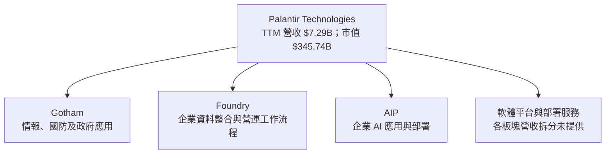
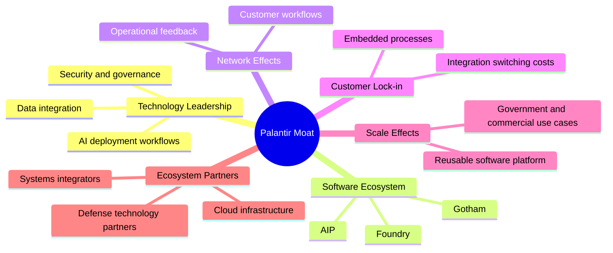
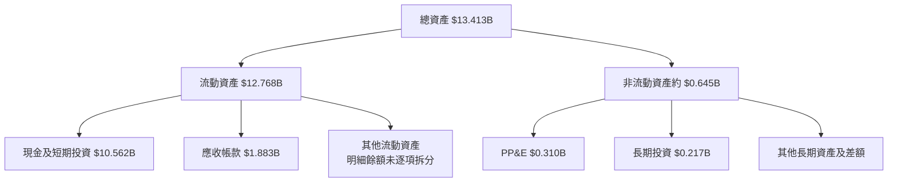
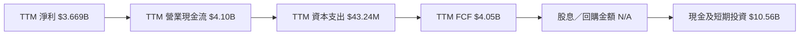
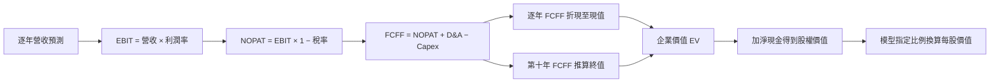
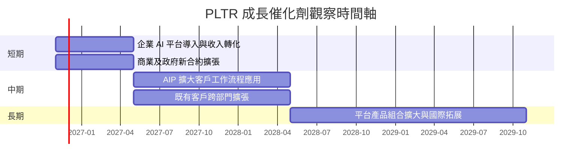
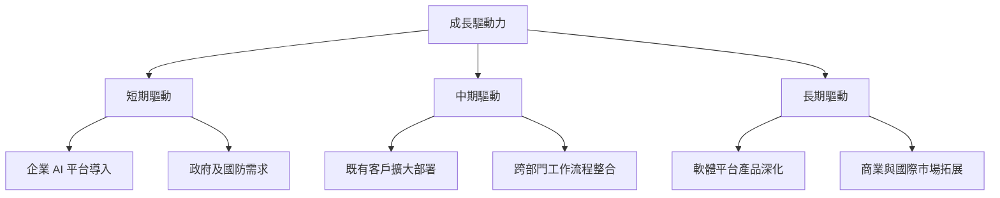
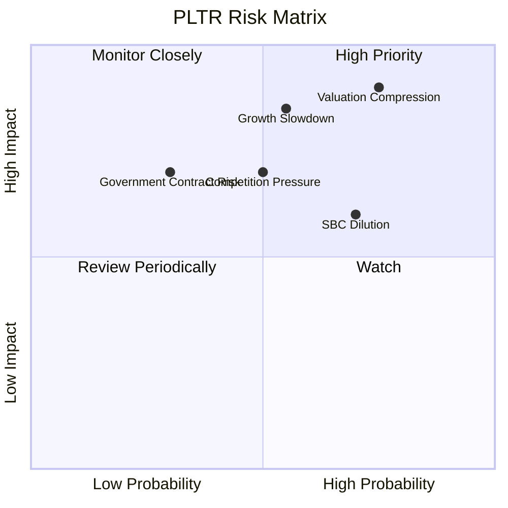
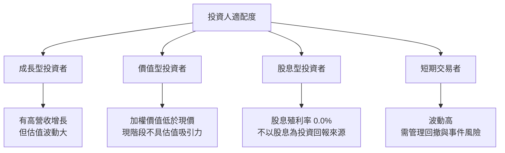

# PLTR 基本面深度分析報告
> **報告日期**：2026-11-21 ｜ **語言**：繁體中文 ｜ **數據來源**：SEC 申報資料 (XBRL)、Yahoo Finance、Finviz、StockAnalysis、Roic.ai ｜ **分析師**：CFA 級機構研究

## 目錄

| # | 章節 | 核心結論 |
|---|------|----------|
| 1 | 執行摘要 | 賣出；加權合理價值 $61.51，MOS −133.3% |
| 2 | 公司概覽與商業模式 | 企業資料平台具客戶整合與部署優勢；業務別營收拆分未提供 |
| 3 | 損益表深度分析 | TTM 營收 $7.29B、TTM 成長 87.1%；毛利率 84.7% |
| 4 | 資產負債表分析 | 現金及短期投資 $10.56B、淨現金 $10.56B；流動性充足 |
| 5 | 現金流量深度分析 | TTM FCF $4.05B、FCF Yield 1.17%；現金轉換良好但 SBC 稀釋仍重要 |
| 6 | 獲利能力與資本效率 | ROIC 492.3% 高於 WACC 11.94%，但 ROIC 受投入資本分母偏小影響 |
| 7 | 相對估值分析 | PLTR 估值遠高於同業 Forward P/E 與 P/S，歷史 P/S 位於偏高區 |
| 8 | DCF 內在價值評估 | DCF 基準值 $22.25；加權合理價值 $61.51，均低於現價 |
| 9 | 成長催化劑 | AI 平台商業化、企業導入與政府需求是主要方向；TAM 數據未提供 |
| 10 | 風險矩陣 | 估值回落、成長降速、競爭與客戶集中為主要風險 |
| 11 | 投資建議 | 依 MOS 為賣出；等待估值與營運條件同時改善 |

## 1. 執行摘要

截至 2026-11-20 收盤價 **$143.49**，PLTR 的 TTM 營收為 **$7.29B**、TTM 營收成長 **87.1%**、TTM 營業利益率 **45.6%**、TTM FCF **$4.05B**，ROIC 為 **492.3%**，高於 **11.94% WACC**。但估值方法加權後合理價值為 **$61.51**，MOS 為 **−133.3%**；依 MOS 門檻評級為**賣出**。高成長與高現金流尚不足以抵銷目前價格相對估值的風險。

### 1.0 一頁式投資儀表板（Portfolio Manager 30 秒速讀）

| 項目 | 內容 |
|------|------|
| **投資論點（3 句）** | ① TTM 營收成長 **87.1%**，最新一季單季 YoY 成長 **95.9%**，顯示需求仍在擴大。② TTM 營業利益率 **45.6%**、TTM FCF **$4.05B**，反映高毛利軟體模式具營運槓桿。③ 加權合理價值 **$61.51**，較現價低 **57.1%**，成長質素與股價風險並存。 |
| **綜合評分** | **7.0/10**（引用 1.1 評分卡；公司品質高但估值扣分） |
| **財務健康** | 🟢 現金及短期投資 **$10.56B**，流動比率 **7.102**；債務數據在來源間有差異，須注意口徑 |
| **ROIC vs WACC** | **492.3% vs 11.94%**；帳面指標顯示創造價值，但 ROIC 分母可能因現金扣除及投入資本偏低而失真 |
| **FCF 趨勢** | 上升；TTM FCF **$4.05B**，FCF Yield **1.17%** |
| **估值** | Forward P/E **56.5x** ｜ EV/EBITDA（VERIFIED FIGURES）**106.9x** ｜ FCF Yield **1.17%** |
| **DCF 內在價值（基準）** | **$22.25** ｜ 相對 DCF 折價／溢價定義下，現價溢價 **+544.9%** |
| **安全邊際（MOS）** | **−133.3%**＝($61.51 − $143.49) ÷ $61.51；🔴 無 |
| **預期報酬（基準情境 12M）** | 加權合理價值相對現價 **−57.1%**；DCF 基準情境相對現價 **−84.5%** |
| **關鍵風險（前二）** | ① 股價估值對長期成長及利潤率高度敏感；② SBC 與股數增加稀釋股東權益 |
| **評級 + 信心度** | 🔴 **賣出** ｜ 信心：中（基本面數據強，但 DCF 輸入與來源口徑存在限制） |

### 1.1 綜合評分卡（全報告唯一）

| 維度 | 評分（1–10） | 主要依據（引用數字與其來源章節） |
|------|--------------|----------------------------------|
| 成長性 | 9.0 | TTM 營收成長 **87.1%**、最新一季單季 YoY **95.9%**（第 3 章） |
| 獲利能力 | 9.0 | TTM 營業利益率 **45.6%**、ROIC **492.3%** 高於 WACC **11.94%**、F-Score **7/8**（第 6 章） |
| 財務健康 | 9.0 | 現金及短期投資 **$10.56B**、流動比率 **7.102**、DSO **94 天**（第 4 章） |
| 估值 | 1.0 | 加權 MOS **−133.3%**；Forward P/E **56.5x** 高於同業中位數 **49.4x**（第 7–8 章） |
| 護城河 | 8.0 | TTM 毛利率 **84.7%**、政府及商業場景均有平台部署；但市場份額與留存率數據未提供（第 2 章） |
| 管理層與資本配置 | 6.0 | FY2025 SBC **$684.03M**；稀釋股數測試未通過，股東稀釋需持續監控（第 3、6 章） |
| **綜合評分** | **7.0** | 六項算術平均：(9+9+9+1+8+6) ÷ 6 = **7.0** |

### 1.2 五大投資論點 + 三大核心風險

| 類型 | 項目 | 具體依據 | 信心度 |
|------|------|----------|--------|
| 🟢 **投資論點①** | 營收加速 | TTM 營收成長 **87.1%**；最新一季單季 YoY **95.9%**，連續季度營收由 **$1.407B** 增至 **$2.313B** | 🟢 高 |
| 🟢 **投資論點②** | 高毛利、營運槓桿 | TTM 毛利率 **84.7%**、營業利益率 **45.6%**；收入增長有機會轉化為利潤與現金流 | 🟢 高 |
| 🟢 **投資論點③** | 現金流強 | TTM OCF **$4.10B**、FCF **$4.05B**；Capex 僅 **$43.24M** | 🟢 高 |
| 🟢 **投資論點④** | 資產負債表有緩衝 | 現金及短期投資 **$10.56B**；可支持產品研發與市場拓展 | 🟢 高 |
| 🟢 **投資論點⑤** | 客戶系統嵌入形成轉換成本 | Gotham、Foundry 等平台整合多源資料與工作流程；改換平台通常涉及流程再設計與系統整合，但量化留存數據未提供 | 🟡 中 |
| 🟡 **風險①** | 估值下修 | 加權合理價值 **$61.51**，比現價低 **57.1%**；DCF 基準 **$22.25** | 🔴 高衝擊 |
| 🔴 **風險②** | 預期成長不及股價隱含程度 | 即使最新一季 YoY 成長 **95.9%**，DCF 仍顯示現價遠高於基準價值 | 🔴 高衝擊 |
| 🟡 **風險③** | SBC 與股數稀釋 | Piotroski 稀釋股數測試未通過；FY2025 SBC **$684.03M** | 🟡 中度 |

### 1.3 快速統計卡片

| 指標 | 公司實際值（期間） | 同業中位數 | 狀態 |
|------|--------------------|------------|------|
| 營收成長（TTM） | **87.1%** | — | 🟢 |
| 營收成長（最新一季年增） | **95.9%** | **35.2%**（SNOW、DDOG、CRM 中位數） | 🟢 |
| 毛利率（TTM） | **84.7%** | **77.3%** | 🟢 |
| 營業利益率（TTM） | **45.6%** | — | 🟢 |
| ROIC（TTM） | **492.3%** | — | 🟢* |
| Forward P/E | **56.5x** | **49.4x**（DDOG、CRM 中位數） | 🔴 |
| FCF Yield（TTM） | **1.17%** | — | 🟡 |
| Piotroski F-Score | **7 / 8** | — | 🟢 |

\* ROIC 數值非常高，應留意投入資本計算分母偏小的影響。

### 1.4 投資結論

```text
╔══════════════════════════════════════════════════════════════════╗
║                    📊 投資結論摘要                               ║
╠══════════════════════════════════════════════════════════════════╣
║  評級：賣出（依加權合理價值 MOS 門檻）                           ║
║  價格（2026-11-20 收盤）：$143.49                                ║
║  DCF 內在價值（基準）：$22.25（現價溢價 +544.9%）               ║
║  安全邊際 MOS：-133.3%（以加權合理價值為分母）                   ║
║  加權合理價值（8.8）：$61.51                                     ║
║  DCF 情境價值：                                                   ║
║    悲觀情境：$13.17（-90.8%）                                    ║
║    基準情境：$22.25（-84.5%）                                    ║
║    樂觀情境：$38.91（-72.9%）                                    ║
║  綜合評分：7.0/10（引用 1.1）                                    ║
║  適合投資人：能承受高波動、重視長期成長且願意等待估值收斂者      ║
╚══════════════════════════════════════════════════════════════════╝
```

## 2. 公司概覽與商業模式

### 2.1 業務結構與收入來源

公司提供資料整合、分析與決策軟體平台，包括政府及國防用途的 Gotham、商業營運用途的 Foundry，以及 AI 平台相關產品。可取得資料未提供各產品或政府／商業業務營收拆分，因此不推估其百分比或金額。



### 2.2 市場份額

市場份額數據未提供，無法以可靠來源量化。相對同業，PLTR TTM 營收成長 **87.1%**，高於 SNOW **35.1%**、DDOG **35.2%** 及 CRM **10.8%** 的最新一季單季 YoY；但這些成長率並不等同市場份額變化。

### 2.3 競爭護城河分析



### 2.4 護城河強度

| 護城河項目 | 強度（強／中／弱） | 證據（引用數字或事實） | 會削弱它的情況 |
|------------|--------------------|------------------------|----------------|
| 技術與產品整合 | 強 | TTM 毛利率 **84.7%**，平台處理多源資料並支援決策流程 | 競品平台能力追上、導入成本下降 |
| 軟體生態系統 | 中至強 | Gotham、Foundry、AIP 涵蓋政府、企業與 AI 場景 | 產品彼此交叉銷售不足或平台碎片化 |
| 網路效應 | 中 | 工作流程與資料模型可在客戶內部擴散；但外部網路效應量化資料未提供 | 客戶間無法共享價值、產品缺乏標準化 |
| 客戶鎖定 | 強 | 深度整合核心作業流程可能增加轉換成本 | 客戶自建、雲端平台原生工具替代 |
| 規模效應 | 中 | TTM 營收 **$7.29B**、TTM 營業利益率 **45.6%** | 競爭帶來定價壓力或交付成本增加 |
| 生態夥伴 | 中 | 資料提及與防務科技領袖及平台夥伴合作；收入貢獻未提供 | 夥伴改變策略或降低合作優先級 |

1.1「護城河」評分 **8.0/10**，主要依據是高毛利、嵌入式工作流程及多產品平台；扣分原因是留存率、客戶集中度及市場份額數字未提供。

## 3. 損益表深度分析

### 3.1 年度收入成長趨勢（近 4 年）

| 財年 | 營收 | YoY | 視覺趨勢 |
|------|------|-----|----------|
| FY2022 | $1.91B | +23.6% | ████████░░░░░░░░░░░░ |
| FY2023 | $2.23B | +16.7% | ██████████░░░░░░░░░░ |
| FY2024 | $2.87B | +28.8% | █████████████░░░░░░░ |
| FY2025 | $4.48B | +56.2% | ████████████████████ |

```text
╔══════════════════════════════════════════════════════════════════╗
║              Palantir 年度收入趨勢（FY2022-FY2025）              ║
╠══════════════════════════════════════════════════════════════════╣
║  FY2022  $1.91B  ████████░░░░░░░░░░░░  YoY +23.6%               ║
║  FY2023  $2.23B  ██████████░░░░░░░░░░  YoY +16.7%               ║
║  FY2024  $2.87B  █████████████░░░░░░░  YoY +28.8%               ║
║  FY2025  $4.48B  ████████████████████  YoY +56.2%               ║
║  FY2022-FY2025 營收 CAGR：約 32.9%                               ║
╚══════════════════════════════════════════════════════════════════╝
```

計算：FY2022 至 FY2025 營收 CAGR = \((4.475 ÷ 1.906)^{1/3} − 1\) = **約 32.9%**。FY2025 成長加速，對應季度營收由 2025 Q1 **$883.86M** 升至 Q4 **$1.407B**；但 2026 年單季高增長能否持續，需區分基期效應與持續性商業需求。

### 3.2 季度收入趨勢分析

| 季度 | 營收 | QoQ | YoY | 備註 |
|------|------|-----|-----|------|
| 2025 Q4 | $1.407B | +19.1% | +70.0% | QoQ 比較 2025 Q3 $1.181B |
| 2026 Q1 | $1.633B | +16.1% | +84.7% | YoY 高於前季，營收規模擴大 |
| 2026 Q2 | $1.935B | +18.5% | +92.8% | 成長延續 |
| 2026 Q3 | $2.313B | +19.5% | +95.9% | 單季 YoY，不是 TTM 成長率 |

QoQ 以當季營收除以前一季營收再減 1 計算；最新一季收入高增長若由企業 AI 導入與合約擴張支撐，將有助延續營運槓桿，但單季數字不能直接外推全年。

### 3.3 利潤率演變分析

| 利潤率指標 | FY2022 | FY2023 | FY2024 | FY2025 | 趨勢 | 評估 |
|------------|--------|--------|--------|--------|------|------|
| **毛利率** | 78.5% | 80.6% | 80.3% | 82.4% | 整體上升 | 🟢 |
| **營業利益率** | −8.5% | 5.4% | 10.8% | 31.6% | 明顯擴張 | 🟢 |
| **淨利率** | −19.6% | 9.4% | 16.1% | 36.3% | 轉盈並擴張 | 🟢 |

年度利潤率由年度損益表數字計算。營業利益率擴張遠快於收入，反映產品規模擴大與費用成長低於毛利增長；FY2025 研發支出 **$557.68M**，相較 FY2024 的 **$507.88M** 增加約 **9.8%**，低於同期營收 **56.2%** 的增幅。此營運槓桿若維持可支撐高利潤率，但不宜假設利潤率能永遠線性上升。

TTM 營業利益率 **45.6%** 高於 FY2025 年度值 **31.6%**，顯示 2026 年營收增長與費用控制進一步提高獲利能力。最新季度營業利益率在來源表格間有 **45.6%** 與 **46.9%** 差異；本報告採 VERIFIED FIGURES 的最新季度值 **46.9%**，TTM 則採 **45.6%**。

### 3.4 費用結構分析

費用細項資料不足以建立完整費用結構圓餅圖；已知 FY2025 研發費用 **$557.68M**，但銷售及管理費用等項目未在可用資料中完整列示，故不推算比例。FY2025 研發支出約佔年度營收 **12.5%**（$557.68M ÷ $4.475B），代表公司仍投入相當資源維持產品與平台競爭力。

### 3.5 季度 EPS 趨勢與盈餘品質（Quality of Earnings）

| 季度 | EPS | EPS YoY | 超預期／不及預期 |
|------|-----|---------|------------------|
| 2025 Q4 | $0.23 | +647.6% | 預估值 N/A，無法判斷 |
| 2026 Q1 | $0.34 | +325.0% | 預估值 N/A，無法判斷 |
| 2026 Q2 | $0.41 | +215.4% | 預估值 N/A，無法判斷 |
| 2026 Q3 | $0.44 | +144.4% | 預估值 N/A，無法判斷 |

| 盈餘品質項目 | 數值／佔比 | 評估 |
|--------------|-----------|------|
| 股權薪酬 SBC / 營收 | TTM SBC **$982.10M** ÷ $7.29B = **13.5%** | 🔴 對股東報酬有實質稀釋；SBC 非現金不代表沒有經濟成本 |
| SBC / 營業現金流 | $982.10M ÷ $4.10B = **23.9%** | 🟡 現金流強，但稀釋薪酬仍佔 OCF 近四分之一 |
| FCF / 淨利（現金轉換率） | $4.05B ÷ TTM 淨利 $3.669B = **110.4%** | 🟢 現金轉換高於會計淨利 |
| 一次性／非經常性損益 | N/A（資料未提供完整調節表） | 無法判定一次性項目對 GAAP 盈餘的淨影響 |
| 有效稅率異常 | **1.4%** | 🟡 偏低；可能使淨利高於正常稅率下水準，未來稅率上升會壓低淨利 |
| 資本化支出 vs 費用化 | TTM Capex **$43.24M**；資本化政策細項 N/A | 未見高資本支出，但無法據此斷定費用資本化不存在 |

EPS 預估值為 NaN，因此不能將最近四季標為超預期或不及預期。盈餘品質的正面證據是 TTM FCF 對淨利轉換率 **110.4%**；主要折扣是 SBC 佔營收 **13.5%**，且稀釋股數測試未通過。低有效稅率亦使 GAAP 淨利不宜直接視為可持續常態盈餘。

## 4. 資產負債表分析

### 4.1 資產結構分解

截至 2026-09-30，總資產 **$13.413B**、流動資產 **$12.768B**，非流動資產約 **$0.645B**（總資產減流動資產，按公布數字計算）。



非流動資產分項存在四捨五入及分類差異，故不將未拆分餘額當作單一確定科目。

### 4.2 流動性與營運資金分析

| 指標 | 數值／最新 TTM | 評估 |
|------|----------------|------|
| 現金及短期投資 | **$10.56B** | 🟢 流動性緩衝充足 |
| 流動比率 | **7.102** | 🟢 短期償債能力高 |
| 速動比率 | **6.923** | 🟢 高流動性資產覆蓋短期負債 |
| DSO 應收帳款天數 | **94 天** | 與一年前持平；需觀察應收增速是否超越營收 |
| DIO 存貨天數 | **N/A** | 公司未報告相應存貨餘額 |
| DPO 應付帳款天數 | **29 天** | 一年前 33 天，減少 4 天 |
| CCC 現金轉換週期 | **N/A** | DIO 不適用，故無法計算 |

| 指標 | 最新 TTM | 一年前 TTM | 變化 | 解讀 |
|------|----------|------------|------|------|
| DSO | 94 天 | 94 天 | 0 天 | 收款天數穩定；仍應比較應收款與收入增速 |
| DIO | N/A | N/A | N/A | 無存貨資料，不適用計算 |
| DPO | 29 天 | 33 天 | −4 天 | 付款天數縮短，可能代表付款節奏改變，不能僅據此推論議價力 |
| CCC | N/A | N/A | N/A | DIO 缺失，不能用估計值填補 |

### 4.3 債務結構分析

債務資料存在來源口徑差異：VERIFIED FIGURES 的總債務為 **N/A**、淨現金為 **$10.56B**；其他資產負債表資料列示總債務 **$225.27M**、淨現金／債務 **$10.34B**。DCF 依指定模型使用淨現金 **$10.56B**，而非以未核對口徑替換。

```text
╔══════════════════════════════════════════════════════════════════╗
║                   PLTR 債務健康診斷                              ║
╠══════════════════════════════════════════════════════════════════╣
║  總債務（VERIFIED FIGURES）：N/A                                 ║
║  其他資產負債表口徑總債務：$0.225B                               ║
║  現金及短期投資：$10.56B                                          ║
║  淨現金（VERIFIED FIGURES）：$10.56B  🟢                          ║
║  流動比率：7.102  🟢                                              ║
║  Debt/EBITDA、利息保障倍數：N/A（計息負債及利息資料不足）         ║
╚══════════════════════════════════════════════════════════════════╝
```

### 4.4 股東權益趨勢

| 財年 | 股東權益 | YoY 變化 |
|------|----------|----------|
| FY2022 | $2.57B | — |
| FY2023 | $3.48B | +35.4% |
| FY2024 | $5.00B | +43.7% |
| FY2025 | $7.39B | +47.8% |

```text
╔══════════════════════════════════════════════════════════════════╗
║                    股東權益趨勢                                  ║
╠══════════════════════════════════════════════════════════════════╣
║  FY2022  $2.57B  ███████░░░░░░░░░░░░░░                           ║
║  FY2023  $3.48B  █████████░░░░░░░░░░░                            ║
║  FY2024  $5.00B  ██████████████░░░░░░                            ║
║  FY2025  $7.39B  ████████████████████                            ║
╚══════════════════════════════════════════════════════════════════╝
```

權益逐年增加與獲利累積相符，但股數稀釋仍是股東權益品質的重要監控項目。

## 5. 現金流量深度分析

### 5.1 現金流量瀑布圖

現金流資料提供營業現金流、資本支出及 FCF，但未提供完整股息與回購現金流拆分，因此相應節點標示為未提供。



### 5.2 FCF 轉換率趨勢

| 財年 | FCF | 淨利 | FCF／淨利 |
|------|-----|------|-----------|
| FY2022 | $183.71M | −$373.70M | 不具解讀意義（淨利為負） |
| FY2023 | $697.07M | $209.82M | 332.2% |
| FY2024 | $1.14B | $462.19M | 約 246.7% |
| FY2025 | $2.10B | $1.63B | 約 128.8% |
| TTM 至 2026-09-30 | $4.05B | $3.669B | 110.4% |

FY2023–FY2025 的轉換率逐步回歸，但仍高於 100%；TTM 110.4% 表示現金流表現強於淨利，仍需結合 SBC、應收款與稅務變動觀察。

### 5.3 自由現金流趨勢

```text
╔══════════════════════════════════════════════════════════════════╗
║                 自由現金流趨勢                                   ║
╠══════════════════════════════════════════════════════════════════╣
║  FY2022  $0.184B  ██░░░░░░░░░░░░░░░░░░  FCF Yield：N/A          ║
║  FY2023  $0.697B  ██████░░░░░░░░░░░░░░  FCF Yield：N/A          ║
║  FY2024  $1.14B   ███████████░░░░░░░░░  FCF Yield：N/A          ║
║  FY2025  $2.10B   █████████████████░░░  FCF Yield：N/A          ║
║  TTM      $4.05B   ████████████████████  FCF Yield：1.17%        ║
╚══════════════════════════════════════════════════════════════════╝
```

歷史各年市值未提供，故只列 TTM FCF Yield **1.17%**，不反推歷史殖利率。TTM FCF 較 FY2025 全年 FCF **$2.10B** 高，與 2026 年季度營收及現金流規模提升一致。

### 5.4 資本配置評估

股息殖利率為 **0.0%**、派息率 **0.0%**。回購與其他投資的完整現金金額未提供，故不畫比例圓餅圖、不推估資本配置比例。

| 資本配置項目 | 可用數據 | 評估 |
|--------------|----------|------|
| 資本支出 | TTM **$43.24M** | 相對營收及 OCF 低，資本密集度有限 |
| 股息 | 殖利率 **0.0%** | 現金保留及再投資為主要用途之一 |
| 回購 | N/A | 無法量化 |
| SBC | TTM 約 **$982.10M** | 需視為股東經濟成本；稀釋股數測試未通過 |
| 留存現金 | 現金及短期投資 **$10.56B** | 提供資金彈性，但資本配置回報需持續驗證 |

## 6. 獲利能力與資本效率

### 6.1 ROE / ROA / ROIC 趨勢

| 指標 | 可取得期間數值 | 評估 |
|------|----------------|------|
| ROE | TTM **32.7%**（QUALITY FIGURES）；其他摘要另列 **40.9%** | 採品質指標的杜邦一致值 **32.7%**；來源口徑有差異 |
| ROA | TTM **19.3%** | 獲利對資產回報高 |
| ROIC | TTM **492.3%** | 明顯高於 WACC，但分母可能偏小 |
| 行業均值 | N/A | 未提供可比口徑資料，不列估計值 |

### 6.2 ROIC vs WACC 分析（核心價值創造判斷）

```text
╔══════════════════════════════════════════════════════════════════╗
║                ROIC vs WACC 深度分析                            ║
╠══════════════════════════════════════════════════════════════════╣
║  WACC（採用 Cost of capital 數據）：11.94%                       ║
║  ├── 無風險利率：4.91%                                           ║
║  ├── ERP：5.00%                                                  ║
║  ├── Beta：原始 1.61；調整後 1.41                                ║
║  ├── 股權成本：11.95%                                            ║
║  ├── 稅前債務成本：6.91%；有效稅率：1.4%                         ║
║  ├── E / D 權重：99.9% / 0.1%                                    ║
║  └── WACC：11.94%                                                ║
║                                                                  ║
║  ROIC（TTM）：492.3%                                              ║
║  EVA 利差 = ROIC − WACC = 492.3% − 11.94% = 480.36 個百分點      ║
║                                                                  ║
║  ROIC  492.3%  ▓▓▓▓▓▓▓▓▓▓▓▓▓▓▓▓▓▓▓▓▓▓▓▓▓▓▓▓  🟢               ║
║  WACC   11.94% ▓░░░░░░░░░░░░░░░░░░░░░░░░░░░░                   ║
╚══════════════════════════════════════════════════════════════════╝
```

以來源定義，ROIC 顯著高於 WACC，帳面上代表公司創造股東價值。不過 ROIC 分母為權益加債務減現金；PLTR 持有 **$10.56B** 現金及短期投資，若投入資本因此壓縮，ROIC 會被放大。故方向性結論為正，但 **492.3% 不宜當成可長期維持的經濟報酬率**。本節 WACC 使用 **11.94%**，與 DCF 一致。

### 6.3 杜邦三因素分解

| 因素 | 數值（TTM） | 解讀 |
|------|-------------|------|
| 淨利率 | **50.3%** | 淨利潤率高，受獲利擴張與低有效稅率影響 |
| 資產週轉率 | **0.54** | 每單位資產產生的收入有限於高現金持有模式 |
| 權益乘數 | **1.19** | 槓桿不高，ROE 並非主要靠負債槓桿撐起 |
| **ROE** | **32.7%** | 50.3% × 0.54 × 1.19 ≈ 32.7% |

ROE 主要由高淨利率驅動，而非高財務槓桿。

### 6.4 財務體質：Piotroski F-Score

Piotroski F-Score 為 **7/8**；因一項缺少輸入資料而排除，分母低於九項。

| 測試 | 結果 | 解讀 |
|------|------|------|
| ROA > 0 | ✅ 通過 | 獲利為正 |
| 營業現金流 > 0 | ✅ 通過 | 現金營運為正 |
| ROA 高於一年前 | ✅ 通過 | 資產獲利改善 |
| 營業現金流 > 淨利 | ✅ 通過 | 應計品質測試通過 |
| 長期負債 ÷ 總資產低於一年前 | — 無法判定 | 缺少輸入，不作推論 |
| 流動比率高於一年前 | ✅ 通過 | 流動性改善 |
| 稀釋股數未增加 | ❌ 未通過 | SBC 或其他發股造成稀釋風險 |
| 毛利率高於一年前 | ✅ 通過 | 毛利率改善 |
| 資產週轉率高於一年前 | ✅ 通過 | 資產使用效率改善 |

## 7. 相對估值分析

### 7.1 同業估值比較表格

PLTR 公司估值採 VERIFIED FIGURES 的估值倍數；同業倍數採同一來源區塊。PLTR Forward P/E 取市場估值資料 **56.5x**；Peer 區塊未提供 PLTR Forward P/E 的原始欄位，但此處使用公司市場資料所列數值。

| 估值指標 | **PLTR** | **SNOW** | **DDOG** | **CRM** | 本公司評估 |
|----------|----------|---------|---------|---------|-----------|
| **Trailing P/E** | **101.0x** | N/A | 218.6x | 16.5x | 🟡 高於 CRM、低於 DDOG；SNOW 無值 |
| **Forward P/E** | **56.5x** | 82.9x | 49.4x | 11.3x | 🔴 高於 DDOG、CRM；低於 SNOW |
| **P/S Ratio** | **50.7x** | 16.5x | 13.3x | 3.4x | 🔴 顯著高於三家同業 |
| **EV/EBITDA** | **106.9x** | −87.1x | 310.6x | 13.9x | 🟡 高於 CRM；SNOW 負值不具一般比較意義 |
| **最新一季營收 YoY** | **95.9%** | 35.1% | 35.2% | 10.8% | 🟢 成長明顯較快 |
| **毛利率（TTM）** | **84.7%** | 67.0% | 79.6% | 77.3% | 🟢 高於列示同業 |

同業最新季度成長中位數為 **35.2%**（SNOW、DDOG、CRM 中位數）。PLTR 成長溢價具有財務依據，但 P/S **50.7x** 約為 DDOG 的 **3.8 倍**、CRM 的 **14.9 倍**，顯示市場已提前資本化大量未來成長。

### 7.2 歷史估值區間分析

```text
╔══════════════════════════════════════════════════════════════════╗
║             PLTR 歷史估值區間（近 5 年 TTM 倍數）                ║
╠══════════════════════════════════════════════════════════════════╣
║  P/E        100.6x ├─●現在 101.0x──────────────┤ 601.0x          ║
║             中位數 228.6x；目前百分位 7%                         ║
║  P/S          7.0x ├────────●現在 50.7x─────────┤ 120.4x         ║
║             中位數 24.7x；目前百分位 67%                         ║
║  EV/EBITDA  109.0x ├●現在 106.9x───────────────┤ 574.4x          ║
║             中位數 233.4x；目前百分位 0%                         ║
╚══════════════════════════════════════════════════════════════════╝
```

P/E 與 EV/EBITDA 的當前歷史百分位低，但當前絕對倍數仍高；P/S 位於自身歷史 **67 百分位**且為歷史中位數的約 **2.1 倍**。不同估值倍數受獲利快速增長及股價期間變化影響，不能只憑百分位判定便宜。

### 7.3 情境價值（Bear / Base / Bull）

| 情境 | 第 1 年營收成長 | 期末營業利潤率 | WACC | 每股價值 | 相對現價 | 機率 | 會發生的條件 |
|------|----------------|----------------|------|----------|----------|------|--------------|
| 🔴 悲觀 | 15.0% | 9.2% | 12.94% | **$13.17** | −90.8% | 25% | AI 導入與商業轉化降速，成熟期利潤率低於基準 |
| 🟡 基準 | 30.0% | 10.8% | 11.94% | **$22.25** | −84.5% | 50% | 早期成長逐步放緩、利潤率向歷史中位數收斂 |
| 🟢 樂觀 | 45.0% | 11.9% | 10.94% | **$38.91** | −72.9% | 25% | 商業化持續加速、成熟期利潤率較高且折現率下降 |

三個情境的每股價值及假設均依模型輸出。上述每一情境仍低於現價，說明依該模型設定，即使樂觀情境也不足以支撐目前股價。

### 7.4 相對估值隱含價格區間

```text
╔══════════════════════════════════════════════════════════════════╗
║             相對估值與參考價值（每股）                           ║
╠══════════════════════════════════════════════════════════════════╣
║  DCF 基準 $22.25 ─ 同業 Forward P/E $77.08 ─ 現價 $143.49        ║
║                                          ─ 分析師共識 $222.90    ║
╚══════════════════════════════════════════════════════════════════╝
```

| 估值方法 | 每股價值 | 相對現價 | 依據 |
|----------|----------|----------|------|
| DCF（基準） | **$22.25** | −84.5% | 10 年 FCFF、WACC 11.94%、終值成長 3.0% |
| 同業 Forward P/E | **$77.08** | −46.3% | DDOG、CRM 同業中位數 **30.4x** × Forward EPS **$2.54** |
| 分析師共識目標價 | **$222.90** | +55.3% | 29 位分析師平均目標價；作參考而非內在價值模型 |
| 同業 EV/EBITDA | N/A | N/A | 未能計算；不得自行補值 |

## 8. DCF 內在價值評估（Discounted Cash Flow）

### 8.0 估值推理鏈（Thinking Logic）

**Step 1 — 價值來源與主導變數**

模型的價值由現有平台營收及高利潤現金流、企業 AI 商業化帶來的增長，以及成熟期利潤率共同決定。可取得資料沒有產品分部營收，因此無法可靠量化 Gotham、Foundry、AIP 的營收占比。模型最敏感的變數是營收成長與營業利潤率路徑，其次是 WACC 和終值成長率。

**Step 2 — 模型選擇**

| 決策點 | 本報告採用 | 理由 | 曾考慮但否決 | 否決理由 |
|--------|-----------|------|--------------|----------|
| 現金流定義 | FCFF | 與 WACC 折現後得到企業價值；模型已提供該口徑 | FCFE | 模型已明確給出 FCFF，改用 FCFE 會改變模型口徑 |
| 預測期 N | 10 年 | DCF MODEL 指定 10 年，允許增長與利潤率逐步收斂 | 5 年 | 過早進入終值會忽略成長與利潤率的轉換 |
| 終值方法 | Gordon Growth | 模型採終值成長率 3.0% | 退出倍數為主 | 模型沒有提供可採用的退出倍數終值 |
| EBIT 基礎 | GAAP EBIT | 模型明示 GAAP EBIT，已含 SBC 費用 | 非 GAAP EBIT | 若加回 SBC 會與模型輸出不一致 |

**Step 3 — 關鍵假設推導鏈**

- **營收成長**：錨點＝TTM 營收成長 **87.1%**、FY2025 年增 **56.2%**、FY2022–FY2025 CAGR 約 **32.9%** → 調整＝高成長基期使長期延續率下降，模型將首年增長限制於 30.0%，再線性降至 3.0% → **採用首年 30.0%、第 10 年 3.0%** → 曾考慮以 TTM 87.1% 作首年成長，但拒絕直接外推，因其可能將單一時段高增速延長成常態。
- **期末營業利潤率**：錨點＝TTM 營業利益率 **45.6%**；近年年度營業利益率由 FY2023 **5.4%**、FY2024 **10.8%** 升至 FY2025 **31.6%** → 調整＝模型以歷史中位數為長期錨，假設競爭及成熟化令利潤率回落 → **採用第 10 年 10.8%** → 曾考慮維持 45.6%，但其與成熟期利潤率假設不相容。
- **永續成長率 g**：錨點＝模型指定 **3.0%**，低於 **11.94% WACC** → 調整＝沒有另行上調；長期成長需低於折現率 → **採用 3.0%** → 曾考慮更高 g，但缺少長期宏觀與公司成熟期資料支持，且會加大終值依賴。
- **預測期 N**：錨點＝DCF MODEL 明列 **10 年**，FY+1 成長 30.0%、FY+10 成長 3.0% → 調整＝不改動模型逐年遞減路徑 → **採用 10 年** → 曾考慮較短預測期，但會與給定模型不一致。
- **Capex／營收**：錨點＝模型首年 **0.6%**、第十年 **0.4%**；TTM Capex **$43.24M**，僅約 TTM 營收 **0.6%** → 調整＝隨成熟化逐步接近模型指定值 → **採用 0.6% 線性降至 0.4%** → 不採用以高資本密集產業比率替代，因公司實際 Capex 偏低且商業模式不同。
- **GAAP EBIT、SBC 與股數**：錨點＝模型指定 GAAP EBIT；FY2025 SBC **$684.03M**，稀釋股數測試未通過 → 調整＝遵照模型以固定股數避免再度重複扣除 → **採用組合 (A)：GAAP EBIT、不另扣 SBC、年稀釋率 0%** → 曾考慮另扣 SBC 或再計股數稀釋，但會偏離模型且可能重複計入。
- **WACC**：錨點＝Cost of capital 計算值 **11.94%** → 調整＝按提供的權重及股債成本採用，不自行重算替換 → **採用 11.94%** → 不採較低折現率，因 10 年美債、ERP 與調整後 Beta 已反映於提供的資本成本。
- **稅率**：錨點＝最新年度有效稅率 **1.4%** → **採用 1.4%**；模型直接沿用，但此低稅率可能低估長期現金稅負。
- **D&A／營收**：錨點＝TTM 約 **0.4%** → **採用 0.4%**，模型固定。
- **營運資金**：模型未建模 ΔWC → **採用不另扣 ΔWC**；此為模型限制，不代表實際營運資金完全不耗用現金。

**Step 4 — 最脆弱環節**

最脆弱的是將營業利潤率由 TTM **45.6%** 降至第十年 **10.8%** 的長期路徑；若成熟期利潤率明顯高於此值，模型價值會提高，但目前提供的情境價值仍僅 **$13.17–$38.91**。

**Step 5 — 計算路徑圖**



### 8.1 模型假設總表（Model Inputs）

| 假設項目 | 採用值 | 依據／來源 | 敏感度 |
|----------|--------|-------------|--------|
| 預測期長度 **N** | **10 年** | DCF MODEL；從 30.0% 增長逐步收斂至 3.0% | 🟡 中 |
| 營收成長 | 第 1 年 **30.0%**，第 10 年 **3.0%**，線性遞減 | TTM 成長 87.1%；FY2025 成長 56.2%；模型限制 0%–30% 首年增長 | 🔴 高 |
| 營業利潤率 | 第 1 年 **45.6%**，第 10 年 **10.8%** | TTM 利潤率與近五年歷史中位數（含 TTM） | 🔴 高 |
| 有效稅率 | **1.4%** | 最新年度有效稅率 | 🟢 低 |
| Capex／營收 | 第 1 年 **0.6%**，第 10 年 **0.4%** | TTM Capex／收入約 0.6%；模型向 1.1×D&A 收斂 | 🟡 中 |
| D&A／營收 | **0.4%** | TTM 比率，模型固定 | 🟢 低 |
| ΔWC／營收增額 | 未建模 | DCF MODEL 明示 Working capital is not modelled | 🟢 低 |
| EBIT 基礎 | GAAP EBIT | 模型採用 GAAP EBIT | 🟡 中 |
| SBC 處理 | GAAP 已含 SBC；FCFF 不再扣 SBC | 模型指定組合 (A) | 🟡 中 |
| 年稀釋率 | **0%**（模型固定股數） | 與 GAAP EBIT 已反映 SBC 成本的模型組合一致 | 🟡 中 |
| 永續成長率 g | **3.0%** | 模型假設，且低於 WACC 11.94% | 🔴 高 |
| 終值方法 | Gordon Growth | DCF MODEL 採 Gordon Growth | 🔴 高 |
| WACC | **11.94%** | Cost of capital 區塊 | 🔴 高 |

FCFF 定義為 **FCFF = NOPAT + D&A − Capex**；模型不列 ΔWC。SBC 只反映一次：本模型採用 **(A) GAAP EBIT + 固定股數**，因此不另扣 SBC，年稀釋率設為 0%。

### 8.2 折現率推導（WACC）

```text
╔══════════════════════════════════════════════════════════════════╗
║                    WACC 推導（折現率）                           ║
╠══════════════════════════════════════════════════════════════════╣
║  無風險利率 Rf：4.91%；日期：成本資本資料列示值，觀測日未提供   ║
║  ERP：5.00%（假設值，依成本資本計算資料）                        ║
║  原始 Beta：1.61；調整 Beta：2/3×1.61 + 1/3×1 = 1.41             ║
║  Ke：提供值 11.95%                                               ║
║  稅前 Kd：提供的假設值 6.91%                                     ║
║  稅率：1.4%；稅後 Kd = 6.91%×(1−1.4%) = 6.813%                  ║
║  E / D 權重：99.9% / 0.1%                                        ║
║  WACC：提供採用值 11.94%                                         ║
╚══════════════════════════════════════════════════════════════════╝
```

原始 Beta 由 Yahoo Finance 列示為 **1.61**；採用 Beta 為調整後 **1.41**，調整方式為 \(⅔×1.61+⅓×1\)。無規模或國別風險溢酬另加值。債務成本為假設值（依據：無利息費用可用時，以無風險利率加信用利差），資料列示 **6.91%**；權重直接採用 **99.9%／0.1%**。10 年美債殖利率的具體觀測日期未提供，故不另聲稱某一日期。

**逐步演算與資料一致性：**

1. CAPM 公式：\(Ke=Rf+β×ERP\)。代入已列示的兩位小數輸入：\(4.91\%+1.41×5.00\%=11.96\%\)。資本成本資料列示 Ke 為 **11.95%**；差異來自輸入或計算精度未公開，本報告沿用指定 Ke。
2. 稅前 Kd：提供假設值 **6.91%**；利息費用與平均計息負債原始金額未提供，無法自行重算。
3. 稅後 Kd：\(6.91\%×(1−1.4\%)=6.813\%\)。
4. 權重：股權 **99.9%**、債務 **0.1%**；兩者合計 **100.0%**。股權市值與債務負債口徑原始計算值未在成本資本資料中列明，因此採用其提供的權重，不重算替換。
5. WACC：\(99.9\%×11.95\%+0.1\%×6.813\%=11.9449\%\)，四捨五入為 **11.94%**。

### 8.3 逐年自由現金流預測（基準情境）

以下金額為 **$B**；逐年數值依 DCF MODEL 原值引用。折現因子保留三位小數。模型未列營運資金變動。

| 年度 | FY+1 | FY+2 | FY+3 | FY+4 | FY+5 | FY+6 | FY+7 | FY+8 | FY+9 | FY+10 |
|------|------|------|------|------|------|------|------|------|------|-------|
| 營收 | 9.47 | 12.03 | 14.92 | 18.05 | 21.30 | 24.50 | 27.44 | 29.91 | 31.70 | 32.65 |
| 營收 YoY | 30.0% | 27.0% | 24.0% | 21.0% | 18.0% | 15.0% | 12.0% | 9.0% | 6.0% | 3.0% |
| 營業利潤率 | 45.6% | 41.8% | 37.9% | 34.0% | 30.2% | 26.3% | 22.4% | 18.6% | 14.7% | 10.8% |
| 營業利益 EBIT | 4.32 | 5.03 | 5.66 | 6.14 | 6.43 | 6.44 | 6.16 | 5.55 | 4.66 | 3.54 |
| − 稅 | (0.06) | (0.07) | (0.08) | (0.08) | (0.09) | (0.09) | (0.08) | (0.08) | (0.06) | (0.05) |
| = NOPAT | 4.26 | 4.96 | 5.58 | 6.06 | 6.34 | 6.36 | 6.07 | 5.48 | 4.60 | 3.49 |
| + D&A | 0.04 | 0.05 | 0.06 | 0.07 | 0.08 | 0.10 | 0.11 | 0.12 | 0.13 | 0.13 |
| − Capex | (0.06) | (0.07) | (0.08) | (0.10) | (0.11) | (0.12) | (0.13) | (0.14) | (0.14) | (0.14) |
| **= FCFF** | **4.25** | **4.94** | **5.55** | **6.03** | **6.31** | **6.33** | **6.05** | **5.45** | **4.58** | **3.48** |
| 折現因子 @11.94% | 0.893 | 0.798 | 0.713 | 0.637 | 0.569 | 0.508 | 0.454 | 0.406 | 0.362 | 0.324 |
| **FCFF 現值 PV** | **3.79** | **3.94** | **3.96** | **3.84** | **3.59** | **3.22** | **2.75** | **2.21** | **1.66** | **1.12** |

預測期現值加總：
**$3.79 + $3.94 + $3.96 + $3.84 + $3.59 + $3.22 + $2.75 + $2.21 + $1.66 + $1.12 = $30.08B**。

**FY+1 代表年度逐步演算**（模型輸出精度有限，底層未四捨五入數據不可得）：

1. 營收：以 TTM 收入 **$7.29B**、首年成長 **30.0%** 推估；模型列示營收 **$9.47B**。
2. EBIT：營收 **$9.47B × 45.6%**；模型列示 **$4.32B**。
3. 稅：EBIT **$4.32B × 1.4%**；模型列示 **$0.06B**。
4. NOPAT：模型列示 **$4.26B**。
5. D&A：模型列示 **$0.04B**（D&A／營收約 0.4%）。
6. Capex：模型列示 **$0.06B**（首年 Capex／營收 0.6%）。
7. ΔWC：模型未建模，不列數字。
8. FCFF：模型列示 **$4.25B**；各表格行均經四捨五入，故用列示兩位小數直接相減可能出現尾差。
9. 折現因子：\(1÷(1+11.94\%)^1\) 約為 **0.893**；PV：模型列示 **$3.79B**。

- 預測 FCFF FY+1 至 FY+10 CAGR：約 \((3.48÷4.25)^{1/9}−1\) = **−2.2%**；FY+1 至 FY+10 現金流先升後降，主要反映營業利潤率從 **45.6%** 降至 **10.8%**。
- FY+10 FCFF 利潤率：**3.48÷32.65=10.7%**；目前 TTM FCF／營收：**4.05÷7.29=55.6%**。同業最佳 FCF 利潤率未提供，不能比較。
- 模型各年 FCFF 均為正；高現金流並未消除終值及利潤率假設風險。

```text
╔══════════════════════════════════════════════════════════════════╗
║            自由現金流：歷史實際 vs 模型預測                      ║
╠══════════════════════════════════════════════════════════════════╣
║  FY2023(實)  $0.697B  ███░░░░░░░░░░░░░░░░░                       ║
║  FY2024(實)  $1.14B   █████░░░░░░░░░░░░░░                       ║
║  FY2025(實)  $2.10B   █████████░░░░░░░░░░░                       ║
║  FY+1 (預)   $4.25B   ██████████████████░░                       ║
║  FY+10(預)   $3.48B   ███████████████░░░░░                       ║
║  預測 FY+1 至 FY+10 FCFF CAGR 約 -2.2%；後段利潤率收斂造成回落  ║
╚══════════════════════════════════════════════════════════════════╝
```

### 8.4 終值計算（Terminal Value）

適用性檢查：**WACC 11.94% vs g 3.0% → WACC > g？✅**

| 方法 | 計算式 | 終值 TV | TV 現值 | 佔總 EV 比重 |
|------|--------|---------|---------|--------------|
| Gordon Growth | FY+10 FCFF × (1+g) ÷ (WACC−g) | **$40.04B** | **$12.96B** | **30.1%** |
| 退出倍數法 | N/A | N/A | N/A | N/A |

1. FY+10 FCFF：**$3.48B**。
2. 分子：模型列示 \(3.48×(1+3.0\%)\)；模型終值 **$40.04B**。
3. 分母：\(11.94\%−3.0\%=8.94\%\)；終值模型列示 **$40.04B**。由於表格輸入已四捨五入，直接用顯示數字複算會有小幅差異，故保留模型原值。
4. PV(TV)：**$40.04B × 0.324 = $12.96B**（模型原值）。
5. 終值佔比：**$12.96B ÷ $43.04B = 30.1%**。

模型未提供退出倍數法所需倍數，因此不自設同業或成熟期退出倍數。終值現值佔 EV **30.1%**，低於終值主導型估值，但仍對長期假設敏感。

### 8.5 企業價值 → 每股內在價值（Bridge）

```text
╔══════════════════════════════════════════════════════════════════╗
║              企業價值 → 每股內在價值 橋接表                      ║
╠══════════════════════════════════════════════════════════════════╣
║  預測期 FCF 現值合計             +$30.08B                        ║
║  終值現值 PV(TV)                 +$12.96B                        ║
║  = 企業價值 EV                    $43.04B                         ║
║  + 現金及短期投資                +$10.56B                         ║
║  − 總債務                        N/A（模型採用淨現金）            ║
║  = 股權價值                       $53.60B                         ║
║  模型比例換算後每股價值           $22.25                          ║
║  當前股價                         $143.49                         ║
║  折溢價                           +544.9%（溢價）                 ║
║  本節不計算 MOS；MOS 只在 8.8 計算                              ║
╚══════════════════════════════════════════════════════════════════╝
```

1. EV：**$30.08B + $12.96B = $43.04B**。
2. 股權價值：**$43.04B + $10.56B = $53.60B**；模型以淨現金橋接，債務細項未另列。
3. 每股價值：DCF MODEL 指定算式為 **股權價值 × 價格 ÷ 市值**，模型列示結果 **$22.25**。不可用另一組股數或市場數據替換該結果。
4. 折溢價：\(($143.49÷$22.25)−1\) = **約 +544.9%**，表示現價較 DCF 基準值溢價。
5. 本節不計算 MOS；安全邊際只以 8.8 加權合理價值為分母。

模型以 GAAP EBIT、固定股數處理 SBC；DCF 每股換算依模型指定的價格與市值比例公式。現金與淨現金採用 2026-09-30 財務數據口徑。

### 8.6 敏感性分析（WACC × 永續成長率）

以下每股值直接引用 DCF MODEL；括號為相對現價 $143.49 的上行空間，計算式為每股值 ÷ $143.49 − 1。

| g（列）／WACC（欄） | 9.94% | 10.94% | **11.94%（基準）** | 12.94% | 13.94% |
|-----------|------:|------:|------------------:|------:|------:|
| **2.0%** | $25.15（−82.5%） | $23.23（−83.8%） | $21.66（−84.9%） | $20.35（−85.8%） | $19.24（−86.6%） |
| **2.5%** | $25.67（−82.1%） | $23.60（−83.6%） | $21.94（−84.7%） | $20.56（−85.7%） | $19.40（−86.5%） |
| **3.0%（基準）** | $26.27（−81.7%） | $24.02（−83.3%） | **$22.25（−84.5%）** | $20.79（−85.5%） | $19.58（−86.4%） |
| **3.5%** | $26.95（−81.2%） | $24.50（−82.9%） | $22.59（−84.3%） | $21.05（−85.3%） | $19.77（−86.2%） |
| **4.0%** | $27.76（−80.7%） | $25.05（−82.5%） | $22.98（−84.0%） | $21.34（−85.1%） | $19.99（−86.1%） |

**非基準格複算限制：**DCF MODEL 提供敏感度矩陣結果，但未提供各個非基準 WACC 的預測期 PV 中間數字、精確未四捨五入 FCFF 及每股換算中間值。本報告照抄矩陣，不另建模型或以不完整資料重算。

**情境 DCF** 依模型輸出：悲觀 **$13.17**、基準 **$22.25**、樂觀 **$38.91**；情境所需 FY+N 營收、FCFF、終值中間值未另列於模型，故不自行補算。機率加權值為模型列示 **$24.14**，但 8.8 固定採基準 DCF 值與指定估值權重。

**敏感度結論：**

- g 由 **2.5%** 增至 **3.5%**、WACC 維持 **11.94%**：每股價值由 **$21.94** 增至 **$22.59**，增加 **$0.65**，約 **3.0%**。
- WACC 由 **10.94%** 增至 **12.94%**、g 維持 **3.0%**：每股價值由 **$24.02** 降至 **$20.79**，減少 **$3.23**，約 **13.4%**。
- 期末營業利潤率每增加 1 個百分點的單獨敏感度未提供，故不另行估算。
- 在可用矩陣範圍內，WACC 的 2 個百分點變化對價值影響大於 g 的 1 個百分點變化；這與 8.0 所指出的折現率及營運假設均重要一致，但無法由矩陣單獨量化利潤率敏感度。

### 8.7 反推 DCF（Reverse DCF：市場在預期什麼）

基準模型的固定輸入為：WACC **11.94%**、稅率 **1.4%**、Capex／營收 **0.6%→0.4%**、ΔWC 不建模、預測期 **10 年**、固定股數處理。模型反推結果顯示，單獨求解「第 1 年營收成長」或「固定營業利潤率」時，在各自指定範圍內均無解。

| 求解變數（一次一個） | 其餘變數設定 | 市場隱含值 | 公司歷史實際 | 判斷 |
|----------------------|--------------|------------|--------------|------|
| 第 1 年營收成長 | 其餘採基準值 | **−10% 至 100% 內無解** | TTM 成長 **87.1%** | 單一變數無法解釋現價 |
| 固定營業利潤率 | 其餘採基準值 | **0.5% 至 95% 內無解** | TTM 營業利益率 **45.6%** | 單一變數無法解釋現價 |
| 永續成長率 g | 模型未提供反解 | 未計算 | — | 不自行解算 |
| 預測期 N | 模型未提供反解 | 未計算 | — | 不自行延長模型 |

**迭代軌跡：**模型所提供的反推結果為「無解」，沒有收斂解或試算中間點可供引用，因此不捏造 CAGR 試算列。這表示在其餘假設固定時，僅改變一項輸入，無法在指定範圍內令模型價值等於現價。若要使現價合理，投資者必須接受多項假設同時顯著偏離基準，而非只靠單一成長率調整。

### 8.8 估值三角驗證與安全邊際

| 估值方法 | 隱含每股價值 | 上行空間（÷現價） | 權重 | 說明 |
|----------|--------------|-------------------|------|------|
| DCF（基準） | $22.25 | −84.5% | 55% | 10 年 FCFF、WACC 11.94%、g 3.0% |
| 同業 Forward P/E | $77.08 | −46.3% | 35% | 同業中位數 30.4x × Forward EPS $2.54 |
| 分析師共識目標價 | $222.90 | +55.3% | 10% | 29 位分析師平均目標價 |
| **加權合理價值** | **$61.51** | **−57.1%** | **100%** | — |

加權合理價值算式：
**$22.25×55% + $77.08×35% + $222.90×10% = $12.2375 + $26.9780 + $22.2900 = $61.5055 ≈ $61.51**。
估值公司類型為「獲利公司」；同業 EV/EBITDA 未能計算，依模型規則不納入，權重已按指定機制分配，總權重 **100%**。

```text
╔══════════════════════════════════════════════════════════════════╗
║                  估值區間與安全邊際                              ║
╠══════════════════════════════════════════════════════════════════╣
║  $13.17 ── $22.25 ── $61.51 ── $143.49 ── $222.90               ║
║  悲觀DCF   基準DCF   加權合理值   現價       分析師共識           ║
║                                                                  ║
║  MOS = ($61.51 − $143.49) ÷ $61.51 = -133.3%                    ║
║  上行空間 = ($61.51 − $143.49) ÷ $143.49 = -57.1%               ║
║  評級：🔴 賣出（MOS < -25%）                                     ║
║  MOS≥10% 的價格門檻：$61.51×(1−10%) = $55.36                     ║
║  建議買入區間：不建議現價買入；若採 MOS≥10% 門檻，須 ≤$55.36    ║
║  合理持有／減碼區間：依投資人風險承受度，現價高於估值基準        ║
╚══════════════════════════════════════════════════════════════════╝
```

依規則 20，MOS **−133.3%** 低於 −25%，評級為**賣出**，不作質化上調或下調。

> 🔎 **程式複算（Python，依本節各項自動重算）**
>
> 加權合理價值 = $22.25 × 55% + $77.08 × 35% + $222.90 × 10% = **$61.51**（權重合計 100%）
>
> 以價格 $143.49 計：MOS = **-133.3%**，上行空間 = **-57.1%**
>
> ✅ 與本節所寫數值一致。

### 8.9 DCF 模型的局限與失效條件

- **終值依賴度**：終值現值佔 EV **30.1%**；估值仍有約三成取決於預測期後的假設。
- **最脆弱假設**：成熟期營業利益率降至 **10.8%**、有效稅率維持 **1.4%**。若利潤率、稅率或營收路徑顯著偏離，DCF 價值會變動；可用情境顯示每股價值範圍 **$13.17–$38.91**。
- **模型適用性**：公司目前 FCF 為正且增長，DCF 可作參考；但 2026 TTM 成長率高、歷史利潤率變化大，十年線性遞減是假設而非確定預測。可搭配同業倍數及單位經濟性檢查。
- **與第 10 章風險矩陣連結**：AI 商業化降速會降低營收成長；競爭及定價壓力會降低營業利益率；利率上升會提高 WACC，三者均壓低估值。

### 8.10 複算檢核表（Audit Trail）

| # | 檢核項目 | 檢查方式 | 結果 |
|---|----------|----------|------|
| 1 | 高／中敏感度假設有推導 | 對照 8.0 Step 3 | ✅ |
| 2 | 所有假設有來歷 | 8.1 逐項列示，缺失項標明未建模或未提供 | ✅ |
| 3 | WACC 推導與相乘相加 | 權重合計 100%；採用 WACC 11.94% | ✅* |
| 4 | Kd 分母與權重 D 口徑一致 | 平均計息負債原始數據缺失，採用成本資本給定值與權重 | ⚠️ |
| 5 | WACC 與 6.2 同值 | 均為 11.94% | ✅ |
| 6 | 逐年預測年數 | 10 欄，FY+1 至 FY+10 | ✅ |
| 7 | FY+1 算式複算 | 模型行項目已四捨五入，無法由顯示精度完全重現 | ⚠️ |
| 8 | 預測期 PV 加總 | 3.79+3.94+3.96+3.84+3.59+3.22+2.75+2.21+1.66+1.12 = 30.08 | ✅ |
| 9 | WACC > g | 11.94% > 3.0% | ✅ |
| 10 | 終值基於 FY+10 並折現 10 期 | 模型列示 FY+10 FCFF 及折現因子 0.324 | ✅ |
| 11 | EV 與股權橋接 | 30.08+12.96=43.04；43.04+10.56=53.60 | ✅ |
| 12 | SBC 組合相容 | GAAP EBIT、無 SBC 再扣除、固定股數 | ✅ |
| 13 | 敏感度基準格與 DCF 基準值 | 基準格 $22.25 | ✅ |
| 14 | 敏感度矩陣有效格 | 所列 WACC 均高於 g | ✅ |
| 15 | 情境機率 | 25%+50%+25%=100% | ✅ |
| 16 | Reverse DCF 只解一個變數 | 引用模型「無解」結果，不虛構迭代軌跡 | ✅ |
| 17 | MOS 與折溢價基準 | MOS 使用 $61.51；折溢價使用 DCF $22.25 | ✅ |
| 18 | 報告完整至第 11 章 | 章節均完整呈現 | ✅ |
| 19 | 加權合理價值加總 | $61.5055，四捨五入 $61.51 | ✅ |
| 20 | 評級符合 MOS 門檻 | MOS −133.3%，賣出 | ✅ |

\* 成本資本區塊列示 Ke **11.95%**，但顯示的 Rf、調整 Beta 與 ERP 代入後為 **11.96%**；採用資料提供的 WACC **11.94%**。FY+1 及終值表的單項數字受四捨五入影響，原始未四捨五入值未提供，因此保留模型輸出並降低估值複算精度信心。

## 9. 成長催化劑

### 9.1 催化劑時間軸

具體財報發布日期與合約交付時點未提供；以下時間軸表示需要持續追蹤的商業化路徑，不代表確定發生日期。



### 9.2 TAM 市場規模分析

**N/A（TAM 數據未提供）**。可確認的營運錨點是 TTM 營收 **$7.29B**、TTM 成長 **87.1%**，以及最新一季單季 YoY 成長 **95.9%**。沒有可引用的 TAM 金額與來源年份，故不推估市場規模或滲透率。

### 9.3 成長驅動力結構圖



## 10. 風險矩陣

### 10.1 風險評分矩陣



### 10.2 風險清單詳細分析

| # | 風險項目 | 發生機率 | 財務衝擊 | 風險評分 | 緩解措施 |
|---|----------|----------|----------|----------|----------|
| 1 | 🔴 **估值倍數收縮** | 高（主觀約 65%） | 高；目前加權價值較現價低 **57.1%**，DCF 基準低 **84.5%** | 🔴 9.0/10 | 分批持有、以估值區間控制倉位，不以高增長單一指標追價 |
| 2 | 🔴 **營收成長降速** | 中高（約 55%） | 高；最新一季 YoY **95.9%**，市場預期可能已過度外推 | 🔴 8.5/10 | 追蹤季度 YoY、合約轉化及管理層財測；連續兩季減速則重估 |
| 3 | 🟡 **競爭與定價壓力** | 中（約 45%） | 中高；若毛利率 **84.7%** 或營業利益率 **45.6%** 收縮，估值將受雙重打擊 | 🟡 7.5/10 | 觀察毛利率、續約與新增客戶採用，不只追蹤訂單新聞 |
| 4 | 🟡 **SBC 與稀釋** | 高（約 70%） | 中；TTM SBC 約佔營收 **13.5%**，稀釋股數測試未通過 | 🟡 7.0/10 | 按季追蹤稀釋後股數、SBC／營收與回購抵銷效果 |
| 5 | 🟡 **政府合約與政策變動** | 中（約 30%） | 高；政府採購節奏與政策可能影響合約認列 | 🟡 6.5/10 | 追蹤政府／商業收入組成及合約續約；分部數據未提供，需提高監控頻率 |

機率與風險評分為分析師主觀評估，不是公司或財報提供的統計機率。

## 11. 投資建議

### 11.1 最終評級與評分

依加權合理價值 **$61.51** 與現價 **$143.49** 計算，MOS 為 **−133.3%**，依規則 20 評級為**賣出**，未作質化調整。1.1 綜合評分為 **7.0/10**，六項分數為成長性 **9.0**、獲利能力 **9.0**、財務健康 **9.0**、估值 **1.0**、護城河 **8.0**、管理層與資本配置 **6.0**。

### 11.2 合理價值與隱含報酬率

| 估值基準 | 每股價值 | 相對現價 | 機率／權重 |
|----------|----------|----------|------------|
| 加權合理價值 | **$61.51** | **−57.1%** | 估值方法權重 100% |
| 悲觀 DCF 情境 | **$13.17** | **−90.8%** | 25% |
| 基準 DCF 情境 | **$22.25** | **−84.5%** | 50% |
| 樂觀 DCF 情境 | **$38.91** | **−72.9%** | 25% |
| 機率加權 DCF（參考） | **$24.14** | **−83.2%** | DCF 情境機率加權 |

上述估值並非保證目標價。分析師共識平均目標 **$222.90** 高於現價，但其方法與 DCF、同業倍數不同，且未能抵銷加權合理價值所顯示的估值風險。

### 11.3 買入時機與觸發因素

```text
╔══════════════════════════════════════════════════════════════════╗
║                  ✅ 買入觸發因素 Checklist                       ║
╠══════════════════════════════════════════════════════════════════╣
║  重新考慮買入前，宜同時觀察：                                    ║
║  ☐ 股價回落至加權合理價值 MOS≥10% 的門檻：≤$55.36               ║
║  ☐ 營收仍保持正成長，且毛利率不持續下滑                          ║
║  ☐ SBC／營收下降，稀釋股數增速趨緩                               ║
║                                                                  ║
║  加碼觸發條件：                                                  ║
║  ☐ 股價接近或低於估值門檻，且最新季度成長與利潤率符合預期        ║
║  ☐ FCF 維持正值，營業現金流增長不依賴應收款異常增加              ║
║                                                                  ║
║  減碼／退出觸發條件：                                            ║
║  ☐ 連續兩季營收 YoY 低於 30%                                     ║
║  ☐ TTM 營業利益率低於 35%                                        ║
║  ☐ TTM FCF 轉負，或稀釋股數持續快速增加                          ║
╚══════════════════════════════════════════════════════════════════╝
```

MOS ≥10% 的價格上限由加權合理價值推導：**$61.51×(1−10%) = $55.36**。這是估值門檻，不代表股價必然到達該水平。

### 11.4 投資人適配度分析



### 11.5 每季財報監控清單（Quarterly Watch List）

| 指標 | 目前參考值 | 觸發加碼觀察 | 觸發減碼／重新評估 |
|------|------------|--------------|-------------------|
| 營收 YoY | 最新一季 **95.9%** | 成長維持 **≥50%** 且營收繼續擴大 | 連續兩季低於 **30%** |
| 營業利益率 | TTM **45.6%**；最新季 **46.9%** | 維持 **≥40%** | 低於 **35%** 或連續兩季收縮 |
| 毛利率 | TTM **84.7%** | 維持在高 70% 以上 | 低於 **78%** 且伴隨營收降速 |
| 營業現金流 | TTM **$4.10B** | OCF 持續為正且跟上淨利 | OCF 轉負或顯著低於淨利 |
| FCF | TTM **$4.05B** | 維持正值、FCF Yield 回升而估值回落 | FCF 轉負 |
| Capex | TTM **$43.24M** | 仍能支援產品發展且回報可驗證 | Capex 大增但營收與 FCF 不改善 |
| SBC／營收 | TTM 約 **13.5%** | 比率持續下降、股數增速放緩 | SBC／營收上升或稀釋股數明顯加快 |
| 應收帳款／DSO | DSO **94 天** | DSO 穩定且應收增速不高於收入 | DSO 持續上升、現金轉換惡化 |
| 財測與商業化 | 最新季度收入 **$2.313B** | 財測上修並可由已認列營收驗證 | 財測下修或合約不能轉成收入 |

### 11.6 反面論證：什麼會證明論點錯誤（What Would Change My Mind）

```text
╔══════════════════════════════════════════════════════════════════╗
║              ⚠️ 論點失效條件（Disconfirming Evidence）           ║
╠══════════════════════════════════════════════════════════════════╣
║  多頭論點在下列情況成立時應重新檢視：                            ║
║  ☐ 營收 YoY 連續兩季低於 30%，顯示成長動能實質減速               ║
║  ☐ TTM 營業利益率由 45.6% 收縮至 35% 以下                        ║
║  ☐ TTM FCF 轉負，或 FCF／淨利低於 80% 且持續兩季                 ║
║  ☐ ROIC 跌破 WACC 11.94%，表示資本回報優勢消失                   ║
║  ☐ SBC／營收升至 15% 以上，且稀釋股數持續增加                    ║
║  ☐ DSO 高於 110 天並伴隨應收款增速高於營收增速                   ║
╚══════════════════════════════════════════════════════════════════╝
```

> **免責聲明**：本報告為 AI 自動生成，僅供研究參考，不構成投資建議。投資有風險，入市需謹慎。

---

## 資料與來源

| 項目 | 內容 |
|------|------|
| 價格 | 143.49 USD，2026-11-20 收盤（Yahoo Finance 日線） |
| 財務報表 | SEC 10-Q filed 2026-11-03，最新季度 2026-09-30（FY2026 Q3） |
| 有回應的資料來源 | SEC 申報資料 (XBRL)、Yahoo Finance、Finviz、StockAnalysis、Roic.ai |
| 由程式計算 | TTM 數字、WACC、DCF 模型、估值方法與權重、加權合理價值、MOS、評級門檻、F-Score、杜邦分解、營運資金天數、綜合評分 |
| 撰寫模型 | openai / gpt-6-luna |

> 本區塊由產生報告的程式依實際取得的資料填寫，非模型撰寫。「由程式計算」的數字不是模型的估計；其餘判斷（評分、情境、策略）是模型的分析。
