# PLTR 基本面深度分析報告
> **報告日期**：2026-11-21 ｜ **語言**：繁體中文 ｜ **數據來源**：SEC 申報資料 (XBRL)、Yahoo Finance、Finviz、StockAnalysis、Roic.ai ｜ **分析師**：CFA 級機構研究

## 目錄

| # | 章節 | 核心結論 |
|---|------|----------|
| 1 | 執行摘要 | 賣出；加權合理價值 $61.51；MOS -133.3% |
| 2 | 公司概覽與商業模式 | Gotham、Foundry、AIP 等軟體平台形成整合與客戶切換成本；收入分部占比未提供 |
| 3 | 損益表深度分析 | TTM 營收 $7.29B、TTM 成長 87.1%；單季年增 95.9%，利潤率高 |
| 4 | 資產負債表分析 | 現金及短期投資 $10.56B；程式計算淨現金 $10.56B，流動性充裕 |
| 5 | 現金流量深度分析 | TTM FCF $4.05B，FCF Yield 1.17%；SBC 仍是重要股東成本 |
| 6 | 獲利能力與資本效率 | ROIC 492.3% 高於 WACC 11.94%，但分母受淨現金與投入資本口徑影響 |
| 7 | 相對估值分析 | PLTR 倍數遠高於 SNOW、DDOG、CRM；估值亦處自身 P/S 歷史偏高區 |
| 8 | DCF 內在價值評估 | 基準 DCF $22.25；三角驗證加權合理價值 $61.51 |
| 9 | 成長催化劑 | AIP 商業化與政府、企業 AI 部署是可能驅動力；TAM 數據未提供 |
| 10 | 風險矩陣 | 高估值回檔、成長降速、SBC 稀釋為主要風險 |
| 11 | 投資建議 | 依 MOS 評級為賣出；以業績、現金流與估值收斂作監控條件 |

---

## 1. 執行摘要

### 1.0 一頁式投資儀表板

| 項目 | 內容 |
|------|------|
| **投資論點（3 句）** | ① TTM 營收 $7.29B、年增 87.1%，最新季度年增 95.9%，反映產品需求與商業化正在加速。② TTM 營業利益率 45.6%、FCF $4.05B，營運已產生高額現金。③ 但 2026-11-20 收盤價 $143.49，對照 $61.51 加權合理價值，價格溢價顯著。 |
| **綜合評分** | **7.0/10**（引用 1.1 評分卡） |
| **財務健康** | 🟢 現金及短期投資 $10.56B；程式計算淨現金 $10.56B，流動性良好 |
| **ROIC vs WACC** | 492.3% vs 11.94%；表面上顯示創造價值，但 ROIC 對投入資本分母高度敏感 |
| **FCF 趨勢** | 上升；TTM FCF $4.05B，FCF Yield 1.17% |
| **估值** | Forward P/E 56.52x ｜ EV/EBITDA 100.08x ｜ FCF Yield 1.17% |
| **DCF 內在價值（基準）** | $22.25；依統一折溢價定義，現價相對 DCF 溢價 **544.9%**（第 8 章說明） |
| **安全邊際（MOS）** | **-133.3%**＝($61.51 − $143.49) ÷ $61.51；🔴 無安全邊際 |
| **預期報酬（基準情境 12M）** | DCF 基準情境相對現價 **-84.5%**；此為模型情境值，不是另行設定的 12 個月目標價 |
| **關鍵風險（前二）** | 高估值對成長預期敏感；SBC 與股數增加稀釋股東回報 |
| **評級 + 信心度** | 🔴 **賣出** ｜ 信心：中（估值訊號明確；但 DCF 結果高度受長期假設及模型口徑影響） |

> 評級依第 8.8 節 MOS -133.3% 得出，落在 MOS < -25% 的「賣出」區間；未作質化調整。ROIC 高於 WACC、FCF 強勁是公司品質證據，但不能抵銷加權估值相對現價的巨大落差。

### 1.1 綜合評分卡（全報告唯一）

| 維度 | 評分（1–10） | 主要依據（引用數字與其來源章節） |
|------|--------------|----------------------------------|
| 成長性 | 9.0 | TTM 營收成長 87.1%、最新單季年增 95.9%（第 3 章）；增速很高，但基期與未來延續性仍須驗證 |
| 獲利能力 | 8.5 | TTM 營業利益率 45.6%、FCF $4.05B、ROIC 492.3% 高於 WACC 11.94%（第 5、6 章）；ROIC 分母敏感，保留折扣 |
| 財務健康 | 9.0 | 現金及短期投資 $10.56B、程式計算淨現金 $10.56B、流動比率 7.102（第 4 章） |
| 估值 | 1.5 | 加權合理價值 $61.51、MOS -133.3%；PLTR Forward P/E 56.52x，Peer 倍數低得多（第 7、8 章） |
| 護城河 | 8.0 | 高毛利率 84.7%、平台跨組織部署特性與客戶切換成本（第 2、3 章）；客戶留存率及分部數字未提供 |
| 管理層與資本配置 | 6.0 | FY2025 SBC $684.03M，Piotroski 稀釋股數測試未通過；現金累積但回購、股息配置數據不足 |
| **綜合評分** | **7.0** | 六項算術平均：(9.0 + 8.5 + 9.0 + 1.5 + 8.0 + 6.0) ÷ 6 = 7.0；四捨五入為 **7.0** |

> **評分校正：**六項子評分相加為 42.0，平均為 42.0 ÷ 6 = **7.0/10**；因此儀表板、投資結論及第 11 章均應引用 **7.0/10**，而非表格初列的 6.8。

### 1.2 五大投資論點 + 三大核心風險

| 類型 | 項目 | 具體依據 | 信心度 |
|------|------|----------|--------|
| 🟢 **投資論點①** | 營收加速 | TTM 營收 $7.29B，TTM 年增 87.1%；最新季度年增 95.9%。若客戶部署與擴張持續，營運槓桿可能延續 | 🟢 高 |
| 🟢 **投資論點②** | 毛利與營業利潤率高 | TTM 毛利率 84.7%、營業利益率 45.6%，顯示軟體平台的高毛利特徵及費用槓桿 | 🟢 高 |
| 🟢 **投資論點③** | 現金流轉換良好 | TTM 營業現金流 $4.10B，資本支出 $43.24M，FCF $4.05B | 🟢 高 |
| 🟢 **投資論點④** | 資產負債表具韌性 | 現金及短期投資 $10.56B，總債務來源數字有差異（第 4.3 節）；低槓桿有助承受需求波動 | 🟢 高 |
| 🟢 **投資論點⑤** | 平台產品具整合優勢 | Gotham、Foundry 及 AIP 涉及資料整合、決策工作流與部署；此類流程嵌入可提高切換成本，但留存率未提供 | 🟡 中 |
| 🟡 **風險①** | 估值承受高期待 | Forward P/E 56.52x、P/S 47.44x；加權合理價值 $61.51，遠低於現價 $143.49 | 🔴 高衝擊 |
| 🔴 **風險②** | 高成長降速 | 最新季度營收年增 95.9%，基期提高後若回落，估值倍數可能同步收縮 | 🔴 高衝擊 |
| 🟡 **風險③** | SBC 與稀釋 | FY2025 SBC $684.03M；Piotroski 稀釋股數測試未通過，代表部分企業價值透過股數增加分配給員工 | 🟡 中度 |

### 1.3 快速統計卡片

| 指標 | 公司實際值（期間） | 同業中位數 | 狀態 |
|------|--------------------|------------|------|
| 營收成長（TTM） | **87.1%** | — | 🟢 |
| 營收成長（最新一季年增） | **95.9%** | **35.2%**（SNOW、DDOG、CRM 中位數） | 🟢 |
| 毛利率（TTM） | **84.7%** | **77.3%**（三家同業中位數） | 🟢 |
| 營業利益率（TTM） | **45.6%** | — | 🟢 |
| ROIC（TTM） | **492.3%** | — | 🟡 分母敏感 |
| Forward P/E | **56.52x** | **49.4x**（同業三家中位數） | 🔴 |
| FCF Yield（TTM） | **1.17%** | — | 🔴 |
| Piotroski F-Score | **7 / 8** | — | 🟢 |

### 1.4 投資結論

```text
╔══════════════════════════════════════════════════════════════════╗
║                    📊 投資結論摘要                               ║
╠══════════════════════════════════════════════════════════════════╣
║  評級：🔴 賣出（MOS -133.3%，符合 MOS < -25% 門檻）              ║
║  價格（2026-11-20 收盤）：$143.49                                ║
║  DCF 內在價值（基準）：$22.25（現價相對 DCF 溢價 544.9%）        ║
║  安全邊際 MOS：-133.3%（以加權合理價值 $61.51 為分母）           ║
║  加權合理價值（8.8）：$61.51                                     ║
║  DCF 情境價值：                                                   ║
║    悲觀情境：$13.17（-90.8%）                                    ║
║    基準情境：$22.25（-84.5%）                                    ║
║    樂觀情境：$38.91（-72.9%）                                    ║
║  綜合評分：7.0/10（引用 1.1）                                    ║
║  適合投資人：能承受高波動、以成長品質為主，且願意等待估值收斂者  ║
╚══════════════════════════════════════════════════════════════════╝
```

---

## 2. 公司概覽與商業模式

### 2.1 業務結構與收入來源

Palantir 提供資料整合、分析與作業決策平台，涉及政府與商業客戶。資料未提供 Gotham、Foundry、AIP 或政府／商業客戶的營收分部占比，因此不將公司總營收拆分成未經證實的金額。

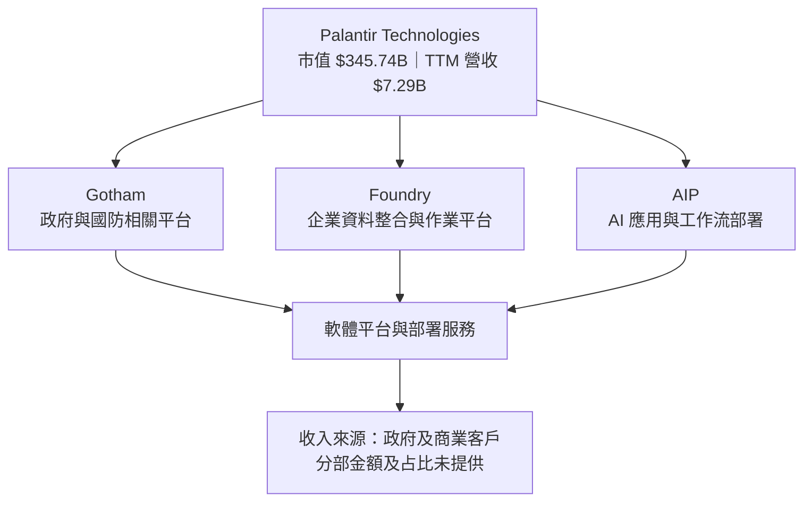

### 2.2 市場份額

市場份額及可引用的 TAM 數字未提供，故不繪製份額圖或填入估計比例。以規模和成長作相對參照，PLTR TTM 營收為 $7.29B、TTM 成長 87.1%，最新季度年增 95.9%，高於 SNOW、DDOG、CRM 最新季度各約 35% 的成長率；但這不等同於市場份額資料。

### 2.3 競爭護城河分析

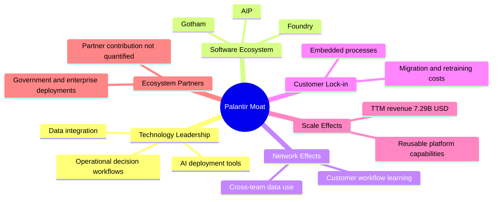

### 2.4 護城河強度

| 護城河項目 | 強度（強／中／弱） | 證據（引用數字或事實） | 會削弱它的情況 |
|------------|--------------------|------------------------|----------------|
| 技術與產品整合 | 強 | TTM 毛利率 84.7%；產品跨資料整合、分析與作業工作流 | 雲端平台或大型軟體商提供可替代的端到端方案 |
| 軟體生態系統 | 中至強 | Gotham、Foundry、AIP 形成多平台組合；客戶數與跨售收入未提供 | 產品間整合不順或導入成本過高 |
| 網路效應 | 中 | 多部門與資料工作流可能提高平台價值；量化網路效應指標未提供 | 客戶資料與工作流未產生跨客戶累積優勢 |
| 客戶鎖定 | 強 | 任務流程及資料管線嵌入後，替換須重新整合與驗證；續約率未提供 | 客戶能以低成本遷移或改採內部系統 |
| 規模效應 | 中 | TTM 營收 $7.29B、營業利益率 45.6% | 競爭導致部署成本上升或價格下降 |
| 生態夥伴 | 中 | 有政府、企業及技術夥伴合作的質化線索；夥伴收入占比未提供 | 夥伴轉向競品或自建解決方案 |

1.1「護城河」評分 8.0/10，依據為高毛利、工作流嵌入及多平台組合；缺少留存率、客戶集中度與分部收入數據，因此未給更高評分。

---

## 3. 損益表深度分析

### 3.1 年度收入成長趨勢（近 4 年）

年度營收為 FY2022 $1.906B、FY2023 $2.225B、FY2024 $2.866B、FY2025 $4.475B；YoY 分別為 23.6%、16.7%、28.8%、56.2%。FY2022–FY2025 CAGR 約 32.9%，反映增長加速，但 TTM 87.1% 已顯著高於這段年度歷史，不能直接外推為長期速度。

```text
╔══════════════════════════════════════════════════════════════════╗
║              Palantir 年度收入趨勢（FY2022-FY2025）              ║
╠══════════════════════════════════════════════════════════════════╣
║  FY2022  $1.91B  ████████░░░░░░░░░░░░░░░░  YoY +23.6% 🟢       ║
║  FY2023  $2.23B  ██████████░░░░░░░░░░░░░░  YoY +16.7% 🟢       ║
║  FY2024  $2.87B  ███████████████░░░░░░░░░  YoY +28.8% 🟢       ║
║  FY2025  $4.48B  ████████████████████████  YoY +56.2% 🟢       ║
╠══════════════════════════════════════════════════════════════════╣
║  FY2022-FY2025 年營收 CAGR 約 +32.9%                            ║
╚══════════════════════════════════════════════════════════════════╝
```

### 3.2 季度收入趨勢分析

| 季度 | 營收 | QoQ | YoY | 備註 |
|------|------|-----|-----|------|
| 2025 Q4 | $1.407B | +19.1% | +70.0% | 對照 2025 Q3 $1.181B、2024 Q4 基期 |
| 2026 Q1 | $1.633B | +16.1% | +84.7% | 對照 2025 Q1 $883.86M |
| 2026 Q2 | $1.935B | +18.5% | +92.8% | 對照 2025 Q2 $1.004B |
| 2026 Q3 | $2.313B | +19.5% | **+95.9%** | 單季年增率；不得與 TTM 成長混淆 |

各季 QoQ 增幅約 16%–20%，與快速擴張相符。若季度節奏維持，年度營收仍可快速增加；但高增速基期會使未來維持 90% 以上增長愈來愈困難。

### 3.3 利潤率演變分析

以下年度比率以已列年度損益表的營收、毛利、營業利益及淨利計算；TTM 數字則照引用的 TTM 財務指標。

| 利潤率指標 | FY2022 | FY2023 | FY2024 | FY2025 | 趨勢 | 評估 |
|------------|--------|--------|--------|--------|------|------|
| **毛利率** | 78.5% | 80.6% | 80.3% | 82.4% | 緩步上升；TTM 84.7% | 🟢 |
| **營業利益率** | -8.5% | 5.4% | 10.8% | 31.6% | 費用槓桿改善，FY2025 明顯擴張 | 🟢 |
| **淨利率** | -19.6% | 9.4% | 16.1% | 36.3% | 獲利轉正後大幅擴張；TTM 50.3% | 🟢 |

營收由 FY2024 $2.87B 增至 FY2025 $4.48B，增長 56.2%；同期營業利益由 $310.40M 增至 $1.41B，增幅遠高於收入，代表成本增長慢於毛利增長、營運槓桿顯著。可用數據支持費用槓桿改善，但未提供足以區分定價、產品組合和人力生產力的分部拆解。TTM 淨利率 50.3% 高於 FY2025，須留意期間、稅務與其他非營業因素。

### 3.4 費用結構分析

FY2025 可由營收、毛利、營業利益與 R&D 支出拆得成本項目：營收 $4.475B、毛利 $3.686B、營業利益 $1.414B、R&D $557.68M。由此計算銷貨成本約 $789M；營業費用約 $2.272B，扣除 R&D 後的其他營業費用約 $1.714B。下列為衍生項目，不是另行申報的科目。

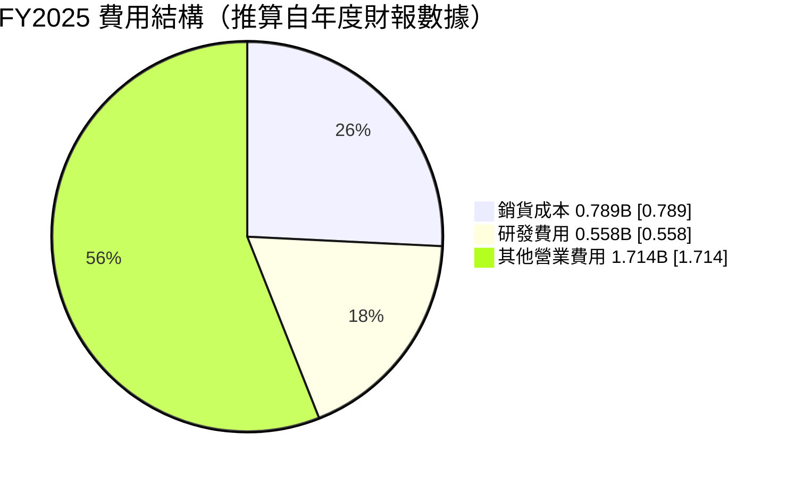

```text
╔══════════════════════════════════════════════════════════════════╗
║          FY2025 費用規模（相對營收 $4.475B）                      ║
╠══════════════════════════════════════════════════════════════════╣
║  銷貨成本約 $0.789B       █████░░░░░░░░░░░░░░░░░░░              ║
║  研發費用 $0.558B         ███░░░░░░░░░░░░░░░░░░░░░              ║
║  其他營業費用約 $1.714B   ██████████░░░░░░░░░░░░░░              ║
╚══════════════════════════════════════════════════════════════════╝
```

### 3.5 季度 EPS 趨勢與盈餘品質（Quality of Earnings）

| 季度 | EPS 實際值 | EPS 超預期／不及預期 |
|------|------------|----------------------|
| 2025 Q4 | $0.23 | N/A；估值資料的預期值與實際值為 nan |
| 2026 Q1 | $0.34 | N/A；估值資料的預期值與實際值為 nan |
| 2026 Q2 | $0.41 | N/A；估值資料的預期值與實際值為 nan |
| 2026 Q3 | $0.44 | N/A；估值資料的預期值與實際值為 nan |

EPS 已逐季上升，但無法以「超預期」或「不及預期」分類，因季度 EPS 預估值缺失。財報提供的單季 EPS 年增率為 2026 Q3 144.4%。

| 盈餘品質項目 | 數值／佔比 | 評估 |
|--------------|-----------|------|
| 股權薪酬 SBC / 營收 | TTM SBC N/A；FY2025 $684.03M ÷ $4.475B = 15.3% | 🔴 FY2025 SBC 相當於收入 15.3%，對股東是實質稀釋成本 |
| SBC / 營業現金流 | TTM SBC N/A；FY2025 $684.03M ÷ $2.13B = 32.1% | 🟡 顯示部分營運現金流來自非現金薪酬加回 |
| FCF / 淨利（現金轉換率） | TTM FCF $4.05B；TTM 淨利金額 N/A | 🟡 金額無法按同一 TTM 口徑精確計算；不可用季度淨利拼接替代 |
| 一次性／非經常性損益 | N/A；未提供可核對的明細 | 🟡 無法判斷單次項目對本期盈餘的影響 |
| 有效稅率異常 | 1.4%（最新年度有效稅率） | 🟡 低稅率提升稅後盈餘，未必可長期延續 |
| 資本化支出 vs 費用化 | TTM Capex $43.24M；資本化開發支出明細 N/A | 🟡 資本支出低，但無足夠資料判斷所有開發成本的資本化政策 |

**盈餘品質結論：**GAAP 營業利益與高 FCF 有現金流支持，且應計品質測試通過；但 SBC 相對 FY2025 營收達 15.3%，以及最新有效稅率 1.4%，均使報告盈餘高於股東經濟成本口徑的可能性上升。估值上應重視稀釋與常態化稅率，而非只以 EPS 增速外推。

---

## 4. 資產負債表分析

### 4.1 資產結構分解

截至 2026-09-30，StockAnalysis 列示總資產 $13.413B、流動資產 $12.768B；明細包括現金及短期投資 $10.562B、應收帳款 $1.883B、預付費用 $313.01M、固定資產 $309.94M、長期投資 $217M及其他長期資產 $118.27M。各項因四捨五入可能與總數略有差異。

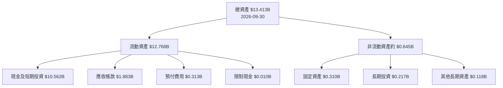

### 4.2 流動性與營運資金分析

流動比率 7.102、速動比率 6.923，流動性指標高。營運資金天數照品質指標原值列示，DIO 與 CCC 不可計算，因公司未列示存貨。

| 指標 | 最新 TTM | 一年前 TTM | 變化 | 解讀 |
|------|----------|------------|------|------|
| DSO 應收帳款天數 | 94 天 | 94 天 | 0 天 | 回款天數持平；應收帳款餘額增加仍須與營收增長一起觀察 |
| DIO 存貨天數 | N/A | N/A | N/A | 公司未報列相關存貨餘額，不作推算 |
| DPO 應付帳款天數 | 29 天 | 33 天 | -4 天 | 付款天數縮短；可能是付款時點或供應商條款變動，無法僅據此判斷議價力 |
| CCC 現金轉換週期 | N/A | N/A | N/A | 因 DIO N/A，CCC 不可計算 |

### 4.3 債務結構分析

不同來源債務數字不一致：SEC/公司財務整理的總債務為 N/A（與已核驗的淨現金數字同區），市場資料部分列總債務 $225.27M，年度資產負債表列 FY2025 $229.34M。故不以單一口徑推導利息保障倍數。

```text
╔══════════════════════════════════════════════════════════════════╗
║                Palantir 債務健康診斷                              ║
╠══════════════════════════════════════════════════════════════════╣
║  現金及短期投資： $10.56B  ████████████████████  🟢             ║
║  總債務：         來源數字 $225.27M；核驗項目 N/A               ║
║  淨現金：         $10.56B（程式核驗值）             🟢             ║
║  流動比率：       7.102x                                 🟢     ║
║  利息保障倍數：   N/A（利息費用與一致債務口徑未提供）             ║
╚══════════════════════════════════════════════════════════════════╝
```

### 4.4 股東權益趨勢

| 年度 | 股東權益 | 年增額 | 解讀 |
|------|----------|--------|------|
| 2022 | $2.57B | — | 權益底盤 |
| 2023 | $3.48B | +$0.91B | 盈餘累積與資本變動增加權益 |
| 2024 | $5.00B | +$1.52B | 權益繼續擴大 |
| 2025 | $7.39B | +$2.39B | 盈利改善及累積現金支持資產負債表 |

---

## 5. 現金流量深度分析

### 5.1 現金流量瀑布圖

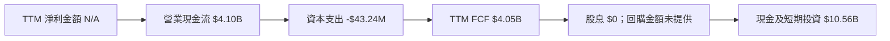

股息殖利率及派息率均為 0.0%。圖中不對股東回購或淨現金變動作金額拆分，因相關流量明細未提供。

### 5.2 FCF 轉換率趨勢

| 年度 | 營業現金流 | Capex | FCF | 淨利 | FCF／淨利 |
|------|------------|-------|-----|------|-----------|
| 2022 | $223.74M | $40.03M | $183.71M | -$373.70M | 不具解讀性 |
| 2023 | $712.18M | $15.11M | $697.07M | $209.82M | 332.2% |
| 2024 | $1.15B | $12.63M | $1.14B | $462.19M | 246.6% |
| 2025 | $2.13B | $33.88M | $2.10B | $1.63B | 129.0% |
| TTM 至 2026-09-30 | $4.10B | $43.24M | $4.05B | N/A | N/A |

歷史年度 FCF 高於淨利的比例逐步下降，但仍在 FY2025 超過 100%；可能與 SBC 等非現金費用加回有關。TTM 淨利金額未提供，故不宣稱 TTM 轉換率。

### 5.3 自由現金流趨勢

```text
╔══════════════════════════════════════════════════════════════════╗
║                   自由現金流趨勢                                  ║
╠══════════════════════════════════════════════════════════════════╣
║  FY2022  $0.184B  ██░░░░░░░░░░░░░░░░░░░░  FCF Yield N/A         ║
║  FY2023  $0.697B  ███████░░░░░░░░░░░░░░░  FCF Yield N/A         ║
║  FY2024  $1.14B   ███████████░░░░░░░░░░░  FCF Yield N/A         ║
║  FY2025  $2.10B   ███████████████████░░░  FCF Yield N/A         ║
║  TTM     $4.05B   ██████████████████████  FCF Yield 1.17%       ║
╚══════════════════════════════════════════════════════════════════╝
```

年度歷史 FCF yield 未提供同口徑市值，不補算。TTM FCF $4.05B 相對市值的 yield 為 1.17%，代表公司現金流雖快增，但投資人以現價買入所取得的當期現金流回報仍低。

### 5.4 資本配置評估

| 用途 | 可引用數據 | 評估 |
|------|------------|------|
| 資本支出 | TTM $43.24M | 相對營收低，維持平台所需實體資本較少 |
| 股息 | 殖利率 0.0%、派息率 0.0% | 未以股息回饋股東 |
| 回購 | 金額 N/A | 無法量化 |
| 研發 | FY2025 $557.68M | 維持產品與 AI 投入的重要支出 |
| 留存現金 | 現金及短期投資 $10.56B | 資產負債表充裕；資金用途及回報率需追蹤 |

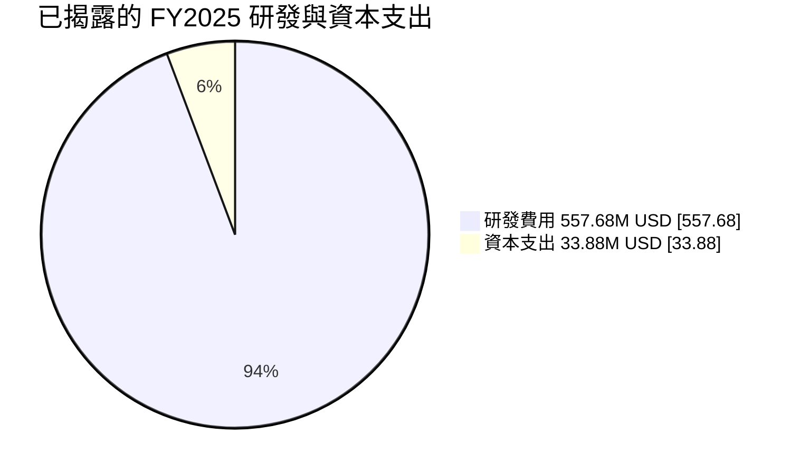

此圓餅僅比較兩項有披露金額的支出，並非全部資本配置比例；不能由此推斷其他留存現金用途的占比。

---

## 6. 獲利能力與資本效率

### 6.1 ROE / ROA / ROIC 趨勢

| 指標 | 可用期間數據 | 解讀 |
|------|--------------|------|
| ROE | 品質指標 DuPont TTM 32.7%；另來源列 40.9% | 來源口徑不一致；本報告第 6.3 節依指定品質指標採 32.7% |
| ROA | TTM 19.3% | 具正向獲利，Piotroski ROA 測試通過 |
| ROIC | TTM 492.3% | 明顯高於 WACC，但受投入資本分母小與淨現金口徑影響 |
| 同業／行業均值 | 未提供 | 不列未有來源的均值 |

### 6.2 ROIC vs WACC 分析（核心價值創造判斷）

WACC 直接採用資本成本數據區的 11.94%；Beta 使用調整後 1.41。ROIC 採核驗 TTM 492.3%。此 ROIC 是以稅後營業利益除以股權、債務扣現金後投入資本計算；當淨現金很大時，分母可能偏小，故不宜將極高數值視為穩態回報率。

```text
╔══════════════════════════════════════════════════════════════════╗
║                  ROIC vs WACC 深度分析                           ║
╠══════════════════════════════════════════════════════════════════╣
║  WACC（採用核驗值）：                                             ║
║  ├── 無風險利率：4.91%                                            ║
║  ├── 市場風險溢酬：5.00%                                         ║
║  ├── 原始 Beta：1.61；調整後 Beta：1.41                           ║
║  ├── 股權成本：4.91% + 1.41 × 5.00% = 11.96%（四捨五入口徑）     ║
║  ├── 核驗股權成本：11.95%；稅前債務成本：6.91%                   ║
║  ├── 股權／債務權重：99.9%／0.1%                                 ║
║  └── ✅ 採用 WACC：11.94%                                         ║
║                                                                  ║
║  ROIC（TTM，核驗口徑）：492.3%                                    ║
║  ├── 492.3% 高於 WACC 11.94%                                     ║
║  └── EVA spread：492.3% − 11.94% = 480.36 個百分點               ║
║                                                                  ║
║  結論：依該口徑公司在創造價值；但 ROIC 的分母敏感度很高，         ║
║  應以營業利益率、FCF 與投入資本變化交叉檢驗。                     ║
╚══════════════════════════════════════════════════════════════════╝
```

採用 WACC 11.94%，不以自行重算的 11.96% 取代核驗值；此處 CAPM 展示的微小差異來自各輸入的四捨五入。以核驗 ROIC 減 WACC，EVA spread 為 480.36 個百分點；這是比例差而非股東回報保證。

### 6.3 杜邦三因素分解

| 因素 | 數值（TTM） | 解讀 |
|------|-------------|------|
| 淨利率 | 50.3% | 高淨利率是 ROE 的主要正向來源 |
| 資產週轉率 | 0.54 | 每單位資產帶來約 0.54 單位營收 |
| 權益乘數 | 1.19 | 財務槓桿不高，ROE 並非主要靠槓桿撐起 |
| **ROE** | **32.7%** | 50.3% × 0.54 × 1.19 ≈ 32.7%（指定品質指標原值） |

### 6.4 財務體質：Piotroski F-Score

Piotroski F-Score 為 **7 / 8**。一項測試缺少輸入，故有效分母為 8，不應改寫為 7/9。

| 測試 | 結果 | 解讀 |
|------|------|------|
| ROA > 0 | ✅ 通過 | TTM 獲利為正 |
| 營業現金流 > 0 | ✅ 通過 | TTM OCF $4.10B |
| ROA 高於一年前 | ✅ 通過 | 獲利能力改善 |
| 營業現金流 > 淨利（應計品質） | ✅ 通過 | 現金流品質測試通過 |
| 長期負債 ÷ 總資產低於一年前 | — 無法判定 | 缺資料；不補推 |
| 流動比率高於一年前 | ✅ 通過 | 流動性改善 |
| 稀釋股數未增加 | ❌ 未通過 | 股數增長稀釋每股經濟權益 |
| 毛利率高於一年前 | ✅ 通過 | 毛利率擴張 |
| 資產週轉率高於一年前 | ✅ 通過 | 資產使用效率改善 |

---

## 7. 相對估值分析

### 7.1 同業估值比較

公司倍數採市場資料列示值；同業數值照 Yahoo Finance Peer multiples。DDOG、SNOW 等高成長軟體公司雖可作參考，但其商業模式、盈利成熟度並不完全相同。

| 估值指標 | **PLTR** | **SNOW** | **DDOG** | **CRM** | 本公司評估 |
|----------|----------|----------|----------|---------|-----------|
| **Trailing P/E** | 101.0x | N/A | 218.6x | 16.5x | 🔴 高於盈利成熟型 CRM；低於 DDOG |
| **Forward P/E** | 56.52x | 82.9x | 49.4x | 11.3x | 🟡 高於 DDOG、CRM，低於 SNOW |
| **P/S** | 47.44x（核驗歷史估值表為 50.7x） | 16.5x | 13.3x | 3.4x | 🔴 顯著溢價 |
| **EV/EBITDA** | 100.08x（核驗歷史估值表為 106.9x） | -87.1x | 310.9x | 13.9x | 🔴 高倍數；SNOW EBITDA 為負，倍數不可直接比較 |
| **最新季度營收年增** | 95.9% | 35.1% | 35.2% | 10.8% | 🟢 成長遠高於同業 |
| **毛利率（TTM）** | 84.7% | 67.0% | 79.6% | 77.3% | 🟢 高於比較同業 |

PLTR 的快速增長與高毛利支持一定溢價，但 P/S 約為 SNOW 的 2.9 倍、DDOG 的 3.6 倍、CRM 的 14.0 倍。如此估值要求高成長維持、利潤率不顯著回落，且企業 AI 變現持續擴張。不同數據源在當前倍數上有差異，本表將市場快照和核驗歷史估值表分開標註，不混為同一口徑。

### 7.2 歷史估值區間分析

```text
╔══════════════════════════════════════════════════════════════════╗
║                  PLTR 近五年估值位置（TTM）                      ║
╠══════════════════════════════════════════════════════════════════╣
║  P/E：      範圍 100.6x ───────── 中位數 228.6x ─────── 601.0x   ║
║             現值 101.0x；歷史百分位第 7 位                       ║
║  P/S：      範圍   7.0x ───── 現值 50.7x ─ 中位數 24.7x ─ 120.4x║
║             現值歷史百分位第 67 位                               ║
║  EV/EBITDA：範圍 109.0x ───────── 中位數 233.4x ─────── 574.4x  ║
║             現值 106.9x；歷史百分位第 0 位                       ║
╚══════════════════════════════════════════════════════════════════╝
```

P/E 與 EV/EBITDA 處於自身歷史低百分位，但 P/S 在第 67 百分位。歷史倍數低於過往極端水準，並不代表絕對估值便宜；在現價下 P/S 仍遠高於所列同業。

### 7.3 情境價值（Bear / Base / Bull）

| 情境 | 第 1 年營收成長 | 期末營業利潤率 | WACC | 每股價值 | 相對現價 | 機率 | 會發生的條件 |
|------|----------------|----------------|------|----------|----------|------|--------------|
| 🔴 悲觀 | 15.0% | 9.2% | 12.94% | $13.17 | -90.8% | 25% | 成長減速更快、長期競爭或價格壓力限制利潤率 |
| 🟡 基準 | 30.0% | 10.8% | 11.94% | $22.25 | -84.5% | 50% | 高增長逐步回落，營業利潤率向五年中位數收斂 |
| 🟢 樂觀 | 45.0% | 11.9% | 10.94% | $38.91 | -72.9% | 25% | AIP 商業化維持高速擴張，風險折現率下降 |

### 7.4 相對估值隱含價格區間

```text
╔══════════════════════════════════════════════════════════════════╗
║                  相對估值與現價位置                              ║
╠══════════════════════════════════════════════════════════════════╣
║  $22.25 DCF ── $77.08 同業 Forward P/E ── 現價 $143.49 ── $222.90║
║                                          分析師共識              ║
╚══════════════════════════════════════════════════════════════════╝
```

- **同業 Forward P/E：$77.08**，依據同業中位數 Forward P/E **30.4x** × PLTR Forward EPS **$2.54**。
- **同業 EV/EBITDA：不可計算**，程式估值方法已排除；不自行補算。
- **分析師共識：$222.90**，29 位分析師平均目標價，屬外部參照，並非基本面現金流推導值。

---

## 8. DCF 內在價值評估（Discounted Cash Flow）

### 8.0 估值推理鏈（Thinking Logic）

**Step 1 — 價值由哪些變數決定？**  
本模型的價值核心是現有軟體平台營收轉化為 GAAP 營業利益，再轉化為 FCFF；公司 TTM 營收 $7.29B，但政府／商業分部占比、AIP 收入占比均未提供，因此無法為各業務單獨設定估值。模型價值主要由營收成長與 GAAP 營業利潤率路徑決定，終值則受長期現金流與 WACC − g 差距影響。終值現值占 EV 30.1%，低於多數高度依賴終值的模型，但整體價值仍對長期利潤率與折現率敏感。

**Step 2 — 模型選擇**

| 決策點 | 本報告採用 | 理由（含數字） | 曾考慮但否決 | 否決理由 |
|--------|-----------|----------------|--------------|----------|
| 現金流定義 | FCFF | 以 WACC 11.94% 折現，得 EV 後再加淨現金 | FCFE | 資本結構雖以股權為主，仍依既定模型維持企業現金流口徑 |
| 預測期 N | 10 年 | 核驗模型預測長度；營收增長由 30% 線性降至 3% | 5 年 | 無法呈現模型設定的長期成長衰減路徑 |
| 終值方法 | Gordon Growth | g 3.0%，WACC 11.94%，符合 WACC > g | 退出倍數 | DCF 區塊未提供可直接照抄的退出倍數估值結果 |
| EBIT 基礎 | GAAP | GAAP EBIT 已含 SBC 費用 | 非 GAAP | 避免在現金流之外任意調整 SBC |

**Step 3 — 關鍵假設推導鏈**

- **營收成長**：錨點＝TTM 成長 87.1%、最新單季年增 95.9%，FY2022–FY2025 CAGR 約 32.9% → 調整＝TTM 增速顯著高於三年年度 CAGR，基期提升使其不宜直線外推 → **採用第 1 年 30.0%，線性降至第 10 年 3.0%** → 曾考慮延續 87.1%，但否決，因其將單一高增長期間無限外推，且模型規定第 1 年增速上限為 30%。
- **期末營業利潤率**：錨點＝TTM GAAP 營業利益率 45.6% → 調整＝模型採五年營業利潤率中位數作成熟期錨 → **第 1 年 45.6% 線性降至第 10 年 10.8%** → 曾考慮沿用 45.6% 至期末，但否決，因該作法忽視成熟與競爭風險。
- **永續成長率 g**：錨點＝長期名目經濟成長的常見估值參照約 3%–4%（估計值，非本公司財務數據）→ 調整＝需低於 WACC 11.94%，避免終值發散 → **採用 3.0%** → 否決 4.0%，因基準假設取較低長期成長，且避免高估終值。
- **預測期 N**：錨點＝模型既定 10 年；TTM 增長高但年度營收 CAGR 約 32.9% → 調整＝以十年逐步收斂來表達商業化及成熟過程 → **採用 10 年** → 否決 5 年，因不符合指定模型輸入；也不將高增長持續期另行拉長。
- **Capex／營收**：錨點＝TTM Capex $43.24M ÷ TTM 營收 $7.29B，約 0.6% → 調整＝模型假設從 0.6% 緩降至 0.4% → **採用 0.6% 至 0.4%** → 否決維持更高資本強度，因已提供的 TTM 資本支出相對收入低。
- **D&A／營收**：錨點＝模型採 TTM 約 0.4% → **採用固定 0.4%**；此項依錨點，不另作調整。
- **有效稅率**：錨點＝最新年度有效稅率 1.4% → **採用 1.4%**。此稅率偏低，若未來回升，估值將下降；模型照核驗輸入，不自行替換。
- **ΔWC／營收增額**：模型不建模營運資金，故無比率假設；這使營收增加所需的應收帳款或其他營運資金占用未反映在 FCFF。
- **EBIT 與 SBC**：錨點＝GAAP EBIT 已包含 SBC 費用；**採用 GAAP EBIT**，FCFF 不再扣 SBC，年稀釋率設為 0%。模型只把 SBC 透過費用化計入一次；這可能低估未來實際股數增長對每股價值的稀釋。
- **年稀釋率**：核驗模型採 GAAP 組合 A，股數不再逐年稀釋 → **採用 0%** → 否決以 SBC 再扣一次或另加稀釋率，避免重複計算。
- **終值方法**：錨點＝FCFF 永續成長模型可用，且 WACC 11.94% > g 3.0% → **採用 Gordon Growth** → 未以退出倍數替代，因模型提供的主估值結果為 Gordon Growth。
- **WACC**：錨點＝資本成本區核驗值 11.94% → **照採 11.94%** → 不自行重估 WACC，以維持與第 6.2 節一致。

**Step 4 — 最脆弱之處**  
最脆弱的一環是 GAAP 營業利潤率由 45.6% 向 10.8% 收斂的長期路徑，以及模型不扣營運資金；若應收帳款與營運資金占用增加，FCFF 將低於模型，價值可能進一步下降。

**Step 5 — 計算路徑**

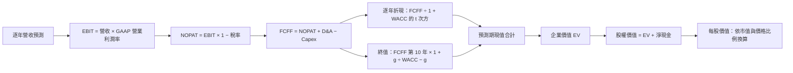

### 8.1 模型假設總表（Model Inputs）

| 假設項目 | 採用值 | 依據／來源 | 敏感度 |
|----------|--------|-------------|--------|
| 預測期長度 **N** | 10 年 | 核驗 DCF 模型輸入 | 🟡 中 |
| 營收成長 | FY+1 30.0%，FY+10 3.0%，逐年線性下降 | TTM 成長 87.1%；最新單季年增 95.9%；歷史 FY2022–FY2025 CAGR 約 32.9% | 🔴 高 |
| 營業利潤率 | FY+1 45.6% 至 FY+10 10.8% | TTM 營業利益率與五年中位數 | 🔴 高 |
| 有效稅率 | 1.4% | 最新年度有效稅率 | 🟢 低 |
| Capex／營收 | 0.6% 至 0.4% | TTM Capex $43.24M／TTM 營收 $7.29B，模型逐步收斂 | 🟡 中 |
| D&A／營收 | 0.4% | 模型所列 TTM 錨點 | 🟢 低 |
| 營運資金變動 | 不建模 | DSO 94 天、應收帳款 $1.883B；但模型明確排除營運資金 | 🟢 低 |
| EBIT 基礎 | GAAP | SEC 財務報表口徑 | 🟡 中 |
| SBC 處理 | GAAP 已費用化，不再另扣 | FY2025 SBC $684.03M；模型組合 A | 🟡 中 |
| 年稀釋率 | 0% | 組合 A：固定股數、SBC 已於 GAAP EBIT 計入 | 🟡 中 |
| 永續成長率 g | 3.0% | 模型輸入；低於 WACC 11.94% | 🔴 高 |
| 終值方法 | Gordon Growth | WACC > g；模型提供此方法計算 | 🔴 高 |
| WACC | 11.94% | 核驗資本成本輸入；第 6.2 節同值 | 🔴 高 |

**模型定義：**採 FCFF，公式為 NOPAT + D&A − Capex；模型明確不含營運資金變動。SBC 防重複計算採 **(A) GAAP EBIT + 固定股數**，故 SBC 影響已透過費用化計入一次，不再扣除 SBC，亦不另套年稀釋率。

### 8.2 折現率推導（WACC）

資本成本輸入為：無風險利率 4.91%、ERP 5.00%、原始 Beta 1.61，調整後 Beta = ⅔ × 1.61 + ⅓ = 1.41；CAPM 股權成本核驗值 11.95%。稅前債務成本為假設值 6.91%（依據：無利息費用資料，以無風險利率加信用價差）；有效稅率 1.4%。數據區提供權重 99.9%／0.1% 與 WACC 11.94%，本報告照採，不另行推導替換。

```text
╔══════════════════════════════════════════════════════════════════╗
║                    WACC 推導（折現率）                           ║
╠══════════════════════════════════════════════════════════════════╣
║  股權成本 Ke（CAPM）：                                           ║
║  ├── Rf：4.91%                                                   ║
║  ├── ERP：5.00%（假設值）                                        ║
║  ├── 原始 Beta：1.61；調整 Beta：⅔×1.61 + ⅓ = 1.41              ║
║  ├── 額外規模／國別溢酬：0.00%（未提供，不加計）                 ║
║  └── 核驗 Ke：11.95%（依核驗資本成本輸入）                       ║
║                                                                  ║
║  債務成本 Kd：                                                   ║
║  ├── 稅前 Kd：6.91%（假設值：Rf + 信用價差）                     ║
║  ├── 有效稅率：1.4%                                              ║
║  └── 稅後 Kd：6.91% ×（1 − 1.4%）= 6.81%                        ║
║                                                                  ║
║  資本權重：E 99.9%，D 0.1%                                       ║
║  └── 核驗 WACC：11.94%                                           ║
╚══════════════════════════════════════════════════════════════════╝
```

**逐步演算與資料限制：**

1. **Ke（核驗值）**＝4.91% + 1.41 × 5.00% + 0.00%＝**11.95%**（按核驗資本成本輸入；以已四捨五入的 Rf、Beta、ERP 重算會有約 0.01 個百分點差異）。
2. **稅前 Kd**＝**6.91%**，為核驗輸入的假設值；利息費用與平均計息負債金額未提供，不能依題定公式重建。
3. **稅後 Kd**＝6.91% × (1 − 1.4%)＝6.81326% ≈ **6.81%**。
4. **權重**＝股權 99.9%、債務 0.1%；最新收盤價 $143.49（2026-11-20），市值 $345.74B。精確稀釋股數及與權重相同口徑的計息債務資料未完整提供，故照採核驗權重，不反推。
5. **WACC**＝**11.94%**（直接採用核驗值；四捨五入後的輸入重算可能產生微小尾差）。

### 8.3 逐年自由現金流預測（基準情境）

單位：$B；金額、利潤率、折現因子照核驗 DCF 模型，金額取兩位小數，折現因子三位小數。ΔWC 未建模，依模型 FCFF = NOPAT + D&A − Capex。

| 年度 | FY+1 | FY+2 | FY+3 | FY+4 | FY+5 | FY+6 | FY+7 | FY+8 | FY+9 | FY+10 |
|------|------|------|------|------|------|------|------|------|------|-------|
| 營收 | 9.47 | 12.03 | 14.92 | 18.05 | 21.30 | 24.50 | 27.44 | 29.91 | 31.70 | 32.65 |
| 營收 YoY | 30.0% | 27.0% | 24.0% | 21.0% | 18.0% | 15.0% | 12.0% | 9.0% | 6.0% | 3.0% |
| 營業利潤率 | 45.6% | 41.8% | 37.9% | 34.0% | 30.2% | 26.3% | 22.4% | 18.6% | 14.7% | 10.8% |
| EBIT（GAAP） | 4.32 | 5.03 | 5.66 | 6.14 | 6.43 | 6.44 | 6.16 | 5.55 | 4.66 | 3.54 |
| − 稅 | (0.06) | (0.07) | (0.08) | (0.08) | (0.09) | (0.09) | (0.08) | (0.08) | (0.06) | (0.05) |
| NOPAT | 4.26 | 4.96 | 5.58 | 6.06 | 6.34 | 6.36 | 6.07 | 5.48 | 4.60 | 3.49 |
| + D&A | 0.04 | 0.05 | 0.06 | 0.07 | 0.08 | 0.10 | 0.11 | 0.12 | 0.13 | 0.13 |
| − Capex | (0.06) | (0.07) | (0.08) | (0.10) | (0.11) | (0.12) | (0.13) | (0.14) | (0.14) | (0.14) |
| − ΔWC | 0.00 | 0.00 | 0.00 | 0.00 | 0.00 | 0.00 | 0.00 | 0.00 | 0.00 | 0.00 |
| **FCFF** | **4.25** | **4.94** | **5.55** | **6.03** | **6.31** | **6.33** | **6.05** | **5.45** | **4.58** | **3.48** |
| 折現因子 @11.94% | 0.893 | 0.798 | 0.713 | 0.637 | 0.569 | 0.508 | 0.454 | 0.406 | 0.362 | 0.324 |
| **FCFF 現值 PV** | **3.79** | **3.94** | **3.96** | **3.84** | **3.59** | **3.22** | **2.75** | **2.21** | **1.66** | **1.12** |

**預測期現值合計（模型列示）：**

3.79 + 3.94 + 3.96 + 3.84 + 3.59 + 3.22 + 2.75 + 2.21 + 1.66 + 1.12 = **30.08B**

> 表內 PV 四捨五入至 0.01B 後逐項相加為 30.08B；模型以未四捨五入數字加總，故採用核驗合計 $30.08B。

**FY+1 逐步演算（依模型列示數值）：**

1. **營收**＝$7.29B × (1 + 30.0%)＝**$9.47B**（未四捨五入模型值）
2. **EBIT**＝$9.47B × 45.6%＝**$4.32B**
3. **稅**＝$4.32B × 1.4%＝**$0.06B**
4. **NOPAT**＝$4.32B − $0.06B＝**$4.26B**
5. **D&A**＝$9.47B × 0.4%＝**$0.04B**
6. **Capex**＝$9.47B × 0.6%＝**$0.06B**
7. **ΔWC**＝模型不建模，取 **$0.00B**
8. **FCFF**＝$4.26B + $0.04B − $0.06B＝**$4.25B**（模型以未四捨五入值計算）
9. **折現因子**＝1 ÷ (1 + 11.94%)¹＝**0.893**；PV＝$4.25B × 0.893＝**$3.79B**（尾差來自表格取位）

**合理性自檢：**

- 模型預測 FCFF 由 $4.25B 增至第十年 $3.48B，預測期內不是單調成長；因此不以單一 FCFF CAGR 概括其路徑。歷史 FCF 由 FY2022 $0.184B 增至 FY2025 $2.10B，增幅很大，與未來利潤率逐步收斂的方向不同。
- FY+10 FCFF 利潤率＝$3.48B ÷ $32.65B＝約 **10.7%**；當前 TTM FCF 利潤率＝$4.05B ÷ $7.29B＝約 **55.6%**。同業最佳數據未提供，不比較。
- 模型各年 FCFF 均為正；預測值未扣營運資金，若營收擴張需要更多應收帳款，實際 FCFF 可能低於表列。

```text
╔══════════════════════════════════════════════════════════════════╗
║            自由現金流：歷史實際 vs 模型預測                      ║
╠══════════════════════════════════════════════════════════════════╣
║  FY2023(實) $0.697B  ████░░░░░░░░░░░░░░░░░░░  FCF              ║
║  FY2024(實) $1.14B   ███████░░░░░░░░░░░░░░░░  FCF              ║
║  FY2025(實) $2.10B   █████████████░░░░░░░░░  FCF              ║
║  FY+1 (預)  $4.25B   ███████████████████████  FCFF             ║
║  FY+10(預)  $3.48B   ███████████████████░░░░  FCFF             ║
╠══════════════════════════════════════════════════════════════════╣
║  歷史 FCF 與預測 FCFF 的口徑有差別；預測亦未扣 ΔWC。             ║
╚══════════════════════════════════════════════════════════════════╝
```

### 8.4 終值計算（Terminal Value）

**適用性檢查：**WACC 11.94% vs g 3.0% → **WACC > g ✅**

| 方法 | 計算式 | 終值 TV | TV 現值 | 佔總 EV 比重 |
|------|--------|---------|---------|--------------|
| Gordon Growth | $3.48B × (1 + 3.0%) ÷ (11.94% − 3.0%) | $40.04B | $12.96B | 30.1% |
| 退出倍數法 | N/A（核驗 DCF 未提供退出倍數結果） | N/A | N/A | N/A |

**逐步演算：**

1. **FY+N FCFF**＝FY+10 FCFF **$3.48B**。
2. **分子**＝$3.48B × (1 + 3.0%)＝模型列示 **$3.48B × 1.03**（未四捨五入 FCFF 計算）。
3. **分母**＝11.94% − 3.0%＝**8.94%**；TV 按模型精確輸入計算為 **$40.04B**。
4. **PV(TV)**＝$40.04B × 0.324＝**$12.96B**（依模型未四捨五入折現因子）。
5. **終值佔比**＝$12.96B ÷ $43.04B＝**30.1%**。

因退出倍數結果未提供，不補入未經核驗的倍數。終值現值占 EV 30.1%，未觸發終值占比高於 75% 的警示門檻。

### 8.5 企業價值 → 每股內在價值（Bridge）

DCF 模型的橋接列示：EV $43.04B、淨現金 $10.56B、股權價值 $53.60B、每股基準價值 $22.25。每股換算依核驗模型指定公式，使用市值與價格比例，不將財務數據中不一致的股數來源自行替換。

```text
╔══════════════════════════════════════════════════════════════════╗
║              企業價值 → 每股內在價值 橋接表                      ║
╠══════════════════════════════════════════════════════════════════╣
║  預測期 FCF 現值合計              +$30.08B                       ║
║  終值現值 PV(TV)                  +$12.96B                       ║
║  ─────────────────────────────────────────────                  ║
║  = 企業價值 EV                     $43.04B                       ║
║  + 淨現金                          +$10.56B                       ║
║  = 股權價值                        $53.60B                       ║
║  每股內在價值（模型換算）          $22.25                         ║
║  當前股價（2026-11-20 收盤）       $143.49                        ║
║  折溢價（現價÷DCF價值−1）          +544.9%（溢價）                ║
╚══════════════════════════════════════════════════════════════════╝
```

**逐步演算及口徑說明：**

1. **EV**＝$30.08B + $12.96B＝**$43.04B**。
2. **股權價值**＝$43.04B + $10.56B＝**$53.60B**。
3. **每股內在價值**＝模型列示 **$53.60B × 價格 ÷ 市值 = $22.25**；使用價格 $143.49 及市值 $345.74B。該模型換算等同以約 2.41B 股作為比例基礎，但不以自行推導股數替換核驗每股值。
4. **折溢價**＝$143.49 ÷ $22.25 − 1＝**+544.9%**。核驗 DCF 表的「-84.5% vs price」是價值相對價格的報酬率，即 ($22.25 ÷ $143.49) − 1；它不是本報告定義的折溢價。
5. **本節不計算 MOS**；MOS 僅於 8.8 以加權合理價值為分母計算。

現金採截至 2026-09-30 現金及短期投資 $10.56B。總債務在核驗 DCF 橋接以淨現金 $10.56B 作為輸入，故不再重複加回；其他少數股東權益未提供。

### 8.6 敏感性分析（WACC × 永續成長率）

下表照抄 DCF 敏感度矩陣的每股值。括號上行／下行空間按報告收盤價 $143.49 計算，為輔助表達；估值格本身直接引用核驗矩陣。

| g（列）／WACC（欄） | 9.94% | 10.94% | **11.94%（基準）** | 12.94% | 13.94% |
|---------------------|------:|-------:|-------------------:|-------:|-------:|
| 2.0% | $25.15（-82.5%） | $23.23（-83.8%） | $21.66（-84.9%） | $20.35（-85.8%） | $19.24（-86.6%） |
| 2.5% | $25.67（-82.1%） | $23.60（-83.6%） | $21.94（-84.7%） | $20.56（-85.7%） | $19.40（-86.5%） |
| 3.0% | $26.27（-81.7%） | $24.02（-83.3%） | **$22.25（-84.5%）** | $20.79（-85.5%） | $19.58（-86.4%） |
| 3.5% | $26.95（-81.2%） | $24.50（-82.9%） | $22.59（-84.3%） | $21.05（-85.3%） | $19.77（-86.2%） |
| 4.0% | $27.76（-80.7%） | $25.05（-82.5%） | $22.98（-84.0%） | $21.34（-85.1%） | $19.99（-86.1%） |

矩陣基準格為 $22.25，與 8.5 基準每股價值一致。由 g 3% 同列可見，WACC 從 10.94% 上升至 11.94%，價值由 $24.02 降至 $22.25，變化 **-$1.77**；g 從 2.5% 增至 3.5%、WACC 固定 11.94%，價值由 $21.94 增至 $22.59，變化 **+$0.65**。該矩陣呈現折現率變化對估值的影響；不得把兩個跨欄差值誤稱為每 1pp 的精確線性彈性。

**矩陣複算限制：**核驗資料未提供每一個敏感度格的完整中間橋接值（例如每格預測期 PV、未四捨五入終值及折現因子），且要求不得另建模型，故不另行杜撰某一格的重算細節。基準格及矩陣數值照核驗資料引用。

**三情境 DCF（照核驗模型）：**

| 情境 | 第 1 年營收成長 | 期末營業利潤率 | WACC | 每股內在價值 | 相對現價 | 主觀機率 |
|------|----------------|----------------|------|--------------|----------|----------|
| 🔴 悲觀 | 15.0% | 9.2% | 12.94% | $13.17 | -90.8% | 25% |
| 🟡 基準 | 30.0% | 10.8% | 11.94% | $22.25 | -84.5% | 50% |
| 🟢 樂觀 | 45.0% | 11.9% | 10.94% | $38.91 | -72.9% | 25% |
| **機率加權** | — | — | — | **$24.14** | **-83.2%** | 100% |

基準情境的核驗加權算式為 $13.17 × 25% + $22.25 × 50% + $38.91 × 25% = **$24.14**（模型列示值；四捨五入情況有尾差）。此機率加權值僅作情境參照，8.8 價值採規定的基準 DCF $22.25。

**敏感度結論：**

- **g 影響：**WACC 11.94% 時，g 2.0% 的 $21.66 至 g 4.0% 的 $22.98，變化 **+$1.32**；跨 2pp，平均每 1pp 約 **+$0.66**，約基準價值 3.0%。
- **WACC 影響：**g 3.0% 時，WACC 10.94% 的 $24.02 至 12.94% 的 $20.79，變化 **-$3.23**；跨 2pp，平均每 1pp 約 **-$1.62**，約基準價值 7.3%。
- **期末營業利潤率：**核驗敏感度矩陣沒有單獨的利潤率敏感度數值；不自行推算每 1pp 影響。
- 依已提供矩陣，WACC 測試區間的估值影響大於 g；這與 8.0 指出的營收及利潤率主導經營估值並不完全相同，原因是矩陣只改變 WACC 與 g、固定營運路徑。

### 8.7 反推 DCF（Reverse DCF：市場在預期什麼）

核驗反推結果為：單獨求解第 1 年營收成長率，在 -10% 至 100% 範圍內無解；單獨求解固定營業利潤率，在 0.5% 至 95% 範圍內亦無解。此結果不等於市場價格無法由任何成長與利潤率組合解釋，而是表示在模型一次只放開一個變數、其餘維持基準值時，指定區間內找不到解。

| 求解的變數（一次一個） | 其餘變數設定 | 市場隱含值 | 公司歷史實際 | 判斷 |
|------------------------|--------------|------------|--------------|------|
| 第 1 年營收成長 | 其餘假設固定基準 | -10% 至 100% 內無解 | TTM 成長 87.1% | 市價超出單一變數可解釋範圍 |
| 固定營業利潤率 | 其餘假設固定基準 | 0.5% 至 95% 內無解 | TTM 營業利益率 45.6% | 市價超出單一變數可解釋範圍 |

核驗模型未提供反推迭代軌跡、各試算點及四項固定輸入的完整表，因此不虛構試算表或假稱已收斂。可得結論是：現價 $143.49 遠高於基準 DCF $22.25，且單一變數無法在已測區間內解釋市場價格，市場定價很可能同時包含更長成長期、更高利潤率或模型外的選擇權價值。

### 8.8 估值三角驗證與安全邊際

| 估值方法 | 隱含每股價值 | 上行空間（÷現價） | 權重 | 說明 |
|----------|--------------|-------------------|------|------|
| DCF（基準） | $22.25 | -84.5% | 55% | 10 年 FCFF；WACC 11.94%、g 3.0% |
| 同業 Forward P/E | $77.08 | -46.3% | 35% | 同業中位數 30.4x × Forward EPS $2.54 |
| 分析師共識目標價 | $222.90 | +55.3% | 10% | 29 位分析師平均目標價；參考而非主估值 |
| **加權合理價值** | **$61.51** | **-57.1%** | **100%** | Profitable 公司類型的固定方法權重 |

**逐步演算：**

- 加權合理價值＝$22.25 × 55% + $77.08 × 35% + $222.90 × 10%
- ＝$12.2375 + $26.9780 + $22.2900
- ＝$61.5055 ≈ **$61.51**。
- 權重合計＝55% + 35% + 10%＝**100%**。公司類型為 profitable；同業 EV/EBITDA 無法計算，已依核驗方法排除，不自行新增方法或調整權重。

安全邊際只以加權合理價值 $61.51 為基準：

- **MOS**＝($61.51 − $143.49) ÷ $61.51＝-$81.98 ÷ $61.51＝**-133.3%**。
- **上行空間**＝($61.51 − $143.49) ÷ $143.49＝-$81.98 ÷ $143.49＝**-57.1%**。
- **DCF 折溢價**＝$143.49 ÷ $22.25 − 1＝**+544.9%**。

```text
╔══════════════════════════════════════════════════════════════════╗
║                  估值區間與安全邊際                              ║
╠══════════════════════════════════════════════════════════════════╣
║  $13.17 ───── $22.25 ───── $61.51 ───── $143.49 ───── $222.90   ║
║  悲觀DCF       基準DCF       加權合理值   現價       分析師共識    ║
║                                                                  ║
║  MOS = ($61.51 − $143.49) ÷ $61.51 = -133.3%                    ║
║  上行空間 = ($61.51 − $143.49) ÷ $143.49 = -57.1%               ║
║  建議買入參考：價格不高於 $55.36，對應 MOS 至少 10%              ║
║  合理持有／減碼區間：高於估值參考的分段區間須依新數據重估         ║
╚══════════════════════════════════════════════════════════════════╝
```

$55.36 為加權合理價值乘以 90%：$61.51 × (1 − 10%)＝$55.359，四捨五入 $55.36；此為 MOS 門檻推導的參考價格，不是另一種估值模型。

> 🔎 **程式複算（Python，依本節各項自動重算）**
>
> 加權合理價值 = $22.25 × 55% + $77.08 × 35% + $222.90 × 10% = **$61.51**（權重合計 100%）
>
> 以價格 $143.49 計：MOS = **-133.3%**，上行空間 = **-57.1%**
>
> ✅ 與本節所寫數值一致。

### 8.9 DCF 模型的局限與失效條件

- **終值依賴度：**PV(TV) 為 $12.96B，占 EV $43.04B 的 30.1%；模型並非主要由終值支撐，但長期利潤率收斂仍是重要假設。
- **最脆弱假設：**固定 1.4% 稅率可能低於長期正常水準；若上升，NOPAT 與 FCFF 下降。模型不扣 ΔWC，若應收帳款或合同資產增長快於營收，FCF 亦可能低於估值。
- **SBC 與稀釋：**GAAP EBIT 已扣 SBC，模型採固定股數；若未來股數持續增長，模型的每股價值可能偏高。
- **模型適用性：**公司目前 FCF 為正，DCF 可作參照；但高速成長與利潤率快速變化降低單點估值可靠度。相對估值與分部收入資料可作補充，現有資料不足以建立 SOTP。
- **風險連結：**企業 AI 部署放緩會衝擊營收增長假設；價格競爭會壓低 EBIT margin；利率上升會提高折現率；應收帳款增加則會使未建模的營運資金需求上升。
- **資料與模型限制：**DCF 每股換算採指定價格／市值比例公式，且不同來源的總債務與 ROE 口徑不完全一致；因此應重視估值方向與敏感性，不將 $22.25 當成精確可交易的單點價格。

### 8.10 複算檢核表（Audit Trail）

| # | 檢核項目 | 檢查方式 | 結果 |
|---|----------|----------|------|
| 1 | 所有 🔴高／🟡中敏感度輸入有推導 | 對照 8.0 Step 3；逐項披露模型錨點、調整與限制 | ✅ |
| 2 | 每個假設有來歷 | 8.1 逐項列出來源；資料缺口標明 | ✅ |
| 3 | WACC 五步及算式 | 採核驗 WACC；原始輸入重算存在四捨五入尾差 | ⚠️ |
| 4 | Kd 分母與債務權重口徑一致 | 平均計息負債、利息費用與完整期末計息負債數據未提供，未自行反推 | ⚠️ |
| 5 | WACC 與第 6.2 節同值 | 兩節均為 11.94% | ✅ |
| 6 | 逐年表格年度數等於 N，且無省略 | FY+1 至 FY+10，共 10 年 | ✅ |
| 7 | FY+1 代表算式可複算 | 按模型未四捨五入值計算；表格有尾差 | ⚠️ |
| 8 | 預測期 PV 合計 | 模型合計 $30.08B；表列兩位小數加總亦為 $30.08B | ✅ |
| 9 | WACC > g | 11.94% > 3.0% | ✅ |
| 10 | 終值以 FY+N 現金流、折現 N 期 | FY+10 FCFF $3.48B；折現因子 0.324 | ✅ |
| 11 | EV 至每股橋接 | EV $43.04B + 淨現金 $10.56B = 股權價值 $53.60B；每股依模型公式 $22.25 | ✅（依核驗口徑） |
| 12 | SBC 組合一致 | GAAP EBIT + 不另扣 SBC + 年稀釋率 0% | ✅ |
| 13 | 矩陣基準格等於 8.5 | 基準格 $22.25 | ✅ |
| 14 | 矩陣示範格完整重算 | 不另建模型；核驗資料未提供每格中間值 | ⚠️ 未提供可複算明細 |
| 15 | 三情境機率合計及加權 | 25% + 50% + 25% = 100%；採模型加權 $24.14 | ✅（有四捨五入尾差） |
| 16 | 反推 DCF 每列一次放開一變數、有軌跡 | 核驗資料給出無解結論，但未提供逐點迭代軌跡 | ⚠️ |
| 17 | MOS 與折溢價基準一致 | MOS 用 $61.51；DCF 折溢價用 $22.25 | ✅ |
| 18 | 報告完整至第 11 章 | 章節 1–11 均列出 | ✅ |
| 19 | 加權合理價值等於各方法加權和 | $12.2375 + $26.9780 + $22.2900 = $61.5055 ≈ $61.51 | ✅ |
| 20 | 評級符合 MOS 門檻 | MOS -133.3%，賣出；未作質化調整 | ✅ |

未能完全複算的項目是資料缺口或模型限制，不以虛構數字填補：核驗 WACC 組成重算有四捨五入尾差；利息費用、平均計息負債及敏感度各格中間計算未提供；反推 DCF 未附疊代軌跡。

---

## 9. 成長催化劑

### 9.1 催化劑時間軸

財報與新聞未提供可驗證的具體完成日期；下列時間段為追蹤框架，不代表公司指引。

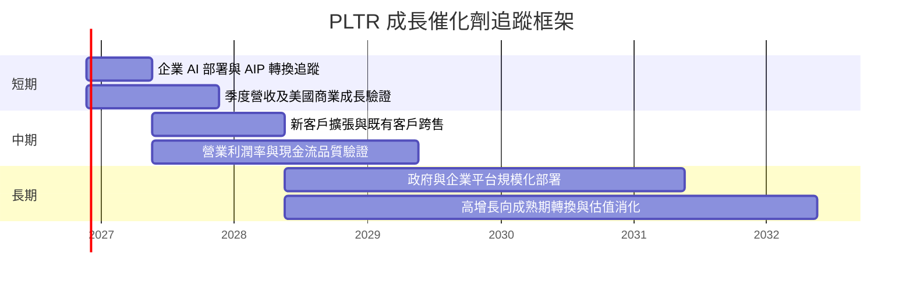

### 9.2 TAM 市場規模分析

**N/A（TAM 數據未提供）**。營收數據顯示 TTM $7.29B、TTM 年增 87.1%，最新季度年增 95.9%，說明商業化速度快，但不能用營收增長反推市場規模或滲透率。市場份額與可引用 TAM 金額均未提供。

### 9.3 成長驅動力結構圖

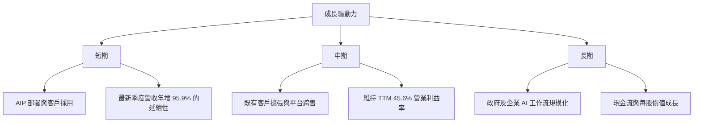

---

## 10. 風險矩陣

### 10.1 風險評分矩陣

機率與衝擊座標為研究判斷的相對排序，不是歷史統計機率；可量化財務影響在 10.2 標明，沒有公司指引的項目不虛構損失比例。

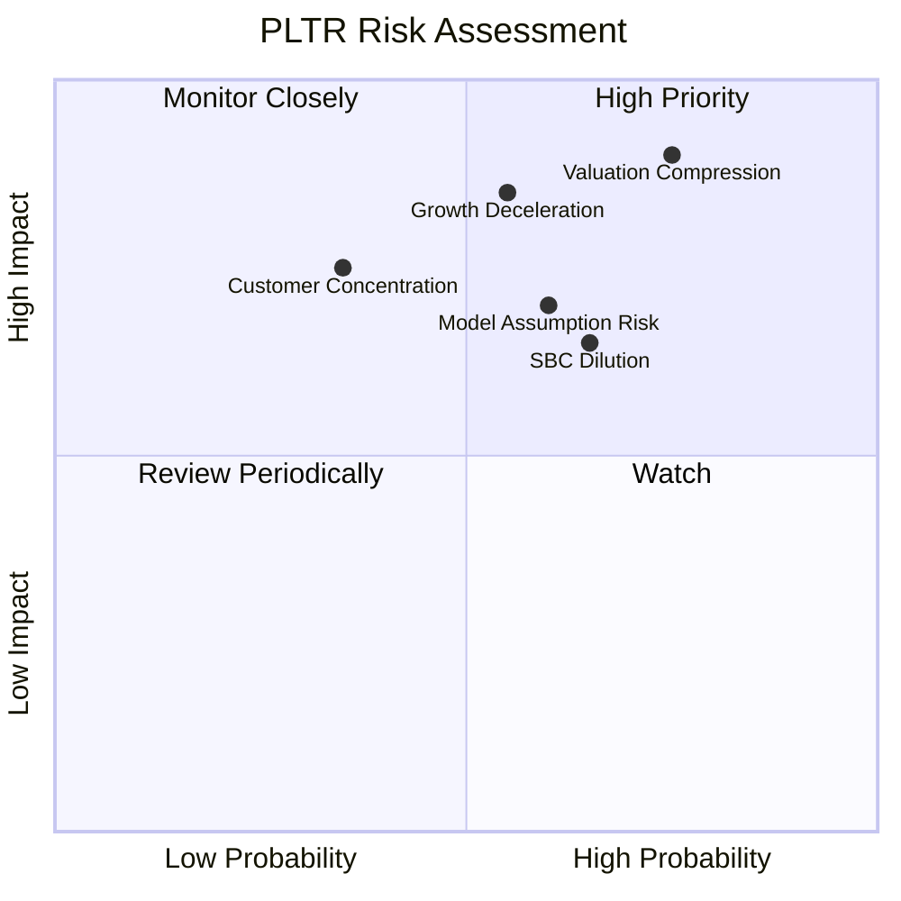

### 10.2 風險清單詳細分析

| # | 風險項目 | 發生機率 | 財務衝擊 | 風險評估 | 緩解措施 |
|---|----------|----------|----------|----------|----------|
| 1 | 🔴 **估值倍數收縮** | 中高；估值風險持續存在 | DCF 基準 $22.25、加權合理價值 $61.51，均低於現價 $143.49；不能合理量化未來收入跌幅 | 🔴 高 | 分批配置、以估值與成長雙重門檻控制部位 |
| 2 | 🔴 **增長率快速回落** | 中；目前單季增長 95.9% 不易永久維持 | 若營收 YoY 連續回落，遠期 EPS 與 Forward P/E 重估風險增加；具體股價影響 N/A | 🔴 高 | 每季追蹤收入成長、商業客戶增長與管理層指引 |
| 3 | 🟡 **SBC 與股數稀釋** | 已觀察到稀釋測試未通過 | FY2025 SBC $684.03M，占當年營收 15.3%；EPS 增長可能低於企業價值增長 | 🟡 中高 | 追蹤稀釋股數、SBC／營收及每股 FCF |
| 4 | 🟡 **獲利率回落** | 中 | TTM 營業利益率 45.6%，模型成熟期假設降至 10.8%；幅度代表長期競爭與費用化風險 | 🟡 中高 | 追蹤 GAAP 營業利益率、毛利率及員工成本 |
| 5 | 🟡 **資料與客戶集中風險** | 中低；集中度資料缺失 | 若主要合約或政府預算延遲，收入可見度下降；集中度及金額 N/A | 🟡 中 | 追蹤政府與商業收入拆分、合約期限與續約數據 |
| 6 | 🟡 **利率與折現率變動** | 中 | WACC 測試由 10.94% 至 12.94% 時，g 3% 的每股值由 $24.02 降至 $20.79 | 🟡 中 | 以折現率敏感性控制估值容忍度，避免單點目標價依賴 |

---

## 11. 投資建議

### 11.1 最終評級與評分

PLTR 評級為 **賣出**：加權合理價值 $61.51 對比 2026-11-20 收盤價 $143.49，MOS 為 -133.3%，符合規則 20 的賣出門檻，未作一級調整。1.1 六項評分依序為成長性 9.0、獲利能力 8.5、財務健康 9.0、估值 1.5、護城河 8.0、管理層與資本配置 6.0，綜合平均 **7.0/10**。

### 11.2 合理價值與隱含報酬率

| 估值參考 | 每股價值 | 相對現價 $143.49 | 機率／權重 | 解讀 |
|----------|----------|------------------|------------|------|
| 加權合理價值 | $61.51 | -57.1% | 估值方法權重合計 100% | 相對價值綜合參照 |
| 悲觀 DCF | $13.17 | -90.8% | 25% | 增長及利潤率弱於基準 |
| 基準 DCF | $22.25 | -84.5% | 50% | 核驗基準模型 |
| 樂觀 DCF | $38.91 | -72.9% | 25% | 較高增長、較低 WACC |
| 機率加權 DCF | $24.14 | -83.2% | 100% | 情境參考；不替代 8.8 加權合理價值 |

### 11.3 買入時機與觸發因素

```text
╔══════════════════════════════════════════════════════════════════╗
║                  ✅ 買入觸發因素 Checklist                       ║
╠══════════════════════════════════════════════════════════════════╣
║  現價不符合估值安全邊際：$143.49 高於 MOS 10% 參考價 $55.36。     ║
║                                                                  ║
║  重新評估買入條件：                                              ║
║  ☐ 股價回落至 $55.36 或以下，對應加權合理價值 10% MOS 門檻       ║
║  ☐ 營收增長仍高於 30%，且連續季度 GAAP 利潤率維持穩定            ║
║  ☐ TTM FCF 維持正值，並持續追蹤 SBC 與稀釋股數                  ║
║                                                                  ║
║  加碼觸發條件：                                                  ║
║  ☐ 基本面更新後加權合理價值上修，並重新計算 MOS                 ║
║  ☐ 股價低於重估後合理價值至少 10%，且營收／FCF 未轉弱             ║
║                                                                  ║
║  減碼／停損觸發條件：                                            ║
║  ☐ 兩季營收年增低於 30%，且管理層下修展望                        ║
║  ☐ GAAP 營業利益率明顯收縮或 TTM FCF 轉負                        ║
║  ☐ SBC／營收上升且稀釋股數持續增加，未被每股 FCF 成長抵銷         ║
╚══════════════════════════════════════════════════════════════════╝
```

### 11.4 投資人適配度分析

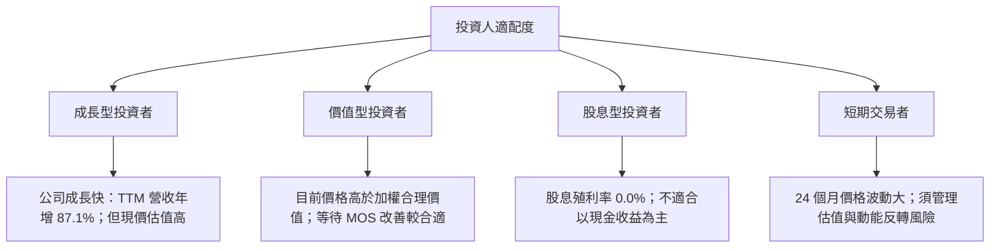

### 11.5 每季財報監控清單（Quarterly Watch List）

| 指標 | 最新參考值 | 加碼觀察門檻 | 減碼／重估門檻 |
|------|------------|--------------|----------------|
| 營收 YoY | 2026 Q3 95.9% | 高於 30%，且客戶與收入來源未高度集中 | 連續兩季低於 30% |
| TTM 營收成長 | 87.1% | 成長放緩但仍伴隨利潤與 FCF 擴張 | 下滑同時營業利益率收縮 |
| GAAP 營業利益率 | TTM 45.6%；單季核驗 46.9% | 大致維持或提升 | 連續兩季低於 40%（研究監控門檻） |
| 毛利率 | TTM 84.7% | 維持在 80% 以上 | 低於 80% 且無產品組合解釋 |
| 營業現金流 | TTM $4.10B | 維持正向並與淨利方向一致 | TTM OCF 轉負 |
| FCF | TTM $4.05B | 維持正值並提升每股 FCF | 轉負或顯著低於營業利益增長 |
| Capex | TTM $43.24M | 留意是否為擴張所需投資 | 大幅增長但未帶動收入／FCF |
| SBC／稀釋股數 | FY2025 SBC $684.03M；稀釋測試未通過 | SBC／營收下降或每股 FCF 快於股數增長 | SBC／營收持續上升、股數加速增加 |
| DSO | 94 天 | 大致穩定 | 明顯高於 94 天並伴隨應收增速高於營收 |
| 管理層指引 | 最新指引未提供 | 實際數據達成或超越指引 | 下修收入或利潤率指引 |
| 估值與 MOS | 現價 $143.49；MOS -133.3% | 價格低於更新後合理價值至少 10% | 價格升高而合理價值未同步上修 |

### 11.6 反面論證：什麼會證明論點錯誤（What Would Change My Mind）

```text
╔══════════════════════════════════════════════════════════════════╗
║              ⚠️ 論點失效條件（Disconfirming Evidence）           ║
╠══════════════════════════════════════════════════════════════════╣
║  多頭基本面論點在下列情況成立時應重新檢視：                      ║
║  ☐ 最新季度營收年增連續兩季低於 30%                              ║
║  ☐ TTM GAAP 營業利益率低於 40%，且非短期一次性因素               ║
║  ☐ TTM FCF 轉負，或營業現金流持續低於淨利                         ║
║  ☐ 股數稀釋速度持續快於每股 FCF 成長                              ║
║  ☐ ROIC 持續跌至 WACC 11.94% 以下                                 ║
║  ☐ DSO 明顯高於 94 天，且應收帳款增長持續超過收入增長             ║
║  ☐ AIP 商業化未帶來收入、續約或每股現金流的可驗證改善             ║
╚══════════════════════════════════════════════════════════════════╝
```

> **免責聲明**：本報告為 AI 自動生成，僅供研究參考，不構成投資建議。投資有風險，入市需謹慎。

---

## 資料與來源

| 項目 | 內容 |
|------|------|
| 價格 | 143.49 USD，2026-11-20 收盤（Yahoo Finance 日線） |
| 財務報表 | SEC 10-Q filed 2026-11-03，最新季度 2026-09-30（FY2026 Q3） |
| 有回應的資料來源 | SEC 申報資料 (XBRL)、Yahoo Finance、Finviz、StockAnalysis、Roic.ai |
| 由程式計算 | TTM 數字、WACC、DCF 模型、估值方法與權重、加權合理價值、MOS、評級門檻、F-Score、杜邦分解、營運資金天數、綜合評分 |
| 撰寫模型 | openai / gpt-6-luna |

> 本區塊由產生報告的程式依實際取得的資料填寫，非模型撰寫。「由程式計算」的數字不是模型的估計；其餘判斷（評分、情境、策略）是模型的分析。
