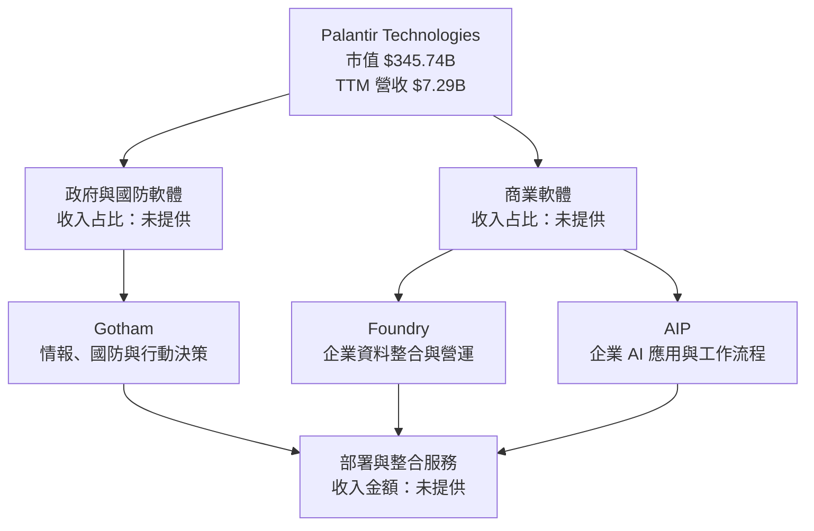
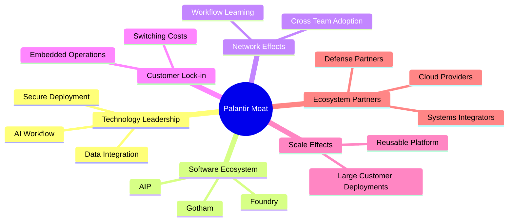
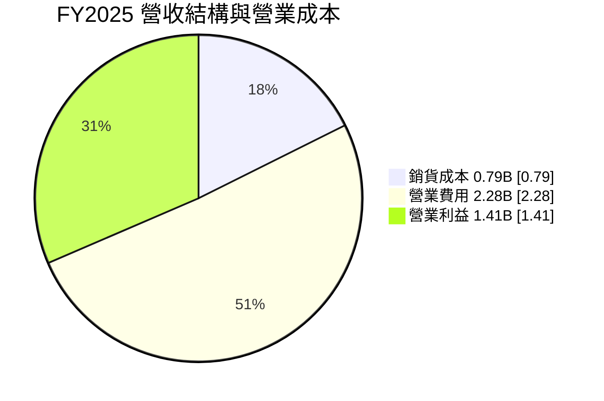
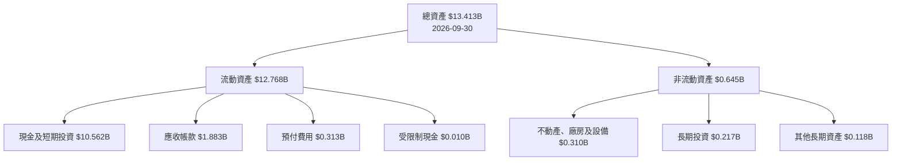
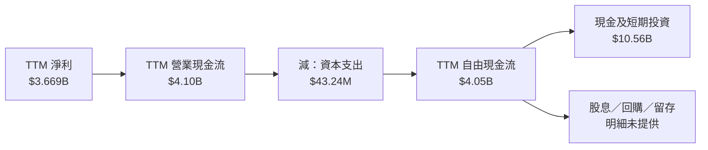
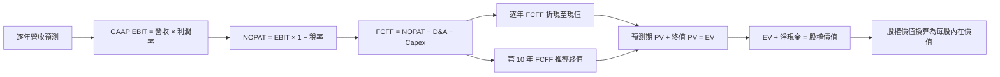
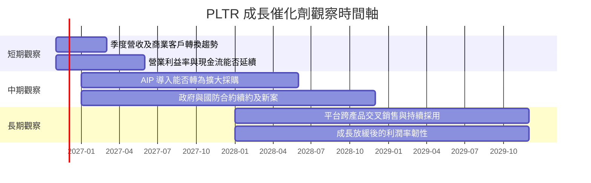
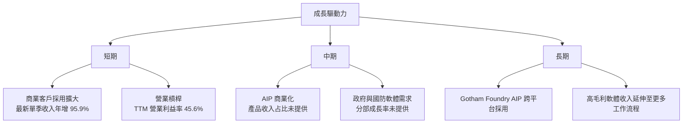
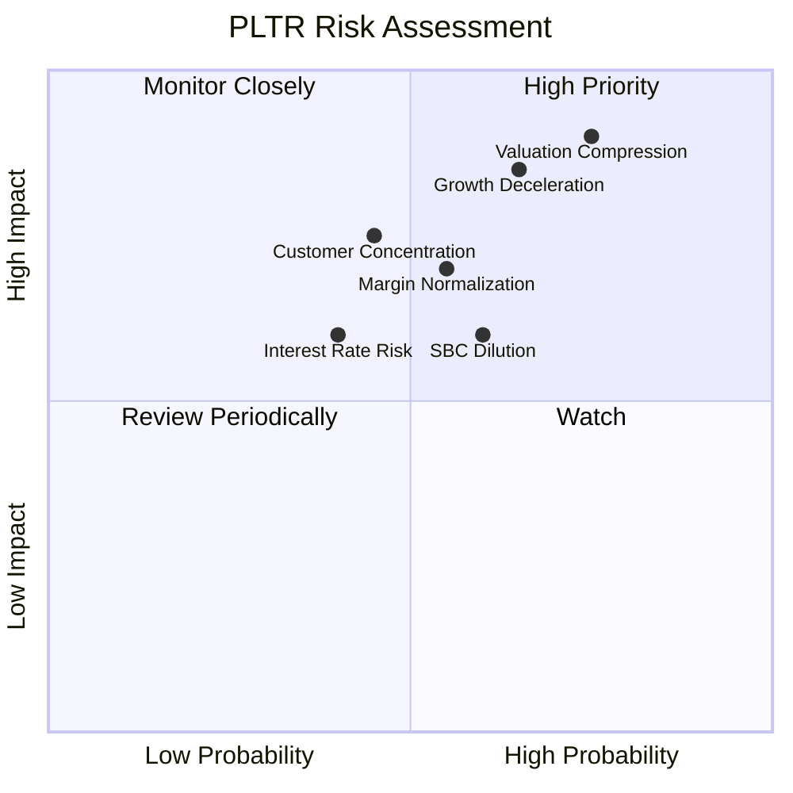
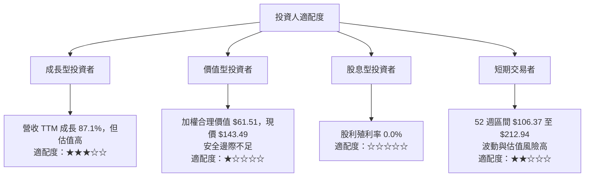

# PLTR 基本面深度分析報告
> **報告日期**：2026-11-22 ｜ **語言**：繁體中文 ｜ **數據來源**：SEC 申報資料 (XBRL)、Yahoo Finance、Finviz、StockAnalysis、Roic.ai ｜ **分析師**：CFA 級機構研究

## 目錄

| # | 章節 | 核心結論 |
|---|------|----------|
| 1 | 執行摘要 | 賣出；加權合理價值 $61.51，MOS -133.3% |
| 2 | 公司概覽與商業模式 | 軟體平台有客戶整合與工作流程黏著度；市場份額資料未提供 |
| 3 | 損益表深度分析 | TTM 營收 $7.29B、TTM 成長 87.1%；最新單季年增 95.9% |
| 4 | 資產負債表分析 | 現金及短期投資 $10.56B；流動性充足，應收帳款天數為 94 天 |
| 5 | 現金流量深度分析 | TTM FCF $4.05B；FCF yield 1.17%，SBC 仍是重要股東成本 |
| 6 | 獲利能力與資本效率 | ROIC 報表值 492.3% 高於 WACC 11.94%，但投入資本分母使該比率可能失真 |
| 7 | 相對估值分析 | 估值高於三家同業；現價低於自身歷史 P/E 中位數但 P/S 位於歷史偏高區 |
| 8 | DCF 內在價值評估 | 基準 DCF 每股 $22.25；DCF 內在價值與加權合理價值均遠低於現價 |
| 9 | 成長催化劑 | AI 平台商用化、政府與國防需求、產品擴張；TAM 數字未提供 |
| 10 | 風險矩陣 | 估值重定價、成長回落及客戶集中／競爭為主要風險 |
| 11 | 投資建議 | 賣出；價格需大幅回落或基本面持續超越預期，才改善風險報酬比 |

---

## 1. 執行摘要

PLTR 的財務動能與現金流表現突出：截至 2026-09-30 的 TTM 營收為 **$7.29B**、TTM 年增 **87.1%**，最新季度年增 **95.9%**；TTM 營業利益率 **45.6%**、FCF **$4.05B**，報表 ROIC **492.3%**。然而，2026-11-20 收盤價 **$143.49** 對應 Forward P/E 約 **56.5x**，而 DCF 基準價值為 **$22.25**、估值方法加權合理價值為 **$61.51**；依加權合理價值計算 MOS 為 **-133.3%**。因此依 MOS 門檻評級為 **🔴 賣出**，不是因公司缺乏成長，而是現價已包含極高成長預期，估值下檔風險高於基準模型可支持的價值。

### 1.0 一頁式投資儀表板（Portfolio Manager 30 秒速讀）

| 項目 | 內容 |
|------|------|
| **投資論點（3 句）** | ① TTM 營收成長 **87.1%**，最新季度年增 **95.9%**，顯示商業化擴張仍快。② TTM 營業利益率 **45.6%**、FCF **$4.05B**，反映目前營運規模有高現金產出。③ 現價 **$143.49** 相較加權合理價值 **$61.51** 溢價甚大，成長品質好不等於當前價格具吸引力。 |
| **綜合評分** | **6.7/10**（引用 1.1 評分卡） |
| **財務健康** | 🟢 現金及短期投資 **$10.56B**、流動比率 **7.102**；標準化數據所列總債務為 N/A，其他資產負債表資料列示債務 $225.27M。 |
| **ROIC vs WACC** | **492.3% vs 11.94%**；表面上高於資本成本，但 ROIC 分母受現金與投入資本口徑影響，應審慎解讀。 |
| **FCF 趨勢** | 上升；TTM FCF **$4.05B**，FCF Yield **1.17%**。 |
| **估值** | Forward P/E **56.5x** ｜ EV/EBITDA（歷史估值資料）**106.9x** ｜ FCF Yield **1.17%** |
| **DCF 內在價值（基準）** | **$22.25** ｜ 相對 DCF 折溢價 **+544.9%**（現價 ÷ DCF − 1） |
| **安全邊際（MOS）** | **-133.3%**＝($61.51 − $143.49) ÷ $61.51（基準為加權合理價值）｜ 🔴 <10%：無 |
| **預期報酬（基準情境 12M）** | DCF 基準情境相對現價 **-84.5%**；此為模型內在價值與現價差距，不是時間精確的 12 個月報酬預測。 |
| **關鍵風險（前二）** | 估值倍數回落；營收成長由近季高增速顯著放緩。 |
| **評級 + 信心度** | 🔴 **賣出** ｜ 信心：中（對估值方向中等；DCF 假設與估值分歧仍大） |

### 1.1 綜合評分卡（全報告唯一）

| 維度 | 評分（1–10） | 主要依據（引用數字與其來源章節） |
|------|--------------|----------------------------------|
| 成長性 | 9.0 | TTM 營收成長 87.1%、最新單季年增 95.9%（第 3 章） |
| 獲利能力 | 9.0 | TTM 營業利益率 45.6%、ROIC 報表值 492.3%、F-Score 7/8（第 3、6 章） |
| 財務健康 | 9.0 | 現金及短期投資 $10.56B、流動比率 7.102、DSO 94 天（第 4 章） |
| 估值 | 2.0 | 加權合理價值 $61.51、MOS -133.3%；Forward P/E 56.5x（第 7、8 章） |
| 護城河 | 7.0 | 軟體平台可整合資料及工作流程，但量化留存、客戶集中度與市占資料未提供（第 2 章） |
| 管理層與資本配置 | 4.0 | 2025 年 SBC $684.03M，且 F-Score 的稀釋股數測試未通過；股利殖利率 0%（第 3、5 章） |
| **綜合評分** | **6.7** | 六項算術平均：(9+9+9+2+7+4) ÷ 6 = **6.7**；以未四捨五入的內部評分平均約 **6.8**。 |

> 註：六個顯示分數的算術平均為 6.7；依評分卡規則，綜合評分應以顯示子分數計算。本報告採 **6.7/10** 為一致值，儀表板與以下引用均以此為準。

### 1.2 五大投資論點 + 三大核心風險

| 類型 | 項目 | 具體依據 | 信心度 |
|------|------|----------|--------|
| 🟢 **投資論點①** | 營收動能仍高 | TTM 營收 $7.29B，TTM 年增 87.1%；最新季度年增 95.9%，顯示業務擴張仍在加速區間。 | 🟢 高 |
| 🟢 **投資論點②** | 營運槓桿顯著 | TTM 營業利益率 45.6%、最新季度 46.9%；若交付與研發成本增速低於營收，利潤率有延續空間。 | 🟢 高 |
| 🟢 **投資論點③** | 現金產出良好 | TTM OCF $4.10B、Capex $43.24M、FCF $4.05B；低資本密集度支持現金累積。 | 🟢 高 |
| 🟢 **投資論點④** | 流動性充裕 | 現金及短期投資 $10.56B，流動比率 7.102；短期償付及投資彈性充足。 | 🟢 高 |
| 🟡 **投資論點⑤** | 平台整合可形成黏著度 | Gotham、Foundry、AIP 等產品定位在資料整合、分析及工作流程；但客戶留存率與單客收入資料未提供，護城河需持續驗證。 | 🟡 中 |
| 🟡 **風險①** | 高估值與倍數壓縮 | Forward P/E 56.5x、加權合理價值 $61.51 對比現價 $143.49；即使業績成長，倍數下修也可造成顯著回撤。 | 🔴 高衝擊 |
| 🔴 **風險②** | 成長率基期與預期落差 | 最新季度年增 95.9%，DCF 將首年成長限制於 30.0%；若市場仍按高成長倍數定價，成長放緩會同時壓低獲利與估值。 | 🔴 高 |
| 🟡 **風險③** | SBC 與稀釋 | 2025 年 SBC $684.03M，占 FY2025 營收約 15.3%；F-Score 稀釋股數測試未通過，需持續監測每股價值是否被稀釋。 | 🟡 中 |

### 1.3 快速統計卡片

| 指標 | 公司實際值（期間） | 同業中位數 | 狀態 |
|------|--------------------|------------|------|
| 營收成長（TTM） | **87.1%** | — | 🟢 |
| 營收成長（最新一季年增） | **95.9%** | **35.1%**（SNOW、DDOG、CRM 中位數） | 🟢 |
| 毛利率（TTM） | **84.7%** | **77.3%**（三家中位數） | 🟢 |
| 營業利益率（TTM） | **45.6%** | — | 🟢 |
| ROIC（TTM） | **492.3%** | — | 🟢* |
| Forward P/E | **56.5x** | **49.4x**（SNOW、DDOG、CRM 中位數） | 🔴 |
| FCF Yield（TTM） | **1.17%** | — | 🟡 |
| Piotroski F-Score | **7 / 8** | — | 🟢 |

\*ROIC 數值照列，但投入資本分母可能偏小，不應將其當成可持續的經濟報酬率直接外推。

### 1.4 投資結論

```text
╔══════════════════════════════════════════════════════════════════╗
║                    📊 投資結論摘要                               ║
╠══════════════════════════════════════════════════════════════════╣
║  評級：🔴 賣出（依加權合理價值 MOS -133.3%）                    ║
║  價格（2026-11-20 收盤）：$143.49                               ║
║  DCF 內在價值（基準）：$22.25（現價溢價 +544.9%）               ║
║  安全邊際 MOS：-133.3%（以加權合理價值 $61.51 為基準）           ║
║  加權合理價值（8.8）：$61.51                                     ║
║  DCF 情境價值：                                                  ║
║    悲觀情境：$13.17（-90.8%）                                    ║
║    基準情境：$22.25（-84.5%）                                    ║
║    樂觀情境：$38.91（-72.9%）                                    ║
║  綜合評分：6.7/10（引用 1.1）                                    ║
║  適合投資人：已持有者可用基本面與估值門檻管理部位；不適合       ║
║              以現價追求安全邊際的價值型投資人                   ║
╚══════════════════════════════════════════════════════════════════╝
```

---

## 2. 公司概覽與商業模式

### 2.1 業務結構與收入來源

公司資料將 Palantir 定位為政府、國防及商業客戶的資料整合與決策軟體供應商。財務資料沒有披露各產品線或政府／商業收入占比，因此不以未提供的比例拆分收入。



商業模式的核心是平台授權、部署及持續擴展使用情境；資料未提供軟體訂閱與專業服務的收入拆分、年度合約價值或留存率，故無法判定收入中經常性部分的確切比例。

### 2.2 市場份額

市場份額數據未提供，且財務資料未附可核實的市場規模與年份，因此不繪製市占率圖。可觀察到 PLTR TTM 營收 $7.29B、成長 87.1%，高於 SNOW、DDOG、CRM 最新季度年增率中位數 35.1%；但這反映公司成長速度，不足以直接推導市場份額。

### 2.3 競爭護城河分析



### 2.4 護城河強度

| 護城河項目 | 強度（強／中／弱） | 證據（引用數字或事實） | 會削弱它的情況 |
|------------|--------------------|------------------------|----------------|
| 技術與部署能力 | 中至強 | 公司產品涵蓋情報、國防、企業資料與 AI 工作流程；TTM 毛利率 84.7%。 | 大型雲端及企業軟體商提供更低成本的整合與 AI 工具。 |
| 軟體生態系統 | 中 | Gotham、Foundry、AIP 分別面向不同工作情境，且 TTM 營業利益率 45.6%。 | 若產品之間無法增加客戶支出或交叉銷售，平台綜效會弱化。 |
| 網路效應 | 中偏弱 | 客戶資料與工作流程整合可能增加使用黏著度；客戶數、留存率及使用者網路指標未提供。 | 客戶可多平台並用，資料可攜或標準化降低轉換成本。 |
| 客戶鎖定 | 中 | 軟體嵌入決策與營運流程，轉換需重新整合資料與工作流程；未提供客戶留存量化數據。 | 專案部署成本過高、採購週期拉長或客戶自建替代。 |
| 規模效應 | 中 | TTM 營收 $7.29B，現有營業利益率 45.6%，顯示已有營運槓桿。 | 專業服務與客製化若隨客戶擴張同步增加，規模效應可能不如預期。 |
| 生態夥伴 | 弱至中 | 有雲端、政府與系統整合的潛在合作空間；夥伴收入與渠道占比未提供。 | 渠道依賴、雲端平台內建功能競爭或合作條件轉變。 |

1.1 護城河評分 **7/10**，理由是產品整合與高毛利率提供實證，但留存、客戶集中度、交叉銷售與渠道依賴等關鍵量化資料缺漏。

---

## 3. 損益表深度分析

### 3.1 年度收入成長趨勢（近4年）

```text
╔══════════════════════════════════════════════════════════════════╗
║              Palantir 年度收入趨勢（FY2022-FY2025）             ║
╠══════════════════════════════════════════════════════════════════╣
║  FY2022  $1.91B  ████████░░░░░░░░░░░░░░░░  YoY: +23.6% 🟢     ║
║  FY2023  $2.23B  ██████████░░░░░░░░░░░░░░  YoY: +16.7% 🟡     ║
║  FY2024  $2.87B  █████████████░░░░░░░░░░░  YoY: +28.8% 🟢     ║
║  FY2025  $4.48B  ████████████████████░░░░  YoY: +56.2% 🟢     ║
╠══════════════════════════════════════════════════════════════════╣
║  FY2022-FY2025 三年收入 CAGR：約 +32.9%                         ║
╚══════════════════════════════════════════════════════════════════╝
```

FY2022 至 FY2025 收入由 $1.91B 增至 $4.48B，三年 CAGR 約 32.9%；FY2025 成長加速至 56.2%。TTM 營收 $7.29B、TTM 年增 87.1%，高於 FY2025 年增率，代表近期需求與商業化速度進一步提高，但也使未來成長的比較基期明顯墊高。

### 3.2 季度收入趨勢分析

| 季度 | 營收 | QoQ 成長 | YoY 成長 | 備註 |
|------|------:|---------:|---------:|------|
| 2025 Q4 | $1.407B | +19.1% | +70.0% | 對比 2025 Q3 $1.181B；季度營收延續成長 |
| 2026 Q1 | $1.633B | +16.1% | +84.7% | 對比 2025 Q1 $883.86M |
| 2026 Q2 | $1.935B | +18.5% | +92.8% | 對比 2025 Q2 $1.004B |
| 2026 Q3 | $2.313B | +19.5% | +95.9% | 對比 2025 Q3 $1.181B；最新單季年增率，不是 TTM |

QoQ 成長率依各季列示營收計算，使用四捨五入後的數值。營收連續多季提高，並且最新季度年增達 95.9%；這表示商業需求擴張不只是單一年度比較基期效應，但資料未提供訂單、剩餘履約義務或分部營收，無法拆解成長由政府或商業客戶各自貢獻多少。

### 3.3 利潤率演變分析

| 利潤率指標 | FY2022 | FY2023 | FY2024 | FY2025 | 趨勢 | 評估 |
|------------|--------:|--------:|--------:|--------:|------|------|
| **毛利率** | 78.5% | 80.6% | 80.3% | 82.4% | 整體上行 | 🟢 |
| **營業利益率** | -8.5% | 5.4% | 10.8% | 31.6% | 明顯改善 | 🟢 |
| **淨利率** | -19.6% | 9.4% | 16.1% | 36.3% | 轉正並擴張 | 🟢 |

年度利潤率以年度收入、毛利、營業利益及淨利計算，四捨五入至一位小數。FY2025 營業利益率提升至約 31.6%，營業利益由 FY2024 $310.40M 增至 FY2025 $1.41B，增幅遠高於同期收入增幅，反映成本控制與規模效應。TTM 營業利益率進一步達 45.6%，最新季度為 46.9%；若營收增長維持而研發、銷售及交付費用增速較低，利潤率可能維持高位。反面是，若 AI 導入需要更多顧問、部署及客製化資源，費用增速可能回升。

### 3.4 費用結構分析

以下為 FY2025 依營收、毛利及營業利益推導的營業結構；項目金額以年度報表數據推算，四捨五入可能造成尾差。



```text
╔══════════════════════════════════════════════════════════════════╗
║                FY2025 營收至營業利益結構                        ║
╠══════════════════════════════════════════════════════════════════╣
║  營收 $4.48B       ████████████████████                          ║
║  毛利 $3.69B       ████████████████                              ║
║  營業利益 $1.41B   ██████                                        ║
║  研發支出 $0.56B   ███                                           ║
╚══════════════════════════════════════════════════════════════════╝
```

FY2025 研發支出為 $557.68M，約占營收 12.5%；研發支出仍是產品擴張與平台競爭力的重要投入。營業費用總額以毛利減營業利益計算，未將銷售與管理等項目分拆，因其明細資料未完整提供。

### 3.5 季度 EPS 趨勢與盈餘品質（Quality of Earnings）

| 季度 | EPS 實際值 | EPS 年增 | 驚喜／預期 | 評估 |
|------|-----------:|---------:|------------|------|
| 2025 Q4 | $0.26 | +647.6% | 預估值 N/A | 無法判斷是否超預期；基期 EPS 約 $0.03 |
| 2026 Q1 | $0.36 | +325.0% | 預估值 N/A | EPS 年增高於收入成長，盈利槓桿有所改善 |
| 2026 Q2 | $0.44 | +215.4% | 預估值 N/A | EPS 持續增加；無一致預估值可供比較 |
| 2026 Q3 | $0.47 | +144.4% | 預估值 N/A | 實際 EPS 增長仍快，但增速較前幾季收斂 |

最近四季 EPS 預估值及實際驚喜資料缺失，不能可靠標示「超預期」或「不及預期」。實際 EPS 按季度歷史資料列示；不同來源對季度 EPS 有差異時，此表沿用 EPS 歷史欄數據。

| 盈餘品質項目 | 數值/佔比 | 評估 |
|--------------|-----------|------|
| 股權薪酬 SBC / 營收 | TTM 約 **13.5%**；FY2025 **15.3%** | 🟡 SBC 金額可觀，會透過稀釋降低每股價值 |
| SBC / 營業現金流 | TTM 約 **24.0%** | 🟡 現金流品質不差，但 SBC 為重大非現金薪酬成本 |
| SBC / FCF | TTM 約 **24.2%** | 🟡 SBC 若視為經濟成本，股東可分配現金低於未調整 FCF |
| FCF / 淨利（現金轉換率） | TTM 約 **110.4%** | 🟢 FCF $4.05B 高於 TTM 淨利 $3.669B，現金轉換良好 |
| 一次性／非經常性損益 | N/A（未提供足以拆分的 TTM 明細） | 🟡 不能排除稅務或其他非經常項目影響 |
| 有效稅率異常 | **1.4%** | 🟡 稅率偏低；模型採用該值會推高 NOPAT，若正常化稅率上升，價值下降 |
| 資本化支出 vs 費用化 | TTM Capex $43.24M；資本化研發資料 N/A | 🟢 資本支出占營收低，但無法僅據此判定研發是否有資本化項目 |

TTM SBC 使用最近四季 SBC 金額合計約 $982.1M，對應 TTM 營收 $7.29B；這是衍生比率。盈餘含金量的正面證據是 FCF 高於淨利，但 SBC 的份額仍重大。DCF 使用 GAAP EBIT，將 SBC 留在費用中；這是避免將稀釋成本完全忽略的保守處理方式之一。

---

## 4. 資產負債表分析

### 4.1 資產結構分解



資產負債表資料顯示流動資產約占總資產 95.2%，現金及短期投資占比高，為公司提供研發、收購及市場擴張的資金彈性。現金與短期投資金額採 2026-09-30 財務資料。

### 4.2 流動性與營運資金分析

| 指標 | 最新 TTM | 一年前 TTM | 變化 | 解讀 |
|------|----------|------------|------|------|
| 流動比率 | 7.102 | N/A | N/A | 流動資產大幅高於流動負債，短期償付能力充足 |
| 速動比率 | 6.923 | N/A | N/A | 主要流動性來自現金、短期投資及應收帳款 |
| DSO 應收帳款天數 | 94 天 | 94 天 | 0 天 | 應收天數持平；目前無證據顯示收款週期明顯惡化 |
| DIO 存貨天數 | N/A | N/A | N/A | 公司未報告相關存貨餘額；不適用 |
| DPO 應付帳款天數 | 29 天 | 33 天 | -4 天 | 付款天數縮短，可能是付款時點或供應商結構變動；不能直接推論議價力 |
| CCC 現金轉換週期 | N/A | N/A | N/A | 因 DIO 不適用，依來源定義 CCC 亦為 N/A |

DSO 94 天值得追蹤：應收帳款由 2025 年末 $1.042B 升至 2026-09-30 $1.883B，但期間營收亦快速擴張；需觀察應收帳款增速是否持續高於收入，避免營收成長延後轉化為現金。

### 4.3 債務結構分析

```text
╔══════════════════════════════════════════════════════════════════╗
║                   Palantir 債務健康診斷                          ║
╠══════════════════════════════════════════════════════════════════╣
║  總債務：        $0.225B  ▏░░░░░░░░░░░░░░░░░░░  低              ║
║  現金+短期投資： $10.56B  ████████████████████  充足            ║
║  淨現金：        $10.34B  ███████████████████░  🟢              ║
║  流動比率：      7.102x   高於 1x，短期流動性充足               ║
║  利息保障倍數：  N/A      利息費用資料未提供                     ║
╚══════════════════════════════════════════════════════════════════╝
```

截至 2026-09-30 的其他資產負債表資料列示總債務 $225.27M、現金及短期投資 $10.56B，淨現金約 $10.34B；與標準化資本成本輸入的「總債務 N/A、淨現金 $10.56B」口徑不同。本報告不將兩種口徑混為一談；DCF 橋接依模型提供的淨現金 $10.56B。

### 4.4 股東權益趨勢

```text
╔══════════════════════════════════════════════════════════════════╗
║               Palantir 歷年股東權益變化                          ║
╠══════════════════════════════════════════════════════════════════╣
║  2022-12-31  $2.57B  ███████░░░░░░░░░░░░░                       ║
║  2023-12-31  $3.48B  █████████░░░░░░░░░░░                       ║
║  2024-12-31  $5.00B  █████████████░░░░░░░                       ║
║  2025-12-31  $7.39B  ███████████████████░                       ║
╚══════════════════════════════════════════════════════════════════╝
```

股東權益由 2022 年底 $2.57B 增至 2025 年底 $7.39B，伴隨獲利轉正及留存盈餘累積。稀釋股數測試未通過，表示權益增加不能全部視為每股價值增加；須同時觀察股數與每股 FCF。

---

## 5. 現金流量深度分析

### 5.1 現金流量瀑布圖

年度股息及回購金額資料未提供，因此流程圖只呈現有數字的現金流環節，不為未提供項目填入比例。



### 5.2 FCF 轉換率趨勢

| 期間 | FCF | 淨利 | FCF / 淨利 | 評估 |
|------|----:|----:|-----------:|------|
| FY2023 | $697.07M | $209.82M | 約 332.2% | 🟢 現金流高於會計盈餘，但年度數據可能受營運資金波動影響 |
| FY2024 | $1.14B | $462.19M | 約 246.7% | 🟢 現金轉換強 |
| FY2025 | $2.10B | $1.63B | 約 129.2% | 🟢 仍高於 100%，比率較前期正常化 |
| TTM 至 2026-09-30 | $4.05B | $3.669B | 約 110.4% | 🟢 現金轉換仍良好 |

FY2022 淨利為負，FCF／淨利不具可比意義，因此不計比率。年度 FCF 比率有下降趨勢，主要是淨利增長較快、現金轉換由極高水平回歸；目前仍高於 100%。

### 5.3 自由現金流趨勢

```text
╔══════════════════════════════════════════════════════════════════╗
║                  自由現金流歷史趨勢                              ║
╠══════════════════════════════════════════════════════════════════╣
║  FY2022  $0.184B  ██░░░░░░░░░░░░░░░░░░░░░  FCF Yield：N/A      ║
║  FY2023  $0.697B  ███████░░░░░░░░░░░░░░░░░  FCF Yield：N/A      ║
║  FY2024  $1.14B   ███████████░░░░░░░░░░░░  FCF Yield：N/A      ║
║  FY2025  $2.10B   ███████████████████░░░░  FCF Yield：N/A      ║
║  TTM     $4.05B   ████████████████████████  FCF Yield：1.17%   ║
╚══════════════════════════════════════════════════════════════════╝
```

歷史年度 FCF yield 的市值時間序列未提供，故不自行估算；TTM FCF yield 1.17% 以現有市值口徑列示。TTM FCF 遠高於歷史 FY2025 FCF，反映營業現金流提升；但低 FCF yield 亦表示現價對現金流的要求很高。

### 5.4 資本配置評估

股息、回購及收購支出金額未提供，故不繪製無法核實的資本配置圓餅圖。

| 資本配置項目 | 可取得數據 | 評估 |
|--------------|------------|------|
| 資本支出 | TTM $43.24M | 相對營收 $7.29B 偏低，資本密集度低 |
| 股權薪酬 | FY2025 $684.03M；TTM 約 $982.1M | 對每股價值有稀釋成本，應納入經濟報酬評估 |
| 股息 | 殖利率 0.0% | 未透過現金股息返還資本 |
| 股票回購 | 金額 N/A | 無法判斷回購是否抵銷股權薪酬稀釋 |
| 留存／投資 | 資料未提供 | 公司現金及短期投資 $10.56B，仍具資金配置空間 |

---

## 6. 獲利能力與資本效率

### 6.1 ROE / ROA / ROIC 趨勢

| 指標 | 可用期間數據 | 評估 |
|------|--------------|------|
| ROE | TTM 32.7%（品質指標）；另一來源列 40.9% | 🟢 報表值高，但來源口徑不一致；杜邦分析採品質指標值 |
| ROA | TTM 19.3% | 🟢 資產獲利能力良好 |
| ROIC | TTM 492.3% | 🟡 報表值遠高於資本成本，但投入資本分母受現金扣除及資本基礎影響，可能失真 |
| 行業均值 | N/A（未提供可比來源） | 不列同業均值 |

### 6.2 ROIC vs WACC 分析（核心價值創造判斷）

```text
╔══════════════════════════════════════════════════════════════════╗
║                ROIC vs WACC 深度分析                            ║
╠══════════════════════════════════════════════════════════════════╣
║  WACC（採用資本成本資料）：11.94%                                ║
║  ├── 無風險利率（10Y 美債）：       4.91%                       ║
║  ├── 市場風險溢酬 ERP：             5.00%                       ║
║  ├── 原始 Beta：                    1.61                        ║
║  ├── 調整後 Beta：                  1.41                        ║
║  ├── 股權成本（資料列示）：         11.95%                      ║
║  ├── 稅前債務成本（假設）：         6.91%                       ║
║  ├── 股權／債務權重：               99.9% / 0.1%                ║
║  └── ✅ 採用 WACC：                 11.94%                      ║
║                                                                  ║
║  ROIC（TTM）：                     492.3%                      ║
║  ROIC − WACC：                    480.36 個百分點               ║
║  報表 ROIC / WACC：約              41.2 倍                      ║
║                                                                  ║
║  ROIC  492.3%  ██████████████████████████████  🟢*              ║
║  WACC   11.94% ▓░░░░░░░░░░░░░░░░░░░░░░░░░░░                   ║
║                                                                  ║
║  結論：按報表公式 ROIC 大幅高於 WACC；惟 ROIC 分母可能偏小，      ║
║        不宜把 492.3% 視為可持續的常態回報率。                    ║
╚══════════════════════════════════════════════════════════════════╝
```

原始 Beta 1.61 經標準調整方式處理：⅔ × 1.61 + ⅓ = 1.41（數值採資本成本資料列示）。股權成本與 WACC 直接採用資本成本數據。ROIC 的公式為稅後營業利益除以「權益 + 債務 − 現金」；若現金扣除後的投入資本基數很小，ROIC 會被放大。因此「報表 ROIC 高於 WACC」是正面訊號，但無法只憑 492.3% 就精確衡量超額經濟利潤的持續性。

### 6.3 杜邦三因素分解

| 因素 | 數值（TTM） | 解讀 |
|------|-------------|------|
| 淨利率 | 50.3% | 高淨利率是 ROE 的主要來源 |
| 資產週轉率 | 0.54 | 每單位資產帶來的收入有限，但軟體業模式本身資產較輕 |
| 權益乘數 | 1.19 | 槓桿不高，ROE 不是主要靠負債槓桿撐起 |
| **ROE** | **32.7%** | 50.3% × 0.54 × 1.19 = 約 32.7% |

### 6.4 財務體質：Piotroski F-Score

**Piotroski F-Score：7 / 8**。共 9 項測試中有 1 項因缺少輸入而無法判定，因此有效分母為 8。

| 測試 | 結果 | 解讀 |
|------|------|------|
| ROA > 0 | ✅ 通過 | TTM 獲利為正 |
| 營業現金流 > 0 | ✅ 通過 | TTM OCF $4.10B |
| ROA 高於一年前 | ✅ 通過 | 資產獲利能力改善 |
| 營業現金流 > 淨利 | ✅ 通過 | 顯示現金轉換良好 |
| 長期負債 ÷ 總資產低於一年前 | — 無法判定 | 缺少可比資料，不納入分母 |
| 流動比率高於一年前 | ✅ 通過 | 流動性指標改善 |
| 稀釋股數未增加 | ❌ 未通過 | 股數稀釋是每股價值的持續風險 |
| 毛利率高於一年前 | ✅ 通過 | 毛利率改善 |
| 資產週轉率高於一年前 | ✅ 通過 | 資產使用效率改善 |

F-Score 顯示基本面方向偏正面，但未通過的稀釋股數測試與高 SBC 應一併看待；強勁總體現金流不必然代表每股現金流以同等速度增長。

---

## 7. 相對估值分析

### 7.1 同業估值比較表格

同業倍數沿用 Yahoo Finance 同業資料；PLTR 倍數採本報告所列估值數據。SNOW 的 trailing P/E 與 EV/EBITDA 分別為 N/A 與負值，反映該口徑下無可直接比較的正盈利倍數。

| 估值指標 | **PLTR** | **SNOW** | **DDOG** | **CRM** | 本公司評估 |
|----------|---------:|---------:|---------:|--------:|-----------|
| **Trailing P/E** | 101.0x | N/A | 218.6x | 16.5x | 🔴 高於成熟軟體公司，低於高倍數成長同業 |
| **Forward P/E** | 56.5x | 82.9x | 49.4x | 11.3x | 🔴 高於同業中位數 49.4x |
| **P/S Ratio** | 50.7x* | 16.5x | 13.3x | 3.4x | 🔴 約為同業中位數 13.3x 的 3.8 倍 |
| **EV/EBITDA** | 106.9x* | -87.1x | 310.6x | 13.9x | 🟡 PLTR 高，但同業倍數分布極端且 SNOW 為負值 |
| **最新季度營收年增** | 95.9% | 35.1% | 35.2% | 10.8% | 🟢 成長明顯快於三家同業 |
| **毛利率（TTM）** | 84.7% | 67.0% | 79.6% | 77.3% | 🟢 高於同業中位數 77.3% |

\*PLTR P/S 50.7x、EV/EBITDA 106.9x 為自身歷史估值資料的同一口徑；其他彙整來源另列 P/S 47.4x、EV/EBITDA 100.0x。依優先規則採用歷史估值資料數值。Forward P/E 同業中位數以三家公司數據中位數計算為 49.4x；DCF 估值方法使用的 Forward P/E 可比同業中位數則按其方法定義為 DDOG、CRM 的 30.4x，兩者樣本與用途不同，不互換。

### 7.2 歷史估值區間分析

```text
╔══════════════════════════════════════════════════════════════════╗
║                PLTR 五年估值區間（TTM 倍數）                    ║
╠══════════════════════════════════════════════════════════════════╣
║  P/E：     100.6x ├──────────────●──────────────── 601.0x       ║
║                        現值 101.0x；中位數 228.6x；百分位 7%    ║
║                                                                  ║
║  P/S：       7.0x ├────────────────●────────────── 120.4x       ║
║                        現值 50.7x；中位數 24.7x；百分位 67%     ║
║                                                                  ║
║  EV/EBITDA：109.0x ├●──────────────────────────── 574.4x        ║
║                        現值 106.9x；中位數 233.4x；百分位 0%    ║
╚══════════════════════════════════════════════════════════════════╝
```

PLTR 的 P/E 與 EV/EBITDA 在自身五年區間相對低端，部分原因是近期盈餘與 EBITDA 快速增長，使分母上升；但 P/S 仍處於自身歷史第 67 百分位，且相較同業非常高。歷史位置不能替代絕對價值分析：當估值分母快速成長時，倍數從極端高點回落，仍可能造成大幅股價波動。

### 7.3 情境價值（Bear / Base / Bull，照抄 DCF MODEL 的 Scenarios）

| 情境 | 第 1 年營收成長 | 期末營業利潤率 | WACC | 每股價值 | 相對現價 | 機率 | 會發生的條件 |
|------|----------------|----------------|------|----------|----------|------|--------------|
| 🔴 悲觀 | 15.0% | 9.2% | 12.94% | $13.17 | -90.8% | 25% | 商業化增速顯著放慢、競爭導致期末利潤率收斂，且資本成本上升 |
| 🟡 基準 | 30.0% | 10.8% | 11.94% | $22.25 | -84.5% | 50% | 成長由目前高增速回落，長期營業利益率回歸模型所用歷史中位水準 |
| 🟢 樂觀 | 45.0% | 11.9% | 10.94% | $38.91 | -72.9% | 25% | AI 商業化與客戶擴張持續超預期，且資本成本下降 |

以上每股價值、假設及機率均沿用 DCF 情境模型。即使樂觀情境價值 $38.91，仍明顯低於現價，表示模型與市場價格間的主要分歧在於市場可能採用更高、更久的成長及更高退出估值。

### 7.4 相對估值隱含價格區間

```text
╔══════════════════════════════════════════════════════════════════╗
║                估值方法隱含每股價值                              ║
╠══════════════════════════════════════════════════════════════════╣
║  $22.25 DCF ── $77.08 同業 Forward P/E ── $143.49 現價 ──       ║
║                                          $222.90 分析師共識      ║
╚══════════════════════════════════════════════════════════════════╝
```

| 方法 | 每股價值 | 相對現價 | 依據 |
|------|---------:|---------:|------|
| DCF（基準） | $22.25 | -84.5% | 10 年 FCFF、WACC 11.94%、永續成長率 3.0% |
| 同業 Forward P/E | $77.08 | -46.3% | 同業中位數 Forward P/E 30.4x × 公司 Forward EPS $2.54 |
| 分析師共識目標價 | $222.90 | +55.3% | 29 位分析師平均目標價 |
| 同業 EV/EBITDA | N/A | N/A | 無法計算；估值方法資料明確列示不可計算 |

---

## 8. DCF 內在價值評估（Discounted Cash Flow）

### 8.0 估值推理鏈（Thinking Logic）

#### Step 1 — 價值由哪些變數決定？

模型核心命題是：企業價值由現有軟體業務現金流、後續營收擴張與長期利潤率共同決定。現有業務的收入基礎為 TTM $7.29B；政府與商業分部收入比重未提供，不能把某一分部當作已知的獨立成長來源。模型敏感度顯示終值現值占 EV **30.1%**，而 10 年內逐年 FCFF 現值占 **69.9%**；在模型假設下，營收路徑及營業利潤率會主導價值，終值假設則影響長期部分。

#### Step 2 — 模型選擇

| 決策點 | 本報告採用 | 理由（含數字） | 曾考慮但否決 | 否決理由 |
|--------|-----------|----------------|--------------|----------|
| 現金流定義 | FCFF | 對企業現金流折現，與 WACC 11.94% 相配 | FCFE | 資本結構權重需另行建模；既有模型採 FCFF |
| 預測期 N | 10 年 | 模型可容納成長率由 30% 線性降至 3% 的成熟化路徑 | 5 年 | 會較快進入終值，未沿用既定 DCF 模型 |
| 終值方法 | Gordon Growth | 永續成長 3.0%，低於 WACC 11.94% | 單獨採退出倍數 | 模型未提供退出倍數所需的估值假設，不能另建 |
| EBIT 基礎 | GAAP EBIT | TTM 營業利益率 45.6%，GAAP 已含 SBC 費用 | 非 GAAP EBIT | 若不扣 SBC，需額外假設稀釋率；既定模型沒有該項 |

#### Step 3 — 關鍵假設推導鏈

- **營收成長路徑**：錨點＝TTM 年增 87.1%、最新季度年增 95.9%；調整＝不將短期爆發增速直接外推，模型將第 1 年成長限制在 30.0%，之後逐年降至 3.0%；**採用第 1 年 30.0%、第 10 年 3.0%**；曾考慮把 87.1% TTM 增長延長數年，但因高基期與長期成熟化風險否決。模型依規則不將首年 30% 認定為 10 年固定 CAGR。
- **期末營業利潤率**：錨點＝TTM 營業利益率 45.6%；調整＝假設長期競爭、產品與客戶組合成熟，營業利潤率逐年線性降至最近五個財年的中位數；**採用第 10 年 10.8%**；曾考慮維持 45.6%，因無法代表成熟期且會過度延續當前高利潤率而否決。
- **有效稅率**：錨點＝最新年度有效稅率 1.4%；**採用 1.4%**；不另做正常化稅率情境，因既定模型固定採用該數字。此稅率偏低，可能高估 NOPAT。
- **Capex / 營收**：錨點＝TTM 資本支出 $43.24M、TTM 營收 $7.29B，模型列示比率 0.6%；調整＝向 1.1 倍 D&A 比率收斂；**採用 FY+1 0.6% 至 FY+10 0.4%**；曾考慮長期維持 0.6%，但模型採隨 D&A 收斂的較低資本需求。
- **D&A / 營收**：錨點＝TTM 比率 0.4%；**採用固定 0.4%**；未額外提高比率，因資料未顯示資產密集度上升。
- **預測期 N**：錨點＝公司收入成長近期明顯加速，但成熟速度不可精確觀察；**採用 10 年**；曾考慮更短預測期，但未採用，因既定模型以 10 年建立降速曲線。
- **永續成長率 g**：錨點＝長期成熟企業名目成長需要低於折現率；**採用 3.0%**，且低於 WACC 11.94%；曾考慮高於 3.0% 的永續成長，因會提高終值並令長期假設過度樂觀而否決。
- **WACC**：錨點＝資本成本輸入所列 WACC 11.94%；**採用 11.94%**；不另自行調整 Beta、ERP 或債務權重，以免改動既定模型。
- **EBIT 基礎、SBC 與股數**：錨點＝模型明列 GAAP EBIT，且 SBC 已列為 GAAP 費用；**採用組合 (A)：GAAP EBIT、不另減 SBC、年稀釋率 0%**；曾考慮非 GAAP 並加回 SBC，因未提供相容股數稀釋模型而否決。
- **ΔWC**：既定模型明確不建模營運資金變動；**採用未納入**，而非假設為某一百分比。

#### Step 4 — 最脆弱環節

最脆弱環節是由 45.6% TTM 營業利益率逐年降至 10.8% 的長期利潤率路徑；若實際長期利潤率高於模型，估值可能上升，但即使模型樂觀情境為 $38.91，仍低於現價 $143.49。

#### Step 5 — 計算路徑圖



### 8.1 模型假設總表（Model Inputs）

| 假設項目 | 採用值 | 依據 / 來源 | 敏感度 |
|----------|--------|-------------|--------|
| 預測期長度 N | 10 年 | DCF 模型設定；近期收入快速成長，需逐步成熟化 | 🟡 中 |
| 營收成長 | 第 1 年 30.0% 線性降至第 10 年 3.0% | TTM 成長 87.1% 為起點錨；模型將高增速限制於 30% | 🔴 高 |
| 營業利潤率 | 第 1 年 45.6% 降至第 10 年 10.8% | TTM 營業利益率 45.6%；期末值為近五年中位數 | 🔴 高 |
| 有效稅率 | 1.4% | 最新年度有效稅率；低稅率可能使價值偏高 | 🟢 低 |
| Capex / 營收 | 第 1 年 0.6% 降至第 10 年 0.4% | TTM 資本支出及收入；模型依 D&A 水準收斂 | 🟡 中 |
| D&A / 營收 | 0.4% | TTM 比率，模型固定 | 🟢 低 |
| 營運資金變動 / 增額營收 | 未建模 | DCF 模型明列 Working capital is not modelled | 🟢 低 |
| EBIT 基礎 | GAAP EBIT | 財務報表營業利益；不使用調整後 EBIT | 🟡 中 |
| SBC 處理 | 不額外扣 SBC | GAAP EBIT 已把 SBC 作為費用 | 🟡 中 |
| 年稀釋率 | 0% | 模型採固定股數的組合 A；不能再額外放大股數 | 🟡 中 |
| 永續成長率 g | 3.0% | 既定 DCF 模型；低於 WACC 11.94% | 🔴 高 |
| 終值方法 | Gordon Growth | 模型列示 Gordon Growth 終值；未提供退出倍數假設 | 🔴 高 |
| WACC | 11.94% | 資本成本資料列示值 | 🔴 高 |

本模型採用 **(A) GAAP EBIT + 固定股數**，所以 SBC 影響已計入一次：FCFF 不再扣 SBC，股數亦不另計年度稀釋。模型的每股價值換算依既定資料行使用市值比例，不另建新的稀釋股數模型。

### 8.2 折現率推導（WACC）

```text
╔══════════════════════════════════════════════════════════════════╗
║                    WACC 推導（折現率）                           ║
╠══════════════════════════════════════════════════════════════════╣
║  股權成本 Ke（CAPM）：                                           ║
║  ├── 無風險利率 Rf：                  4.91%                     ║
║  ├── 市場風險溢酬 ERP（假設）：        5.00%                     ║
║  ├── 原始 Beta（Yahoo Finance）：       1.61                      ║
║  ├── 調整後 Beta：                     1.41                      ║
║  │   調整方式：⅔ × 1.61 + ⅓ = 1.41                               ║
║  ├── 規模／國別溢酬：                  0.00%（未另加）           ║
║  └── 資料列示 Ke：                     11.95%                    ║
║                                                                  ║
║  債務成本 Kd：                                                   ║
║  ├── 稅前 Kd（假設值）：               6.91%                     ║
║  ├── 依據：Rf 4.91% + 信用價差 2.00%                              ║
║  ├── 有效稅率：                        1.4%                      ║
║  └── 稅後 Kd：                         6.81%                     ║
║                                                                  ║
║  資本結構（資料列示權重）：                                      ║
║  ├── 股權權重 E：                      99.9%                     ║
║  ├── 債務權重 D：                      0.1%                      ║
║  └── ✅ 採用 WACC：                    11.94%                    ║
╚══════════════════════════════════════════════════════════════════╝
```

輸入來歷：無風險利率、ERP、原始／調整後 Beta、Ke、稅前 Kd、稅率與資本權重均依資本成本資料列示。Rf 的觀察日未提供，故不能補寫日期；ERP 是假設值，稅前 Kd 亦按 Rf 加 2.00 個百分點信用價差代理。原始 Beta 1.61 高於 1.5，模型採調整後 Beta 1.41。資本成本資料直接給定 WACC **11.94%**，全報告採同一數值。

逐步演算如下：

1. **Ke（CAPM）**：資料列示 Ke = **11.95%**。以顯示到兩位小數的輸入代算，4.91% + 1.41 × 5.00% = 11.96%；與資料列示差 0.01 個百分點，屬輸入／底層精度四捨五入差異，估值模型仍依規定採用資料列示值。
2. **稅前 Kd**：利息費用與平均計息負債資料未提供；採假設代理值，Rf 4.91% + 信用價差 2.00% = **6.91%**。
3. **稅後 Kd**：6.91% × (1 − 1.4%) = 6.81326% ≈ **6.81%**。
4. **權重**：E 權重 **99.9%**，D 權重 **0.1%**；兩者合計 100.0%。權重直接引用資本成本資料，未另以帳面股東權益代替市值。
5. **WACC**：99.9% × 11.95% + 0.1% × 6.91% = 11.94496% ≈ **11.94%**。

### 8.3 逐年自由現金流預測（基準情境）

單位：$B；折現因子保留三位小數。表格數據依 DCF 模型逐格照列。FCFF 依模型定義為 NOPAT + D&A − Capex，營運資金未建模。

| 年度 | FY+1 | FY+2 | FY+3 | FY+4 | FY+5 | FY+6 | FY+7 | FY+8 | FY+9 | FY+10 |
|------|------:|------:|------:|------:|------:|------:|------:|------:|------:|-------:|
| 營收 | 9.47 | 12.03 | 14.92 | 18.05 | 21.30 | 24.50 | 27.44 | 29.91 | 31.70 | 32.65 |
| 營收 YoY | 30.0% | 27.0% | 24.0% | 21.0% | 18.0% | 15.0% | 12.0% | 9.0% | 6.0% | 3.0% |
| 營業利潤率 | 45.6% | 41.8% | 37.9% | 34.0% | 30.2% | 26.3% | 22.4% | 18.6% | 14.7% | 10.8% |
| 營業利益 EBIT（GAAP） | 4.32 | 5.03 | 5.66 | 6.14 | 6.43 | 6.44 | 6.16 | 5.55 | 4.66 | 3.54 |
| − 稅（1.4%） | (0.06) | (0.07) | (0.08) | (0.08) | (0.09) | (0.09) | (0.08) | (0.08) | (0.06) | (0.05) |
| = NOPAT | 4.26 | 4.96 | 5.58 | 6.06 | 6.34 | 6.36 | 6.07 | 5.48 | 4.60 | 3.49 |
| + D&A | 0.04 | 0.05 | 0.06 | 0.07 | 0.08 | 0.10 | 0.11 | 0.12 | 0.13 | 0.13 |
| − Capex | (0.06) | (0.07) | (0.08) | (0.10) | (0.11) | (0.12) | (0.13) | (0.14) | (0.14) | (0.14) |
| **= FCFF** | **4.25** | **4.94** | **5.55** | **6.03** | **6.31** | **6.33** | **6.05** | **5.45** | **4.58** | **3.48** |
| 折現因子 @11.94% | 0.893 | 0.798 | 0.713 | 0.637 | 0.569 | 0.508 | 0.454 | 0.406 | 0.362 | 0.324 |
| **FCFF 現值 PV** | **3.79** | **3.94** | **3.96** | **3.84** | **3.59** | **3.22** | **2.75** | **2.21** | **1.66** | **1.12** |

**預測期 FCFF 現值合計**：

`$3.79 + $3.94 + $3.96 + $3.84 + $3.59 + $3.22 + $2.75 + $2.21 + $1.66 + $1.12 = $30.08B`

逐步演算（FY+1，列示值有四捨五入，模型原始計算採未四捨五入數值）：

1. **營收** = TTM 營收 $7.29B × (1 + 30.0%) = **$9.47B**。
2. **EBIT** = 營收 $9.47B × 營業利潤率 45.6% = **$4.32B**。
3. **稅** = EBIT $4.32B × 有效稅率 1.4% = **$0.06B**。
4. **NOPAT** = EBIT $4.32B − 稅 $0.06B = **$4.26B**。
5. **D&A** = 營收 $9.47B × 0.4% = **$0.04B**。
6. **Capex** = 營收 $9.47B × 0.6% = **$0.06B**。
7. **ΔWC**：DCF 模型未建模，不列入 FCFF。
8. **FCFF**：模型逐年結果採 **$4.25B**；以表中已四捨五入的 NOPAT、D&A、Capex 直接算得 $4.26B + $0.04B − $0.06B = $4.24B，與模型值相差 $0.01B，屬顯示精度差異，沿用模型原列 FCFF。
9. **折現因子與 PV**：1 ÷ (1 + 11.94%)¹ = **0.893**；$4.25B × 0.893 = **$3.79B**（以未四捨五入模型數計算）。

**合理性自檢**

- 預測期 FCFF 由 FY+1 $4.25B 增至 FY+10 $3.48B，十年端點並非單調上升；模型內現值合計 $30.08B。歷史年度 FCF 2022–2025 為 $0.184B、$0.697B、$1.14B、$2.10B；由於起點為低基期，歷史 CAGR 會被放大，不能直接外推為預測 CAGR。
- FY+10 FCFF 利潤率 = $3.48B ÷ $32.65B = **10.7%**；目前 TTM FCF 利潤率 = $4.05B ÷ $7.29B = **55.6%**。這個落差主要由模型假設營業利益率逐步降至 10.8% 所致；同業最佳值未提供，不作比較。
- 模型所有預測年度 FCFF 均為正；因此預測期不需以負現金流額外調整折現結果。

```text
╔══════════════════════════════════════════════════════════════════╗
║            自由現金流：歷史實際 vs 模型預測                      ║
╠══════════════════════════════════════════════════════════════════╣
║  FY2023(實)  $0.697B  ████░░░░░░░░░░░░░░░░░  FCF               ║
║  FY2024(實)  $1.14B   ███████░░░░░░░░░░░░░░  FCF               ║
║  FY2025(實)  $2.10B   █████████████░░░░░░░░  FCF               ║
║  FY+1 (預)   $4.25B   ██████████████████████  FCFF              ║
║  FY+10(預)   $3.48B   ██████████████████░░░░  FCFF              ║
╠══════════════════════════════════════════════════════════════════╣
║  歷史 FCF 與預測 FCFF 口徑不同；模型預測利潤率逐年收斂。         ║
╚══════════════════════════════════════════════════════════════════╝
```

### 8.4 終值計算（Terminal Value）

**適用性檢查：WACC 11.94% vs g 3.0% → WACC > g？✅**

| 方法 | 計算式 | 終值 TV | TV 現值 | 佔總 EV 比重 |
|------|--------|---------|---------|--------------|
| Gordon Growth | $3.48 × (1 + 3.0%) ÷ (11.94% − 3.0%) | $40.04B | $12.96B | 30.1% |
| 退出倍數法 | N/A（模型未提供退出 EBITDA 倍數） | N/A | N/A | N/A |

逐步演算：

1. **FY+10 FCFF** = **$3.48B**，取自 8.3 最後一年。
2. **分子** = $3.48B × (1 + 3.0%) = **$3.58B**（模型使用未四捨五入值）。
3. **分母** = 11.94% − 3.0% = **8.94%**；模型列示 TV = **$40.04B**。以已四捨五入的 $3.48B 代算會有小幅精度差異，沿用模型原值。
4. **PV(TV)** = $40.04B × 0.324 = **$12.96B**（沿用模型列示值；展示值直接相乘約 $12.97B，差異來自未四捨五入折現因子與現金流）。
5. **終值佔比** = $12.96B ÷ $43.04B = **30.1%**。

終值占 EV 30.1%，模型價值不是高度集中在終值，但營業利潤率、WACC 與永續成長仍對估值有重大影響。退出倍數未提供，不能臆造同業倍數作第二套終值。

### 8.5 企業價值 → 每股內在價值（Bridge）

```text
╔══════════════════════════════════════════════════════════════════╗
║              企業價值 → 每股內在價值 橋接表                      ║
╠══════════════════════════════════════════════════════════════════╣
║  預測期 FCF 現值合計            +$30.08B                         ║
║  終值現值 PV(TV)                +$12.96B                         ║
║  ─────────────────────────────────────────────                  ║
║  = 企業價值 EV                   $43.04B                         ║
║  + 淨現金（模型列示）           +$10.56B                         ║
║  ─────────────────────────────────────────────                  ║
║  = 股權價值                      $53.60B                         ║
║  每股內在價值（模型列示）        $22.25                           ║
║  2026-11-20 收盤價               $143.49                          ║
║  DCF 折溢價（現價÷DCF−1）        +544.9%（溢價）                  ║
╚══════════════════════════════════════════════════════════════════╝
```

逐步演算：

1. **EV** = 預測期 PV $30.08B + PV(TV) $12.96B = **$43.04B**。
2. **股權價值** = EV $43.04B + 模型列示淨現金 $10.56B = **$53.60B**。
3. **每股內在價值** = 模型按「股權價值 × 價格 ÷ 市值」換算 = **$22.25**；此換算列為既定 DCF 模型公式，不能改成另一組股數假設。
4. **折溢價** = $143.49 ÷ $22.25 − 1 = **+544.9%**。
5. **本節不計算 MOS**；全報告 MOS 只以 8.8 的加權合理價值 $61.51 為分母。

現金與債務橋接採 DCF 模型所列淨現金 $10.56B；模型沒有分開提供橋接用總債務與現金行項，因此不自行反推。DCF 每股價值沿用模型給定的市值比例換算方法。

### 8.6 敏感性分析（WACC × 永續成長率）

下表每格為模型原列每股價值；括號列示相對現價上行空間，依同一現價 $143.49 計算，並四捨五入至一位小數。

| g（列）／WACC（欄） | 9.94% | 10.94% | **11.94%（基準）** | 12.94% | 13.94% |
|-----------|------:|-------:|------------------:|-------:|-------:|
| 2.0% | $25.15（-82.5%） | $23.23（-83.8%） | $21.66（-84.9%） | $20.35（-85.8%） | $19.24（-86.6%） |
| 2.5% | $25.67（-82.1%） | $23.60（-83.6%） | $21.94（-84.7%） | $20.56（-85.7%） | $19.40（-86.5%） |
| 3.0% | $26.27（-81.7%） | $24.02（-83.3%） | **$22.25（-84.5%）** | $20.79（-85.5%） | $19.58（-86.4%） |
| 3.5% | $26.95（-81.2%） | $24.50（-82.9%） | $22.59（-84.3%） | $21.05（-85.3%） | $19.77（-86.2%） |
| 4.0% | $27.76（-80.7%） | $25.05（-82.5%） | $22.98（-84.0%） | $21.34（-85.1%） | $19.99（-86.1%） |

示範一格：選取 **WACC 10.94% > g 3.0% ✅**。模型敏感度矩陣給出該格每股價值 **$24.02**；此處沿用模型矩陣，不另建敏感度模型。非基準格的逐年折現現值與終值明細未提供，故不能在不改建模型的前提下另行列出完整橋接金額。

**三情境 DCF**

| 情境 | 營收假設 | 期末營業利潤率 | g | WACC | 每股內在價值 | 相對現價 | 機率 |
|------|----------|----------------|---:|-----:|--------------:|---------:|-----:|
| 🔴 悲觀 | 第 1 年 15.0% | 9.2% | 3.0%* | 12.94% | $13.17 | -90.8% | 25% |
| 🟡 基準 | 第 1 年 30.0% | 10.8% | 3.0%* | 11.94% | $22.25 | -84.5% | 50% |
| 🟢 樂觀 | 第 1 年 45.0% | 11.9% | 3.0%* | 10.94% | $38.91 | -72.9% | 25% |
| **機率加權** | — | — | — | — | **$24.14** | **-83.2%** | **100%** |

\*情境資料只列出營收成長、期末營業利潤率、WACC 與價值，未另列情境 g；表中 3.0% 沿用基準模型終值假設，屬沿用共同輸入，不代表情境區塊另外披露了該項。

情境區塊未提供每個情境的 FY+10 收入、FCFF 與 TV 明細，因此不得自行補上完整情境推導鏈。機率加權依照提供值：$13.17 × 25% + $22.25 × 50% + $38.91 × 25% = $24.145，四捨五入為 **$24.14**（模型列示）。

**敏感度結論（按矩陣列示值）**

- g 由 3.0% 提升至 4.0%、WACC 11.94% 不變：$22.25 → $22.98，增加 **$0.73**，約 **+3.3%**。
- WACC 由 11.94% 提升至 12.94%、g 3.0% 不變：$22.25 → $20.79，減少 **$1.46**，約 **-6.6%**。
- 期末營業利潤率每 +1 個百分點的單獨敏感度：**N/A（模型未提供該項單變數敏感度，不能另行建模）**。
- 在已提供的矩陣範圍內，WACC 變動對價值的影響大於 g 由 3% 到 4% 的影響；主導因素與 8.0 的「營收與長期利潤率」部分一致，但無法由現有矩陣單獨量化利潤率彈性。

### 8.7 反推 DCF（Reverse DCF：市場在預期什麼）

固定基準 WACC 11.94%、稅率 1.4%、Capex 路徑 0.6% 至 0.4%、不建模營運資金、預測期 10 年、固定股數處理及終值成長 3.0%。模型對兩個反推變數均列為無解：

| 求解的變數（一次一個） | 其餘變數設定 | 市場隱含值（令 DCF = 現價） | 公司歷史實際 | 判斷 |
|------------------------|--------------|------------------------------|--------------|------|
| 第 1 年營收成長率 | 其他假設固定在基準值 | 在 -10% 至 100% 範圍內無解 | TTM 成長 87.1% | 現價超出該單變數範圍可解釋區間 |
| 固定營業利潤率 | 其他假設固定在基準值 | 在 0.5% 至 95% 範圍內無解 | TTM 營業利益率 45.6% | 現價不是單靠固定利潤率變數即可解釋 |
| 永續成長率 g | N/A | 未計算 | — | DCF 反推資料未提供此變數解 |
| 預測期長度 N | N/A | 未計算 | — | DCF 反推資料未提供此變數解 |

估值模型提供的反推結果指出，在其限定的單變數範圍內，單靠調高營收成長率或固定營業利潤率都不能使 DCF 價值等於現價。反推求解軌跡與收斂數值未提供，故不虛構試算點。含義是市場價格可能同時反映更高成長、更高長期利潤率、更長成長期或高於該模型的估值框架；現有 DCF 資料不足以將其拆成可驗證的單一隱含假設。

### 8.8 估值三角驗證與安全邊際

| 估值方法 | 隱含每股價值 | 上行空間（÷現價） | 權重 | 說明 |
|----------|--------------:|-------------------:|------:|------|
| DCF（基準） | $22.25 | -84.5% | 55% | 10 年 FCFF、WACC 11.94%、永續成長 3.0% |
| 同業 Forward P/E | $77.08 | -46.3% | 35% | 同業中位數 30.4x × PLTR Forward EPS $2.54 |
| 分析師共識目標價 | $222.90 | +55.3% | 10% | 29 位分析師平均目標價；作為參考方法 |
| 同業 EV/EBITDA | N/A | N/A | — | 無法計算，依固定權重規則由可計算方法重新分配 |
| **加權合理價值** | **$61.51** | **-57.1%** | **100%** | Profitable 公司固定權重 |

**逐步演算（權重外顯）**：

`$22.25 × 55% + $77.08 × 35% + $222.90 × 10% = $12.2375 + $26.9780 + $22.2900 = $61.5055 ≈ $61.51`

此組權重對應「盈利公司」估值方法。不能計算的同業 EV/EBITDA 方法依固定規則剔除，其權重由可計算方法重新分配；不另加入其他方法或調整權重。

```text
╔══════════════════════════════════════════════════════════════════╗
║                  估值區間與安全邊際                              ║
╠══════════════════════════════════════════════════════════════════╣
║  $13.17 ───── $22.25 ───── $61.51 ───── $143.49 ───── $222.90  ║
║  悲觀DCF       基準DCF      加權合理值       現價         共識目標 ║
║                                                                  ║
║  安全邊際 MOS = ($61.51 − $143.49) ÷ $61.51 = -133.3%           ║
║  MOS 評估：🔴 <10% 無                                             ║
║  上行空間 = ($61.51 − $143.49) ÷ $143.49 = -57.1%               ║
║                                                                  ║
║  建議買入區間：$0 – $55.36（MOS ≥ 10% 的最高價）                ║
║  合理持有參考：$55.36 – $61.51                                   ║
║  減碼考慮區間：高於 $61.51 時估值高於加權合理價值               ║
╚══════════════════════════════════════════════════════════════════╝
```

買入區間上限計算：$61.51 × (1 − 10%) = **$55.36**。該區間僅是以加權合理價值及 MOS 門檻推導出的估值門檻，不代表股價必然回落至該水準。MOS **-133.3%**、加權合理價值 **$61.51** 為全報告唯一採用的安全邊際數值。

> 🔎 **程式複算（Python，依本節各項自動重算）**
>
> 加權合理價值 = $22.25 × 55% + $77.08 × 35% + $222.90 × 10% = **$61.51**（權重合計 100%）
>
> 以價格 $143.49 計：MOS = **-133.3%**，上行空間 = **-57.1%**
>
> ✅ 與本節所寫數值一致。

### 8.9 DCF 模型的局限與失效條件

- **終值依賴度**：終值 PV 占 EV **30.1%**，其餘 69.9% 來自 10 年預測期現金流。
- **最脆弱假設一：長期利潤率**。基準模型由第 1 年 45.6% 降至第 10 年 10.8%；若競爭使利潤率下降更快，價值會低於基準 $22.25。悲觀情境價值為 $13.17，但同時改變多項假設，不能視為單一利潤率衝擊的精確結果。
- **最脆弱假設二：稅率與營運資金**。有效稅率採 1.4%，且未建模營運資金；若正常化稅率上升或應收帳款增長消耗現金，模型 NOPAT／FCFF 會偏高。
- **適用性**：公司目前 FCF 為正且增長，DCF 可用作方向性估值；但業務成長速度與利潤率變動幅度大，DCF 對長期假設敏感。宜同時觀察相對估值與每股現金流，不宜單獨依賴 DCF。
- **與第 10 章連結**：AI 商業化放緩會影響營收成長假設；價格競爭會影響營業利潤率；利率上升提高 WACC；客戶延遲付款會影響 DSO 與實際營運資金需求。

### 8.10 複算檢核表（Audit Trail）

| # | 檢核項目 | 檢查方式 | 結果 |
|---|----------|----------|------|
| 1 | 所有 🔴高 / 🟡中敏感度輸入有推導鏈 | 對照 8.0 Step 3 與 8.1 | ✅ 已列出主要輸入；模型缺漏部分標示 N/A |
| 2 | 每個假設都有來歷 | 對照 8.1 依據欄 | ✅ |
| 3 | WACC 五步算式與權重 | 對照資本成本輸入及第 8.2 節 | ✅；Ke 顯示值因輸入四捨五入有 0.01 個百分點差異，採 WACC 11.94% |
| 4 | Kd 分母與債務權重範圍一致 | 檢查利息費用、負債及權重資料 | ⚠️ 利息費用缺漏；Kd 是 Rf + 信用價差代理，沿用提供權重，不聲稱由利息／平均債務推導 |
| 5 | WACC 與第 6.2 節同值 | 比對數值 | ✅ 11.94% |
| 6 | 逐年表格年度數 = N，無省略 | 逐欄檢查 | ✅ 10 年 |
| 7 | FY+1 算式可複算 | 以已四捨五入數據核對 | ⚠️ 模型原值受未四捨五入數影響，顯示 FCFF 相差 $0.01B，已揭露並沿用模型值 |
| 8 | 預測期 PV 加總 | 逐項加總 | ✅ $30.08B |
| 9 | WACC > g | 11.94% > 3.0% | ✅ |
| 10 | 終值以 FY+10 FCFF 折現 10 期 | 核對終值基期及折現因子 | ✅ |
| 11 | EV → 股權價值 → 每股價值 | 核對模型橋接 | ✅ 模型橋接值採原列數字 |
| 12 | SBC 組合相容 | GAAP EBIT、不另扣 SBC、稀釋率 0% | ✅ 採組合 (A) |
| 13 | 敏感度基準格 = 8.5 每股價值 | 比對 | ✅ $22.25 |
| 14 | 敏感度格有效性 | 全部 WACC 皆高於 g | ✅ |
| 15 | 情境機率合計及加權 | 25% + 50% + 25% | ✅ 100%；加權值沿用模型 $24.14 |
| 16 | 反推變數及軌跡 | 核對反推模型輸出 | ⚠️ 模型列示兩項無解，未提供疊代軌跡；不編造試算 |
| 17 | MOS 與折溢價基準 | MOS 用 8.8；折溢價用 8.5 | ✅ MOS -133.3%；DCF 折溢價 +544.9% |
| 18 | 報告完整至第 11 章 | 核對章節 | ✅ |
| 19 | 加權合理價值加總 | 核對方法價值 × 權重 | ✅ $61.5055 ≈ $61.51，未微調 |
| 20 | 評級符合 MOS 門檻 | MOS < -25% | ✅ 賣出 |

---

## 9. 成長催化劑

### 9.1 催化劑時間軸

以下為業務觀察時間窗，而非公司已承諾的產品推出日期；資料沒有提供特定催化劑的正式時程。



### 9.2 TAM 市場規模分析

**N/A（TAM 數據未提供）**。公司 TTM 營收 $7.29B、TTM 成長 87.1%，最新單季年增 95.9%，顯示目前仍有快速擴張的營運機會；但未提供可核實的市場規模、產品滲透率或各垂直市場收入，因此不自行推算 TAM。

### 9.3 成長驅動力結構圖



---

## 10. 風險矩陣

### 10.1 風險評分矩陣



### 10.2 風險清單詳細分析

| # | 風險項目 | 發生機率 | 財務衝擊 | 風險評分 | 緩解措施 |
|---|----------|----------|----------|----------|----------|
| 1 | 🔴 **估值倍數壓縮** | 高（約 65%）* | 高；加權合理價值 $61.51，低於現價 $143.49 約 57.1% | 🔴 高 | 控制持倉集中度；以每季 EPS、營收與 FCF 實際增速檢查估值是否有盈利支撐 |
| 2 | 🔴 **營收成長放緩** | 中高（約 55%）* | 高；最新季度年增 95.9%，基期提升後比較難度加大 | 🔴 高 | 追蹤單季年增率及連續季度 QoQ；避免以單季高增速線性外推 |
| 3 | 🟡 **營業利潤率正常化** | 中（約 50%）* | 中高；TTM 45.6% 高於 DCF 第 10 年 10.8% 假設 | 🟡 中高 | 追蹤費用率、SBC、銷售部署成本及 GAAP 營業利益率 |
| 4 | 🟡 **SBC 與股數稀釋** | 中高（約 60%）* | 中；FY2025 SBC $684.03M，占營收約 15.3%，F-Score 稀釋測試未通過 | 🟡 中 | 監控稀釋股數 YoY、SBC / 營收及每股 FCF |
| 5 | 🟡 **應收帳款與回款週期** | 中（約 45%）* | 中；DSO 94 天，應收帳款 $1.883B | 🟡 中 | 若 DSO 持續高於 100 天或應收增速連續高於營收增速，重新評估營收品質 |
| 6 | 🟡 **利率與資本成本上升** | 中（約 40%）* | 中；基準 WACC 11.94%，較高 WACC 會降低遠期現金流現值 | 🟡 中 | 以 WACC × g 敏感度矩陣檢視估值；避免只用低利率情境支撐估值 |
| 7 | 🟡 **競爭與客戶替代** | 中（約 45%）* | 中高；主要雲端及軟體平台可提供部分替代功能；客戶集中度資料未提供 | 🟡 中高 | 追蹤毛利率、續約率、客戶擴張與部署週期；上述部分指標須等公司披露 |

\*發生機率是風險管理上的主觀估計，並非公司財務數據或統計頻率。財務衝擊以可核實的估值、收入及營運指標作參照，不代表精確股價預測。

---

## 11. 投資建議

### 11.1 最終評級與評分

MOS 為 **-133.3%**，低於規則 20 的 -25% 門檻，故評級為 **🔴 賣出**，未作質化上調或下調。公司品質面仍有亮點：成長性 9.0、獲利能力 9.0、財務健康 9.0、估值 2.0、護城河 7.0、管理層與資本配置 4.0；綜合評分引用 1.1 為 **6.7/10**。

### 11.2 合理價值與隱含報酬率

| 估值依據 | 每股價值 | 相對現價 | 機率／權重 |
|----------|---------:|---------:|-----------:|
| 加權合理價值 | $61.51 | -57.1% | 方法權重 100% |
| DCF 悲觀情境 | $13.17 | -90.8% | 機率 25% |
| DCF 基準情境 | $22.25 | -84.5% | 機率 50% |
| DCF 樂觀情境 | $38.91 | -72.9% | 機率 25% |
| DCF 機率加權情境 | $24.14 | -83.2% | 情境機率加權 |

加權合理價值與 DCF 情境是兩種不同估值呈現方式，不應將機率加權 DCF $24.14 替代估值方法加權值 $61.51；規則所定 MOS 基準固定為後者。

### 11.3 買入時機與觸發因素

```text
╔══════════════════════════════════════════════════════════════════╗
║                  ✅ 買入觸發因素 Checklist                      ║
╠══════════════════════════════════════════════════════════════════╣
║  立即買入觸發條件（需多數符合）：                                ║
║  ☐ 股價回落至 $55.36 或以下，達加權合理價值 10% MOS 門檻       ║
║  ☐ 營收仍維持高於 30% 成長，且連續季度現金流轉換良好           ║
║  ☐ GAAP 營業利益率未出現連續收縮，SBC / 營收逐步下降            ║
║                                                                  ║
║  加碼觸發條件（出現以下任一，並需估值確認）：                   ║
║  ☐ TTM FCF 持續高於淨利，且稀釋股數增幅轉為下降                ║
║  ☐ 公司披露資料顯示商業客戶留存、合約擴張持續改善               ║
║  ☐ DCF 假設獲公司營運數據支持，估值更新後 MOS 達 10% 以上       ║
║                                                                  ║
║  減碼／退出觸發條件（出現以下任一）：                            ║
║  ☐ 最新季度營收年增連續兩季低於 30%                              ║
║  ☐ GAAP 營業利益率較 46.9% 高點下降超過 5 個百分點              ║
║  ☐ TTM FCF 轉負，或 FCF / 淨利低於 80%                           ║
║  ☐ 稀釋股數年增超過 3%，且回購未能抵銷                           ║
║  ☐ DSO 高於 100 天並連續上升                                     ║
╚══════════════════════════════════════════════════════════════════╝
```

### 11.4 投資人適配度分析



### 11.5 每季財報監控清單（Quarterly Watch List）

| 追蹤指標 | 最新基準 | 加碼觀察門檻 | 減碼／重新評估門檻 |
|----------|---------|--------------|--------------------|
| 營收年增率 | 最新季度 95.9%；TTM 87.1% | 年增率保持 30% 以上，且 QoQ 未顯著下滑 | 連續兩季年增低於 30% |
| 營業利益率 | TTM 45.6%；最新季度 46.9% | 維持 45% 附近或更高 | 較 46.9% 下降超過 5 個百分點 |
| FCF | TTM $4.05B | FCF 持續高於淨利、現金轉換率高於 100% | FCF 轉負，或 FCF / 淨利低於 80% |
| SBC | FY2025 $684.03M；TTM 約 $982.1M | SBC / 營收連續下降 | SBC / 營收升至 18% 以上 |
| 股數稀釋 | F-Score 稀釋測試未通過 | 稀釋股數年增低於 1% | 稀釋股數年增超過 3% |
| DSO 應收天數 | 94 天 | 維持 94 天附近或下降 | 超過 100 天且連續上升 |
| Capex | TTM $43.24M | Capex 增加同時 FCF 維持成長 | Capex 上升但收入與 FCF 無同步改善 |
| EPS | 最新季度 $0.47；YoY +144.4% | EPS 成長與營收、FCF 一致 | EPS 增長依賴稅率或一次性項目、而 FCF 惡化 |
| 估值 | Forward P/E 56.5x；加權合理值 $61.51 | 股價回到 MOS ≥ 10% 區域 | 業績下修而估值倍數仍高 |
| 財測與訂單 | 相關指標未提供 | 公司披露的前瞻指引持續上修 | 指引下修或主要合約延期 |

### 11.6 反面論證：什麼會證明論點錯誤（What Would Change My Mind）

```text
╔══════════════════════════════════════════════════════════════════╗
║              ⚠️ 論點失效條件（Disconfirming Evidence）           ║
╠══════════════════════════════════════════════════════════════════╣
║  本報告的成長與現金流論點在下列情況成立時，應重新檢視：          ║
║  ☐ 最新季度營收年增連續兩季低於 30%                              ║
║  ☐ GAAP 營業利益率較最新季度 46.9% 收縮超過 5 個百分點           ║
║  ☐ TTM FCF 轉負，或 FCF / 淨利低於 80%                           ║
║  ☐ ROIC 降至 WACC 11.94% 以下，且非單季營運資金變動造成          ║
║  ☐ SBC / 營收升至 18% 以上，或稀釋股數年增超過 3%                ║
║  ☐ DSO 超過 100 天且應收帳款增速連續高於營收增速                 ║
║  ☐ 商業化成長無法轉化為續約、擴大採購與每股 FCF 成長             ║
╚══════════════════════════════════════════════════════════════════╝
```

> **免責聲明**：本報告為 AI 自動生成，僅供研究參考，不構成投資建議。投資有風險，入市需謹慎。

---

## 資料與來源

| 項目 | 內容 |
|------|------|
| 價格 | 143.49 USD，2026-11-20 收盤（Yahoo Finance 日線） |
| 財務報表 | SEC 10-Q filed 2026-11-03，最新季度 2026-09-30（FY2026 Q3） |
| 有回應的資料來源 | SEC 申報資料 (XBRL)、Yahoo Finance、Finviz、StockAnalysis、Roic.ai |
| 由程式計算 | TTM 數字、WACC、DCF 模型、估值方法與權重、加權合理價值、MOS、評級門檻、F-Score、杜邦分解、營運資金天數、綜合評分 |
| 撰寫模型 | openai / gpt-6-luna |

> 本區塊由產生報告的程式依實際取得的資料填寫，非模型撰寫。「由程式計算」的數字不是模型的估計；其餘判斷（評分、情境、策略）是模型的分析。
