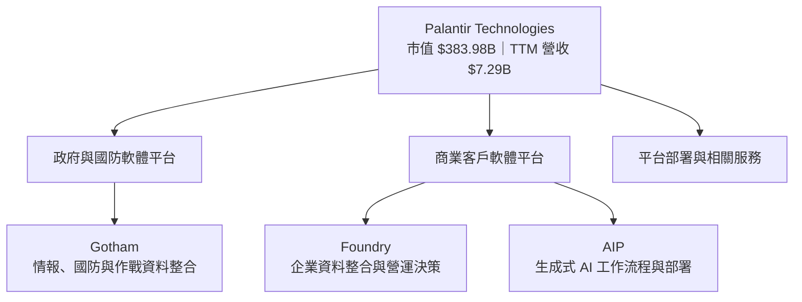
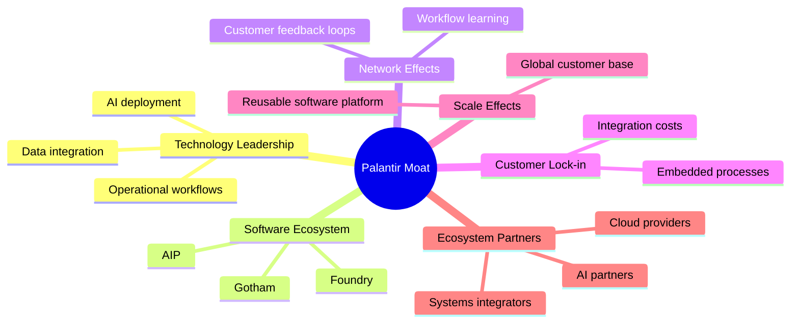
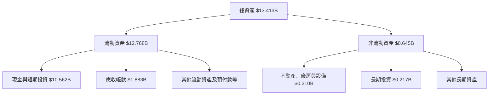
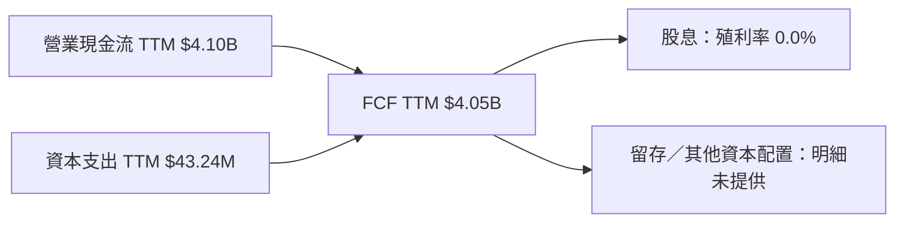
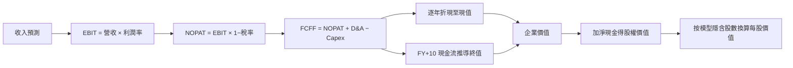
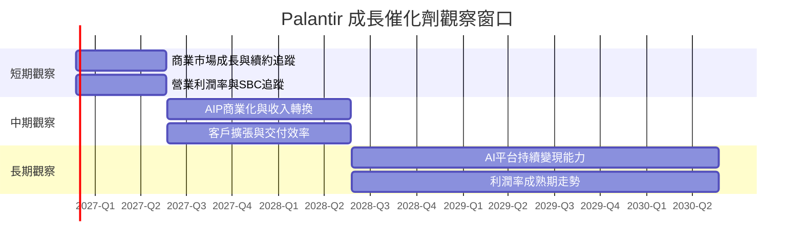
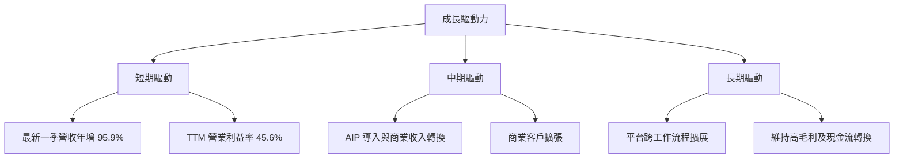
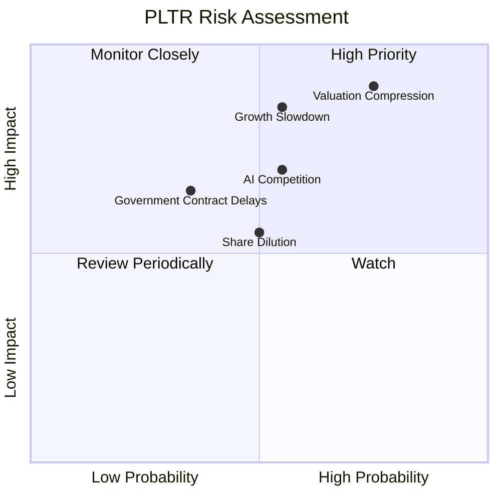
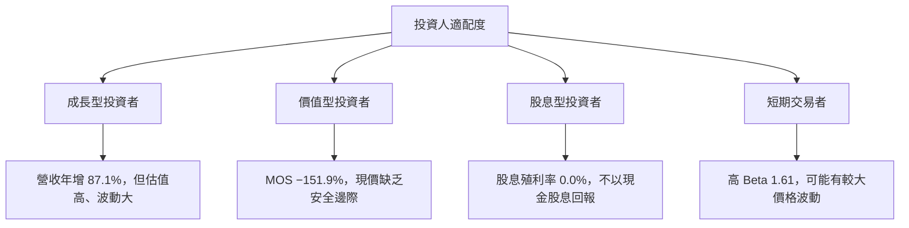

# PLTR 基本面深度分析報告
> **報告日期**：2026-11-24 ｜ **語言**：繁體中文 ｜ **數據來源**：SEC 申報資料 (XBRL)、Yahoo Finance、Finviz、StockAnalysis、Roic.ai ｜ **分析師**：CFA 級機構研究

---

## 目錄

| # | 章節 | 核心結論 |
|---|------|----------|
| 1 | 執行摘要 | 賣出；加權合理價值 $63.26，MOS −151.9% |
| 2 | 公司概覽與商業模式 | 軟體平台具客戶嵌入性，但分部營收與市場份額資料未提供 |
| 3 | 損益表深度分析 | TTM 營收 $7.29B、年增 87.1%；利潤率處於高位 |
| 4 | 資產負債表分析 | 現金與短期投資 $10.56B；流動性充裕 |
| 5 | 現金流量深度分析 | TTM FCF $4.05B，現金流轉換良好；SBC 仍具稀釋成本 |
| 6 | 獲利能力與資本效率 | 報表 ROIC 492.3% 高於 WACC 11.95%，但 ROIC 分母極小，須謹慎解讀 |
| 7 | 相對估值分析 | 相較同業與自身歷史，估值仍高；同業 Forward P/E 估值低於現價 |
| 8 | DCF 內在價值評估 | DCF 基準值 $22.24；加權合理價值 $63.26，均低於現價 |
| 9 | 成長催化劑 | AI 商業化與美國商業市場成長是主要觀察方向；TAM 數據未提供 |
| 10 | 風險矩陣 | 估值回撤、成長放緩與競爭是主要風險 |
| 11 | 投資建議 | 依 MOS 評級為賣出；監控營收成長、利潤率、SBC 與 FCF |

---

## 1. 執行摘要

Palantir 的 TTM 營收為 **$7.29B**、年增 **87.1%**，最新一季營收年增 **95.9%**；TTM 營業利益率 **45.6%**、FCF **$4.05B**，反映營收擴張與營運槓桿同步發生。然而，2026-11-23 收盤價 **$159.36** 對應 DCF 基準價值 **$22.24**，而三角驗證後加權合理價值為 **$63.26**；按統一 MOS 定義計算，MOS 為 **−151.9%**。因此評級依規則 20 為 **🔴 賣出**，即使公司基本面成長與現金流表現良好，當前價格仍需要遠高於基準模型的長期成長與獲利表現才能支撐。

### 1.0 一頁式投資儀表板（Portfolio Manager 30 秒速讀）

| 項目 | 內容 |
|------|------|
| **投資論點（3 句）** | ① TTM 營收年增 **87.1%**，最新一季年增 **95.9%**，顯示需求加速。② TTM 營業利益率 **45.6%**、FCF **$4.05B**，成長伴隨高現金轉換。③ 現價 **$159.36** 高於加權合理價值 **$63.26**，MOS **−151.9%**，估值折價保護不足。 |
| **綜合評分** | **7.0/10**（引用 1.1 評分卡） |
| **財務健康** | 🟢 現金及短期投資 **$10.56B**，流動比率 **7.102**；債務資料口徑有差異 |
| **ROIC vs WACC** | **492.3% vs 11.95%**；表面上大幅高於資金成本，但 ROIC 分母受淨現金扣除影響而極小，不能簡單外推 |
| **FCF 趨勢** | 上升；TTM FCF **$4.05B**，FCF Yield **1.06%** |
| **估值** | Forward P/E **62.77x** ｜ EV/EBITDA（歷史估值區塊）**119.1x** ｜ FCF Yield **1.06%** |
| **DCF 內在價值（基準）** | **$22.24** ｜ 相對 DCF 折價／溢價：現價溢價 **616.5%**（計算：$159.36 ÷ $22.24 − 1） |
| **安全邊際（MOS）** | **−151.9%**＝($63.26 − $159.36) ÷ $63.26；🔴 <10% 無 |
| **預期報酬（基準情境 12M）** | DCF 基準情境相對現價 **−86.0%**；非市場共識目標價 |
| **關鍵風險（前二）** | 估值倍數收縮；成長與高利潤率無法同時延續 |
| **評級 + 信心度** | 🔴 **賣出** ｜ 信心：中（估值結論清楚，DCF 長期假設與公司 ROIC 口徑仍有不確定性） |

### 1.1 綜合評分卡（全報告唯一）

| 維度 | 評分（1–10） | 主要依據（引用數字與其來源章節） |
|------|--------------|----------------------------------|
| 成長性 | 9.0 | TTM 營收年增 87.1%、最新一季年增 95.9%（第 3 章） |
| 獲利能力 | 9.0 | TTM 營業利益率 45.6%、F-Score 7/8；ROIC 遠高於 WACC，但分母異常小（第 6 章） |
| 財務健康 | 9.0 | 淨現金（依統一數據口徑）$10.56B、流動比率 7.102、DSO 94 天（第 4 章） |
| 估值 | 1.0 | MOS −151.9%；P/S 56.3x，高於自身五年中位數 24.7x（第 7、8 章） |
| 護城河 | 8.0 | 軟體平台支援跨資料整合與作業流程；客戶鎖定可能強，但缺少客戶留存率等量化資料（第 2 章） |
| 管理層與資本配置 | 6.0 | SBC 佔 TTM 營收約 13.5%，流通股數測試未通過；現金留存與投資細項不足（第 3、5 章） |
| **綜合評分** | **7.0** | 六項算術平均：(9+9+9+1+8+6) ÷ 6 = **7.0** |

### 1.2 五大投資論點 + 三大核心風險

| 類型 | 項目 | 具體依據 | 信心度 |
|------|------|----------|--------|
| 🟢 **投資論點①** | 營收成長加速 | TTM 營收年增 **87.1%**；最新一季年增 **95.9%**，季度收入由 2025 Q3 的 $1.181B 增至 2026 Q3 的 $2.313B | 🟢 高 |
| 🟢 **投資論點②** | 軟體毛利與營業槓桿 | TTM 毛利率 **84.7%**、營業利益率 **45.6%**；若收入擴張維持且交付成本受控，獲利可保持高於一般軟體公司水準 | 🟢 高 |
| 🟢 **投資論點③** | 現金流轉換強 | TTM 營業現金流 **$4.10B**，扣除資本支出 **$43.24M** 後 FCF **$4.05B** | 🟢 高 |
| 🟢 **投資論點④** | 資產負債表有緩衝 | 現金與短期投資 **$10.56B**；總債務在統一數據欄為 N/A，不能由此口徑推算債務 | 🟢 中高 |
| 🟢 **投資論點⑤** | 商業化擴張帶來選擇權 | 美國商業市場可望擴大軟體平台的客戶基礎；目前資料未提供分部收入及客戶數，仍需後續財報驗證 | 🟡 中 |
| 🟡 **風險①** | 估值與基本面脫節 | 加權合理價值 **$63.26**，較現價低 **60.3%**；DCF 基準 **$22.24** | 🔴 高衝擊 |
| 🔴 **風險②** | 高成長基期與持續性 | 最新一季年增 **95.9%**，若新簽約轉成收入的速度減慢，估值可能因成長預期下修而快速收縮 | 🔴 高 |
| 🟡 **風險③** | SBC 與股數稀釋 | TTM SBC 約 **$0.982B**，約佔營收 **13.5%**；F-Score 的稀釋股數測試未通過 | 🟡 中高 |

### 1.3 快速統計卡片

| 指標 | 公司實際值（期間） | 同業中位數 | 狀態 |
|------|--------------------|------------|------|
| 營收成長（TTM） | **87.1%** | — | 🟢 |
| 營收成長（最新一季年增） | **95.9%** | **35.1%** | 🟢 |
| 毛利率（TTM） | **84.7%** | **77.3%** | 🟢 |
| 營業利益率（TTM） | **45.6%** | — | 🟢 |
| ROIC（TTM） | **492.3%** | — | 🟡（分母極小，解讀受限） |
| Forward P/E | **62.77x** | **53.1x**（三家公司中位數） | 🔴 |
| FCF Yield（TTM） | **1.06%** | — | 🔴 |
| Piotroski F-Score | **7 / 8** | — | 🟢 |

### 1.4 投資結論

╔══════════════════════════════════════════════════════════════════╗  
║                    📊 投資結論摘要                               ║  
╠══════════════════════════════════════════════════════════════════╣  
║  評級：🔴 賣出（依 MOS 評級門檻）                                ║  
║  價格（2026-11-23 收盤）：$159.36                                ║  
║  DCF 內在價值（基準）：$22.24（現價溢價 616.5%）                 ║  
║  安全邊際 MOS：−151.9%（以加權合理價值 $63.26 為分母）          ║  
║  加權合理價值（8.8）：$63.26                                     ║  
║  DCF 情境價值：                                                  ║  
║    悲觀情境：$13.16（−91.7%）                                    ║  
║    基準情境：$22.24（−86.0%）                                    ║  
║    樂觀情境：$38.89（−75.6%）                                    ║  
║  綜合評分：7.0/10（引用 1.1）                                    ║  
║  適合投資人：能承受高波動、重視成長且不以現價安全邊際為前提者    ║  
╚══════════════════════════════════════════════════════════════════╝

---

## 2. 公司概覽與商業模式

Palantir Technologies 是美國軟體公司，提供 Gotham、Foundry 與 AIP 等資料整合與決策支援平台。公司平台可整合不同來源的資料，讓政府、國防及企業客戶建立分析與作業流程。最新可用員工數為 **4,634 人**；TTM 營收為 **$7.29B**。財務資料未提供各業務板塊收入與佔比，以下不推估分部數字。

### 2.1 業務結構與收入來源

由於沒有可引用的政府／商業分部營收及產品收入比例，不以推估金額繪製營收結構圖。可確認的業務類別如下：

各板塊收入金額及佔比：**N/A（資料未提供）**。因此無法判斷成長貢獻究竟來自政府合約、商業訂閱或部署服務；未來應追蹤公司披露的客戶數、合約金額與分部收入。

### 2.2 市場份額

市場份額數據未提供，且現有資料未包含可引用的 TAM 或市場研究來源。Palantir TTM 營收 **$7.29B**、成長 **87.1%**，高於所列 SNOW、DDOG、CRM 的最新一季營收年增率；但營收成長率不能直接等同市場份額提升。

### 2.3 競爭護城河分析

### 2.4 護城河強度

| 護城河項目 | 強度（強／中／弱） | 證據（引用數字或事實） | 會削弱它的情況 |
|------------|--------------------|------------------------|----------------|
| 技術與資料整合 | 強 | TTM 毛利率 **84.7%**、營業利益率 **45.6%**，顯示軟體交付具有高毛利特徵 | 通用雲端、資料庫或 AI 工具降低整合門檻 |
| 軟體生態系統 | 中強 | Gotham、Foundry、AIP 對應不同工作流程；TTM 營收 **$7.29B** | 平台模組被客戶以多供應商方案替代 |
| 網路效應 | 中 | 客戶使用資料與流程可能改善產品適配；但客戶數、留存率及產品使用量未提供 | 資料無法跨客戶形成有效學習，或客戶自行建置 |
| 客戶鎖定 | 中強 | 國防與企業工作流程整合通常增加遷移成本；實際續約率未提供 | 客戶轉向標準化雲端平台或合約集中度過高 |
| 規模效應 | 中 | 營收擴張伴隨高營業利益率；目前無單客成本或部署效率資料 | 專案型部署增加人力成本，抵消軟體規模效益 |
| 生態夥伴 | 中 | AI 與雲端合作可拓展產品觸及；合作收入貢獻未提供 | 夥伴將功能內建、降低外部平台價值 |

**1.1 護城河分數為 8.0/10**：主要依據為高毛利、高營業利益率及深度工作流程整合；因客戶留存率、續約、客戶集中度與分部收入未提供，未給更高分。

---

## 3. 損益表深度分析

### 3.1 年度收入成長趨勢（近 4 年）

年度收入（2022–2025）分別為 **$1.906B、$2.225B、$2.866B、$4.475B**。2022 至 2025 的三年 CAGR 約為 **32.9%**，計算為 \((4.475 ÷ 1.906)^{1/3}−1\)。

╔══════════════════════════════════════════════════════════════════╗  
║              Palantir 年度收入趨勢（FY2022–FY2025）              ║  
╠══════════════════════════════════════════════════════════════════╣  
║ FY2022  $1.91B  ████████░░░░░░░░░░░░░░░░  YoY +23.6% 🟢       ║  
║ FY2023  $2.23B  ██████████░░░░░░░░░░░░░░  YoY +16.7% 🟡       ║  
║ FY2024  $2.87B  █████████████░░░░░░░░░░░  YoY +28.8% 🟢       ║  
║ FY2025  $4.48B  ████████████████████░░░░  YoY +56.2% 🟢       ║  
╠══════════════════════════════════════════════════════════════════╣  
║ 2022–2025 三年收入 CAGR：約 +32.9%                               ║  
╚══════════════════════════════════════════════════════════════════╝

### 3.2 季度收入趨勢分析

| 季度 | 營收 | QoQ 成長 | YoY 成長 | 備註 |
|------|------|----------|----------|------|
| 2025 Q4 | $1.407B | +19.1% | +70.0% | 比較基期為 2024 Q4 |
| 2026 Q1 | $1.633B | +16.1% | +84.7% | 年增率高於 2025 Q4 |
| 2026 Q2 | $1.935B | +18.5% | +92.8% | QoQ 與 YoY 皆維持高位 |
| 2026 Q3 | $2.313B | +19.5% | +95.9% | 單季收入接近前一季的 1.20 倍 |

QoQ 以相鄰季度營收計算；YoY 為同季比較，不能把最新一季 **95.9%** 誤寫成 TTM 成長率。持續的季度擴張顯示需求具延續性，但如此高的年增率也會提高未來比較基期。

### 3.3 利潤率演變分析

| 利潤率指標 | FY2022 | FY2023 | FY2024 | FY2025 | 趨勢 | 評估 |
|------------|--------|--------|--------|--------|------|------|
| **毛利率** | 78.5% | 80.6% | 80.3% | 82.4% | 整體改善 | 🟢 |
| **營業利益率** | −8.5% | 5.4% | 10.8% | 31.6% | 明顯擴張 | 🟢 |
| **淨利率** | −19.6% | 9.4% | 16.1% | 36.3% | 轉盈後快速提升 | 🟢 |

年度毛利率由毛利除以收入計算，營業利益率與淨利率亦同。FY2025 營業利益率上升，與營收成長速度高於研發支出增幅相符：研發支出由 FY2024 **$507.88M** 升至 FY2025 **$557.68M**，增幅約 **9.8%**，低於同期收入約 **56.2%** 的增幅。這代表固定成本與平台重用可能帶來營運槓桿；若新增客戶需要大量客製部署，利潤率擴張則可能減速。TTM 營業利益率 **45.6%** 高於 FY2025 水準，顯示最近四季利潤率進一步擴張。

### 3.4 費用結構分析

年度資料提供收入、毛利、營業利益及研發支出，但沒有可完整勾稽的 TTM 費用科目明細及剩餘營業費用分項。為避免把未提供的費用項目當作實際值，不繪製費用結構圓餅圖。可確認 FY2025 研發支出 **$557.68M**，佔收入約 **12.5%**（$557.68M ÷ $4.475B）；持續投入研發有助維持平台能力，但也須與 SBC、銷售與部署成本一併追蹤。

### 3.5 季度 EPS 趨勢與盈餘品質（Quality of Earnings）

| 季度 | EPS 實際值 | EPS 預估／驚喜 | 說明 |
|------|-----------|----------------|------|
| 2025 Q4 | $0.26 | N/A | 預估值未提供，無法判斷是否超預期 |
| 2026 Q1 | $0.36 | N/A | 季 EPS 高於前季；估值資料不完整 |
| 2026 Q2 | $0.44 | N/A | EPS 資料來源列示年增 215.38% |
| 2026 Q3 | $0.47 | N/A | EPS 資料來源列示年增 144.44%；預估值缺漏 |

EPS 歷史表的預估值為空值，因此不能將任一季標示為超預期或不及預期。另有不同資料欄位列出最新季度淨利 **$1.128B**，而季度淨利資料與 EPS 欄位存在來源口徑差異；本報告不自行推導季度 EPS 驚喜。

| 盈餘品質項目 | 數值／佔比 | 評估 |
|--------------|-----------|------|
| 股權薪酬 SBC / 營收 | 約 **13.5%**（估算：近四季 SBC $0.982B ÷ TTM 營收 $7.29B） | 🟡 SBC 是實際股東成本；以 GAAP 費用計入，但仍須留意股數稀釋 |
| SBC / 營業現金流 | 約 **24.0%**（$0.982B ÷ $4.10B） | 🟡 現金流表現良好，但 SBC 規模仍不可忽略 |
| FCF / 淨利 | 約 **110.4%**（$4.05B ÷ StockAnalysis TTM 淨利 $3.669B） | 🟢 現金轉換高於會計淨利 |
| 一次性／非經常性損益 | N/A（未提供足以拆分一次性項目的資料） | 🟡 無法判斷稅務或其他一次性項目貢獻 |
| 有效稅率異常 | **1.4%** | 🟡 偏低；DCF 依模型採用此稅率，長期稅率上升會降低價值 |
| 資本化支出 vs 費用化 | TTM Capex **$43.24M**；資本化研發明細 N/A | 🟢 資本支出相對收入低，但無法僅憑 Capex 判斷全部研發投入的會計處理 |

**盈餘品質結論**：GAAP 淨利的現金流支持度不弱，TTM FCF 高於 TTM 淨利；但 SBC 約佔營收 **13.5%**，且 F-Score 的稀釋股數測試未通過。因而會計盈利具現金含量，卻不等於完全未稀釋的股東經濟回報。

---

## 4. 資產負債表分析

### 4.1 資產結構分解

TTM 資產負債表列示總資產 **$13.413B**、流動資產 **$12.768B**。以下列出來源提供的主要流動及非流動項目；部分細項未完整提供，不補足差額。

### 4.2 流動性與營運資金分析

| 指標 | 數值 | 評估 |
|------|------|------|
| 流動比率 | **7.102** | 🟢 流動資產對短期負債覆蓋充足 |
| 速動比率 | **6.923** | 🟢 即使排除存貨，短期流動性仍高 |
| 現金與短期投資 | **$10.56B** | 🟢 提供投資及經營緩衝 |

**營運資金天數（照抄品質指標）**

| 指標 | 最新 TTM | 一年前 TTM | 變化 | 解讀 |
|------|----------|------------|------|------|
| DSO 應收帳款天數 | 94 天 | 94 天 | 0 天 | 🟡 週轉未惡化；收入快速增加仍須留意回款品質 |
| DIO 存貨天數 | N/A | N/A | N/A | 公司未報告存貨餘額，不推算 |
| DPO 應付帳款天數 | 29 天 | 33 天 | −4 天 | 可能反映付款週期縮短；不能單憑天數判定議價力變化 |
| CCC 現金轉換週期 | N/A | N/A | N/A | DIO 缺資料，依品質指標保留 N/A |

### 4.3 債務結構分析

統一財務數據列示總債務 **N/A**、淨現金 **$10.56B**。補充財務資料另列總債務 **$225.27M**，並列示淨現金 **$10.34B**；因來源與計算口徑不一致，本節以統一指標的總債務 N/A、淨現金 $10.56B 為主，不推導債務倍數或利息保障倍數。

╔══════════════════════════════════════════════════════════════════╗  
║                   Palantir 債務健康診斷                          ║  
╠══════════════════════════════════════════════════════════════════╣  
║  總債務：        N/A（統一指標未提供）                            ║  
║  補充資料總債務：$225.27M（不同資料來源口徑）                    ║  
║  現金+短期投資： $10.56B                                          ║  
║  淨現金：        $10.56B（統一指標） 🟢                           ║  
║  Debt/EBITDA：   N/A（債務口徑不一致，不計算）                    ║  
║  Interest Coverage：N/A（利息費用未提供）                        ║  
╚══════════════════════════════════════════════════════════════════╝

### 4.4 股東權益趨勢

年度股東權益由 FY2022 **$2.57B** 增至 FY2025 **$7.39B**。權益增加與公司轉盈、累積留存及股東權益變動相關；同時股數稀釋指標未通過，需區分帳面權益增加與每股價值增加。

╔══════════════════════════════════════════════════════════════════╗  
║                    股東權益趨勢（年度）                          ║  
╠══════════════════════════════════════════════════════════════════╣  
║ FY2022  $2.57B  ███████░░░░░░░░░░░░░░░                            ║  
║ FY2023  $3.48B  ██████████░░░░░░░░░░░                            ║  
║ FY2024  $5.00B  ██████████████░░░░░░░                            ║  
║ FY2025  $7.39B  ████████████████████░                            ║  
╚══════════════════════════════════════════════════════════════════╝

---

## 5. 現金流量深度分析

### 5.1 現金流量瀑布圖

TTM 淨利沒有在統一指標區塊提供，因此不把補充來源數字混入同一條 TTM 現金流瀑布；以下以已確認的現金流數據呈現。

### 5.2 FCF 轉換率趨勢

| 年度 | FCF | 淨利 | FCF / 淨利 | 解讀 |
|------|-----|------|------------|------|
| FY2022 | $183.71M | −$373.70M | 不具可比性 | 淨利為負，比例不能代表正常現金轉換 |
| FY2023 | $697.07M | $209.82M | 332.2% | 現金流高於淨利，受非現金項目與營運資金影響 |
| FY2024 | $1.14B | $462.19M | 246.7% | 轉換率仍高，但不宜永久外推 |
| FY2025 | $2.10B | $1.63B | 約 128.8% | 仍高於 100%，現金流支撐盈利 |
| TTM | $4.05B | $3.669B（StockAnalysis） | 約 110.4% | 以不同資料來源的 TTM 淨利作參考，存在口徑限制 |

### 5.3 自由現金流趨勢

╔══════════════════════════════════════════════════════════════════╗  
║                  自由現金流趨勢（年度與 TTM）                    ║  
╠══════════════════════════════════════════════════════════════════╣  
║ FY2022  $0.18B  ██░░░░░░░░░░░░░░░░░░░░  FCF Yield：N/A        ║  
║ FY2023  $0.70B  █████░░░░░░░░░░░░░░░░░  FCF Yield：N/A        ║  
║ FY2024  $1.14B  █████████░░░░░░░░░░░░░  FCF Yield：N/A        ║  
║ FY2025  $2.10B  ██████████████░░░░░░░░  FCF Yield：N/A        ║  
║ TTM     $4.05B  ████████████████████░░  FCF Yield：1.06%      ║  
╚══════════════════════════════════════════════════════════════════╝

年度歷史 FCF Yield 的相應市值未提供，不補算。TTM FCF 上升代表營收擴張轉化為現金；但現價對應 FCF Yield 僅 **1.06%**，意味市場已對未來多年的現金流擴張提前定價。

### 5.4 資本配置評估

| 資本用途 | 可用數據 | 評估 |
|----------|----------|------|
| 資本支出 | TTM **$43.24M** | 佔 TTM 營收約 0.6%，平台模式資本密集度低 |
| 股息 | 殖利率 **0.0%**、派息率 **0.0%** | 未以現金股息回饋股東 |
| 回購 | 金額 N/A | 無足夠資料判斷回購規模 |
| SBC | FY2025 **$684.03M**；近四季估算約 **$0.982B** | 非現金會計費用，但對每股持有權有稀釋影響 |
| 留存／投資 | 明細 N/A | 現金及短期投資累積至 $10.56B；用途需追蹤 |

資本配置比例數據不完整，不繪製比例圓餅圖，以免把未知項目填成估算比例。

---

## 6. 獲利能力與資本效率

### 6.1 ROE / ROA / ROIC 趨勢

| 指標 | 歷史數據 | 最新值 | 評估 |
|------|----------|--------|------|
| ROE | 年度歷史完整序列 N/A；品質指標 DuPont TTM **32.7%** | 32.7% | 🟢 有盈利能力；另有來源列示 40.9%，口徑不同 |
| ROA | 長期序列 N/A | TTM **19.3%**（補充資料） | 🟢 資產盈利能力良好；與品質指標計算口徑不完全相同 |
| ROIC | 歷史可比序列 N/A | TTM **492.3%** | 🟡 高於 WACC，但投入資本分母極小，不能按倍數外推 |

### 6.2 ROIC vs WACC 分析（核心價值創造判斷）

依統一成本資本數據，無風險利率 **4.92%**、ERP **5.00%**、調整後 Beta **1.41**、股權成本 **11.95%**、稅前債務成本假設 **6.92%**，股權／債務權重 **99.9%／0.1%**，WACC **11.95%**。以下的 ROIC 與 WACC 直接採用統一指標，不另建一套模型。

╔══════════════════════════════════════════════════════════════════╗  
║                ROIC vs WACC 深度分析                            ║  
╠══════════════════════════════════════════════════════════════════╣  
║ WACC 輸入：                                                      ║  
║ ├── 無風險利率：4.92%                                            ║  
║ ├── ERP：5.00%                                                   ║  
║ ├── 原始 Beta：1.61；調整後 Beta：1.41                           ║  
║ ├── 股權成本：11.95%（採用資本成本區塊值）                      ║  
║ ├── 稅前債務成本假設：6.92%                                      ║  
║ ├── 股權／債務權重：99.9%／0.1%                                  ║  
║ └── WACC：11.95%                                                 ║  
║                                                                  ║  
║ ROIC 與價值差：                                                  ║  
║ ├── TTM ROIC：492.3%                                             ║  
║ ├── WACC：11.95%                                                 ║  
║ ├── ROIC − WACC：480.35 個百分點                                 ║  
║ └── ROIC / WACC：約 41.2 倍                                      ║  
║                                                                  ║  
║ 結論：報表 ROIC 高於 WACC；但投入資本扣除大量現金後分母很小，    ║  
║       492.3% 不宜作為穩定經濟回報率直接外推。                    ║  
╚══════════════════════════════════════════════════════════════════╝

Beta 調整方式：\(2/3×1.61+1/3=1.407\)，顯示為 **1.41**。WACC 採用提供的 **11.95%**；各輸入值經四捨五入展示，並不由報告另行重算。ROIC 高於 WACC 的方向支持價值創造，但其量級受現金扣除後資本基數小影響，判斷品質應低於單看百分比的結論。

### 6.3 杜邦三因素分解

| 因素 | 數值（TTM） | 解讀 |
|------|-------------|------|
| 淨利率 | **50.3%** | 高淨利率是 ROE 的重要來源 |
| 資產週轉率 | **0.54** | 每單位資產帶來的收入有限於資產輕型模式；仍有改善空間 |
| 權益乘數 | **1.19** | 槓桿不高，ROE 並非主要依靠負債放大 |
| **ROE** | **32.7%** | 品質指標：50.3% × 0.54 × 1.19 = 約 32.3%，與提供的 32.7% 有四捨五入及計算口徑差異；此處 ROE 依品質指標照錄 |

### 6.4 財務體質：Piotroski F-Score

**Piotroski F-Score：7 / 8**。其中有一項因資料缺漏未能判定，故分母為 8，而不是 9。

| 測試 | 結果 | 解讀 |
|------|------|------|
| ROA > 0 | ✅ 通過 | 公司有正資產報酬 |
| 營業現金流 > 0 | ✅ 通過 | TTM OCF 為正 |
| ROA 高於一年前 | ✅ 通過 | 盈利能力改善 |
| 營業現金流 > 淨利 | ✅ 通過 | 應計品質測試通過 |
| 長期負債 ÷ 總資產低於一年前 | — 無法判定 | 缺資料，不納入分母 |
| 流動比率高於一年前 | ✅ 通過 | 流動性相對改善 |
| 稀釋股數未增加 | ❌ 未通過 | SBC 及股數變化須納入每股回報 |
| 毛利率高於一年前 | ✅ 通過 | 毛利率改善 |
| 資產週轉率高於一年前 | ✅ 通過 | 資產效率改善 |

---

## 7. 相對估值分析

### 7.1 同業估值比較表格

本節同業估值採用 Yahoo Finance 同業倍數。PLTR 自身 Forward P/E 取市場估值數據，歷史 P/E、P/S、EV/EBITDA 比較另依自身歷史區塊。

| 估值指標 | **PLTR** | **SNOW** | **DDOG** | **CRM** | PLTR 評估 |
|----------|----------|----------|---------|---------|-----------|
| **Trailing P/E** | 112.2x | N/A | 234.8x | 17.0x | 🟡 盈利公司，但高於 CRM |
| **Forward P/E** | 62.77x | 88.2x | 53.1x | 11.6x | 🔴 高於兩家可盈利同業的中位數 32.3x |
| **P/S Ratio** | 56.3x（歷史估值區塊） | 17.6x | 14.3x | 3.5x | 🔴 明顯高於同業 |
| **EV/EBITDA** | 119.1x（歷史估值區塊） | −92.7x | 335.3x | 14.2x | 🟡 同業差距大；SNOW 倍數為負值，不適合直接比較 |
| **最新一季營收年增** | 95.9% | 35.1% | 35.2% | 10.8% | 🟢 成長率明顯高於同業 |
| **毛利率（TTM）** | 84.7% | 67.0% | 79.6% | 77.3% | 🟢 高於所列同業 |

### 7.2 歷史估值區間分析

╔══════════════════════════════════════════════════════════════════╗  
║               PLTR 五年估值區間（TTM 倍數）                     ║  
╠══════════════════════════════════════════════════════════════════╣  
║ P/E：        100.6x ├────────●112.2x────────┤ 601.0x            ║  
║ 五年中位數：228.6x；目前百分位：7%                                 ║  
║ P/S：          7.0x ├────────────────●56.3x─┤ 120.4x            ║  
║ 五年中位數：24.7x；目前百分位：67%                                ║  
║ EV/EBITDA：  109.0x ├──────●119.1x──────────┤ 574.4x            ║  
║ 五年中位數：233.4x；目前百分位：8%                                ║  
╚══════════════════════════════════════════════════════════════════╝

P/E 與 EV/EBITDA 位於自身歷史區間較低百分位，部分原因是獲利基數快速擴大；但 **P/S 56.3x** 仍高於五年中位數 **24.7x**。這代表「相對自身歷史某些盈利倍數回落」不等於絕對估值便宜。

### 7.3 情境價值（Bear / Base / Bull，照抄 DCF MODEL 的 Scenarios）

| 情境 | 第 1 年營收成長 | 期末營業利潤率 | WACC | 每股價值 | 相對現價 | 機率 | 會發生的條件 |
|------|----------------|----------------|------|----------|----------|------|--------------|
| 🔴 悲觀 | 15.0% | 9.2% | 12.95% | **$13.16** | −91.7% | 25% | 商業化增速下滑，長期利潤率收斂幅度大 |
| 🟡 基準 | 30.0% | 10.8% | 11.95% | **$22.24** | −86.0% | 50% | 成長由高位逐步降至 3%，利潤率回歸歷史中位數 |
| 🟢 樂觀 | 45.0% | 11.9% | 10.95% | **$38.89** | −75.6% | 25% | 高成長延續且折現率下降，期末利潤率略高於基準 |

模型提供的機率加權值為 **$24.13**（相對現價 −84.9%），此值僅為情境參考，不取代第 8.8 節按固定權重計算的加權合理價值。

### 7.4 相對估值隱含價格區間

╔══════════════════════════════════════════════════════════════════╗  
║            估值方法對應價格與現價位置                            ║  
╠══════════════════════════════════════════════════════════════════╣  
║ DCF 基準：$22.24 ── 同業 Forward P/E：$82.11 ── 現價：$159.36    ║  
║ 分析師共識：$222.90                                              ║  
╚══════════════════════════════════════════════════════════════════╝

同業 Forward P/E 法依據為 **DDOG 與 CRM 中位數 32.3x × PLTR Forward EPS $2.54 = $82.11**（使用模型列示值）。分析師共識目標價 **$222.90**，由 29 位分析師平均目標價構成，屬市場參考，不是可直接驗證的內在價值。EV/EBITDA 方法在模型中未能計算，依規則不另增估值方法。

---

## 8. DCF 內在價值評估（Discounted Cash Flow）

> 本節採用程式計算的 DCF MODEL，金額除每股價值外均為美元十億。模型採 GAAP EBIT、FCFF 與 WACC 折現。提供表格的金額經四捨五入，部分算式以未四捨五入的底層數字計算；顯示值可能出現小於 1% 的尾差。

### 8.0 估值推理鏈（Thinking Logic）

**Step 1 — 價值由哪些變數決定？**  
核心價值由既有政府與商業軟體營收、商業市場擴張，以及未來 AIP 商業化三部分形成；各部分目前營收佔比均未提供，不能量化拆分。模型中最能主導估值的是**營業利潤率長期路徑與高成長能否持續**；敏感度表顯示終值成長率與 WACC 也顯著影響估值。

**Step 2 — 模型選擇**

| 決策點 | 本報告採用 | 理由（含數字） | 曾考慮但否決 | 否決理由 |
|--------|-----------|----------------|--------------|----------|
| 現金流定義 | FCFF | 以 GAAP EBIT 推導，WACC 11.95% 折現至企業價值 | FCFE | 模型已設定 FCFF，避免重建模型 |
| 預測期 N | 10 年 | 模型提供 10 年逐年預測，收入成長由 30% 降至 3% | 5 年 | 會縮短成長遞減過程，不符合既定模型 |
| 終值方法 | Gordon Growth | 模型採永續成長率 3.0% | 退出倍數 | DCF MODEL 未提供退出倍數輸入與計算值，不自行補建 |
| EBIT 基礎 | GAAP | GAAP EBIT 已含 SBC 費用 | 非 GAAP | 避免加回 SBC 後又無法以股數稀釋反映成本 |

**Step 3 — 關鍵假設推導鏈**

- **營收成長**：錨點為 TTM 成長 **87.1%**、最新一季單季年增 **95.9%**；但這是高增長階段且基期快速墊高，模型將首年成長限制為 **30.0%**，並線性降至第十年 **3.0%**；採用值為 **FY+1 30.0%、FY+10 3.0%**；曾考慮把 87.1% 延續至預測期，因不可持續且模型已限制在 0%–30% 而否決。
- **期末營業利潤率**：錨點是 TTM GAAP 營業利益率 **45.6%**；模型以最近五個財年的中位水準作長期收斂，期末採 **10.8%**；否決長期維持 45.6%，因其假設競爭、交付與成熟期利潤率完全不收斂。
- **永續成長率 g**：模型採 **3.0%**，低於 WACC **11.95%**；其作為成熟期名目增長假設，並使 Gordon Growth 分母為正；未採用 4.0% 以上的較高值，以避免把永續增長設得過度積極。
- **預測期 N**：採 **10 年**，對應高成長向成熟期遞減；未採 5 年，避免未充分呈現營收成長收斂至長期 3% 的過程。
- **Capex／營收**：錨點為 TTM Capex **$43.24M**，TTM 營收 **$7.29B**；模型由首年 **0.6%** 緩降至第十年 **0.4%**；未採更高的資本密集度，因歷史 Capex 相對收入低，但需注意工作資本未建模。
- **GAAP EBIT 與 SBC**：採用 GAAP EBIT，SBC 已在費用中扣除；模型按組合 **(A)** 不再扣一次 SBC，股數不再額外稀釋，年稀釋率設為 0%。未採「非 GAAP 加回 SBC」方案，以免假設不一致。
- **WACC**：採用成本資本區塊的 **11.95%**；Beta 原始值 1.61、調整後 1.41；不另加規模溢酬，以保持與程式模型一致。
- **有效稅率**：採用資料列示的 **1.4%**；長期代表性仍不確定，稅率升高將降低 NOPAT。
- **D&A／營收**：採模型 **0.4%**，以 TTM 比率為錨並固定；資料未提供獨立詳細折舊假設，故不另改值。
- **ΔWC／營收增額**：模型不建模營運資金，故不設額外扣項；DSO 94 天顯示應收款規模值得監控，但不能臆測未提供的 ΔWC。
- **終值方法**：採 Gordon Growth；退出倍數法未提供所需倍數，故不自行創造交叉驗證數字。

**Step 4 — 最脆弱環節**  
最大弱點是將當前 **45.6%** 營業利益率逐步降至 **10.8%**，同時不建模營運資金；若長期利潤率或現金轉換比模型更差，價值將低於 **$22.24**。

**Step 5 — 計算路徑**

### 8.1 模型假設總表（Model Inputs）

| 假設項目 | 採用值 | 依據／來源 | 敏感度 |
|----------|--------|-------------|--------|
| 預測期長度 **N** | 10 年 | DCF MODEL 固定預測期；高成長向成熟期逐步遞減 | 🟡 中 |
| 營收成長 | FY+1 30.0%，FY+10 3.0% | TTM 成長 87.1%；模型限制首年值並線性淡出 | 🔴 高 |
| 營業利潤率 | 45.6% → 10.8% | TTM 營業利益率及近五年中位數 | 🔴 高 |
| 有效稅率 | 1.4% | 最新年度有效稅率 | 🟢 低 |
| Capex / 營收 | 0.6% → 0.4% | TTM 比率及模型逐步收斂 | 🟡 中 |
| D&A / 營收 | 0.4% | DCF MODEL：TTM 比率固定 | 🟢 低 |
| 營運資金變動 | 未建模 | DCF MODEL 明列 Working capital is not modelled | 🟡 中 |
| EBIT 基礎 | GAAP EBIT | DCF MODEL 採 GAAP EBIT | 🟡 中 |
| SBC 處理 | 組合 (A)：不再扣 SBC，股數不再稀釋 | GAAP EBIT 已含 SBC 費用 | 🟡 中 |
| 年稀釋率 | 0%（模型處理） | 與組合 (A) 相容；現實股數測試未通過，模型仍採固定股數 | 🟡 中 |
| 永續成長率 g | 3.0% | DCF MODEL；且低於 WACC 11.95% | 🔴 高 |
| 終值方法 | Gordon Growth | DCF MODEL 提供終值計算 | 🔴 高 |
| WACC | 11.95% | 成本資本資料與 DCF MODEL | 🔴 高 |
| FCFF | NOPAT + D&A − Capex | 模型不含營運資金變動列 | — |

本模型採用 **(A) GAAP EBIT + 固定股數**，所以 SBC 影響在 GAAP 費用中計入一次；不另扣 SBC，也不另放大股數。該處理符合模型指定組合，但因實際稀釋股數測試未通過，可能低估未來股數增長的影響。

### 8.2 折現率推導（WACC）

╔══════════════════════════════════════════════════════════════════╗  
║                    WACC 推導（折現率）                           ║  
╠══════════════════════════════════════════════════════════════════╣  
║ 股權成本 Ke（CAPM）：                                             ║  
║ ├── 無風險利率 Rf：4.92%                                         ║  
║ ├── ERP：5.00%                                                    ║  
║ ├── 原始 Beta：1.61；調整後 Beta：1.41                            ║  
║ ├── 規模／國別溢酬：未另加                                        ║  
║ └── 採用股權成本：11.95%（成本資本資料）                          ║  
║                                                                  ║  
║ 債務成本：稅前假設 6.92%；有效稅率 1.4%                           ║  
║ 資本權重：股權 99.9%；債務 0.1%                                  ║  
║ WACC：11.95%（依成本資本及 DCF MODEL 原值）                      ║  
╚══════════════════════════════════════════════════════════════════╝

- **Ke**：\(4.92\% + 1.407×5.00\% = 11.955\%\)，四捨五入約 **11.95%**；調整後 Beta 的顯示值為 1.41，內部未四捨五入值約 1.407。
- **稅前 Kd**：採成本資本區塊假設值 **6.92%**；利息費用與可比平均計息負債沒有提供，因此不另用財報債務自行反推。
- **稅後 Kd**：\(6.92\%×(1−1.4\%)=6.82\%\)（四捨五入）。
- **權重**：依成本資本區塊採股權 **99.9%**、債務 **0.1%**；具體市值與計息負債權重的底層計算沒有在區塊提供，不另重建。
- **WACC**：依指定值採 **11.95%**；按顯示權重估算，股權權重主導 WACC。第 6.2 節亦採同一 WACC。

### 8.3 逐年自由現金流預測（基準情境）

單位：$B。模型未納入 ΔWC，因此不列 ΔWC 行；折現因子顯示至三位小數。表內數字照錄 DCF MODEL。

| 年度 | FY+1 | FY+2 | FY+3 | FY+4 | FY+5 | FY+6 | FY+7 | FY+8 | FY+9 | FY+10 |
|------|------|------|------|------|------|------|------|------|------|-------|
| 營收 | 9.47 | 12.03 | 14.92 | 18.05 | 21.30 | 24.50 | 27.44 | 29.91 | 31.70 | 32.65 |
| 營收 YoY | 30.0% | 27.0% | 24.0% | 21.0% | 18.0% | 15.0% | 12.0% | 9.0% | 6.0% | 3.0% |
| 營業利潤率 | 45.6% | 41.8% | 37.9% | 34.0% | 30.2% | 26.3% | 22.4% | 18.6% | 14.7% | 10.8% |
| EBIT（GAAP） | 4.32 | 5.03 | 5.66 | 6.14 | 6.43 | 6.44 | 6.16 | 5.55 | 4.66 | 3.54 |
| − 稅 | (0.06) | (0.07) | (0.08) | (0.08) | (0.09) | (0.09) | (0.08) | (0.08) | (0.06) | (0.05) |
| NOPAT | 4.26 | 4.96 | 5.58 | 6.06 | 6.34 | 6.36 | 6.07 | 5.48 | 4.60 | 3.49 |
| + D&A | 0.04 | 0.05 | 0.06 | 0.07 | 0.08 | 0.10 | 0.11 | 0.12 | 0.13 | 0.13 |
| − Capex | (0.06) | (0.07) | (0.08) | (0.10) | (0.11) | (0.12) | (0.13) | (0.14) | (0.14) | (0.14) |
| = FCFF | 4.25 | 4.94 | 5.55 | 6.03 | 6.31 | 6.33 | 6.05 | 5.45 | 4.58 | 3.48 |
| 折現因子 | 0.893 | 0.798 | 0.713 | 0.637 | 0.569 | 0.508 | 0.454 | 0.405 | 0.362 | 0.323 |
| FCFF 現值 PV | 3.79 | 3.94 | 3.96 | 3.84 | 3.59 | 3.22 | 2.74 | 2.21 | 1.66 | 1.12 |

預測期現值合計依模型為 **$30.08B**；將表內四捨五入數字相加為 \(3.79+3.94+3.96+3.84+3.59+3.22+2.74+2.21+1.66+1.12=30.07\)B，與模型總額差 **$0.01B**，屬逐年數字四捨五入尾差。

**逐步演算（FY+1，示範）**

1. 營收：\(7.29×(1+30.0\%)=9.477\)B；模型列示 **$9.47B**（底層未四捨五入數據）。
2. EBIT：模型列示 **$4.32B**，按顯示值計算 \(9.47×45.6\%=4.3183\)B，四捨五入為 **$4.32B**。
3. 稅：\(4.32×1.4\%=0.0605\)B，約 **$0.06B**。
4. NOPAT：\(4.32−0.06=4.26\)B。
5. D&A：模型列示 **$0.04B**。
6. Capex：模型列示 **$0.06B**。
7. ΔWC：模型不建模，**不扣減**。
8. FCFF：按四捨五入顯示行直接相減為 \(4.26+0.04−0.06=4.24\)B；模型列示 **$4.25B**，差異來自表格輸入行各自四捨五入，模型以未四捨五入底層數據計算。
9. 折現因子：\(1÷(1+11.95\%)^1=0.893\)；依模型現值列示 \(4.25×0.893\) 約 **$3.79B**。

預測期 FCF 的年末值由 FY+1 **$4.25B** 降至 FY+10 **$3.48B**，不是單調增加；原因是模型將營業利潤率由 **45.6%** 降至 **10.8%**，抵消營收成長。以模型列示 FCF 計，首年到第十年變化約為負，與「收入持續增長」不能混為「FCF 同速增長」。FY+10 FCF 利潤率約 **10.7%**（3.48 ÷ 32.65），低於當前 TTM FCF／收入約 **55.6%**（4.05 ÷ 7.29）；這一差距主要來自模型假設利潤率大幅收斂。年度歷史 FCF 與模型年度口徑不同，且模型不含工作資本，不能精確計算完全同口徑 FCF CAGR。

╔══════════════════════════════════════════════════════════════════╗  
║            自由現金流：歷史實際 vs 模型預測                      ║  
╠══════════════════════════════════════════════════════════════════╣  
║ FY2023(實)  $0.70B  ███░░░░░░░░░░░░░░░░░░░                     ║  
║ FY2024(實)  $1.14B  █████░░░░░░░░░░░░░░░░░░                   ║  
║ FY2025(實)  $2.10B  █████████░░░░░░░░░░░░░                   ║  
║ FY+1 (預)   $4.25B  ██████████████████░░░                     ║  
║ FY+10 (預)  $3.48B  ███████████████░░░░░                     ║  
╠══════════════════════════════════════════════════════════════════╣  
║ 模型 FCF 先升至 FY+6 $6.33B，後因利潤率收斂而下降至 $3.48B。    ║  
╚══════════════════════════════════════════════════════════════════╝

### 8.4 終值計算（Terminal Value）

**適用性檢查**：WACC **11.95%** vs g **3.0%** → WACC > g？✅

| 方法 | 計算式 | 終值 TV | TV 現值 | 佔總 EV 比重 |
|------|--------|---------|---------|--------------|
| Gordon Growth | 3.48 × (1 + 3.0%) ÷ (11.95% − 3.0%) | **$40.01B**（模型值） | **$12.94B**（模型值） | **30.1%** |
| 退出倍數法 | N/A（DCF MODEL 未提供退出倍數） | N/A | N/A | N/A |

逐步演算：FY+10 FCFF 為 **$3.48B**；分子按顯示值計為 \(3.48×1.03=3.5844\)B；分母為 \(11.95\%−3.0\%=8.95\%\)。以顯示值計算 TV 約 **$40.05B**，而 DCF MODEL 列示 **$40.01B**，差異來自底層未四捨五入現金流。模型 PV(TV) 為 **$12.94B**，佔 EV **30.1%**，並非高度依賴終值的 75% 以上情況。

### 8.5 企業價值 → 每股內在價值（Bridge）

╔══════════════════════════════════════════════════════════════════╗  
║              企業價值 → 每股內在價值 橋接表                      ║  
╠══════════════════════════════════════════════════════════════════╣  
║ 預測期 FCF 現值合計             +$30.08B                         ║  
║ 終值現值 PV(TV)                 +$12.94B                         ║  
║ = 企業價值 EV                    $43.02B                         ║  
║ + 現金及短期投資                +$10.56B                         ║  
║ − 總債務                         N/A（資料口徑未提供）            ║  
║ 模型股權價值                     $53.58B                         ║  
║ 每股內在價值                     $22.24                           ║  
║ 當前股價                         $159.36                          ║  
║ 折溢價                           +616.5%（現價溢價）              ║  
╚══════════════════════════════════════════════════════════════════╝

模型橋接依 DCF MODEL 列示：\(30.08+12.94=43.02\)B；加淨現金 **$10.56B** 得股權價值 **$53.58B**。雖然總債務的統一數據欄為 N/A，模型已將淨現金按 **$10.56B** 納入；不另以補充來源的債務數字替換模型橋接。每股值依模型公式：
\[
\text{每股價值}=\text{股權價值}×\text{價格}÷\text{市值}
\]
\[
\$53.58B×\$159.36÷\$383.98B=\$22.24
\]
其中股價日期為 **2026-11-23**；隱含股數約對應模型的市值／股價口徑。折溢價為 \(159.36÷22.24−1=+616.5\%\)。此處**不計算 MOS**；全報告 MOS 僅以 8.8 加權合理價值為分母。

### 8.6 敏感性分析（WACC × 永續成長率）

以下每股價值照錄 DCF MODEL，括號內為相對現價的上行空間，按 \((價值−159.36)÷159.36\) 計算並四捨五入。

| g（列）／WACC（欄） | 9.95% | 10.95% | **11.95%（基準）** | 12.95% | 13.95% |
|-----------|------:|-------:|------------------:|-------:|-------:|
| 2.0% | $25.14 (−84.2%) | $23.22 (−85.4%) | $21.65 (−86.4%) | $20.34 (−87.2%) | $19.23 (−87.9%) |
| 2.5% | $25.66 (−83.9%) | $23.59 (−85.2%) | $21.93 (−86.2%) | $20.55 (−87.1%) | $19.39 (−87.8%) |
| **3.0%（基準）** | $26.25 (−83.5%) | $24.01 (−84.9%) | **$22.24 (−86.0%)** | $20.79 (−87.0%) | $19.57 (−87.7%) |
| 3.5% | $26.94 (−83.1%) | $24.49 (−84.6%) | $22.58 (−85.8%) | $21.04 (−86.8%) | $19.77 (−87.6%) |
| 4.0% | $27.74 (−82.6%) | $25.04 (−84.3%) | $22.97 (−85.6%) | $21.33 (−86.6%) | $19.98 (−87.5%) |

矩陣基準格為 **$22.24**，與 DCF 基準值一致。以下選用非基準格 **WACC 10.95% > g 3.0% ✅**；該格模型值為 **$24.01**。模型只提供敏感度矩陣結果，未提供該格逐年折現現值與新終值中間數據，故不以臆測中間數字冒充可複算推導。

**三情境 DCF（依模型照錄）**

| 情境 | 第 1 年成長 | 期末營業利潤率 | WACC | 每股內在價值 | 相對現價 | 機率 |
|------|------------|----------------|------|--------------|----------|------|
| 🔴 悲觀 | 15.0% | 9.2% | 12.95% | $13.16 | −91.7% | 25% |
| 🟡 基準 | 30.0% | 10.8% | 11.95% | $22.24 | −86.0% | 50% |
| 🟢 樂觀 | 45.0% | 11.9% | 10.95% | $38.89 | −75.6% | 25% |
| **機率加權** | — | — | — | **$24.13** | **−84.9%** | 100% |

以上情境的完整逐年營收、FY+10 FCFF 與終值明細未列於模型輸出，因此不另行重建，以免改動程式計算假設。機率加權為 \(13.16×25\%+22.24×50\%+38.89×25\%=24.1325\)，四捨五入 **$24.13**。

敏感度方向：在基準 WACC 11.95% 下，g 由 2.0% 升至 3.0%，每股值由 **$21.65** 升至 **$22.24**，增加 **$0.59**；由 3.0% 升至 4.0%，增加 **$0.73**。在 g=3.0% 下，WACC 由 10.95% 升至 11.95%，每股值由 **$24.01** 降至 **$22.24**，減少 **$1.77**。期末營業利潤率每增加 1 個百分點的單獨敏感度數據未提供，故不虛構彈性；整體營業利潤率路徑已在悲觀、基準、樂觀情境中與成長、WACC 同時變動。從現有矩陣看，WACC 變化對價值影響顯著，與折現率及終值敏感性高的判斷一致。

### 8.7 反推 DCF（Reverse DCF：市場在預期什麼）

DCF MODEL 的反推結果為：單獨改變首年營收成長率，在 **−10% 至 100%** 範圍內無解；單獨改變固定營業利潤率，在 **0.5% 至 95%** 範圍內無解。由於市場價格 **$159.36** 高於兩項單變數模型可解區間，不得據此捏造隱含 CAGR 或利潤率。

| 求解的變數（一次一個） | 其餘變數設定 | 市場隱含值 | 公司歷史實際 | 判斷 |
|------------------------|--------------|--------------|--------------|------|
| 年 1 營收成長率 | 其餘採基準值 | **無解（−10% 至 100%）** | TTM 成長 87.1% | 🔴 單一成長變數不足以解釋現價 |
| 固定營業利潤率 | 其餘採基準值 | **無解（0.5% 至 95%）** | TTM 營業利益率 45.6% | 🔴 單一利潤率變數不足以解釋現價 |
| 永續成長率 g | 未提供求解結果 | 未計算 | N/A | 不另行求解 |
| 高成長持續年數 N | 未提供求解結果 | 未計算 | N/A | 不另行求解 |

反推結論：按指定單變數反推方式，模型無法只靠提高首年成長或固定營業利潤率達到現價，意味市場估值隱含多項樂觀因素同時成立，或此 DCF 假設對現價的解釋能力有限。

### 8.8 估值三角驗證與安全邊際

| 估值方法 | 隱含每股價值 | 上行空間（÷現價） | 權重 | 說明 |
|----------|--------------|-------------------|------|------|
| DCF（基準） | $22.24 | −86.0% | 55% | 10 年 FCFF、WACC 11.95%、g 3.0% |
| 同業 Forward P/E | $82.11 | −48.5% | 35% | 同業中位數 32.3x × Forward EPS $2.54 |
| 分析師共識目標價 | $222.90 | +39.9% | 10% | 29 位分析師平均目標價 |
| **加權合理價值** | **$63.26** | **−60.3%** | **100%** | 依盈利公司固定方法權重 |

加權合理價值完整算式：
\[
\$22.24×55\%+\$82.11×35\%+\$222.90×10\%
=\$12.232+\$28.7385+\$22.290
=\$63.2605\approx\mathbf{\$63.26}
\]
估值方法權重對應公司類型 **profitable**。同業 EV/EBITDA 因模型不可計算而剔除，依程式規則其權重已分配至可計算方法；不自行新增估值法或調整權重。

\[
\text{MOS}=(\$63.26-\$159.36)÷\$63.26
=-\$96.10÷\$63.26
=\mathbf{-151.9\%}
\]

\[
\text{上行空間}=(\$63.26-\$159.36)÷\$159.36
=-\$96.10÷\$159.36
=\mathbf{-60.3\%}
\]

╔══════════════════════════════════════════════════════════════════╗  
║                  估值區間與安全邊際                              ║  
╠══════════════════════════════════════════════════════════════════╣  
║ $13.16 ─── $63.26 ─── $82.11 ─── $159.36 ─── $222.90             ║  
║ 悲觀DCF    加權合理值  同業P/E       現價        分析師共識        ║  
║                                                                  ║  
║ 安全邊際 MOS = ($63.26 − $159.36) ÷ $63.26 = −151.9%            ║  
║ MOS 評估：🔴 無安全邊際                                          ║  
║ 上行空間 = ($63.26 − $159.36) ÷ $159.36 = −60.3%                ║  
║ 建議買入區間（MOS ≥10%）：$0–$56.93                             ║  
║ MOS 約 −10% 至 +10% 價格區間：約 $56.93–$69.59                   ║  
║ 減碼考慮區間：高於約 $69.59                                      ║  
╚══════════════════════════════════════════════════════════════════╝

買入區間上限依加權合理價值推導：MOS ≥10% 對應價格不高於 \(63.26×(1−10\%)=\$56.93\)。現價遠高於該區間。

> 🔎 **程式複算（Python，依本節各項自動重算）**
>
> 加權合理價值 = $22.24 × 55% + $82.11 × 35% + $222.90 × 10% = **$63.26**（權重合計 100%）
>
> 以價格 $159.36 計：MOS = **-151.9%**，上行空間 = **-60.3%**
>
> ✅ 與本節所寫數值一致。

### 8.9 DCF 模型的局限與失效條件

- **終值依賴度**：PV(TV) 佔 EV **30.1%**，低於 75% 高依賴警戒線；但長期現金流仍受 10 年後假設影響。
- **最脆弱假設**：營業利益率由 TTM **45.6%** 降至 FY+10 **10.8%**；若收入成長高於模型而利潤率不下降，估值可能高於基準；若競爭壓低利潤率，則可能低於 **$22.24**。
- **工作資本未建模**：DSO 為 **94 天**；若應收款隨成長增加，模型可能高估可分配自由現金流。
- **稅率假設偏低**：有效稅率 **1.4%**；長期稅率上升將降低 NOPAT，對價值不利。
- **SBC 與股數**：模型採 GAAP EBIT、固定股數；實際稀釋股數測試未通過，若未來股數繼續增加，每股價值低於模型。
- **失效情境**：若高成長、利潤率與現金轉換同時劇烈波動，DCF 的單一基準值可靠度下降，應與 EV/Sales、同業估值及客戶／合約單位經濟性併看。
- **與第 10 章連結**：AI 競爭與產品替代會打擊營收成長及營業利潤率；政府合約或採購延遲會延後營收；利率上升會提高折現率，壓低終值。

### 8.10 複算檢核表（Audit Trail）

| # | 檢核項目 | 檢查方式 | 結果 |
|---|----------|----------|------|
| 1 | 高／中敏感度輸入有推導說明 | 對照 8.0 與 8.1 | ✅ |
| 2 | 每個假設有來源或標明資料缺漏 | 檢查 8.1 依據欄 | ✅ |
| 3 | WACC 五步以原始輸入完整重建 | 債務權重與利息明細未提供，採用指定 WACC 原值 | ⚠️ 採用模型值，底層無法完全獨立驗證 |
| 4 | Kd 分母與 D 權重同一計息負債範圍 | 原始計息負債與利息費用未提供 | ⚠️ 無法獨立核對 |
| 5 | WACC 與第 6.2 節相同 | 均為 11.95% | ✅ |
| 6 | 預測年度數等於 N，且無省略 | FY+1 至 FY+10 共 10 年 | ✅ |
| 7 | FY+1 FCFF／PV 可按未四捨五入值重算 | 顯示列經四捨五入，FCFF 顯示行有 $0.01B 尾差 | ⚠️ 已揭露 |
| 8 | 預測期 PV 加總 | 表內顯示值合計 $30.07B，模型合計 $30.08B | ✅（差額低於 1%） |
| 9 | WACC > g | 11.95% > 3.0% | ✅ |
| 10 | 終值以 FY+10、折現 10 期 | 模型列示 FY+10 FCFF 與折現因子 0.323 | ✅ |
| 11 | 橋接 EV 至每股價值 | 依模型 EV $43.02B、股權價值 $53.58B、每股 $22.24 | ✅（淨現金模型口徑照錄） |
| 12 | SBC 三要素組合相容 | GAAP EBIT、無 SBC 再扣、股數不放大 | ✅ |
| 13 | 敏感性基準格等於 DCF 基準值 | 矩陣基準 $22.24 | ✅ |
| 14 | 矩陣格有效性 | 模型矩陣 WACC 均高於 g | ✅ |
| 15 | 情境機率合計與加權 | 25%+50%+25%=100%；加權 $24.13 | ✅ |
| 16 | 反推每列一次只放開一個變數 | 僅照錄模型有結果的兩個無解區間 | ✅（未提供疊代軌跡） |
| 17 | MOS 與折溢價基準一致 | MOS 用 $63.26；折溢價用 DCF $22.24 | ✅ |
| 18 | 報告完整至第 11 章 | 章節 1–11 均列出 | ✅ |
| 19 | 加權合理價值等於加權總和 | 算式得 $63.2605，四捨五入 $63.26 | ✅ |
| 20 | 評級符合 MOS 門檻 | MOS −151.9%，符合賣出門檻 | ✅ |

已揭露的主要限制：模型表格未提供足以完全重建 WACC 的債務利息與負債範圍；逐年表格因四捨五入有小額尾差；Reverse DCF 未提供逐次迭代軌跡。估值因此依程式模型原值呈列，信心度不宜視為高。

---

## 9. 成長催化劑

### 9.1 催化劑時間軸

下圖為未來財報觀察窗口，不代表公司已公布的產品上市或合約時間表。

### 9.2 TAM 市場規模分析

**N/A（TAM 數據未提供）**。公司 TTM 營收 **$7.29B**、最新一季營收年增 **95.9%**，可確認目前收入擴張速度高；但沒有市場規模、可服務市場或市場滲透率的可引用數字，故不推估 TAM。

### 9.3 成長驅動力結構圖

---

## 10. 風險矩陣

### 10.1 風險評分矩陣

下圖位置為分析師對可能性與衝擊的定性評估，不代表公司披露的統計機率。

### 10.2 風險清單詳細分析

| # | 風險項目 | 發生機率 | 財務衝擊 | 風險評分 | 緩解措施 |
|---|----------|----------|----------|----------|----------|
| 1 | 🔴 **估值倍數收縮** | 高（定性） | 高；現價比加權合理價值高 **151.9%**（MOS口徑） | 🔴 9.5/10 | 分批管理曝險；以估值區間與業績驗證相結合 |
| 2 | 🔴 **營收成長減速** | 中高（定性） | 高；最新一季年增 **95.9%**，基期高使減速風險上升 | 🔴 8.5/10 | 追蹤單季 YoY、續約與商業客戶收入 |
| 3 | 🟠 **AI／雲端平台競爭** | 中高（定性） | 高；可能壓低平台定價與長期利潤率 | 🟠 7.5/10 | 追蹤毛利率、營業利益率及部署效率 |
| 4 | 🟡 **政府採購或合約延遲** | 中（定性） | 中高；可能延後收入認列與現金回收 | 🟡 6.5/10 | 監控應收帳款、DSO 及政府／商業分部披露 |
| 5 | 🟡 **股權薪酬及稀釋** | 中（定性） | 中；SBC 約佔 TTM 營收 **13.5%** | 🟡 6.5/10 | 追蹤稀釋股數、SBC／營收與回購抵銷程度 |

---

## 11. 投資建議

### 11.1 最終評級與評分

MOS **−151.9%**，依規則 20 評級為 **🔴 賣出**；未作質化調整，因為現價相對加權合理價值的折溢價幅度已明顯超出門檻。1.1 綜合評分為 **7.0/10**，六項分數為成長性 9.0、獲利能力 9.0、財務健康 9.0、估值 1.0、護城河 8.0、管理層與資本配置 6.0。

### 11.2 合理價值與隱含報酬率

| 估值項目 | 每股價值 | 相對現價 | 機率／權重 |
|----------|----------|----------|------------|
| 加權合理價值 | **$63.26** | **−60.3%** | 權重加總 100% |
| 🔴 悲觀 DCF 情境 | $13.16 | −91.7% | 25% |
| 🟡 基準 DCF 情境 | $22.24 | −86.0% | 50% |
| 🟢 樂觀 DCF 情境 | $38.89 | −75.6% | 25% |
| 機率加權 DCF（參考） | $24.13 | −84.9% | 100% |

### 11.3 買入時機與觸發因素

╔══════════════════════════════════════════════════════════════════╗  
║                  ✅ 買入觸發因素 Checklist                       ║  
╠══════════════════════════════════════════════════════════════════╣  
║  評估重新進場條件（建議同時檢視）：                              ║  
║  ☐ 股價接近或低於加權合理價值所對應的 MOS ≥10% 區間：約 $56.93  ║  
║  ☐ 營收成長仍維持正向，且營業利益率未出現連續收縮               ║  
║  ☐ SBC／營收下降，稀釋股數增幅趨緩                              ║  
║                                                                  ║  
║  加碼觸發條件（出現以下任一並確認基本面）：                      ║  
║  ☐ DSO 低於或維持 94 天，同時營收成長仍高於 30%                 ║  
║  ☐ TTM FCF 維持正值，FCF Yield 隨股價回落而上升                 ║  
║  ☐ 公司披露的商業業務成長與 AIP 轉換能支持估值假設               ║  
║                                                                  ║  
║  減碼／退出觸發條件（出現以下任一）：                            ║  
║  ☐ 連續兩季營收年增低於 30%                                     ║  
║  ☐ 營業利益率較 TTM 45.6% 收縮超過 5 個百分點                   ║  
║  ☐ FCF 轉負，或股數稀釋持續增加且 SBC／營收不下降               ║  
╚══════════════════════════════════════════════════════════════════╝

### 11.4 投資人適配度分析

### 11.5 每季財報監控清單（Quarterly Watch List）

| 指標 | 當前基準 | 加碼觀察門檻 | 減碼／重新檢視門檻 |
|------|----------|--------------|--------------------|
| 營收年增 | 最新一季 **95.9%** | 維持高於 30%，並有商業業務收入支撐 | 連續兩季低於 30% |
| 營業利益率 | TTM **45.6%**；最新一季模型資料列示 46.9% | 維持高於 40% | 較 TTM 基準下降超過 5 個百分點 |
| 毛利率 | TTM **84.7%** | 維持約 80% 以上 | 連續下降並低於 75% |
| TTM FCF | **$4.05B** | 維持正值且轉換率穩定 | FCF 轉負或 OCF 顯著低於淨利 |
| Capex | TTM **$43.24M** | 與營收成長相稱 | Capex 快速上升但收入未同步 |
| SBC／營收 | 估算約 **13.5%** | 逐步下降 | 持續上升並伴隨股數增加 |
| DSO | **94 天** | 維持或下降 | 連續上升，尤其超過 100 天 |
| AIP／商業化指標 | 細項資料未提供 | 公司披露的客戶、部署或收入轉換可驗證 | 只有宣示而無收入與續約轉換 |
| 財測與實際結果 | EPS 預估數據未提供 | 新財測與實際營收、利潤率相符 | 財測連續下修或合約延遲 |

### 11.6 反面論證：什麼會證明論點錯誤（What Would Change My Mind）

╔══════════════════════════════════════════════════════════════════╗  
║              ⚠️ 論點失效條件（Disconfirming Evidence）           ║  
╠══════════════════════════════════════════════════════════════════╣  
║ 若下列條件成立，應重新檢視或退出：                              ║  
║ ☐ 核心營收成長連續兩季低於 30%                                   ║  
║ ☐ 營業利益率由 TTM 45.6% 下滑超過 5 個百分點                   ║  
║ ☐ TTM FCF 轉負，或 FCF／淨利持續低於 80%                        ║  
║ ☐ ROIC 持續跌破 WACC 11.95%（需先確認 ROIC 分母口徑）           ║  
║ ☐ SBC／營收持續高於約 13.5%，且稀釋股數繼續增加                ║  
║ ☐ DSO 由 94 天持續上升，顯示收入回款品質惡化                    ║  
║ ☐ AIP 與商業市場拓展未轉化為可辨識收入或續約                    ║  
╚══════════════════════════════════════════════════════════════════╝

---

> **免責聲明**：本報告為 AI 自動生成，僅供研究參考，不構成投資建議。投資有風險，入市需謹慎。

---

## 資料與來源

| 項目 | 內容 |
|------|------|
| 價格 | 159.36 USD，2026-11-23 收盤（Yahoo Finance 日線） |
| 財務報表 | SEC 10-Q filed 2026-11-03，最新季度 2026-09-30（FY2026 Q3） |
| 有回應的資料來源 | SEC 申報資料 (XBRL)、Yahoo Finance、Finviz、StockAnalysis、Roic.ai |
| 由程式計算 | TTM 數字、WACC、DCF 模型、估值方法與權重、加權合理價值、MOS、評級門檻、F-Score、杜邦分解、營運資金天數、綜合評分 |
| 撰寫模型 | openai / gpt-6-luna |

> 本區塊由產生報告的程式依實際取得的資料填寫，非模型撰寫。「由程式計算」的數字不是模型的估計；其餘判斷（評分、情境、策略）是模型的分析。
