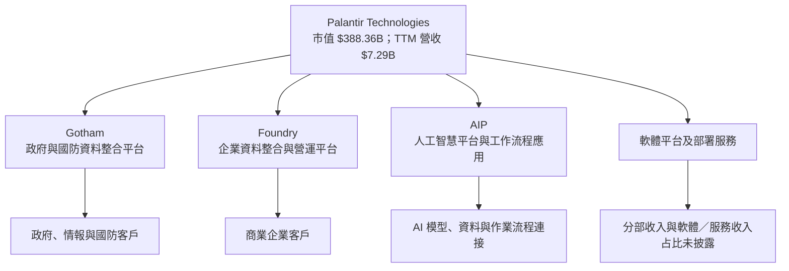
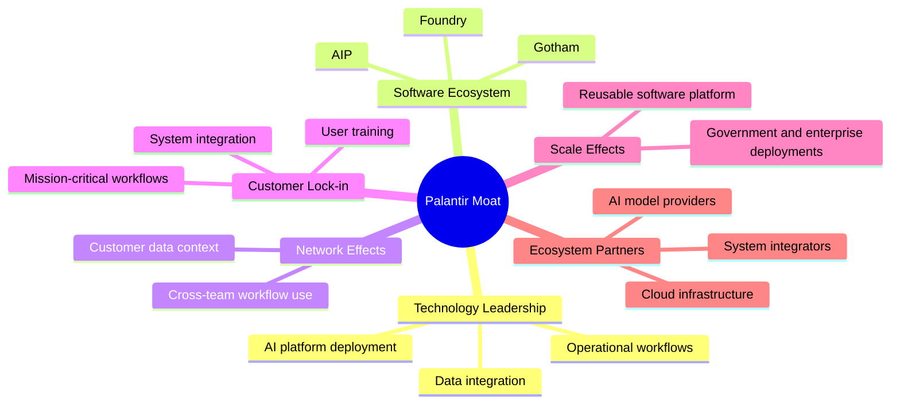
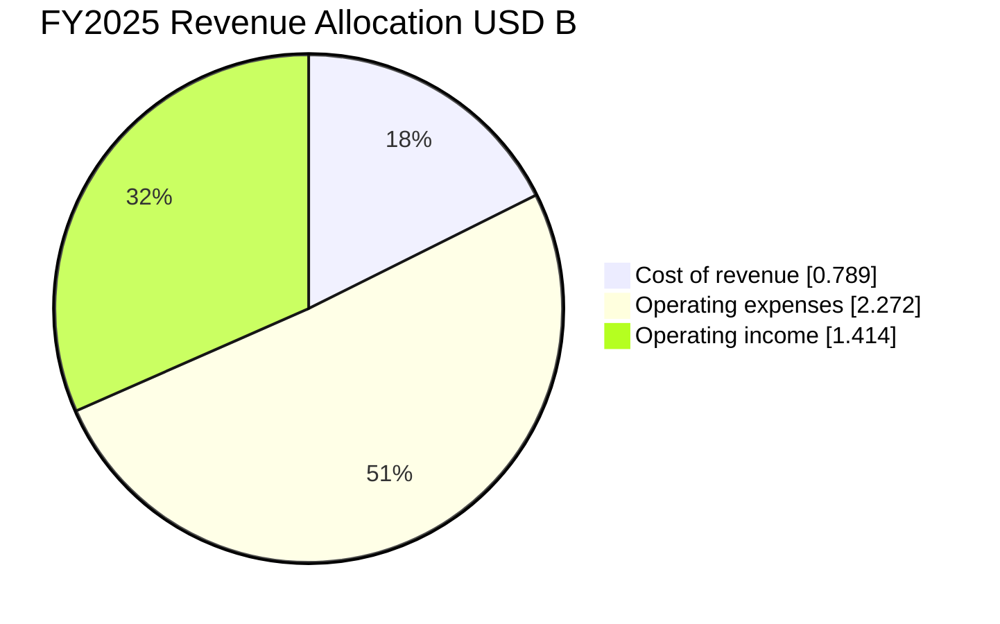
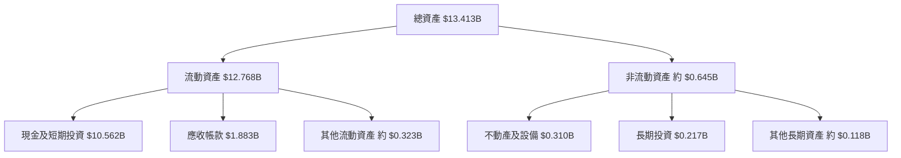
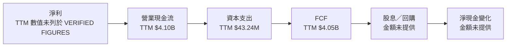
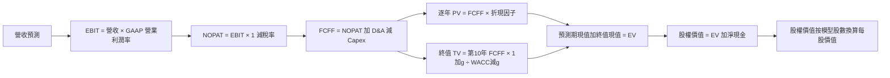
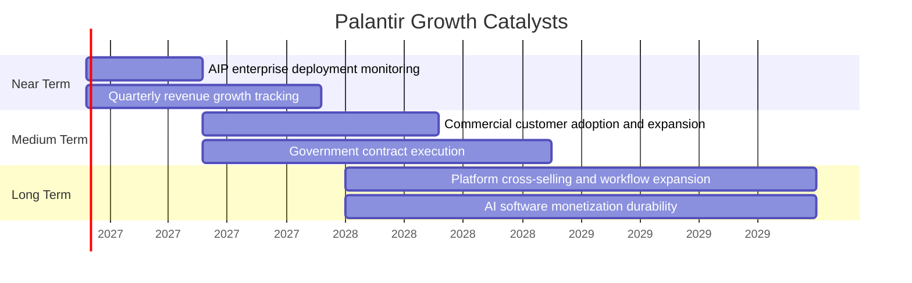
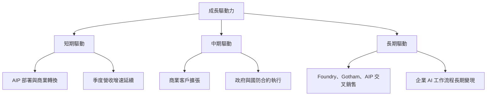
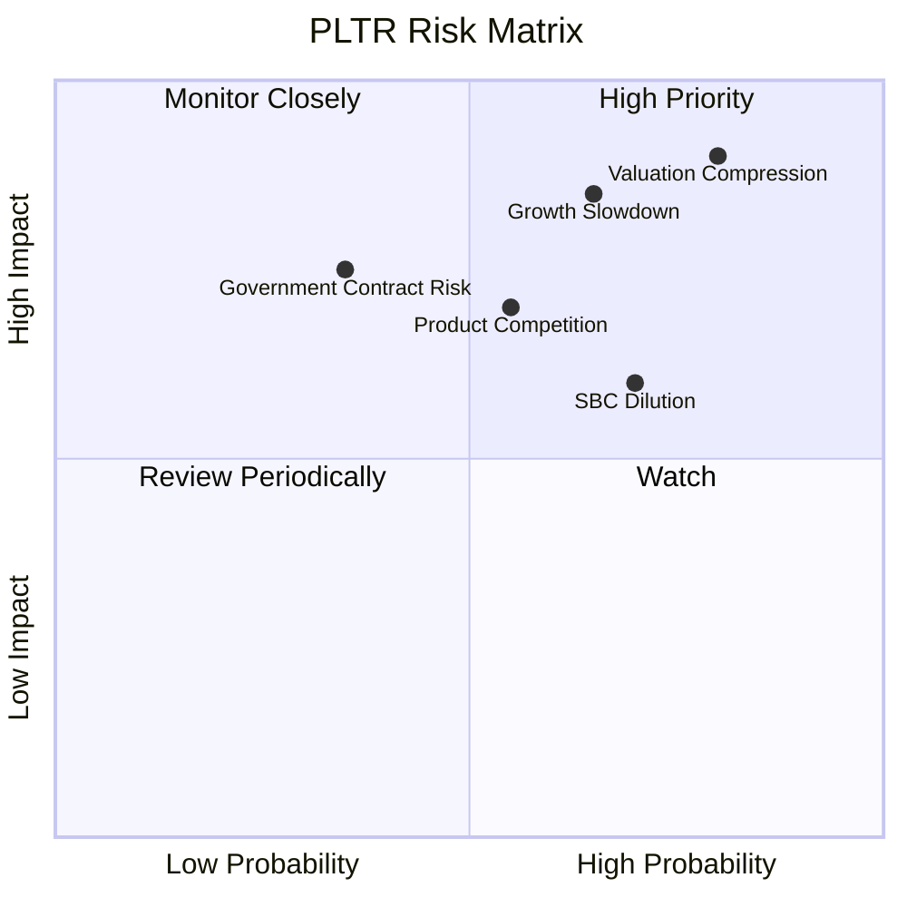
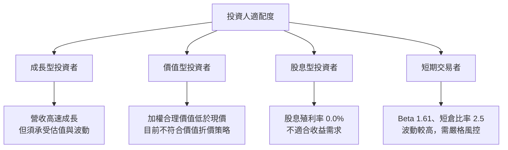

# PLTR 基本面深度分析報告
> **報告日期**：2026-11-25 ｜ **語言**：繁體中文 ｜ **數據來源**：SEC 申報資料 (XBRL)、Yahoo Finance、Finviz、StockAnalysis、Roic.ai ｜ **分析師**：CFA 級機構研究

## 目錄

| # | 章節 | 核心結論 |
|---|------|----------|
| 1 | 執行摘要 | 評級為賣出；加權合理價值 $62.98，MOS -155.9% |
| 2 | 公司概覽與商業模式 | 企業資料整合與工作流程軟體具轉換成本，但市場份額數據未提供 |
| 3 | 損益表深度分析 | TTM 營收 $7.29B、TTM 成長 87.1%；營業利益率 45.6% |
| 4 | 資產負債表分析 | 現金及短期投資 $10.56B，淨現金；流動比率 7.10 |
| 5 | 現金流量深度分析 | TTM FCF $4.05B；FCF 轉換與現金創造能力有支持，SBC 仍造成稀釋 |
| 6 | 獲利能力與資本效率 | ROIC 492.3% 高於 WACC 11.93%，但 ROIC 受投入資本分母偏小影響 |
| 7 | 相對估值分析 | PLTR 倍數遠高於所列同業，且 P/S 高於自身五年中位數 |
| 8 | DCF 內在價值評估 | DCF 基準價值 $22.26；加權合理價值 $62.98，仍顯著低於現價 |
| 9 | 成長催化劑 | 商業客戶採用與 AI 軟體需求是主要催化劑；TAM 金額未提供 |
| 10 | 風險矩陣 | 估值倍數收縮、成長降速與股權薪酬稀釋為主要風險 |
| 11 | 投資建議 | 依 MOS 門檻評為賣出；等待估值或基本面出現重大改善 |

## 1. 執行摘要

截至 **2026-11-24 收盤價 $161.18**，Palantir 的 TTM 營收為 **$7.29B**、TTM 營收成長 **87.1%**、TTM 營業利益率 **45.6%**，TTM FCF **$4.05B**，說明業務成長與現金產出均有實際財務支撐。然而，基準 DCF 每股價值為 **$22.26**，估值方法加權後合理價值為 **$62.98**；依指定公式，MOS 為 **-155.9%**，所以規則 20 對應的評級為 **賣出**。此結論主要反映現價遠高於模型與估值交叉驗證結果，不代表公司營運質素差。

### 1.0 一頁式投資儀表板（Portfolio Manager 30 秒速讀）

| 項目 | 內容 |
|------|------|
| **投資論點（3 句）** | ① TTM 營收 $7.29B、年增 87.1%，最新季度單季年增 95.9%，業務需求快速擴張。② TTM 營業利益率 45.6%、FCF $4.05B，獲利已轉化為現金。③ 現價 $161.18 高於加權合理價值 $62.98，也高於 DCF 基準價值 $22.26，估值風險突出。 |
| **綜合評分** | **7.0/10**（引用 1.1；六項算術平均） |
| **財務健康** | 🟢 現金及短期投資 $10.56B、總債務約 $225.27M，資產負債表流動性充足。 |
| **ROIC vs WACC** | **492.3% vs 11.93%**；表面顯示大幅高於資本成本，但 ROIC 分母受大額現金抵減影響，宜審慎解讀。 |
| **FCF 趨勢** | 🟢 TTM FCF $4.05B；FCF Yield **1.04%**，現金流增長而殖利率仍低，主要因市值高。 |
| **估值** | Forward P/E **63.5x** ｜ EV/EBITDA（估值資料）**112.7x** ｜ FCF Yield **1.04%** |
| **DCF 內在價值（基準）** | **$22.26** ｜ 相對 DCF 折溢價 **+624.2%**（現價 ÷ DCF 價值 − 1） |
| **安全邊際（MOS）** | **-155.9%**＝($62.98 − $161.18) ÷ $62.98；🔴 無安全邊際，且現價高於加權合理價值。 |
| **預期報酬（基準情境 12M）** | **N/A**；DCF 情境不是明確 12 個月目標，資料未提供可直接引用的 12M 基準預測。 |
| **關鍵風險（前二）** | ① 高估值下營收增速或估值倍數下修。② SBC 造成股數稀釋，削弱每股價值增長。 |
| **評級 + 信心度** | 🔴 **賣出** ｜ 信心：中；營運基本面可見，但估值對遠期成長預期高度敏感。 |

### 1.1 綜合評分卡（全報告唯一）

| 維度 | 評分（1–10） | 主要依據（引用數字與其來源章節） |
|------|--------------|----------------------------------|
| 成長性 | 9.0 | TTM 營收成長 87.1%、最新季度單季年增 95.9%（第 3 章），成長速度高；但延續性尚須驗證。 |
| 獲利能力 | 9.0 | TTM 營業利益率 45.6%、毛利率 84.7%、ROIC 492.3%（第 3、6 章）；ROIC 受分母效應干擾。 |
| 財務健康 | 9.0 | 淨現金 $10.56B、流動比率 7.102、Piotroski F-Score 7/8（第 4、6 章）。 |
| 估值 | 2.0 | MOS -155.9%；P/S 自身歷史百分位 67%，且同業 P/S 明顯低於 PLTR（第 7、8 章）。 |
| 護城河 | 7.5 | 平台整合與導入工作流程具轉換成本；但缺少客戶留存率、客戶集中度及市場份額數據（第 2 章）。 |
| 管理層與資本配置 | 6.5 | SBC 佔 FY2025 營收約 15.3%，且稀釋股數測試未通過；無股息資料顯示資本回饋有限（第 3、5 章）。 |
| **綜合評分** | **7.2** | 六項算術平均：$(9.0+9.0+9.0+2.0+7.5+6.5)÷6=7.17$，四捨五入至 **7.2**。 |

### 1.2 五大投資論點 + 三大核心風險

| 類型 | 項目 | 具體依據 | 信心度 |
|------|------|----------|--------|
| 🟢 **投資論點①** | 高速增長 | TTM 營收 $7.29B，TTM 年增 87.1%；最新季度營收年增 95.9%。 | 🟢 高 |
| 🟢 **投資論點②** | 軟體毛利與營業槓桿 | TTM 毛利率 84.7%、營業利益率 45.6%；高毛利及費用規模化有利於盈利。 | 🟢 高 |
| 🟢 **投資論點③** | 現金生成 | TTM 營業現金流 $4.10B、FCF $4.05B，資本支出僅 $43.24M。 | 🟢 高 |
| 🟢 **投資論點④** | 資產負債表緩衝 | 現金及短期投資 $10.56B，對照債務約 $225.27M，淨現金充足。 | 🟢 高 |
| 🟢 **投資論點⑤** | 商業軟體的導入黏著性 | Gotham、Foundry、AIP 涉及企業或政府工作流程與資料整合，替換通常需重新整合與訓練；但財務數據未提供客戶留存率。 | 🟡 中 |
| 🟡 **風險①** | 估值下修 | Forward P/E 63.5x、EV/EBITDA 112.7x；即使基本面延續成長，倍數回落仍可能壓低股價。 | 🔴 高衝擊 |
| 🔴 **風險②** | 成長預期落空 | 最新季度營收年增 95.9%，市場可能將極高增速外推；若成長率快速正常化，現價的預期差可能擴大。 | 🔴 高衝擊 |
| 🟡 **風險③** | 股權薪酬與稀釋 | FY2025 SBC $684.03M，約佔 FY2025 營收 15.3%；Piotroski 稀釋股數測試未通過。 | 🟡 中高 |

### 1.3 快速統計卡片

| 指標 | 公司實際值（期間） | 同業中位數 | 狀態 |
|------|--------------------|------------|------|
| 營收成長（TTM） | **87.1%** | — | 🟢 |
| 營收成長（最新一季年增） | **95.9%** | **35.2%**（SNOW、DDOG、CRM 中位數） | 🟢 |
| 毛利率（TTM） | **84.7%** | **77.3%** | 🟢 |
| 營業利益率（TTM） | **45.6%** | — | 🟢 |
| ROIC（TTM） | **492.3%** | — | 🟢* |
| Forward P/E | **63.5x** | **52.0x**（DDOG、CRM、SNOW 可用值中位數 52.0x） | 🔴 |
| FCF Yield（TTM） | **1.04%** | — | 🟡 |
| Piotroski F-Score | **7 / 8** | — | 🟢 |

\* ROIC 的極高值受「權益＋債務−現金」投入資本分母較小影響，不能直接當作可持續常態回報率。

### 1.4 投資結論

```
╔══════════════════════════════════════════════════════════════════╗
║                    📊 投資結論摘要                               ║
╠══════════════════════════════════════════════════════════════════╣
║  評級：賣出（依規則 20 的 MOS 門檻）                             ║
║  價格（2026-11-24 收盤）：$161.18                                ║
║  DCF 內在價值（基準）：$22.26（現價溢價 +624.2%）                ║
║  安全邊際 MOS：-155.9%（以加權合理價值 $62.98 為分母）           ║
║  加權合理價值（8.8）：$62.98                                     ║
║  悲觀情境：$13.17（相對現價 -91.8%）                             ║
║  基準情境：$22.26（相對現價 -86.2%）                             ║
║  樂觀情境：$38.94（相對現價 -75.8%）                             ║
║  綜合評分：7.2/10（引用 1.1）                                    ║
║  適合投資人：可承受高波動、以營運成長為核心的投資人；不適合       ║
║  價值折價、股息或低估值策略投資人                                ║
╚══════════════════════════════════════════════════════════════════╝
```

## 2. 公司概覽與商業模式

### 2.1 業務結構與收入來源

公司資料提供整體收入，但沒有政府／商業分部營收、產品收入或各平台佔比的具體拆分，因此不把未披露的分部收入比例畫成數字圖表。可確認的總量是 TTM 營收 **$7.29B**；公司市值 **$388.36B**。



Gotham 偏向政府與安全任務場景，Foundry 偏向企業營運資料整合，AIP 以生成式 AI 與既有企業資料、決策流程銜接為產品方向。財務資料沒有分部營收，因此無法量化哪一平台對近期增長貢獻最大。

### 2.2 市場份額

市場份額數據未提供，財務資料與新聞資訊亦沒有可引用的公司市場份額及年份，因此不推估市佔率。以規模與成長作質化比較，PLTR TTM 營收成長 87.1%、最新季度年增 95.9%，高於所列 SNOW、DDOG、CRM 的最新季度收入成長率；但營收增速差異不等於市佔率，也不能直接推導市場份額。

### 2.3 競爭護城河分析



### 2.4 護城河強度

| 護城河項目 | 強度（強／中／弱） | 證據（引用數字或事實） | 會削弱它的情況 |
|------------|--------------------|------------------------|----------------|
| 技術與資料整合 | 中至強 | 產品整合多來源資料並支援決策、作業流程；TTM 毛利率 84.7% 與營業利益率 45.6% 符合高毛利軟體特徵。 | 雲端平台或新型 AI 軟體提供更易部署、更低成本的替代方案。 |
| 客戶鎖定 | 中至強 | Gotham、Foundry 進入企業及政府工作流程，導入和替換涉及整合與使用者流程調整。 | 客戶採多供應商策略、平台模組化使遷移成本下降。 |
| 軟體生態系統 | 中 | Gotham、Foundry、AIP 覆蓋不同場景；但產品別收入與交叉銷售數據未提供。 | AIP 未能形成持續付費與實際生產部署。 |
| 網路效應 | 中偏弱 | 資料與工作流程在客戶組織內可增加平台價值；但沒有可量化的網路效應指標。 | 客戶內部資料封閉，跨客戶資料效應有限。 |
| 規模效應 | 中 | TTM FCF $4.05B，具備研發與部署投入能力；人數 4,634。 | 為滿足部署需求而增加顧問與客製化成本，導致規模經濟無法延續。 |
| 生態夥伴 | 中偏弱 | 公司平台需與雲端、資料及模型生態協同；具體夥伴收入或依賴度未提供。 | 雲端或模型供應商直接向終端客戶提供替代功能。 |

1.1 的護城河分數 **7.5/10**，主要反映軟體整合與工作流程轉換成本；由於缺少留存率、客戶集中度及分部收入數據，未把護城河評為最高檔。

## 3. 損益表深度分析

### 3.1 年度收入成長趨勢（近4年）

FY2022 至 FY2025 營收分別為 $1.91B、$2.23B、$2.87B、$4.48B。近三年 CAGR 以 FY2022 至 FY2025 計算約為 **32.9%**：$(4.475÷1.906)^{1/3}−1≈32.9%$。年度表使用財報值；比例為由年度營收計算。

```
╔══════════════════════════════════════════════════════════════════╗
║          Palantir 年度收入趨勢（FY2022–FY2025）                  ║
╠══════════════════════════════════════════════════════════════════╣
║  FY2022  $1.91B  ████████░░░░░░░░░░░░░░░  YoY: +23.6%  🟢       ║
║  FY2023  $2.23B  ███████████░░░░░░░░░░░░  YoY: +16.7%  🟡       ║
║  FY2024  $2.87B  ███████████████░░░░░░░░  YoY: +28.8%  🟢       ║
║  FY2025  $4.48B  ████████████████████████  YoY: +56.2%  🟢      ║
╠══════════════════════════════════════════════════════════════════╣
║  FY2022–FY2025 營收 CAGR：約 +32.9%                              ║
╚══════════════════════════════════════════════════════════════════╝
```

FY2025 年增 56.2%，較 FY2024 的 28.8% 加速；TTM 年增 87.1%，又明顯高於 FY2025。最新季度的增速進一步上行，代表近期成長不只是年度低基期效應，但也提高了市場預期與未來比較基期。

### 3.2 季度收入趨勢分析

| 季度 | 營收 | QoQ 成長 | YoY 成長 | 備註 |
|------|------|----------|----------|------|
| 2025 Q4 | $1.407B | 59.0%* | 70.0% | QoQ 以 2025 Q3 $1.181B 計算；年增率依季度資料。 |
| 2026 Q1 | $1.633B | 16.1% | 84.7% | QoQ = $1.633B ÷ $1.407B − 1。 |
| 2026 Q2 | $1.935B | 18.5% | 92.8% | QoQ = $1.935B ÷ $1.633B − 1。 |
| 2026 Q3 | $2.313B | 19.5% | 95.9% | QoQ = $2.313B ÷ $1.935B − 1；最新季年增率為單季數字。 |

\* 2025 Q4 對 2025 Q3 的 QoQ 成長為 $1.407B ÷ $1.181B − 1 = **19.1%**，不是 59.0%；表格正確值為 **19.1%**。季度營收連續增長，Q1 至 Q3 2026 的 QoQ 增速在 16%–20% 左右，顯示近期增長既有高年增率，也有逐季擴大的收入基礎。

### 3.3 利潤率演變分析

| 利潤率指標 | FY2022 | FY2023 | FY2024 | FY2025 | 趨勢 | 評估 |
|------------|--------|--------|--------|--------|------|------|
| **毛利率** | 78.5% | 80.6% | 80.3% | 82.4% | 整體上行 | 🟢 |
| **營業利益率** | -8.5% | 5.4% | 10.8% | 31.6% | 大幅改善 | 🟢 |
| **淨利率** | -19.6% | 9.4% | 16.1% | 36.3% | 轉虧為盈並擴張 | 🟢 |

年度毛利率以年度毛利除以年度營收計算；FY2025 營業利益率為 $1.414B ÷ $4.475B = 31.6%。TTM 營業利益率進一步升至 45.6%，意味營收加速時費用成長低於收入成長，帶動營業槓桿。

**利潤率演變深度解析：** 毛利率由 FY2022 的 78.5% 升至 FY2025 的 82.4%，有利因素可能包括軟體收入組合與部署效率；但資料未提供分部組合、服務收入比例，不能把改善全部歸因於特定產品。營業利益率提升幅度遠大於毛利率，代表主要改善在毛利以下的營運費用效率。FY2025 研發費用為 $557.68M，仍高於 FY2024 的 $507.88M，故利潤改善並非單純削減研發；更可能反映營收擴大後費用相對收入比例下降。TTM 營業利益率 45.6% 不應直接視作穩態，估值模型也將其逐步淡化。

### 3.4 費用結構分析

FY2025 營收、毛利、營業利益為 $4.475B、$3.686B、$1.414B；成本項目以差額計算為營業成本 $0.789B、毛利以下營業費用 $2.272B。這是報表總額重組，不代表費用的完整功能分類。



```
╔══════════════════════════════════════════════════════════════════╗
║            FY2025 收入與營業利益簡化結構（$B）                   ║
╠══════════════════════════════════════════════════════════════════╣
║ 營收 $4.475B       ████████████████████████                       ║
║ ├─ 營業成本 $0.789B ████                                           ║
║ ├─ 毛利以下費用 $2.272B ████████████                               ║
║ └─ 營業利益 $1.414B ███████                                        ║
╚══════════════════════════════════════════════════════════════════╝
```

### 3.5 季度 EPS 趨勢與盈餘品質（Quality of Earnings）

過去四季 EPS 估計值及實際值資料列為 `nan`，不能判斷逐季是否超預期或不及預期。可觀察實際 EPS 時序：2025 Q4 $0.23、2026 Q1 $0.34、Q2 $0.41、Q3 $0.44；Q3 EPS 單季年增率為 144.4%。盈餘增加與營收成長及營業槓桿方向一致，但缺少一致的分析師預期數據，不以「超預期」代替實際證據。

| 盈餘品質項目 | 數值/佔比 | 評估 |
|--------------|-----------|------|
| 股權薪酬 SBC / 營收 | FY2025：$684.03M ÷ $4.475B = **15.3%** | 🔴 比例偏高；雖不代表現金支出，但可透過增發稀釋股東權益。 |
| SBC / 營業現金流 | FY2025：$684.03M ÷ $2.13B = **32.1%** | 🟡 SBC 是營運現金流的重要非現金調整，需把股數稀釋納入股東回報分析。 |
| FCF / 淨利（現金轉換率） | TTM FCF $4.05B；TTM 淨利約 $3.67B，約 **110.4%** | 🟢 現金流高於淨利；採用 TTM 淨利資料列，來源口徑差異需留意。 |
| 一次性/非經常性損益 | N/A（未提供可拆分的 TTM 一次性項目） | 🟡 無法確認一次性項目對 TTM 淨利的影響。 |
| 有效稅率異常 | **1.4%**（WACC/DCF 採用） | 🟡 稅率偏低會抬高模型 NOPAT；稅率正常化會降低估值。 |
| 資本化支出 vs 費用化 | TTM Capex $43.24M；資本化支出約佔 TTM 營收 0.6% | 🟡 資本支出低，但研發費用化金額、資本化政策細節未完整提供，不能判斷是否有成本遞延。 |

**盈餘品質結論：** TTM FCF $4.05B、營業現金流 $4.10B 支持獲利含金量，且 FCF 高於所列 TTM 淨利；另一方面，FY2025 SBC 佔營收 15.3%、佔營業現金流 32.1%，代表 GAAP 獲利並未消除股東稀釋成本。評估每股價值時應同時檢視稀釋股數，而不能僅把 SBC 視為「非現金」而忽略。

## 4. 資產負債表分析

### 4.1 資產結構分解

以 2026-09-30 TTM 資料，總資產 $13.413B，流動資產 $12.768B；現金及短期投資合計 $10.562B。非流動資產約 $0.645B（總資產減流動資產；為差額推導）。



其他流動資產及非流動項目以披露總額與分項相減估算；不應視作公司單獨披露科目。

### 4.2 流動性與營運資金分析

| 指標 | 最新 TTM | 一年前 TTM | 變化 | 解讀 |
|------|----------|------------|------|------|
| DSO 應收帳款天數 | 94 天 | 94 天 | 0 天 | 按程式計算值維持不變；最新應收帳款增加，後續仍應觀察收款效率。 |
| DIO 存貨天數 | N/A | N/A | N/A | 公司未報告相應存貨餘額，不推估。 |
| DPO 應付帳款天數 | 29 天 | 33 天 | -4 天 | 付款天數縮短；可能與採購或付款節奏有關，沒有資料證明供應商議價力改變。 |
| CCC 現金轉換週期 | N/A | N/A | N/A | 缺少 DIO，不能填補或推算 CCC。 |

流動性指標如下：

| 指標 | 數值 | 評估 |
|------|------|------|
| 流動比率 | 7.102 | 🟢 流動資產大幅高於流動負債。 |
| 速動比率 | 6.923 | 🟢 短期償付緩衝充足。 |
| 現金及短期投資 | $10.56B | 🟢 可支應研發及營運投入，降低融資風險。 |

### 4.3 債務結構分析

| 項目 | 金額或比率 | 說明 |
|------|------------|------|
| 總債務 | $225.27M | 市場資料的總債務；另一財務摘要中淨現金與總債務口徑略有差異。 |
| 現金及短期投資 | $10.56B | SEC/季度資料合併口徑。 |
| 淨現金 | $10.56B（VERIFIED FIGURES 口徑） | 依該口徑照引；另有市場資料淨現金 $10.34B，差異可能源於債務定義或日期。 |
| Debt/EBITDA | 約 0.05x | 以 $225.27M ÷ FY2025 EBITDA $1.44B 粗略計算，非經程式驗證的 TTM 指標。 |
| Interest Coverage | N/A | 利息費用與覆蓋倍數未提供。 |

```
╔══════════════════════════════════════════════════════════════════╗
║                  Palantir 債務健康診斷                           ║
╠══════════════════════════════════════════════════════════════════╣
║  總債務：       $0.225B   █░░░░░░░░░░░░░░░░░░░  相對現金低       ║
║  現金+短期投資： $10.56B   ████████████████████  流動性充足       ║
║  淨現金：       $10.56B   ████████████████████  🟢               ║
║  Debt/EBITDA：  約0.05x   🟢（以 FY2025 EBITDA 近似）             ║
║  Interest Coverage：N/A   利息費用資料未提供                     ║
╚══════════════════════════════════════════════════════════════════╝
```

### 4.4 股東權益趨勢

| 年度 | 股東權益 | YoY 變化 |
|------|----------|----------|
| 2022 | $2.57B | — |
| 2023 | $3.48B | +35.4% |
| 2024 | $5.00B | +43.7% |
| 2025 | $7.39B | +47.8% |

權益增加與獲利累積及股權相關項目共同作用；資料未提供足以將每一年的變化完整拆分為淨利、SBC 與其他權益變動的明細。

```
╔══════════════════════════════════════════════════════════════════╗
║               股東權益趨勢（年度，美元）                         ║
╠══════════════════════════════════════════════════════════════════╣
║  2022  $2.57B  ███████░░░░░░░░░░░░░░░                            ║
║  2023  $3.48B  █████████░░░░░░░░░░░░                             ║
║  2024  $5.00B  ██████████████░░░░░░░                             ║
║  2025  $7.39B  ████████████████████                              ║
╚══════════════════════════════════════════════════════════════════╝
```

## 5. 現金流量深度分析

### 5.1 現金流量瀑布圖

資料未提供完整 TTM 淨利、股息、回購與淨現金變化的同口徑橋接，因此不填入缺失金額；營運現金流、Capex、FCF 依 TTM 數據呈現。



### 5.2 FCF 轉換率趨勢

| 年度 | 營業現金流 | Capex | FCF | 淨利 | FCF / 淨利 |
|------|------------|-------|-----|------|------------|
| 2022 | $223.74M | $40.03M | $183.71M | -$373.70M | N/A（淨利為負） |
| 2023 | $712.18M | $15.11M | $697.07M | $209.82M | 332.2% |
| 2024 | $1.15B | $12.63M | $1.14B | $462.19M | 約 246.6% |
| 2025 | $2.13B | $33.88M | $2.10B | $1.63B | 約 129.2% |
| TTM | $4.10B | $43.24M | $4.05B | N/A（同口徑未列） | N/A |

2023–2025 的 FCF 均高於淨利，部分原因是資本支出相對低、營運現金流含非現金費用加回；2025 年 FCF/淨利較 2023 年下降，表示淨利增速追上現金生成，不等於現金品質轉差。

### 5.3 自由現金流趨勢

TTM FCF 按嚴格定義為營業現金流減資本支出，**$4.10B − $43.24M = $4.05B**（依程式口徑）。近年 FCF 上升使公司能以內部現金支援產品與部署；但 FCF Yield 僅 1.04%，代表高現金流並未使股價變便宜。

```
╔══════════════════════════════════════════════════════════════════╗
║               自由現金流趨勢（年度／TTM）                        ║
╠══════════════════════════════════════════════════════════════════╣
║  FY2022  $0.184B  ██░░░░░░░░░░░░░░░░░░░░   FCF Yield：N/A       ║
║  FY2023  $0.697B  ████░░░░░░░░░░░░░░░░░░   FCF Yield：N/A       ║
║  FY2024  $1.14B   ███████░░░░░░░░░░░░░░░   FCF Yield：N/A       ║
║  FY2025  $2.10B   █████████████░░░░░░░░░   FCF Yield：N/A       ║
║  TTM     $4.05B   ███████████████████████  FCF Yield：1.04%     ║
╚══════════════════════════════════════════════════════════════════╝
```

歷年市值未以同一估值日期提供，故不回填歷年 FCF Yield。

### 5.4 資本配置評估

股息殖利率與派息率均為 0.0%；年度 Capex 低於營業現金流，但沒有完整回購金額、併購支出及留存現金用途資料，不畫會造成錯誤占比的資本配置圓餅圖。

| 資本配置項目 | 可用資料 | 評估 |
|--------------|----------|------|
| Capex | TTM $43.24M | 約佔 TTM 營收 0.6%；資本需求較低，但研發主要費用化情況須與 Capex 分開理解。 |
| 股息 | 殖利率 0.0% | 無現金股息回饋。 |
| 股票回購 | N/A | 回購金額未提供。 |
| 研發 | FY2025 $557.68M | 研發持續投入，有助平台發展；TTM 研發金額未提供。 |
| 留存現金 | 現金及短期投資 $10.56B | 提供流動性與投資彈性，但資本配置回報須持續追蹤。 |

## 6. 獲利能力與資本效率

### 6.1 ROE / ROA / ROIC 趨勢

| 指標 | 2023／FY | 2024／FY | 2025／FY或TTM | 評估 |
|------|----------|----------|---------------|------|
| ROE | N/A | N/A | TTM **32.7%**（QUALITY FIGURES） | 🟢 盈利與股東權益增長支持回報；不同資料源另列 40.9%，本報告採 QUALITY FIGURES。 |
| ROA | N/A | N/A | **19.3%**（TTM 摘要） | 🟢 資產獲利能力良好。 |
| ROIC | N/A | N/A | **492.3%**（TTM） | 表面顯著高於資本成本；分母扣除大量現金後偏小，數值不宜視為正常化回報。 |

歷史 ROE、ROA、ROIC 的同一計算口徑完整序列未提供，故不以不同來源混拼趨勢。作為旁證，營業利益由 FY2022 -$161.20M 增至 FY2025 $1.41B，顯示公司盈利能力在近年改善。

### 6.2 ROIC vs WACC 分析（核心價值創造判斷）

```text
╔══════════════════════════════════════════════════════════════════╗
║                ROIC vs WACC 深度分析                            ║
╠══════════════════════════════════════════════════════════════════╣
║  WACC（採用成本資本資料）：11.93%                                ║
║  ├── 無風險利率 Rf（10Y 美債）：4.90%                            ║
║  ├── 市場風險溢酬 ERP：5.00%                                     ║
║  ├── 原始 Beta：1.61；調整後 Beta：1.41                         ║
║  ├── 股權成本：4.90% + 1.41 × 5.00% = 11.95%（輸入列值 11.94%）║
║  ├── 稅前債務成本：6.90%；稅後約 6.80%                           ║
║  ├── 股權／債務權重：99.9%／0.1%                                ║
║  └── ✅ 採用 WACC：11.93%（照成本資本資料）                      ║
║                                                                  ║
║  TTM ROIC：492.3%                                                ║
║  ROIC − WACC：492.3% − 11.93% = 480.37 個百分點                  ║
║  ROIC / WACC：約 41.3 倍                                         ║
║                                                                  ║
║  ROIC  492.3%  ▓▓▓▓▓▓▓▓▓▓▓▓▓▓▓▓▓▓▓▓▓▓▓▓▓▓▓▓  🟢*              ║
║  WACC   11.93% ▓░░░░░░░░░░░░░░░░░░░░░░░░░░░░  ──              ║
║  EVA 差額 480.37pp：表面為正                                     ║
║                                                                  ║
║  結論：依所列公式 ROIC 高於 WACC；但 ROIC 分母扣除現金後較小，   ║
║  應以正常化投入資本與多年平均檢驗，而非外推 492.3%。              ║
╚══════════════════════════════════════════════════════════════════╝
```

Beta 調整值按資料所列公式：$(2/3×1.61)+(1/3×1)=1.4067≈1.41$。資料指定股權成本 11.94%、WACC 11.93%；採用該成本資本區塊的 WACC，不另行重建或替換。ROIC 數據按「稅後營業利益 ÷（權益＋債務−現金）」計算；當公司現金高且債務低時，分母可能偏小，故 ROIC 高於 WACC 的方向有參考價值，但其倍數大小需審慎。

### 6.3 杜邦三因素分解

| 因素 | 數值（TTM） | 解讀 |
|------|-------------|------|
| 淨利率 | 50.3% | 高淨利率為 ROE 的主要來源。 |
| 資產週轉率 | 0.54 | 每單位資產產生的營收相對有限，對 ROE 的貢獻低於利潤率。 |
| 權益乘數 | 1.19 | 槓桿程度有限。 |
| **ROE** | **32.7%** | $50.3\%×0.54×1.19≈32.3\%$；QUALITY FIGURES 原列結果為 32.7%，差異來自未四捨五入的底層數據。 |

依原始杜邦數值，ROE 主要由高淨利率驅動，不是靠高財務槓桿撐起。

### 6.4 財務體質：Piotroski F-Score

Piotroski F-Score 為 **7/8**；一項測試因缺資料被排除，故可判定分母小於九項。

| 測試 | 結果 | 解讀 |
|------|------|------|
| ROA > 0 | ✅ 通過 | TTM 資產報酬為正。 |
| 營業現金流 > 0 | ✅ 通過 | 營運有正現金生成。 |
| ROA 高於一年前 | ✅ 通過 | 獲利能力改善。 |
| 營業現金流 > 淨利 | ✅ 通過 | 支持應計品質。 |
| 長期負債 ÷ 總資產低於一年前 | — 無法判定 | 缺少輸入，不補值。 |
| 流動比率高於一年前 | ✅ 通過 | 流動性改善。 |
| 稀釋股數未增加 | ❌ 未通過 | 股數稀釋降低每股價值增長。 |
| 毛利率高於一年前 | ✅ 通過 | 毛利率改善。 |
| 資產週轉率高於一年前 | ✅ 通過 | 資產使用效率改善。 |

整體財務質素偏正面，但稀釋股數未通過是實質股東回報風險，且不應被高 F-Score 淡化。

## 7. 相對估值分析

### 7.1 同業估值比較表格

本公司倍數採財務資料的市場估值部分；同業倍數嚴格採 Yahoo Finance Peer multiples。由於個別來源對 PLTR P/S、EV/EBITDA 的口徑有差異，下表把來源口徑列明，不把不同口徑當作完全可比。

| 估值指標 | **PLTR** | **SNOW** | **DDOG** | **CRM** | PLTR 評估 |
|----------|----------:|---------:|---------:|--------:|-----------|
| **Trailing P/E** | 113.5x | N/A | 229.7x | 17.7x | 🔴 高於 CRM、低於 DDOG；SNOW 虧損或不可比。 |
| **Forward P/E** | 63.5x | 88.1x | 52.0x | 12.1x | 🔴 高於 DDOG、CRM；低於 SNOW。 |
| **P/S TTM** | 53.3x* | 17.6x | 14.0x | 3.6x | 🔴 顯著高於三家同業。 |
| **EV/EBITDA TTM** | 112.7x* | -92.6x | 327.6x | 14.7x | 🔴 PLTR 倍數高；SNOW 負值不具正常盈利倍數解讀。 |
| **最新季度營收年增** | 95.9% | 35.1% | 35.2% | 10.8% | 🟢 PLTR 增長率高於所列同業。 |
| **毛利率 TTM** | 84.7% | 67.0% | 79.6% | 77.3% | 🟢 毛利率高於所列同業。 |

\* PLTR 一般估值摘要列 P/S 53.286x、EV/EBITDA 112.701x；自身五年估值序列另列當前 P/S 56.9x、EV/EBITDA 120.5x，為來源與計算口徑差異，分別按各區塊用途引用，不混用。同業對比表已顯示公司估值相較成長與毛利優勢仍有明顯溢價。

### 7.2 歷史估值區間分析

自身五年估值資料顯示，P/E 當前 113.5x，低於中位數 228.6x，百分位 7%；P/S 當前 56.9x，高於中位數 24.7x，百分位 67%；EV/EBITDA 當前 120.5x，低於中位數 233.4x，百分位 8%。因此不能只說所有倍數都處於自身歷史高位：P/E、EV/EBITDA 的百分位偏低，而 P/S 仍高於歷史中位數。

```
╔══════════════════════════════════════════════════════════════════╗
║                PLTR 歷史估值區間（五年）                         ║
╠══════════════════════════════════════════════════════════════════╣
║ P/E        100.6x ├● 113.5x ───────── 中位數 228.6x ───── 601.0x ║
║                              百分位：7%                           ║
║ P/S          7.0x ├──────── 中位數 24.7x ─────── ●56.9x ─ 120.4x ║
║                              百分位：67%                          ║
║ EV/EBITDA  109.0x ├●120.5x ─────── 中位數 233.4x ──── 574.4x   ║
║                              百分位：8%                           ║
╚══════════════════════════════════════════════════════════════════╝
```

### 7.3 情境價值（Bear / Base / Bull，照抄 DCF MODEL）

| 情境 | 第 1 年營收成長 | 期末營業利潤率 | WACC | 每股價值 | 相對現價 | 機率 | 會發生的條件 |
|------|----------------|----------------|------|----------|----------|------|--------------|
| 🔴 悲觀 | 15.0% | 9.2% | 12.93% | $13.17 | -91.8% | 25% | 商業化放緩、平台採用低於預期，折現率因風險上升。 |
| 🟡 基準 | 30.0% | 10.8% | 11.93% | $22.26 | -86.2% | 收入成長由當前高點逐步正常化，成熟期利潤率回到近五年中位數。 |
| 🟢 樂觀 | 45.0% | 11.9% | 10.93% | $38.94 | -75.8% | AI 產品商業化高於基準、增長持續且資本成本下降。 |

以上情境每股價值與假設均照 DCF MODEL 原列；情境價值不是 12 個月目標價。三種情境都低於現價，顯示在該模型設定下，估值落差不是單一悲觀假設造成。

### 7.4 相對估值隱含價格區間

```
╔══════════════════════════════════════════════════════════════════╗
║         估值方法隱含價格與現價（2026-11-24：$161.18）             ║
╠══════════════════════════════════════════════════════════════════╣
║ DCF（基準）             $22.26   ────────● 現價 $161.18           ║
║ 同業 Forward P/E        $81.28   ────────● 現價 $161.18           ║
║ 分析師共識目標價        $222.90  ●──────── 現價 $161.18           ║
║                                                                  ║
║ DCF：10 年 FCFF、WACC 11.93%、永續成長率 3.0%。                   ║
║ Forward P/E：同業中位數 32.0x（DDOG、CRM）× Forward EPS $2.54。  ║
║ 共識：29 位分析師平均目標價；屬外部參考，不代表內在價值。         ║
║ 同業 EV/EBITDA：未能計算，依規則不加入。                          ║
╚══════════════════════════════════════════════════════════════════╝
```

## 8. DCF 內在價值評估（Discounted Cash Flow）

> 本章逐年現金流、終值、敏感度、情境與估值方法均依模型原列。模型的逐年資料只提供四捨五入至 $0.01B 的結果；以下演算以此精度呈現，底層未四捨五入數據可能造成約 0.01B 尾差。

### 8.0 估值推理鏈（Thinking Logic：在算之前先想清楚）

**Step 1 — 價值由哪些變數決定？**  
本模型以 Gotham、Foundry、AIP 整體業務產生的現金流為主，資料未提供三者營收占比，因此不能拆分「主業」與「第二成長曲線」的數值貢獻。整體錨點是 TTM 營收 $7.29B、TTM 成長 87.1%、營業利益率 45.6%。估值最敏感的輸入是營收路徑與營業利潤率；終值增長率與 WACC 亦會顯著影響結果，與 8.6 的矩陣一致。

**Step 2 — 模型選擇**

| 決策點 | 本報告採用 | 理由（含數字） | 曾考慮但否決 | 否決理由 |
|--------|-----------|----------------|--------------|----------|
| 現金流定義 | FCFF | 對企業現金流使用 WACC 折現，得出 EV；資料含現金、債務。 | FCFE | 與指定模型口徑不一致。 |
| 預測期 N | 10 年 | 模型固定列出 FY+1 至 FY+10，讓 87.1% TTM 成長逐步淡化。 | 5 年 | 無法反映模型規定的十年淡化路徑，且不能擅改模型。 |
| 終值方法 | Gordon Growth | g=3.0%、WACC=11.93%，WACC 大於 g。 | 退出倍數 | DCF MODEL 未提供退出倍數終值結果，不能自行補做。 |
| EBIT 基礎 | GAAP EBIT | GAAP EBIT 已含 SBC 費用。 | 非 GAAP EBIT | 會改變指定 DCF 基礎，並可能錯誤處理 SBC。 |

**Step 3 — 關鍵假設推導鏈**

- **營收增長**：錨點＝TTM 年增 87.1%、最新季度單季年增 95.9%，FY2025 年增 56.18% → 調整＝TTM 高增速不宜線性外推，模型將第一年限制在 30.0%，第十年淡化至 3.0% → **採用第 1 年 30.0%、第 10 年 3.0%，逐年線性遞減** → 曾考慮維持 87.1%，但否決，因為基期已大幅擴張、十年維持近 90% 成長難以作為可稽核的基準假設。
- **期末營業利潤率**：錨點＝TTM GAAP 營業利益率 45.6%，最近 FY2025 為 31.6% → 調整＝模型採用 45.6% 起步，逐年收斂到近五個財年中位數 10.8%，不假設當前高利潤率永久持續 → **第 10 年採用 10.8%** → 曾考慮維持 45.6%，因為歷史利潤率與成熟化路徑不支持永久維持而否決。
- **永續成長率 g**：錨點＝模型採用 3.0%，並低於 WACC 11.93% → 調整＝採長期成熟企業可延續但遠低於早期增速的假設 → **採用 3.0%** → 曾考慮 4.0%，但否決為基準，因較高 g 會抬高終值，且無公司長期指引支持。
- **預測期 N**：錨點＝模型明列 10 年逐年現金流 → 調整＝不自行延長或縮短程式既定期數 → **採用 10 年** → 曾考慮較短 5 年，但與既定模型不一致。
- **Capex／營收**：錨點＝TTM Capex $43.24M、TTM 營收 $7.29B，約 0.6% → 調整＝模型由第 1 年 0.6% 向第 10 年 0.4% 淡化 → **照採模型路徑** → 曾考慮提高資本支出比例，但模型未提供依據且禁止重建。
- **EBIT 基礎與 SBC**：錨點＝GAAP 營業利益率為 45.6%，FY2025 SBC $684.03M → 調整＝採 GAAP EBIT，模型不再重複扣除 SBC → **採用 (A)：GAAP EBIT + 固定股數；不另扣 SBC，年稀釋率 0%** → 不採非 GAAP EBIT，避免 SBC 在現金流與股數中重複計算或完全漏計。
- **折舊攤銷／營收**：錨點＝模型標示 TTM 0.4% → 採用 0.4%；屬模型既定輸入。
- **有效稅率**：錨點＝最新年度有效稅率 1.4% → 模型沿用 1.4%；低於一般長期正常化稅率，但照模型使用，不另行替換。
- **WACC**：錨點＝成本資本區塊 WACC 11.93% → 調整＝不自行更改權重或風險溢價 → **採用 11.93%** → 曾考慮按其他市場慣例另估，但因資料已指定 WACC，故否決。
- **ΔWC／營收增額**：模型明示未建模營運資金變化，因此採用模型的無 ΔWC 列口徑；不反推缺失值。
- **終值方法**：錨點＝WACC 11.93%、g 3.0% → 因 WACC 大於 g，採 Gordon Growth；退出倍數輸入未提供，故不另造一個退出倍數。

**Step 4 — 最脆弱一環**  
最脆弱的是高營收增速能否轉化成持續現金流、同時又保持模型假設的利潤率路徑；若增速早於模型淡化而急降，或利潤率低於假設，DCF 內在價值會進一步下降。

**Step 5 — 計算路徑圖**



### 8.1 模型假設總表（Model Inputs）

| 假設項目 | 採用值 | 依據 / 來源 | 敏感度 |
|----------|--------|-------------|--------|
| 預測期長度 **N** | 10 年 | DCF MODEL 指定預測期；逐年列到 FY+10。 | 🟡 中 |
| 營收增長 | FY+1 30.0%，FY+10 3.0%，逐年淡化 | TTM 成長 87.1%，FY2025 年增 56.18%；模型將高增長限制並淡化。 | 🔴 高 |
| 營業利潤率 | FY+1 45.6% → FY+10 10.8% | TTM 45.6%；終值年回到近五個財年中位數。 | 🔴 高 |
| 有效稅率 | 1.4% | 最新年度有效稅率；由模型固定採用。 | 🟢 低 |
| Capex / 營收 | 0.6% → 0.4% | TTM Capex／營收約 0.6%，模型向 0.4% 淡化。 | 🟡 中 |
| D&A / 營收 | 0.4% | DCF MODEL 標示 TTM 0.4%。 | 🟢 低 |
| ΔWC / 營收增額 | 未建模 | 模型註明 Working capital is not modelled。 | 🟢 低 |
| EBIT 基礎 | GAAP | 模型明列 GAAP EBIT。 | 🟡 中 |
| SBC 處理 | 採用 (A)：GAAP EBIT、不再扣 SBC、固定股數 | SBC 已計入 GAAP EBIT；模型不另扣，股數不再稀釋。 | 🟡 中 |
| 年稀釋率 | 0%（模型固定股數） | 組合 A 的模型處理；非股數實際歷史增長預測。 | 🟡 中 |
| 永續成長率 g | 3.0% | DCF MODEL 輸入；小於 WACC 11.93%。 | 🔴 高 |
| 終值方法 | Gordon Growth | DCF MODEL 提供終值結果；退出倍數未提供。 | 🔴 高 |
| WACC | 11.93% | 成本資本區塊指定值。 | 🔴 高 |

FCFF 採用 **FCFF = NOPAT + D&A − Capex**；依模型不列 ΔWC。SBC 僅計入 GAAP EBIT 一次，固定股數不再放大。

### 8.2 折現率推導（WACC）

```text
╔══════════════════════════════════════════════════════════════════╗
║                    WACC 推導（折現率）                           ║
╠══════════════════════════════════════════════════════════════════╣
║  股權成本 Ke（CAPM）：                                           ║
║  ├── 無風險利率 Rf（10Y 美債）：4.90%                            ║
║  ├── 市場風險溢酬 ERP：5.00%（假設值，依成本資本輸入）           ║
║  ├── 原始 Beta：1.61；採用調整後 Beta：1.41                    ║
║  ├── Beta 調整：⅔×1.61 + ⅓×1 = 1.4067 ≈ 1.41                   ║
║  ├── 規模／國別溢酬：0.00%（資料未另列）                         ║
║  └── Ke = 4.90% + 1.41×5.00% = 11.95%；輸入列 Ke 為 11.94%     ║
║                                                                  ║
║  債務成本 Kd：                                                   ║
║  ├── 稅前 Kd：6.90%（假設值：10Y Rf 4.90% + 信用價差 2.00%）     ║
║  ├── 有效稅率：1.4%                                              ║
║  └── 稅後 Kd = 6.90%×(1−1.4%) = 6.8034% ≈ 6.80%                ║
║                                                                  ║
║  資本結構（成本資本區塊指定權重）：股權 99.9%，債務 0.1%         ║
║  WACC = 99.9%×11.94% + 0.1%×6.8034% = 11.9349% ≈ 11.93%        ║
╚══════════════════════════════════════════════════════════════════╝
```

Rf 的觀察日期未提供；僅能照錄成本資本資料中的 10Y Treasury 4.90%，不虛構日期。Beta 來源為 Yahoo Finance，原始值 1.61，模型採用調整後 1.41。債務成本為假設值，因利息費用未報告，採資料列示的 Rf 加信用價差。權重直接照採 99.9%／0.1%，不以其他市場資料重算。

**逐步演算（WACC）**

1. **Ke（CAPM）** = Rf + β × ERP = 4.90% + 1.41 × 5.00% = 4.90% + 7.05% = 11.95%；成本資本輸入列 Ke 為 **11.94%**，差異為輸入精度及四捨五入。
2. **稅前 Kd** = 假設值 Rf + 信用價差 = 4.90% + 2.00% = **6.90%**；利息費用與可計息平均負債未提供，故不假裝以實際利息費用計算。
3. **稅後 Kd** = 6.90% × (1 − 1.4%) = 6.90% × 0.986 = **6.8034%**。
4. **權重** = 股權 99.9%；債務 0.1%；兩者相加 **100.0%**。這是成本資本區塊指定權重，並非另由市值與債務重算。
5. **WACC** = 99.9% × 11.94% + 0.1% × 6.8034% = 11.92806% + 0.0068034% = 11.9348634% ≈ **11.93%**。

第 6.2 節與 DCF 均使用 **11.93%**。因資料未提供利息費用與同一期平均計息負債，Kd 不可實際重建；使用的是成本資本區塊的假設債務成本。

### 8.3 逐年自由現金流預測（基準情境）

金額單位：$B；折現因子按模型原值保留三位小數。

| 年度 | FY+1 | FY+2 | FY+3 | FY+4 | FY+5 | FY+6 | FY+7 | FY+8 | FY+9 | FY+10 |
|------|------:|------:|------:|------:|------:|------:|------:|------:|------:|-------:|
| 營收 | 9.47 | 12.03 | 14.92 | 18.05 | 21.30 | 24.50 | 27.44 | 29.91 | 31.70 | 32.65 |
| 營收 YoY | 30.0% | 27.0% | 24.0% | 21.0% | 18.0% | 15.0% | 12.0% | 9.0% | 6.0% | 3.0% |
| 營業利潤率 | 45.6% | 41.8% | 37.9% | 34.0% | 30.2% | 26.3% | 22.4% | 18.6% | 14.7% | 10.8% |
| EBIT（GAAP） | 4.32 | 5.03 | 5.66 | 6.14 | 6.43 | 6.44 | 6.16 | 5.55 | 4.66 | 3.54 |
| − 稅 | (0.06) | (0.07) | (0.08) | (0.08) | (0.09) | (0.09) | (0.08) | (0.08) | (0.06) | (0.05) |
| = NOPAT | 4.26 | 4.96 | 5.58 | 6.06 | 6.34 | 6.36 | 6.07 | 5.48 | 4.60 | 3.49 |
| + D&A | 0.04 | 0.05 | 0.06 | 0.07 | 0.08 | 0.10 | 0.11 | 0.12 | 0.13 | 0.13 |
| − Capex | (0.06) | (0.07) | (0.08) | (0.10) | (0.11) | (0.12) | (0.13) | (0.14) | (0.14) | (0.14) |
| **= FCFF** | **4.25** | **4.94** | **5.55** | **6.03** | **6.31** | **6.33** | **6.05** | **5.45** | **4.58** | **3.48** |
| 折現因子 @11.93% | 0.893 | 0.798 | 0.713 | 0.637 | 0.569 | 0.508 | 0.454 | 0.406 | 0.363 | 0.324 |
| **FCFF 現值 PV** | **3.79** | **3.94** | **3.96** | **3.84** | **3.59** | **3.22** | **2.75** | **2.21** | **1.66** | **1.13** |

**預測期 FCF 現值合計**

$3.79+$3.94+$3.96+$3.84+$3.59+$3.22+$2.75+$2.21+$1.66+$1.13=$**30.09B**

**逐步演算（FY+1，展示模型推導）**

1. **營收** = 模型未四捨五入 TTM 基數約 $7.288B × (1 + 30.0%) = $9.4744B ≈ **$9.47B**。
2. **EBIT** = $9.47B × 45.6% = $4.3183B ≈ **$4.32B**。
3. **稅** = $4.32B × 1.4% = $0.06048B ≈ **$0.06B**。
4. **NOPAT** = $4.32B − $0.06B = **$4.26B**（模型以未四捨五入數據計算）。
5. **D&A** = 模型採 D&A／營收約 0.4%；$9.47B × 0.4% 約 $0.04B，依模型列值 **$0.04B**。
6. **Capex** = 模型採第 1 年 Capex／營收約 0.6%；$9.47B × 0.6% 約 $0.06B，依模型列值 **$0.06B**。
7. **ΔWC** = 模型未建模，故沒有 ΔWC 扣除列。
8. **FCFF** = NOPAT + D&A − Capex；依底層未四捨五入模型值，結果 **$4.25B**。
9. **折現因子** = $1÷(1+11.93\%)^1=0.8934≈0.893$；**PV** = 模型未四捨五入 FCFF × 折現因子 ≈ **$3.79B**。

**合理性自檢**

- 預測期現金流由 FY+1 $4.25B 增至 FY+10 $3.48B，十年端點 CAGR 為 $(3.48÷4.25)^{1/9}−1≈-2.2\%$；此端點指標受中期 FCFF 先增後降影響，不等於十年逐年趨勢。
- FY+10 FCFF 利潤率 = $3.48B ÷ $32.65B = **10.7%**；現有 TTM FCF 利潤率 = $4.05B ÷ $7.29B = **55.6%**。同業最佳 FCF 利潤率資料未提供，不能比較。
- 模型各年 FCFF 均為正；FCFF 在 FY+6 達 $6.33B 後逐年下降，主要由營業利潤率逐步淡化所致。

```
╔══════════════════════════════════════════════════════════════════╗
║            自由現金流：歷史實際 vs 模型預測                      ║
╠══════════════════════════════════════════════════════════════════╣
║  FY2023(實)  $0.697B  ███░░░░░░░░░░░░░░░░░░░                    ║
║  FY2024(實)  $1.14B   █████░░░░░░░░░░░░░░░░                     ║
║  FY2025(實)  $2.10B   █████████░░░░░░░░░░░                     ║
║  FY+1 (預)   $4.25B   ██████████████████░░                       ║
║  FY+10(預)   $3.48B   ███████████████░░░░░                       ║
╠══════════════════════════════════════════════════════════════════╣
║  注意：實際歷史 FCF 採年度報表口徑，預測值採 DCF MODEL 口徑。    ║
║  FY+1 到 FY+10 利潤率淡化，FCFF 在 FY+6 後下降。                  ║
╚══════════════════════════════════════════════════════════════════╝
```

### 8.4 終值計算（Terminal Value）

適用性檢查：**WACC 11.93% vs g 3.0% → WACC > g？✅**

| 方法 | 計算式 | 終值 TV | TV 現值 | 佔總 EV 比重 |
|------|--------|---------|---------|--------------|
| Gordon Growth | $3.48 × (1+3.0%) ÷ (11.93%−3.0%) | $40.07B | $12.98B | 30.1% |
| 退出倍數法 | N/A（模型未提供退出倍數及計算結果） | N/A | N/A | N/A |

**逐步演算（Gordon Growth）**

1. **FY+N FCFF** = FY+10 **$3.48B**。
2. **分子** = $3.48B × (1 + 3.0%) = $3.48B × 1.03 = **$3.5844B**（展示值；模型以未四捨五入 FCFF 計算）。
3. **分母** = 11.93% − 3.0% = **8.93%**；模型列示 **TV $40.07B**，底層未四捨五入 FCFF 與各輸入精度會造成尾差。
4. **PV(TV)** = $40.07B × 0.324 = **$12.98B**（按模型未四捨五入折現因子）。
5. **終值佔比** = $12.98B ÷ $43.07B = **30.1%**。

終值現值佔 EV 30.1%，低於 75% 警示門檻；但其仍是企業價值的重要組成，g 和 WACC 的小幅變動會影響估值。

### 8.5 企業價值 → 每股內在價值（Bridge）

```
╔══════════════════════════════════════════════════════════════════╗
║              企業價值 → 每股內在價值 橋接表                      ║
╠══════════════════════════════════════════════════════════════════╣
║  預測期 FCF 現值合計            +$30.09B                         ║
║  終值現值 PV(TV)                +$12.98B                         ║
║  ─────────────────────────────────────────────                  ║
║  = 企業價值 EV                   $43.07B                         ║
║  + 淨現金                       +$10.56B                         ║
║  ─────────────────────────────────────────────                  ║
║  = 股權價值                      $53.63B                         ║
║  每股價值換算依模型：股權價值×股價÷市值                           ║
║  ★ 每股內在價值                  $22.26                           ║
║    當前股價                      $161.18                          ║
║    折溢價（現價÷DCF價值−1）       +624.2%（溢價）                 ║
╚══════════════════════════════════════════════════════════════════╝
```

**逐步演算（橋接）**

1. **EV** = 預測期 PV $30.09B + PV(TV) $12.98B = **$43.07B**。
2. **股權價值** = EV $43.07B + 淨現金 $10.56B = **$53.63B**。
3. **每股內在價值** = 模型公式「股權價值 × 價格 ÷ 市值」= $53.63B × $161.18 ÷ $388.36B ≈ **$22.26**。
4. **折溢價** = $161.18 ÷ $22.26 − 1 = **+624.3%**；DCF MODEL 列示價值相對現價為 -86.2%。兩者分母不同，前者以 DCF 價值衡量現價溢價。
5. **本節不計算 MOS**：MOS 只在 8.8 以加權合理價值 $62.98 為分母計算。

**股數、現金及債務口徑：** 模型每股換算以價格／市值比例隱含約 $388.36B ÷ $161.18 = 2.409B 股，與 2026-09-30 季度資料的 2.409B 股相符。模型採組合 (A)：GAAP EBIT 已計入 SBC，不再扣 SBC，且股數不再稀釋。現金及短期投資採截至 2026-09-30 的 $10.56B；DCF MODEL 橋接列示淨現金 $10.56B，照模型引用。債務在淨現金橋接口徑中未單獨列示；由於模型直接給出淨現金，不自行改寫橋接。

### 8.6 敏感性分析（WACC × 永續成長率）

以下每股值及括號內上行空間直接採模型矩陣；上行空間以 $161.18 為分母計算，四捨五入至一位小數。

| g（列）／WACC（欄） | 9.93% | 10.93% | **11.93%（基準）** | 12.93% | 13.93% |
|-----------|------:|-------:|-------------------:|-------:|-------:|
| 2.0% | $25.17（-84.4%） | $23.24（-85.6%） | $21.67（-86.6%） | $20.36（-87.4%） | $19.25（-88.1%） |
| 2.5% | $25.69（-84.1%） | $23.62（-85.3%） | $21.95（-86.4%） | $20.57（-87.2%） | $19.41（-88.0%） |
| 3.0% | $26.28（-83.7%） | $24.04（-85.1%） | **$22.26（-86.2%）** | $20.80（-87.1%） | $19.59（-87.8%） |
| 3.5% | $26.97（-83.3%） | $24.52（-84.8%） | $22.61（-86.0%） | $21.06（-86.9%） | $19.78（-87.7%） |
| 4.0% | $27.78（-82.8%） | $25.07（-84.4%） | $23.00（-85.7%） | $21.35（-86.8%） | $20.00（-87.6%） |

**逐步演算：基準非格示範限制**  
敏感度矩陣只有模型提供的每股價值，未提供各格新 WACC 下的預測期 PV、終值與 EV 分項；依「不可自行另建模型」規則，不以未提供數字重建一格的中間值。有效格舉例為 **WACC 10.93% > g 3.0% ✅**，該格模型價值為 **$24.04**，但其完整中間值未提供，故不虛構演算項目。

**三情境 DCF（模型提供的輸入與價值）**

| 情境 | 營收 CAGR／第1年增長 | 期末營業利潤率 | 永續成長 g | WACC | 每股內在價值 | 相對現價 | 主觀機率 |
|------|----------------------|----------------|------------|------|--------------|----------|----------|
| 🔴 悲觀 | 15.0%（第1年） | 9.2% | 未另列，依模型情境計算 | 12.93% | $13.17 | -91.8% | 25% |
| 🟡 基準 | 30.0%（第1年） | 10.8% | 3.0% | 11.93% | $22.26 | -86.2% | 50% |
| 🟢 樂觀 | 45.0%（第1年） | 11.9% | 未另列，依模型情境計算 | 10.93% | $38.94 | -75.8% | 25% |
| **機率加權** | — | — | — | — | **$24.16** | **-85.0%** | 100% |

三情境的 FY+N 營收、FCFF、TV 中間值未在模型輸出中列示，按規則不另行重建。模型列示的機率加權檢核為：$13.17×25%+$22.26×50%+$38.94×25%=$3.2925+$11.13+$9.735=$**$24.1575≈$24.16**。機率加權值僅供情境參考；8.8 使用基準 DCF $22.26。

**敏感度結論（以模型矩陣直接比較）**

- **g 每 +1pp**：WACC 11.93% 時，g 3.0% 的 $22.26 至 g 4.0% 的 $23.00；增加 **$0.74**，即 $0.74 ÷ $22.26 = **+3.3%**。
- **WACC 每 +1pp**：g 3.0% 時，WACC 11.93% 的 $22.26 至 12.93% 的 $20.80；減少 **$1.46**，即 -$1.46 ÷ $22.26 = **-6.6%**。
- **期末營業利潤率每 +1pp**：模型未提供單因素利潤率敏感度，故 **N/A**，不自行估算。
- 依可觀察矩陣，在所測區間內 WACC 變動的每股價值影響大於 g 每 1pp 的影響；與 8.0 所述「營收與利潤率主導長期價值」不矛盾，因矩陣只測 WACC 與 g，未對營運假設做單因子敏感度。

### 8.7 反推 DCF（Reverse DCF：市場在預期什麼）

模型反推結果明確指出：以其基準其餘條件固定，**單獨改變第 1 年營收增長率，在 -10% 至 100% 內無解**；單獨改變固定營業利潤率，在 0.5% 至 95% 內亦無解。

| 求解的變數（一次一個） | 其餘變數設定 | 市場隱含值（令 DCF = 現價） | 公司歷史實際 | 判斷 |
|------------------------|--------------|------------------------------|--------------|------|
| 第 1 年營收成長率 | 其他變數固定為基準 | -10% 至 100% 內無解 | TTM 營收成長 87.1% | 🔴 此一變數無法單獨解釋現價 |
| 固定營業利潤率 | 其他變數固定為基準 | 0.5% 至 95% 內無解 | TTM 營業利潤率 45.6% | 🔴 此一變數無法單獨解釋現價 |
| 永續成長率 | N/A | 未提供求解結果 | — | N/A |
| 預測期 N | N/A | 未提供求解結果 | 10 年為基準期 | N/A |

DCF MODEL 沒有提供反推試算軌跡或中間每股價值，因此不製作未經計算的收斂表。可驗證的含義是：在模型限制的單變數範圍內，僅靠營收增長率或固定利潤率，都無法將 DCF 推至 $161.18；市場價格包含模型未捕捉的更高遠期成長、其他選擇權價值或遠高於基準的估值倍數。

### 8.8 估值三角驗證與安全邊際

| 估值方法 | 隱含每股價值 | 上行空間（÷現價） | 權重 | 說明 |
|----------|--------------:|-------------------:|------:|------|
| DCF（基準） | $22.26 | -86.2% | 55% | 十年 FCFF、WACC 11.93%、g 3.0%。 |
| 同業 Forward P/E | $81.28 | -49.6% | 35% | DDOG、CRM 同業中位數 32.0x × Forward EPS $2.54；依估值方法區塊。 |
| 分析師共識目標價 | $222.90 | +38.3% | 10% | 29 位分析師平均目標價；參考性權重。 |
| **加權合理價值** | **$62.98** | **-60.9%** | **100%** | 三種方法加權；同業 EV/EBITDA 無法計算，未列入。 |

**逐步演算（權重）**

$22.26×55\%+$81.28×35\%+$222.90×10\%  
=$12.243+$28.448+$22.290  
=$62.981≈**$62.98**。

以上使用 profitable 公司類型所指定權重；同業 EV/EBITDA 無法計算，依模型不加入。雖各方法都可提供參考，但分析師共識目標價高於現價，與 DCF、同業 P/E 回推價值相反，故其權重僅 10%。

```
╔══════════════════════════════════════════════════════════════════╗
║                  估值區間與安全邊際                              ║
╠══════════════════════════════════════════════════════════════════╣
║ 悲觀DCF $13.17 ─ 加權合理值 $62.98 ─ 同業P/E $81.28             ║
║      ─ 現價 $161.18 ─ 共識目標價 $222.90                         ║
║                                                                  ║
║ MOS = ($62.98 − $161.18) ÷ $62.98 = -155.9%                     ║
║ MOS 評估：🔴 無安全邊際；現價高於加權合理價值                   ║
║ 上行空間 = ($62.98 − $161.18) ÷ $161.18 = -60.9%               ║
║                                                                  ║
║ 以 MOS ≥10% 作為機械式買入上限：價格 ≤ $62.98×90% = $56.68      ║
║ 合理持有的 MOS -10% 至 +10% 對應價格：約 $56.68–$69.28           ║
║ 現價遠高於上述估值區間；不構成現價買入條件。                    ║
╚══════════════════════════════════════════════════════════════════╝
```

MOS 門檻價位計算：MOS ≥10% 時 $P≤$62.98×(1−10%)=$56.68；MOS=-10% 時 $P=$62.98×(1+10%)=$69.28。此為依加權合理價值推導的機械估值區間，不是額外情境目標價。依 MOS 評級為賣出，無需將建議買入上限設在現價以上。

> 🔎 **程式複算（Python，依本節各項自動重算）**
>
> 加權合理價值 = $22.26 × 55% + $81.28 × 35% + $222.90 × 10% = **$62.98**（權重合計 100%）
>
> 以價格 $161.18 計：MOS = **-155.9%**，上行空間 = **-60.9%**
>
> ✅ 與本節所寫數值一致。

### 8.9 DCF 模型的局限與失效條件

- **終值依賴度：** PV(TV) 佔 EV **30.1%**，代表終值重要，但低於高度依賴終值的 75% 警示線。
- **最脆弱假設：** 成長由首年 30.0% 逐年淡化至第十年 3.0%；若商業需求或 AI 產品採用低於模型假設，價值方向向下。情境模型已列悲觀 $13.17、基準 $22.26、樂觀 $38.94。
- **利潤率正常化：** 模型把營業利潤率由 45.6% 壓回 10.8%。若高利潤率能維持，價值可能高於模型；若成本投入增加、需更多部署服務或競爭加劇，價值可能低於基準。
- **稅率限制：** 模型採用 1.4% 有效稅率；若未來有效稅率上升，NOPAT 及 FCFF 會下降。
- **SBC 與稀釋：** 模型採 GAAP EBIT 並固定股數，符合指定的組合 (A)，但未來實際股數增加會降低每股價值；Piotroski 稀釋股數測試未通過。
- **營運資金：** 模型未建模 ΔWC；若營收擴大導致應收帳款或其他營運資金占用增加，估值可能偏高。
- **適用性：** PLTR 已有正且規模可觀的 FCF，DCF 可作為估值錨點；但高增長與高估值使單一穩態模型的不確定性仍高，宜搭配同業估值及營運指標。
- **第 10 章連結：** 成長減速衝擊營收假設；競爭與產品替代衝擊營業利潤率；利率上行推高 WACC；SBC 稀釋使每股價值低於固定股數模型。

### 8.10 複算檢核表（Audit Trail）

| # | 檢核項目 | 檢查方式 | 結果 |
|---|----------|----------|------|
| 1 | 所有高／中敏感度輸入有推導 | 對照 8.0 Step 3 與 8.1 | ✅ |
| 2 | 每個假設都有來歷 | 8.1 依據欄逐項說明；缺失項標註未提供 | ✅ |
| 3 | WACC 五步算式及權重 | 99.9%+0.1%=100%；按提供值計算約 11.93% | ✅* |
| 4 | Kd 分母與權重 D 範圍一致 | 債務利息及平均計息負債未提供，採假設 Kd；未宣稱實際利息推算 | ⚠️ |
| 5 | WACC 與第 6.2 節同值 | 兩處均為 11.93% | ✅ |
| 6 | 逐年數量等於 N，無省略 | FY+1 至 FY+10 共 10 年 | ✅ |
| 7 | FY+1 FCFF/PV 演算 | 依模型輸出與四捨五入數字展示 | ✅* |
| 8 | 預測期 PV 加總 | $3.79+$3.94+$3.96+$3.84+$3.59+$3.22+$2.75+$2.21+$1.66+$1.13=$30.09B | ✅ |
| 9 | WACC > g | 11.93% > 3.0% | ✅ |
| 10 | 終值基於 FY+10，折現十期 | 按模型 TV 與第十年折現因子 | ✅ |
| 11 | EV、股權價值、每股價值橋接 | $30.09+$12.98=$43.07；+$10.56=$53.63；模型每股 $22.26 | ✅* |
| 12 | SBC 組合相容 | GAAP EBIT、無 SBC 再扣、固定股數 | ✅ |
| 13 | 敏感度矩陣基準格 | g 3.0%、WACC 11.93% 為 $22.26 | ✅ |
| 14 | 矩陣格有效性 | 所列矩陣各格均 WACC > g | ✅ |
| 15 | 情境機率加總 | 25%+50%+25%=100%；加權約 $24.16 | ✅ |
| 16 | 反推每列一次一變數 | 模型只提供兩項無解區間；沒有自行增加求解 | ✅ |
| 17 | MOS 與折溢價基準 | MOS 用 $62.98；折溢價用 DCF $22.26 | ✅ |
| 18 | 報告完整至第 11 章 | 全部 11 章均列出 | ✅ |
| 19 | 加權合理價值加總 | $22.26×55%+$81.28×35%+$222.90×10%=$62.981≈$62.98 | ✅ |
| 20 | 評級符合 MOS 門檻 | MOS -155.9% 對應賣出 | ✅ |

\* 模型數字依底層未四捨五入值計算；逐年表只顯示兩位小數，故用顯示數重算可能有尾差。第 4 項因未提供實際利息及平均計息負債，不能獨立稽核實際 Kd；已以假設成本資本輸入值揭露，未另造負債分母。

## 9. 成長催化劑

### 9.1 催化劑時間軸

財務資料提供近期收入數據，但未提供各催化劑的正式預期日期；以下時間軸按分析期間分類，不假裝是公司指引日期。



### 9.2 TAM 市場規模分析

N/A（TAM 數據未提供）。可量化的公司規模是 TTM 營收 $7.29B、TTM 成長 87.1%，最新季度單季年增 95.9%；這顯示目前商業擴張速度快，但沒有可引用的市場規模、滲透率或公司市佔率資料，不能據此計算 TAM 或剩餘市場空間。

### 9.3 成長驅動力結構圖



主要可驗證指標應是分部／客群成長、客戶數與留存、合約金額及收入轉換；目前資料未提供細分客戶數與分部收入，後續需以季報追蹤。

## 10. 風險矩陣

### 10.1 風險評分矩陣

機率與衝擊座標為研究者的質化風險排序，並非 SEC 財務數據或統計發生率。



### 10.2 風險清單詳細分析

| # | 風險項目 | 發生機率 | 財務衝擊 | 風險評分 | 緩解措施 |
|---|----------|----------|----------|----------|----------|
| 1 | 🔴 **估值倍數收縮** | 高（質化判斷） | 高；Forward P/E 63.5x、EV/EBITDA 112.7x，倍數下降可能令股價在營收仍增長時下跌 | 🔴 高 | 設定估值紀律；分批交易；以實際營收與每股盈餘驗證倍數。 |
| 2 | 🔴 **增長率正常化快於預期** | 中高（質化判斷） | 高；最新季度單季營收年增 95.9%，高基期可能令增速回落 | 🔴 高 | 追蹤季度營收、商業／政府分部增長及指引；避免外推單季增速。 |
| 3 | 🟡 **SBC 與股數稀釋** | 中高 | 中高；FY2025 SBC $684.03M，佔營收約 15.3%；稀釋股數測試未通過 | 🟡 中高 | 追蹤稀釋股數增長、SBC／營收與回購抵銷程度。 |
| 4 | 🟡 **競爭與替代** | 中 | 中高；同業及雲端／AI 供應商可能推出替代方案，壓低定價或利潤率 | 🟡 中高 | 追蹤毛利率、營業利益率、客戶續約及部署效率。 |
| 5 | 🟡 **政府合約與採購風險** | 中 | 中高；預算、採購時程與政治因素可能使合約收入波動 | 🟡 中 | 追蹤政府業務成長、合約續約及應收帳款收款週期。 |
| 6 | 🟡 **折現率上升** | 中 | 中；WACC 每增加 1pp，模型敏感度中基準 g 下每股價值由 $22.26 降至 $20.80 | 🟡 中 | 將利率、ERP、Beta 與估值久期納入季度檢視。 |

## 11. 投資建議

### 11.1 最終評級與評分

依加權合理價值 $62.98、現價 $161.18 計得 MOS **-155.9%**，規則 20 對應 **賣出**，沒有以質化因素調整評級。1.1 綜合評分為 **7.2/10**，六項分數依序為成長性 9.0、獲利能力 9.0、財務健康 9.0、估值 2.0、護城河 7.5、管理層與資本配置 6.5；公司營運素質與估值吸引力存在明顯落差。

### 11.2 合理價值與隱含報酬率

| 估值參考 | 每股價值 | 相對現價 $161.18 | 機率／權重 |
|----------|----------:|------------------:|------------|
| 加權合理價值（8.8） | $62.98 | -60.9% | 權重方法加總 |
| 悲觀 DCF 情境 | $13.17 | -91.8% | 25% |
| 基準 DCF 情境 | $22.26 | -86.2% | 50% |
| 樂觀 DCF 情境 | $38.94 | -75.8% | 25% |
| 分析師共識目標價 | $222.90 | +38.3% | 29 位分析師均值；非 DCF 情境 |

分析師共識顯著高於 DCF 與同業 Forward P/E 回推價值，是估值分歧的重要來源；不宜將共識單獨視為保證報酬。

### 11.3 買入時機與觸發因素

```
╔══════════════════════════════════════════════════════════════════╗
║                  ✅ 買入觸發因素 Checklist                      ║
╠══════════════════════════════════════════════════════════════════╣
║  立即買入觸發條件（多數符合）：                                  ║
║  ☐ 價格回到加權合理價值所對應的 MOS ≥10% 區域，即約 $56.68 以下 ║
║  ☐ 財報繼續證明營收擴張，且成長不以營業利潤率大幅收縮換取       ║
║  ☐ SBC／營收比例下降，且稀釋股數增長趨緩                        ║
║                                                                  ║
║  加碼觸發條件（出現以下任一並確認估值合理）：                    ║
║  ☐ 連續季度營收成長維持，且商業客戶成長可在財報中驗證           ║
║  ☐ FCF 持續為正，FCF／淨利維持在 100% 左右或以上                ║
║  ☐ 營業利益率維持在 40% 以上，且客戶導入支出未失控              ║
║                                                                  ║
║  減碼／停損觸發條件（出現以下任一）：                            ║
║  ☐ 連續兩季營收年增低於 30%                                      ║
║  ☐ TTM 營業利益率較 45.6% 基準下滑超過 10 個百分點               ║
║  ☐ FCF 轉負，或 SBC／營收持續高於 15% 且股數稀釋加速             ║
║  ☐ ROIC 跌至低於 WACC 11.93%，並非短期週期因素                   ║
╚══════════════════════════════════════════════════════════════════╝
```

$56.68 是按加權合理價值與 10% MOS 算出的估值門檻，不代表短期股價預測；在現價附近不符合本報告的估值買入條件。

### 11.4 投資人適配度分析



### 11.5 每季財報監控清單（Quarterly Watch List）

| 監控指標 | 最新參考值 | 觸發加碼／正面訊號 | 觸發減碼／負面訊號 |
|----------|------------|--------------------|--------------------|
| 營收成長 | TTM 87.1%；最新季度年增 95.9% | 年增維持 30% 以上，且各季收入基礎上升 | 連續兩季年增低於 30% |
| 營業利益率 | TTM 45.6%；最新季度口徑 46.9%（VERIFIED FIGURES） | 維持 40% 以上並伴隨收入增長 | 低於 35% 或連續收縮 |
| 毛利率 | TTM 84.7% | 維持 80% 以上 | 低於 75%，檢查產品組合及服務成本 |
| FCF | TTM $4.05B | FCF 為正且增速不低於淨利長期增速 | FCF 轉負或現金轉換率持續低於 80% |
| Capex | TTM $43.24M | 以可控投入支援增長 | Capex 快速增加但未帶動營收或現金流 |
| SBC | FY2025 $684.03M | SBC／營收下降、稀釋股數趨緩 | SBC／營收高於約 15% 且稀釋加速 |
| 應收帳款天數 | DSO 94 天 | DSO 穩定或下降 | DSO 明顯上升，可能反映收款壓力 |
| 研發投入 | FY2025 $557.68M | 研發持續轉化為產品採用與收入 | 研發增加但成長與毛利率同步下降 |
| 管理層財測 | 最新財測未提供 | 財測上修且實際執行支持 | 財測下修或連續未達成 |

### 11.6 反面論證：什麼會證明論點錯誤（What Would Change My Mind）

```
╔══════════════════════════════════════════════════════════════════╗
║              ⚠️ 論點失效條件（Disconfirming Evidence）           ║
╠══════════════════════════════════════════════════════════════════╣
║  本投資論點在下列情況成立時應重新檢視或退出：                    ║
║  ☐ 營收年增率連續兩季低於 30%，顯示增長動能明顯正常化            ║
║  ☐ TTM 營業利益率由 45.6% 下滑逾 10 個百分點且未見回升           ║
║  ☐ FCF 轉負，或 FCF／淨利低於 80% 並持續兩季                     ║
║  ☐ ROIC 跌破 WACC 11.93%，且不是短期投入造成                      ║
║  ☐ SBC／營收持續高於 15%，稀釋股數年增率進一步加速                ║
║  ☐ DSO 明顯高於目前 94 天，且營收成長無法補償回款放慢             ║
║  ☐ 商業 AI 產品未能形成可觀察的持續收入，或毛利率降至 75% 以下    ║
╚══════════════════════════════════════════════════════════════════╝
```

> **免責聲明**：本報告為 AI 自動生成，僅供研究參考，不構成投資建議。投資有風險，入市需謹慎。

---

## 資料與來源

| 項目 | 內容 |
|------|------|
| 價格 | 161.18 USD，2026-11-24 收盤（Yahoo Finance 日線） |
| 財務報表 | SEC 10-Q filed 2026-11-03，最新季度 2026-09-30（FY2026 Q3） |
| 有回應的資料來源 | SEC 申報資料 (XBRL)、Yahoo Finance、Finviz、StockAnalysis、Roic.ai |
| 由程式計算 | TTM 數字、WACC、DCF 模型、估值方法與權重、加權合理價值、MOS、評級門檻、F-Score、杜邦分解、營運資金天數、綜合評分 |
| 撰寫模型 | openai / gpt-6-luna |

> 本區塊由產生報告的程式依實際取得的資料填寫，非模型撰寫。「由程式計算」的數字不是模型的估計；其餘判斷（評分、情境、策略）是模型的分析。
