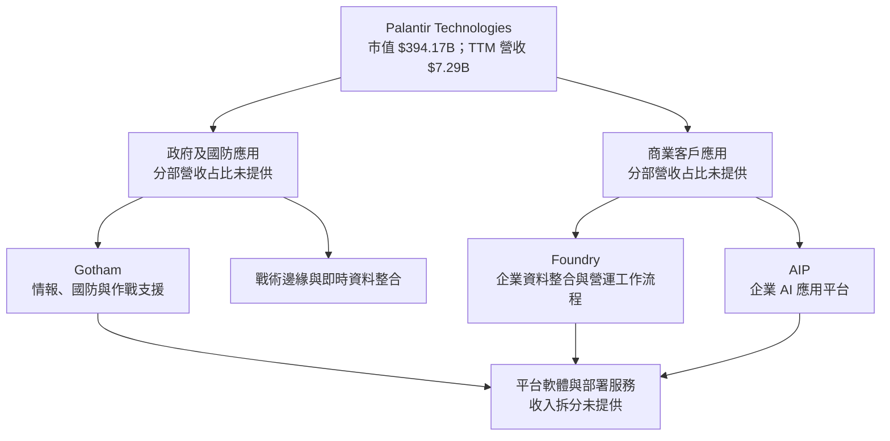
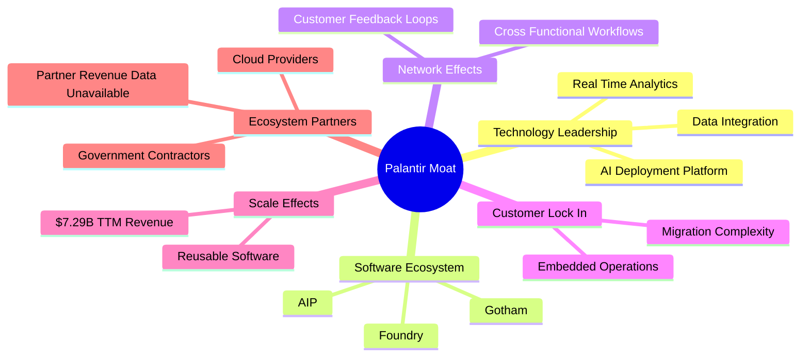
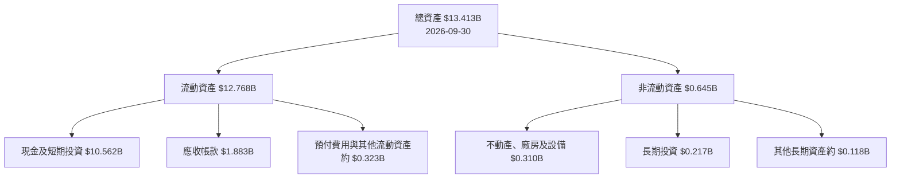
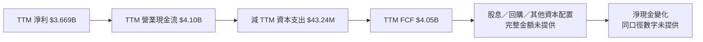
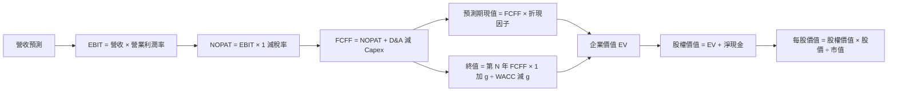
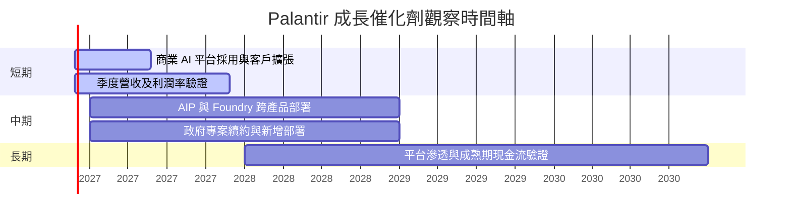
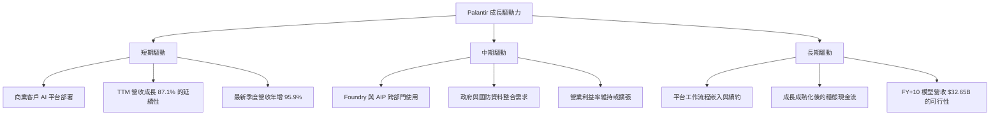
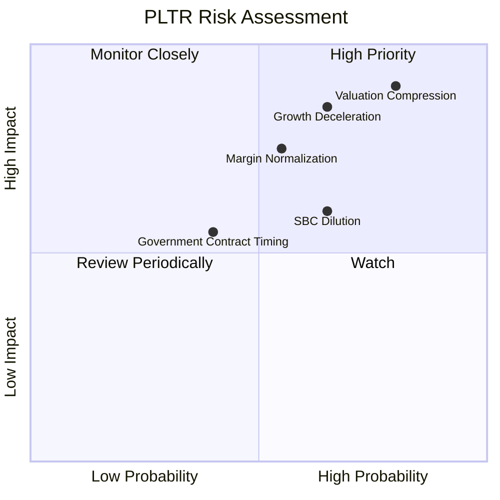
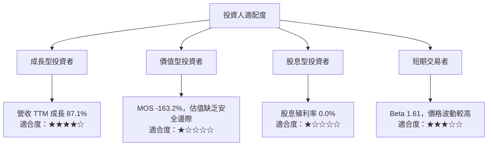

# PLTR 基本面深度分析報告
> **報告日期**：2026-11-26 ｜ **語言**：繁體中文 ｜ **數據來源**：SEC 申報資料 (XBRL)、Yahoo Finance、Finviz、StockAnalysis、Roic.ai ｜ **分析師**：CFA 級機構研究

---

## 目錄

| # | 章節 | 核心結論 |
|---|------|----------|
| 1 | 執行摘要 | 賣出；加權合理價值 $62.15，MOS -163.2% |
| 2 | 公司概覽與商業模式 | 軟體平台有高轉換成本潛力，但分部收入與市占率數據未提供 |
| 3 | 損益表深度分析 | TTM 營收 $7.29B、年增 87.1%；營業利益率 45.6% |
| 4 | 資產負債表分析 | 現金及短期投資 $10.56B、流動比率 7.102；負債數據存在口徑差異 |
| 5 | 現金流量深度分析 | TTM FCF $4.05B、FCF Yield 1.03%；股權薪酬仍造成稀釋成本 |
| 6 | 獲利能力與資本效率 | 報列 ROIC 492.3% 高於 WACC 11.88%，但 ROIC 分母可能令比率失真 |
| 7 | 相對估值分析 | 相對同業溢價明顯；相對自身歷史 P/E 偏低、P/S 仍偏高 |
| 8 | DCF 內在價值評估 | DCF 基準價值 $22.35；加權合理價值 $62.15，現價遠高於兩者 |
| 9 | 成長催化劑 | 商用 AI 軟體採用及政府／企業部署是主要方向；TAM 數據未提供 |
| 10 | 風險矩陣 | 估值壓縮、成長放緩及股權薪酬稀釋為主要風險 |
| 11 | 投資建議 | 依 MOS 規則為賣出；等待估值與基本面重新匹配 |

---

## 1. 執行摘要

### 1.0 一頁式投資儀表板（Portfolio Manager 30 秒速讀）

| 項目 | 內容 |
|------|------|
| **投資論點（3 句）** | ① TTM 營收年增 **87.1%**，最新季度年增 **95.9%**，顯示商用與政府軟體需求仍在加速。② TTM 營業利益率 **45.6%**、FCF **$4.05B**，現金生成能力已有規模。③ 但 **Forward P/E 64.4x、TTM P/S 54.1x**，加權合理價值僅 **$62.15**，較 $163.59 現價低 **62.0%**。 |
| **綜合評分** | **6.8/10**（引用 1.1 評分卡） |
| **財務健康** | 🟢 現金及短期投資 **$10.56B**、流動比率 **7.102**；但總債務口徑在來源間有差異，詳見第 4 章。 |
| **ROIC vs WACC** | **492.3% vs 11.88%**；表面上高於資本成本，但 ROIC 分母受淨現金扣除後可能偏小，不能直接視為可持續回報率。 |
| **FCF 趨勢** | 向上；TTM FCF **$4.05B**，FCF Yield **1.03%**。 |
| **估值** | Forward P/E **64.4x** ｜ EV/EBITDA **114.4x** ｜ FCF Yield **1.03%** |
| **DCF 內在價值（基準）** | **$22.35** ｜ 相對 DCF 的折溢價 **+631.8%**（現價 ÷ DCF 基準價值 − 1） |
| **安全邊際（MOS）** | **-163.2%**＝（加權合理價值 **$62.15** − 現價 $163.59）÷ 加權合理價值 $62.15｜🔴 無安全邊際 |
| **預期報酬（基準情境 12M）** | **-86.3%**（DCF 基準情境 $22.35 相對現價；非時間保證） |
| **關鍵風險（前二）** | 估值倍數下修；目前高成長率無法延續。 |
| **評級 + 信心度** | 🔴 **賣出** ｜ 信心：中（估值數據明確，長期成長與 DCF 假設不確定性高） |

### 1.1 綜合評分卡（全報告唯一）

| 維度 | 評分（1–10） | 主要依據（引用數字與其來源章節） |
|------|--------------|----------------------------------|
| 成長性 | 9.0 | TTM 營收年增 87.1%、最新季度年增 95.9%（第 3 章）；但須留意高基期。 |
| 獲利能力 | 8.5 | TTM 營業利益率 45.6%、FCF $4.05B；報列 ROIC 492.3% 可能受投入資本分母影響（第 5、6 章）。 |
| 財務健康 | 9.0 | 現金及短期投資 $10.56B、流動比率 7.102、F-Score 7/8（第 4、6 章）。 |
| 估值 | 1.0 | MOS -163.2%，Forward P/E 64.4x，DCF 基準價值 $22.35（第 7、8 章）。 |
| 護城河 | 8.0 | 平台跨資料整合、工作流程嵌入形成轉換成本；但分部、客戶留存等量化資料未提供（第 2 章）。 |
| 管理層與資本配置 | 5.0 | 年度 SBC 2025 年 $684.03M，稀釋股數測試未通過；股息殖利率 0%（第 3、5 章）。 |
| **綜合評分** | **6.8** | 六項算術平均：**(9.0 + 8.5 + 9.0 + 1.0 + 8.0 + 5.0) ÷ 6 = 6.75 ≈ 6.8** |

### 1.2 五大投資論點 + 三大核心風險

| 類型 | 項目 | 具體依據 | 信心度 |
|------|------|----------|--------|
| 🟢 **投資論點①** | 營收增長加速 | TTM 營收 $7.29B、年增 87.1%；最新季度年增 95.9%。若需求延續，可支撐高固定成本軟體模式的營業槓桿。 | 🟢 高 |
| 🟢 **投資論點②** | 營業獲利已具規模 | TTM 營業利益率 45.6%，最新季度 46.9%；相較 FY2024 的 10.8% 已明顯提升。 | 🟢 高 |
| 🟢 **投資論點③** | 現金流強 | TTM 營業現金流 $4.10B、資本支出 $43.24M，依指定定義 FCF 為 $4.05B。 | 🟢 高 |
| 🟢 **投資論點④** | 資產負債表有緩衝 | 現金及短期投資 $10.56B，負債規模相對現金小；但不同資料來源的總債務口徑不完全一致。 | 🟢 高 |
| 🟢 **投資論點⑤** | 軟體平台有高轉換成本潛力 | Gotham、Foundry、AIP 等平台將資料整合、決策流程與執行工具連接；產品採用後更換成本可能上升，但缺少留存率與合約資料量化。 | 🟡 中 |
| 🟡 **風險①** | 估值與營運預期不匹配 | 加權合理價值 $62.15，現價 $163.59；Forward P/E 64.4x，市場定價已要求高成長延續。 | 🔴 高衝擊 |
| 🔴 **風險②** | 高成長率正常化 | 最新季度營收年增 95.9%，但 DCF 模型將第 1 年成長率降至 30%，反映極高基期下成長回落的風險。 | 🔴 高衝擊 |
| 🟡 **風險③** | 股權薪酬與稀釋 | FY2025 SBC $684.03M，Piotroski 稀釋股數測試未通過；若股數持續增加，單股經濟價值增幅低於公司層級增幅。 | 🟡 中高 |

### 1.3 快速統計卡片

| 指標 | 公司實際值（期間） | 同業中位數 | 狀態 |
|------|--------------------|------------|------|
| 營收成長（TTM） | **87.1%** | — | 🟢 |
| 營收成長（最新一季年增） | **95.9%** | **35.2%**（SNOW、DDOG、CRM 中位數） | 🟢 |
| 毛利率（TTM） | **84.7%** | **77.3%**（SNOW、DDOG、CRM 中位數） | 🟢 |
| 營業利益率（TTM） | **45.6%** | — | 🟢 |
| ROIC（TTM） | **492.3%** | — | 🟡（分母可能失真） |
| Forward P/E | **64.4x** | **49.7x**（三家中位數） | 🔴 |
| FCF Yield（TTM） | **1.03%** | — | 🔴 |
| Piotroski F-Score | **7 / 8** | — | 🟢 |

### 1.4 投資結論

```text
╔══════════════════════════════════════════════════════════════════╗
║                    📊 投資結論摘要                               ║
╠══════════════════════════════════════════════════════════════════╣
║  評級：🔴 賣出（依加權合理價值 MOS 門檻）                        ║
║  價格（2026-11-25 收盤）：$163.59                                ║
║  DCF 內在價值（基準）：$22.35（現價溢價 +631.8%）               ║
║  安全邊際 MOS：-163.2%（＝(加權合理價值−現價)÷加權合理價值）   ║
║  加權合理價值（8.8）：$62.15                                    ║
║  DCF 情境價值：                                                  ║
║    悲觀情境：$13.21（-91.9%）                                   ║
║    基準情境：$22.35（-86.3%）                                   ║
║    樂觀情境：$39.16（-76.1%）                                   ║
║  綜合評分：6.8/10（引用 1.1）                                   ║
║  適合投資人：能承受高波動、採分批配置的成長型投資人；不適合     ║
║              以低估值或股息收入為主要目標的投資人               ║
╚══════════════════════════════════════════════════════════════════╝
```

---

## 2. 公司概覽與商業模式

### 2.1 業務結構與收入來源

Palantir 為美國軟體公司，面向政府與商業客戶提供資料整合與分析平台。公司概述提及 Gotham、防務作業環境與即時跨域資料整合；現有財務資料沒有政府／商業分部收入及占比，因此不推算各板塊金額。



### 2.2 市場份額

市場份額及可引用的 TAM 數字未提供，故不繪製市占率圖表。以公司營收規模衡量，PLTR TTM 營收為 $7.29B、TTM 成長 87.1%，高於 SNOW、DDOG、CRM 最新季度年增率；但不同公司的產品範圍與客戶組合不同，不能將成長率直接解讀為市占率變化。

### 2.3 競爭護城河分析



### 2.4 護城河強度

| 護城河項目 | 強度（強／中／弱） | 證據（引用數字或事實） | 會削弱它的情況 |
|------------|--------------------|------------------------|----------------|
| 技術與產品平台 | 中至強 | 平台涵蓋 Gotham、Foundry、AIP；TTM 營業利益率 45.6%，顯示軟體經濟性已反映在利潤。 | 競品提供更容易部署、成本更低或性能更佳的解決方案。 |
| 軟體生態系統 | 中 | 產品面向政府與企業不同工作流程；分部營收、合作夥伴貢獻未提供。 | 客戶採用單一模組而非平台化部署，削弱跨產品擴張。 |
| 網路效應 | 中 | 資料及工作流程整合可形成組織內部使用回饋；缺少使用者數、資料網路規模等直接數據。 | 客戶資料可攜性提高，或替代品能快速整合相同資料。 |
| 客戶鎖定 | 中至強 | 核心應用嵌入營運流程，替換可能涉及資料、權限與流程重建；客戶留存率未提供。 | 採購集中、合約縮短或客戶自行開發替代平台。 |
| 規模效應 | 中 | TTM 營收 $7.29B、毛利率 84.7%，形成軟體交付規模。 | 導入服務與客製化成本上升，限制規模效益傳遞。 |
| 生態夥伴 | 弱至中 | 可服務政府、企業及雲端部署場景，但合作夥伴數與渠道收入未提供。 | 雲端商或大型軟體商直接整合相同功能。 |

護城河評分 **8.0/10**：營收成長與利潤率支持平台價值，但留存率、合約擴張及分部數據不足以將判斷升至更高區間。

---

## 3. 損益表深度分析

### 3.1 年度收入成長趨勢（近 4 年）

年度營收來源：FY2022 $1.906B、FY2023 $2.225B、FY2024 $2.866B、FY2025 $4.475B。FY2022–FY2025 三年 CAGR 約 **32.9%**。

```text
╔══════════════════════════════════════════════════════════════════╗
║              Palantir 年度收入趨勢（FY2022-FY2025）              ║
╠══════════════════════════════════════════════════════════════════╣
║  FY2022  $1.906B  ████████░░░░░░░░░░░░░░░░  YoY: +23.6% 🟢     ║
║  FY2023  $2.225B  ███████████░░░░░░░░░░░░░  YoY: +16.7% 🟡     ║
║  FY2024  $2.866B  ███████████████░░░░░░░░░  YoY: +28.8% 🟢     ║
║  FY2025  $4.475B  ████████████████████████  YoY: +56.2% 🟢     ║
║                                                                  ║
║  FY2022–FY2025 三年營收 CAGR：約 +32.9%                          ║
╚══════════════════════════════════════════════════════════════════╝
```

FY2025 營收成長加速至 56.2%，TTM 成長再升至 87.1%，反映近期商業化需求提高；不過 TTM 高增長大幅超過過去三年 CAGR，延續性比歷史趨勢更不確定。

### 3.2 季度收入趨勢分析

| 季度 | 營收 | QoQ 成長 | YoY 成長 | 備註 |
|------|------:|---------:|---------:|------|
| 2025 Q4 | $1.407B | +19.1% | +70.0% | YoY 依 StockAnalysis 季度成長數據。 |
| 2026 Q1 | $1.633B | +16.1% | +84.7% | 季度收入延續上升。 |
| 2026 Q2 | $1.935B | +18.5% | +92.8% | YoY 加速。 |
| 2026 Q3 | $2.313B | +19.5% | +95.9% | 最新季度數字，不是 TTM 成長率。 |

QoQ 計算依相鄰季度營收；例如 2026 Q3 QoQ = ($2.313B ÷ $1.935B) − 1 = 約 **19.5%**。連續四季 QoQ 擴張顯示營收動能廣泛延續，但若大額合約或交付時點造成季度波動，未來單季增速可能不平滑。

### 3.3 利潤率演變分析

| 利潤率指標 | FY2022 | FY2023 | FY2024 | FY2025 | TTM／最新季度 | 趨勢與評估 |
|------------|-------:|-------:|-------:|-------:|---------------:|------------|
| **毛利率** | 78.5% | 80.6% | 80.3% | 82.4% | TTM 84.7% | ↗️ 產品組合及交付規模改善；🟢 |
| **營業利益率** | -8.5% | 5.4% | 10.8% | 31.6% | TTM 45.6%；最新季 46.9% | ↗️ 營收擴張快於費用增長；🟢 |
| **淨利率** | -19.6% | 9.4% | 16.1% | 36.3% | TTM 50.3% | ↗️ 營業槓桿與非營業／稅項也可能影響；🟡 |

FY2022 至 FY2025 營業利益率由負轉正，FY2025 利潤率大幅跳升；TTM 進一步至 45.6%。這種變化可能來自高毛利軟體收入增長與固定成本攤薄，但因未提供費用細項及分部獲利，無法精確拆分產品組合、定價與成本控制各自貢獻。最新季度營業利益率依 SEC 10-Q 計算數據為 46.9%；其他彙整欄位另列 45.6%，本報告在季度指標採用較精確的 46.9% 已驗證數值。

### 3.4 費用結構分析

可用資料提供 FY2025 研發費用 **$557.68M**，但未提供完整銷售與行銷、一般行政等費用明細，亦未提供可直接畫成各費用占比的完整數據，因此不繪製費用結構圓餅圖。FY2025 研發費用約占營收 **12.5%**（$557.68M ÷ $4.475B），顯示公司仍投入產品研發；但不能由此單一項目推導總營運費用比例。

### 3.5 季度 EPS 趨勢與盈餘品質（Quality of Earnings）

| 季度 | 可得實際 EPS | EPS 預估／超預期資訊 | 解讀 |
|------|--------------:|----------------------|------|
| 2025 Q4 | $0.26 | 預估值與 surprise 為 N/A | 無法判定超預期或不及預期。 |
| 2026 Q1 | $0.36 | 預估值與 surprise 為 N/A | 年度 EPS 成長資料顯示獲利增長，但不代表超預期。 |
| 2026 Q2 | $0.44 | 預估值與 surprise 為 N/A | 同上。 |
| 2026 Q3 | $0.47 | 預估值與 surprise 為 N/A | 同上；EPS 估值表中估計與實際欄位缺值。 |

| 盈餘品質項目 | 數值／佔比 | 評估 |
|--------------|-----------|------|
| 股權薪酬 SBC / 營收 | 2025 年 **15.3%**（$684.03M ÷ $4.475B）；最近四個已列季度 SBC 合計 $982.10M，約為 TTM 營收 **13.5%** | 🟡 偏高；SBC 非當期現金流出，但會稀釋股東權益。 |
| SBC / 營業現金流 | 最近四季 SBC 合計 $982.10M ÷ TTM OCF $4.10B = **23.9%** | 🟡 SBC 是重要經濟成本，不能只看調整後現金流。 |
| FCF / 淨利（現金轉換率） | $4.05B ÷ TTM 淨利 $3.669B = **110.4%** | 🟢 現金轉換高於會計淨利；但須與 SBC 一併評估。 |
| 一次性／非經常性損益 | 逐項明細未提供 | N/A；不能確認是否有顯著一次性收益。 |
| 有效稅率異常 | **1.4%**（最近年度有效稅率） | 🟡 稅率偏低會提高當期淨利；若回升，淨利增長可能低於 EBIT 增長。 |
| 資本化支出 vs 費用化 | TTM Capex $43.24M；資本化政策細項未提供 | Capex 很低不代表所有投入都已資本化或費用化；須查閱 SEC 10-Q 附註。 |

**盈餘品質結論**：TTM FCF 高於淨利，且 F-Score 應計品質測試通過，現金轉換具支持；但 SBC 對近期營收約 13.5%，且稀釋股數測試未通過，代表 GAAP 盈餘仍不能等同完全屬於既有股東的經濟回報。低有效稅率亦可能抬高淨利。EPS surprise 欄位為 N/A，因此無法依現有數據判定過去四季超預期或不及預期。

---

## 4. 資產負債表分析

### 4.1 資產結構分解

以 2026-09-30 TTM 資產負債表資料為準，總資產 **$13.413B**，流動資產 **$12.768B**；現金與短期投資 $10.562B。不同來源摘要的總資產日期與分類口徑不完全相同，以下採 StockAnalysis 2026-09-30 資產分類。



### 4.2 流動性與營運資金分析

| 指標 | 最新 TTM | 一年前 TTM | 變化 | 解讀 |
|------|----------|------------|------|------|
| 流動比率 | 7.102 | N/A | N/A | 流動資產相對流動負債具大幅緩衝；缺少同口徑一年前品質指標。 |
| DSO 應收帳款天數 | 94 天 | 94 天 | 0 天 | 收款天數持平；應收帳款金額上升可能伴隨業務規模擴大，仍應追蹤帳齡。 |
| DIO 存貨天數 | N/A | N/A | N/A | 公司沒有相應存貨餘額資料，不補估。 |
| DPO 應付帳款天數 | 29 天 | 33 天 | -4 天 | 付款天數縮短；可能是付款時點或供應商結構變化，不能單獨推論議價能力。 |
| CCC 現金轉換週期 | N/A | N/A | N/A | 因 DIO 無資料，依品質指標原值保留 N/A。 |

### 4.3 債務結構分析

財務摘要的 VERIFIED FIGURES 將總債務列為 N/A、淨現金列為 $10.56B；其他資產負債表資料則列總債務 $225.27M、淨現金／債務 $10.34B。由於指定的已驗證淨現金數值為 $10.56B，本節引用該值，同時披露來源口徑不一致，不將兩種口徑混為一談。

```text
╔══════════════════════════════════════════════════════════════════╗
║                   Palantir 債務健康診斷                          ║
╠══════════════════════════════════════════════════════════════════╣
║  總債務：        N/A（已驗證指標未提供）                          ║
║  其他資產負債表：$225.27M（不同來源口徑）                         ║
║  現金+短期投資： $10.56B  ████████████████████  🟢              ║
║  淨現金：        $10.56B（依已驗證數值）       🟢              ║
║  Current Ratio： 7.102                                      🟢  ║
║  Debt/EBITDA：   N/A（債務口徑未能一致核對）                     ║
║  Interest Coverage：N/A（利息費用未提供）                       ║
║                                                                  ║
║  判讀：流動性明顯充足；避免以資料口徑不一致的負債數字製造       ║
║        精確的槓桿倍數或利息保障倍數。                           ║
╚══════════════════════════════════════════════════════════════════╝
```

### 4.4 股東權益趨勢

| 年度 | 股東權益 | 年增變化 |
|------|---------:|---------:|
| 2022 | $2.57B | — |
| 2023 | $3.48B | +35.4% |
| 2024 | $5.00B | +43.7% |
| 2025 | $7.39B | +47.8% |

```text
╔══════════════════════════════════════════════════════════════════╗
║                 股東權益趨勢（年度資產負債表）                   ║
╠══════════════════════════════════════════════════════════════════╣
║  2022  $2.57B  ████████░░░░░░░░░░░░░░░░                         ║
║  2023  $3.48B  ███████████░░░░░░░░░░░░░                         ║
║  2024  $5.00B  ████████████████░░░░░░░░                         ║
║  2025  $7.39B  ████████████████████████                         ║
╚══════════════════════════════════════════════════════════════════╝
```

股東權益擴張與留存獲利、股權薪酬等因素有關；現有資料無法拆分各來源，且股數測試未通過，帳面權益增長不應直接等同每股內在價值增長。

---

## 5. 現金流量深度分析

### 5.1 現金流量瀑布圖

缺少完整的 TTM 淨利到營業現金流調節項，以及同口徑回購與淨現金變化明細，因此不填入未提供數字的節點金額。FCF 依指定口徑為 OCF 減 Capex。



### 5.2 FCF 轉換率趨勢

| 年度 | FCF | 淨利 | FCF / 淨利 | 評估 |
|------|----:|----:|-----------:|------|
| 2022 | $183.71M | -$373.70M | 不具可比性 | 淨利為負，比例不適合解讀。 |
| 2023 | $697.07M | $209.82M | 332.2% | FCF 高於淨利，受現金流及營運資金時點影響。 |
| 2024 | $1.14B | $462.19M | 246.7% | 現金轉換仍高，基期與營運資金影響需留意。 |
| 2025 | $2.10B | $1.63B | 129.2% | 現金轉換穩健，但較前兩年回落。 |
| TTM 至 2026-09-30 | $4.05B | $3.669B | 110.4% | 高於 100%；需與 SBC、應收帳款變動共同追蹤。 |

### 5.3 自由現金流趨勢

```text
╔══════════════════════════════════════════════════════════════════╗
║                 自由現金流趨勢（年度實際）                       ║
╠══════════════════════════════════════════════════════════════════╣
║  2022  $0.184B  ██░░░░░░░░░░░░░░░░░░░░░░                       ║
║  2023  $0.697B  ████████░░░░░░░░░░░░░░░                         ║
║  2024  $1.14B   █████████████░░░░░░░░░░                         ║
║  2025  $2.10B   ████████████████████████                         ║
║  TTM   $4.05B   FCF Yield 1.03%                                  ║
╠══════════════════════════════════════════════════════════════════╣
║  FCF 上升改善財務彈性，但 1.03% FCF Yield 顯示現價已反映大量     ║
║  未來現金流增長。                                                ║
╚══════════════════════════════════════════════════════════════════╝
```

### 5.4 資本配置評估

股息殖利率與 payout ratio 均為 **0.0%**。資本配置金額沒有完整回購、投資與留存現金分拆，不繪製比例圓餅圖。

| 項目 | 可得資料 | 評估 |
|------|----------|------|
| 資本支出 | TTM $43.24M | 約為 TTM 營收 0.6%；資本密集程度低。 |
| 股息 | 殖利率 0.0% | 未見現金股息回饋，收入型投資者吸引力低。 |
| 股權薪酬 | FY2025 $684.03M；近四季合計 $982.10M | 需以每股價值稀釋成本評估，不能只因非現金而忽略。 |
| 回購與其他投資 | 金額未提供 | N/A；不推算資本配置占比。 |

---

## 6. 獲利能力與資本效率

### 6.1 ROE / ROA / ROIC 趨勢

| 指標 | FY2023／歷史數據 | FY2024／歷史數據 | FY2025／近期 | TTM | 評估 |
|------|------------------:|------------------:|------------:|----:|------|
| ROE | N/A | N/A | N/A | **32.7%**（品質指標） | 資本回報高，但季度平均與期末口徑的其他摘要數據有差異。 |
| ROA | N/A | N/A | N/A | **19.3%**（彙整資料） | 顯示資產獲利能力良好；年度可比序列未完整提供。 |
| ROIC | 3.25%（Roic.ai 2023） | N/A | N/A | **492.3%**（已驗證） | TTM 值異常高，淨現金扣除後投入資本可能接近較小分母；不宜直接外推。 |

### 6.2 ROIC vs WACC 分析（核心價值創造判斷）

```text
╔══════════════════════════════════════════════════════════════════╗
║                ROIC vs WACC 深度分析                            ║
╠══════════════════════════════════════════════════════════════════╣
║  WACC（已驗證成本資本）：11.88%                                  ║
║  ├── 無風險利率（10Y美債）： 4.85%                               ║
║  ├── 市場風險溢酬：           5.00%（假設值）                    ║
║  ├── 原始 Beta：              1.61                               ║
║  ├── 調整後 Beta：            1.41                               ║
║  ├── 股權成本：               11.88%                             ║
║  ├── 稅前債務成本：           6.85%（假設值）                    ║
║  ├── 股權／債務權重：         99.9% / 0.1%                      ║
║  └── WACC：                   11.88%                             ║
║                                                                  ║
║  ROIC（TTM）：               492.3%                              ║
║  ROIC − WACC：               480.42 個百分點                    ║
║  ROIC / WACC：               約 41.4 倍                         ║
║                                                                  ║
║  判讀：報列 ROIC 高於 WACC，表面上代表創造股東價值；但 ROIC     ║
║  定義中的投入資本為權益 + 債務 − 現金，若現金接近或大於經營性   ║
║  資本，分母可能偏小，492.3% 不宜視為穩態回報率。               ║
╚══════════════════════════════════════════════════════════════════╝
```

WACC 依已驗證成本資本輸入採 **11.88%**，不另建 WACC。CAPM 股權成本以 4.85% + 1.41 × 5.00% = 11.90%，與已驗證股權成本 11.88% 的微小差異屬輸入精度／四捨五入口徑；報告及 DCF 一律使用指定 WACC **11.88%**。原始 Beta 1.61 依公式調整為 ⅔ × 1.61 + ⅓ × 1 = 1.41。10 年期美債資料未附觀測日，故不另行補寫日期。

### 6.3 杜邦三因素分解

| 因素 | 數值（TTM） | 解讀 |
|------|-------------|------|
| 淨利率 | 50.3% | 淨利率高，亦可能受到低有效稅率影響。 |
| 資產週轉率 | 0.54 | 以資產規模衡量的營收轉換效率。 |
| 權益乘數 | 1.19 | 槓桿程度不高，ROE 並非主要靠財務槓桿支撐。 |
| **ROE** | **32.7%** | **50.3% × 0.54 × 1.19 = 約 32.3%；已驗證 ROE 為 32.7%，尾差來自原始未四捨五入值。** |

### 6.4 財務體質：Piotroski F-Score

| 測試 | 結果 | 解讀 |
|------|------|------|
| ROA > 0 | ✅ 通過 | 資產獲利為正。 |
| 營業現金流 > 0 | ✅ 通過 | TTM OCF $4.10B。 |
| ROA 高於一年前 | ✅ 通過 | 獲利效率方向改善。 |
| 營業現金流 > 淨利 | ✅ 通過 | 支持應計品質。 |
| 長期負債 ÷ 總資產低於一年前 | — 無法判定 | 缺少可比輸入資料。 |
| 流動比率高於一年前 | ✅ 通過 | 流動性改善。 |
| 稀釋股數未增加 | ❌ 未通過 | 代表股東存在稀釋風險。 |
| 毛利率高於一年前 | ✅ 通過 | 毛利率改善。 |
| 資產週轉率高於一年前 | ✅ 通過 | 資產使用效率改善。 |

**Piotroski F-Score：7 / 8**。這是以有資料的八項測試計算，未把缺資料的長期負債測試算入分母。整體財務與獲利訊號偏正面，未通過項目則指出稀釋是需要持續監控的股東回報風險。

---

## 7. 相對估值分析

### 7.1 同業估值比較表格

本公司倍數採估值摘要；同業倍數依 Yahoo Finance Peer multiples。PLTR 與大型 CRM 軟體、雲端監控及資料平台公司的產品組合不同，倍數比較僅作相對定價參考。

| 估值指標 | **PLTR** | **SNOW** | **DDOG** | **CRM** | PLTR 評估 |
|----------|---------:|--------:|--------:|-------:|-----------|
| **Trailing P/E** | 115.2x | N/A | 219.8x | 18.0x | 🟡 較 DDOG 低、較 CRM 高；SNOW 無正值可比。 |
| **Forward P/E** | 64.4x | 86.9x | 49.7x | 12.3x | 🔴 高於 DDOG、CRM；三家同業中位數 49.7x。 |
| **P/S Ratio** | 54.1x | 17.4x | 13.4x | 3.7x | 🔴 顯著高於三家同業。 |
| **EV/EBITDA** | 114.4x | -91.5x | 312.2x | 15.0x | 🟡 SNOW 負值不具傳統意義；PLTR 仍屬高倍數。 |
| **最新季度營收 YoY** | 95.9% | 35.1% | 35.2% | 10.8% | 🟢 PLTR 成長較快，但不能單以成長率抵消估值風險。 |
| **毛利率（TTM）** | 84.7% | 67.0% | 79.6% | 77.3% | 🟢 PLTR 毛利率高於所列同業。 |

### 7.2 歷史估值區間分析

```text
╔══════════════════════════════════════════════════════════════════╗
║              PLTR 五年估值區間（TTM 倍數）                       ║
╠══════════════════════════════════════════════════════════════════╣
║  P/E：       100.6x ├─ 現值 115.2x ───────── 中位數 228.6x ─┤601.0x
║              當前歷史百分位：7%                                  ║
║                                                                  ║
║  P/S：         7.0x ├──────── 中位數 24.7x ─── 現值 57.8x ─┤120.4x
║              當前歷史百分位：67%                                 ║
║                                                                  ║
║  EV/EBITDA： 109.0x ├─ 現值 122.3x ─────── 中位數 233.4x ─┤574.4x
║              當前歷史百分位：8%                                  ║
╚══════════════════════════════════════════════════════════════════╝
```

歷史倍數呈現兩面性：P/E 與 EV/EBITDA 位於自身五年區間低端，但 P/S 仍在第 67 百分位、且為同業的數倍。P/E 歷史百分位偏低，部分源自獲利快速放大與此前極高倍數；不代表現價已便宜。

### 7.3 情境價值（Bear / Base / Bull，依 DCF MODEL）

| 情境 | 第 1 年營收成長 | 期末營業利潤率 | WACC | 每股價值 | 相對現價 | 機率 | 會發生的條件 |
|------|----------------:|---------------:|-----:|---------:|---------:|-----:|--------------|
| 🔴 悲觀 | 15.0% | 9.2% | 12.88% | $13.21 | -91.9% | 25% | 成長快速降速、長期利潤率回落，資本成本上升。 |
| 🟡 基準 | 30.0% | 10.8% | 11.88% | $22.35 | -86.3% | 50% | 高速成長逐年衰退，利潤率回歸五年期中位數。 |
| 🟢 樂觀 | 45.0% | 11.9% | 10.88% | $39.16 | -76.1% | 25% | 商用 AI 擴張更快、成熟期利潤率較高且折現率下降。 |

以上情境照 DCF 模型數值列示；各情境終值成長率未在情境明細中另列，故不自行補建情境假設。三個情境即使取樂觀值，仍低於 2026-11-25 收盤價。

### 7.4 相對估值隱含價格區間

```text
╔══════════════════════════════════════════════════════════════════╗
║                  估值方法隱含每股價值                            ║
╠══════════════════════════════════════════════════════════════════╣
║  $22.35 DCF ───── $78.75 同業 Forward P/E ───── $163.59 現價    ║
║      │                     │                         │           ║
║  10 年 FCFF           同業中位數 31.0x           市場收盤價       ║
║                       × Forward EPS $2.54                        ║
║                                                                  ║
║  分析師共識目標價：$222.90（29 位分析師平均值）                  ║
╚══════════════════════════════════════════════════════════════════╝
```

DCF、同業 Forward P/E 與分析師共識價格均依估值方法區塊引用。Forward P/E 方法採 DDOG、CRM 同業中位數 **31.0x** 乘以公司 Forward EPS **$2.54**，得到 **$78.75**；SNOW 的 forward P/E 不納入該已指定中位數方法。分析師目標價 $222.90 是參考項，非基本面現金流推導值。

---

## 8. DCF 內在價值評估（Discounted Cash Flow）

> 本章唯一模型為已計算的 10 年 FCFF DCF。模型原值採 GAAP EBIT、WACC 11.88%、永續成長率 3.0%，不另行建立替代模型。表格金額以 $B 表示，金額取兩位小數、折現因子三位小數、比率一位小數；四捨五入尾差可能達 1%。

### 8.0 估值推理鏈（Thinking Logic）

**Step 1 — 價值由哪些變數決定？**  
模型將價值拆為現有政府與商業軟體現金流底盤、AI／企業平台帶來的新增成長，以及長期終值；各板塊營收占比未提供，故不能分別量化。估值主導變數是成長率及成熟期營業利潤率，因模型中營收由 $7.29B 增至 FY+10 $32.65B，而 EBIT 利潤率由 45.6% 降至 10.8%。

**Step 2 — 模型選擇**

| 決策點 | 本報告採用 | 理由（含數字） | 曾考慮但否決 | 否決理由 |
|--------|-----------|----------------|--------------|----------|
| 現金流定義 | FCFF | 以 WACC 11.88% 折現，先算 EV，再加淨現金。 | FCFE | 資本結構比重採已驗證 WACC 模型，FCFF 與模型一致。 |
| 預測期 N | 10 年 | DCF 模型固定 10 年，反映成長由 30% 線性衰退至 3%。 | 5 年 | 會改動既有模型預測期，不能取代程式模型。 |
| 終值方法 | Gordon Growth | WACC 11.88% 大於 g 3.0%，公式可用；終值現值占 EV 30.3%。 | 退出倍數 | DCF 模型未提供退出倍數終值輸入，不另造模型。 |
| EBIT 基礎 | GAAP | 模型明列 GAAP EBIT，SBC 已作費用扣除。 | 非 GAAP EBIT | 可能把 SBC 從營運成本剔除，與指定模型不同。 |

**Step 3 — 關鍵假設推導鏈**

- **營收成長**：錨點＝TTM 成長 87.1%、FY2025 年增 56.18% → 高基期與長期均值回歸使成長率下降 → **第 1 年採 30.0%，第 10 年降至 3.0%** → 不採用 87.1% 持續十年，因會導致不合理的遠期規模。
- **營業利潤率**：錨點＝TTM 45.6% → 模型將其逐年降至近五年財年中位數 → **FY+1 45.6% 至 FY+10 10.8%** → 不採用持續 45.6%，因成熟期競爭、費用投入及歷史中位數都不支持永久維持當前高位。
- **永續成長率 g**：錨點＝長期名目經濟成長需低於折現率；本模型指定 **3.0%** → 採用 3.0%，且低於 WACC 11.88% → 不採用高於 WACC 的成長率，因 Gordon Growth 公式會失效。
- **預測期 N**：錨點＝模型預設 10 年，且逐年成長由 30% 降至 3% → 以較長時間反映成熟化 → **採用 10 年** → 不改成 5 年或自行延長，避免改寫指定模型。
- **Capex／營收**：錨點＝TTM 資本支出 $43.24M／TTM 營收 $7.29B，約 0.6% → 逐步回落至 0.4%，但最低不低於模型所定的折舊基準 → **FY+1 0.6% 至 FY+10 0.4%** → 不假設 Capex 長期為零，因擴張仍需基礎設施投入。
- **EBIT 基礎與 SBC**：錨點＝GAAP 營業利益已包含 SBC 費用 → 不在 FCFF 再扣一次 SBC → **採組合 (A)：GAAP EBIT、固定股數、不額外稀釋** → 不採非 GAAP EBIT 加回 SBC，避免使股東成本消失。
- **年稀釋率**：模型指定股數不再稀釋 → **DCF 設定 0% 額外稀釋**，但這是模型處理方式，不代表實際股數不會增加；最新品質測試顯示稀釋股數未通過。
- **終值方法**：錨點＝第 10 年 FCFF $3.48B → 永續成長 3.0%、WACC 11.88% → **Gordon Growth** → 不以未提供的退出倍數另建終值。
- **WACC**：錨點＝已驗證 WACC 11.88% → 按模型原值使用 → **採用 11.88%** → 不以市場短期情緒自行調低折現率。

**Step 4 — 最脆弱一環**  
最脆弱的是長期營業利潤率與成長率同時受競爭、產品採用及定價能力影響；任一項低於模型路徑都會降低預測期 FCFF，並可能使內在價值進一步低於 $22.35。

**Step 5 — 計算路徑圖**



### 8.1 模型假設總表（Model Inputs）

| 假設項目 | 採用值 | 依據／來源 | 敏感度 |
|----------|--------|-------------|--------|
| 預測期長度 N | 10 年 | DCF 模型固定輸入，營收成長由 30% 線性降至 3%。 | 🟡 中 |
| 營收成長路徑 | 第 1 年 30.0% → 第 10 年 3.0% | TTM 實際成長 87.1%，模型將其限制在 0%–30%，之後線性遞減。 | 🔴 高 |
| 營業利潤率 | 第 1 年 45.6% → 第 10 年 10.8% | 起點採 TTM；終點採近五年財年中位數，含 TTM。 | 🔴 高 |
| 有效稅率 | 1.4% | 最近年度有效稅率；稅率可能偏低。 | 🟢 低 |
| Capex / 營收 | 0.6% → 0.4% | 起點採 TTM 比率，逐步回落至模型設定終值。 | 🟡 中 |
| D&A / 營收 | 0.4% | TTM 比率，模型固定。 | 🟢 低 |
| 營運資金變動 | 不建模 | DCF 模型明示 working capital is not modelled；不是零值假設。 | 🟡 中 |
| EBIT 基礎 | GAAP EBIT | DCF 模型採 GAAP EBIT。 | 🟡 中 |
| SBC 處理 | 不在 FCFF 重複扣除 | GAAP EBIT 已含 SBC 費用，固定股數，不再額外稀釋。 | 🟡 中 |
| 年稀釋率 | 0%（模型固定股數） | 組合 A；與模型假設一致，但實際稀釋股數測試未通過。 | 🟡 中 |
| 永續成長率 g | 3.0% | 模型原值，低於 WACC 11.88%。 | 🔴 高 |
| 終值方法 | Gordon Growth | DCF 模型原值；退出倍數法數據未提供。 | 🔴 高 |
| WACC | 11.88% | 已驗證成本資本輸入，見 8.2。 | 🔴 高 |

**FCFF 定義**：FCFF = NOPAT + D&A − Capex。因模型明示不建模營運資金，故不列 ΔWC 行。本模型採用 **(A) GAAP EBIT + 固定股數**，SBC 影響已透過 GAAP 費用計入一次；不再扣 SBC，也不再以稀釋率加計一次。

### 8.2 折現率推導（WACC）

```text
╔══════════════════════════════════════════════════════════════════╗
║                    WACC 推導（折現率）                           ║
╠══════════════════════════════════════════════════════════════════╣
║  股權成本 Ke（已驗證 CAPM）：                                    ║
║  ├── 無風險利率 Rf：                   4.85%                     ║
║  ├── 市場風險溢酬 ERP：                5.00%（假設值）           ║
║  ├── 原始 Beta：                       1.61                      ║
║  ├── 調整後 Beta：                     1.41                      ║
║  ├── Beta 調整：                       ⅔×1.61 + ⅓×1 = 1.41     ║
║  └── 已驗證 Ke：                       11.88%                    ║
║                                                                  ║
║  債務成本：                                                    ║
║  ├── 稅前 Kd：                         6.85%（模型假設）         ║
║  ├── 有效稅率：                        1.4%                      ║
║  └── 稅後 Kd：                        6.85%×(1−1.4%)=6.7541%   ║
║                                                                  ║
║  資本結構（已驗證權重）：                                      ║
║  ├── 股權權重 E：                      99.9%                     ║
║  ├── 債務權重 D：                      0.1%                      ║
║  └── 已驗證 WACC：                     11.88%                    ║
╚══════════════════════════════════════════════════════════════════╝
```

逐步演算與限制：

1. **Ke（CAPM）**：已驗證輸入為 Rf 4.85%、調整後 Beta 1.41、ERP 5.00%；依成本資本資料指定 Ke **11.88%**。以顯示值重算為 4.85% + 1.41 × 5.00% = 11.90%，與已驗證 11.88% 相差 0.02 個百分點，屬輸入精度／底層未四捨五入值差異；後續採已驗證值。
2. **稅前 Kd**：利息費用與平均計息負債未提供；採指定假設值 **6.85%**，依據為 Rf 4.85% + 信用價差 2.00 個百分點。
3. **稅後 Kd**：6.85% × (1 − 1.4%) = **6.7541%**。
4. **資本權重**：已驗證股權／債務權重 **99.9%／0.1%**，合計 100.0%。市值與計息負債逐項權重輸入未完整提供，故不反推金額替代。
5. **WACC**：已驗證 WACC **11.88%**。依已顯示權重與四捨五入 Kd 計算為 99.9% × 11.88% + 0.1% × 6.7541% = 11.8749% ≈ **11.88%**。第 6.2 與本章使用相同數值。

### 8.3 逐年自由現金流預測（基準情境）

以下逐年數值照 DCF 模型原值。DCF 模型將 GAAP EBIT 稅後加回 D&A、減 Capex，不含營運資金變動。

| 年度 | FY+1 | FY+2 | FY+3 | FY+4 | FY+5 | FY+6 | FY+7 | FY+8 | FY+9 | FY+10 |
|------|------:|------:|------:|------:|------:|------:|------:|------:|------:|-------:|
| 營收 | 9.47 | 12.03 | 14.92 | 18.05 | 21.30 | 24.50 | 27.44 | 29.91 | 31.70 | 32.65 |
| 營收 YoY | 30.0% | 27.0% | 24.0% | 21.0% | 18.0% | 15.0% | 12.0% | 9.0% | 6.0% | 3.0% |
| 營業利潤率 | 45.6% | 41.8% | 37.9% | 34.0% | 30.2% | 26.3% | 22.4% | 18.6% | 14.7% | 10.8% |
| EBIT（GAAP） | 4.32 | 5.03 | 5.66 | 6.14 | 6.43 | 6.44 | 6.16 | 5.55 | 4.66 | 3.54 |
| − 稅 | (0.06) | (0.07) | (0.08) | (0.08) | (0.09) | (0.09) | (0.08) | (0.08) | (0.06) | (0.05) |
| NOPAT | 4.26 | 4.96 | 5.58 | 6.06 | 6.34 | 6.36 | 6.07 | 5.48 | 4.60 | 3.49 |
| + D&A | 0.04 | 0.05 | 0.06 | 0.07 | 0.08 | 0.10 | 0.11 | 0.12 | 0.13 | 0.13 |
| − Capex | (0.06) | (0.07) | (0.08) | (0.10) | (0.11) | (0.12) | (0.13) | (0.14) | (0.14) | (0.14) |
| = FCFF | 4.25 | 4.94 | 5.55 | 6.03 | 6.31 | 6.33 | 6.05 | 5.45 | 4.58 | 3.48 |
| 折現因子 @11.88% | 0.894 | 0.799 | 0.714 | 0.638 | 0.571 | 0.510 | 0.456 | 0.407 | 0.364 | 0.325 |
| FCFF 現值 PV | 3.80 | 3.94 | 3.97 | 3.85 | 3.60 | 3.23 | 2.76 | 2.22 | 1.67 | 1.13 |

模型內預測期現值合計為 **$30.16B**。逐項按顯示至兩位小數的表格相加為 $30.17B；$0.01B 差異為逐年四捨五入尾差，模型合計採未四捨五入底層值。

**逐步演算（FY+1，依模型顯示值）**

1. **營收** = $7.29B × (1 + 30.0%) = $9.477B ≈ **$9.47B**（模型原值）。
2. **EBIT** = $9.47B × 45.6% = $4.3183B ≈ **$4.32B**。
3. **稅** = $4.32B × 1.4% = $0.0605B ≈ **$0.06B**。
4. **NOPAT** = $4.32B − $0.06B = **$4.26B**。
5. **D&A** = $9.47B × 0.4% = $0.0379B ≈ **$0.04B**。
6. **Capex** = $9.47B × 0.6% = $0.0568B ≈ **$0.06B**。
7. **ΔWC** = 不納入模型；模型明示未建模營運資金。
8. **FCFF** = $4.26B + $0.04B − $0.06B = $4.24B；模型原始底層精度計算值列為 **$4.25B**，差異來自展示欄位四捨五入。
9. **折現與 PV**：折現因子 = 1 ÷ (1 + 11.88%)¹ = 0.894；PV = 模型 FCFF $4.25B × 0.894 = $3.8015B ≈ **$3.80B**。

**預測期 FCF 現值合計**：  
$3.80 + $3.94 + $3.97 + $3.85 + $3.60 + $3.23 + $2.76 + $2.22 + $1.67 + $1.13 = **$30.17B**（展示值逐項合計）；模型底層未四捨五入合計為 **$30.16B**。

**合理性自檢**

- 預測期 FCFF 由 $4.25B 增至 $3.48B，FY+1 至 FY+10 並非單調增長；無法與歷史 FCF CAGR 作嚴格同口徑比較，因模型未提供同一期間的逐年未四捨五入 FCFF 歷史序列。
- FY+10 FCFF 利潤率 = $3.48B ÷ $32.65B = **10.7%**；目前 TTM FCF／營收 = $4.05B ÷ $7.29B = **55.6%**。兩者差距主要源自模型將營業利潤率由 45.6% 下修至 10.8%；同業最佳 FCF 利潤率資料未提供，不作比較。
- 預測期間 FCFF 均為正值。

```text
╔══════════════════════════════════════════════════════════════════╗
║            自由現金流：歷史實際 vs 模型預測                      ║
╠══════════════════════════════════════════════════════════════════╣
║  FY2023(實)  $0.70B  ████░░░░░░░░░░░░░░░░                       ║
║  FY2024(實)  $1.14B  ██████░░░░░░░░░░░░░░                       ║
║  FY2025(實)  $2.10B  ███████████░░░░░░░░                       ║
║  FY+1 (預)   $4.25B  ██████████████████████                     ║
║  FY+10(預)   $3.48B  ██████████████████                         ║
╠══════════════════════════════════════════════════════════════════╣
║  預測並非永久增長：FCFF 於 FY+6 附近見高後，隨營業利潤率回歸而   ║
║  下降；該利潤率收斂是估值的核心風險之一。                       ║
╚══════════════════════════════════════════════════════════════════╝
```

### 8.4 終值計算（Terminal Value）

**適用性檢查**：WACC **11.88%** vs g **3.0%** → WACC > g？✅

| 方法 | 計算式 | 終值 TV | TV 現值 | 佔總 EV 比重 |
|------|--------|---------:|--------:|-------------:|
| Gordon Growth | FCFF(FY+10) × (1+g) ÷ (WACC − g) | $40.32B | $13.12B | 30.3% |
| 退出倍數法 | N/A（模型未提供退出倍數與 FY+10 EBITDA） | N/A | N/A | N/A |

逐步演算：

1. **FY+N FCFF** = FY+10 **$3.48B**。
2. **分子** = $3.48B × (1 + 3.0%) = $3.5844B。
3. **分母** = 11.88% − 3.0% = 8.88%；TV = $3.5844B ÷ 8.88% = **$40.32B**（模型原值）。
4. **PV(TV)** = $40.32B × 0.325 = **$13.12B**（模型原值）。
5. **終值佔比** = $13.12B ÷ $43.29B = **30.3%**（採模型未四捨五入數值）。

終值佔 EV 30.3%，低於 75% 警戒線；但 Gordon Growth 仍對長期 g 與 WACC 敏感。

### 8.5 企業價值 → 每股內在價值（Bridge）

```text
╔══════════════════════════════════════════════════════════════════╗
║              企業價值 → 每股內在價值 橋接表                      ║
╠══════════════════════════════════════════════════════════════════╣
║  預測期 FCF 現值合計              +$30.16B                       ║
║  終值現值 PV(TV)                  +$13.12B                       ║
║  = 企業價值 EV                     $43.29B                       ║
║  + 現金及短期投資                 +$10.56B                       ║
║  = 股權價值                        $53.85B                       ║
║  每股內在價值（模型換算）          $22.35                         ║
║  當前股價（2026-11-25）            $163.59                        ║
║  折溢價（現價÷DCF內在價值−1）      +631.8% 溢價                  ║
╚══════════════════════════════════════════════════════════════════╝
```

逐步演算：

1. **EV** = $30.16B + $13.12B = $43.28B；DCF 模型未四捨五入底層值列為 **$43.29B**。
2. **股權價值** = $43.29B + $10.56B = **$53.85B**（模型原值；按展示數相加為 $53.85B）。
3. **每股內在價值**：模型指定公式為股權價值 × 股價 ÷ 市值；$53.85B × $163.59 ÷ $394.17B = **$22.35**。
4. **折溢價** = $163.59 ÷ $22.35 − 1 = **+631.8%**。
5. **本節不計算 MOS**：MOS 僅以 8.8 加權合理價值作分母。

股數方面，模型以股權價值乘價格再除市值換算每股價值；未提供模型逐項採用的最新稀釋股數，故不另行反推股數。現金及短期投資採 2026-09-30 的 $10.56B；總債務在已驗證指標中為 N/A，DCF 橋接按模型以淨現金 $10.56B 直接加回。

### 8.6 敏感性分析（WACC × 永續成長率）

以下每股數值及矩陣照 DCF 模型原值；括號內為相對 $163.59 現價的上行／下行幅度，按「價值 ÷ 現價 − 1」計算。

| g（列）／WACC（欄） | 9.88% | 10.88% | **11.88%（基準）** | 12.88% | 13.88% |
|-----------|------:|-------:|------------------:|-------:|-------:|
| **2.0%** | $25.29 (-84.5%) | $23.34 (-85.7%) | $21.75 (-86.7%) | $20.43 (-87.5%) | $19.30 (-88.2%) |
| **2.5%** | $25.82 (-84.2%) | $23.72 (-85.5%) | $22.03 (-86.5%) | $20.64 (-87.4%) | $19.47 (-88.1%) |
| **3.0%** | $26.43 (-83.8%) | $24.15 (-85.2%) | **$22.35 (-86.3%)** | $20.88 (-87.2%) | $19.65 (-88.0%) |
| **3.5%** | $27.13 (-83.4%) | $24.64 (-84.9%) | $22.70 (-86.1%) | $21.14 (-87.1%) | $19.85 (-87.9%) |
| **4.0%** | $27.96 (-82.9%) | $25.20 (-84.6%) | $23.10 (-85.9%) | $21.43 (-86.9%) | $20.07 (-87.7%) |

**矩陣示範格**：所選格 WACC **10.88% > g 3.0% ✅**。該格模型原值每股 **$24.15**；逐年 FCFF 不變、折現率改為 10.88%，依模型敏感度結果計算。模型未提供該格重新折現的逐年 PV 明細，因此不另造分項數字或假稱可逐項重現；本章矩陣直接引用模型結果。

**三情境 DCF**：機率加權價值只作情境參考，8.8 採用基準 DCF 原值。

| 情境 | 營收成長假設 | 期末營業利潤率 | WACC | 每股內在價值 | 相對現價 | 主觀機率 |
|------|-------------|----------------:|-----:|--------------:|---------:|---------:|
| 🔴 悲觀 | 第 1 年 15.0% | 9.2% | 12.88% | $13.21 | -91.9% | 25% |
| 🟡 基準 | 第 1 年 30.0% | 10.8% | 11.88% | $22.35 | -86.3% | 50% |
| 🟢 樂觀 | 第 1 年 45.0% | 11.9% | 10.88% | $39.16 | -76.1% | 25% |
| **機率加權** | — | — | — | **$24.27** | **-85.2%** | **100%** |

機率加權算式：$13.21 × 25% + $22.35 × 50% + $39.16 × 25% = **$24.2675 ≈ $24.27**。模型沒有提供三情境各自的 FY+10 營收、FCFF 與終值明細，故不自行補出逐段推導數字；上表照錄模型 Scenarios。

**敏感度結論**

- **g 每 +1pp**：在基準 WACC 11.88% 下，g 由 2.0% 至 3.0% 的價值由 $21.75 升至 $22.35，變動 **+$0.60／+2.8%**；由 3.0% 至 4.0% 為 $22.35 升至 $23.10，變動 **+$0.75／+3.4%**，因 Gordon Growth 非線性，兩區間不完全相同。
- **WACC 每 +1pp**：基準 g 3.0% 下，WACC 11.88% 至 12.88%，價值由 $22.35 降至 $20.88，變動 **-$1.47／-6.6%**。
- **期末營業利潤率每 +1pp**：DCF 模型沒有單獨的利潤率敏感度矩陣，無法引用每 +1pp 的精確價值變化；不另行自建模型。
- 在已提供的矩陣測試範圍內，WACC 變動造成的價值彈性明顯；營收與成熟期利潤率仍是基本面主導變數，與 8.0 Step 1 的判斷一致。

### 8.7 反推 DCF（Reverse DCF：市場在預期什麼）

DCF 模型反推的兩項結果均為指定區間內無解，不能將當前價格合理化成單一營收成長率或固定營業利潤率。

| 求解的變數（一次一個） | 其餘變數設定 | 市場隱含值（令 DCF = 現價） | 公司歷史實際 | 判斷 |
|------------------------|--------------|------------------------------|--------------|------|
| 第 1 年營收成長率 | 其他假設固定基準值 | **-10% 至 100% 內無解** | TTM 成長 87.1%；FY2025 成長 56.18% | 現價超出該單一變數求解範圍。 |
| 固定營業利潤率 | 其他假設固定基準值 | **0.5% 至 95% 內無解** | TTM 營業利益率 45.6% | 現價無法由該單一利潤率變數解釋。 |
| 永續成長率 | 其他假設固定基準值 | 未計算 | — | 模型反推區塊未提供。 |
| 高成長持續年數 N | 其他假設固定基準值 | 未計算 | — | 模型反推區塊未提供。 |

**反推結論**：在模型既定 10 年 FCFF 架構中，單獨提高第一年成長率或固定營業利潤率，都無法在指定搜索區間內解釋 $163.59 現價；市場價格必須同時包含模型外的更長成長期、不同終值假設或其他尚未量化的選擇權價值。由於沒有求解軌跡或可用解，不提供虛構的迭代表。

### 8.8 估值三角驗證與安全邊際

| 估值方法 | 隱含每股價值 | 上行空間（÷現價） | 權重 | 說明 |
|----------|--------------:|-------------------:|------:|------|
| DCF（基準） | $22.35 | -86.3% | 55% | 10 年 FCFF、WACC 11.88%、g 3.0%。 |
| 同業 Forward P/E | $78.75 | -51.9% | 35% | 同業中位數 31.0x × Forward EPS $2.54。 |
| 分析師共識目標價 | $222.90 | +36.3% | 10% | 29 位分析師平均目標價，作參考權重。 |
| **加權合理價值** | **$62.15** | **-62.0%** | **100%** | 三項權重依公司類型「profitable」的固定規則。 |

**加權演算**：  
$22.35 × 55% + $78.75 × 35% + $222.90 × 10%  
= $12.2925 + $27.5625 + $22.2900  
= **$62.145 ≈ $62.15**。權重合計 **55% + 35% + 10% = 100%**。同業 EV/EBITDA 因無法計算而未納入，權重依模型規則分配至其他方法；不得另加或刪除方法。

```text
╔══════════════════════════════════════════════════════════════════╗
║                  估值區間與安全邊際                              ║
╠══════════════════════════════════════════════════════════════════╣
║  $13.21 ───── $22.35 ───── $62.15 ───── $78.75 ───── $163.59    ║
║  悲觀DCF       基準DCF       加權合理值    同業P/E       現價      ║
║                                                                  ║
║  安全邊際 MOS = ($62.15 − $163.59) ÷ $62.15 = -163.2%           ║
║  MOS 評估：🔴 無安全邊際                                         ║
║  上行空間 = ($62.15 − $163.59) ÷ $163.59 = -62.0%               ║
║  DCF 折溢價 = $163.59 ÷ $22.35 − 1 = +631.8%                    ║
║                                                                  ║
║  建議買入觀察區間：≤ $55.94（對應 MOS 至少 +10%）               ║
║  合理持有觀察區間：$55.94–$68.37（MOS 約 +10% 至 -10%）         ║
║  減碼／重新評估區間：高於 $77.69（MOS 低於 -25%）               ║
╚══════════════════════════════════════════════════════════════════╝
```

其中買入觀察上限 = $62.15 × (1 − 10%) = **$55.94**；MOS 為 -10% 的價格 = $62.15 × 1.10 = **$68.37**；MOS 為 -25% 的價格 = $62.15 × 1.25 = **$77.69**。現價 $163.59 遠高於上述價值區間。此處買入區間是估值門檻，不代表短線價格必然觸及。

> 🔎 **程式複算（Python，依本節各項自動重算）**
>
> 加權合理價值 = $22.35 × 55% + $78.75 × 35% + $222.90 × 10% = **$62.15**（權重合計 100%）
>
> 以價格 $163.59 計：MOS = **-163.2%**，上行空間 = **-62.0%**
>
> ✅ 與本節所寫數值一致。

### 8.9 DCF 模型的局限與失效條件

- **終值依賴度**：終值現值占企業價值 **30.3%**，約三成 EV 由 FY+10 後假設決定。
- **最脆弱假設**：營收由第 1 年 30.0% 衰退至第 10 年 3.0%；營業利潤率則由 45.6% 收斂至 10.8%。若增長降速更快或利潤率低於模型路徑，價值可能落向悲觀情境 **$13.21**；若執行優於基準，樂觀情境為 **$39.16**。
- **適用性**：公司目前 FCF 為正且獲利擴張，DCF 可作參考；但營業利潤率由高位回歸的假設對估值影響大，且未建模營運資金，故不能視為精確點估值。相對估值、收入成長與單位經濟性資料應搭配檢視。
- **風險連結**：競品或 AI 商業化放緩會壓低營收成長與利潤率；融資成本升高會提高 WACC；應收帳款天數或營運資金惡化會使未建模的現金需求增加。

### 8.10 複算檢核表（Audit Trail）

| # | 檢核項目 | 檢查方式 | 結果 |
|---|----------|----------|------|
| 1 | 所有高／中敏感度輸入有推導 | 對照 8.0 Step 3 與 8.1 | 🟡 已說明主要輸入；個別底層推導資料未提供。 |
| 2 | 每個假設有來歷 | 檢查 8.1 依據欄 | 🟡 已列來源；營運資金未建模。 |
| 3 | WACC 算式及權重 | 99.9% + 0.1% = 100%；使用已驗證 WACC | 🟡 顯示值重算與底層 Ke 有 0.02pp 精度差。 |
| 4 | Kd 與 D 負債範圍一致 | 利息費用及平均計息負債未提供 | 🟡 依已驗證 WACC 組成引用，不以缺漏數據另算。 |
| 5 | WACC 與第 6.2 節同值 | 兩處皆 11.88% | ✅ |
| 6 | 預測年度數等於 N | FY+1 至 FY+10 共 10 年 | ✅ |
| 7 | FY+1 算式可複算 | 逐步演算已列；展示值有四捨五入尾差 | 🟡 底層精度未提供。 |
| 8 | 預測期 PV 加總 | 顯示值加總 $30.17B；模型底層 $30.16B | 🟡 差額 $0.01B，約 0.03%，在 1% 內。 |
| 9 | WACC > g | 11.88% > 3.0% | ✅ |
| 10 | 終值取 FY+N 並折現 N 期 | 使用 FY+10 FCFF、折現因子 0.325 | ✅ |
| 11 | EV 至每股價值橋接 | 模型列 EV $43.29B、股權價值 $53.85B、每股 $22.35 | 🟡 展示值有四捨五入尾差；採模型原值。 |
| 12 | SBC 三要素一致 | GAAP EBIT、無 SBC 再扣、固定股數 | ✅ 採組合 (A)。 |
| 13 | 敏感度矩陣基準格等於 DCF | 矩陣基準 $22.35；8.5 為 $22.35 | ✅ |
| 14 | 矩陣 WACC > g 有效性 | 各格 WACC 均高於各列 g | ✅ |
| 15 | 三情境機率合計 | 25% + 50% + 25% = 100% | ✅ |
| 16 | 反推每列只解一變數 | 模型只提供兩項「無解」結果，沒有迭代軌跡 | 🟡 不虛構收斂試算。 |
| 17 | MOS 分母與折溢價基準 | MOS 用 $62.15；折溢價用 DCF $22.35 | ✅ |
| 18 | 報告完整至第 11 章 | 章節 1–11 均列示 | ✅ |
| 19 | 加權價值與加權算式一致 | 三項加權合計 $62.145 ≈ $62.15 | ✅ |
| 20 | 評級符合 MOS 門檻 | MOS -163.2% 對應賣出 | ✅ |

未完全可複算的部分主要是模型底層未四捨五入數值、反推 DCF 迭代過程、利息費用／計息負債細項；本報告保留模型原值，不用臆測數字補缺。

---

## 9. 成長催化劑

### 9.1 催化劑時間軸

以下為質化觀察時間軸；財務資料未提供特定合約生效日或公司指引日期，因此不填入虛構日程。



### 9.2 TAM 市場規模分析

**N/A（TAM 數據未提供）**。不以產業外部估算補入市場金額或滲透率。可觀察的公司自身指標為 TTM 營收 $7.29B、TTM 成長 87.1% 及最新季度年增 95.9%；若未來成長率回落，仍須以客戶數、合約價值與商業／政府分部收入驗證市場拓展品質。

### 9.3 成長驅動力結構圖



---

## 10. 風險矩陣

### 10.1 風險評分矩陣

機率與影響為分析師質化評估，不是公司披露的統計機率；圖表只表示相對優先順序。



### 10.2 風險清單詳細分析

| # | 風險項目 | 發生機率 | 財務衝擊 | 風險評分 | 緩解措施 |
|---|----------|----------|----------|----------|----------|
| 1 | 🔴 **估值倍數壓縮** | 高（主觀 70%） | 高；目前 P/S 54.1x、Forward P/E 64.4x，倍數下修即使盈餘增長也可能帶來股價下跌 | 🔴 9/10 | 分批投資；以加權合理價值 $62.15 與營收／EPS 更新作定期再評估。 |
| 2 | 🔴 **營收成長降速** | 中高（主觀 60%） | 高；最新季度年增 95.9%，遠高於同業約 10.8%–35.2%，若落回較低成長區間將改變市場預期 | 🔴 8/10 | 監控每季商業與政府收入、合約轉換及營收指引；相關分部數據未提供時不以總營收替代。 |
| 3 | 🟡 **利潤率正常化** | 中（主觀 50%） | 中高；TTM 營業利益率 45.6%，DCF 假設十年後為 10.8% | 🟠 7/10 | 追蹤 GAAP 營業費用增速、研發投入與最新季度利潤率。 |
| 4 | 🟡 **SBC 與股數稀釋** | 中高（主觀 60%） | 中；近四季 SBC 約 $982.10M，約占 TTM 營收 13.5%；稀釋股數測試未通過 | 🟠 6/10 | 同步追蹤稀釋股數、SBC／營收及每股 FCF，不只看總 FCF。 |
| 5 | 🟡 **政府合約時程與客戶集中** | 中（主觀 40%） | 中高；分部與集中度數據未提供，難量化單一合約延遲影響 | 🟡 6/10 | 監控政府與商業分部成長、續約、合約負債與應收帳款。 |

---

## 11. 投資建議

### 11.1 最終評級與評分

依加權合理價值 $62.15 與現價 $163.59 計算，MOS 為 **-163.2%**，依評級門檻為 **賣出**；沒有作質化上調或下調。公司品質綜合評分引用第 1.1 節 **6.8/10**，其中成長性 9.0、獲利能力 8.5、財務健康 9.0、估值 1.0、護城河 8.0、管理層與資本配置 5.0。公司成長與現金流表現良好，但股價與估值推導值差距過大。

### 11.2 合理價值與隱含報酬率

| 方法／情境 | 每股價值 | 相對現價 | 機率／權重 |
|------------|---------:|---------:|-----------:|
| 加權合理價值 | $62.15 | -62.0% | 100% |
| DCF 悲觀情境 | $13.21 | -91.9% | 25% |
| DCF 基準情境 | $22.35 | -86.3% | 50% |
| DCF 樂觀情境 | $39.16 | -76.1% | 25% |
| DCF 情境機率加權參考值 | $24.27 | -85.2% | 100% 情境機率 |

### 11.3 買入時機與觸發因素

```text
╔══════════════════════════════════════════════════════════════════╗
║                  ✅ 買入觸發因素 Checklist                      ║
╠══════════════════════════════════════════════════════════════════╣
║  目前策略：不追價；評級為賣出，現價高於各估值參考值。           ║
║                                                                  ║
║  重新考慮建立部位（多數符合）：                                  ║
║  ☐ 股價進入 $55.94 以下，對應加權價值至少 10% MOS              ║
║  ☐ 最新季度營收仍維持正成長，且公司指引未明顯下修               ║
║  ☐ GAAP 營業利益率維持在 40% 以上或下降原因可驗證               ║
║  ☐ 稀釋股數增幅放緩，SBC／營收持續下行                           ║
║                                                                  ║
║  加碼觸發條件（出現以下任一，且估值仍合理）：                   ║
║  ☐ 股價低於 $55.94，基本面沒有同步惡化                           ║
║  ☐ FCF 持續高於淨利，且每股 FCF 同步成長                         ║
║                                                                  ║
║  減碼／停損觸發條件（出現以下任一）：                            ║
║  ☐ 營收成長連續兩季低於 30%                                      ║
║  ☐ 營業利益率較 46.9% 高點收縮超過 5 個百分點                   ║
║  ☐ TTM FCF 轉負或應收帳款天數明顯高於目前 94 天                  ║
║  ☐ 稀釋股數持續增加，且每股現金流增長落後總量增長               ║
╚══════════════════════════════════════════════════════════════════╝
```

以上觸發門檻是投資監控條件，不是公司財測。現價 $163.59 明顯高於加權合理價值；在沒有安全邊際時，不宜將高成長直接等同買入理由。

### 11.4 投資人適配度分析



### 11.5 每季財報監控清單（Quarterly Watch List）

| 監控指標 | 目前基準 | 加碼觀察條件 | 減碼／重新評估條件 |
|----------|---------|--------------|--------------------|
| 營收成長 | TTM 87.1%；最新季 YoY 95.9% | YoY 成長維持 30% 以上，且多季可持續 | 連續兩季低於 30%，或指引大幅下修 |
| 營業利益率 | TTM 45.6%；最新季已驗證 46.9% | 維持約 40% 以上，且不是依賴一次性項目 | 低於 40% 或較 46.9% 收縮超過 5pp |
| 毛利率 | TTM 84.7% | 維持 80% 以上 | 連續季度跌破 80%，需檢視服務交付成本 |
| FCF | TTM $4.05B；Yield 1.03% | FCF 持續為正且每股 FCF 上升 | TTM FCF 轉負，或增長只來自營運資金時點 |
| SBC／營收 | 最近四季約 13.5%；FY2025 約 15.3% | 逐年下降，股數增長放緩 | SBC 比率上升且稀釋持續擴大 |
| 應收帳款天數 DSO | 94 天 | 大致持平或下降 | 明顯高於 94 天且應收帳齡惡化 |
| Capex | TTM $43.24M | 維持低資本需求且不影響平台交付 | Capex 快速上升但營收與 FCF 無相應回報 |
| 研發費用 | FY2025 $557.68M | 新產品投入帶動新客戶或客戶擴張 | 研發增加但營收增長與產品採用下降 |
| 財測／合約轉換 | 具體指引、合約 backlog 未提供 | 追蹤財測達成、商業及政府分部成長 | 財測下修、合約延遲或續約惡化 |

### 11.6 反面論證：什麼會證明論點錯誤（What Would Change My Mind）

```text
╔══════════════════════════════════════════════════════════════════╗
║              ⚠️ 論點失效條件（Disconfirming Evidence）           ║
╠══════════════════════════════════════════════════════════════════╣
║  多頭論點應在下列情況成立時重新檢視：                            ║
║  ☐ 最新季度營收 YoY 連續兩季低於 30%                             ║
║  ☐ GAAP 營業利益率低於 40%，或較 46.9% 收縮超過 5pp            ║
║  ☐ TTM FCF 轉負，或 FCF／淨利持續低於 80%                        ║
║  ☐ SBC／營收持續高於 15%，且稀釋股數年增不降                     ║
║  ☐ ROIC 在口徑修正後低於 WACC 11.88%                             ║
║  ☐ DSO 明顯高於 94 天且逾期應收增加                               ║
║  ☐ 商業化成長減速，無法支持 DCF 基準的第 1 年 30% 成長假設        ║
╚══════════════════════════════════════════════════════════════════╝
```

---

> **免責聲明**：本報告為 AI 自動生成，僅供研究參考，不構成投資建議。投資有風險，入市需謹慎。

---

## 資料與來源

| 項目 | 內容 |
|------|------|
| 價格 | 163.59 USD，2026-11-25 收盤（Yahoo Finance 即時報價（該交易日已收盤）） |
| 財務報表 | SEC 10-Q filed 2026-11-03，最新季度 2026-09-30（FY2026 Q3） |
| 有回應的資料來源 | SEC 申報資料 (XBRL)、Yahoo Finance、Finviz、StockAnalysis、Roic.ai |
| 由程式計算 | TTM 數字、WACC、DCF 模型、估值方法與權重、加權合理價值、MOS、評級門檻、F-Score、杜邦分解、營運資金天數、綜合評分 |
| 撰寫模型 | openai / gpt-6-luna |

> 本區塊由產生報告的程式依實際取得的資料填寫，非模型撰寫。「由程式計算」的數字不是模型的估計；其餘判斷（評分、情境、策略）是模型的分析。
