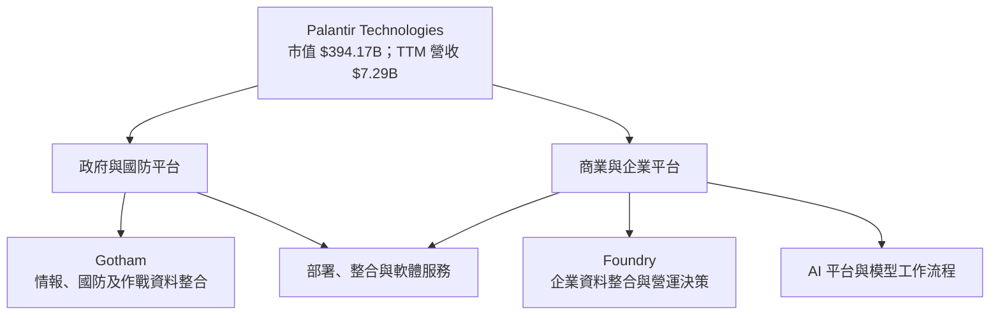
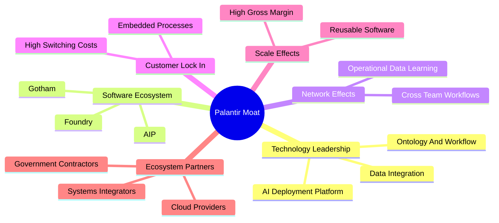
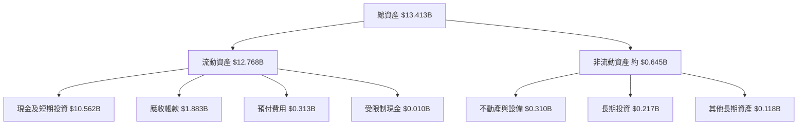
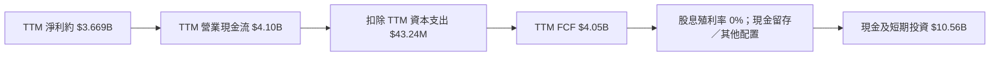
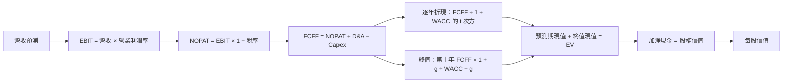
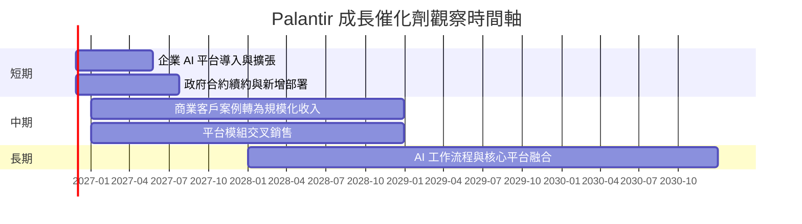
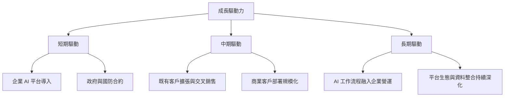
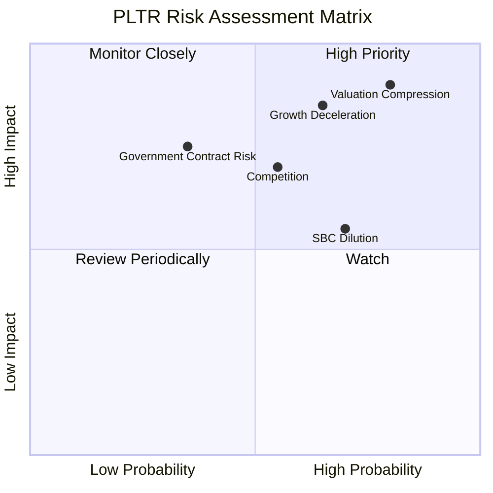
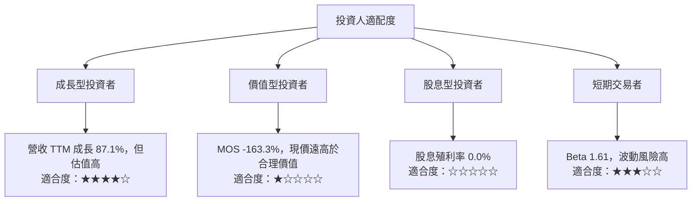

# PLTR 基本面深度分析報告
> **報告日期**：2026-11-27 ｜ **語言**：繁體中文 ｜ **數據來源**：SEC 申報資料 (XBRL)、Yahoo Finance、Finviz、StockAnalysis、Roic.ai ｜ **分析師**：CFA 級機構研究

---

## 目錄

| # | 章節 | 核心結論 |
|---|------|----------|
| 1 | 執行摘要 | 賣出；加權合理價值 $62.14，MOS -163.3% |
| 2 | 公司概覽與商業模式 | 政府與企業資料整合平台具客戶鎖定潛力，但分部收入及市場份額數據未提供 |
| 3 | 損益表深度分析 | TTM 營收 $7.29B、TTM 成長 87.1%；最新一季營業利益率 46.9% |
| 4 | 資產負債表分析 | 現金及短期投資 $10.56B；債務欄位資料存在差異，流動性充裕 |
| 5 | 現金流量深度分析 | TTM FCF $4.05B；SBC 仍是不可忽視的股東稀釋成本 |
| 6 | 獲利能力與資本效率 | 報列 ROIC 492.3% 高於 WACC 11.88%，但 ROIC 分母受大量現金影響，需審慎解讀 |
| 7 | 相對估值分析 | PLTR 估值遠高於同業銷售倍數；DCF 情境均低於現價 |
| 8 | DCF 內在價值評估 | DCF 基準值 $22.35；加權合理價值 $62.14 |
| 9 | 成長催化劑 | AI 平台商業化及政府、企業客戶擴張是主要催化劑；TAM 數據未提供 |
| 10 | 風險矩陣 | 估值回落、成長放緩及競爭加劇是主要風險 |
| 11 | 投資建議 | 依 MOS 評級為賣出；估值不足以支持現價 |

---

## 1. 執行摘要

### 1.0 一頁式投資儀表板（Portfolio Manager 30 秒速讀）

| 項目 | 內容 |
|------|------|
| **投資論點（3 句）** | ① TTM 營收 $7.29B、較前一 TTM 成長 87.1%，顯示商業化需求正在擴張。② TTM 營業利益率 45.6%、FCF $4.05B，現金獲利能力高。③ 但 2026-11-25 收盤價 $163.59，遠高於 $62.14 加權合理價值；估值風險主導報酬前景。 |
| **綜合評分** | **6.7/10**（引用 1.1 評分卡） |
| **財務健康** | 🟢 現金及短期投資 $10.56B、流動比率 7.102；債務資料來源不一致，解讀時保留限制。 |
| **ROIC vs WACC** | 492.3% vs 11.88%；表面上高於資本成本，但 ROIC 分母很小，數值可能被現金與投入資本定義放大。 |
| **FCF 趨勢** | TTM FCF $4.05B；FCF Yield 1.03%。FCF 擴大，但現價下現金流殖利率偏低。 |
| **估值** | Forward P/E 64.4x ｜ EV/EBITDA 114.4x ｜ FCF Yield 1.03%。 |
| **DCF 內在價值（基準）** | $22.35 ｜ 現價相對 DCF 溢價 **631.7%**（現價 ÷ DCF 價值 − 1）。 |
| **安全邊際（MOS）** | **-163.3%**＝($62.14 − $163.59) ÷ $62.14；基準為 8.8 加權合理價值。🔴 <10%：無安全邊際。 |
| **預期報酬（基準情境 12M）** | DCF 基準情境相對現價 **-86.3%**；此為估值情境，不代表短期價格預測。 |
| **關鍵風險（前二）** | 高估值引發倍數收縮；高成長難以延續且 SBC 稀釋股東權益。 |
| **評級 + 信心度** | 🔴 **賣出** ｜ 信心：中。依 MOS 規則直接採用，未作一級調整。 |

### 1.1 綜合評分卡（全報告唯一）

| 維度 | 評分（1–10） | 主要依據（引用數字與其來源章節） |
|------|--------------|----------------------------------|
| 成長性 | 9.0 | TTM 營收成長 87.1%、最新一季 YoY 95.9%（第 3 章）；成長速度高，但能否持續仍有不確定性。 |
| 獲利能力 | 8.0 | TTM 營業利益率 45.6%、Piotroski F-Score 7/8、報列 ROIC 492.3%（第 3、6 章）；ROIC 受分母扭曲疑慮限制。 |
| 財務健康 | 9.0 | 現金及短期投資 $10.56B、流動比率 7.102、DSO 94 天（第 4 章）；債務資料口徑不一致。 |
| 估值 | 1.0 | MOS -163.3%、Forward P/E 64.4x、P/S 歷史口徑 57.8x（第 7、8 章）；現價遠高於加權合理價值。 |
| 護城河 | 8.0 | 政府與企業資料整合、Gotham 及商業平台部署能力（第 2 章）；缺少客戶留存與分部收入數據驗證。 |
| 管理層與資本配置 | 6.0 | FY2025 SBC $684.03M、約佔營收 15.3%；稀釋股數測試未通過（第 3、6 章）。 |
| **綜合評分** | **6.8** | 六項算術平均：(9+8+9+1+8+6) ÷ 6 = 6.833，四捨五入至一位小數為 **6.8**。 |

> 儀表板所列綜合評分引用本表，採 **6.8/10**。

### 1.2 五大投資論點 + 三大核心風險

| 類型 | 項目 | 具體依據 | 信心度 |
|------|------|----------|--------|
| 🟢 **投資論點①** | 營收增長加速 | TTM 營收 $7.29B、TTM YoY 87.1%；最新一季營收 YoY 95.9%。若商業客戶導入與既有客戶擴張能延續，收入基礎仍可擴大。 | 🟢 高 |
| 🟢 **投資論點②** | 營業槓桿已顯現 | FY2025 營業利益 $1.41B，較 FY2024 $310.40M 大幅增加；TTM 營業利益率 45.6%。 | 🟢 高 |
| 🟢 **投資論點③** | 現金流與資產負債表具彈性 | TTM FCF $4.05B、現金及短期投資 $10.56B，足以支持研發與部署；不過 FCF Yield 僅 1.03%。 | 🟢 高 |
| 🟢 **投資論點④** | 軟體導入可能形成客戶鎖定 | 平台整合資料、工作流程和決策流程，切換成本可能提高；但缺少留存率、合約價值等量化數據。 | 🟡 中 |
| 🟢 **投資論點⑤** | 政府與企業市場並行 | 公司服務政府情報與國防客戶，也提供企業平台；業務結構可分散單一市場依賴，惟各板塊收入占比未提供。 | 🟡 中 |
| 🟡 **風險①** | 估值下修 | 加權合理價值 $62.14，較現價低 62.0%；DCF 基準 $22.35，現價相對 DCF 溢價 631.7%。 | 🔴 高衝擊 |
| 🔴 **風險②** | 成長預期過高 | 最新一季營收 YoY 95.9%，DCF 基準假設第一年成長 30%，但仍需保持高成長才能支撐市場估值。 | 🔴 高衝擊 |
| 🟡 **風險③** | SBC 與股數稀釋 | FY2025 SBC $684.03M，佔當年營收約 15.3%；F-Score「稀釋股數未增加」未通過。 | 🟡 中高 |

### 1.3 快速統計卡片

| 指標 | 公司實際值（期間） | 同業中位數 | 狀態 |
|------|--------------------|------------|------|
| 營收成長（TTM） | **87.1%** | — | 🟢 |
| 營收成長（最新一季年增） | **95.9%** | 35.2%（SNOW、DDOG、CRM 中位數） | 🟢 |
| 毛利率（TTM） | **84.7%** | 77.3% | 🟢 |
| 營業利益率（TTM） | **45.6%** | — | 🟢 |
| ROIC（TTM） | **492.3%** | — | 🟢* |
| Forward P/E | **64.4x** | 49.7x（同業中位數 31.0x 僅限估值法使用；三家公司中位數為 49.7x） | 🔴 |
| FCF Yield（TTM） | **1.03%** | — | 🔴 |
| Piotroski F-Score | **7 / 8** | — | 🟢 |

\* ROIC 的極高讀值受投入資本分母影響，不能與一般穩態 ROIC 直接等同。

### 1.4 投資結論

```text
╔══════════════════════════════════════════════════════════════════╗
║                    📊 投資結論摘要                               ║
╠══════════════════════════════════════════════════════════════════╣
║  評級：賣出（依規則 20；未作質化一級調整）                       ║
║  價格（2026-11-25 收盤）：$163.59                                ║
║  DCF 內在價值（基準）：$22.35（現價溢價 631.7%）                ║
║  安全邊際 MOS：-163.3%（＝(加權合理價值−現價)÷加權合理價值）    ║
║  加權合理價值（8.8）：$62.14                                     ║
║  DCF 情境價值：                                                  ║
║    悲觀情境：$13.21（-91.9%）                                    ║
║    基準情境：$22.35（-86.3%）                                    ║
║    樂觀情境：$39.16（-76.1%）                                    ║
║  綜合評分：6.8/10（引用 1.1）                                    ║
║  適合投資人：能承受高波動、重視長期平台成長且不依賴估值安全邊際者║
╚══════════════════════════════════════════════════════════════════╝
```

---

## 2. 公司概覽與商業模式

### 2.1 業務結構與收入來源

公司提供 Gotham、Foundry 等資料整合與決策軟體平台，面向政府及企業客戶。財務資料未提供政府／商業收入分拆、產品營收占比與服務收入比例，故不推算各板塊金額或占比。



### 2.2 市場份額

市場份額數據未提供，且資料中沒有可引用的 TAM 數字，因此不製作份額圖。以營收規模而言，PLTR TTM 營收 $7.29B、成長 87.1%，高於 SNOW、DDOG、CRM 最新一季 YoY 成長率 35.1%、35.2%、10.8%；但收入規模與成長率不能直接推導市場份額。

### 2.3 競爭護城河分析



### 2.4 護城河強度

| 護城河項目 | 強度（強／中／弱） | 證據（引用數字或事實） | 會削弱它的情況 |
|------------|--------------------|------------------------|----------------|
| 技術與平台整合 | 中至強 | 公司平台整合多來源資料並連接營運流程；TTM 毛利率 84.7%。 | 雲端平台或新興 AI 工具提供較低成本的整合替代品。 |
| 軟體生態系統 | 中 | Gotham、Foundry、AIP 面向不同客群與使用情境；但產品收入占比未提供。 | 產品模組化不足、第三方工具互通性提高，降低平台整體黏著度。 |
| 網路效應 | 中 | 更多資料與工作流程可提升平台對客戶的實用性；沒有跨客戶網路效應的量化數據。 | 客戶資料隔離，平台效用主要來自單一客戶內部而非跨客戶累積。 |
| 客戶鎖定 | 中至強 | 政府與企業平台若嵌入任務流程，遷移成本可能較高；留存率與續約率未提供。 | 合約到期後客戶自建、替換，或導入成本下降。 |
| 規模效應 | 中 | TTM 營業利益率 45.6%，顯示軟體營收增長可帶來營業槓桿。 | 部署與客製化服務成本隨客戶數同步上升。 |
| 生態夥伴 | 中 | 業務可與雲端、系統整合及政府承包商合作；具體夥伴收入未提供。 | 雲端供應商競爭、渠道集中或夥伴自建替代方案。 |

**護城河評分理由**：1.1 評分卡給予 8.0/10，依據是高毛利率、產品平台廣度及可能的流程嵌入；留存、續約、客戶集中度等量化資料不足，故未給更高評價。

---

## 3. 損益表深度分析

### 3.1 年度收入成長趨勢（近 4 年）

年營收：FY2022 $1.906B、FY2023 $2.225B、FY2024 $2.866B、FY2025 $4.475B。FY2022–FY2025 CAGR 約為 32.9%：\((4.475 ÷ 1.906)^{1/3}-1\)。

```text
╔══════════════════════════════════════════════════════════════════╗
║          Palantir 年度收入趨勢（FY2022–FY2025）                 ║
╠══════════════════════════════════════════════════════════════════╣
║  FY2022  $1.906B  ████████░░░░░░░░░░░░░░░░  YoY: +23.61% 🟢   ║
║  FY2023  $2.225B  ███████████░░░░░░░░░░░░░  YoY: +16.74% 🟡   ║
║  FY2024  $2.866B  ███████████████░░░░░░░░░  YoY: +28.79% 🟢   ║
║  FY2025  $4.475B  ████████████████████████  YoY: +56.18% 🟢   ║
╠══════════════════════════════════════════════════════════════════╣
║  FY2022–FY2025 三年 CAGR：約 +32.9%                              ║
╚══════════════════════════════════════════════════════════════════╝
```

FY2025 加速與 TTM 87.1% 成長一致，反映近期需求較歷史年度更快；但高基期會提高未來維持相同百分比增長的難度。

### 3.2 季度收入趨勢分析

| 季度 | 營收 | QoQ | YoY | 備註 |
|------|------:|----:|----:|------|
| 2025 Q4 | $1.407B | +19.1% | +70.0% | QoQ 以 2025 Q3 $1.181B 計算；YoY 取季度資料。 |
| 2026 Q1 | $1.633B | +16.1% | +84.7% | QoQ 以 2025 Q4 計算；企業需求延續加速。 |
| 2026 Q2 | $1.935B | +18.5% | +92.8% | QoQ 以 2026 Q1 計算。 |
| 2026 Q3 | $2.313B | +19.5% | +95.9% | 最新季度；YoY 為單季年增率，不是 TTM 成長率。 |

QoQ 公式示例：2026 Q3 \((2.313 ÷ 1.935)-1=19.5\%\)。季度成長連續上行，代表擴張不只來自年度比較基期；但單季數據可能受合約交付及認列時間影響，應追蹤後續季度是否延續。

### 3.3 利潤率演變分析

| 利潤率指標 | FY2022 | FY2023 | FY2024 | FY2025 | 趨勢 | 評估 |
|------------|-------:|-------:|-------:|-------:|------|------|
| **毛利率** | 78.5% | 80.6% | 80.3% | 82.4% | 整體上升 | 🟢 |
| **營業利益率** | -8.5% | 5.4% | 10.8% | 31.6% | 顯著改善 | 🟢 |
| **淨利率** | -19.6% | 9.4% | 16.1% | 36.3% | 顯著改善 | 🟢 |

FY2025 毛利率約為 $3.686B ÷ $4.475B = 82.4%；營業利益率約為 $1.414B ÷ $4.475B = 31.6%。TTM 營業利益率進一步達 45.6%，最新季度為 46.9%。利潤率改善與營收增長、軟體平台的高毛利特性及營業費用增長低於收入增長相符；但資料不足以分解定價、產品組合、銷售效率等各項貢獻，不能將改善全部歸因於單一因素。

### 3.4 費用結構分析

完整費用項目明細未提供；資料列出 FY2025 R&D $557.68M，但不足以構成完整費用結構，因此不畫費用比例圓餅圖。已知 FY2025 R&D 約佔營收 12.5%：$557.68M ÷ $4.475B。

```text
╔══════════════════════════════════════════════════════════════════╗
║                    FY2025 已知費用項目                           ║
╠══════════════════════════════════════════════════════════════════╣
║  研發費用 R&D：$557.68M，約佔營收 12.5%                         ║
║  其他完整營業費用明細：未提供，故不推算各項費用占比            ║
╚══════════════════════════════════════════════════════════════════╝
```

### 3.5 季度 EPS 趨勢與盈餘品質（Quality of Earnings）

最近四季 EPS 實際值為 2025 Q4 $0.23、2026 Q1 $0.34、Q2 $0.41、Q3 $0.44。EPS 估值及實際值資料庫欄位均為 NaN，因此**無法判定超預期或不及預期**；不可把 EPS 成長當成盈餘超預期證據。

| 季度 | EPS 實際值 | QoQ 變化 | YoY 變化 | 超預期／不及預期 |
|------|-----------:|---------:|---------:|------------------|
| 2025 Q4 | $0.23 | — | +647.64% | N/A：EPS 預估值缺漏 |
| 2026 Q1 | $0.34 | +47.8% | +325.00% | N/A：EPS 預估值缺漏 |
| 2026 Q2 | $0.41 | +20.6% | +215.38% | N/A：EPS 預估值缺漏 |
| 2026 Q3 | $0.44 | +7.3% | +144.44% | N/A：EPS 預估值缺漏 |

| 盈餘品質項目 | 數值／佔比 | 評估 |
|--------------|------------|------|
| 股權薪酬 SBC / 營收 | TTM SBC 約 $982.10M ÷ $7.29B = **13.5%** | 🔴 SBC 是實質股東成本；稀釋會降低每股價值。 |
| SBC / 營業現金流 | 約 $982.10M ÷ $4.10B = **23.9%** | 🟡 現金流不等於無成本盈利；SBC 加回 OCF 需連同稀釋一起看。 |
| FCF / 淨利 | 約 $4.05B ÷ $3.669B = **110.4%** | 🟢 現金轉換率高；淨利與現金流量表的期間口徑存在近似及四捨五入差異。 |
| 一次性／非經常性損益 | N/A：未提供可量化的調整項 | 無法判定是否有一次性項目顯著美化盈餘。 |
| 有效稅率 | **1.4%**（資本成本資料採最新年度有效稅率） | 🟡 稅率偏低，未來正常化稅率上升會壓低稅後現金流。 |
| 資本化支出 vs 費用化 | TTM Capex $43.24M；資本化政策細節未提供 | Capex 低不等同全部成長成本已完整反映；資本化與費用化明細不足。 |

TTM SBC 由最近四季列示值加總：$318.89M+$265.21M+$201.59M+$196.41M=$982.10M。FCF 對淨利高於 100%，是現金盈利的正面證據；但 SBC 的非現金會計處理，代表淨利與 FCF 都未直接表達股東承受的全部稀釋成本。整體 GAAP 獲利含金量不低，但應把 SBC 稀釋納入每股報酬分析。

---

## 4. 資產負債表分析

### 4.1 資產結構分解

最新資產負債表（2026-09-30）總資產 $13.413B，其中流動資產 $12.768B，非流動資產約 $0.645B。



### 4.2 流動性與營運資金分析

| 指標 | 最新 TTM | 一年前 TTM | 變化 | 解讀 |
|------|----------|------------|------|------|
| DSO 應收帳款天數 | 94 天 | 94 天 | 0 天 | 收款天數持平；應收帳款絕對金額上升，仍需比對營收與帳期變化。 |
| DIO 存貨天數 | N/A | N/A | N/A | 公司未列存貨，不應推算。 |
| DPO 應付帳款天數 | 29 天 | 33 天 | -4 天 | 付款速度較快；可能反映付款節奏變動，不能單憑天數推定議價力。 |
| CCC 現金轉換週期 | N/A | N/A | N/A | 因 DIO 缺漏，依資料口徑保留 N/A。 |

最新現金及短期投資 $10.56B；財務資料列示流動比率 7.102、速動比率 6.923，短期流動性高。DSO 持平是正面訊號，但應收帳款由 FY2025 $1.042B 增至 2026-09 $1.883B，需關注其增幅是否持續快於收入。

### 4.3 債務結構分析

債務數據有口徑差異：VERIFIED FIGURES 的 Total debt 為 N/A、Net cash 為 $10.56B；另一市場資料表列總債務 $225.27M、淨現金 $10.34B。估值模型要求採用程式計算的淨現金 $10.56B；本節不反推或混合不同口徑。

```text
╔══════════════════════════════════════════════════════════════════╗
║                 Palantir 債務健康診斷                            ║
╠══════════════════════════════════════════════════════════════════╣
║  總債務：        N/A（核心估值口徑未提供）                       ║
║  現金及短期投資：$10.56B  ████████████████████  🟢               ║
║  淨現金：        $10.56B（程式計算口徑）        🟢               ║
║  流動比率：      7.102x                        🟢               ║
║  Debt/EBITDA：   N/A（債務口徑不一致，未重算）                   ║
║  Interest Coverage：N/A（利息費用資料未提供）                   ║
╚══════════════════════════════════════════════════════════════════╝
```

### 4.4 股東權益趨勢

| 年度 | 股東權益 | YoY |
|------|---------:|----:|
| 2022 | $2.57B | — |
| 2023 | $3.48B | +35.4% |
| 2024 | $5.00B | +43.7% |
| 2025 | $7.39B | +47.8% |

```text
╔══════════════════════════════════════════════════════════════════╗
║                    股東權益變化                                  ║
╠══════════════════════════════════════════════════════════════════╣
║  FY2022  $2.57B  ████████░░░░░░░░░░░░░░░░                        ║
║  FY2023  $3.48B  ███████████░░░░░░░░░░░░░                        ║
║  FY2024  $5.00B  ████████████████░░░░░░░░                        ║
║  FY2025  $7.39B  ████████████████████████                        ║
╚══════════════════════════════════════════════════════════════════╝
```

股東權益增加與盈利留存及資本累積相符；但每股股東價值仍需扣除 SBC 帶來的股數稀釋影響。

---

## 5. 現金流量深度分析

### 5.1 現金流量瀑布圖



### 5.2 FCF 轉換率趨勢

| 財年 | FCF | 淨利 | FCF / 淨利 |
|------|----:|-----:|-----------:|
| 2022 | $183.71M | -$373.70M | 不具解讀性：淨利為負 |
| 2023 | $697.07M | $209.82M | 332.2% |
| 2024 | $1.14B | $462.19M | 約 246.7% |
| 2025 | $2.10B | $1.63B | 約 128.8% |
| TTM 至 2026-09-30 | $4.05B | 約 $3.669B | 約 110.4% |

FCF 與淨利均上升，但轉換率由早期高值逐步回落，部分原因是較低的歷史淨利基數使比率容易偏高；近 TTM 仍略高於 100%。

### 5.3 自由現金流趨勢

```text
╔══════════════════════════════════════════════════════════════════╗
║                    歷史 FCF 趨勢                                 ║
╠══════════════════════════════════════════════════════════════════╣
║  FY2022  $0.184B  ██░░░░░░░░░░░░░░░░░░░░░░                       ║
║  FY2023  $0.697B  ████████░░░░░░░░░░░░░░░░                       ║
║  FY2024  $1.14B   █████████████░░░░░░░░░░                       ║
║  FY2025  $2.10B   ████████████████████████                       ║
║  TTM     $4.05B   FCF Yield：1.03%                                ║
╚══════════════════════════════════════════════════════════════════╝
```

FY2022 至 FY2025 FCF 約由 $183.71M 增至 $2.10B，期間 CAGR 約 125%；此增速受早期低基數影響，不應線性外推。TTM FCF Yield 只有 1.03%，顯示現價已預先反映相當高的未來現金流成長。

### 5.4 資本配置評估

資料沒有完整回購、收購、研發現金支出與留存現金拆分，故不製作比例圓餅圖。FY2025 SBC 為 $684.03M、Capex 為 $33.88M、股息殖利率為 0%；公司持有大量現金，投資人應關注未來現金如何配置、以及是否以股權薪酬而非現金支付形成稀釋。

| 配置項目 | 已知數據 | 評估 |
|----------|----------|------|
| 資本支出 | FY2025 $33.88M；TTM $43.24M | 相對 FCF 低；資產輕，但需確認研發及部署投資不只反映在 Capex。 |
| 股息 | 殖利率 0.0% | 目前不以現金股息回饋股東。 |
| SBC | FY2025 $684.03M | 股東稀釋成本顯著。 |
| 回購／收購 | N/A：明細未提供 | 不對資本配置成效作無數據推斷。 |

---

## 6. 獲利能力與資本效率

### 6.1 ROE / ROA / ROIC 趨勢

| 指標 | 歷史／最新數據 | 評估 |
|------|----------------|------|
| ROE | TTM 品質指標 32.7%；另一市場資料列示 40.9% | 來源口徑不同；採品質指標計算的 DuPont 數值作本報告分解。 |
| ROA | TTM 19.3%（市場資料） | 正向，顯示資產盈利能力提升。 |
| ROIC | TTM 492.3%（指定計算口徑） | 遠高於 WACC，但投入資本分母可能很小，不宜解讀成穩態回報率。 |
| 行業均值比較 | N/A | 未提供可核實的同口徑行業均值，不填入估計值。 |

### 6.2 ROIC vs WACC 分析（核心價值創造判斷）

```text
╔══════════════════════════════════════════════════════════════════╗
║                ROIC vs WACC 深度分析                            ║
╠══════════════════════════════════════════════════════════════════╣
║  資本成本（直接採用程式計算值）：                                ║
║  ├── 無風險利率（10Y 美債）：       4.85%                        ║
║  ├── 市場風險溢酬 ERP：              5.00%                        ║
║  ├── 原始 Beta：                     1.61                         ║
║  ├── 調整後 Beta：                   1.41                         ║
║  ├── 股權成本 Ke：                   11.88%                       ║
║  ├── 稅前債務成本：                  6.85%（假設值）             ║
║  ├── E / D 權重：                    99.9% / 0.1%                 ║
║  └── WACC：                          11.88%                       ║
║                                                                  ║
║  ROIC（TTM，指定口徑）：             492.3%                       ║
║  ROIC − WACC：                       +480.42 個百分點             ║
║                                                                  ║
║  ROIC 492.3%  ━━━━━━━━━━━━━━━━━━━━━━━━━━━━━━━  🟢              ║
║  WACC  11.88% ━━━━━━━━━━━━━━━━━━━━━━━━━━━━━━━  ──              ║
║  EVA spread +480.42pp：表面上大幅高於資本成本                    ║
╚══════════════════════════════════════════════════════════════════╝
```

ROIC 及 WACC 均採指定的同一數值。WACC 輸入指出調整後 Beta 為 1.41，按規則使用調整值；顯示值 4.85% + 1.41×5.00% = 11.90%，與資料庫給定 Ke 11.88% 相差 0.02 個百分點，應是底層精度差異，故不自行替換官方採用值。另，ROIC 公式的投入資本為權益加債務減現金；現金龐大可能令分母很小，因此 492.3% 並非可直接外推的經濟回報率。結論是「指定公式下高於資本成本」，但經濟價值創造程度的量級需以更穩健的平均投入資本資料驗證。

### 6.3 杜邦三因素分解

| 因素 | 數值（TTM） | 解讀 |
|------|-------------|------|
| 淨利率 | 50.3% | 高淨利率是 ROE 的主要來源。 |
| 資產週轉率 | 0.54 | 每單位資產對應營收約 0.54 倍。 |
| 權益乘數 | 1.19 | 槓桿有限，ROE 並非主要靠財務槓桿推高。 |
| **ROE** | **32.7%** | 50.3% × 0.54 × 1.19 ≈ 32.7%；小幅尾差來自四捨五入。 |

### 6.4 財務體質：Piotroski F-Score

Piotroski F-Score 為 **7/8**；一項測試因缺少輸入而不納入分母，故不是 9 項制的 7/9。

| 測試 | 結果 | 解讀 |
|------|------|------|
| ROA > 0 | ✅ 通過 | TTM 獲利為正。 |
| 營業現金流 > 0 | ✅ 通過 | TTM OCF $4.10B。 |
| ROA 高於一年前 | ✅ 通過 | 盈利能力改善。 |
| 營業現金流 > 淨利 | ✅ 通過 | 應計品質指標通過。 |
| 長期負債 ÷ 總資產低於一年前 | — 無法判定 | 缺少一致期間長期負債資料。 |
| 流動比率高於一年前 | ✅ 通過 | 流動性改善。 |
| 稀釋股數未增加 | ❌ 未通過 | 股數稀釋仍是股東回報的風險。 |
| 毛利率高於一年前 | ✅ 通過 | 毛利率上升。 |
| 資產週轉率高於一年前 | ✅ 通過 | 資產使用效率改善。 |

---

## 7. 相對估值分析

### 7.1 同業估值比較表格

同業數值採 Yahoo Finance 同業資料；本公司市盈率取市場估值資料，Forward P/E 與同業銷售倍數作交叉比較。SNOW TTM P/E 不適用，EV/EBITDA 為負值，不具正常盈利倍數解讀。

| 估值指標 | **PLTR** | **SNOW** | **DDOG** | **CRM** | 本公司評估 |
|----------|--------:|--------:|--------:|-------:|-----------|
| **Trailing P/E** | 115.2x | N/A | 219.8x | 18.0x | 🔴 高於 CRM；低於 DDOG，但公司成長差異不可忽略。 |
| **Forward P/E** | 64.4x | 86.6x | 49.7x | 12.3x | 🔴 位於同業高位；低於 SNOW、高於 DDOG 與 CRM。 |
| **P/S Ratio** | 54.1x* | 17.4x | 13.4x | 3.7x | 🔴 顯著溢價；需依靠更長期高成長消化。 |
| **EV/EBITDA** | 114.4x* | -91.5x | 312.5x | 15.0x | 🟡 PLTR 低於 DDOG、高於 CRM；SNOW 負值不可直接比較。 |
| **最新季度營收 YoY** | 95.9% | 35.1% | 35.2% | 10.8% | 🟢 成長明顯較快，但高成長不會自動消除估值風險。 |
| **TTM 毛利率** | 84.7% | 67.0% | 79.6% | 77.3% | 🟢 高於三家同業。 |

\* 市場估值快照列 P/S 54.08283x、EV/EBITDA 114.431x；自身歷史估值資料另列 P/S 57.8x、EV/EBITDA 122.3x。口徑與資料快照不同，歷史比較採第 7.2 節指定數值。

### 7.2 歷史估值區間分析

```text
╔══════════════════════════════════════════════════════════════════╗
║              PLTR 歷史估值區間（TTM，5 年）                     ║
╠══════════════════════════════════════════════════════════════════╣
║  P/E       100.6x ├────● 現值 115.2x ─────────────────┤ 601.0x  ║
║                    歷史中位數 228.6x；目前百分位 7%              ║
║  P/S         7.0x ├────────────────● 57.8x────────────┤ 120.4x  ║
║                    歷史中位數 24.7x；目前百分位 67%              ║
║  EV/EBITDA 109.0x ├────● 現值 122.3x ────────────────┤ 574.4x  ║
║                    歷史中位數 233.4x；目前百分位 8%              ║
╚══════════════════════════════════════════════════════════════════╝
```

P/E 與 EV/EBITDA 當前處於自身五年區間低百分位，主要是相對極端歷史高值而言；P/S 仍高於歷史中位數 24.7x，且處於 67 百分位。歷史區間本身估值極高，低百分位不代表絕對便宜。

### 7.3 情境價值（Bear / Base / Bull）

| 情境 | 第 1 年營收成長 | 期末營業利潤率 | WACC | 每股價值 | 相對現價 | 機率 | 會發生的條件 |
|------|----------------:|----------------:|-----:|----------:|---------:|-----:|--------------|
| 🔴 悲觀 | 15.0% | 9.2% | 12.88% | $13.21 | -91.9% | 25% | 商業化增速明顯降溫，競爭壓低長期利潤率，風險溢價上升。 |
| 🟡 基準 | 30.0% | 10.8% | 11.88% | $22.35 | -86.3% | 50% | 成長由高基期逐步降速，營業利潤率長期回歸模型採用水準。 |
| 🟢 樂觀 | 45.0% | 11.9% | 10.88% | $39.16 | -76.1% | 25% | AI 商業化加速、收入持續超預期，資本成本下降。 |

上述情境來自 DCF 模型輸出；三個情境價值均遠低於 $163.59 現價，顯示估值安全邊際不足。

### 7.4 相對估值隱含價格區間

```text
╔══════════════════════════════════════════════════════════════════╗
║            估值方法回推每股價值與現價                            ║
╠══════════════════════════════════════════════════════════════════╣
║  $22.35 ───── $62.14 ───────────────── $163.59 ───── $222.90    ║
║   DCF 基準      加權合理價值               現價       分析師共識 ║
║                                                                  ║
║  同業 Forward P/E：$78.73                                        ║
║  依據：同業中位數 31.0x × 公司 Forward EPS $2.54                 ║
╚══════════════════════════════════════════════════════════════════╝
```

同業 Forward P/E 價值按提供的估值方法為 $78.73；其參考同業為 DDOG 與 CRM，peer median 31.0x，乘公司 Forward EPS $2.54。該方法仍低於現價，且 forward EPS 與市價變動會使回推值更新。

---

## 8. DCF 內在價值評估（Discounted Cash Flow）

> 以下估值數字採用程式計算的 DCF 模型；不另建模型。顯示值採模型原列數字，金額以 $B 表示、折現因子保留三位小數。表內因四捨五入可能有小額尾差。

### 8.0 估值推理鏈（Thinking Logic）

**Step 1 — 價值由哪些變數決定？**  
公司價值主要由政府軟體平台、商業軟體平台及 AI 工作流程商業化決定；但政府／商業分部營收占比均未提供，不能量化分拆。DCF 的收入基礎為 TTM $7.29B，TTM 營業利益率 45.6%。模型最敏感的是長期營收與利潤率路徑，以及 WACC；敏感度表顯示 WACC、永續成長率會改變終值現值。

**Step 2 — 模型選擇**

| 決策點 | 本報告採用 | 理由 | 曾考慮但否決 | 否決理由 |
|--------|-----------|------|--------------|----------|
| 現金流定義 | FCFF | 以 WACC 折現後得企業價值，再加淨現金橋接股權價值。 | FCFE | 資本結構及利息資料有限；模型已指定 FCFF。 |
| 預測期 N | 10 年 | DCF 模型固定 10 年，讓高速成長逐步衰減至終值。 | 5 年 | 模型並未提供 5 年估值輸出，不自行改建。 |
| 終值方法 | Gordon Growth | 模型提供永續成長率 3.0% 及 TV。 | 退出倍數 | DCF 模型未提供可核實退出倍數，不能另造。 |
| EBIT 基礎 | GAAP EBIT | 模型明列 GAAP EBIT。 | 非 GAAP EBIT | 避免 SBC 被加回後漏計股東成本。 |

**Step 3 — 主要假設推導鏈**

- **營收成長**：錨點為 TTM YoY 87.1%、最新季度 YoY 95.9%；模型把第一年成長限制在 0%–30%，反映高基期後增速回落 → **採用第一年 30.0%，逐年線性降至第十年 3.0%** → 不採用持續 87.1%，因那會把單一高增長期直接延長十年。
- **營業利潤率**：錨點為 TTM 45.6%；模型以過去五個財年的中位水平作長期收斂參考，逐年由 45.6% 降至 **第十年 10.8%** → 不採用長期維持 45.6%，因成熟期競爭與費用投入可能侵蝕利潤。
- **永續成長率 g**：採用 **3.0%**，為模型給定值，低於 WACC 11.88%；不採用高於 3.0% 的永續增長，避免長期成長假設超出宏觀可持續範圍。
- **預測期 N**：採用 **10 年**，模型提供逐年預測；未改採更短期，因現有模型沒有相應輸出。
- **Capex / 營收**：TTM Capex $43.24M、TTM 營收 $7.29B，模型採用約 **0.6% 起始、逐步降至 0.4%**；不採用更高比例，因現有資本支出率低，但此假設可能低估未來基礎設施需求。
- **EBIT 基礎與 SBC**：採用 GAAP EBIT，且 SBC 已作費用列入 EBIT；不再扣 SBC，也不再另計年股數稀釋。
- **年稀釋率**：模型採固定股數口徑，沒有額外放大股數；否決另加稀釋率，以避免與 GAAP EBIT 已扣 SBC 重複計算。這是模型口徑，並不表示實際稀釋不存在。
- **終值方法**：採 Gordon Growth，因模型提供 FCFF、WACC 與 g；不另設退出倍數，因無模型輸入可直接引用。
- **WACC**：採用資本成本資料指定的 **11.88%**；不另行重估，以維持與模型一致。風險是長期無形資產公司股權風險溢酬可能變動。

**Step 4 — 最脆弱假設**  
最脆弱的是高成長向成熟增長的轉換及長期 GAAP 利潤率路徑；若收入成長或利潤率低於模型，價值會下降，情境表悲觀值為 $13.21。

**Step 5 — 計算路徑**



### 8.1 模型假設總表（Model Inputs）

| 假設項目 | 採用值 | 依據／來源 | 敏感度 |
|----------|--------|-------------|--------|
| 預測期長度 N | 10 年 | DCF 模型指定；FY+1 至 FY+10。 | 🟡 中 |
| 營收成長 | 第一年 30.0%，第十年 3.0%，線性遞減 | TTM 成長 87.1%；模型限制第一年在 0%–30%。 | 🔴 高 |
| 營業利潤率 | 45.6% 降至 10.8% | 起點為 TTM 營業利潤率，終點為模型指定五年中位水準。 | 🔴 高 |
| 有效稅率 | 1.4% | 最新年度有效稅率；屬低稅率假設，未來可能正常化。 | 🟢 低 |
| Capex / 營收 | 0.6% 降至 0.4% | TTM Capex / Revenue 約 0.6%；模型逐步淡出。 | 🟡 中 |
| D&A / 營收 | 0.4% | 模型採 TTM 比率固定。 | 🟢 低 |
| 營運資金變動 | 未建模 | DCF 模型明列 Working capital is not modelled。 | 🟢 低 |
| EBIT 基礎 | GAAP EBIT | DCF 模型指定，SBC 已在費用中。 | 🟡 中 |
| SBC 處理 | 不重複扣除 | GAAP EBIT 已含 SBC，股數不再另行稀釋。 | 🟡 中 |
| 年稀釋率 | 0%（模型固定股數） | 模型指定「share count is not diluted further」。 | 🟡 中 |
| 永續成長率 g | 3.0% | 模型指定；低於 WACC。 | 🔴 高 |
| 終值方法 | Gordon Growth | 模型指定終值計算。 | 🔴 高 |
| WACC | 11.88% | 直接採資本成本資料。 | 🔴 高 |

模型公式為 `FCFF = NOPAT + D&A − Capex`，沒有 ΔWC 列。**本模型採用組合 (A)：GAAP EBIT + 固定股數；EBIT 已含 SBC 費用，因此不另扣 SBC，也不額外放大股數。SBC 影響在模型中計入一次。**

### 8.2 折現率推導（WACC）

```text
╔══════════════════════════════════════════════════════════════════╗
║                    WACC 推導（折現率）                           ║
╠══════════════════════════════════════════════════════════════════╣
║  股權成本 Ke（CAPM，採資料庫給定值）：                           ║
║  ├── 無風險利率 Rf：                  4.85%                      ║
║  ├── ERP：                            5.00%（假設值）            ║
║  ├── 原始 Beta：                      1.61                       ║
║  ├── 調整後 Beta：                    1.41                       ║
║  ├── Beta 調整：                      ⅔ × 1.61 + ⅓ × 1 = 1.41   ║
║  └── Ke（資料庫值）：                 11.88%                     ║
║                                                                  ║
║  債務成本：                                                     ║
║  ├── 稅前 Kd：                        6.85%（假設值：Rf + 信差）║
║  ├── 有效稅率：                       1.4%                      ║
║  └── 稅後 Kd：                        6.85% × (1 − 1.4%)       ║
║                                      = 6.7531%                  ║
║                                                                  ║
║  資本結構：                                                       ║
║  ├── 股權權重 E：                     99.9%                      ║
║  ├── 債務權重 D：                     0.1%                       ║
║  └── 採用 WACC：                      11.88%                     ║
╚══════════════════════════════════════════════════════════════════╝
```

逐步演算：

1. **Ke**：資料庫採用 \(Rf+\beta\times ERP\)，輸入為 4.85%、調整後 Beta 1.41、ERP 5.00%；展示值代入為 \(4.85\%+1.41\times5.00\%=11.90\%\)，與程式給定 Ke 11.88% 差 0.02 個百分點，屬輸入底層精度差異；依規則採用程式給定值 **11.88%**。
2. **稅前 Kd**：假設值 6.85%；利息費用與平均計息負債明細未提供，因此不能以利息費用除平均負債推算。
3. **稅後 Kd**：\(6.85\%\times(1-1.4\%)=6.7531\%\)。
4. **權重**：股權 99.9%、債務 0.1%，合計 \(99.9\%+0.1\%=100.0\%\)。市值為 $394.17B；債務權重為模型資本結構輸入，因債務市值與計息負債定義資料不全，不以別的債務口徑替換。
5. **WACC**：以展示值計算 \(99.9\%\times11.88\%+0.1\%\times6.7531\%=11.8749\%\)，四捨五入為 11.87%；模型給定值為 **11.88%**。由於底層精度及權重顯示位數，後續統一採模型 WACC 11.88%，與第 6.2 節一致。

### 8.3 逐年自由現金流預測（基準情境）

金額單位：$B。表中數字照模型輸出；ΔWC 未建模。

| 年度 | FY+1 | FY+2 | FY+3 | FY+4 | FY+5 | FY+6 | FY+7 | FY+8 | FY+9 | FY+10 |
|------|-----:|-----:|-----:|-----:|-----:|-----:|-----:|-----:|-----:|------:|
| 營收 | 9.47 | 12.03 | 14.92 | 18.05 | 21.30 | 24.50 | 27.44 | 29.91 | 31.70 | 32.65 |
| 營收 YoY | 30.0% | 27.0% | 24.0% | 21.0% | 18.0% | 15.0% | 12.0% | 9.0% | 6.0% | 3.0% |
| 營業利潤率 | 45.6% | 41.8% | 37.9% | 34.0% | 30.2% | 26.3% | 22.4% | 18.6% | 14.7% | 10.8% |
| EBIT | 4.32 | 5.03 | 5.66 | 6.14 | 6.43 | 6.44 | 6.16 | 5.55 | 4.66 | 3.54 |
| − 稅 | (0.06) | (0.07) | (0.08) | (0.08) | (0.09) | (0.09) | (0.08) | (0.08) | (0.06) | (0.05) |
| NOPAT | 4.26 | 4.96 | 5.58 | 6.06 | 6.34 | 6.36 | 6.07 | 5.48 | 4.60 | 3.49 |
| + D&A | 0.04 | 0.05 | 0.06 | 0.07 | 0.08 | 0.10 | 0.11 | 0.12 | 0.13 | 0.13 |
| − Capex | (0.06) | (0.07) | (0.08) | (0.10) | (0.11) | (0.12) | (0.13) | (0.14) | (0.14) | (0.14) |
| **FCFF** | **4.25** | **4.94** | **5.55** | **6.03** | **6.31** | **6.33** | **6.05** | **5.45** | **4.58** | **3.48** |
| 折現因子 | 0.894 | 0.799 | 0.714 | 0.638 | 0.571 | 0.510 | 0.456 | 0.407 | 0.364 | 0.325 |
| **FCFF 現值 PV** | **3.80** | **3.94** | **3.97** | **3.85** | **3.60** | **3.23** | **2.76** | **2.22** | **1.67** | **1.13** |

預測期現值加總：  
`$3.80 + $3.94 + $3.97 + $3.85 + $3.60 + $3.23 + $2.76 + $2.22 + $1.67 + $1.13 = $30.17B`  
模型列示合計為 **$30.16B**，差異約 0.03%，屬年度數字四捨五入尾差；後續橋接照模型原值 $30.16B。

**FY+1 逐步演算**（模型原列數字為四捨五入值）：

1. 營收：$7.29B × (1+30.0%) = $9.477B，模型列示 $9.47B。
2. EBIT：$9.47B × 45.6% = $4.318B，模型列示 $4.32B。
3. 稅：$4.32B × 1.4% = $0.0605B，列示 $0.06B。
4. NOPAT：$4.32B − $0.06B = $4.26B。
5. D&A：$9.47B × 0.4% = $0.0379B，列示 $0.04B。
6. Capex：$9.47B × 約 0.6% = 約 $0.06B。
7. ΔWC：模型不建模，未列入 FCFF。
8. FCFF：依未四捨五入模型輸入計算為 $4.25B；表面上用已四捨五入列值 \(4.26+0.04-0.06=4.24\)，差額為顯示精度造成。
9. 折現因子：\(1÷(1+11.88\%)^1=0.894\)；PV：$4.25B × 0.894 = $3.80B。

**合理性自檢**

- 歷史 FY2022–FY2025 FCF CAGR 約 125%；模型 FY+1 至 FY+10 FCF 由 $4.25B 變 $3.48B，非持續高速增長假設，末年低於初年。
- FY+10 FCFF 利潤率 \(3.48÷32.65=10.7\%\)；TTM FCF 利潤率 \(4.05÷7.29=55.6\%\)。模型假設營業利潤率大幅回歸，且與當前 FCF 利潤率口徑不同，兩者不可直接視為同一利潤率。
- 模型每年 FCFF 均為正；由於 ΔWC 未建模，現金流可能未反映營收擴張所需的營運資金。

```text
╔══════════════════════════════════════════════════════════════════╗
║            自由現金流：歷史實際 vs 模型預測                      ║
╠══════════════════════════════════════════════════════════════════╣
║  FY2023(實)  $0.697B  ████░░░░░░░░░░░░░░░░  YoY: +279.4%       ║
║  FY2024(實)  $1.14B   ██████░░░░░░░░░░░░░░  YoY: 約 +63.5%     ║
║  FY2025(實)  $2.10B   ███████████░░░░░░░░░  YoY: 約 +84.2%     ║
║  FY+1 (預)   $4.25B   ████████████████████████  模型值          ║
║  FY+10(預)   $3.48B   ████████████████████  末年值              ║
╠══════════════════════════════════════════════════════════════════╣
║  歷史增速含低基期效應；不可把 FY2022–FY2025 CAGR 外推至未來。  ║
╚══════════════════════════════════════════════════════════════════╝
```

### 8.4 終值計算（Terminal Value）

**適用性檢查**：WACC 11.88% vs g 3.0% → **WACC > g ✅**

| 方法 | 計算式 | 終值 TV | TV 現值 | 佔總 EV 比重 |
|------|--------|---------:|--------:|-------------:|
| Gordon Growth | FCFF(FY+10) × (1+g) ÷ (WACC−g) | $40.32B | $13.12B | 30.3% |
| 退出倍數法 | N/A | N/A：模型未提供退出倍數 | N/A | N/A |

終值計算逐步演算：

1. FY+N FCFF：FY+10 FCFF = **$3.48B**。
2. 分子：$3.48B × (1+3.0%) = **$3.5844B**。
3. 分母：11.88% − 3.0% = **8.88%**；以顯示值計算 TV 約 $3.5844B ÷ 8.88% = $40.36B，模型原列 **$40.32B**；差額小於 1%，來自底層未四捨五入現金流。
4. PV(TV)：模型原值 $40.32B × 0.325 = **$13.12B**（依未四捨五入折現因子）。
5. 終值佔 EV：$13.12B ÷ $43.29B = **30.3%**（依模型原列）。

### 8.5 企業價值 → 每股內在價值（Bridge）

```text
╔══════════════════════════════════════════════════════════════════╗
║              企業價值 → 每股內在價值 橋接表                      ║
╠══════════════════════════════════════════════════════════════════╣
║  預測期 FCF 現值合計            +$30.16B                         ║
║  終值現值 PV(TV)                +$13.12B                         ║
║  = 企業價值 EV                   $43.29B                         ║
║  + 淨現金                       +$10.56B                         ║
║  = 股權價值                      $53.85B                         ║
║  每股內在價值                    $22.35                          ║
║  2026-11-25 收盤價               $163.59                         ║
║  DCF 折溢價                      +631.7% 溢價                    ║
╚══════════════════════════════════════════════════════════════════╝
```

1. **EV**：$30.16B + $13.12B = $43.28B；模型列 $43.29B，為各分項未四捨五入前加總差異。
2. **股權價值**：$43.29B + $10.56B = **$53.85B**。
3. **每股價值**：模型指定公式為股權價值 × 價格 ÷ 市值：\($53.85B×$163.59÷$394.17B\) = **$22.35**。
4. **折溢價**：$163.59 ÷ $22.35 − 1 = **+631.7% 溢價**；模型另以內在價值相對現價表示為 -86.3%。
5. 本節不計算 MOS；MOS 僅在 8.8 以加權合理價值作分母計算。

股權價值橋接採 DCF 模型淨現金 $10.56B；該值取自 2026-09-30 財務資料。模型未提供總債務拆分與稀釋股數明細；每股價值按模型指定的價格／市值比率換算，沒有另行假設股數。

### 8.6 敏感性分析（WACC × 永續成長率）

| g（列）／WACC（欄） | 9.88% | 10.88% | **11.88%（基準）** | 12.88% | 13.88% |
|-----------|------:|-------:|------------------:|-------:|-------:|
| 2.0% | $25.29 (-84.5%) | $23.34 (-85.7%) | $21.75 (-86.7%) | $20.43 (-87.5%) | $19.30 (-88.2%) |
| 2.5% | $25.82 (-84.2%) | $23.72 (-85.5%) | $22.03 (-86.5%) | $20.64 (-87.4%) | $19.47 (-88.1%) |
| **3.0%** | $26.43 (-83.8%) | $24.15 (-85.2%) | **$22.35 (-86.3%)** | $20.88 (-87.2%) | $19.65 (-88.0%) |
| 3.5% | $27.13 (-83.4%) | $24.64 (-84.9%) | $22.70 (-86.1%) | $21.14 (-87.1%) | $19.85 (-87.9%) |
| 4.0% | $27.96 (-82.9%) | $25.20 (-84.6%) | $23.10 (-85.9%) | $21.43 (-86.9%) | $20.07 (-87.7%) |

矩陣中的括號上行空間以現價 $163.59 為分母，依公式 \((估值−現價)÷現價\) 計算。模型直接提供矩陣，本報告不自行重建各格。

**模型輸出限制**：矩陣只提供結果，沒有各敏感性格的逐年折現現值及終值中間表，因此無法在不自建模型的情況下展示完整重算。基準格 $22.35 與 8.5 一致；非基準格按模型原值引用。

**三情境 DCF**

| 情境 | 第一年營收成長 | 期末營業利潤率 | 永續成長 g | WACC | 每股價值 | 相對現價 | 主觀機率 |
|------|----------------:|----------------:|-----------:|-----:|----------:|---------:|---------:|
| 🔴 悲觀 | 15.0% | 9.2% | 模型情境未另列 | 12.88% | $13.21 | -91.9% | 25% |
| 🟡 基準 | 30.0% | 10.8% | 3.0%（基準） | 11.88% | $22.35 | -86.3% | 50% |
| 🟢 樂觀 | 45.0% | 11.9% | 模型情境未另列 | 10.88% | $39.16 | -76.1% | 25% |
| **機率加權** | — | — | — | — | **$24.27** | **-85.2%** | **100%** |

情境中間的 FY+10 營收、FCFF 及終值拆分未由模型區塊提供；依規則不自行推導或補造。機率加權算式：$13.21×25% + $22.35×50% + $39.16×25% = **$24.27**（採模型列示值）。

**敏感度結論**

- g 由 2.0% 升至 4.0%、WACC 維持 11.88%：$21.75 → $23.10，增加 **$1.35**，約 **+6.2%**。
- WACC 由 11.88% 升至 12.88%、g 維持 3.0%：$22.35 → $20.88，減少 **$1.47**，約 **-6.6%**。
- 期末營業利潤率每 +1 個百分點的獨立敏感度：**N/A（模型沒有提供該敏感度矩陣）**。
- 在已提供的 g/WACC 測試範圍中，WACC 變動的每百分點影響略大於 g 變動；公司營收與利潤率仍是情境表的重要營運驅動因素。

### 8.7 反推 DCF（Reverse DCF：市場在預期什麼）

反推模型一次只求解一個變數。模型結果指出，年一營收成長率與固定營業利潤率在指定搜索範圍內均無解，不能把現價解讀成模型內某個可複算的單一營運假設。

| 求解的變數（一次一個） | 其餘變數設定 | 市場隱含值（令 DCF = 現價） | 公司歷史實際 | 判斷 |
|------------------------|--------------|------------------------------|--------------|------|
| 第一年營收成長率 | 其餘採基準值 | **無解：-10% 至 100% 範圍內** | TTM 成長 87.1% | 現價不能由此單一變數在該區間解釋。 |
| 固定營業利潤率 | 其餘採基準值 | **無解：0.5% 至 95% 範圍內** | TTM 營業利益率 45.6% | 現價不能由此單一變數在該區間解釋。 |
| 永續成長率 g | 模型未提供解 | 未計算 | — | N/A |
| 預測期 N | 模型未提供解 | 未計算 | — | N/A |

模型沒有提供可引用的反推試算軌跡，且明確標記上述兩變數無解，因此不呈現虛構的試算表或收斂值。反推結果指向：現價包含基準 DCF 無法以單一營收成長或單一固定利潤率解釋的高估值成分。

### 8.8 估值三角驗證與安全邊際

| 估值方法 | 隱含每股價值 | 上行空間（÷現價） | 權重 | 說明 |
|----------|--------------:|-------------------:|-----:|------|
| DCF（基準） | $22.35 | -86.3% | 55% | 10 年 FCFF、WACC 11.88%、g 3.0%。 |
| 同業 Forward P/E | $78.73 | -51.9% | 35% | 同業中位數 31.0x × 公司 Forward EPS $2.54。 |
| 分析師共識目標價 | $222.90 | +36.3% | 10% | 29 位分析師平均目標價，作參考。 |
| **加權合理價值** | **$62.14** | **-62.0%** | **100%** | 依獲利型公司固定權重。 |

加權算式：  
\[
\$22.35\times55\%+\$78.73\times35\%+\$222.90\times10\%
=\$12.2925+\$27.5555+\$22.2900
=\$62.1380\approx\mathbf{\$62.14}
\]

未能計算的同業 EV/EBITDA 方法，其權重已依估值方法程序分配給可計算方法；表中列示的權重合計 100%。加權價值保留算術總和，不作事後調整。

```text
╔══════════════════════════════════════════════════════════════════╗
║                  估值區間與安全邊際                              ║
╠══════════════════════════════════════════════════════════════════╣
║  $13.21 ───── $22.35 ───── $62.14 ─────────── $163.59 ─ $222.90║
║  悲觀DCF      基準DCF      加權合理值          現價      共識目標║
║                                                                  ║
║  安全邊際 MOS = ($62.14 − $163.59) ÷ $62.14 = -163.3%          ║
║  MOS 評估：🔴 無安全邊際                                       ║
║  上行空間 = ($62.14 − $163.59) ÷ $163.59 = -62.0%              ║
║                                                                  ║
║  建議買入區間：不建議在現價建立新倉；規則 20 評級為賣出         ║
║  合理持有／減碼：現價高於加權合理價值，依持倉與風險承受度評估    ║
╚══════════════════════════════════════════════════════════════════╝
```

MOS 與上行空間使用不同分母：MOS 以加權合理價值 $62.14 為分母；上行空間以現價 $163.59 為分母。兩者均與 1.0 儀表板一致。

> 🔎 **程式複算（Python，依本節各項自動重算）**
>
> 加權合理價值 = $22.35 × 55% + $78.73 × 35% + $222.90 × 10% = **$62.14**（權重合計 100%）
>
> 以價格 $163.59 計：MOS = **-163.3%**，上行空間 = **-62.0%**
>
> ✅ 與本節所寫數值一致。

### 8.9 DCF 模型的局限與失效條件

- **終值依賴度**：終值現值佔 EV 30.3%，估值有相當部分來自第十年後假設，但非主要價值來源。
- **最脆弱假設**：營收成長由第一年 30.0% 逐步降至第十年 3.0%；若客戶導入或商業化弱於預期，現值向悲觀情境 $13.21 靠近。長期營業利潤率由 45.6% 降至 10.8%，若成熟期利潤率高於此假設，價值可能上升；若競爭令毛利與營業槓桿逆轉，則相反。
- **SBC 與稀釋限制**：模型採 GAAP EBIT 並固定股數，沒有再計未來股數增加。此處避免 SBC 重複扣除，但實際稀釋若持續，模型每股價值可能偏高。
- **營運資金限制**：模型不計 ΔWC；DSO 94 天、應收帳款增加可能代表現金流與收入認列間的時差，若營運資金需求增加，FCFF 會低於模型。
- **稅率限制**：採 1.4% 有效稅率；若未來稅率回歸較高水平，NOPAT 與 DCF 價值會下降。
- **與第 10 章風險的連結**：競爭與成長放緩衝擊營收成長、毛利與營業利潤率；市場利率或風險溢酬上升會提高 WACC；SBC 增加會削弱每股價值。

### 8.10 複算檢核表（Audit Trail）

| # | 檢核項目 | 檢查方式 | 結果 |
|---|----------|----------|------|
| 1 | 高／中敏感度輸入均有推導 | 對照 8.0 Step 3 與 8.1 | ✅ 已列出；部分模型未提供替代數值，已明示不另造。 |
| 2 | 每個假設都有來歷 | 檢查 8.1 依據欄 | ✅ 有來源或明列模型假設。 |
| 3 | WACC 五步算式齊全且相乘相加正確 | 以展示值重算 | ⚠️ 展示精度重算 11.87%，模型給定值 11.88%；依規則使用模型值並披露差異。 |
| 4 | Kd 分母與權重債務範圍一致 | 檢查利息及負債資料 | ⚠️ 利息費用／計息負債明細缺漏；沒有以無息負債補算。 |
| 5 | WACC 與第 6.2 節同值 | 比對兩處 | ✅ 均採 11.88%。 |
| 6 | 年度數等於 N，無省略 | 逐欄核對 | ✅ FY+1 至 FY+10 共 10 年。 |
| 7 | FY+1 代表年度算式可複算 | 依四捨五入輸入驗算 | ⚠️ 顯示值產生約 $0.01B 尾差；模型底層未四捨五入數值用於原結果。 |
| 8 | 預測期 PV 加總 | 重加 10 年現值 | ✅ 顯示值加總 $30.17B，模型 $30.16B，差 0.03%，小於 1%。 |
| 9 | WACC > g | 比較 11.88% 與 3.0% | ✅ |
| 10 | 終值以 FY+10 FCFF 為基礎 | 核對終值與折現期 | ✅ 基準模型為第十年 FCFF、折現 10 期。 |
| 11 | EV 至每股價值橋接 | 核對 EV、淨現金及換算 | ✅ 每股值採模型公式；EV 分項有四捨五入尾差。 |
| 12 | SBC 三要素組合相容 | 核對 EBIT、SBC 列及股數 | ✅ 組合 (A)：GAAP EBIT、無 SBC 扣除列、固定股數。 |
| 13 | 敏感性基準格等於 DCF 基準值 | 比對 8.5、8.6 | ✅ $22.35。 |
| 14 | 矩陣格均為有效 WACC > g | 檢視矩陣 | ✅ 最低 WACC 9.88% 高於最高 g 4.0%。 |
| 15 | 三情境機率及加權 | 25%+50%+25% | ✅ 合計 100%；模型加權值 $24.27。 |
| 16 | 反推每列僅放開一變數 | 核對模型結果 | ⚠️ 兩項結果為無解；模型未提供疊代軌跡，故不虛構試算值。 |
| 17 | MOS 與 DCF 折溢價分母一致 | 比對 1.0、8.5、8.8 | ✅ MOS 基於 $62.14；DCF 溢價基於 $22.35。 |
| 18 | 報告完整至第 11 章 | 核對章節 | ✅ |
| 19 | 加權合理價值為逐項總和 | 重算權重算式 | ✅ $62.1380，四捨五入 $62.14。 |
| 20 | 評級符合 MOS 門檻 | MOS -163.3% | ✅ 賣出；未作一級調整。 |

---

## 9. 成長催化劑

### 9.1 催化劑時間軸



時間軸為研究觀察期間，不代表公司已承諾的財測或合約時間表。

### 9.2 TAM 市場規模分析

**N/A（TAM 數據未提供）**。目前可確認 TTM 營收 $7.29B、TTM 成長 87.1%，最新季度營收 YoY 95.9%，顯示收入仍處於快速擴張階段。由於沒有可核實 TAM、滲透率與市場規模來源，不推算市場份額或可服務市場金額。

### 9.3 成長驅動力結構圖



---

## 10. 風險矩陣

### 10.1 風險評分矩陣

下圖為質化風險排序，機率與衝擊座標為分析判斷，並非財務申報數據。



### 10.2 風險清單詳細分析

| # | 風險項目 | 發生機率 | 財務衝擊 | 風險評分 | 緩解措施 |
|---|----------|----------|----------|----------|----------|
| 1 | 🔴 **估值倍數收縮** | 高（質化估計） | 高；加權合理價值 $62.14，較現價低 62.0% | 🔴 9/10 | 分批建倉、設定估值上限，追蹤營收與每股 FCF 是否足以消化倍數。 |
| 2 | 🔴 **營收增速回落** | 中高（質化估計） | 高；最新季度 YoY 95.9%，若快速降速會改變市場成長預期 | 🔴 8/10 | 按季追蹤政府與商業業務增速、合約新增與續約。 |
| 3 | 🟡 **SBC 與股數稀釋** | 高 | 中高；TTM SBC 約佔營收 13.5%，稀釋股數測試未通過 | 🟠 7/10 | 監控稀釋後股數、SBC/營收及回購能否抵銷稀釋。 |
| 4 | 🟡 **競爭及替代方案** | 中 | 中高；大型雲端與企業軟體供應商可能競爭資料平台及 AI 工作流程 | 🟠 7/10 | 追蹤毛利率、續約、部署時間與客戶擴張指標。 |
| 5 | 🟡 **政府合約集中／採購變動** | 中 | 高；政府業務收入占比未提供，無法量化敏感度 | 🟠 6/10 | 追蹤政府與商業收入占比、合約續約及預算變化。 |
| 6 | 🟡 **應收帳款與收款週期** | 中 | 中；DSO 94 天，應收帳款由 FY2025 $1.042B 增至 $1.883B | 🟠 6/10 | 監控 DSO 是否上升、營收增長與應收帳款增速是否背離。 |

---

## 11. 投資建議

### 11.1 最終評級與評分

依加權合理價值 $62.14 與現價 $163.59 計算，MOS 為 -163.3%，依評級門檻為 **賣出**；本報告未作質化一級調整。公司品質綜合評分引用 1.1 的 **6.8/10**，六個維度為成長性 9.0、獲利能力 8.0、財務健康 9.0、估值 1.0、護城河 8.0、管理層與資本配置 6.0。

### 11.2 合理價值與隱含報酬率

| 估值情境／方法 | 每股價值 | 機率 | 相對現價 $163.59 |
|----------------|---------:|-----:|-----------------:|
| 加權合理價值（8.8） | **$62.14** | — | **-62.0%** |
| 🔴 悲觀 DCF | $13.21 | 25% | -91.9% |
| 🟡 基準 DCF | $22.35 | 50% | -86.3% |
| 🟢 樂觀 DCF | $39.16 | 25% | -76.1% |
| 機率加權 DCF（參考） | $24.27 | 100% | -85.2% |

加權合理價值反映 DCF、同業 Forward P/E 及分析師共識固定權重；DCF 三情境則說明即使採用樂觀營運情境，估值仍顯著低於現價。

### 11.3 買入時機與觸發因素

```text
╔══════════════════════════════════════════════════════════════════╗
║                  ✅ 買入觸發因素 Checklist                      ║
╠══════════════════════════════════════════════════════════════════╣
║  立即買入觸發條件（多數符合）：                                  ║
║  ☐ 現價回落至接近或低於加權合理價值 $62.14                       ║
║  ☐ 營收成長放緩但仍有足夠每股 FCF 成長支撐估值                   ║
║  ☐ SBC / 營收持續下降且稀釋股數增速收斂                          ║
║                                                                  ║
║  加碼觸發條件（出現以下任一）：                                  ║
║  ☐ 季度營收與合約增長持續，且 DSO 維持約 94 天或下降             ║
║  ☐ GAAP 營業利益率維持在 40% 以上且 FCF 持續為正                 ║
║  ☐ 股數稀釋顯著放緩，SBC 佔營收比例連續下降                       ║
║                                                                  ║
║  減碼／停損觸發條件（出現以下任一）：                            ║
║  ☐ 連續兩季營收 YoY 明顯低於前期且公司下修展望                   ║
║  ☐ 營業利益率較近期水準收縮超過 5 個百分點                       ║
║  ☐ FCF 轉負、DSO 明顯上升，或 SBC 佔營收重新上行                 ║
║  ☐ 現價維持顯著高於合理價值而營運指標未同步上修                 ║
╚══════════════════════════════════════════════════════════════════╝
```

以上門檻為投資監控條件，不是管理層財測；營業利益率 5 個百分點為風險管理觀察線，並非歷史事實。

### 11.4 投資人適配度分析



### 11.5 每季財報監控清單（Quarterly Watch List）

| 監控指標 | 最新參考值 | 觸發加碼觀察 | 觸發減碼／重新評估 |
|----------|------------|--------------|---------------------|
| 營收 YoY | 最新季度 95.9% | 維持高成長且連續性獲驗證 | 連續兩季低於前期趨勢且展望下修 |
| 營業利益率 | TTM 45.6%；最新季度 46.9% | 維持 40% 以上且營收持續擴張 | 較近期水準收縮超過 5 個百分點 |
| 毛利率 | TTM 84.7% | 高毛利維持，表示產品組合及定價未惡化 | 連續下滑並伴隨競爭折價 |
| FCF | TTM $4.05B | FCF 增長且稀釋後每股 FCF 上升 | FCF 轉負或現金轉換率明顯惡化 |
| FCF Yield | 1.03% | 股價回落或現金流增長提升收益率 | 股價上升但 FCF 預估未同步上修 |
| SBC / 營收 | TTM 約 13.5%（依最近四季 SBC 加總） | 比率連續下降、稀釋放緩 | SBC 比率上升且股數持續增加 |
| DSO | 94 天 | 維持或下降 | 顯著上升並快於收入增長 |
| 應收帳款 | 2026-09-30 $1.883B | 增長與收入相符 | 應收增速持續高於營收增速 |
| Capex | TTM $43.24M | 投資增加但有收入與 FCF 回報 | Capex 增加、回報與現金流未跟上 |
| 政府／商業收入拆分 | 未提供 | 公司開始披露並呈現收入來源均衡 | 單一來源集中且增長轉弱 |
| EPS 預期差 | 估值資料缺漏 | 後續提供可比預估及實際值後再判斷 | 連續不及預期且調降展望 |

### 11.6 反面論證：什麼會證明論點錯誤（What Would Change My Mind）

```text
╔══════════════════════════════════════════════════════════════════╗
║              ⚠️ 論點失效條件（Disconfirming Evidence）           ║
╠══════════════════════════════════════════════════════════════════╣
║  下列情況成立時，應重新檢視或退出：                              ║
║  ☐ 營收 YoY 連續兩季低於 30%，且公司未能提出可驗證的復甦依據     ║
║  ☐ TTM 營業利益率由 45.6% 下滑超過 5 個百分點且持續惡化          ║
║  ☐ TTM FCF 轉負，或 FCF / 淨利低於 80% 並持續兩季                ║
║  ☐ SBC / 營收高於目前約 13.5% 且稀釋股數持續增加                 ║
║  ☐ DSO 由 94 天持續上升，同時應收帳款增速高於營收增速            ║
║  ☐ 按一致口徑重算 ROIC 後低於 WACC 11.88%                         ║
║  ☐ 政府或商業平台收入顯示長期需求流失，續約與客戶擴張同步走弱    ║
╚══════════════════════════════════════════════════════════════════╝
```

> **免責聲明**：本報告為 AI 自動生成，僅供研究參考，不構成投資建議。投資有風險，入市需謹慎。

---

## 資料與來源

| 項目 | 內容 |
|------|------|
| 價格 | 163.59 USD，2026-11-25 收盤（Yahoo Finance 日線） |
| 財務報表 | SEC 10-Q filed 2026-11-03，最新季度 2026-09-30（FY2026 Q3） |
| 有回應的資料來源 | SEC 申報資料 (XBRL)、Yahoo Finance、Finviz、StockAnalysis、Roic.ai |
| 由程式計算 | TTM 數字、WACC、DCF 模型、估值方法與權重、加權合理價值、MOS、評級門檻、F-Score、杜邦分解、營運資金天數、綜合評分 |
| 撰寫模型 | openai / gpt-6-luna |

> 本區塊由產生報告的程式依實際取得的資料填寫，非模型撰寫。「由程式計算」的數字不是模型的估計；其餘判斷（評分、情境、策略）是模型的分析。
