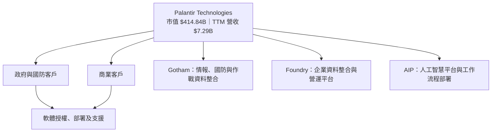
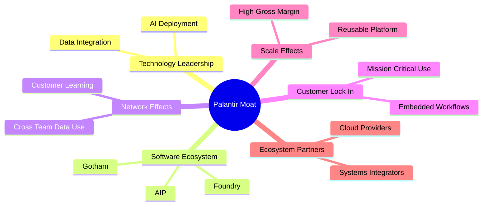
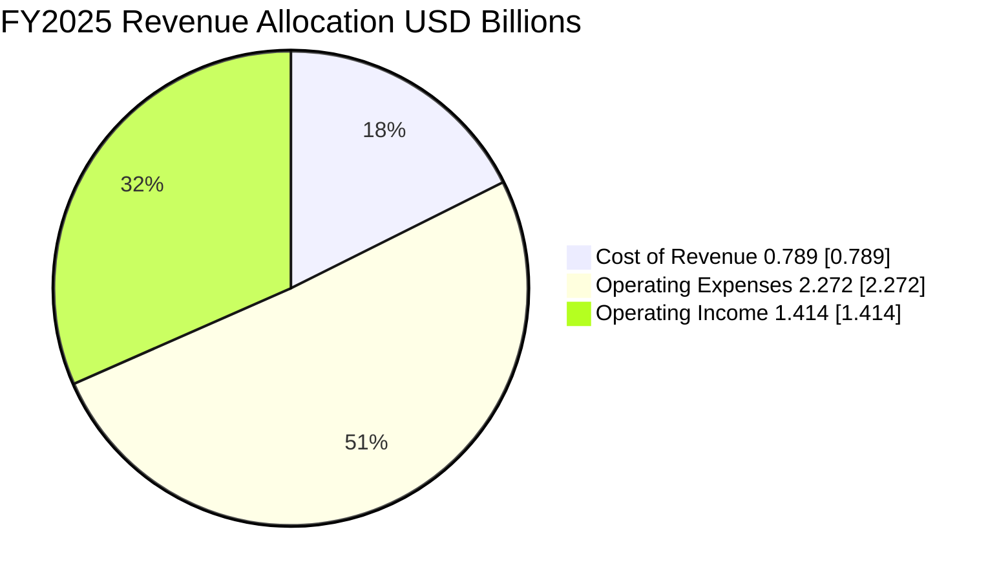
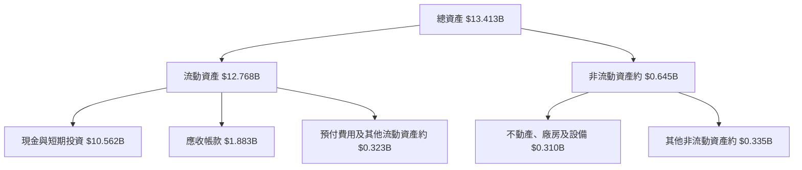
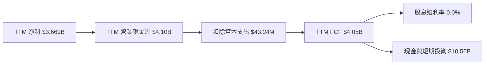
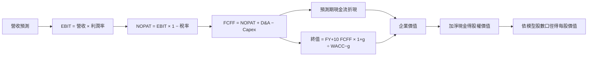
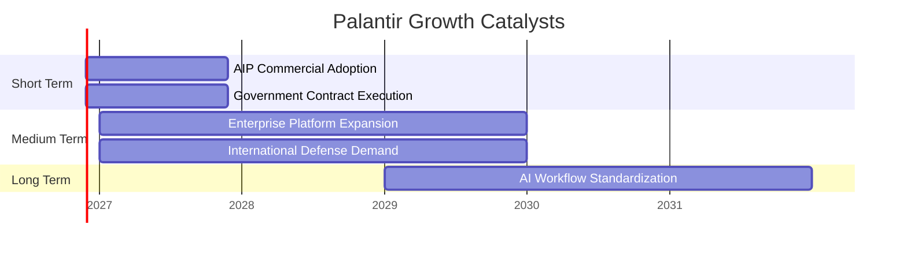
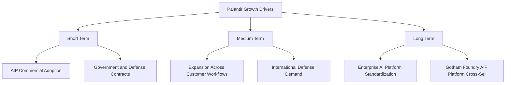
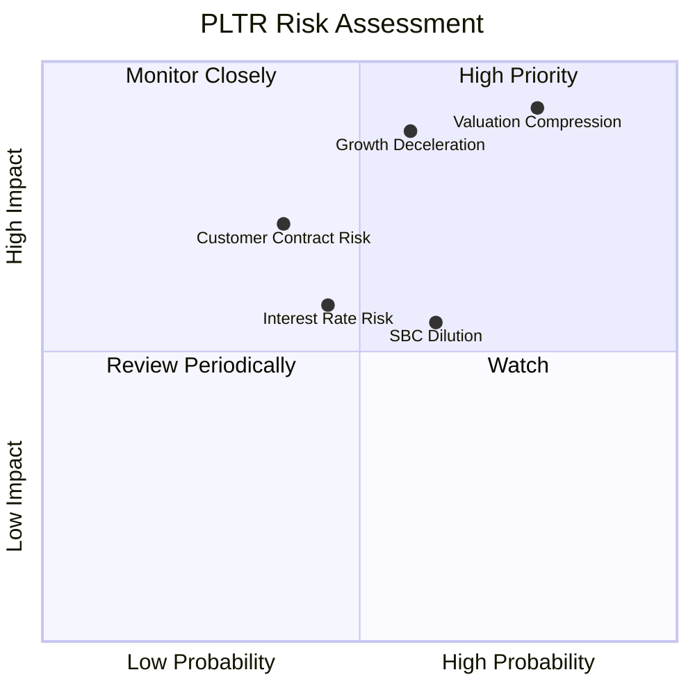
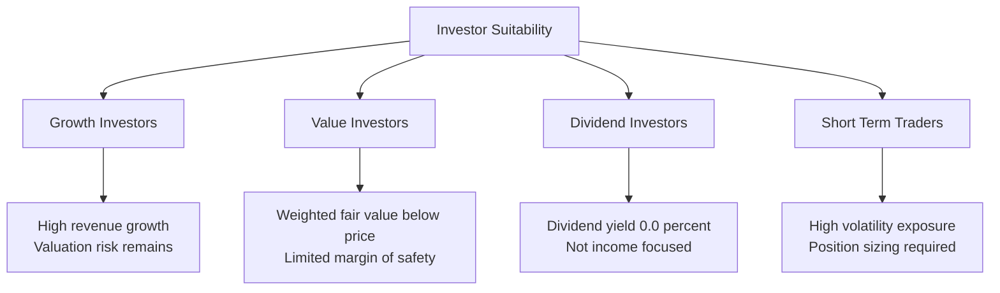

# PLTR 基本面深度分析報告
> **報告日期**：2026-11-28 ｜ **語言**：繁體中文 ｜ **數據來源**：SEC 申報資料 (XBRL)、Yahoo Finance、Finviz、StockAnalysis、Roic.ai ｜ **分析師**：CFA 級機構研究

## 目錄

| # | 章節 | 核心結論 |
|---|------|----------|
| 1 | 執行摘要 | 賣出；加權合理價值 $62.49；MOS -161.8% |
| 2 | 公司概覽與商業模式 | 軟體平台具高切換成本潛力；細分收入比例未提供 |
| 3 | 損益表深度分析 | TTM 營收 $7.29B、年增 87.1%；最新一季年增 95.9% |
| 4 | 資產負債表分析 | 現金與短期投資 $10.56B；財務資料列示總債務 N/A |
| 5 | 現金流量深度分析 | TTM FCF $4.05B；FCF Yield 0.98% |
| 6 | 獲利能力與資本效率 | 報告 ROIC 492.3% 高於 WACC 11.97%，但 ROIC 受現金調整後分母影響 |
| 7 | 相對估值分析 | PLTR 倍數遠高於 SNOW、DDOG、CRM；P/S 高於自身五年中位數 |
| 8 | DCF 內在價值評估 | 基準 DCF 每股 $21.10；加權合理價值 $62.49 |
| 9 | 成長催化劑 | 美國商業業務、AI 平台採用與國防合約是主要觀察方向 |
| 10 | 風險矩陣 | 估值收縮、增長降速、客戶集中／合約風險為主要風險 |
| 11 | 投資建議 | 依 MOS 門檻為賣出；追蹤營收、利潤率、稀釋及 FCF |

---

## 1. 執行摘要

PLTR 的基本面數據包括 TTM 營收 **$7.29B、年增 87.1%**、最新一季營收年增 **95.9%**、TTM 營業利益率 **45.6%**、TTM FCF **$4.05B**。但以 **2026-11-25 收盤價 $163.59** 計，估值方法加權後的合理價值為 **$62.49**，MOS 為 **-161.8%**；即使 29 位分析師平均目標價為 $221.93，DCF 基準值仍只有 $21.10，現價相對 DCF 基準值溢價 675.3%。因此依規則 20 評級為 **賣出**，不是對企業業務品質的否定，而是估值與基本面現金流折現結果差距極大。

### 1.0 一頁式投資儀表板（Portfolio Manager 30 秒速讀）

| 項目 | 內容 |
|------|------|
| **投資論點（3 句）** | ① TTM 營收年增 87.1%，最新一季年增 95.9%，營收動能強。② TTM FCF $4.05B、營業利益率 45.6%，顯示軟體模式具高現金轉換能力。③ 現價 $163.59 對照加權合理價值 $62.49，MOS -161.8%，估值是主要負面因素。 |
| **綜合評分** | **7.3/10**（引用 1.1 評分卡） |
| **財務健康** | 🟢 現金與短期投資 $10.56B、流動比率 7.102；總債務在核心財務欄位為 N/A。 |
| **ROIC vs WACC** | 492.3% vs 11.97%；表面上高於資本成本，但 ROIC 分母受現金扣除影響，需審慎解讀。 |
| **FCF 趨勢** | 向上；TTM FCF $4.05B，FCF Yield 0.98%。 |
| **估值** | Forward P/E 67.7x ｜ EV/EBITDA 120.6x ｜ FCF Yield 0.98%。 |
| **DCF 內在價值（基準）** | $21.10 ｜ 現價相對 DCF 溢價 **675.3%**（DCF 基準為 $21.10）。 |
| **安全邊際（MOS）** | **-161.8%**＝($62.49 − $163.59) ÷ $62.49 ｜ 🔴 無安全邊際。 |
| **預期報酬（基準情境 12M）** | DCF 基準情境每股 $21.10，相對現價 **-87.1%**；此為估值模型情境，不是市場價格預測。 |
| **關鍵風險（前二）** | 高估值倍數回落；營收成長率由高基期放緩。 |
| **評級 + 信心度** | 🔴 **賣出** ｜ 信心：中（估值數字明確，但 DCF 假設及資料口徑存在限制）。 |

### 1.1 綜合評分卡（全報告唯一）

| 維度 | 評分（1–10） | 主要依據（引用數字與其來源章節） |
|------|--------------|----------------------------------|
| 成長性 | 9.5 | TTM 營收年增 87.1%、最新一季年增 95.9%（第 3 章）。 |
| 獲利能力 | 9.0 | TTM 營業利益率 45.6%、ROIC 492.3%；Piotroski 7/8（第 6 章），惟 ROIC 受分母影響。 |
| 財務健康 | 9.0 | 現金與短期投資 $10.56B、流動比率 7.102；總債務核心欄位 N/A（第 4 章）。 |
| 估值 | 1.0 | MOS -161.8%；P/S 57.8x，高於自身五年中位數 24.7x（第 7、8 章）。 |
| 護城河 | 8.0 | 平台型軟體、高毛利及客戶部署黏著度有利，但未提供客戶留存率與分部收入（第 2 章）。 |
| 管理層與資本配置 | 7.5 | FY2025 SBC $684.03M，最新四季 SBC 合計約 $982.10M；稀釋股數測試未通過，無股息（第 3、5 章）。 |
| **綜合評分** | **7.3** | 六項算術平均：($9.5+$9.0+$9.0+$1.0+$8.0+$7.5)÷6 = **7.3**。 |

### 1.2 五大投資論點 + 三大核心風險

| 類型 | 項目 | 具體依據 | 信心度 |
|------|------|----------|--------|
| 🟢 **投資論點①** | 營收加速 | TTM 營收 $7.29B，TTM 年增 87.1%；最新一季年增 95.9%。 | 🟢 高 |
| 🟢 **投資論點②** | 營業槓桿顯著 | TTM 營業利益率 45.6%，最新一季 46.9%；營收擴張轉化為高營業利益。 | 🟢 高 |
| 🟢 **投資論點③** | 現金流轉換良好 | TTM OCF $4.10B，Capex $43.24M，FCF $4.05B；FCF/淨利約 110.4%。 | 🟢 高 |
| 🟢 **投資論點④** | 現金緩衝充足 | 現金與短期投資 $10.56B，流動比率 7.102。 | 🟢 高 |
| 🟢 **投資論點⑤** | 軟體部署黏著性 | Gotham、Foundry、AIP 涉及資料整合與營運流程；客戶嵌入程度可能提高轉換成本，但缺客戶留存數據驗證。 | 🟡 中 |
| 🟡 **風險①** | 估值容錯率低 | P/S 57.8x、Forward P/E 約 67.7x、FCF Yield 0.98%；增速只要低於預期，倍數可能收縮。 | 🔴 高衝擊 |
| 🔴 **風險②** | 成長基期抬高 | 最新一季年增 95.9%，若企業導入周期或大型合約推遲，年增率可能快速回落。 | 🟡 中 |
| 🟡 **風險③** | SBC 與股數稀釋 | 最新四季 SBC 約 $982.10M，約佔 TTM 營收 13.5%；Piotroski 稀釋股數測試未通過。 | 🟡 中 |

### 1.3 快速統計卡片

| 指標 | 公司實際值（期間） | 同業中位數 | 狀態 |
|------|--------------------|------------|------|
| 營收成長（TTM） | **87.1%** | — | 🟢 |
| 營收成長（最新一季年增） | **95.9%** | 35.2%（SNOW、DDOG、CRM 中位數） | 🟢 |
| 毛利率（TTM） | **84.7%** | 77.3% | 🟢 |
| 營業利益率（TTM） | **45.6%** | — | 🟢 |
| ROIC（TTM） | **492.3%** | — | 🟢* |
| Forward P/E | **67.7x** | 52.1x | 🔴 |
| FCF Yield（TTM） | **0.98%** | — | 🔴 |
| Piotroski F-Score | **7 / 8** | — | 🟢 |

\*ROIC 數值依程式計算口徑照列，因現金扣除後投入資本分母可能偏小，不能直接視為可持續經濟報酬率。

### 1.4 投資結論

╔══════════════════════════════════════════════════════════════════╗  
║                    📊 投資結論摘要                               ║  
╠══════════════════════════════════════════════════════════════════╣  
║  評級：賣出（依規則 20；MOS -161.8%）                            ║  
║  價格（2026-11-25 收盤）：$163.59                                ║  
║  DCF 內在價值（基準）：$21.10（現價溢價 675.3%）                 ║  
║  安全邊際 MOS：-161.8%（＝(加權合理價值−現價)÷加權合理價值）    ║  
║  加權合理價值（8.8）：$62.49                                    ║  
║  DCF 情境價值：                                                  ║  
║    悲觀情境：$12.50（-92.4%）                                   ║  
║    基準情境：$21.10（-87.1%）                                   ║  
║    樂觀情境：$36.89（-77.5%）                                   ║  
║  綜合評分：7.3/10（引用 1.1）                                    ║  
║  適合投資人：能承受高波動、重視高成長且不依賴估值安全邊際者      ║  
╚══════════════════════════════════════════════════════════════════╝  

---

## 2. 公司概覽與商業模式

### 2.1 業務結構與收入來源

Palantir 為軟體平台供應商，產品涵蓋 Gotham、Foundry、AIP。已知 TTM 營收為 $7.29B、市值 $414.84B；但未提供商業與政府業務分部營收及比例，因此下圖不分配未經證實的收入比例。

收入主要屬軟體平台與相關部署、支援服務；各產品收入金額、訂閱與服務占比未提供，故不拆分比例。產品與客戶用途可從公司業務描述確認，但不能以推測代替分部財務披露。

### 2.2 市場份額

市場份額數據未提供。PLTR 的 TTM 營收為 $7.29B、TTM 年增 87.1%，高於同業資料中 SNOW、DDOG、CRM 的最新一季營收成長率 35.1%、35.2%、10.8%；但企業軟體細分市場不同，不能據此直接推算市佔率。

### 2.3 競爭護城河分析

### 2.4 護城河強度

| 護城河項目 | 強度（強／中／弱） | 證據（引用數字或事實） | 會削弱它的情況 |
|------------|--------------------|------------------------|----------------|
| 技術與資料整合 | 中至強 | 產品服務情報、國防及企業資料整合；TTM 毛利率 84.7%。 | 替代平台降低整合成本，或客戶自建工具達到相近效果。 |
| 軟體生態系統 | 中至強 | Gotham、Foundry、AIP 涵蓋不同使用場景；細分產品收入未提供。 | 客戶採用停留在試點，未擴張至更多部門或工作流程。 |
| 網路效應 | 中 | 多部門共享資料可能增加平台價值，但用戶數、資料網絡指標未提供。 | 部門間資料治理、隱私或系統相容性阻礙共享。 |
| 客戶鎖定 | 中至強 | 平台進入關鍵營運工作流程，切換可能涉及重整資料與流程；留存率未提供。 | 合約到期後客戶轉換、雲端平台原生工具替代。 |
| 規模效應 | 中 | TTM 營業利益率 45.6%，顯示已有高營運槓桿。 | 為維持成長而增加銷售、部署或研發成本。 |
| 生態夥伴 | 中 | 多雲與系統整合合作具擴張可能；合作收入數據未提供。 | 夥伴掌握客戶入口或以自身平台替代 PLTR。 |

1.1 評分卡中的護城河分數為 **8.0/10**，依據是高毛利、平台多用途與高營業利益率；分數仍受客戶留存率、產品分部營收等資料缺口限制。

---

## 3. 損益表深度分析

### 3.1 年度收入成長趨勢（近4年）

╔══════════════════════════════════════════════════════════════════╗  
║              Palantir 年度收入趨勢（FY2022-FY2025）              ║  
╠══════════════════════════════════════════════════════════════════╣  
║ FY2022  $1.91B  ████████░░░░░░░░░░░░░░░░  YoY: +23.6% 🟢       ║  
║ FY2023  $2.23B  █████████░░░░░░░░░░░░░░░  YoY: +16.7% 🟡       ║  
║ FY2024  $2.87B  █████████████░░░░░░░░░░░  YoY: +28.8% 🟢       ║  
║ FY2025  $4.48B  ████████████████████░░░░  YoY: +56.2% 🟢       ║  
║                                                                  ║  
║ FY2022-FY2025 CAGR = (4.475 ÷ 1.906)^(1/3) − 1 = 32.9%         ║  
╚══════════════════════════════════════════════════════════════════╝  

FY2025 收入增速升至 56.2%，TTM 年增進一步達 87.1%；最新季度營收年增 95.9%。這代表近期需求加速，但也使未來比較基期變高，外推高增速的確定性下降。

### 3.2 季度收入趨勢分析

| 季度 | 營收 | QoQ 成長 | YoY 成長 | 備註 |
|------|------|----------|----------|------|
| 2025 Q4 | $1.407B | 19.1% | 70.0% | QoQ 以 2025 Q3 $1.181B 計算；YoY 依 StockAnalysis。 |
| 2026 Q1 | $1.633B | 16.1% | 84.7% | YoY 為單季同比，不是 TTM 成長。 |
| 2026 Q2 | $1.935B | 18.5% | 92.8% | 季增仍維持雙位數。 |
| 2026 Q3 | $2.313B | 19.5% | 95.9% | 最新季度營收年增率；相對前季再增約 19.5%。 |

QoQ 計算示例：Q3 2026 QoQ = ($2.313B ÷ $1.935B) − 1 = **19.5%**。季度成長逐步抬升，可能反映商業化部署擴張與大型合約收入認列；但單季資料不能直接當作全年成長率。

### 3.3 利潤率演變分析

| 利潤率指標 | FY2022 | FY2023 | FY2024 | FY2025 | 趨勢 | 評估 |
|------------|--------|--------|--------|--------|------|------|
| **毛利率** | 78.5% | 80.6% | 80.3% | 82.4% | 上升，FY2025改善 | 🟢 |
| **營業利益率** | -8.5% | 5.4% | 10.8% | 31.6% | 明顯擴張 | 🟢 |
| **淨利率** | -19.6% | 9.4% | 16.1% | 36.3% | 轉盈後提升 | 🟢 |

FY2025 營業利益率由 FY2024 的 10.8% 升至 31.6%，反映收入增長快於部分成本增長，且平台規模擴大提高營業槓桿。TTM 營業利益率為 45.6%，最新季度為 46.9%；資料中另一處對最新季度列示 45.6%，本報告依指定核心財務數據的 46.9% 作為最新季度口徑。毛利率自 FY2022 的 78.5% 升至 FY2025 的 82.4%，顯示交付成本相對收入下降或高毛利軟體收入組合提高；未披露分部組合，原因判斷仍屬推論。

### 3.4 費用結構分析

FY2025 營收 $4.475B、毛利 $3.686B、營業利益 $1.414B。以收入減毛利計算銷貨成本約 $0.789B；以毛利減營業利益計算營業費用約 $2.272B。以下為收入分配，不代表現金支出分類。

╔══════════════════════════════════════════════════════════════════╗  
║ FY2025 收入 $4.475B：銷貨成本 $0.789B｜營業費用 $2.272B         ║  
║ 營業利益 $1.414B；營業利益率 = 1.414 ÷ 4.475 = 31.6%           ║  
║ R&D $0.558B；研發支出約佔收入 12.5%                             ║  
╚══════════════════════════════════════════════════════════════════╝  

### 3.5 季度 EPS 趨勢與盈餘品質（Quality of Earnings）

| 季度 | EPS 實際 | EPS 年增 | 超預期／不及預期 |
|------|----------|----------|------------------|
| 2025 Q4 | $0.23 | 647.6% | 預估 EPS 缺失，無法判定 |
| 2026 Q1 | $0.34 | 325.0% | 預估 EPS 缺失，無法判定 |
| 2026 Q2 | $0.41 | 215.4% | 預估 EPS 缺失，無法判定 |
| 2026 Q3 | $0.44 | 144.4% | 預估 EPS 缺失，無法判定 |

EPS 實際值逐季增加，但增幅從高基期逐步下降。財報資料中的 EPS estimate 欄位為 NaN，因此不能把缺失資料描述為超預期或不及預期。

| 盈餘品質項目 | 數值/佔比 | 評估 |
|--------------|-----------|------|
| 股權薪酬 SBC / 營收 | 約 $0.982B ÷ $7.288B = **13.5%** | 🟡 SBC 具實質稀釋成本；當期營業費用已認列，但股數稀釋仍降低每股盈餘。 |
| SBC / 營業現金流 | 約 $0.982B ÷ $4.10B = **23.9%** | 🟡 SBC 佔 OCF 約四分之一，需避免只看未扣除稀釋的現金流品質。 |
| FCF / 淨利（現金轉換率） | $4.05B ÷ $3.669B = **110.4%** | 🟢 現金流高於淨利，營運現金轉換良好。 |
| 一次性/非經常性損益 | 詳細項目未提供 | 🟡 無法量化是否有一次性收益推高淨利。 |
| 有效稅率異常 | **1.4%** | 🟡 稅率偏低，現階段淨利受低稅負支持；正常化稅率上升會壓低未來淨利。 |
| 資本化支出 vs 費用化 | TTM Capex $43.24M；資本化支出明顯低於 TTM FCF | 🟡 未提供資本化軟體支出細節，不能判定有成本遞延。 |

SBC 最新四季合計約 $982.10M，計算自季度資料（$318.89M+$265.21M+$201.59M+$196.41M）。FCF/淨利超過 100% 支持現金盈利品質，但 SBC 是非現金費用而又造成股東稀釋；因此 GAAP 淨利不宜機械式視為完全歸屬於既有股東的經濟盈餘。

---

## 4. 資產負債表分析

### 4.1 資產結構分解

2026-09-30 總資產 $13.413B，流動資產 $12.768B，非流動資產差額約 $0.645B。

拆分項目依 2026-09-30 資產負債表數據；其他項目以總額扣除披露項目計算，為彙總差額而非另行披露的單一科目。

### 4.2 流動性與營運資金分析

| 指標 | 最新 TTM | 一年前 TTM | 變化 | 解讀 |
|------|----------|------------|------|------|
| DSO 應收帳款天數 | 94 天 | 94 天 | 0 天 | 收款天數未見變化；應收帳款金額上升仍需對照營收增幅監控。 |
| DIO 存貨天數 | N/A | N/A | N/A | 公司未列示存貨餘額，不自行補算。 |
| DPO 應付帳款天數 | 29 天 | 33 天 | -4 天 | 付款天數下降，代表相較一年前較快支付供應商，可能略減少營運資金來源。 |
| CCC 現金轉換週期 | N/A | N/A | N/A | DIO 缺失，因此現金轉換週期不計算。 |

流動比率 7.102、速動比率 6.923，短期償債能力充足。應收款週轉天數維持 94 天，未顯示指標惡化；但最新 TTM 應收款 $1.883B，較 FY2025 $1.042B 增長，需追蹤回款是否與收入增長相稱。

### 4.3 債務結構分析

核心財務資料的「總債務」與「總債務/淨現金」口徑列示為 N/A／淨現金 $10.56B；市場資料另列總債務 $225.27M、淨現金/債務 $10.34B。為遵守核心數據原值優先原則，本節不以次級數據替代核心欄位，也不推算 Debt/EBITDA 或利息保障倍數。

╔══════════════════════════════════════════════════════════════════╗  
║                   Palantir 債務健康診斷                          ║  
╠══════════════════════════════════════════════════════════════════╣  
║ 總債務：核心財務口徑 N/A；其他市場欄位列 $225.27M               ║  
║ 現金＋短期投資：$10.56B 🟢                                       ║  
║ 淨現金：核心數據列示 $10.56B 🟢                                  ║  
║ Debt/EBITDA：N/A（核心債務欄位缺值）                             ║  
║ Interest Coverage：N/A（利息費用資料未提供）                    ║  
║ 流動比率：7.102x 🟢                                               ║  
╚══════════════════════════════════════════════════════════════════╝  

### 4.4 股東權益趨勢

╔══════════════════════════════════════════════════════════════════╗  
║                 歷年股東權益變化（美元）                         ║  
╠══════════════════════════════════════════════════════════════════╣  
║ FY2022  $2.57B  ███████░░░░░░░░░░░░░░░░░░                        ║  
║ FY2023  $3.48B  █████████░░░░░░░░░░░░░░░                         ║  
║ FY2024  $5.00B  █████████████░░░░░░░░░░                          ║  
║ FY2025  $7.39B  ███████████████████░░░░                          ║  
╚══════════════════════════════════════════════════════════════════╝  

股東權益由 FY2022 $2.57B 增至 FY2025 $7.39B，反映獲利累積與資本基礎擴張；每股價值仍須考慮 SBC 導致的股數稀釋。

---

## 5. 現金流量深度分析

### 5.1 現金流量瀑布圖

股息／回購與現金淨變化的完整現金流分配表未提供；圖中僅列示可確認的現金流量及股息資料，不代表 FCF 全數留存或全部形成現金增量。

### 5.2 FCF 轉換率趨勢

| 年度 | FCF | 淨利 | FCF / 淨利 | 解讀 |
|------|-----|------|------------|------|
| FY2022 | $0.184B | -$0.374B | -49.2%* | 淨利為負，該比率不適合衡量現金轉換。 |
| FY2023 | $0.697B | $0.210B | 332.2% | FCF 高於淨利，部分受非現金項目及營運資金影響。 |
| FY2024 | $1.14B | $0.462B | 246.7% | 現金流轉換仍高。 |
| FY2025 | $2.10B | $1.63B | 128.8% | 現金流高於淨利，差距收斂。 |
| TTM | $4.05B | $3.669B | 110.4% | 現金轉換仍高於 100%。 |

\*因淨利為負，比率僅作數學結果呈現，不作正向品質判讀。

### 5.3 自由現金流趨勢

╔══════════════════════════════════════════════════════════════════╗  
║            自由現金流：歷史實際（美元）                          ║  
╠══════════════════════════════════════════════════════════════════╣  
║ FY2022  $0.184B  ██░░░░░░░░░░░░░░░░░░  FCF Yield N/A            ║  
║ FY2023  $0.697B  █████░░░░░░░░░░░░░░░  FCF Yield N/A            ║  
║ FY2024  $1.14B   █████████░░░░░░░░░░░  FCF Yield N/A            ║  
║ FY2025  $2.10B   ████████████████░░░░  FCF Yield N/A            ║  
║ TTM      $4.05B   ████████████████████  FCF Yield 0.98%          ║  
╚══════════════════════════════════════════════════════════════════╝  

歷年市值資料未提供一致的年末口徑，因此歷史 FCF Yield 不補算。TTM FCF 已達 $4.05B，但相對 $414.84B 市值，FCF Yield 僅 0.98%，顯示現價已反映相當高的未來增長預期。

### 5.4 資本配置評估

FY2025 SBC 為 $684.03M、Capex 約 $33.88M（現金流表列負值）、股息殖利率 0.0%。回購、併購與研發投資的年度現金分配金額未完整提供，因此不繪製資本配置圓餅圖。

| 資本配置項目 | 可得資料 | 評估 |
|--------------|----------|------|
| 研發 | FY2025 $557.68M，佔營收約 12.5% | 支持平台與產品迭代；回報需以後續成長驗證。 |
| 資本支出 | TTM $43.24M | 相較營收低，屬資本較輕的營運模式。 |
| SBC | FY2025 $684.03M；TTM 四季約 $982.10M | 股東稀釋是主要資本配置成本之一。 |
| 股息 | 殖利率 0.0% | 無股息收入。 |
| 回購／併購 | N/A（資料未提供完整分項） | 無法判斷資本返還及外部投資效果。 |

---

## 6. 獲利能力與資本效率

### 6.1 ROE / ROA / ROIC 趨勢

| 指標 | 最新可得值 | 歷史趨勢資料 | 評估 |
|------|------------|--------------|------|
| ROE | TTM 32.7%（品質指標口徑） | 其他財務彙總列示 40.9%，口徑不一致 | 🟢 高，但本報告採用品質指標的杜邦口徑。 |
| ROA | 19.3% | F-Score 測試顯示高於一年前；未提供一致歷年序列 | 🟢 |
| ROIC | 492.3% | 未提供同口徑歷史序列 | 🟡 數字高，但分母受淨現金扣除影響，可能失真。 |

未提供可比較的行業均值，因此不列行業均值欄。ROE、ROA、ROIC 的口徑差異會影響跨來源比較，分析重點應放在現金流與營業利益率是否持續，而非單獨依賴高 ROIC 百分比。

### 6.2 ROIC vs WACC 分析（核心價值創造判斷）

╔══════════════════════════════════════════════════════════════════╗  
║                ROIC vs WACC 深度分析                            ║  
╠══════════════════════════════════════════════════════════════════╣  
║ 無風險利率 Rf（10Y 美債）：4.94%                                ║  
║ ERP：5.00%｜原始 Beta：1.61｜調整 Beta：1.41                    ║  
║ Ke = 4.94% + 1.41 × 5.00% = 11.99%（模型原值 11.97%）           ║  
║ 稅前債務成本：6.94%｜有效稅率：1.4%                             ║  
║ 股權／債務權重：99.9%／0.1%｜採用 WACC：11.97%                  ║  
║                                                                  ║  
║ ROIC（TTM）：492.3%｜WACC：11.97%                               ║  
║ ROIC − WACC = 492.3% − 11.97% = 480.33 個百分點                 ║  
║ ROIC / WACC = 492.3 ÷ 11.97 = 41.1 倍                           ║  
║ 結論：報告口徑 ROIC 高於 WACC；數值可能因現金扣除後投入資本小而 ║  
║ 被放大，不能直接把 492.3% 當成正常化資本回報率。                ║  
╚══════════════════════════════════════════════════════════════════╝  

CAPM 組成數字依資本成本資料照列；11.99% 與程式提供的 Ke 11.97% 之差來自輸入精度／四捨五入，估值與本報告採用值維持 **WACC 11.97%**，不另建 WACC。總債務及利息費用缺少一致的可核對口徑，因此不以自算債務成本取代程式提供的 6.94% 假設值。按官方 ROIC 指標，ROIC 高於 WACC，方向上代表創造價值；但其水平存在分母敏感性。

### 6.3 杜邦三因素分解

| 因素 | 數值（TTM） | 解讀 |
|------|-------------|------|
| 淨利率 | 50.3% | 淨利率是 ROE 的主要支撐來源。 |
| 資產週轉率 | 0.54 | 反映每單位資產創造的營收。 |
| 權益乘數 | 1.19 | 財務槓桿不高，ROE 不是主要由負債槓桿推升。 |
| **ROE** | **32.7%** | 50.3% × 0.54 × 1.19 ≈ 32.7%；照列品質指標數值。 |

### 6.4 財務體質：Piotroski F-Score

Piotroski F-Score 為 **7/8**；一項測試因缺少資料而不納入分母，稀釋股數測試未通過。

| 測試 | 結果 | 解讀 |
|------|------|------|
| ROA > 0 | ✅ 通過 | 公司在測試期間為獲利狀態。 |
| 營業現金流 > 0 | ✅ 通過 | TTM OCF 為正。 |
| ROA 高於一年前 | ✅ 通過 | 資產獲利能力改善。 |
| 營業現金流 > 淨利 | ✅ 通過 | 現金流高於會計淨利，應計品質測試通過。 |
| 長期負債 ÷ 總資產低於一年前 | — 無法判定 | 缺少輸入資料，不補值。 |
| 流動比率高於一年前 | ✅ 通過 | 短期流動性改善。 |
| 稀釋股數未增加 | ❌ 未通過 | 股數增加可能稀釋每股收益。 |
| 毛利率高於一年前 | ✅ 通過 | 毛利率改善。 |
| 資產週轉率高於一年前 | ✅ 通過 | 資產利用效率改善。 |

---

## 7. 相對估值分析

### 7.1 同業估值比較表格

| 估值指標 | **PLTR** | **SNOW** | **DDOG** | **CRM** | PLTR 評估 |
|----------|----------|----------|----------|---------|-----------|
| **Trailing P/E** | 115.2x* | N/A | 230.2x | 18.1x | 🔴 高於 CRM；低於 DDOG，但同業獲利結構差異大。 |
| **Forward P/E** | 67.7x | 89.4x | 52.1x | 12.4x | 🔴 高於 DDOG、CRM，低於 SNOW。 |
| **P/S Ratio** | 57.8x* | 17.9x | 14.0x | 3.7x | 🔴 顯著高於三家同業。 |
| **EV/EBITDA** | 122.3x* | -94.4x | 328.4x | 15.0x | 🟡 倍數落在 DDOG 與 CRM 之間；SNOW 倍數為負，不宜直接比較。 |
| **最新一季營收年增** | 95.9% | 35.1% | 35.2% | 10.8% | 🟢 成長率較高，但估值溢價也明顯。 |
| **毛利率（TTM）** | 84.7% | 67.0% | 79.6% | 77.3% | 🟢 高於列示同業。 |

\*PLTR 的 P/E、P/S、EV/EBITDA 使用自身歷史估值區塊數值。其他市場摘要的倍數略有差異，依指定 Peer multiples 與歷史估值區塊引用。SNOW P/E（TTM）及負 EV/EBITDA 不具一般獲利倍數解讀意義。

### 7.2 歷史估值區間分析

╔══════════════════════════════════════════════════════════════════╗  
║              PLTR 歷史估值區間（五年 TTM）                       ║  
╠══════════════════════════════════════════════════════════════════╣  
║ P/E：       100.6x ├── 現值 115.2x ───────── 中位數 228.6x ── 601.0x ║  
║ P/S：         7.0x ├──────── 中位數 24.7x ───── 現值 57.8x ── 120.4x ║  
║ EV/EBITDA： 109.0x ├── 現值 122.3x ───────── 中位數 233.4x ── 574.4x ║  
╚══════════════════════════════════════════════════════════════════╝  

P/E 與 EV/EBITDA 現值分別處於自身歷史第 7、第 8 百分位，表面上低於過去極端倍數；但 P/S 處於第 67 百分位，且現值 57.8x 高於五年中位數 24.7x。歷史高估值不等於現價便宜，因現價仍要求公司持續高增長。

### 7.3 情境價值（Bear / Base / Bull，照抄 DCF MODEL 的 Scenarios）

| 情境 | 第 1 年營收成長 | 期末營業利潤率 | WACC | 每股價值 | 相對現價 | 機率 | 會發生的條件 |
|------|----------------|----------------|------|----------|----------|------|--------------|
| 🔴 悲觀 | 15.0% | 9.2% | 12.97% | $12.50 | -92.4% | 25% | 商業化成長明顯降速，競爭或銷售成本使長期利潤率回落。 |
| 🟡 基準 | 30.0% | 10.8% | 11.97% | $21.10 | -87.1% | 50% | 依 DCF 基準假設由 30% 成長線性降至 3%，利潤率逐步回落。 |
| 🟢 樂觀 | 45.0% | 11.9% | 10.97% | $36.89 | -77.5% | 25% | 高增長延續，融資折現率較低，成熟期利潤率較基準高。 |

### 7.4 相對估值隱含價格區間

╔══════════════════════════════════════════════════════════════════╗  
║        估值方法回推每股價值與現價 $163.59                       ║  
╠══════════════════════════════════════════════════════════════════╣  
║ $21.10 ───── $81.99 ─────────────── $163.59 ───── $221.93       ║  
║ DCF基準       同業 Forward P/E        現價           分析師共識    ║  
╚══════════════════════════════════════════════════════════════════╝  

| 方法 | 每股價值 | 依據 |
|------|----------|------|
| DCF（基準） | $21.10 | 10 年 FCFF，WACC 11.97%，終值成長 3.0%。 |
| 同業 Forward P/E | $81.99 | 同業中位數 32.2x × Forward EPS $2.54。 |
| 分析師共識目標價 | $221.93 | 29 位分析師平均目標價。 |

---

## 8. DCF 內在價值評估（Discounted Cash Flow）

> 本章逐年現金流、估值橋接、敏感度及情境數字均採用程式模型原值；模型沒有列出的項目不自行補建。模型原值存在小幅四捨五入差異，以下保留原始結果並於 8.10 說明。

### 8.0 估值推理鏈（Thinking Logic：在算之前先想清楚）

**Step 1 — 價值由哪些變數決定？**  
公司目前營收底盤為 TTM $7.29B；Gotham、Foundry 與 AIP 的營收分部比例未提供，故不能精確拆成業務占比。模型價值主要由未來營收增長與 EBIT 利潤率路徑決定，終值則取決於 FY+10 FCFF、WACC 與永續成長率；敏感度表顯示在基準 WACC 下，g 變化對估值有影響，但營收與利潤率偏離會改變整條現金流路徑。

**Step 2 — 模型選擇**

| 決策點 | 本報告採用 | 理由（含數字） | 曾考慮但否決 | 否決理由 |
|--------|-----------|----------------|--------------|----------|
| 現金流定義 | FCFF | 對應 WACC 折現與企業價值；模型使用 FCFF = NOPAT + D&A − Capex。 | FCFE | 模型提供的是 FCFF，且企業價值橋接加淨現金。 |
| 預測期 N | 10 年 | 模型固定列出 FY+1 至 FY+10，收入增長由 30.0% 降至 3.0%。 | 更短預測期 | 與既定模型不一致，不能自行替換。 |
| 終值方法 | Gordon Growth | 模型給定 g 3.0%、WACC 11.97%。 | 退出倍數 | DCF MODEL 未提供退出倍數終值，不能自建。 |
| EBIT 基礎 | GAAP EBIT | DCF 明定採用 GAAP EBIT。 | 非 GAAP EBIT | 會加回 SBC，與既定模型不同。 |

**Step 3 — 關鍵假設推導鏈**

- **營收增長路徑**：錨點＝TTM 年增 87.1%、最新一季年增 95.9% → 模型為避免將高基期極速增長外推，將首年增長上限設在 30.0%，之後逐年線性降至 3.0% → **採用 FY+1 30.0%、FY+10 3.0%** → 未採用持續 87.1%，因其把近期高速增長視為十年可延續，缺乏支撐。
- **期末營業利益率**：錨點＝TTM 營業利益率 45.6%；模型使用近五個財年中位數（含 TTM）作期末錨 → 利潤率由 45.6% 逐步降至 **FY+10 10.8%** → 未採用 45.6% 永續，避免假設目前利潤率永久不變。
- **永續成長率 g**：錨點＝模型成熟期營收成長 3.0% → WACC 為 11.97%，g 必須低於 WACC 才能使用 Gordon Growth → **採用 3.0%** → 未採用更高永續增長，以避免終值過度膨脹。
- **預測期 N**：錨點＝模型設定 10 年，給予成長與利潤率足夠時間收斂 → **採用 10 年** → 未替換為其他年數，因程式模型已指定預測期。
- **Capex / 營收**：錨點＝TTM Capex $43.24M ÷ TTM 營收 $7.29B，約 0.6% → 模型由首年 0.6% 降至第十年 0.4% → **採用 0.6% 至 0.4% 路徑** → 未假設更高資本密集度，因現有 TTM Capex 強度低。
- **EBIT 基礎與 SBC**：採用 GAAP EBIT，GAAP 營業利益已含 SBC 費用；模型不再扣 SBC，也不再放大股數。**採用組合 (A)**，SBC 影響在 GAAP 費用中計入一次 → 未採用另扣 SBC 或另加稀釋，避免重複計算。
- **年稀釋率**：與組合 (A) 相容，股數固定、不再另行稀釋 → **年稀釋率 0%**（模型組合設定）→ 未以額外稀釋率再扣一次 SBC。
- **終值方法**：Gordon Growth；因 WACC 11.97% > g 3.0%，公式有效 → **採用 Gordon Growth** → 未加入未提供的退出倍數。
- **WACC**：直接採用資本成本資料中的 **11.97%**；組成詳見 8.2 → 未自行替換 WACC，以維持模型一致。

**Step 4 — 最脆弱一環**  
最脆弱的是未來營收成長與利潤率路徑是否能同時達成；模型基準值僅 $21.10，樂觀情境也只有 $36.89，顯示即使採用較樂觀假設，仍遠低於 $163.59 現價。

**Step 5 — 計算路徑圖**

### 8.1 模型假設總表（Model Inputs）

| 假設項目 | 採用值 | 依據 / 來源 | 敏感度 |
|----------|--------|-------------|--------|
| 預測期長度 N | 10 年 | DCF MODEL 指定 FY+1 至 FY+10。 | 🟡 中 |
| 營收增長路徑 | FY+1 30.0% 線性降至 FY+10 3.0% | TTM 年增 87.1%；模型將首年增長限制於 0%–30%。 | 🔴 高 |
| 營業利潤率 | FY+1 45.6% 降至 FY+10 10.8% | 起點為 TTM 利潤率；終點為近五財年中位數（含 TTM）。 | 🔴 高 |
| 有效稅率 | 1.4% | 最新年度有效稅率。 | 🟢 低 |
| Capex / 營收 | FY+1 0.6% 降至 FY+10 0.4% | TTM 強度起點，模型逐步收斂至約 1.1 × D&A。 | 🟡 中 |
| D&A / 營收 | 0.4% | 模型採 TTM 比率並固定。 | 🟢 低 |
| 營運資金變動 | 未建模 | DCF MODEL 明示 Working capital is not modelled。 | 🟢 低 |
| EBIT 基礎 | GAAP EBIT | 模型明示 GAAP EBIT。 | 🟡 中 |
| SBC 處理 | GAAP 費用已含 SBC，不再扣 SBC | 與固定股數組合 (A) 相容。 | 🟡 中 |
| 年稀釋率 | 0%（模型固定股數） | 組合 (A)；股數不再另稀釋。 | 🟡 中 |
| 永續成長率 g | 3.0% | DCF MODEL 指定；低於 WACC 11.97%。 | 🔴 高 |
| 終值方法 | Gordon Growth | DCF MODEL 終值公式。 | 🔴 高 |
| WACC | 11.97% | 資本成本區塊原值。 | 🔴 高 |

**FCFF 定義**：使用 FCFF = NOPAT + D&A − Capex；營運資金變動未建模，不另加 ΔWC 列。  
**SBC 防重複**：本模型採用 **(A) GAAP EBIT + 固定股數**，故 SBC 影響已計入一次。

### 8.2 折現率推導（WACC）

╔══════════════════════════════════════════════════════════════════╗  
║                    WACC 推導（折現率）                           ║  
╠══════════════════════════════════════════════════════════════════╣  
║ 無風險利率 Rf（10Y 美債）：4.94%                                ║  
║ ERP：5.00%（資本成本資料假設值）                                ║  
║ 原始 Beta：1.61；採用調整 Beta：1.41                            ║  
║ 調整方式：⅔ × 1.61 + ⅓ × 1 = 1.407 ≈ 1.41                      ║  
║ Ke：資本成本資料列示 11.97%                                      ║  
║ 稅前 Kd：6.94%（假設：Rf + 信用利差；未披露利息費用）           ║  
║ 有效稅率：1.4%｜權重 E/D：99.9% / 0.1%                          ║  
║ 採用 WACC：11.97%（照資本成本資料原值）                          ║  
╚══════════════════════════════════════════════════════════════════╝  

1. Ke 算式依原始輸入：Rf + 調整 Beta × ERP = 4.94% + 1.41 × 5.00% = 約 12.0%；程式列示 Ke **11.97%**，本報告採原值。  
2. 稅前 Kd：**6.94%**，為假設值（依據：Rf 加信用利差，未提供利息費用）。  
3. 稅後 Kd = 6.94% × (1 − 1.4%) = 約 **6.84%**。  
4. 權重：股權 99.9%、債務 0.1%；權重相加 = **100.0%**。市值／計息債務的底層精確金額未在資本成本區塊完整列示，故不反推替換權重。  
5. WACC = 99.9% × Ke + 0.1% × 稅後 Kd；程式提供的採用值為 **11.97%**。由於權重與成本輸入經四捨五入，依規則直接採用程式 WACC，不另造精確小數。

### 8.3 逐年自由現金流預測（基準情境）

單位：$B；折現因子保留三位小數。表內各項為 DCF MODEL 原值。

| 年度 | FY+1 | FY+2 | FY+3 | FY+4 | FY+5 | FY+6 | FY+7 | FY+8 | FY+9 | FY+10 |
|------|------|------|------|------|------|------|------|------|------|-------|
| 營收 | 9.47 | 12.03 | 14.92 | 18.05 | 21.30 | 24.50 | 27.44 | 29.91 | 31.70 | 32.65 |
| 營收 YoY | 30.0% | 27.0% | 24.0% | 21.0% | 18.0% | 15.0% | 12.0% | 9.0% | 6.0% | 3.0% |
| 營業利潤率 | 45.6% | 41.8% | 37.9% | 34.0% | 30.2% | 26.3% | 22.4% | 18.6% | 14.7% | 10.8% |
| EBIT（GAAP） | 4.32 | 5.03 | 5.66 | 6.14 | 6.43 | 6.44 | 6.16 | 5.55 | 4.66 | 3.54 |
| − 稅 | (0.06) | (0.07) | (0.08) | (0.08) | (0.09) | (0.09) | (0.08) | (0.08) | (0.06) | (0.05) |
| = NOPAT | 4.26 | 4.96 | 5.58 | 6.06 | 6.34 | 6.36 | 6.07 | 5.48 | 4.60 | 3.49 |
| + D&A | 0.04 | 0.05 | 0.06 | 0.07 | 0.08 | 0.10 | 0.11 | 0.12 | 0.13 | 0.13 |
| − Capex | (0.06) | (0.07) | (0.08) | (0.10) | (0.11) | (0.12) | (0.13) | (0.14) | (0.14) | (0.14) |
| **= FCFF** | **4.25** | **4.94** | **5.55** | **6.03** | **6.31** | **6.33** | **6.05** | **5.45** | **4.58** | **3.48** |
| 折現因子 @11.97% | 0.893 | 0.798 | 0.712 | 0.636 | 0.568 | 0.508 | 0.453 | 0.405 | 0.362 | 0.323 |
| **FCFF 現值 PV** | **3.79** | **3.94** | **3.96** | **3.84** | **3.59** | **3.21** | **2.74** | **2.21** | **1.66** | **1.12** |

模型未建模營運資金變動，故不列 ΔWC 行；GAAP EBIT 已含 SBC，不再扣 SBC。

**預測期 FCF 現值合計**：模型原值 **$30.05B**。表中四捨五入 PV 相加為  
$3.79+$3.94+$3.96+$3.84+$3.59+$3.21+$2.74+$2.21+$1.66+$1.12 = **$30.06B**；與模型未四捨五入加總 $30.05B 相差 $0.01B，低於 1%。

**逐步演算（FY+1，依模型列值）**
1. 營收 = TTM 營收 $7.29B × (1+30.0%) = **$9.47B**（模型未四捨五入值）。
2. EBIT = $9.47B × 45.6% = **$4.32B**（依模型未四捨五入值）。
3. 稅 = $4.32B × 1.4% ≈ **$0.06B**。
4. NOPAT = $4.32B − $0.06B = **$4.26B**。
5. D&A = $9.47B × 0.4% ≈ **$0.04B**。
6. Capex = $9.47B × 0.6% ≈ **$0.06B**。
7. ΔWC = **未建模**。
8. FCFF = NOPAT + D&A − Capex = 模型原值 **$4.25B**；各分項只顯示兩位小數，未四捨五入值造成表面 $0.01B 差額。
9. 折現因子 = 1 ÷ (1+11.97%)¹ = **0.893**；PV = 模型原值 **$3.79B**。

**合理性自檢**
- 預測 FCFF CAGR：FY+1 $4.25B 至 FY+10 $3.48B，十年間 FCFF 不是持續成長；端點 CAGR = (3.48÷4.25)^(1/9)−1 ≈ **-2.2%**。歷史 FY2022–FY2025 FCF CAGR = (2.10÷0.184)^(1/3)−1 ≈ **125.0%**；差距約 **-127.2 個百分點**，主因模型假設營業利潤率由 45.6% 收斂至 10.8%。
- FY+10 FCFF 利潤率 = $3.48B ÷ $32.65B = **10.7%**，低於目前 TTM FCF 利潤率約 $4.05B ÷ $7.29B = **55.6%**；同業最佳 FCF 利潤率未提供。
- 預測 FCFF 各年均為正；模型未提供營運資金變動，現金流預測因此未包含營運資金投資需求。

╔══════════════════════════════════════════════════════════════════╗  
║            自由現金流：歷史實際 vs 模型預測                      ║  
╠══════════════════════════════════════════════════════════════════╣  
║ FY2023(實)  $0.697B  ███░░░░░░░░░░░░░░░░░  YoY: +279.3%         ║  
║ FY2024(實)  $1.14B   █████░░░░░░░░░░░░░░░  YoY: +63.5%          ║  
║ FY2025(實)  $2.10B   █████████░░░░░░░░░░░  YoY: +84.2%          ║  
║ FY+1 (預)   $4.25B   ██████████████████░░  模型預測             ║  
║ FY+10 (預)  $3.48B   ███████████████░░░░░  期末營業利潤率 10.8% ║  
╠══════════════════════════════════════════════════════════════════╣  
║ FY+1 至 FY+10 FCFF 收縮，主要由模型假設營業利潤率逐步回歸造成。 ║  
╚══════════════════════════════════════════════════════════════════╝  

### 8.4 終值計算（Terminal Value）

適用性檢查：**WACC 11.97% vs g 3.0% → WACC > g？✅**

| 方法 | 計算式 | 終值 TV | TV 現值 | 佔總 EV 比重 |
|------|--------|---------|---------|--------------|
| Gordon Growth | 3.48 × (1+3.0%) ÷ (11.97%−3.0%) | $39.93B | $12.89B | 30.0% |
| 退出倍數法 | N/A（模型未提供退出倍數） | N/A | N/A | N/A |

**逐步演算**
1. FY+N FCFF = FY+10 **$3.48B**。
2. 分子 = $3.48B × (1+3.0%) ≈ **$3.58B**（模型使用未四捨五入 FCFF）。
3. 分母 = 11.97% − 3.0% = **8.97%**；TV = 模型原值 **$39.93B**。
4. PV(TV) = $39.93B × FY+10 折現因子 0.323 = 模型原值 **$12.89B**。
5. 終值佔比 = $12.89B ÷ $42.95B = **30.0%**（以模型 EV 作分母）。

### 8.5 企業價值 → 每股內在價值（Bridge）

╔══════════════════════════════════════════════════════════════════╗  
║              企業價值 → 每股內在價值 橋接表                      ║  
╠══════════════════════════════════════════════════════════════════╣  
║ 預測期 FCF 現值合計             +$30.05B                         ║  
║ 終值現值 PV(TV)                 +$12.89B                         ║  
║ = 企業價值 EV                    $42.95B                         ║  
║ + 淨現金                         +$10.56B                         ║  
║ = 股權價值                       $53.51B                         ║  
║ 每股價值（模型原值）             $21.10                          ║  
║ 當前股價                         $163.59                         ║  
║ 折溢價：$163.59÷$21.10−1          +675.3% 溢價                    ║  
╚══════════════════════════════════════════════════════════════════╝  

逐步演算：
1. EV = 預測期 PV $30.05B + PV(TV) $12.89B = **$42.94B**；模型原值為 **$42.95B**，差 $0.01B 為表列四捨五入。
2. 股權價值 = EV $42.95B + 淨現金 $10.56B = **$53.51B**（依模型橋接）。
3. 每股價值依模型原式：股權價值 × 股價 ÷ 市值 = $53.51B × $163.59 ÷ $414.84B = **$21.10**。
4. 折溢價 = 現價 ÷ DCF 基準內在價值 − 1 = $163.59 ÷ $21.10 − 1 = **+675.3%**。
5. 本節不計算 MOS；MOS 僅以第 8.8 節加權合理價值為分母。

**股數與淨現金口徑**：模型按市值與價格換算每股值，未使用 2.31B 的市場資料股數直接除算。市場資料列示流通股數 2.31B，但市值 $414.84B ÷ 股價 $163.59 隱含股數約 2.54B；兩者存在口徑差異。模型每股值採其原式，避免擅自替換。淨現金 $10.56B 依 DCF MODEL 原值。

### 8.6 敏感性分析（WACC × 永續成長率）

下表為 DCF MODEL 原始每股價值；粗體為基準格。

| g（列）／WACC（欄） | 9.97% | 10.97% | **11.97%（基準）** | 12.97% | 13.97% |
|-----------|------:|-------:|-------------------:|-------:|-------:|
| 2.0% | $23.85 | $22.03 | $20.55 | $19.31 | $18.26 |
| 2.5% | $24.34 | $22.38 | $20.81 | $19.51 | $18.41 |
| 3.0% | $24.90 | $22.78 | **$21.10** | $19.73 | $18.58 |
| 3.5% | $25.54 | $23.23 | $21.43 | $19.97 | $18.76 |
| 4.0% | $26.30 | $23.75 | $21.79 | $20.24 | $18.96 |

**矩陣演算限制**：以上敏感度表由模型提供。模型未提供各敏感度格的逐年重新折現明細，為避免重建或改動模型，不能自行宣稱某一非基準格的 PV、TV 與 EV 中間步驟。

**三情境 DCF（照 DCF MODEL）**

| 情境 | 第 1 年成長 | 期末營業利潤率 | WACC | 每股價值 | 相對現價 | 機率 |
|------|------------:|---------------:|-----:|----------:|----------:|------:|
| 🔴 悲觀 | 15.0% | 9.2% | 12.97% | $12.50 | -92.4% | 25% |
| 🟡 基準 | 30.0% | 10.8% | 11.97% | $21.10 | -87.1% | 50% |
| 🟢 樂觀 | 45.0% | 11.9% | 10.97% | $36.89 | -77.5% | 25% |
| **機率加權** | — | — | — | **$22.90** | **-86.0%** | **100%** |

模型未列出各情境的 FY+10 營收、FY+10 FCFF 與終值逐項數字，因此不補造完整情境推導中間值。機率加權按模型原值：$12.50×25% + $21.10×50% + $36.89×25% = **$22.90**。

**敏感度解讀**
- g 由 2.0% 升至 3.0%、WACC 固定 9.97%：每股價值由 $23.85 升至 $24.90，增加 **$1.05**。
- WACC 由 10.97% 升至 11.97%、g 固定 3.0%：每股價值由 $22.78 降至 $21.10，減少 **$1.68**。
- 期末營業利潤率每 +1pp 的估值敏感度：模型未提供獨立敏感度數字，故不自行估算。
- WACC 變動對上述矩陣價值的影響明顯；營收增長及利潤率對長期現金流的影響更廣，與 8.0 所指主要估值驅動變數一致。

### 8.7 反推 DCF（Reverse DCF：市場在預期什麼）

基準固定值包括 WACC 11.97%、稅率 1.4%、預測期 10 年；Capex 及 D&A 路徑照 8.1，營運資金未建模。模型直接提供的反推結果如下：

| 求解的變數（一次一個） | 其餘變數設定 | 市場隱含值（令 DCF = 現價） | 公司歷史實際 | 判斷 |
|------------------------|--------------|------------------------------|--------------|------|
| 第 1 年營收增長 | 其餘採基準值 | -10% 至 100% 範圍內無解 | TTM 年增 87.1% | 🔴 基準單一變數無法解釋現價 |
| 固定營業利潤率 | 其餘採基準值 | 0.5% 至 95% 範圍內無解 | TTM 營業利益率 45.6% | 🔴 單一利潤率變數無法解釋現價 |
| 永續成長率 g | 未計算 | 未計算 | — | 模型未提供解 |
| 預測期長度 N | 未計算 | 未計算 | — | 模型未提供解 |

模型並未在指定範圍內找到可使 DCF 等於現價的單變數解，故不虛構疊代軌跡或收斂數字。反推結果的含義是：按既定基準模型，僅靠提高單一營收增長或營業利潤率，無法把現價合理化；市場價格可能包含模型未反映的更高成長持續期、不同商業價值或更低折現率預期。

### 8.8 估值三角驗證與安全邊際

| 估值方法 | 隱含每股價值 | 上行空間（÷現價） | 權重 | 說明 |
|----------|--------------|-------------------|------|------|
| DCF（基準） | $21.10 | -87.1% | 55% | 10 年 FCFF，WACC 11.97%，g 3.0%。 |
| 同業 Forward P/E | $81.99 | -49.9% | 35% | 同業中位數倍數 32.2x × Forward EPS $2.54。 |
| 分析師共識目標價 | $221.93 | +35.7% | 10% | 29 位分析師平均目標價；參考性估值。 |
| **加權合理價值** | **$62.49** | **-61.8%** | **100%** | 依盈利型公司固定權重加權。 |

加權合理價值算式：  
$21.10×55% + $81.99×35% + $221.93×10%  
= $11.605 + $28.6965 + $22.193  
= **$62.4945 ≈ $62.49**。  

權重對應公司類型為「profitable」。同業 EV/EBITDA 因不可計算而剔除，權重依程式規則分配至可計算估值方法；未另增方法。

╔══════════════════════════════════════════════════════════════════╗  
║                  估值區間與安全邊際                              ║  
╠══════════════════════════════════════════════════════════════════╣  
║ $12.50 ── $62.49 ── $81.99 ── $163.59 ── $221.93               ║  
║ 悲觀DCF   加權合理值  同業P/E     現價      分析師共識            ║  
║                                                                  ║  
║ MOS = ($62.49−$163.59) ÷ $62.49 = -161.8%                      ║  
║ 上行空間 = ($62.49−$163.59) ÷ $163.59 = -61.8%                  ║  
║ 評級：🔴 賣出                                                     ║  
║ 10% MOS 對應參考買入上限：$62.49 × 90% = $56.24                 ║  
╚══════════════════════════════════════════════════════════════════╝  

加權合理價值低於現價，因此不存在與「買入」評級一致的現價附近買入區間；**$56.24** 是以 10% MOS 門檻推算的參考上限，不是新目標價。依 MOS 門檻，MOS < -25% 為賣出；未作質化上調或下調。

> 🔎 **程式複算（Python，依本節各項自動重算）**
>
> 加權合理價值 = $21.10 × 55% + $81.99 × 35% + $221.93 × 10% = **$62.49**（權重合計 100%）
>
> 以價格 $163.59 計：MOS = **-161.8%**，上行空間 = **-61.8%**
>
> ✅ 與本節所寫數值一致。

### 8.9 DCF 模型的局限與失效條件

- **終值依賴度**：模型終值現值佔 EV **30.0%**；低於 75% 警戒線，但終值仍對長期假設敏感。
- **最脆弱的假設**：營收增長由首年 30.0% 降至 3.0%，以及營業利潤率由 45.6% 降至 10.8%。若公司營收成長持續高於基準、或成熟期利潤率高於 10.8%，估值可能上升；若成長迅速降速，估值下修。
- **不適用情境**：PLTR 目前 FCF 為正，且 TTM FCF $4.05B，DCF 並非因負 FCF 而失效；但模型不含營運資金變動，且每股估值股數口徑與市場股數資料有差異，降低精度。
- **風險連結**：企業 AI 導入放緩衝擊營收路徑；價格競爭或部署成本上升衝擊營業利潤率；利率上升推高 WACC；客戶延遲付款則使未建模營運資金需求增加。

### 8.10 複算檢核表（Audit Trail：輸出前自我驗算）

| # | 檢核項目 | 檢查方式 | 結果 |
|---|----------|----------|------|
| 1 | 所有高／中敏感度輸入有推導 | 對照 8.0、8.1；依模型可得資訊列出依據與否決理由 | ✅ |
| 2 | 每個假設有來歷 | 8.1 逐項列出模型或財務錨點 | ✅ |
| 3 | WACC 五步算式齊全且相乘相加正確 | 部分底層精度不足；採用 WACC 原值 11.97% | ⚠️ |
| 4 | Kd 分母與債務權重口徑一致 | 利息及完整計息負債明細未提供，不能獨立驗算 | ⚠️ |
| 5 | WACC 與第 6.2 節同值 | 均採用 11.97% | ✅ |
| 6 | 逐年表格年度數 = N 且無省略 | FY+1 至 FY+10，共 10 年 | ✅ |
| 7 | FY+1 FCFF 與 PV 可複算 | 因分項兩位小數造成約 $0.01B 尾差；模型使用未四捨五入值 | ⚠️ |
| 8 | 預測期 PV 逐項相加 | 顯示值合計 $30.06B；模型原值 $30.05B，差 $0.01B | ✅（差異低於 1%） |
| 9 | WACC > g | 11.97% > 3.0% | ✅ |
| 10 | 終值以 FY+10 FCFF 為基礎、折現 10 期 | 模型列 FY+10 FCFF $3.48B、折現因子 0.323 | ✅ |
| 11 | 橋接可複算 | $30.05B+$12.89B 與 $42.95B 差 $0.01B，屬四捨五入 | ✅ |
| 12 | SBC 組合相容 | GAAP EBIT、不另扣 SBC、固定股數 | ✅ |
| 13 | 敏感度基準格 = DCF 基準值 | 3.0% g、11.97% WACC 格為 $21.10 | ✅ |
| 14 | 敏感度矩陣有效性 | 全矩陣 WACC 均高於 g | ✅ |
| 15 | 情境機率總和 | 25%+50%+25%=100%；加權值 $22.90 | ✅ |
| 16 | 反推 DCF 一次一個變數 | 依模型提供結果，兩個變數均為無解；未編造試算軌跡 | ✅ |
| 17 | MOS、折溢價基準一致 | MOS 用 $62.49；DCF 溢價用 $21.10 | ✅ |
| 18 | 輸出至第 11 章 | 章節完整列出 | ✅ |
| 19 | 加權合理價值等於加權總和 | 未四捨五入 $62.4945，列示 $62.49 | ✅ |
| 20 | 評級符合 MOS 門檻 | MOS -161.8% < -25%，評級賣出 | ✅ |

模型給定值存在小幅四捨五入差額；另市值推算股數與市場欄位流通股數不一致，報告保留模型每股價值原式，未自行替換其假設。上述兩項為估值信心度採「中」的原因。

---

## 9. 成長催化劑

### 9.1 催化劑時間軸

時間區間為分析觀察框架，不代表公司已公布的財測或合約認列日期。

### 9.2 TAM 市場規模分析

N/A（TAM 數據未提供）。可確認的財務增長錨點為 TTM 營收 $7.29B、TTM 年增 87.1%；最新季度年增 95.9%。缺乏可引用的市場總量及滲透率資料，不能據此估計市場份額或 TAM 金額。

### 9.3 成長驅動力結構圖

短期驗證重點是新合約是否轉化為可持續收入，而非僅有合約公告；中長期則觀察平台是否擴展至更多部門與工作流程。新聞列示波蘭國防合約報導約 $300M，但未提供合約期限、認列節奏及是否已納入營收，故不將其直接加進預測。

---

## 10. 風險矩陣

### 10.1 風險評分矩陣

以下座標為研究風險排序的定性位置，不是公司披露的量化機率或財務損失估計。

### 10.2 風險清單詳細分析

| # | 風險項目 | 發生機率 | 財務衝擊 | 風險評分 | 緩解措施 |
|---|----------|----------|----------|----------|----------|
| 1 | 🔴 **估值倍數收縮** | 高；無法從資料推算精確機率 | 現價 $163.59，對照加權合理價值 $62.49；若估值靠近模型值，跌幅風險重大 | 🔴 高 | 分批控制部位；以估值區間而非短期價格動能作決策。 |
| 2 | 🔴 **營收增速降檔** | 中至高 | TTM 年增 87.1%、最新季年增 95.9%；高基期下增速正常化會壓縮估值 | 🔴 高 | 逐季監控單季年增與商業／政府分部增長；分部數據目前未提供。 |
| 3 | 🟡 **SBC 與股數稀釋** | 中 | SBC 約佔 TTM 營收 13.5%，Piotroski 稀釋股數測試未通過 | 🟡 中 | 追蹤稀釋股數、SBC/營收與每股 FCF，而非只看公司總 FCF。 |
| 4 | 🟡 **合約集中或政府採購延遲** | 中 | 政府與大型合約收入占比未提供，無法量化營收敏感度 | 🟡 中 | 監控合約簽署、續約、認列時間與商業收入分散度。 |
| 5 | 🟡 **利率上升** | 中 | WACC 基準 11.97%；敏感度表中 WACC 上升時估值下行 | 🟡 中 | 對照實際利率與公司增長，不因折現率變化單獨調高假設。 |

---

## 11. 投資建議

### 11.1 最終評級與評分

評級依加權合理價值 $62.49 與現價 $163.59 計算，MOS 為 -161.8%，依規則 20 為 **賣出**，未作一級質化調整。1.1 綜合評分為 **7.3/10**，其中成長性 9.5、獲利能力 9.0、財務健康 9.0、估值 1.0、護城河 8.0、管理層與資本配置 7.5；公司品質評分高不改變估值導向的賣出評級。

### 11.2 合理價值與隱含報酬率

| 方法／情境 | 每股價值 | 相對現價 | 機率 |
|------------|----------|----------|------|
| 加權合理價值 | $62.49 | -61.8% | — |
| DCF 悲觀 | $12.50 | -92.4% | 25% |
| DCF 基準 | $21.10 | -87.1% | 50% |
| DCF 樂觀 | $36.89 | -77.5% | 25% |
| DCF 機率加權（參考） | $22.90 | -86.0% | 100% |

加權合理價值是估值方法加權結果；DCF 情境與機率加權值用於情境參考，不互相替代。

### 11.3 買入時機與觸發因素

╔══════════════════════════════════════════════════════════════════╗  
║                  ✅ 買入觸發因素 Checklist                      ║  
╠══════════════════════════════════════════════════════════════════╣  
║  立即買入觸發條件：目前不符合估值門檻                            ║  
║  ☐ 股價回到加權合理價值附近，且營收增長未顯著放緩                ║  
║  ☐ FCF Yield 相較目前 0.98% 有明顯提升，並由現金流驗證            ║  
║                                                                  ║  
║  加碼觸發條件：                                                  ║  
║  ☐ 單季營收年增維持正增長，且商業與政府收入來源更分散            ║  
║  ☐ SBC/營收下降、稀釋股數不再持續增加                            ║  
║                                                                  ║  
║  減碼／退出觸發條件：                                            ║  
║  ☐ 單季營收年增連續兩季低於 30%                                  ║  
║  ☐ TTM 營業利益率較目前 45.6% 收縮超過 10 個百分點               ║  
║  ☐ TTM FCF 轉負，或 ROIC 跌至 WACC 11.97% 以下                   ║  
╚══════════════════════════════════════════════════════════════════╝  

30% 成長門檻與 10 個百分點利潤率收縮屬分析師監控閾值，不是公司財測；應配合後續財報重新評估。

### 11.4 投資人適配度分析

### 11.5 每季財報監控清單（Quarterly Watch List）

| 監控指標 | 最新基準 | 加碼觀察條件 | 減碼／重新評估條件 |
|----------|----------|--------------|--------------------|
| 最新一季營收年增 | 95.9% | 成長保持且新增收入能持續數季 | 連續兩季低於 30% |
| TTM 營業利益率 | 45.6% | 維持高水準且營收增長未依賴大幅成本擴張 | 由目前水平收縮超過 10 個百分點 |
| TTM FCF | $4.05B | FCF 持續高於淨利並提升每股 FCF | FCF 轉負或連續兩季下滑 |
| TTM FCF Yield | 0.98% | 市值下降或 FCF 增長帶動收益率提升 | 股價上升但 FCF 不增，收益率進一步下滑 |
| SBC / 營收 | 約 13.5% | 比率下降、稀釋股數穩定 | SBC 占比上升且稀釋加快 |
| DSO | 94 天 | 維持或下降 | 持續高於 94 天並伴隨應收款增速快於營收 |
| Capex | TTM $43.24M | 投資支出帶來可驗證的收入與現金流回報 | Capex 快速增加但 FCF 或營收未同步改善 |
| EPS surprise | 預估值缺失 | 取得一致的分析師預估與實際值後追蹤 | 目前資料無法判定超預期或不及預期 |

### 11.6 反面論證：什麼會證明論點錯誤（What Would Change My Mind）

╔══════════════════════════════════════════════════════════════════╗  
║              ⚠️ 論點失效條件（Disconfirming Evidence）           ║  
╠══════════════════════════════════════════════════════════════════╣  
║ 本報告的主要負面判斷是現價相對合理價值溢價過高；以下情況須重估：║  
║ ☐ 連續兩季營收年增低於 30%，且管理層下修前景                     ║  
║ ☐ 營業利益率較 TTM 45.6% 收縮超過 10 個百分點                     ║  
║ ☐ TTM FCF 轉負，或 FCF / 淨利低於 80% 並持續惡化                  ║  
║ ☐ 經一致口徑調整的 ROIC 低於 WACC 11.97%                          ║  
║ ☐ SBC/營收高於目前約 13.5%，且稀釋股數增速未下降                 ║  
║ ☐ 客戶留存或續約惡化，證明平台工作流程黏著度未轉化為持續收入     ║  
╚══════════════════════════════════════════════════════════════════╝  

> **免責聲明**：本報告為 AI 自動生成，僅供研究參考，不構成投資建議。投資有風險，入市需謹慎。

---

## 資料與來源

| 項目 | 內容 |
|------|------|
| 價格 | 163.59 USD，2026-11-25 收盤（Yahoo Finance 日線） |
| 財務報表 | SEC 10-Q filed 2026-11-03，最新季度 2026-09-30（FY2026 Q3） |
| 有回應的資料來源 | SEC 申報資料 (XBRL)、Yahoo Finance、Finviz、StockAnalysis、Roic.ai |
| 由程式計算 | TTM 數字、WACC、DCF 模型、估值方法與權重、加權合理價值、MOS、評級門檻、F-Score、杜邦分解、營運資金天數、綜合評分 |
| 撰寫模型 | openai / gpt-6-luna |

> 本區塊由產生報告的程式依實際取得的資料填寫，非模型撰寫。「由程式計算」的數字不是模型的估計；其餘判斷（評分、情境、策略）是模型的分析。
