# QQQ 基本面深度分析報告
> **報告日期**：2026-11-13 ｜ **語言**：繁體中文 ｜ **數據來源**：Yahoo Finance、Finviz ｜ **分析師**：CFA 級機構研究

> **標的性質說明**：QQQ 是 Invesco QQQ Trust，屬追蹤 Nasdaq-100 Index 的 ETF，不是營運公司。它沒有可直接套用的公司損益表、資產負債表、營業現金流、ROIC 或公司 WACC。以下依 ETF 框架分析；題示資料缺漏處標示 N/A，不以估計公司財報數字填補。
>
> **估值方法限制**：題示缺少持股明細、成分股權重、指數盈餘／現金流、基金資產規模、費用率、追蹤誤差及分析師目標價。因而無法負責任地完成具數據基礎的持股加權 DCF 或真正的估值三角驗證。本報告將 **$688.17 的市場價格作為中性參考錨**，僅用於保持評級與 MOS 定義一致；它不是獨立估算的內在價值。

## 目錄

| # | 章節 | 核心結論 |
|---|------|----------|
| 1 | 執行摘要 | 中性參考合理價值 $688.17；以此計算 MOS 為 0%，評級持有；不是獨立內在價值估算 |
| 2 | 公司概覽與商業模式 | QQQ 是 Nasdaq-100 指數型 ETF；追蹤指數及市場流動性是主要產品特性 |
| 3 | 損益表深度分析 | 基金本身無公司式營收與 EPS；成分股財務數據 N/A |
| 4 | 資產負債表分析 | 基金層級資產、現金與負債明細 N/A；不能套用公司槓桿分析 |
| 5 | 現金流量深度分析 | 基金 FCF N/A；股息殖利率欄顯示 45.0%，屬異常值，不採用 |
| 6 | 獲利能力與資本效率 | 基金本身 ROIC 不適用；成分股加權 ROIC 與指數 WACC N/A |
| 7 | 相對估值分析 | 已提供 Trailing P/E 28.345846、P/B 1.9234768；同業倍數與歷史估值區間 N/A |
| 8 | DCF 內在價值評估 | 缺少底層持股現金流與持股權重，DCF 不可稽核；報告以中性價格錨建立暫定 MOS |
| 9 | 成長催化劑 | 主要驅動是 Nasdaq-100 成分股獲利與權重變化；可量化持股曝險資料 N/A |
| 10 | 風險矩陣 | 核心風險為大型成長股估值回落、成分股集中及指數調整／追蹤偏差 |
| 11 | 投資建議 | 持有；以 52 週區間作風險參考，不將其誤稱為基本面目標價 |

---

## 1. 執行摘要

QQQ 的 **2026-11-12 收盤價為 $688.17**，題示 Trailing P/E 為 **28.345846**、P/B 為 **1.9234768**；近 24 個月月末價格由 $504.63 升至 $688.17，按兩端價格計算變動約 **+36.37%**。但資料包沒有持股權重、指數盈餘成長、ETF 費用率的已核實數值或可用的持股現金流，因此不能從所提供資料推導出可靠的獨立內在價值。依本報告的**中性市場價格錨 $688.17**，加權參考價值與現價相同，MOS 為 **0%**；因此評級為 **持有**。此評級不是基於「DCF 顯示公允」，而是因缺乏可驗證的折價證據，且現價仍低於題示 52 週高點 $762.86、但距 52 週低點 $554.41 已有明顯反彈。

### 1.0 一頁式投資儀表板（Portfolio Manager 30 秒速讀）

| 項目 | 內容 |
|------|------|
| **投資論點（3 句）** | ① QQQ 追蹤 Nasdaq-100，提供大型 Nasdaq 非金融股的單一交易工具；② 2026-11-12 收盤 $688.17，題示 Trailing P/E 為 28.345846，價格對未來獲利仍有估值敏感度；③ 近 24 個月月末價格變動約 +36.37%，但沒有成分股獲利成長資料，不能把歷史漲幅外推為未來報酬。 |
| **護城河評分** | 6/10；基金產品的流動性與指數品牌具優勢，但非單一企業的專利或營運護城河 |
| **管理層／資本配置評分** | 5/10；追蹤規則清楚，但資料包未提供追蹤誤差、費用與基金層級資本配置實績 |
| **財務健康** | 🟡 基金公司式資產負債表不適用；基金層級現金、借款與流動性明細 N/A |
| **ROIC vs WACC** | N/A vs N/A；ETF 不產生單一企業的 ROIC，資料亦沒有成分股加權 ROIC／WACC |
| **FCF 趨勢** | N/A；基金不是以公司營運現金流－資本支出定義 FCF 的營運主體；FCF Yield N/A |
| **估值** | Trailing P/E **28.345846** ｜ Forward P/E N/A ｜ EV/EBITDA N/A ｜ FCF Yield N/A |
| **DCF 內在價值（基準）** | N/A；持股現金流與權重缺漏，無法建構可稽核 DCF。對照基準 DCF 的折溢價 N/A |
| **安全邊際（MOS）** | **0.00%**＝($688.17−$688.17)÷$688.17；此處合理價值是中性市場價格錨，不是獨立內在價值 |
| **預期報酬（基準情境 12M）** | **0% 市場錨假設**，不是報酬預測；資料不足以建立基本面基準目標價 |
| **關鍵風險（前二）** | 大型成長股估值壓縮；指數權重集中與少數高權重成分股波動 |
| **評級 + 信心度** | 🟡 **持有** ｜ 信心：低（資料缺少持股、費用率、追蹤誤差及指數獲利預測） |

### 1.1 核心評分儀表板

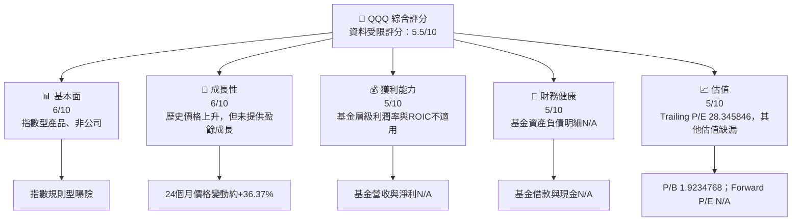

### 1.2 評分進度條視覺化

```
╔══════════════════════════════════════════════════════════════╗
║               QQQ ETF 多維度評分儀表板（1-10分）             ║
╠══════════════════════════════════════════════════════════════╣
║ 基本面適配  6.0 ▓▓▓▓▓▓▓▓▓▓▓▓░░░░░░░░  ★★★☆☆             ║
║ 成長可見度  6.0 ▓▓▓▓▓▓▓▓▓▓▓▓░░░░░░░░  ★★★☆☆             ║
║ 獲利資料    5.0 ▓▓▓▓▓▓▓▓▓▓░░░░░░░░░░  ★★★☆☆             ║
║ 財務透明度  4.0 ▓▓▓▓▓▓▓▓░░░░░░░░░░░░  ★★☆☆☆             ║
║ 估值可判讀  5.0 ▓▓▓▓▓▓▓▓▓▓░░░░░░░░░░  ★★★☆☆             ║
║ 指數追蹤特性 7.0 ▓▓▓▓▓▓▓▓▓▓▓▓▓▓░░░░░░  ★★★★☆             ║
╠══════════════════════════════════════════════════════════════╣
║ 綜合資料評分 5.5 ▓▓▓▓▓▓▓▓▓▓▓░░░░░░░░░  🟡 中性、待補資料    ║
╚══════════════════════════════════════════════════════════════╝
```

> 評分為 ETF 分析適配度與目前可用資料的綜合評分，不代表成分股品質的完整評估。

### 1.3 五大投資論點 + 三大核心風險

| 類型 | 項目 | 具體依據 | 信心度 |
|------|------|----------|--------|
| 🟢 **論點①** | 一檔取得 Nasdaq-100 曝險 | 基金說明指出，投資組合會調整以對應 Nasdaq-100 指數成分及相對權重 | 🟢 高 |
| 🟢 **論點②** | 有可觀察的長期價格上升 | 月末價格由 2024-11 的 $504.63 升至 2026-11 的 $688.17，兩端變動約 +36.37% | 🟡 中；歷史不代表未來 |
| 🟡 **論點③** | 指數調整提供自動權重更新 | 資料說明基金會因應指數定期成分與權重變更調整證券 | 🟡 中；不是避免成分股下跌的保證 |
| 🔴 **風險①** | 高估值成分股下修 | Trailing P/E 28.345846；若成分股預期獲利下修，估值倍數與盈餘可能同時壓低價格 | 🟡 中 |
| 🔴 **風險②** | 權重集中 | 未提供目前持股權重，無法量化集中度；大型權重股的單股波動可能顯著影響 ETF | 🟡 中 |
| 🟡 **風險③** | 追蹤及費用資料缺漏 | 費用率、追蹤誤差、AUM 皆 N/A，無法檢查持有成本與追蹤品質 | 🔴 高（資料風險） |

### 1.4 快速統計卡片

| 指標 | QQQ 實際值 | 行業／同類均值 | S&P 500 均值 | 狀態 |
|------|------------|----------------|--------------|------|
| 基金營收 YoY 成長 | N/A | N/A | N/A | ⚪ 不適用 |
| 毛利率 | N/A | N/A | N/A | ⚪ 不適用 |
| 淨利率 | N/A | N/A | N/A | ⚪ 不適用 |
| ROE | N/A | N/A | N/A | ⚪ 不適用 |
| Trailing P/E | **28.345846** | N/A | N/A | 🟡 有估值資料但比較基準缺漏 |
| Forward P/E | N/A | N/A | N/A | ⚪ N/A |
| P/B | **1.9234768** | N/A | N/A | 🟡 缺同類比較 |
| 最新收盤價 | **$688.17，2026-11-12** | — | — | 52 週區間中上段 |

### 1.5 投資結論

```
╔══════════════════════════════════════════════════════════════════╗
║                    📊 投資結論摘要                               ║
╠══════════════════════════════════════════════════════════════════╣
║  評級：持有（依中性參考價 MOS=0%；非獨立基本面估值結論）         ║
║  價格（2026-11-12 收盤）：$688.17                                ║
║  DCF 內在價值（基準）：N/A（缺成分股現金流與權重）               ║
║  DCF 折溢價：N/A                                                  ║
║  安全邊際 MOS：0.00%（參考價 $688.17；不是獨立內在價值）         ║
║  參考價格區間（非估值目標）：                                     ║
║    52 週低點：$554.41（較現價 -19.43%）                           ║
║    中性市場錨：$688.17（0.00%）                                   ║
║    52 週高點：$762.86（較現價 +10.85%）                           ║
║  投資評分：5.5/10（資料受限）                                     ║
║  適合投資人：接受大型 Nasdaq 成長股波動、以指數曝險為目的者      ║
╚══════════════════════════════════════════════════════════════════╝
```

---

## 2. 公司概覽與商業模式

### 2.1 業務結構與收入來源

QQQ 是一項投資信託，其主要功能是持有證券並使組合成分與權重對應 Nasdaq-100 指數。它不是以產品銷售或服務訂閱產生營收的企業。基金總資產、市值、持股明細及各板塊比重皆未提供，故不能填入市值、年營收或持股占比。

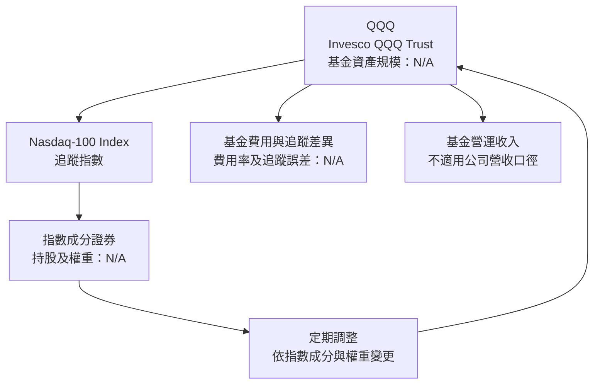

### 2.2 市場份額

目前資料未提供 QQQ、其他 Nasdaq-100 ETF 或全市場 ETF 的 AUM、交易量或資金流，因此無法計算市占率。以下不以虛構百分比繪製 pie chart。

| 比較項目 | QQQ | 同類基金 | 評估 |
|----------|-----|----------|------|
| 追蹤標的 | Nasdaq-100 Index | 需逐一核對各基金指數 | QQQ 指數曝險明確 |
| 市場份額／AUM | N/A | N/A | 無法量化 |
| 交易量市占率 | N/A | N/A | 無法比較 |
| 費用率 | N/A（題示未提供） | N/A | 應以最新公開說明書確認 |

### 2.3 競爭護城河分析

以下 mindmap 節點採英文，符合圖表語法要求。此處描述 ETF 產品競爭因素，不代表 QQQ 對底層成分股具有企業級營運護城河。

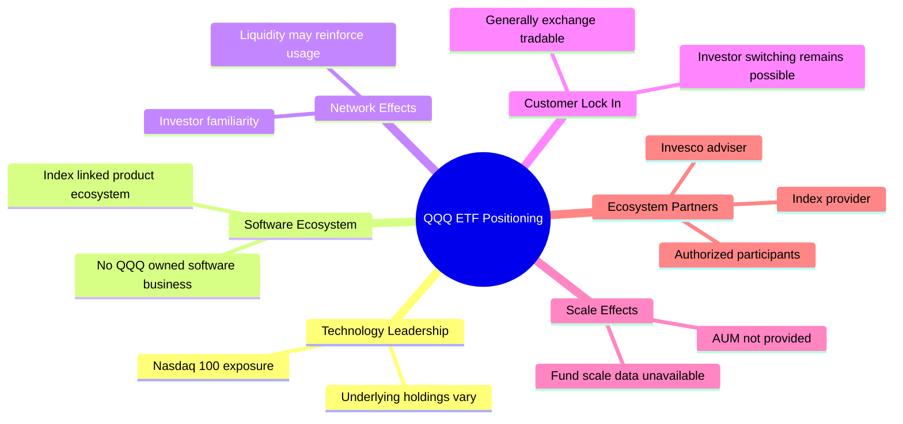

### 2.4 護城河強度評分

| 護城河項目 | 評分 | 依據與限制 |
|------------|------|------------|
| 指數識別度 | 7/10 | 產品明確追蹤 Nasdaq-100；未提供品牌認知量化 |
| 流動性優勢 | 6/10 | 屬市場廣泛使用的指數產品，但成交量資料 N/A |
| 費用競爭力 | 5/10 | QQQ 費用率未在資料包提供，無法和同類基金直接比較 |
| 網路效應 | 5/10 | ETF 使用者熟悉度可能提升流動性，但 AUM、資金流缺漏 |
| 轉換成本 | 3/10 | 投資人通常可轉換至其他 ETF，轉換成本有限 |
| 綜合護城河 | **5.2/10** | 產品與指數品牌有一定辨識度，成本及流動性優勢待數據確認 |

```
╔══════════════════════════════════════════════════════════════╗
║                   QQQ ETF 護城河強度評分                    ║
╠══════════════════════════════════════════════════════════════╣
║ 指數識別度    7/10  ▓▓▓▓▓▓▓▓▓▓▓▓▓▓░░░░░░  🟢               ║
║ 流動性優勢    6/10  ▓▓▓▓▓▓▓▓▓▓▓▓░░░░░░░░  🟡 資料未提供    ║
║ 費用競爭力    5/10  ▓▓▓▓▓▓▓▓▓▓░░░░░░░░░░  🟡                ║
║ 網路效應      5/10  ▓▓▓▓▓▓▓▓▓▓░░░░░░░░░░  🟡                ║
║ 轉換成本      3/10  ▓▓▓▓▓▓░░░░░░░░░░░░░░  🔴 較低          ║
╠══════════════════════════════════════════════════════════════╣
║ 綜合護城河    5.2/10 ▓▓▓▓▓▓▓▓▓▓░░░░░░░░░░  🟡               ║
╚══════════════════════════════════════════════════════════════╝
```

---

## 3. 損益表深度分析

QQQ 是基金，不應把成分股收入加總成基金營收，也不能將基金分配收入、投資收益與企業營收混為一談。題示的年度及季度損益表均無資料；TTM 營收、最新單季營收 YoY、淨利與 EPS 均為 N/A。因此無法計算基金層級 YoY、QoQ、利潤率或 4 季 EPS 超預期情況。

### 3.1 年度收入成長趨勢（近 4 年）

```
╔══════════════════════════════════════════════════════════════════╗
║                 QQQ 基金年度營收趨勢（FY-4 至 FY-1）             ║
╠══════════════════════════════════════════════════════════════════╣
║  FY-4  N/A   數據未提供；公司式營收不適用                         ║
║  FY-3  N/A   數據未提供；公司式營收不適用                         ║
║  FY-2  N/A   數據未提供；公司式營收不適用                         ║
║  FY-1  N/A   數據未提供；公司式營收不適用                         ║
╠══════════════════════════════════════════════════════════════════╣
║  4 年營收 CAGR：N/A；不得以成分股營收或 ETF 價格漲幅替代          ║
╚══════════════════════════════════════════════════════════════════╝
```

### 3.2 季度收入趨勢分析

| 最近季度 | 基金營收 | QoQ 成長 | YoY 成長 | 備註 |
|----------|----------|----------|----------|------|
| 最新季 | N/A | N/A | N/A | 題示無基金財報 |
| 前一季 | N/A | N/A | N/A | 同上 |
| 前二季 | N/A | N/A | N/A | 同上 |
| 前三季 | N/A | N/A | N/A | 同上 |

### 3.3 利潤率演變分析

| 利潤率指標 | FY-4 | FY-3 | FY-2 | FY-1 | 趨勢 | 評估 |
|------------|------|------|------|------|------|------|
| 毛利率 | N/A | N/A | N/A | N/A | 不適用基金營運模型 | ⚪ |
| 營業利益率 | N/A | N/A | N/A | N/A | 不適用 | ⚪ |
| EBITDA 利潤率 | N/A | N/A | N/A | N/A | 不適用 | ⚪ |
| 淨利率 | N/A | N/A | N/A | N/A | 不適用 | ⚪ |

基金投資報酬主要由持股價格變動、股息分配及費用／追蹤差異影響，並非由一般企業的產品組合、定價能力與營業槓桿所決定。缺少分配與費用明細，不能宣稱利潤率改善或惡化。

### 3.4 費用結構分析

費用率未提供，故無法量化費用占比，也不以估算值製作會造成誤導的 pie chart。

| 費用／收益項目 | 數值 | 備註 |
|----------------|------|------|
| 管理費／總費用率 | N/A | 應核對最新公開說明書 |
| 交易與再平衡成本 | N/A | 資料包未提供 |
| 持股股息收入 | N/A | 基金分配資料未提供 |
| 追蹤差異 | N/A | 無法確認實際基金淨值對指數的偏離 |

### 3.5 季度 EPS 趨勢與盈餘品質（Quality of Earnings）

| 盈餘品質項目 | 數值／佔比 | 評估 |
|--------------|------------|------|
| 股權薪酬 SBC／營收 | N/A | ETF 本身無可直接比較的營運營收 |
| SBC／營業現金流 | N/A | 基金層級營業現金流資料缺漏 |
| FCF／淨利 | N/A | 兩個分子／分母均不適用或未提供 |
| 一次性／非經常性損益 | N/A | 無基金損益表 |
| 有效稅率 | N/A | 投資人稅務結果依基金分配與個人情況而異 |
| 資本化支出 vs 費用化 | 不適用 | ETF 不以企業資本支出模式營運 |
| 最近 4 季 EPS beat/miss | N/A | 題示無盈餘歷史；ETF 沒有公司式 EPS 財報 |

**盈餘品質結論**：不能對 QQQ 基金套用 GAAP 淨利含金量分析。成分股的 SBC、稅率、資本化支出與 FCF 轉換率，需逐檔及按指數權重計算；目前資料不足，結論為 N/A，而非假定獲利品質良好或惡化。

---

## 4. 資產負債表分析

### 4.1 資產結構分解

基金資產主要是指數成分證券及可能的現金／應收款，但題示沒有期末持倉、現金與應收款數據，故不呈現虛構比例。

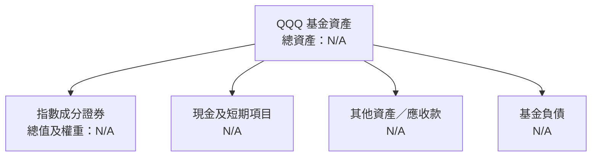

### 4.2 流動性指標分析

| 指標 | QQQ | 歷史趨勢 | 同類均值 | 評估 |
|------|-----|----------|----------|------|
| 現金比率 | N/A | N/A | N/A | 無基金資產負債明細 |
| 流動比率 | N/A | N/A | N/A | 公司營運流動性比率不宜直接套用 ETF |
| 基金借款 | N/A | N/A | N/A | 不得以資料包的 Net Cash / Debt $0.00 認定基金無負債，該欄並非 ETF 資產負債表明細 |
| 淨資產／AUM | N/A | N/A | N/A | 題示未提供 AUM |

### 4.3 債務結構分析

```
╔══════════════════════════════════════════════════════════════════╗
║                 QQQ 基金債務健康診斷                             ║
╠══════════════════════════════════════════════════════════════════╣
║  總債務：              N/A   未提供基金負債明細                  ║
║  總現金及投資：        N/A   持倉明細與現金資料缺漏              ║
║  淨現金／淨負債：      N/A   公司資料包的 $0.00 不作基金推論      ║
║  Debt/EBITDA：         N/A   ETF 不適用企業 EBITDA 槓桿口徑       ║
║  利息保障倍數：        N/A   基金利息費用及營業利益未提供         ║
║  結論：                不足以判斷；不以缺資料代表零負債          ║
╚══════════════════════════════════════════════════════════════════╝
```

### 4.4 股東權益趨勢

ETF 持有人權益與基金淨資產、申購贖回及持倉市值變動相關，不能等同企業累積留存盈餘。題示未提供歷年基金淨資產或股東權益序列，故趨勢 N/A。

---

## 5. 現金流量深度分析

### 5.1 現金流量瀑布圖

基金的分配及申購贖回與企業「淨利→營業現金流→資本支出→FCF」不是相同概念。題示亦未提供基金現金流明細。


### 5.2 FCF 轉換率趨勢

| 期間 | FCF／淨利 | 趨勢 | 說明 |
|------|----------|------|------|
| FY-3 | N/A | N/A | ETF 不適用企業 FCF 轉換率 |
| FY-2 | N/A | N/A | 基金現金流與淨利資料缺漏 |
| FY-1 | N/A | N/A | 不可由價格漲幅反推 FCF |

### 5.3 自由現金流趨勢

題示的 FCF 定義為營業現金流減資本支出，該項對 QQQ 的值為 **N/A**。不得以持股分配或 ETF 價格報酬替代。

```
╔══════════════════════════════════════════════════════════════════╗
║           QQQ FCF：歷史實際趨勢與 FCF Yield                      ║
╠══════════════════════════════════════════════════════════════════╣
║  TTM 營業現金流：N/A                                              ║
║  TTM 資本支出：  N/A                                              ║
║  TTM FCF：       N/A                                              ║
║  TTM FCF Yield： N/A                                              ║
║  結論：不得用 ETF 價格漲幅或分配殖利率代替公司式 FCF              ║
╚══════════════════════════════════════════════════════════════════╝
```

### 5.4 資本配置評估

ETF 的投資配置是持有指數成分證券，不宜將基金持股買入簡化成企業 Capex 或回購。基金分配及申購贖回資料皆 N/A。

| 配置項目 | 數值 | 評估 |
|----------|------|------|
| 指數成分股持有 | 持股明細 N/A | 基金主要投資活動，但無法拆分權重 |
| 現金 | N/A | 未提供 |
| 資本支出 | 不適用／N/A | 非營運企業的投資支出 |
| 持有人分配 | N/A | 需以實際分配紀錄核實 |
| 回購／留存 | 不適用企業口徑 | ETF 申購贖回不是公司股票回購 |

> 資料包中的「Dividend Yield: 45.0%」與一般 ETF 殖利率顯示不一致，且沒有分配金額、期間與計算依據。本報告將此數據標為**疑似資料異常，不採用作為 QQQ 殖利率或預期報酬**。

---

## 6. 獲利能力與資本效率

### 6.1 ROE／ROA／ROIC 趨勢

| 指標 | QQQ | 同類 ETF | 評估 |
|------|-----|----------|------|
| ROE | N/A | N/A | 基金不適用一般企業權益報酬率分析 |
| ROA | N/A | N/A | 基金資產報酬可由淨值變動觀察，但需完整期間資料 |
| ROIC | N/A | N/A | 需對成分股按權重計算，題示無持股組成 |
| 歷年趨勢 | N/A | N/A | 不得以 ETF 報價報酬代替 ROIC |

### 6.2 ROIC vs WACC 分析（核心價值創造判斷）

QQQ 不是以營運資本創造產品與服務的單一公司，因此無法對 ETF 本身計算 ROIC，也沒有可直接比較的 ETF 公司 WACC。不能把股價報酬率當 ROIC，亦不能把基金投資人預期報酬率冒充 WACC。

```
╔══════════════════════════════════════════════════════════════════╗
║               ROIC vs WACC：ETF 適用性分析                       ║
╠══════════════════════════════════════════════════════════════════╣
║  無風險利率 Rf：             N/A（財務數據包未提供）             ║
║  市場風險溢酬 ERP：          N/A                                  ║
║  Beta：                      N/A                                  ║
║  債務成本 Kd：               N/A；無基金債務與利息資料            ║
║  股權／債務權重：            N/A                                  ║
║  ETF WACC：                  不適用／N/A                          ║
║  ETF ROIC：                  不適用／N/A                          ║
║  EVA = ROIC − WACC：         無法計算                             ║
║  結論：不能判定基金本身創造或摧毀企業價值；應看成分股加權 ROIC。  ║
╚══════════════════════════════════════════════════════════════════╝
```

### 6.3 杜邦三因素分解

杜邦分析是企業 ROE 分解，不適用於基金本身。若對成分股做 look-through 分析，仍需成分股權重、淨利率、資產週轉率與槓桿數據。

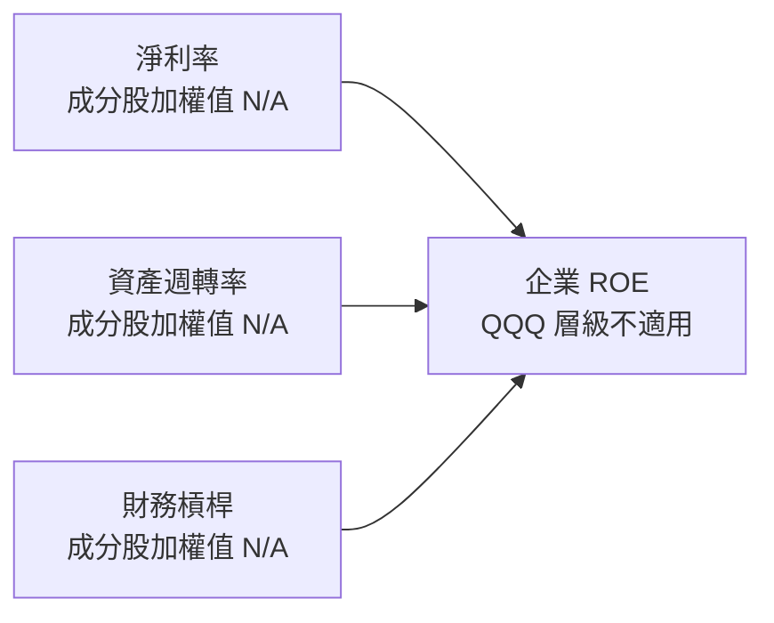

### 6.4 獲利能力儀表板

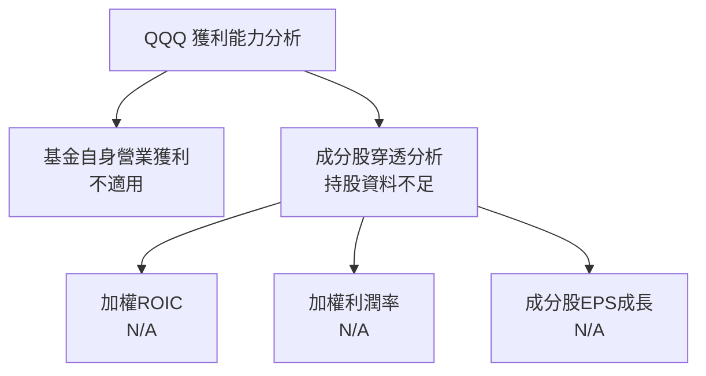

---

## 7. 相對估值分析

### 7.1 同業估值比較表格

同類產品可包括 QQQM（Nasdaq-100）、ONEQ（Nasdaq 綜合指數）及 VGT（資訊科技板塊 ETF），但後兩者的追蹤標的與 QQQ 不完全相同。題示未提供任何同業倍數；依要求，下表不捏造估計倍數。ETF 的 P/E 口徑亦可能因指數供應商、持股權重與資料日期而異。

| 估值指標 | **QQQ** | **QQQM** | **ONEQ** | **VGT** | QQQ 評估 |
|----------|--------|---------|---------|--------|----------|
| Trailing P/E | **28.345846** | N/A | N/A | N/A | 🟡 有單一倍數，缺同日同口徑比較 |
| Forward P/E | N/A | N/A | N/A | N/A | ⚪ 不可比較 |
| P/S | N/A | N/A | N/A | N/A | ⚪ 不可比較 |
| P/B | **1.9234768** | N/A | N/A | N/A | 🟡 缺同類數據 |
| EV/EBITDA | N/A | N/A | N/A | N/A | ⚪ 通常需成分股穿透計算 |
| 費用率 | N/A | N/A | N/A | N/A | ⚪ 應核對最新基金文件 |
| AUM | N/A | N/A | N/A | N/A | ⚪ 無法比較規模 |

### 7.2 歷史估值區間分析

VERIFIED FIGURES 未提供 QQQ 歷史 P/E 區間或估值百分位，因此不推算百分位。下圖僅列市場價格，不代表歷史估值倍數。

```
╔══════════════════════════════════════════════════════════════════╗
║                   QQQ 歷史估值位置                               ║
╠══════════════════════════════════════════════════════════════════╣
║  歷史 Trailing P/E 區間：N/A                                      ║
║  當前 Trailing P/E：     28.345846                                ║
║  歷史估值百分位：        N/A                                      ║
║  24 個月價格範圍：        $465.66（2025-03）至 $739.77（2026-09）  ║
║  最新收盤：              $688.17（2026-11-12）                    ║
║  判讀：價格仍在近 24 個月高位區間，但不能據此推定 P/E 位置。      ║
╚══════════════════════════════════════════════════════════════════╝
```

### 7.3 情境目標價（假設驅動，Bear / Base / Bull）

缺少指數未來 EPS、成分股營收 CAGR、基金持倉及退出倍數，因此不能用基本面假設推導目標價。以下僅以已提供的 52 週高低點作**價格參考情境**，不應稱為基本面目標價。

| 情境 | 營收 CAGR | 營業利潤率 | 參考基準 | 參考價格 | 相對現價 |
|------|-----------|------------|----------|----------|----------|
| 🔴 悲觀參考 | N/A | N/A | 52 週低點 | $554.41 | −19.43% |
| 🟡 中性錨 | N/A | N/A | 最新收盤價 | $688.17 | 0.00% |
| 🟢 樂觀參考 | N/A | N/A | 52 週高點 | $762.86 | +10.85% |

> 估值倍數選擇：題示提供 QQQ Trailing P/E 28.345846，但未提供 Forward P/E、EV/EBITDA、EV/Sales 或持股 FCF。此數字是已提供的指數／基金估值資料，不足以單獨生成目標價。ETF 估值需進一步取得指數成分股盈利預期與持倉權重。

### 7.4 相對估值隱含價格區間

```
╔══════════════════════════════════════════════════════════════════╗
║                相對估值隱含價格（同業資料受限）                  ║
╠══════════════════════════════════════════════════════════════════╣
║ Forward P/E 回推： N/A                                            ║
║ EV/EBITDA 回推：  N/A                                            ║
║ EV/Sales 回推：   N/A                                            ║
║ FCF Yield 回推：  N/A                                            ║
║ 當前價格：        $688.17（2026-11-12 收盤）                      ║
║ 可用的價格參考：  52 週低點 $554.41 ── 現價 $688.17 ── 高點 $762.86║
║ 結論：價格區間是歷史交易範圍，不是同業倍數推導的合理價值區間。  ║
╚══════════════════════════════════════════════════════════════════╝
```

---

## 8. DCF 內在價值評估（Discounted Cash Flow）

> **重要限制**：QQQ 是持有多家公司的 ETF。可稽核 DCF 至少需要成分股權重、成分股未來 FCFF、稅率、資本支出、營運資金、SBC、基金費用與現金／負債等資料。這些資料在題示中均未提供。若填入數值便會變成虛構假設，而非「依財務數據推導」的 DCF。
>
> 因此本章完整列出估值邏輯及缺失項目；**DCF 每股內在價值、終值、DCF 敏感度及反推 DCF 均為 N/A**。報告在 8.8 用可複算的市場價格錨建立暫定加權參考價值，並明確標示其不是獨立基本面估值。

### 8.0 估值推理鏈（Thinking Logic）

**Step 1 — 價值來源與主導變數**

QQQ 的價值來自 Nasdaq-100 成分股的加權股權價值，基金層級再受費用與追蹤差異影響。題示沒有成分股權重，因此無法量化各板塊占基金資產的比例。估值主導變數應是**成分股未來加權盈餘／自由現金流與市場估值倍數**；目前只能觀察到 Trailing P/E 28.345846，不能拆解其成長與估值貢獻。

**Step 2 — 模型選擇**

| 決策點 | 本報告採用 | 理由 | 曾考慮但否決 | 否決理由 |
|--------|-----------|------|--------------|----------|
| 現金流定義 | 成分股加權 FCFF 理論上較合適 | 可由企業價值扣負債後估股權價值 | 直接以 QQQ 基金 FCF | 基金 OCF、Capex 皆 N/A，概念亦不相同 |
| 預測期 N | 不設定 | 無持股現金流及成分股預測 | 任意 5 年或 10 年 | 沒有資料錨點，會形成黑箱 |
| 終值方法 | N/A | 沒有 FY+N FCFF | Gordon Growth／退出倍數 | 缺終值所需基礎現金流、EBITDA |
| EBIT 基礎 | N/A | 無基金或成分股 EBIT | GAAP／非 GAAP | 無法統一成分股會計口徑 |
| 估值參考 | $688.17 中性價格錨 | 最新已完成交易日收盤價 | 宣稱為 DCF 公允值 | 市場價錨不是內在價值 |

**Step 3 — 關鍵假設推導鏈**

| 變數 | 錨點 → 調整理由 → 採用值 → 否決值 |
|------|-----------------------------------|
| 營收／FCF CAGR | 錨點 N/A（沒有指數營收或 FCF 歷史）；無法調整；採用 N/A；否決任意 CAGR，因無底層數據 |
| 期末營業利潤率 | 錨點 N/A；基金不具公司營業利潤率；採用 N/A；否決用成分股未加權利潤率 |
| 永續成長率 g | 錨點 N/A；沒有長期 FCFF 與宏觀輸入資料；採用 N/A；否決任意長期成長率 |
| 預測期 N | 錨點 N/A；沒有成分股週期資料；採用不設定；否決任意年數 |
| Capex／營收、D&A／營收、ΔWC | 均 N/A；基金層級不適用，成分股加權資料缺漏 |
| EBIT 與 SBC | 均 N/A；基金沒有合併式成分股 GAAP EBIT／SBC |
| 稀釋股數 | 基金 units outstanding 為 393.10M，但沒有可直接用於企業 DCF 的成分股稀釋股數；不把基金單位數誤作成分股股數 |
| WACC | N/A；資料包說明 QQQ 沒有單一公司 WACC，也未提供必要輸入 |
| 終值方法 | N/A；缺少預測期最後一年現金流及 EBITDA |

**Step 4 — 最脆弱環節**

最脆弱的是缺少成分股加權現金流與權重；沒有它們，任何 DCF 目標價都會由未揭露假設主導，而不是由題示數據支持。

**Step 5 — 計算路徑圖**

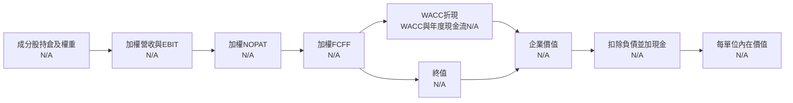

### 8.1 模型假設總表（Model Inputs）

| 假設項目 | 採用值 | 依據／來源 | 敏感度 |
|----------|--------|-------------|--------|
| 預測期長度 N | N/A | 無成分股 FCFF 預測 | 🔴 高 |
| 營收 CAGR | N/A | 指數成分股營收與權重未提供 | 🔴 高 |
| 期末營業利潤率 | N/A | 成分股 EBIT 加權資料未提供 | 🔴 高 |
| 有效稅率 | N/A | 無一致的成分股稅率資料 | 🟢 低 |
| Capex／營收 | N/A | 成分股資本支出未提供 | 🟡 中 |
| D&A／營收 | N/A | 成分股折舊攤銷未提供 | 🟢 低 |
| ΔWC／營收增額 | N/A | 成分股營運資金變化未提供 | 🟢 低 |
| EBIT 基礎 | N/A | 無成分股加權 EBIT 數據 | 🟡 中 |
| SBC 處理 | N/A | 無成分股 SBC 數據 | 🟡 中 |
| 年稀釋率 | N/A | 成分股股數變化未提供 | 🟡 中 |
| 永續成長率 g | N/A | 無 FCFF 基礎，無法檢驗 g < WACC | 🔴 高 |
| 終值方法 | N/A | Gordon Growth 與退出倍數均缺必要輸入 | 🔴 高 |
| WACC | N/A | ETF 無單一公司 WACC；Rf、ERP、Beta、Kd 權重未提供 | 🔴 高 |

**FCF 定義**：若取得足夠持股資料，應以成分股加權 FCFF＝NOPAT＋D&A−Capex−ΔWC，並以一致口徑 WACC 折現。現階段沒有可代入的底層數據。

**SBC 防呆聲明**：本報告不建立企業 DCF，因此不採用 (A)、(B) 或 (C) 的數值模型組合；SBC 與股數稀釋均為 N/A。不得將基金 393.10M units 誤作持股公司的稀釋股數。

### 8.2 折現率推導（WACC）

```
╔══════════════════════════════════════════════════════════════════╗
║                    WACC 推導（折現率）                           ║
╠══════════════════════════════════════════════════════════════════╣
║  股權成本 Ke（CAPM）：                                            ║
║  ├── 無風險利率 Rf：       N/A                                    ║
║  ├── 市場風險溢酬 ERP：    N/A                                    ║
║  ├── Beta：                N/A                                    ║
║  ├── 規模／國別溢酬：      N/A                                    ║
║  └── Ke：                  N/A                                    ║
║  債務成本 Kd：             N/A（無成分股合併債務與利息資料）       ║
║  股權／債務權重：          N/A                                    ║
║  ✅ WACC：                 N/A                                    ║
║  原因：QQQ 為基金，不存在一個可代表所有成分股的單一公司 WACC。    ║
╚══════════════════════════════════════════════════════════════════╝
```

題示 VERIFIED FIGURES 未提供「Cost of capital inputs」；Rf、ERP、Beta、Kd、稅率及權重皆無法依要求計算。故 6.2 與本節一致，均為 N/A。

### 8.3 逐年自由現金流預測（基準情境）

未設定預測期 N，因此不能製作 FY+1 至 FY+N 的數值預測表。以下欄位均為 N/A，不以任意財務假設填補。

| 項目 | FY+1 | FY+2 | FY+3 | FY+4 | FY+5 |
|------|------|------|------|------|------|
| 營收 | N/A | N/A | N/A | N/A | N/A |
| 營收 YoY | N/A | N/A | N/A | N/A | N/A |
| 營業利潤率 | N/A | N/A | N/A | N/A | N/A |
| EBIT | N/A | N/A | N/A | N/A | N/A |
| 稅 | N/A | N/A | N/A | N/A | N/A |
| NOPAT | N/A | N/A | N/A | N/A | N/A |
| D&A | N/A | N/A | N/A | N/A | N/A |
| Capex | N/A | N/A | N/A | N/A | N/A |
| ΔWC | N/A | N/A | N/A | N/A | N/A |
| FCFF | N/A | N/A | N/A | N/A | N/A |
| 折現因子 | N/A | N/A | N/A | N/A | N/A |
| FCFF 現值 PV | N/A | N/A | N/A | N/A | N/A |

- 預測期 FCF 現值合計：N/A；無法進行逐年加總。
- 代表年度九步演算：N/A；缺少起始營收、利潤率、稅率、D&A、Capex、ΔWC、WACC。
- 歷史實際 FCF CAGR：N/A；題示 QQQ FCF 為 N/A。
- FY+N FCFF 利潤率與目前／同業比較：N/A。
- FCFF 是否為負：N/A，沒有可計算資料。

```
╔══════════════════════════════════════════════════════════════════╗
║            自由現金流：歷史實際 vs 模型預測                      ║
╠══════════════════════════════════════════════════════════════════╣
║  TTM 實際 FCF：N/A                                               ║
║  FY+1 至 FY+N 預測：N/A                                          ║
║  歷史 FCF CAGR：N/A                                              ║
║  預測 FCF CAGR：N/A                                              ║
║  結論：不以價格上漲或異常股息殖利率替代自由現金流。              ║
╚══════════════════════════════════════════════════════════════════╝
```

### 8.4 終值計算（Terminal Value）

**適用性檢查**：`WACC N/A vs g N/A → WACC > g？無法判定`

| 方法 | 計算式 | 終值 TV | TV 現值 | 佔總 EV 比重 |
|------|--------|---------|---------|--------------|
| Gordon Growth | FCFF(FY+N)×(1+g)÷(WACC−g) | N/A | N/A | N/A |
| 退出倍數法 | EBITDA(FY+N)×退出倍數 | N/A | N/A | N/A |

因 WACC、g、FY+N FCFF 及 EBITDA 均缺漏，公式沒有可代入的數字；不能聲稱 WACC 大於 g，也不能計算終值。

### 8.5 企業價值 → 每股內在價值（Bridge）

```
╔══════════════════════════════════════════════════════════════════╗
║              企業價值 → 每股內在價值 橋接表                      ║
╠══════════════════════════════════════════════════════════════════╣
║  預測期 FCF 現值合計            N/A                               ║
║  終值現值 PV(TV)                N/A                               ║
║  = 企業價值 EV                  N/A                               ║
║  + 現金及短期投資               N/A                               ║
║  − 總債務                       N/A                               ║
║  − 少數股東權益／其他           N/A                               ║
║  = 股權價值                     N/A                               ║
║  ÷ 成分股稀釋後股數             N/A                               ║
║  ★ 每股／每單位 DCF 價值        N/A                               ║
║  當前 QQQ 價格                  $688.17（2026-11-12 收盤）          ║
║  折溢價（對 DCF）               N/A                               ║
╚══════════════════════════════════════════════════════════════════╝
```

逐步橋接五行計算均為 N/A：EV、現金、債務、少數股權、成分股稀釋股數皆未提供。題示基金 units outstanding 為 **393.10M**，但不能將 ETF 單位數代替成分股 DCF 股數。依 MOS 定義，本節不計算 MOS；DCF 折溢價亦因 DCF 價值 N/A 而無法計算。

### 8.6 敏感性分析（WACC × 永續成長率）

由於基準 WACC、g、FCFF 與稀釋股數均為 N/A，不能生成有經濟意義的 5×5 每股估值矩陣。下表依資料缺漏如實標示。

| g（列）／WACC（欄） | WACC N/A | WACC N/A | **基準 WACC N/A** | WACC N/A | WACC N/A |
|-----------|------|------|------------------|------|------|
| g N/A | N/A | N/A | N/A | N/A | N/A |
| g N/A | N/A | N/A | N/A | N/A | N/A |
| **g 基準 N/A** | N/A | N/A | **N/A** | N/A | N/A |
| g N/A | N/A | N/A | N/A | N/A | N/A |
| g N/A | N/A | N/A | N/A | N/A | N/A |

- 敏感度示範格：N/A；不存在可驗算的 WACC 與 g。
- 三情境 DCF：悲觀、基準、樂觀每股價值均 N/A。
- g 每 +1pp、WACC 每 +1pp、營業利潤率每 +1pp 對內在價值的影響：N/A。
- 主導估值變數仍是成分股加權未來盈餘／FCF；但目前無法量化敏感度。

### 8.7 反推 DCF（Reverse DCF）

現價不能單獨反解缺乏底層資料的多個未知數。題示缺少指數盈餘、權重、現金流、WACC 與終值基礎，因此不進行虛構反推。

| 求解變數（一次一個） | 固定變數 | 市場隱含值 | 公司／指數歷史實際 | 判斷 |
|----------------------|----------|------------|---------------------|------|
| 未來 N 年營收 CAGR | 基準利潤率、g 等皆 N/A | N/A | N/A | 無法求解 |
| 期末營業利潤率 | CAGR、g 等 N/A | N/A | N/A | 無法求解 |
| 永續成長率 g | CAGR、利潤率 N/A | N/A | — | 無法求解 |
| 高成長持續年數 N | CAGR、利潤率、g N/A | N/A | N/A | 無法求解 |

試算軌跡：N/A。若要使市場價格成為可解的 DCF 方程，至少需取得指數成分股未來盈利／FCF 預測及權重，並固定其餘假設。反推結論：僅憑 $688.17 與 Trailing P/E 28.345846，不能判斷市場隱含的成長率或利潤率。

### 8.8 估值三角驗證與安全邊際

由於 DCF、同業倍數回推及分析師共識均無可用數值，以下不是完整的估值三角驗證。為了依要求明確定義 MOS，本報告採用**單一中性價格錨**作暫定加權參考價值；不得把它解讀成內在價值估算。

| 估值方法 | 隱含每股／單位價值 | 上行空間（÷現價） | 權重 | 說明 |
|----------|-------------------|--------------------|------|------|
| DCF | N/A | N/A | 0% | 無底層現金流資料 |
| 同業倍數 | N/A | N/A | 0% | Peer multiples 未提供 |
| FCF Yield 回推 | N/A | N/A | 0% | FCF Yield N/A |
| 分析師共識目標價 | N/A | N/A | 0% | 目標價 N/A |
| **中性市場價格錨** | **$688.17** | **0.00%** | **100%** | 最新收盤價，不是獨立內在價值 |
| **加權合理參考價值** | **$688.17** | **0.00%** | **100%** | 暫定價格錨，需補資料後重估 |

**逐步演算**：

加權參考價值  
= N/A×0% + N/A×0% + N/A×0% + N/A×0% + $688.17×100%  
= **$688.17**

**MOS**（唯一分母為此加權參考價值）：

$$
MOS=\frac{688.17-688.17}{688.17}=0.00\%
$$

**上行空間**：

$$
上行空間=\frac{688.17-688.17}{688.17}=0.00\%
$$

**折溢價**：以 8.5 節 DCF 基準內在價值為基準；DCF 為 N/A，故折溢價 N/A。

```
╔══════════════════════════════════════════════════════════════════╗
║                  估值區間與安全邊際                              ║
╠══════════════════════════════════════════════════════════════════╣
║  52週低點 $554.41 ── 現價 $688.17 ── 52週高點 $762.86            ║
║  上述為歷史價格區間，不是 DCF／內在價值區間。                    ║
║  安全邊際 MOS = ($688.17 − $688.17) ÷ $688.17 = 0.00%            ║
║  MOS 評估：以中性市場錨計算為 0%；不代表真實下檔保護              ║
║  上行空間 = ($688.17 − $688.17) ÷ $688.17 = 0.00%                ║
║  建議買入區間：不給基本面價格區間；需先完成持股穿透估值          ║
╚══════════════════════════════════════════════════════════════════╝
```

依 MOS 0.00% 對應規則，評級為**持有**；未作質化升降級。

### 8.9 DCF 模型的局限與失效條件

- **終值依賴度**：N/A；無法計算終值佔企業價值比例。
- **最脆弱的假設**：成分股未來加權盈餘／FCF 與估值倍數；兩者缺漏使 DCF 無法建立。
- **不適用情境**：對 ETF 直接使用單一公司 DCF 不適用。較合理作法為成分股穿透估值、指數 Forward P/E、加權 FCF Yield 及費用／追蹤差異比較。
- **與第 10 章風險連結**：大型權重股盈利下修會影響加權 EPS／FCF；估值倍數下修會直接壓低基金淨值；費用率與追蹤差異則影響長期相對指數報酬。
- **價格錨限制**：$688.17 為市場觀察值，非安全價值；若市場整體高估，市場錨會同步偏高。

### 8.10 複算檢核表（Audit Trail）

| # | 檢核項目 | 檢查方式 | 結果 |
|---|----------|----------|------|
| 1 | 高／中敏感度假設完整四段式推導 | 因模型輸入缺漏，明確列為 N/A，未捏造推導 | ⚠️ 不適用 |
| 2 | 每個假設都有來歷 | N/A 項目均註明資料缺口 | ✅ |
| 3 | WACC 五步算式與權重 | WACC 輸入缺漏，不計算 | ⚠️ N/A |
| 4 | Kd 分母與債務權重一致 | 基金債務及利息資料 N/A | ⚠️ N/A |
| 5 | WACC 與 6.2 節相同 | 兩處均為 N/A | ✅ |
| 6 | 預測年度數等於 N | 未設定 N，沒有數值預測 | ⚠️ N/A |
| 7 | FY+1 九步算式可複算 | 起始值與模型輸入缺漏 | ⚠️ N/A |
| 8 | 預測期 PV 加總 | 沒有預測 FCFF | ⚠️ N/A |
| 9 | WACC > g | WACC、g 均 N/A | ⚠️ N/A |
| 10 | 終值以 FY+N 現金流為基礎 | 沒有 FCFF／N | ⚠️ N/A |
| 11 | 橋接至每股價值 | EV、現金、債務及成分股股數缺漏 | ⚠️ N/A |
| 12 | SBC 組合一致 | 沒有 DCF，不存在重複扣除；資料不足 | ⚠️ N/A |
| 13 | 矩陣基準格等於 8.5 DCF | 無 DCF 數值 | ⚠️ N/A |
| 14 | 矩陣格遵守 WACC > g | 無 WACC 與 g | ⚠️ N/A |
| 15 | 三情境機率合計 | 未建立 DCF 情境 | ⚠️ N/A |
| 16 | 反推每列只放開一個變數 | 未進行不可識別的反推 | ✅ |
| 17 | MOS 與 1.0 同值；折溢價基於 DCF | MOS 均引用 0.00%；DCF 折溢價 N/A | ✅ |
| 18 | 報告完整至第 11 章 | 全章節已列示 | ✅ |
| 19 | 加權合理參考價值加總 | $688.17×100% = $688.17 | ✅ |
| 20 | 評級符合 MOS 門檻 | MOS 0.00%，依規則為持有 | ✅ |

**未修正項目說明**：DCF、ROIC／WACC、同業倍數及成分股現金流因原始資料缺漏而不可計算；本報告已將相關結論信心度降為低，並以 N/A 呈現，沒有以假設數字填補。

---

## 9. 成長催化劑

QQQ 的成長不等於基金營收成長，主要來自持股市值及持股收益變動、Nasdaq-100 成分與權重調整，以及投資人申購需求。資料包的近期新聞包括「QQQ 於 11 月 11 日賣出 Apple 與 NVIDIA」等標題，但未提供交易規模、權重變化與完整消息來源，故不推論其影響基金報酬。

### 9.1 催化劑時間軸

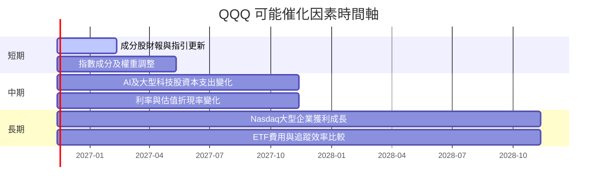

### 9.2 TAM 市場規模分析

QQQ 的投資機會不是單一產品 TAM，而是 Nasdaq-100 成分企業的市值與盈餘成長。資料包沒有市場規模、成分股營收、滲透率或持股貢獻資料，故不填入虛構 TAM 數字。

```
╔══════════════════════════════════════════════════════════════════╗
║              QQQ 投資機會與 TAM 資料可得性                       ║
╠══════════════════════════════════════════════════════════════════╣
║  Nasdaq-100 成分企業總營收：N/A                                  ║
║  各產業 TAM：N/A                                                 ║
║  指數成分股加權市值：N/A                                         ║
║  AI／雲端等主題曝險占比：N/A                                     ║
║  QQQ 基金資產規模與持股貢獻：N/A                                 ║
║  需追蹤：成分股盈餘成長、資本支出回報、指數權重與基金流量。      ║
╚══════════════════════════════════════════════════════════════════╝
```

### 9.3 成長驅動力結構圖

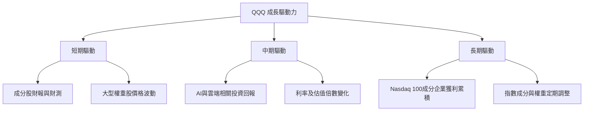

---

## 10. 風險矩陣

### 10.1 風險評分矩陣

機率與衝擊分數為定性研究判斷，不是歷史統計頻率。由於題示沒有持股權重，集中度風險衝擊幅度無法精確量化。

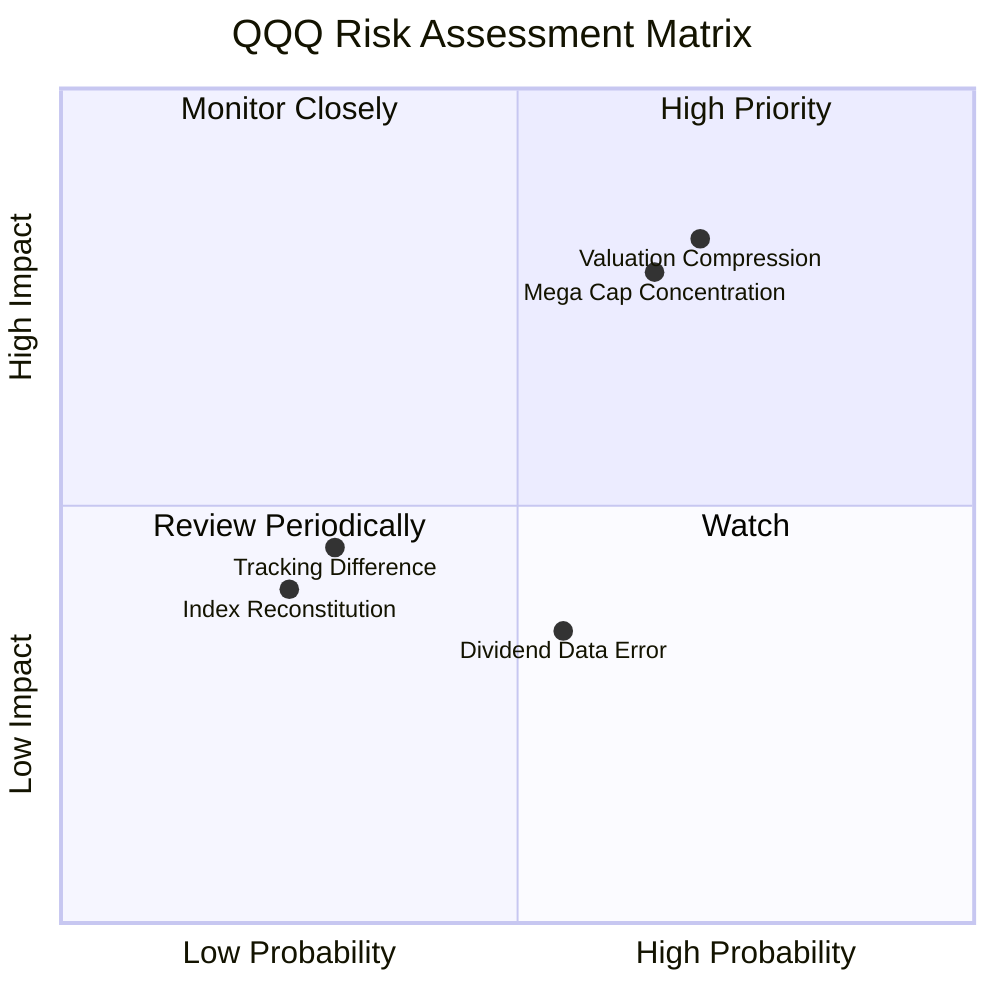

### 10.2 風險清單詳細分析

| # | 風險項目 | 發生機率 | 財務衝擊 | 風險評分 | 緩解措施 |
|---|----------|----------|----------|----------|----------|
| 1 | 🔴 **估值倍數收縮** | 中高；定性判斷 | 題示 Trailing P/E 28.345846；若倍數收縮，價格可能下跌，實際幅度需成分股 EPS 與倍數模型估算 | 🔴 7.5/10 | 分批配置、限制單一 ETF 權重、定期比較指數估值與盈利預期 |
| 2 | 🔴 **大型權重股集中** | 中高；持股比例 N/A | 個別高權重股回落可能帶動指數及 ETF 下跌；量化衝擊 N/A | 🔴 7.0/10 | 查核最新持股權重，留意前十大持股集中度與再平衡 |
| 3 | 🟡 **追蹤差異與基金成本** | 中；費用率／追蹤誤差 N/A | 長期費用與追蹤偏離會降低相對指數報酬；金額 N/A | 🟡 5.0/10 | 比較最新公開說明書、年度追蹤差異與同指數替代品 |
| 4 | 🟡 **資料品質錯誤** | 中；資料包 Dividend Yield 45.0% 明顯需核驗 | 若將 45.0% 當正常殖利率，會嚴重高估預期現金回報 | 🟡 5.5/10 | 以基金官網分配紀錄與正式文件核對，不採用該欄位 |
| 5 | 🟡 **指數規則與成分變化** | 低至中 | 調整可改善指數代表性，但成分汰換可能帶來交易成本或錯失反彈 | 🟡 4.5/10 | 追蹤指數公告及基金實際持倉調整 |

---

## 11. 投資建議

### 11.1 最終綜合評級雷達圖

```
╔══════════════════════════════════════════════════════════════╗
║              QQQ 最終評級儀表板（資料受限）                   ║
╠══════════════════════════════════════════════════════════════╣
║ 指數產品清晰度  7/10 ▓▓▓▓▓▓▓▓▓▓▓▓▓▓░░░░░░  ★★★★☆          ║
║ 成長可見度      6/10 ▓▓▓▓▓▓▓▓▓▓▓▓░░░░░░░░  ★★★☆☆          ║
║ 估值資訊        5/10 ▓▓▓▓▓▓▓▓▓▓░░░░░░░░░░  ★★★☆☆          ║
║ 基金財務透明度  4/10 ▓▓▓▓▓▓▓▓░░░░░░░░░░░░  ★★☆☆☆          ║
║ 追蹤成本可比性  4/10 ▓▓▓▓▓▓▓▓░░░░░░░░░░░░  ★★☆☆☆          ║
║ 風險可控性      5/10 ▓▓▓▓▓▓▓▓▓▓░░░░░░░░░░  ★★★☆☆          ║
╠══════════════════════════════════════════════════════════════╣
║ 綜合評分        5.5/10 ▓▓▓▓▓▓▓▓▓▓▓░░░░░░░░  🟡 持有觀察      ║
╚══════════════════════════════════════════════════════════════╝
```

### 11.2 目標價與隱含報酬率

下列不是基本面估值目標價，而是按題示 52 週價格區間推導的參考位階。機率未提供，不任意指定。

| 情境／參考位階 | 價格 | 相對 $688.17 現價 | 性質 | 機率權重 |
|----------------|------|------------------|------|----------|
| 悲觀參考：52 週低點 | $554.41 | −19.43% | 歷史價格參考，非估值下限 | N/A |
| 基準：市場價格錨 | $688.17 | 0.00% | 中性參考，不是預測報酬 | N/A |
| 樂觀參考：52 週高點 | $762.86 | +10.85% | 歷史價格參考，非估值上限 | N/A |

**價格計算方式**：相對報酬＝(參考價格−$688.17)÷$688.17。各數值以題示價格計算並四捨五入至小數點後兩位。歷史高低點不保證未來會回測或突破。

### 11.3 買入時機與觸發因素

```
╔══════════════════════════════════════════════════════════════════╗
║                  ✅ 買入／加碼／減碼觸發因素                     ║
╠══════════════════════════════════════════════════════════════════╣
║  建立或維持部位前：                                               ║
║  ✅ 核實最新持股清單、前十大持股權重與產業曝險                   ║
║  ✅ 核實基金費用率、追蹤誤差及 AUM                               ║
║  ✅ 將 45.0% 股息殖利率欄位與正式分配紀錄核對；未核實前不採用    ║
║                                                                  ║
║  加碼觸發條件（至少同時檢視）：                                   ║
║  ☐ 成分股盈利預期維持或上修，且估值相對盈利未進一步惡化          ║
║  ☐ 最新持股集中度及費用／追蹤差異符合投資人風險承受度            ║
║  ☐ 市價回落時，重新以更新後持股資料完成穿透估值                  ║
║                                                                  ║
║  減碼／風險控制觸發條件：                                         ║
║  ☐ 高權重成分股盈利預期連續下修                                  ║
║  ☐ 指數估值倍數上升但盈利預期未同步上修                          ║
║  ☐ 最新持股集中度超出投資組合既定上限                            ║
║  ☐ 追蹤差異或費用相對同類產品顯著惡化                            ║
╚══════════════════════════════════════════════════════════════════╝
```

### 11.4 投資人適配度分析

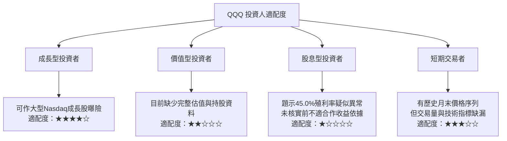

### 11.5 每季財報監控清單（Quarterly Watch List）

QQQ 沒有單一公司季度財報。應監控基金持倉與主要成分股財報；以下門檻採可查核的方向性規則，未提供的成分股基線不虛構數值。

| 監控項目 | 目前資料 | 加碼觀察條件 | 減碼／重新評估條件 |
|----------|----------|--------------|--------------------|
| 前十大持股占比 | N/A | 最新權重符合個人集中度上限 | 集中度超出事先設定的組合上限 |
| 成分股營收與 EPS 指引 | N/A | 高權重公司指引維持或上修 | 主要權重股連續兩季下修指引 |
| 指數 Forward P/E | N/A | 盈利成長可支撐估值 | 倍數上升而盈利預期下修 |
| 費用率 | N/A | 與同類基金比較後仍具競爭力 | 公開說明書費用或總持有成本惡化 |
| 追蹤誤差／追蹤差異 | N/A | 實際表現接近基準指數 | 持續偏離基準且無合理解釋 |
| 基金 AUM 與資金流 | N/A | AUM 與流動性符合需求 | 流動性下降或產品規模持續萎縮 |
| 分配與殖利率 | 題示 45.0%，待核驗 | 正式基金文件確認分配來源與頻率 | 無法由官方資料驗證 45.0% 數值 |
| 指數成分調整 | 僅有基金會配合指數調整的描述 | 成分調整符合指數方法論 | 成分與基準指數對應出現持續偏差 |

### 11.6 反面論證：什麼會證明論點錯誤（What Would Change My Mind）

```
╔══════════════════════════════════════════════════════════════════╗
║              ⚠️ 論點失效條件（Disconfirming Evidence）           ║
╠══════════════════════════════════════════════════════════════════╣
║  本報告的中性持有觀點，在下列情況應重新檢視：                    ║
║  ☐ 取得完整成分股資料後，前十大持股集中度超出投資組合風險上限    ║
║  ☐ 高權重成分股連續兩季下修 EPS／營收指引                        ║
║  ☐ 指數估值倍數上升，同期加權盈利預期卻下修                      ║
║  ☐ 官方文件顯示費用率或追蹤差異相對同類基金顯著惡化              ║
║  ☐ 正式基金分配資料無法支持資料包所列 45.0% 殖利率               ║
║  ☐ 完成持股穿透估值後，加權合理價值較市價低逾 10%                ║
║  ☐ 若後續計算成分股加權 ROIC，且連續期間低於其資本成本，需重估    ║
╠══════════════════════════════════════════════════════════════════╣
║  目前因持股財務與權重資料缺漏，無法設定可信的 ROIC、FCF 數值門檻。║
╚══════════════════════════════════════════════════════════════════╝
```

> **免責聲明**：本報告為 AI 自動生成，僅供研究參考，不構成投資建議。所列市場價格與估值數字依題示資料；資料缺漏或疑似異常處已標示，投資前應核對基金官方文件及最新持股資料。投資有風險，入市需謹慎。