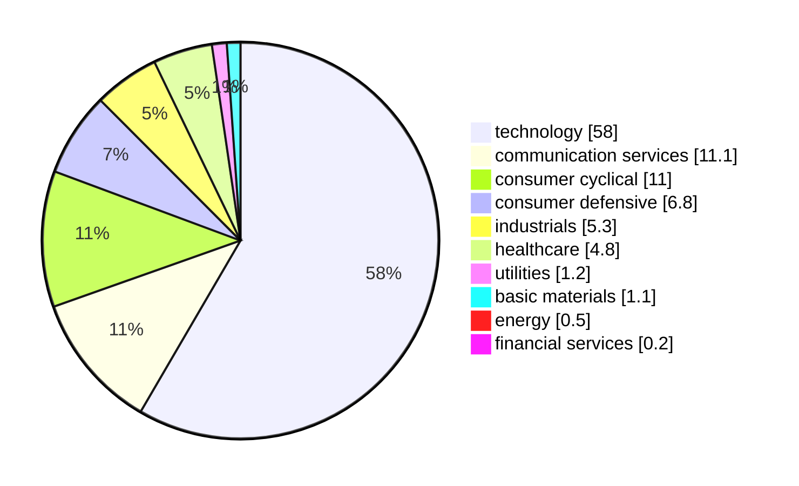

# QQQ ETF 分析報告

> **報告日期**：2026-11-16 ｜ **語言**：繁體中文 ｜ **數據來源**：Yahoo Finance、Finviz ｜ **類型**：ETF／指數基金

## 目錄

| # | 章節 | 核心結論 |
|---|------|----------|
| 1 | 執行摘要 | 成本低、資產規模大，但科技產業與大型持股權重集中，較適合作為衛星配置。 |
| 2 | 基金概況 | 基金調整持倉，以維持與 NASDAQ-100 Index® 成分及權重的對應。 |
| 3 | 成本與規模 | 費用率低於同類平均，基金資產規模大；折溢價接近 NAV。 |
| 4 | 持股與集中度 | 前十大持股合計未達基金資產的一半，但持倉仍受大型科技相關股票影響。 |
| 5 | 產業配置 | 科技產業權重最高，投資人主要承擔科技產業及相關大型股風險。 |
| 6 | 績效與風險 | 長期相對 VTI 有正超額報酬，近期短期期間則落後；波動與最大回撤均須留意。 |
| 7 | 估值與配息 | 投資組合 P/E、P/B 與配息殖利率可供參考，不代表基金合理價值。 |
| 8 | 適合對象、風險與觀察重點 | 適合接受產業集中與波動的投資人；應持續觀察權重、費用與相對績效。 |

---

## 1. 執行摘要

QQQ 是 Invesco 發行的 Large Growth 類型基金，基金說明指出其會調整證券組成與權重，以維持與 NASDAQ-100 Index® 成分及相對權重的對應。  
基金淨費用率為 **0.18%**，同類平均為 **0.90%**；資產規模為 **463.83B USD**。  
前十大持股合計 **46.5%**，最大單一持股為 Apple，權重 **8.16%**；產業配置中科技產業占 **58.0%**。  
截至 **2026-11-13**，QQQ 收盤價為 **679.89 USD**；相對 VTI 的價格超額報酬，**1 年為 -1.0%**、**3 年為 +10.6%**、**5 年為 +17.4%**。

### 1.1 一頁式摘要

| 項目 | 內容 |
|------|------|
| 追蹤標的／類別 | NASDAQ-100 Index® 的成分及相對權重對應；Large Growth |
| 費用率（同類平均） | 0.18%（0.90%） |
| 資產規模 | 463.83B USD |
| 前十大合計權重／最大持股 | 46.5%／Apple 8.16% |
| 1 年／3 年／5 年價格報酬 | +9.5%／+82.3%／+70.6% |
| 相對基準的超額報酬（1 年／3 年／5 年） | -1.0%／+10.6%／+17.4%（基準：VTI） |
| 年化波動率／最大回撤 | 21.5%／-35.6% |
| 折溢價 | +0.01% |
| 定位 | **衛星配置** |

### 1.2 五項評分

| 評分項目 | 分數（0–10） | 依據（引用數字） |
|----------|-------------:|------------------|
| 成本 | 9 | 淨費用率為 0.18%，低於同類平均 0.90%；以費用率水準評估，成本表現具吸引力。 |
| 規模與流動性 | 10 | 資產規模為 463.83B USD，規模非常大；本資料未提供成交量或買賣價差，因此流動性評分主要依資產規模。 |
| 分散度 | 6 | 前十大持股合計 46.5%，最大持股 Apple 為 8.16%；前十大合計未達基金資產的一半，但科技產業占 58.0%，仍有產業集中。 |
| 相對績效 | 7 | 相對 VTI 的超額報酬為：1 年 -1.0%、3 年 +10.6%、5 年 +17.4%；不同期間表現不一。 |
| 風險 | 4 | 年化波動率為 21.5%，最大回撤為 -35.6%；波動與歷史回撤均需納入配置考量。 |

**評分說明：**各項分數為研究判斷，不加總、不計算平均；基金評分不等於對未來報酬的保證。

---

## 2. 基金概況

### 2.1 基金資料

| 項目 | 資料 |
|------|------|
| 代號 | QQQ |
| 名稱 | Invesco QQQ Trust |
| 基金公司／家族 | Invesco |
| 類別 | Large Growth |
| 基金性質 | ETF／指數基金 |
| Sector／Industry／Country／Employees | N/A（資料未提供） |

### 2.2 投資標的與基金運作說明

基金說明指出，顧問會不時調整信託所持證券，使證券的組成與權重對應 NASDAQ-100 Index® 股票的成分及相對權重。

本報告僅依基金說明概述其對應方式；指數編製規則細節為 **N/A（資料未提供）**。追蹤誤差亦為 **N/A（資料未提供）**，因此無法據此評估基金與指數之間的實際追蹤偏離程度。

### 2.3 在投資組合中的角色

| 可能角色 | 說明 |
|----------|------|
| 成長型曝險 | 類別為 Large Growth，持股與產業配置呈現大型成長股及科技相關產業曝險。 |
| 美國股票配置的一部分 | 相對績效比較基準為 VTI；QQQ 與美國整體市場基準的持股組成並不相同。 |
| 衛星配置工具 | 科技產業權重與大型持股權重較高，適合在投資人已考量整體組合分散度後，作為特定成長風格曝險。 |

QQQ 不應僅因規模大或過往部分期間相對報酬較高，就被視為完整的股票市場分散配置。其產業與持股結構仍需與投資人的其他資產一併檢視。

---

## 3. 成本與規模

### 3.1 費用與基金資料

| 指標 | 數值 | 解讀 |
|------|------:|------|
| 淨費用率 | 0.18% | 持有基金的年度基金費用指標。 |
| 同類平均費用率 | 0.90% | Yahoo Finance 提供的類別平均值；QQQ 費用率低於該平均。 |
| 年度持股週轉率 | 0.0% | 本資料列示的持股週轉率；不能單憑此數值推定所有交易成本皆為零。 |
| 淨資產 | 463.83B USD | 顯示基金資產規模大。 |
| 收盤價 | 679.89 USD（2026-11-13） | 最近完成交易日收盤價。 |
| NAV | 679.85 USD | 基金淨資產價值。 |
| 價格相對 NAV 折溢價 | +0.01% | 報價相對 NAV 呈現小幅溢價。 |

### 3.2 費用試算

| 試算情境 | 金額 |
|----------|-----:|
| 投資 1,000,000 USD，按目前費用率持有 10 年，假設不計報酬 | 18,000 USD |

以上是資料提供的簡化試算，**不計投資報酬**，也不代表實際持有期間的費用一定固定不變。實際投資結果還會受到市場價格、基金費用調整及個人交易成本等因素影響。

### 3.3 規模與週轉率的閱讀方式

- **資產規模：**淨資產為 **463.83B USD**，反映基金規模大。資產規模本身不保證未來報酬，也不能替代成交量或買賣價差資料。
- **週轉率：**年度持股週轉率列為 **0.0%**。本資料沒有提供週轉率的計算口徑或其他交易成本，因此不延伸推論。
- **折溢價：**目前相對 NAV 的折溢價為 **+0.01%**。這是該資料時點的數值，不表示其他交易時點也會維持相同水準。

---

## 4. 持股與集中度

### 4.1 前十大持股

| 代號 | 名稱 | 權重 |
|------|------|-----:|
| AAPL | Apple Inc | 8.16% |
| NVDA | NVIDIA Corp | 8.00% |
| MSFT | Microsoft Corp | 6.29% |
| MU | Micron Technology Inc | 4.47% |
| AMZN | Amazon.com Inc | 4.21% |
| AMD | Advanced Micro Devices Inc | 3.69% |
| TSLA | Tesla Inc | 3.41% |
| META | Meta Platforms Inc Class A | 2.97% |
| WMT | Walmart Inc | 2.69% |
| GOOGL | Alphabet Inc Class A | 2.66% |

前十大持股合計占基金資產 **46.5%**；最大單一持股為 Apple，權重 **8.16%**。這表示基金並非只持有少數幾檔股票，但前十大持股對基金整體表現仍有明顯影響。

### 4.2 集中度的含義

- **前十大持股：**其合計權重為 **46.5%**，不到基金資產的一半；前十大股票的股價變化仍可能對基金報酬產生重要影響。
- **最大單一持股：**Apple 權重為 **8.16%**。單一公司風險低於把全部資產投在一檔股票，但個別大型持股仍可能影響短期績效。
- **前十大成分股數量以外的持股：**前十大以外的個別持股與權重為 **N/A（資料未提供）**，本報告不列出或推測。
- **成分股總數：**N/A（資料未提供）。

因此，QQQ 的分散度應與「單一股票」投資區分，但也不宜將其理解為各產業、各公司權重均勻分散的基金。

---

## 5. 產業配置

### 5.1 產業權重

| 產業 | 權重 |
|------|-----:|
| technology | 58.0% |
| communication services | 11.1% |
| consumer cyclical | 11.0% |
| consumer defensive | 6.8% |
| industrials | 5.3% |
| healthcare | 4.8% |
| utilities | 1.2% |
| basic materials | 1.1% |
| energy | 0.5% |
| financial services | 0.2% |

### 5.2 產業配置圖

### 5.3 配置解讀

- **最大產業曝險：**technology 權重為 **58.0%**，是基金最主要的產業曝險。
- **次要產業：**communication services 為 **11.1%**，consumer cyclical 為 **11.0%**。
- **投資人實際承擔的風險：**持有 QQQ 不只是持有大型成長股，也代表相當程度承擔科技產業的市場與公司獲利變化。
- **產業分類限制：**產業權重呈現資料庫的分類結果，不代表每家公司只受單一產業因素影響。

---

## 6. 績效與風險

### 6.1 各期間價格報酬

| 期間 | QQQ 價格報酬 | VTI 基準報酬 | 超額報酬 |
|------|-------------:|-------------:|---------:|
| 1 個月 | -6.6% | -1.9% | -4.7% |
| 3 個月 | -6.8% | -2.9% | -4.0% |
| 6 個月 | -4.1% | +2.3% | -6.4% |
| 1 年 | +9.5% | +10.5% | -1.0% |
| 3 年 | +82.3% | +71.7% | +10.6% |
| 5 年 | +70.6% | +53.1% | +17.4% |

以上為截至 **2026-11-13** 的價格報酬比較，基準為 VTI（美國整體市場）。報酬為**價格報酬、不含配息**。

### 6.2 相對績效解讀

- **較短期間：**表列的 **1 個月、3 個月、6 個月**期間，QQQ 的超額報酬均為負值，表示同期價格表現落後 VTI。
- **1 年期間：**QQQ 價格報酬為 **+9.5%**，低於 VTI 的 **+10.5%**，超額報酬為 **-1.0%**。
- **較長期間：**3 年與 5 年的超額報酬分別為 **+10.6%** 與 **+17.4%**，但歷史相對表現不代表未來結果。
- **資料口徑：**未計入配息，也未提供稅負、交易成本或投資人實際買入時點造成的差異。

### 6.3 波動與回撤

| 風險指標 | 數值 | 說明 |
|----------|------:|------|
| 年化波動率（1 年） | 21.5% | 反映所列期間的價格波動程度。 |
| 最大回撤（資料庫歷史區間 10.0 年） | -35.6% | 歷史資料中的最大回撤；谷底日期為 2022-12-28。 |
| 資料庫歷史區間 CAGR | 19.5% | 資料所列歷史區間年化複合成長率；不代表未來報酬。 |

回撤代表投資價值可能由高點大幅下跌，投資人應評估自身能否承受期間性的資產縮水，而非只看長期報酬數字。

### 6.4 最大回撤情境金額

| 試算情境 | 金額 |
|----------|-----:|
| 投資 1,000,000 USD，按歷史最大回撤計算的帳面減少 | 356,200 USD |

此金額為資料提供的最大回撤情境試算，不代表每位投資人實際會遇到相同虧損，也不代表未來最大回撤幅度。

---

## 7. 估值與配息

### 7.1 投資組合估值指標

| 指標 | 數值 |
|------|-----:|
| 投資組合 P/E | 28.4x |
| 投資組合 P/B | 8.7x |
| 配息殖利率 | 0.45% |

投資組合 P/E 與 P/B 是成分股的加權指標，不是對基金本身計算出的合理價值，也不能單獨用來推導基金未來報酬。

### 7.2 配息與資料限制

- 配息殖利率為 **0.45%**；實際配息金額與時間可能變動。
- 個別配息紀錄為 **N/A（資料未提供）**。
- 本資料沒有提供配息頻率、歷次配息金額或配息來源明細。
- 本報告不據此推估未來配息，也不以投資組合估值倍數推導合理價值或目標價。

---

## 8. 適合對象、風險與觀察重點

### 8.1 適合與不適合的投資人

| 投資人類型 | 適合度 | 原因（引用數字） |
|------------|--------|------------------|
| 尋求大型成長股曝險，且能承受產業集中者 | 較適合 | 類別為 Large Growth，technology 權重為 58.0%；投資人須接受科技產業曝險。 |
| 希望以低基金費用取得此類曝險者 | 較適合 | 淨費用率為 0.18%，低於同類平均 0.90%。 |
| 尋求單一基金涵蓋較廣泛產業、降低科技權重者 | 較不適合 | technology 占 58.0%，前十大持股合計 46.5%。 |
| 無法承受明顯價格波動或大幅回撤者 | 較不適合 | 年化波動率為 21.5%，歷史最大回撤為 -35.6%。 |
| 需要以穩定配息作為主要投資目標者 | 較不適合 | 配息殖利率為 0.45%；本資料未提供配息紀錄或未來配息承諾。 |
| 需要掌握完整持股清單與追蹤誤差資料者 | 資料不足 | 前十大以外持股及追蹤誤差均為 N/A（資料未提供）。 |

### 8.2 主要風險

| 風險 | 對應資料 | 可能影響 |
|------|----------|----------|
| 持股集中風險 | 前十大持股合計 46.5%；最大持股 Apple 為 8.16%。 | 大型成分股價格變化可能對基金表現造成顯著影響；前十大持股同向波動時，基金可能承受較大影響。 |
| 科技產業集中風險 | technology 權重為 58.0%。 | 科技產業景氣、企業獲利預期或市場評價變化，可能影響基金整體報酬。 |
| 價格波動與回撤風險 | 年化波動率為 21.5%；歷史最大回撤為 -35.6%。 | 投資人可能面臨明顯帳面損失；歷史回撤不代表未來跌幅上限。 |
| 評價風險 | 投資組合 P/E 為 28.4x，P/B 為 8.7x。 | 成分股評價變化可能影響基金價格；這些倍數不是基金合理價值或未來報酬的保證。 |
| 匯率風險 | 收盤價與資產規模以 USD 表示；本資料未提供投資人本位幣或避險資訊。 | 非美元投資人以本位幣衡量時，匯率變動可能影響實際報酬；本資料不足以量化其影響。 |

### 8.3 什麼情況下要重新評估

| 觀察項目 | 可查核的重新評估條件 | 為何重要 |
|----------|----------------------|----------|
| 最大單一持股權重 | 若最大持股權重高於目前的 8.16%，或集中度趨勢與投資人原先設定不符。 | 單一公司對基金的影響可能上升。 |
| 前十大持股合計權重 | 若前十大合計權重高於目前的 46.5%，且投資人希望降低大型持股集中度。 | 有助檢視基金是否逐漸更受少數持股左右。 |
| 科技產業權重 | 若 technology 權重高於目前的 58.0%，或投資人可接受的產業上限有所變化。 | 科技產業曝險是基金配置的重要特徵。 |
| 費用率 | 若淨費用率不再是目前的 0.18%，應重新與同類平均及替代基金比較。 | 費用變化會改變持有成本。 |
| 相對基準績效 | 若更新後的 1 年、3 年或 5 年超額報酬轉為負值，或持續落後 VTI。 | 可重新檢視該基金在投資組合中的功能是否仍符合需求。 |
| 基金規模 | 若淨資產相較目前的 463.83B USD 明顯縮減。 | 規模變化可作為持續檢查基金狀況的指標；仍應搭配其他資料評估。 |
| 折溢價 | 若折溢價不再接近目前的 +0.01%。 | 交易價格與 NAV 的差距可能影響實際成交條件。 |
| 資料完整性 | 若仍無法取得追蹤誤差、完整持股與配息紀錄，且這些資訊已成為投資決策必要條件。 | 重要資訊缺漏會限制對基金追蹤品質、持股結構與配息特性的評估。 |

### 8.4 整體定位

**定位：衛星配置。**

截至 **2026-11-13**，QQQ 收盤價為 **679.89 USD**；基金費用率為 **0.18%**，資產規模為 **463.83B USD**，但 technology 權重為 **58.0%**、前十大持股合計 **46.5%**。相對 VTI 的超額報酬在 **1 年為 -1.0%**、**3 年為 +10.6%**、**5 年為 +17.4%**，呈現不同期間表現不一；另有 **21.5%** 的年化波動率與 **-35.6%** 的歷史最大回撤。因此，將 QQQ 視為特定成長風格曝險的衛星配置，較能反映其持股與產業特徵。此定位是基金分析結論，不是買賣建議。

---

> **免責聲明**：本報告為 AI 自動生成，僅供研究與教育參考，不構成投資建議。報酬為價格報酬，未計入配息、稅負與交易成本；投資有風險。

---

## 資料與來源

| 項目 | 內容 |
|------|------|
| 價格 | 679.89 USD，2026-11-13 收盤（Yahoo Finance 日線） |
| 基金資料 | Yahoo Finance（持股、費用率、規模）；績效與回撤由價格資料庫計算 |
| 有回應的資料來源 | Yahoo Finance、Finviz |
| 未回應的資料來源 | SEC 申報資料 (XBRL)、StockAnalysis、Roic.ai |
| 由程式計算 | 基金的集中度、績效、費用與回撤試算 |
| 撰寫模型 | openai / gpt-6-luna |

> 本區塊由產生報告的程式依實際取得的資料填寫，非模型撰寫。「由程式計算」的數字不是模型的估計；其餘判斷（評分、情境、策略）是模型的分析。
