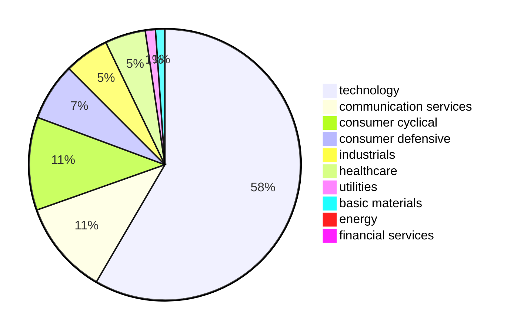

# QQQ ETF 分析報告

> **報告日期**：2026-11-17 ｜ **語言**：繁體中文 ｜ **數據來源**：Yahoo Finance、Finviz ｜ **類型**：ETF／指數基金

## 目錄

| # | 章節 | 核心結論 |
|---|------|----------|
| 1 | 執行摘要 | 資產規模大、費用率低於類別平均，但持股與產業曝險集中於大型成長股及科技產業。 |
| 2 | 基金概況 | Invesco 旗下 Large Growth 類別基金；基金說明指出其持股組成與權重會調整以配合 NASDAQ-100 Index®。 |
| 3 | 成本與規模 | 費用率為 0.18%，資產規模為 463.83B USD；折溢價為 0.01%。 |
| 4 | 持股與集中度 | 前十大持股合計占 46.5%，最大持股權重為 8.2%。 |
| 5 | 產業配置 | 科技產業權重為 58.0%，是主要產業曝險。 |
| 6 | 績效與風險 | 1 年價格報酬落後 VTI 1.7%；3 年與 5 年則分別高於基準 8.8% 與 16.2%。 |
| 7 | 估值與配息 | 投資組合 P/E 為 28.4x、P/B 為 8.7x，配息殖利率為 0.45%。 |
| 8 | 適合對象、風險與觀察重點 | 適合接受成長股及科技產業集中風險的投資人；結論定位為「衛星配置」。 |

---

## 1. 執行摘要

截至 2026-11-16，QQQ 收盤價為 661.75 USD；基金說明指出，基金會調整持股組成與權重，以配合 NASDAQ-100 Index® 成分證券的變動。

基金費用率為 0.18%，低於同類平均 0.90%；資產規模為 463.83B USD，前十大持股合計占 46.5%，最大持股權重為 8.2%。

截至 2026-11-16，QQQ 的 1 年、3 年及 5 年價格報酬分別為 +8.8%、+78.8% 及 +66.2%；相對 VTI 的超額報酬分別為 -1.7%、+8.8% 及 +16.2%。

截至 2026-11-16，基金年化波動率為 21.6%，歷史最大回撤為 -35.6%；綜合其成長股曝險、集中度與相對績效，定位為「衛星配置」。

### 1.1 一頁式摘要

| 項目 | 內容 |
|------|------|
| 追蹤標的／類別 | NASDAQ-100 Index®（基金說明所述）；Invesco / Large Growth |
| 費用率（同類平均） | 0.18%（0.90%） |
| 資產規模 | 463.83B USD |
| 前十大合計權重／最大持股 | 46.5%／8.2% |
| 1 年／3 年／5 年價格報酬 | +8.8%／+78.8%／+66.2% |
| 相對基準的超額報酬（1 年／3 年／5 年） | -1.7%／+8.8%／+16.2%（基準：VTI） |
| 年化波動率／最大回撤 | 21.6%／-35.6% |
| 折溢價 | +0.01%（相對 NAV） |
| 定位 | 衛星配置 |

### 1.2 五項評分

| 評分項目 | 分數（0–10） | 依據（引用數字） |
|----------|-------------:|------------------|
| 成本 | 9 | 費用率 0.18%，低於同類平均 0.90%；費用具有競爭力，但評分仍保留差異空間。 |
| 規模與流動性 | 10 | 資產規模為 463.83B USD，按基金資產規模評分；成交量及買賣價差資料為 N/A（資料未提供），因此不將交易流動性指標另行量化。 |
| 分散度 | 6 | 前十大持股合計 46.5%，最大單一持股權重為 8.2%；前十大未超過基金資產的一半，但仍有大型持股集中情形。 |
| 相對績效 | 7 | 相對 VTI 的 1 年超額報酬為 -1.7%，3 年為 +8.8%，5 年為 +16.2%；不同期間表現有差異。 |
| 風險 | 4 | 年化波動率為 21.6%，最大回撤為 -35.6%；兩項指標顯示投資人須承受較明顯的價格波動與下跌風險。 |

## 2. 基金概況

| 項目 | 資料 |
|------|------|
| 基金名稱 | Invesco QQQ Trust |
| 代號 | QQQ |
| 基金公司／家族 | Invesco |
| 類別 | Large Growth |
| 基金性質 | ETF／指數基金 |
| 基金說明所述指數 | NASDAQ-100 Index® |
| 基金簡介 | 顧問會調整信託持有證券的組成與權重，以配合指數證券身分或相對權重的定期變化。 |
| 指數編製規則細節 | N/A（資料未提供） |
| 成分股數量 | N/A（資料未提供） |
| 追蹤誤差 | N/A（資料未提供） |

QQQ 的基金簡介指出，基金持股及權重會依指數成分證券的身分或相對權重變化而調整。此處只依基金說明描述其與 NASDAQ-100 Index® 的對應關係，不延伸補充未提供的指數編製規則。

從類別及持股資料看，QQQ 可作為投資組合中偏大型成長股的配置工具。其前十大持股與產業配置顯示，基金曝險並非平均分散於各產業；投資人應將這種成長股與科技產業傾斜納入整體資產配置考量。

QQQ 是基金，不是營運公司；本報告不適用公司損益表、現金流量表、WACC、DCF、安全邊際或 ROIC 分析。

## 3. 成本與規模

### 3.1 費用與資產規模

| 指標 | QQQ | 同類平均／說明 |
|------|----:|----------------|
| 淨費用率 | 0.18% | 0.90% |
| 基金淨資產 | 463.83B USD | — |
| 年度持股週轉率 | 0.0% | 依 Yahoo Finance 所列 |
| 費用試算 | 18,000 USD | 以 1,000,000 USD 持有 10 年、不假設報酬的簡化試算 |

QQQ 的費用率為 0.18%，同類平均為 0.90%。以基金持有成本來看，費用率低於同類平均；實際投資結果仍會受到市場價格、交易成本、稅負及基金分配等因素影響。

以 1,000,000 USD 為例，依區塊所列費用試算，持有 10 年的費用為 18,000 USD。這是不計報酬的簡化試算，不代表投資人的實際總成本或最終報酬。

基金淨資產為 463.83B USD，表示基金規模較大。基金規模不等同於每日交易量或買賣價差；相關成交量與價差資料為 N/A（資料未提供）。

年度持股週轉率為 0.0%。此數值依 Yahoo Finance 所列；本報告不據此推算未提供的交易成本、基金實際調整頻率或未來週轉狀況。

### 3.2 NAV 與折溢價

| 指標 | 數值 |
|------|-----:|
| NAV | 661.69 USD |
| 市價相對 NAV 折溢價 | +0.01% |
| 收盤價日期與價格 | 2026-11-16，661.75 USD |

資料所列市價相對 NAV 的折溢價為 +0.01%。此為所列價格與 NAV 的折溢價指標；不應將市價或 NAV 解讀為基金的合理價值。

## 4. 持股與集中度

### 4.1 前十大持股

| 排序 | 代號 | 名稱 | 權重 |
|---:|------|------|----:|
| 1 | AAPL | Apple Inc | 8.16% |
| 2 | NVDA | NVIDIA Corp | 8.00% |
| 3 | MSFT | Microsoft Corp | 6.29% |
| 4 | MU | Micron Technology Inc | 4.47% |
| 5 | AMZN | Amazon.com Inc | 4.21% |
| 6 | AMD | Advanced Micro Devices Inc | 3.69% |
| 7 | TSLA | Tesla Inc | 3.41% |
| 8 | META | Meta Platforms Inc Class A | 2.97% |
| 9 | WMT | Walmart Inc | 2.69% |
| 10 | GOOGL | Alphabet Inc Class A | 2.66% |

### 4.2 集中度解讀

| 指標 | 數值 | 解讀 |
|------|-----:|------|
| 前十大持股合計權重 | 46.5% | 基金近半數資產集中於前十大列示持股。 |
| 最大單一持股權重 | 8.2% | 最大持股為 Apple；單一持股權重低於前十大合計，但仍會對基金表現造成影響。 |
| 前十大以外持股 | N/A（資料未提供） | 依要求不列出前十大以外持股。 |

前十大合計權重為 46.5%，最大單一持股權重為 8.2%。因此，基金並非由單一持股主導，但大型成分股的價格變動仍可能明顯影響整體基金表現。

前十大權重合計未達基金資產的一半，提供一定程度的持股分散；不過，這不代表基金在產業、風格或市場風險上同樣分散。投資人仍須一併檢視下一章的產業權重。

## 5. 產業配置

### 5.1 產業權重

| 產業 | 權重 |
|------|----:|
| technology | 58.0% |
| communication services | 11.1% |
| consumer cyclical | 11.0% |
| consumer defensive | 6.8% |
| industrials | 5.3% |
| healthcare | 4.8% |
| utilities | 1.2% |
| basic materials | 1.1% |
| energy | 0.5% |
| financial services | 0.2% |

科技產業權重為 58.0%，是基金最大的產業曝險；communication services 權重為 11.1%，consumer cyclical 權重為 11.0%。這表示持有 QQQ 不只是配置多檔股票，也同時承擔科技產業及大型成長股相關風險。

從實際配置來看，投資人主要押注科技產業及相關大型成長股的表現。當科技類股或大型成長股走勢與整體市場不同時，QQQ 的相對表現也可能與較廣泛的美國市場基準不同。

## 6. 績效與風險

### 6.1 各期間價格報酬

| 期間 | QQQ 價格報酬 | VTI 基準報酬 | 超額報酬 |
|------|-------------:|-------------:|---------:|
| 1 個月 | -6.8% | -2.6% | -4.2% |
| 3 個月 | -7.8% | -3.9% | -3.9% |
| 6 個月 | -6.3% | +0.5% | -6.8% |
| 1 年 | +8.8% | +10.4% | -1.7% |
| 3 年 | +78.8% | +70.0% | +8.8% |
| 5 年 | +66.2% | +50.1% | +16.2% |

以上為價格報酬，不含配息。與 VTI（美國整體市場）比較，QQQ 在 1 個月、3 個月、6 個月及 1 年期間的超額報酬為負；在 3 年及 5 年期間的超額報酬為正。

區塊所列 CAGR over the stored history 為 18.9%。此數值依區塊列示；存續期間的詳細起訖計算方式未另提供。

### 6.2 波動與回撤

| 風險指標 | 數值 | 說明 |
|----------|-----:|------|
| 年化波動率（1 年） | 21.6% | 衡量區塊所列期間的價格波動程度。 |
| 最大回撤 | -35.6% | 依存檔歷史資料；谷底日期為 2022-12-28。 |
| 最大回撤例示帳面減少 | 356,200 USD | 以 1,000,000 USD 對應最大回撤的區塊所列例示金額。 |

年化波動率為 21.6%，歷史最大回撤為 -35.6%。兩項數據說明，持有期間可能面臨較大的資產價值起伏；過往回撤資料不代表未來跌幅上限。

區塊所列 1,000,000 USD 最大回撤例示的帳面減少為 356,200 USD。此為套用區塊所列最大回撤的例示金額，不是未來損失預測。

### 6.3 已提供的月收盤價

以下依價格資料庫所列呈現月收盤價，不據此另行計算報酬或變動幅度。

| 月份 | 收盤價（USD） |
|------|--------------:|
| 2024-11 | 504.63 |
| 2024-12 | 506.92 |
| 2025-01 | 517.89 |
| 2025-02 | 503.89 |
| 2025-03 | 465.66 |
| 2025-04 | 472.17 |
| 2025-05 | 515.51 |
| 2025-06 | 548.42 |
| 2025-07 | 561.72 |
| 2025-08 | 567.08 |
| 2025-09 | 597.56 |
| 2025-10 | 626.13 |
| 2025-11 | 616.35 |
| 2025-12 | 612.22 |
| 2026-01 | 619.76 |
| 2026-02 | 605.23 |
| 2026-03 | 575.95 |
| 2026-04 | 666.31 |
| 2026-05 | 736.73 |
| 2026-06 | 735.63 |
| 2026-07 | 687.27 |
| 2026-08 | 716.01 |
| 2026-09 | 739.77 |
| 2026-10 | 690.49 |
| 2026-11 | 661.75 |

月收盤價呈現觀察期間內價格有起伏的情況。表格僅列歷史月收盤價；投資人不應將其中任何單一月份的價格視為合理價值或未來價格預測。

## 7. 估值與配息

| 指標 | 數值 | 解讀 |
|------|-----:|------|
| 投資組合 P/E | 28.4x | Yahoo Finance 所列加權投資組合倍數。 |
| 投資組合 P/B | 8.7x | Yahoo Finance 所列加權投資組合倍數。 |
| 配息殖利率 | 0.45% | Yahoo Finance 所列。 |
| 配息紀錄 | N/A（資料未提供） | 未提供分配金額與歷史紀錄。 |

P/E 為 28.4x、P/B 為 8.7x，反映基金成分股整體的加權評價指標，不是對基金本身的合理價值判斷。這些倍數不構成基金的目標價或買賣依據。

配息殖利率為 0.45%。配息紀錄、分配頻率與各期配息金額為 N/A（資料未提供）；本報告不推測未列出的配息資訊。

## 8. 適合對象、風險與觀察重點

### 8.1 適合與不適合的投資人

| 投資人類型 | 適合度 | 原因（引用數字） |
|------------|--------|------------------|
| 希望配置大型成長股、可接受科技產業權重偏高的投資人 | 較適合 | 科技產業權重為 58.0%，前十大持股合計權重為 46.5%。 |
| 重視基金費用的長期投資人 | 較適合 | 費用率為 0.18%，同類平均為 0.90%。 |
| 希望相對廣泛分散於美國整體市場的投資人 | 較不適合單獨作為唯一配置 | QQQ 對科技產業的權重為 58.0%；相較基準 VTI，兩者的產業配置定位不同。 |
| 無法承受明顯價格波動或回撤的投資人 | 較不適合 | 年化波動率為 21.6%，歷史最大回撤為 -35.6%。 |
| 主要追求較高配息收入的投資人 | 較不適合 | 配息殖利率為 0.45%；配息紀錄為 N/A（資料未提供）。 |

### 8.2 主要風險

| 風險 | 區塊數字與持股依據 | 對投資人的意義 |
|------|------------------|----------------|
| 持股集中風險 | 前十大持股合計 46.5%；最大單一持股權重 8.2%。 | 少數大型持股走勢可能對基金報酬造成較大影響；前十大以外持股資料為 N/A（資料未提供）。 |
| 產業集中風險 | technology 權重為 58.0%。 | 科技產業走弱時，基金可能承受較明顯的產業集中影響。 |
| 成長股評價風險 | 投資組合 P/E 為 28.4x、P/B 為 8.7x。 | 成分股整體評價指標須與企業基本面和市場環境一併觀察；上述倍數不代表合理價值。 |
| 市場波動與回撤風險 | 年化波動率為 21.6%，歷史最大回撤為 -35.6%。 | 投資人須能承受價格波動與資產價值下跌；歷史最大回撤不是未來跌幅上限。 |
| 匯率風險 | 基金價格以 USD 表示；非 USD 投資人的匯率影響數據為 N/A（資料未提供）。 | 非 USD 投資人換算為自身計價貨幣時，匯率變動可能影響實際投資結果；本報告不提供匯率預測。 |

### 8.3 什麼情況下要重新評估

| 可查核條件 | 重新評估重點 |
|------------|--------------|
| 最大單一持股權重高於目前所列 8.16%，或前十大合計權重高於目前所列 46.5%。 | 檢視持股集中程度是否改變，以及組合是否仍符合個人風險承受度。 |
| 費用率不再是目前所列 0.18%。 | 重新比較基金成本與同類平均 0.90%，並檢視費用變動對持有成本的影響。 |
| 1 年、3 年或 5 年期間相對 VTI 的超額報酬持續轉弱。 | 對照目前所列 1 年 -1.7%、3 年 +8.8% 及 5 年 +16.2%，並檢視各期間是否仍符合原先配置目的。 |
| 基金淨資產相較目前所列 463.83B USD 出現持續下滑或顯著縮減。 | 重新檢視基金規模變化；顯著縮減的量化門檻為 N/A（資料未提供）。 |
| 科技產業權重偏離目前所列 58.0%，或成分股與基金說明所述指數的對應出現變化。 | 檢查基金實際曝險與投資人預期是否一致；指數細節未提供，不對變化原因作推測。 |
| 年化波動率或最大回撤明顯高於目前所列 21.6% 或 -35.6%。 | 重新檢視投資人能否承受波動及回撤；不將歷史數字視為未來風險上限。 |

**結論定位：衛星配置。** QQQ 的費用率為 0.18%，資產規模為 463.83B USD；但科技產業權重為 58.0%，前十大持股合計為 46.5%，年化波動率為 21.6%，歷史最大回撤為 -35.6%。這些數字支持將其視為具大型成長股與科技產業傾斜的配置，而非不經評估便取代廣泛市場配置。此定位不是買賣建議。

> **免責聲明**：本報告為 AI 自動生成，僅供研究與教育參考，不構成投資建議。報酬為價格報酬，未計入配息、稅負與交易成本；投資有風險。

---

## 資料與來源

| 項目 | 內容 |
|------|------|
| 價格 | 661.75 USD，2026-11-16 收盤（Yahoo Finance 日線） |
| 基金資料 | Yahoo Finance（持股、費用率、規模）；績效與回撤由價格資料庫計算 |
| 有回應的資料來源 | Yahoo Finance、Finviz |
| 未回應的資料來源 | SEC 申報資料 (XBRL)、StockAnalysis、Roic.ai |
| 由程式計算 | 基金的集中度、績效、費用與回撤試算 |
| 撰寫模型 | openai / gpt-6-luna |

> 本區塊由產生報告的程式依實際取得的資料填寫，非模型撰寫。「由程式計算」的數字不是模型的估計；其餘判斷（評分、情境、策略）是模型的分析。
