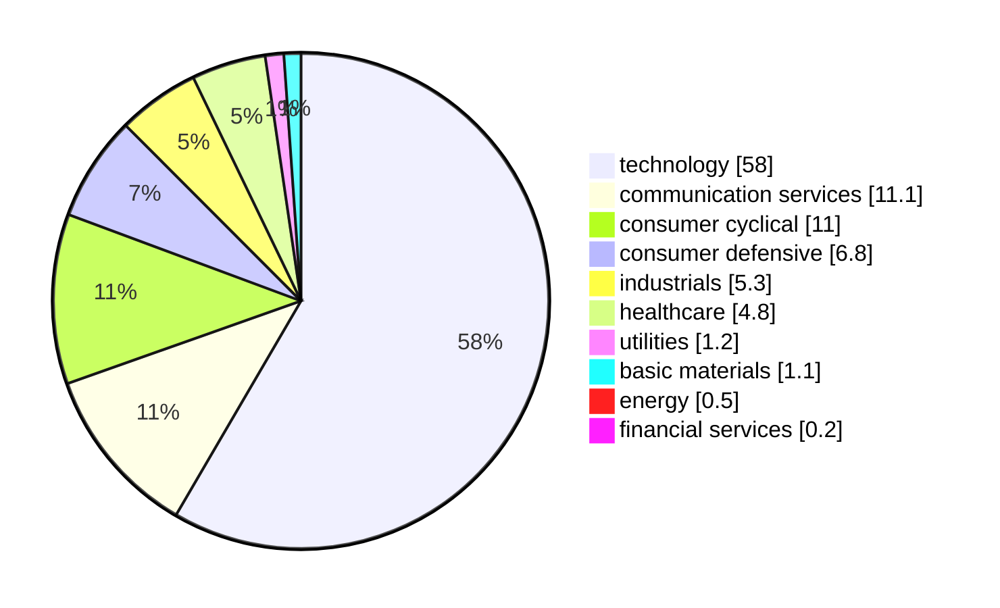

# QQQ ETF 分析報告

> **報告日期**：2026-11-20 ｜ **語言**：繁體中文 ｜ **數據來源**：Yahoo Finance、Finviz ｜ **類型**：ETF／指數基金

## 目錄

| # | 章節 | 核心結論 |
|---|------|----------|
| 1 | 執行摘要 | 以科技股為主要曝險，成本低、規模大，但產業與大型持股集中 |
| 2 | 基金概況 | 依簡介調整持有證券，使組成與權重對應 NASDAQ-100 Index® |
| 3 | 成本與規模 | 費用率低於同類平均，資產規模為 463.83B USD |
| 4 | 持股與集中度 | 前十大持股合計 46.5%，最大持股權重為 8.2% |
| 5 | 產業配置 | technology 權重為 58.0%，基金表現對科技產業較敏感 |
| 6 | 績效與風險 | 1 年落後 VTI，3 年與 5 年超額報酬為正；波動與回撤均須留意 |
| 7 | 估值與配息 | 投資組合 P/E 為 28.4x，配息殖利率為 0.45% |
| 8 | 適合對象、風險與觀察重點 | 適合作為成長型衛星配置，不宜視為高度分散的全市場核心部位 |

---

## 1. 執行摘要

截至 2026-11-19，QQQ 收盤價為 **645.04 USD**；基金家族／類別為 Invesco／Large Growth，依基金簡介調整證券組成與權重，以對應 NASDAQ-100 Index®。

淨費用率為 **0.18%**，同類平均為 **0.90%**；淨資產為 **463.83B USD**，年持股週轉率為 **0.0%**。

前十大持股合計 **46.5%**，最大單一持股權重為 **8.2%**；其中 technology 產業權重為 **58.0%**，因此基金雖持有多檔股票，仍有明顯產業集中。

相對 VTI 的價格超額報酬，1 年為 **-0.5%**、3 年為 **+8.8%**、5 年為 **+18.3%**；定位為 **衛星配置**，較適合作為成長曝險，而非單獨取代廣泛市場配置。

### 1.1 一頁式摘要

| 項目 | 內容 |
|------|------|
| 追蹤標的／類別 | 依基金簡介調整證券組成與權重，以對應 NASDAQ-100 Index®；類別為 Large Growth |
| 費用率（同類平均） | 0.18%（0.90%） |
| 資產規模 | 463.83B USD |
| 前十大合計權重／最大持股 | 46.5%／8.2% |
| 1 年／3 年／5 年價格報酬 | +8.2%／+67.4%／+65.1% |
| 相對基準的超額報酬（1 年／3 年／5 年） | -0.5%／+8.8%／+18.3%（基準：VTI） |
| 年化波動率／最大回撤 | 21.7%／-35.6% |
| 折溢價 | -0.03% |
| 定位 | 衛星配置 |

### 1.2 五項評分

| 評分項目 | 分數（0–10） | 依據（引用數字） |
|----------|-------------:|------------------|
| 成本 | 9 | 淨費用率為 0.18%，低於同類平均 0.90%；依費用率比較評分。 |
| 規模與流動性 | 10 | 淨資產為 463.83B USD，依資產規模評分；本資料未提供買賣價差或成交量數據，因此不另評估這些流動性面向。 |
| 分散度 | 6 | 前十大持股合計 46.5%，最大持股權重為 8.2%；持股分布並非由單一股票主導，但大型持股合計仍占相當比重。 |
| 相對績效 | 7 | 相對 VTI 的超額報酬，1 年為 -0.5%、3 年為 +8.8%、5 年為 +18.3%；不同期間表現不一。 |
| 風險 | 4 | 年化波動率為 21.7%，最大回撤為 -35.6%；歷史價格波動與回撤幅度需納入風險承受度考量。 |

## 2. 基金概況

### 2.1 基金基本資料

| 項目 | 資料 |
|------|------|
| 代號 | QQQ |
| 名稱 | Invesco QQQ Trust |
| 基金公司／類別 | Invesco／Large Growth |
| 標的說明 | 基金簡介指出，顧問會調整信託持有證券，使其組成及權重對應 NASDAQ-100 Index® 的成分證券及相對權重 |
| Sector | N/A（資料未提供） |
| Industry | N/A（資料未提供） |
| Country | N/A（資料未提供） |
| Employees | N/A（資料未提供） |
| 成分股數量 | N/A（資料未提供） |
| 指數編製規則細節 | N/A（資料未提供） |
| 追蹤誤差 | N/A（資料未提供） |

### 2.2 基金如何運作

基金簡介說明，顧問會不時調整信託持有證券，以配合指數成分證券身分或相對權重的定期變化。

基金存入組合中的證券組成與權重，也會配合指數變動調整。

以上僅描述基金簡介所載的調整方式；更詳細的指數編製規則、追蹤誤差或成分股數量均為 N/A（資料未提供）。

### 2.3 在投資組合中的角色

Large Growth 類別、technology 產業權重 58.0%，以及前十大持股合計 46.5%，顯示 QQQ 帶有明確的大型成長股與科技產業曝險。

對已有廣泛市場配置的投資人，QQQ 可作為增加成長型股票曝險的衛星部位。

若把 QQQ 當作唯一股票配置，則應留意它並非產業權重平均分布的市場代表；本報告所列產業權重顯示 technology 占比最高。

基金的市場區域細分與持股幣別資料為 N/A（資料未提供），因此無法據此量化地區或外幣曝險。

## 3. 成本與規模

### 3.1 費用率

| 項目 | 數值 |
|------|------:|
| QQQ 淨費用率 | 0.18% |
| 類別平均費用率 | 0.90% |

0.18% 的淨費用率低於 0.90% 的類別平均，從基金持有成本角度看具相對優勢。

費用率是長期持有時應留意的基金成本之一；實際投資結果仍會受到市場報酬、配息、稅負及交易成本影響。

### 3.2 費用試算

| 試算條件 | 10 年費用 |
|----------|----------:|
| 以 1,000,000 USD 投資、採目前費用率、不假設報酬 | 18,000 USD |

**18,000 USD** 為基金資料列示的簡化試算，假設不計投資報酬；這不是對未來實際費用的預測，也未納入稅負與交易成本。

### 3.3 資產規模、週轉率與折溢價

| 項目 | 數值 | 解讀 |
|------|------:|------|
| 淨資產 | 463.83B USD | 資產規模龐大；規模本身不代表未來績效，也不等同於成交流動性數據。 |
| 年持股週轉率 | 0.0% | 資料列示的週轉率為 0.0%；此數字不代表基金未來持股組成不會變動，基金簡介仍說明會配合指數變化調整證券。 |
| NAV | 645.24 USD | 基金資料列示的每單位淨資產價值。 |
| 相對 NAV 的折溢價 | -0.03% | 目前呈現折價；折溢價是市價相對 NAV 的比較，不代表長期績效或未來報酬。 |

## 4. 持股與集中度

### 4.1 前十大持股

| 代號 | 名稱 | 權重 |
|------|------|------:|
| AAPL | Apple Inc | 8.16% |
| NVDA | NVIDIA Corp | 8.00% |
| MSFT | Microsoft Corp | 6.29% |
| MU | Micron Technology Inc | 4.47% |
| AMZN | Amazon.com Inc | 4.21% |
| AMD | Advanced Micro Devices Inc | 3.69% |
| TSLA | Tesla Inc | 3.41% |
| META | Meta Platforms Inc Class A | 2.97% |
| WMT | Walmart Inc | 2.69% |
| GOOGL | Alphabet Inc Class A | 2.66% |

### 4.2 集中度解讀

資料列示的前十大合計權重為 **46.5%**，最大單一持股權重為 **8.2%**。

因此，前十大以外的持股合計占比超過一半；但前十大仍占基金資產相當比重，大型成分股的價格變化可能對整體基金表現造成較明顯影響。

上述集中度應與產業分布一併解讀：科技產業權重為 **58.0%**，表示風險不只來自單一持股，也來自多檔持股可能共同受到科技產業因素影響。

前十大以外的持股名稱與權重均為 N/A（資料未提供），本報告不列出或推測其他持股。

## 5. 產業配置

### 5.1 產業權重

| 產業 | 權重 |
|------|------:|
| technology | 58.0% |
| communication services | 11.1% |
| consumer cyclical | 11.0% |
| consumer defensive | 6.8% |
| industrials | 5.3% |
| healthcare | 4.8% |
| utilities | 1.2% |
| basic materials | 1.1% |
| energy | 0.5% |
| financial services | 0.2% |

### 5.2 產業權重圖

### 5.3 主要產業曝險

technology 權重為 **58.0%**，為最大產業配置；其次是 communication services **11.1%** 與 consumer cyclical **11.0%**。

因此，持有 QQQ 的投資人不只是持有多檔個股，也承擔較高的科技產業曝險。

當科技產業成分股表現較佳時，這種配置可能帶來較高的相關參與度；若科技產業面臨估值調整或整體賣壓，產業集中也可能放大基金的下行波動。

上述描述是依產業權重作風險解讀，不代表對未來產業報酬的預測。

## 6. 績效與風險

### 6.1 各期間價格報酬

下表報酬為**價格報酬，不含配息**；基準為 VTI（美國整體市場）。

| 期間 | QQQ | VTI 基準 | 超額報酬 |
|------|----:|---------:|---------:|
| 1 個月 | -11.1% | -7.1% | -4.0% |
| 3 個月 | -9.6% | -6.8% | -2.8% |
| 6 個月 | -9.7% | -3.5% | -6.2% |
| 1 年 | +8.2% | +8.7% | -0.5% |
| 3 年 | +67.4% | +58.6% | +8.8% |
| 5 年 | +65.1% | +46.9% | +18.3% |

1 年期間 QQQ 價格報酬為 **+8.2%**，相對 VTI 超額報酬為 **-0.5%**，表現略低於基準。

3 年與 5 年期間，超額報酬分別為 **+8.8%** 與 **+18.3%**；較長期間的相對表現為正，但不代表未來會重複。

1 個月、3 個月與 6 個月期間的超額報酬分別為 **-4.0%**、**-2.8%** 與 **-6.2%**，顯示近期觀察期間相對基準落後。

### 6.2 波動率、最大回撤與長期資料

| 風險／歷史指標 | 數值 |
|----------------|------:|
| 年化波動率（1 年） | 21.7% |
| 最大回撤（儲存歷史期間 10.0 年） | -35.6% |
| 最大回撤谷底日期 | 2022-12-28 |
| 儲存歷史期間 CAGR | 18.5% |

年化波動率為 **21.7%**，反映價格在該統計期間的波動程度；實際波動可能隨市場環境改變。

最大回撤為 **-35.6%**，谷底日期為 **2022-12-28**。最大回撤是歷史高點至其後低點的最大下跌幅度，不是對未來跌幅的上限。

以 **1,000,000 USD** 為例，資料列示最大回撤對應的帳面減少金額為 **356,200 USD**；此為依歷史最大回撤呈現的帳面變動示例，不代表實際投資人必然經歷相同損失。

儲存歷史期間 CAGR 為 **18.5%**；這是歷史資料，不應直接視為未來年化報酬預期。

### 6.3 24 個月月收盤價紀錄

以下為價格資料庫列示的月收盤價；此表僅呈現歷史價格，不額外計算期間報酬。

| 月份 | 收盤價（USD） |
|------|--------------:|
| 2024-11 | 504.63 |
| 2024-12 | 506.92 |
| 2025-01 | 517.89 |
| 2025-02 | 503.89 |
| 2025-03 | 465.66 |
| 2025-04 | 472.17 |
| 2025-05 | 515.51 |
| 2025-06 | 548.42 |
| 2025-07 | 561.72 |
| 2025-08 | 567.08 |
| 2025-09 | 597.56 |
| 2025-10 | 626.13 |
| 2025-11 | 616.35 |
| 2025-12 | 612.22 |
| 2026-01 | 619.76 |
| 2026-02 | 605.23 |
| 2026-03 | 575.95 |
| 2026-04 | 666.31 |
| 2026-05 | 736.73 |
| 2026-06 | 735.63 |
| 2026-07 | 687.27 |
| 2026-08 | 716.01 |
| 2026-09 | 739.77 |
| 2026-10 | 690.49 |
| 2026-11 | 645.04 |

## 7. 估值與配息

### 7.1 投資組合估值指標與配息殖利率

| 項目 | 數值 |
|------|------:|
| 投資組合 P/E（加權） | 28.4x |
| 投資組合 P/B（加權） | 8.7x |
| 配息殖利率 | 0.45% |
| 配息紀錄 | N/A（資料未提供） |

P/E **28.4x** 與 P/B **8.7x** 是資料所列的投資組合加權倍數，反映成分股整體的評價指標，不是對 QQQ 基金本身的獨立估值。

配息殖利率為 **0.45%**，但配息紀錄為 N/A（資料未提供）；因此無法從本資料判斷過去配息的頻率、金額或變化。

這些指標不提供基金合理價值，也不構成目標價或未來報酬預測。

## 8. 適合對象、風險與觀察重點

### 8.1 適合與不適合的投資人

| 投資人類型 | 適合度 | 原因（引用數字） |
|------------|--------|------------------|
| 已有廣泛市場配置、希望增加成長型股票曝險者 | 較適合 | QQQ 類別為 Large Growth，technology 權重為 58.0%；可用作成長型衛星部位。 |
| 能承受較大價格波動的長期投資人 | 有條件適合 | 年化波動率為 21.7%，最大回撤為 -35.6%；投資人需能承受明顯帳面波動。 |
| 希望以單一基金取得較均衡產業配置者 | 較不適合 | technology 權重為 58.0%，產業配置並非平均分布。 |
| 主要追求高配息現金流者 | 較不適合 | 配息殖利率為 0.45%；配息紀錄為 N/A（資料未提供）。 |
| 不願承受大型持股集中風險者 | 較不適合 | 前十大持股合計 46.5%，最大持股權重為 8.2%。 |
| 需要可量化追蹤誤差或完整成分股清單者 | 資料不足 | 追蹤誤差、成分股數量與前十大以外持股為 N/A（資料未提供）。 |

### 8.2 主要風險

1. **大型持股集中風險**  
   前十大持股合計 **46.5%**，最大單一持股權重為 **8.2%**。若大型持股同步回檔，基金可能受到多檔主要持股共同影響。

2. **產業集中風險**  
   technology 權重為 **58.0%**。科技產業的價格變化可能對整體基金表現造成較大影響；基金並非單純均衡配置各產業的股票組合。

3. **市場波動與回撤風險**  
   年化波動率為 **21.7%**，歷史最大回撤為 **-35.6%**。投資人若可能因短期下跌而被迫賣出，持有體驗與實際結果都可能受到影響。

4. **估值敏感度風險**  
   投資組合 P/E 為 **28.4x**、P/B 為 **8.7x**。這些是成分股加權倍數；若市場對成分股評價下修，基金價格可能承壓，但倍數本身不能用來推算基金合理價值。

5. **匯率與資訊不足風險**  
   基金最新收盤價以 **USD** 列示；對以新台幣衡量資產的投資人，美元與新台幣之間的換算可能影響投資成果。基金地區、持股幣別與避險資訊為 N/A（資料未提供），故無法量化此曝險。

### 8.3 什麼情況下要重新評估

| 可查核條件 | 重新評估方式 |
|------------|--------------|
| 最大持股權重高於目前資料列示的 8.16% | 檢視單一公司對基金的影響是否增加，並一併查看前十大合計權重。 |
| 前十大持股合計權重高於目前資料列示的 46.5% | 重新檢視大型持股集中程度，以及是否仍符合原先配置目的。 |
| technology 權重高於目前資料列示的 58.0% | 檢視產業集中是否已超出投資人可接受範圍。 |
| 淨費用率高於目前的 0.18% | 重新比較基金成本與同類平均費用率 0.90%。 |
| 相對 VTI 的 1 年、3 年或 5 年超額報酬轉為持續落後 | 按相同期間與價格報酬口徑，重新檢視基金作為成長型配置的必要性。 |
| 淨資產較目前的 463.83B USD 明顯縮減 | 重新確認資產規模變化及基金的持續追蹤需求；不可只依規模變化判斷績效。 |
| 折溢價偏離目前的 -0.03% | 交易前重新查看市價相對 NAV 的折溢價狀況。 |

> **免責聲明**：本報告為 AI 自動生成，僅供研究與教育參考，不構成投資建議。報酬為價格報酬，未計入配息、稅負與交易成本；投資有風險。

---

## 資料與來源

| 項目 | 內容 |
|------|------|
| 價格 | 645.04 USD，2026-11-19 收盤（Yahoo Finance 日線） |
| 基金資料 | Yahoo Finance（持股、費用率、規模）；績效與回撤由價格資料庫計算 |
| 有回應的資料來源 | Yahoo Finance、Finviz |
| 未回應的資料來源 | SEC 申報資料 (XBRL)、StockAnalysis、Roic.ai |
| 由程式計算 | 基金的集中度、績效、費用與回撤試算 |
| 撰寫模型 | openai / gpt-6-luna |

> 本區塊由產生報告的程式依實際取得的資料填寫，非模型撰寫。「由程式計算」的數字不是模型的估計；其餘判斷（評分、情境、策略）是模型的分析。
