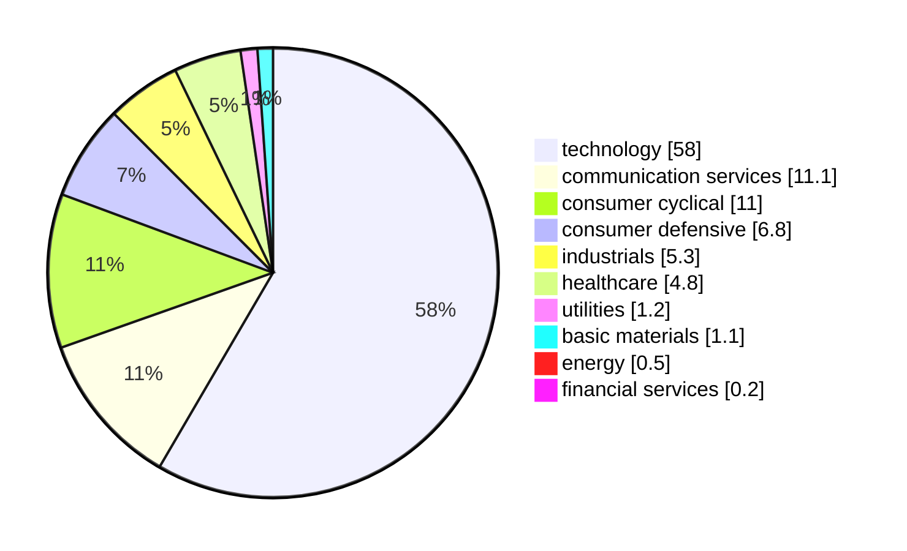

# QQQ ETF 分析報告

> **報告日期**：2026-11-23 ｜ **語言**：繁體中文 ｜ **數據來源**：Yahoo Finance、Finviz ｜ **類型**：ETF／指數基金

## 目錄

| # | 章節 | 核心結論 |
|---|------|----------|
| 1 | 執行摘要 | 費用率低、規模大，但產業曝險集中；長期相對績效較佳，近期相對基準落後。 |
| 2 | 基金概況 | Invesco 管理的 Large Growth 基金，依 NASDAQ-100 Index® 的成分與權重調整持有證券。 |
| 3 | 成本與規模 | 費用率低於類別平均，資產規模為 463.83B USD。 |
| 4 | 持股與集中度 | 前十大合計占 46.5%，最大單一持股 AAPL 權重為 8.16%。 |
| 5 | 產業配置 | technology 權重為 58.0%，基金對科技產業變化較敏感。 |
| 6 | 績效與風險 | 1 年相對基準落後；3 年與 5 年相對基準領先，波動與回撤仍須留意。 |
| 7 | 估值與配息 | 投資組合 P/E 為 28.4x、P/B 為 8.7x，配息殖利率為 0.45%。 |
| 8 | 適合對象、風險與觀察重點 | 較適合作為成長型衛星配置，需定期檢視集中度、產業風險及相對績效。 |

---

## 1. 執行摘要

QQQ 是 Invesco 的 Large Growth 基金，持有證券的組成與權重會調整，以對應 NASDAQ-100 Index® 的成分與相對權重；最新完成交易日 **2026-11-20** 的收盤價為 **608.45 USD**。  
基金費用率為 **0.18%**，同類平均為 **0.90%**；資產規模為 **463.83B USD**，前十大持股合計權重為 **46.5%**，最大單一持股 AAPL 權重為 **8.16%**。  
以價格報酬比較 VTI，QQQ 的 **1 年超額報酬為 -3.1%**，但 **3 年為 +5.1%**、**5 年為 +13.5%**；這些報酬不含配息。  
年化波動率為 **22.4%**，儲存歷史期間的最大回撤為 **-35.6%**；綜合成長取向、產業集中與波動風險，本報告定位為 **衛星配置**。

### 1.1 一頁式摘要

| 項目 | 內容 |
|------|------|
| 追蹤標的／類別 | NASDAQ-100 Index® 成分與權重對應；Invesco / Large Growth |
| 費用率（同類平均） | 0.18%（0.90%） |
| 資產規模 | 463.83B USD |
| 前十大合計權重／最大持股 | 46.5%／AAPL 8.16% |
| 1 年／3 年／5 年價格報酬 | +1.4%／+57.8%／+54.2% |
| 相對基準的超額報酬（1 年／3 年／5 年） | -3.1%／+5.1%／+13.5% |
| 年化波動率／最大回撤 | 22.4%／-35.6% |
| 折溢價 | -0.11%（折價） |
| 定位 | 衛星配置 |

### 1.2 五項評分

| 評分項目 | 分數（0–10） | 依據（引用數字） |
|----------|-------------:|------------------|
| 成本 | 9/10 | 費用率為 0.18%，低於同類平均 0.90%；評分反映費用相對水準。 |
| 規模與流動性 | 10/10 | 資產規模為 463.83B USD，屬大型基金規模；交易量、買賣價差等流動性數據為 N/A（資料未提供）。 |
| 分散度 | 6/10 | 前十大合計權重為 46.5%，最大單一持股權重為 8.16%；單一持股權重有限，但大型持股合計占有相當比重。 |
| 相對績效 | 6/10 | 1 年超額報酬為 -3.1%，3 年為 +5.1%，5 年為 +13.5%；不同期間相對表現不一致。 |
| 風險 | 4/10 | 年化波動率為 22.4%，最大回撤為 -35.6%；波動與回撤顯示淨值可能有明顯起伏。 |

## 2. 基金概況

| 項目 | 資料 |
|------|------|
| 基金名稱 | Invesco QQQ Trust |
| 代號 | QQQ |
| 基金家族／類別 | Invesco / Large Growth |
| 追蹤標的資訊 | NASDAQ-100 Index® |
| 指數編製規則細節 | N/A（資料未提供） |
| 產業／國家分類 | N/A（資料未提供） |
| 員工數 | N/A（資料未提供） |
| 基金類型 | 基金／ETF |

基金說明指出，顧問會不時調整信託持有的證券，使其組成與權重對應指數成分及其相對權重的定期變動。  
投資人因此可將 QQQ 理解為依指數成分與權重配置證券的基金，而不是持有單一公司的股票。  
資料未提供指數的完整編製規則、重編或調整時程等細節，本報告不推定相關規則。  
在投資組合中，QQQ 通常可用於增加大型成長股曝險；由於 technology 權重為 58.0%，不宜僅因持股名稱多元就視為產業均衡的整體市場基金。  
若投資人的主要目標是涵蓋更廣泛的市場，宜把 QQQ 與其他資產配置一併檢視，而非僅依賴單一產業權重較高的基金。

## 3. 成本與規模

### 3.1 費用與基金規模

| 項目 | 數值 | 解讀 |
|------|------:|------|
| 淨費用率 | 0.18% | 持有基金的經常性費用指標。 |
| 類別平均費用率 | 0.90% | 作為同類成本比較基準。 |
| 淨資產 | 463.83B USD | 基金資產規模指標。 |
| 年度持股週轉率 | 0.0% | Yahoo Finance 所列週轉率；不代表交易成本必然為零。 |

費用率 **0.18%** 低於類別平均 **0.90%**，就資料所列的經常性費用而言，成本相對較低。  
但費用率並非投資人承擔的全部成本；交易時仍可能涉及買賣價差、券商費用、稅負及其他交易相關成本，相關數值為 N/A（資料未提供）。

### 3.2 費用試算

| 試算項目 | 數值 | 說明 |
|----------|------:|------|
| 投入金額 | 1,000,000 USD | 試算基礎。 |
| 期間 | 10 年 | 試算期間。 |
| 費用試算 | 18,000 USD | 不假設報酬的簡化試算；依資料所列金額引用。 |

這項試算以目前費用率進行，並假設期間內不計投資報酬；實際持有成本會受費用率變化、資產價值變動及其他交易成本影響。

### 3.3 規模、週轉與折溢價

基金淨資產為 **463.83B USD**，顯示其資產規模大；但資產規模本身不能取代成交量、買賣價差或市場深度等流動性資料。  
年度持股週轉率為 **0.0%**。本報告不據此推論基金完全沒有交易或交易成本，因週轉率的計算口徑與相關交易資料未提供。  
基金 NAV 為 **609.11 USD**，市價相對 NAV 的折溢價為 **-0.11%**，目前呈折價。折溢價是特定時點的觀察值，不代表未來折溢價方向。

## 4. 持股與集中度

### 4.1 前十大持股

| 排序 | 代號 | 名稱 | 權重 |
|-----:|------|------|-----:|
| 1 | AAPL | Apple Inc | 8.16% |
| 2 | NVDA | NVIDIA Corp | 8.00% |
| 3 | MSFT | Microsoft Corp | 6.29% |
| 4 | MU | Micron Technology Inc | 4.47% |
| 5 | AMZN | Amazon.com Inc | 4.21% |
| 6 | AMD | Advanced Micro Devices Inc | 3.69% |
| 7 | TSLA | Tesla Inc | 3.41% |
| 8 | META | Meta Platforms Inc Class A | 2.97% |
| 9 | WMT | Walmart Inc | 2.69% |
| 10 | GOOGL | Alphabet Inc Class A | 2.66% |

### 4.2 集中度解讀

前十大持股合計占基金資產 **46.5%**，最大單一持股 AAPL 占 **8.16%**。  
前十大持股合計低於基金資產的一半，表示基金並非只由前十大持股構成；不過，前十大仍占相當比重，這些持股的價格變動可能對基金表現造成可觀影響。  
最大單一持股權重為 **8.16%**，其權重低於前十大合計權重，但不能因此忽略單一大型持股的公司特定風險。  
基金全部持股數量、前十大以外的持股明細與權重為 N/A（資料未提供），本報告不列出或推定前十大以外的持股。  
因此，使用者能依現有資料評估前十大集中程度，但無法據此完整判斷整體持股數量及所有持股間的分散狀況。

## 5. 產業配置

### 5.1 產業權重

| 產業 | 權重 |
|------|-----:|
| technology | 58.0% |
| communication services | 11.1% |
| consumer cyclical | 11.0% |
| consumer defensive | 6.8% |
| industrials | 5.3% |
| healthcare | 4.8% |
| utilities | 1.2% |
| basic materials | 1.1% |
| energy | 0.5% |
| financial services | 0.2% |

### 5.2 配置含義

technology 權重為 **58.0%**，是最大的產業曝險。  
communication services 權重為 **11.1%**，consumer cyclical 權重為 **11.0%**。  
因此，持有 QQQ 不只是持有多家公司，也代表對科技產業及大型成長股表現承擔較高曝險。  
若科技產業估值收縮、成分股獲利預期下修，或市場風險偏好下降，基金可能受到較明顯影響。  
產業分類與權重是基金配置的統計呈現，不能取代對個別持股業務與風險的分析。

## 6. 績效與風險

### 6.1 各期間價格報酬

| 期間 | QQQ | VTI 基準 | 超額報酬 |
|------|----:|---------:|---------:|
| 1 個月 | -13.6% | -9.3% | -4.3% |
| 3 個月 | -13.9% | -9.8% | -4.0% |
| 6 個月 | -15.2% | -7.3% | -7.9% |
| 1 年 | +1.4% | +4.5% | -3.1% |
| 3 年 | +57.8% | +52.7% | +5.1% |
| 5 年 | +54.2% | +40.6% | +13.5% |

以上為價格報酬，不含配息；基準為 VTI（美國整體市場）。  
QQQ 在表列的近期期間落後 VTI；在 **1 年**區間，超額報酬為 **-3.1%**。  
相較之下，在 **3 年**與 **5 年**區間，超額報酬分別為 **+5.1%**與 **+13.5%**。  
這些期間的相對表現並不一致，不能只依較長期間的正超額報酬推定未來仍會領先，也不能只依近期落後判斷長期結果。  
追蹤誤差為 N/A（資料未提供），本報告不以基金報酬與基準報酬之差推算追蹤誤差。

### 6.2 價格歷史觀察

以下為提供的月收盤價資料；這些價格不是總報酬，也未包含配息。

| 月份 | 收盤價 |
|------|-------:|
| 2024-11 | 504.63 |
| 2024-12 | 506.92 |
| 2025-01 | 517.89 |
| 2025-02 | 503.89 |
| 2025-03 | 465.66 |
| 2025-04 | 472.17 |
| 2025-05 | 515.51 |
| 2025-06 | 548.42 |
| 2025-07 | 561.72 |
| 2025-08 | 567.08 |
| 2025-09 | 597.56 |
| 2025-10 | 626.13 |
| 2025-11 | 616.35 |
| 2025-12 | 612.22 |
| 2026-01 | 619.76 |
| 2026-02 | 605.23 |
| 2026-03 | 575.95 |
| 2026-04 | 666.31 |
| 2026-05 | 736.73 |
| 2026-06 | 735.63 |
| 2026-07 | 687.27 |
| 2026-08 | 716.01 |
| 2026-09 | 739.77 |
| 2026-10 | 690.49 |
| 2026-11 | 608.45 |

這段月收盤價序列包含上升與回落，顯示觀察區間內價格並非單向變動。  
月收盤價不能單獨呈現投資人的完整持有報酬；本表亦未把配息納入。

### 6.3 波動與回撤

| 風險指標 | 數值 | 說明 |
|----------|------:|------|
| 年化波動率（1 年） | 22.4% | 衡量所列期間價格波動程度。 |
| 最大回撤 | -35.6% | 儲存歷史期間為 10.0 年；谷底日期為 2022-12-28。 |
| 儲存歷史期間 CAGR | 17.8% | 僅適用於所列儲存歷史期間。 |

年化波動率為 **22.4%**，反映價格可能有明顯起伏；最大回撤為 **-35.6%**，表示在儲存歷史期間內曾出現大幅回落。  
歷史最大回撤不代表未來回撤上限，也不保證未來會以相同方式復原。投資人應確認自身可承受的帳面波動與資金使用期限。

### 6.4 最大回撤金額示例

| 試算項目 | 數值 | 說明 |
|----------|------:|------|
| 試算金額 | 1,000,000 USD | 資料提供的示例基礎。 |
| 最大回撤對應帳面減少金額 | 356,200 USD | 依資料提供的示例金額引用；不是對個別投資人的損失預測。 |

此示例僅說明歷史最大回撤套用於指定試算金額時的帳面減少，不代表未來損失必然相同，也未計入配息、稅負或交易成本。

## 7. 估值與配息

| 項目 | 數值 |
|------|-----:|
| 投資組合 P/E | 28.4x |
| 投資組合 P/B | 8.7x |
| 配息殖利率 | 0.45% |

P/E 與 P/B 是 Yahoo Finance 所列的加權投資組合指標，反映基金成分股整體的評價概況，不是基金本身的合理價值。  
此類倍數會隨成分股價格、獲利、帳面價值及持股權重變化而變動；單一時點的倍數不能單獨用來判定基金便宜或昂貴。  
本報告不據此推算基金合理價值，也不提供目標價。  
配息殖利率為 **0.45%**；配息金額、配息頻率及歷史配息紀錄為 N/A（資料未提供）。  
投資人若將基金用於現金流需求，應另行確認最新配息公告及個人適用的稅務處理。

## 8. 適合對象、風險與觀察重點

### 8.1 適合與不適合的投資人

| 投資人類型 | 適合度 | 原因（引用數字） |
|------------|--------|------------------|
| 希望增加大型成長股曝險的投資人 | 較適合 | 基金類別為 Large Growth；technology 權重為 58.0%。 |
| 可接受科技產業集中與價格波動的投資人 | 有條件適合 | 年化波動率為 22.4%，最大回撤為 -35.6%；需能承受明顯波動。 |
| 尋求低成本指數型配置的投資人 | 可考慮 | 費用率為 0.18%，低於類別平均 0.90%。 |
| 尋求與美國整體市場相同曝險的投資人 | 不宜單獨替代 | QQQ 的產業配置以 technology 為主；基準比較資料採用 VTI（美國整體市場）。 |
| 以穩定現金流為主要目標的投資人 | 需審慎評估 | 配息殖利率為 0.45%；配息紀錄及頻率為 N/A（資料未提供）。 |
| 無法承受大幅帳面回撤的投資人 | 不適合單獨集中配置 | 儲存歷史期間的最大回撤為 -35.6%。 |

### 8.2 主要風險

| 風險 | 數據依據 | 對投資人的可能影響 |
|------|----------|--------------------|
| 前十大持股集中風險 | 前十大合計權重為 46.5%；AAPL 權重為 8.16%。 | 大型持股價格或基本面變化，可能對基金報酬造成影響。 |
| 科技產業集中風險 | technology 權重為 58.0%。 | 科技產業景氣、估值或市場情緒變化，可能影響基金整體表現。 |
| 市場波動與回撤風險 | 年化波動率為 22.4%；最大回撤為 -35.6%。 | 短期帳面損失可能較大，投資人可能需要較長時間承受波動。 |
| 評價風險 | 投資組合 P/E 為 28.4x，P/B 為 8.7x。 | 若成分股評價下降，基金價格可能受壓；倍數本身不代表未來報酬。 |
| 匯率風險 | 基金價格以 USD 表示；外幣投資人的匯率避險資訊為 N/A（資料未提供）。 | 非美元投資人換算成自身貨幣時，匯率變化可能影響實際報酬。 |
| 相對基準落後風險 | 1 年超額報酬為 -3.1%；3 個月與 6 個月超額報酬為 -4.0% 與 -7.9%。 | 若相對落後延續，可能不符合投資人對基準比較結果的預期。 |

### 8.3 什麼情況下要重新評估

| 可查核條件 | 重新評估的原因 |
|------------|----------------|
| 最大單一持股權重高於目前的 8.16%。 | 檢查單一公司曝險是否增加，以及投資人是否仍能接受集中程度。 |
| 前十大持股合計權重高於目前的 46.5%。 | 評估基金的主要持股集中度是否進一步提高。 |
| technology 權重相較目前的 58.0% 出現明顯變化。 | 檢視基金的產業風格與原先投資目的是否仍相符。 |
| 費用率不再是目前的 0.18%，或類別平均出現變化。 | 重新比較基金持有成本與同類產品的成本水準。 |
| 1 年超額報酬持續為負，且 3 年或 5 年超額報酬也轉為負值。 | 檢視相對績效是否從短期落後擴展至較長觀察期間。 |
| 資產規模相較目前的 463.83B USD 明顯縮減。 | 重新檢視基金規模變化，以及該變化是否影響持有人的使用需求。 |
| NAV 與市價折溢價相較目前的 -0.11% 出現明顯變化。 | 檢視買進或賣出時的市價與 NAV 差異。 |
| 個人資金用途、持有期限或可承受風險改變。 | 即使基金資料未變，個人投資組合中的適配性也可能改變。 |

### 8.4 結論定位

**定位：衛星配置。**  
目前費用率為 **0.18%**，資產規模為 **463.83B USD**；但 technology 權重為 **58.0%**，前十大持股合計為 **46.5%**，年化波動率為 **22.4%**，最大回撤為 **-35.6%**。  
相對績效方面，1 年超額報酬為 **-3.1%**，3 年與 5 年超額報酬則為 **+5.1%** 與 **+13.5%**。  
這些數字顯示 QQQ 具有成長型配置用途，但產業曝險、持股集中度與回撤幅度使其較適合搭配其他資產，而非僅憑單一基金承擔全部市場曝險。  
此定位是基金特性分析，不是買賣建議。

---

> **免責聲明**：本報告為 AI 自動生成，僅供研究與教育參考，不構成投資建議。報酬為價格報酬，未計入配息、稅負與交易成本；投資有風險。

---

## 資料與來源

| 項目 | 內容 |
|------|------|
| 價格 | 608.45 USD，2026-11-20 收盤（Yahoo Finance 日線） |
| 基金資料 | Yahoo Finance（持股、費用率、規模）；績效與回撤由價格資料庫計算 |
| 有回應的資料來源 | Yahoo Finance、Finviz |
| 未回應的資料來源 | SEC 申報資料 (XBRL)、StockAnalysis、Roic.ai |
| 由程式計算 | 基金的集中度、績效、費用與回撤試算 |
| 撰寫模型 | openai / gpt-6-luna |

> 本區塊由產生報告的程式依實際取得的資料填寫，非模型撰寫。「由程式計算」的數字不是模型的估計；其餘判斷（評分、情境、策略）是模型的分析。
