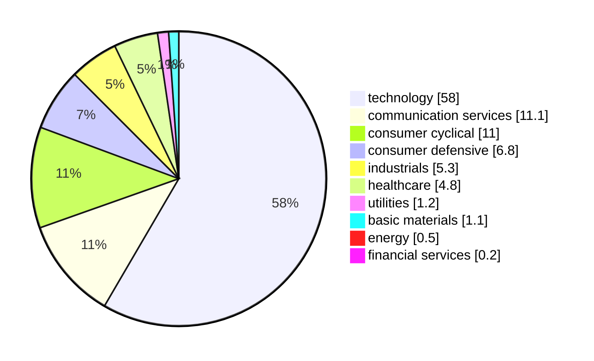

# QQQ ETF 分析報告

> **報告日期**：2026-11-24 ｜ **語言**：繁體中文 ｜ **數據來源**：Yahoo Finance、Finviz ｜ **類型**：ETF／指數基金

## 目錄

| # | 章節 | 核心結論 |
|---|------|----------|
| 1 | 執行摘要 | 費用率為 0.18%，長期相對 VTI 報酬為正，但產業曝險偏重科技 |
| 2 | 基金概況 | 投資組合依 NASDAQ-100 Index 成分與權重調整 |
| 3 | 成本與規模 | 資產規模為 463.83B USD，費用率低於同類平均 |
| 4 | 持股與集中度 | 前十大合計占 46.5%，最大持股為 AAPL |
| 5 | 產業配置 | technology 權重為 58.0% |
| 6 | 績效與風險 | 1 年相對 VTI 略優，3 年與 5 年超額報酬為正；波動與回撤不可忽視 |
| 7 | 估值與配息 | 投資組合 P/E 為 28.4x、P/B 為 8.7x，配息殖利率為 0.45% |
| 8 | 適合對象、風險與觀察重點 | 較適合作為偏成長型投資組合的衛星配置 |

---

## 1. 執行摘要

截至 2026-11-23，QQQ 收盤價為 651.03 USD；基金依其說明調整持股，使證券組合對應 NASDAQ-100 Index 的成分與相對權重。  
費用率為 0.18%，同類平均為 0.90%；基金資產規模為 463.83B USD。  
前十大持股合計占 46.5%，最大持股權重為 8.2%；產業配置中 technology 占 58.0%。  
相對 VTI，QQQ 的 1 年、3 年與 5 年價格超額報酬分別為 +0.2%、+9.0% 與 +18.0%，但年化波動率為 23.3%，歷史最大回撤為 -35.6%。

### 1.1 一頁式摘要

| 項目 | 內容 |
|------|------|
| 追蹤標的／類別 | NASDAQ-100 Index 成分與相對權重；Large Growth |
| 費用率（同類平均） | 0.18%（0.90%） |
| 資產規模 | 463.83B USD |
| 前十大合計權重／最大持股 | 46.5%／8.2%（AAPL） |
| 1 年／3 年／5 年價格報酬 | +11.2%／+68.7%／+65.0% |
| 相對基準的超額報酬（1 年／3 年／5 年） | +0.2%／+9.0%／+18.0%（基準：VTI） |
| 年化波動率／最大回撤 | 23.3%／-35.6% |
| 折溢價 | +0.02% 溢價 |
| 定位 | 衛星配置 |

### 1.2 五項評分

| 評分項目 | 分數（0–10） | 依據（引用數字） |
|----------|-------------:|------------------|
| 成本 | 9 | 費用率為 0.18%，低於同類平均 0.90%；評分依所提供的同類平均比較 |
| 規模與流動性 | 9 | 資產規模為 463.83B USD；此評分依資產規模判斷，未提供成交量或買賣價差資料 |
| 分散度 | 6 | 前十大合計占 46.5%，最大單一持股權重為 8.2%；科技產業占 58.0%，仍有明顯產業集中 |
| 相對績效 | 8 | 相對 VTI 的 1 年、3 年與 5 年超額報酬分別為 +0.2%、+9.0% 與 +18.0% |
| 風險 | 4 | 年化波動率為 23.3%，歷史最大回撤為 -35.6%；兩項指標均顯示價格波動風險不可忽略 |

## 2. 基金概況

| 項目 | 資料 |
|------|------|
| 基金名稱 | Invesco QQQ Trust |
| 代號 | QQQ |
| 基金公司／家族 | Invesco |
| 類別 | Large Growth |
| 基金型態 | ETF／指數基金 |
| 基金價格資料日期 | 2026-11-23 |
| 收盤價 | 651.03 USD |
| 對應指數 | NASDAQ-100 Index |
| 追蹤誤差 | N/A（資料未提供） |
| 指數編製規則細節 | N/A（資料未提供） |

依基金說明，顧問會不時調整信託持有證券，使證券的組成與權重符合指數成分及相對權重的變動。  
基金申購組合的組成與權重也會配合指數變化調整。  
以上是資料所提供的基金運作描述；未提供指數成分納入條件、權重上限或定期檢視細節，因此本報告不延伸推定相關規則。

QQQ 的投資組合包括大型成長股，且產業配置高度偏向科技相關曝險。  
在多元投資組合中，投資人可將其視為偏成長、偏大型股的配置工具。  
由於 technology 占 58.0%，QQQ 不宜被理解為與美國整體市場產業分布相同的替代品。  
若投資人需要較廣泛的美國市場曝險，應將 QQQ 與其整體投資組合中的其他資產一併評估。

## 3. 成本與規模

| 指標 | QQQ | 比較或說明 |
|------|----:|------------|
| 淨費用率 | 0.18% | Yahoo Finance 所列 |
| 同類平均費用率 | 0.90% | Yahoo Finance 所列 |
| 淨資產 | 463.83B USD | Yahoo Finance 所列 |
| 年度持股週轉率 | 0.0% | Yahoo Finance 所列 |
| 折溢價 | +0.02% | 相對 NAV 的溢價 |
| NAV | 650.89 USD | 所列淨資產價值 |
| 收盤價 | 651.03 USD | 2026-11-23 |

QQQ 的費用率為 0.18%，低於同類平均 0.90%。  
費用率是持有基金時需要留意的持續性成本，但不代表投資人最終報酬；市場價格變動、配息、稅負與交易成本亦會影響實際結果。

依資料提供的簡化試算，若以 1,000,000 USD 投資 10 年、採用目前費用率且不假設任何報酬，費用為 **18,000 USD**。  
這是不計報酬的簡化試算，並非未來費用或投資結果的保證。

基金淨資產為 463.83B USD，代表基金具有相當規模。  
但資料未提供成交量、買賣價差或市場深度，因此無法只依資產規模推斷個別投資人實際交易時的流動性狀況。

年度持股週轉率為 0.0%。  
此數字是資料所列的週轉率；本報告不據此推論未來交易活動、追蹤誤差或基金交易成本。

收盤價相對 NAV 為 +0.02% 溢價。  
這反映所列資料時點下的價格與淨資產價值關係，不代表未來折溢價方向。

## 4. 持股與集中度

| 代號 | 名稱 | 權重 |
|------|------|-----:|
| AAPL | Apple Inc | 8.16% |
| NVDA | NVIDIA Corp | 8.00% |
| MSFT | Microsoft Corp | 6.29% |
| MU | Micron Technology Inc | 4.47% |
| AMZN | Amazon.com Inc | 4.21% |
| AMD | Advanced Micro Devices Inc | 3.69% |
| TSLA | Tesla Inc | 3.41% |
| META | Meta Platforms Inc Class A | 2.97% |
| WMT | Walmart Inc | 2.69% |
| GOOGL | Alphabet Inc Class A | 2.66% |

| 集中度指標 | 數值 | 解讀 |
|------------|-----:|------|
| 前十大持股合計 | 46.5% | 少數大型持股占基金資產的重要部分，但合計低於基金資產的一半 |
| 最大單一持股 | 8.2% | 最大持股為 AAPL |
| 前十大以外持股 | N/A（資料未提供） | 不列出未提供的持股 |
| 成分股數量 | N/A（資料未提供） | 不以記憶或其他來源補充 |

前十大合計占 46.5%，最大單一持股為 AAPL，權重為 8.2%。  
因此，基金並非由單一持股主導，但大型成分股的價格變化仍可能對整體表現產生明顯影響。  
資料將前十大合計低於一半描述為分散；然而，持股分散程度仍應與產業配置一併觀察，不能只看前十大權重。

前十大持股包括多家科技、半導體、網路平台及消費相關公司。  
其中 AAPL、NVDA 與 MSFT 的權重分別為 8.16%、8.00% 與 6.29%。  
這些持股所在產業及個別公司的價格變動，可能使基金表現偏離產業較分散的市場組合。

持股權重會隨基金組合調整及市場變動而變化。  
以上權重是所提供資料的持股快照，不代表未來固定配置。

## 5. 產業配置

| 產業 | 權重 |
|------|-----:|
| technology | 58.0% |
| communication services | 11.1% |
| consumer cyclical | 11.0% |
| consumer defensive | 6.8% |
| industrials | 5.3% |
| healthcare | 4.8% |
| utilities | 1.2% |
| basic materials | 1.1% |
| energy | 0.5% |
| financial services | 0.2% |

technology 權重為 58.0%，是 QQQ 最大的產業曝險。  
因此，持有 QQQ 不只是押注大型成長股，也會承受科技產業及其成分公司表現對基金的影響。

communication services 權重為 11.1%，consumer cyclical 權重為 11.0%。  
其他列示產業的權重均低於這些主要配置。  
此產業結構意味著 QQQ 的表現可能與科技及大型成長股的市場環境有較高關聯。

產業配置是所提供資料中的分類結果。  
未提供持股分類標準或產業權重變動歷史，因此無法判斷不同分類方法下的權重差異，也不推定未列出的產業曝險。

## 6. 績效與風險

以下報酬為價格報酬，不含配息。  
相對基準為 VTI（美國整體市場）。

| 期間 | QQQ 價格報酬 | VTI 基準報酬 | 超額報酬 |
|------|-------------:|-------------:|---------:|
| 1 個月 | -7.6% | -4.8% | -2.8% |
| 3 個月 | -8.4% | -6.1% | -2.3% |
| 6 個月 | -10.9% | -3.8% | -7.0% |
| 1 年 | +11.2% | +11.0% | +0.2% |
| 3 年 | +68.7% | +59.6% | +9.0% |
| 5 年 | +65.0% | +47.0% | +18.0% |

短期資料顯示，1 個月、3 個月與 6 個月期間，QQQ 的價格報酬均低於 VTI。  
1 年期間，QQQ 的報酬為 +11.2%，相對超額報酬為 +0.2%。  
3 年與 5 年期間的超額報酬分別為 +9.0% 與 +18.0%。

這些期間的比較結果並不表示未來會重複相同表現。  
價格報酬不含配息，也未反映個別投資人的交易成本、稅負或實際買進時點。

| 風險指標 | 數值 | 說明 |
|----------|-----:|------|
| 年化波動率（1Y） | 23.3% | 衡量所列期間的價格波動程度 |
| 最大回撤 | -35.6% | 所列歷史資料中的最大回撤 |
| 最大回撤低點日期 | 2022-12-28 | 價格資料庫所列 |
| 回撤資料期間 | 10.0 年 | 所列歷史資料涵蓋期間 |
| 儲存歷史期間 CAGR | 18.6% | 價格資料庫所列 |

若以 1,000,000 USD 參照歷史最大回撤，資料提供的帳面減少金額為 **356,200 USD**。  
這是依區塊所列最大回撤提供的示例，不是未來損失預測，也不是本金保證或投資結果承諾。

年化波動率為 23.3%，最大回撤為 -35.6%。  
這些數字顯示，持有期間可能面臨明顯價格波動；投資人應確認自身能否承受帳面價值下跌，而不應只依較長期間的正報酬評估基金風險。

## 7. 估值與配息

| 指標 | 數值 |
|------|-----:|
| 投資組合 P/E | 28.4x |
| 投資組合 P/B | 8.7x |
| 配息殖利率 | 0.45% |
| 配息紀錄 | N/A（資料未提供） |

P/E 為 28.4x、P/B 為 8.7x，反映的是基金持股組合依資料來源呈現的加權估值指標，不是對 QQQ 基金本身的合理價值判斷。  
這些倍數不能直接推導基金應有市價，也不應被視為基金未來報酬的保證。

配息殖利率為 0.45%。  
資料未提供配息金額、頻率或歷史紀錄，因此無法據此說明配息是否穩定或推估未來配息。

基金價格為 651.03 USD（2026-11-23 收盤），NAV 為 650.89 USD。  
價格相對 NAV 的溢價為 +0.02%。  
此處僅列示基金價格與 NAV 的關係，不以市價推算合理價值或目標價。

## 8. 適合對象、風險與觀察重點

### 8.1 適合與不適合的投資人

| 投資人類型 | 適合度 | 原因（引用數字） |
|------------|--------|------------------|
| 尋求大型成長股曝險的投資人 | 較適合 | 基金類別為 Large Growth，technology 權重為 58.0% |
| 已有廣泛市場配置、希望增加成長型曝險的投資人 | 可評估 | 對 VTI 的 3 年與 5 年超額報酬分別為 +9.0% 與 +18.0%，但歷史相對表現不代表未來 |
| 重視低費用且有長期持有規劃的投資人 | 可評估 | 費用率為 0.18%，同類平均為 0.90% |
| 需要穩定配息作為主要現金流來源的投資人 | 較不適合 | 配息殖利率為 0.45%，配息紀錄為 N/A（資料未提供） |
| 無法接受較大價格波動的投資人 | 較不適合 | 年化波動率為 23.3%，歷史最大回撤為 -35.6% |
| 希望產業配置廣泛分散的投資人 | 較不適合單獨依賴 | technology 權重為 58.0%，前十大持股合計占 46.5% |

### 8.2 主要風險

| 風險 | 數據依據 | 對投資人的可能影響 |
|------|----------|--------------------|
| 持股集中風險 | 前十大合計占 46.5%，最大持股權重為 8.2% | 大型成分股下跌時，可能對基金價格造成較大影響 |
| 產業集中風險 | technology 權重為 58.0% | 科技產業景氣、投資情緒或成分公司表現變化，可能對基金有較大影響 |
| 價格波動與回撤風險 | 年化波動率為 23.3%，最大回撤為 -35.6% | 投資人可能經歷明顯帳面損失，且回復時間無法由歷史資料保證 |
| 評價風險 | 投資組合 P/E 為 28.4x，P/B 為 8.7x | 若市場對成分股成長預期或估值看法改變，基金價格可能受影響；上述倍數不代表未來方向 |
| 匯率風險 | 基金收盤價以 USD 表示，匯率資料為 N/A（資料未提供） | 以非美元作為生活或投資計價貨幣的投資人，還需留意換匯造成的投資結果差異；資料不足以量化其幅度 |

### 8.3 什麼情況下要重新評估

| 可查核條件 | 重新評估的理由 |
|------------|----------------|
| 最大單一持股權重高於目前列示的 8.16% | 檢視個別公司曝險是否進一步提高 |
| 前十大持股合計權重高於目前列示的 46.5% | 檢視基金集中度變化及其對整體資產配置的影響 |
| technology 權重高於目前列示的 58.0% | 重新檢查投資人可接受的產業集中程度 |
| 淨費用率不再是 0.18% | 更新持有成本評估，並與屆時可取得的同類費用資料比較 |
| 相對 VTI 的後續 1 年、3 年或 5 年超額報酬轉為負值 | 重新檢查 QQQ 相對整體市場的表現與配置理由 |
| 淨資產相較目前的 463.83B USD 出現明顯縮減 | 重新檢視基金規模變化；判斷時應查核後續基金資料 |
| 折溢價偏離目前的 +0.02% | 檢視買進價格相對 NAV 的差異 |
| 波動率或最大回撤高於目前列示的 23.3% 或 -35.6% | 重新評估自身風險承受度及投資組合風險 |

> **定位：衛星配置。** QQQ 的費用率為 0.18%，資產規模為 463.83B USD，且對 VTI 的 3 年與 5 年超額報酬分別為 +9.0% 與 +18.0%；但 technology 權重為 58.0%，年化波動率為 23.3%，最大回撤為 -35.6%，因此較適合作為偏成長曝險的配置，而非僅憑本報告視為全面分散的單一持有工具。此定位不是買賣建議。

---

> **免責聲明**：本報告為 AI 自動生成，僅供研究與教育參考，不構成投資建議。報酬為價格報酬，未計入配息、稅負與交易成本；投資有風險。

---

## 資料與來源

| 項目 | 內容 |
|------|------|
| 價格 | 651.03 USD，2026-11-23 收盤（Yahoo Finance 日線） |
| 基金資料 | Yahoo Finance（持股、費用率、規模）；績效與回撤由價格資料庫計算 |
| 有回應的資料來源 | Yahoo Finance、Finviz |
| 未回應的資料來源 | SEC 申報資料 (XBRL)、StockAnalysis、Roic.ai |
| 由程式計算 | 基金的集中度、績效、費用與回撤試算 |
| 撰寫模型 | openai / gpt-6-luna |

> 本區塊由產生報告的程式依實際取得的資料填寫，非模型撰寫。「由程式計算」的數字不是模型的估計；其餘判斷（評分、情境、策略）是模型的分析。
