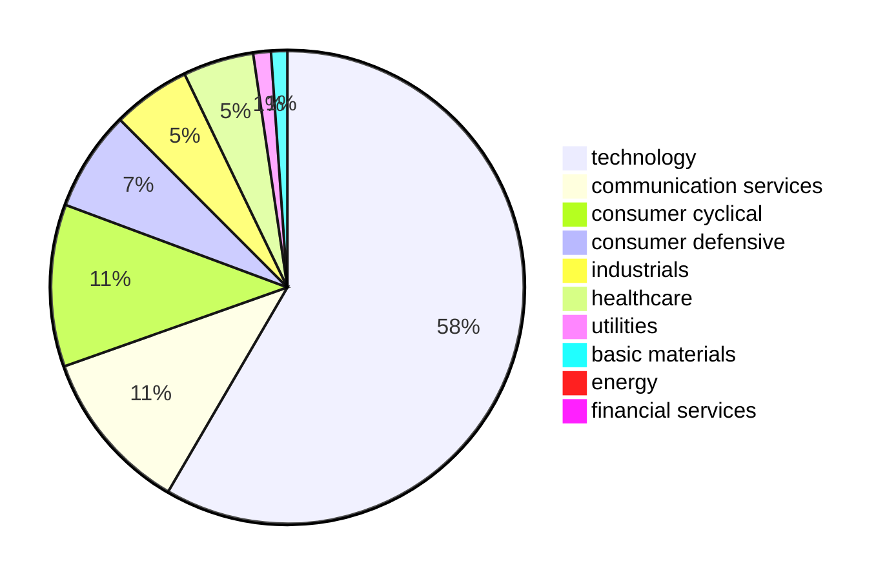

# QQQ ETF 分析報告

> **報告日期**：2026-11-25 ｜ **語言**：繁體中文 ｜ **數據來源**：Yahoo Finance、Finviz ｜ **類型**：ETF／指數基金

## 目錄

| # | 章節 | 核心結論 |
|---|------|----------|
| 1 | 執行摘要 | 費用率低於同類平均，長期相對報酬為正；投資組合偏重科技，且波動與回撤不可忽視。 |
| 2 | 基金概況 | 透過調整持倉，使信託證券組成與權重對應 NASDAQ-100 Index®。 |
| 3 | 成本與規模 | 費用率為 0.18%，資產規模為 463.83B USD。 |
| 4 | 持股與集中度 | 前十大持股占資產 46.5%，最大單一持股權重為 8.2%。 |
| 5 | 產業配置 | 科技業權重為 58.0%，是主要產業曝險。 |
| 6 | 績效與風險 | 3 年與 5 年相對 VTI 超額報酬為正；年化波動率與最大回撤顯示價格波動風險。 |
| 7 | 估值與配息 | 投資組合 P/E 為 28.4x、P/B 為 8.7x，配息殖利率為 0.45%。 |
| 8 | 適合對象、風險與觀察重點 | 較適合作為偏成長取向的衛星配置，配置前應評估科技集中與回撤承受度。 |

---

## 1. 執行摘要

截至 2026-11-24，QQQ 收盤價為 **638.10 USD**；基金類別為 Invesco / Large Growth，並依基金簡介調整信託證券組成與權重，以對應 NASDAQ-100 Index®。

費用率為 **0.18%**，低於同類平均 **0.90%**；資產規模為 **463.83B USD**，年持股週轉率為 **0.0%**。

前十大持股合計占資產 **46.5%**，最大單一持股權重為 **8.2%**；產業配置則以科技業的 **58.0%** 為主，基金並非跨產業均衡配置。

相對 VTI 的價格報酬超額在 1 年為 **-1.1%**、3 年為 **+6.7%**、5 年為 **+14.8%**；目前價格相對 NAV 溢價 **0.02%**。

### 1.1 一頁式摘要

| 項目 | 內容 |
|------|------|
| 追蹤標的／類別 | 依基金簡介調整信託證券組成與權重，以對應 NASDAQ-100 Index®；類別為 Invesco / Large Growth。 |
| 價格與日期 | 638.10 USD；2026-11-24 收盤。 |
| 費用率（同類平均） | 0.18%（0.90%）。 |
| 資產規模 | 463.83B USD。 |
| 前十大合計權重／最大持股 | 46.5%／8.2%。 |
| 1 年／3 年／5 年價格報酬 | +8.1%／+65.3%／+60.6%；不含配息。 |
| 相對基準的超額報酬（1 年／3 年／5 年） | -1.1%／+6.7%／+14.8%；基準為 VTI。 |
| 年化波動率／最大回撤 | 23.4%／-35.6%。 |
| 折溢價 | 溢價 +0.02%。 |
| 定位 | **衛星配置**；理由是產業曝險偏重科技，且歷史資料顯示有明顯波動與回撤。 |

### 1.2 五項評分

| 評分項目 | 分數（0–10） | 依據（引用數字） |
|----------|-------------:|------------------|
| 成本 | 9 | 費用率為 0.18%，低於同類平均 0.90%；相對成本具吸引力，但仍有基金費用。 |
| 規模與流動性 | 9 | 資產規模為 463.83B USD，規模評分偏高；未提供成交量與買賣價差，流動性不另作量化判斷。 |
| 分散度 | 5 | 前十大占 46.5%，最大單一持股占 8.2%；單一持股並非過半，但科技業占比高，分散效果有限。 |
| 相對績效 | 7 | 相對 VTI 的 1 年超額為 -1.1%，但 3 年與 5 年超額分別為 +6.7% 與 +14.8%；期間表現不一致。 |
| 風險 | 4 | 年化波動率為 23.4%，最大回撤為 -35.6%；價格波動與下跌幅度都需要留意。 |

## 2. 基金概況

### 2.1 基金基本資料

| 欄位 | 資料 |
|------|------|
| 代號 | QQQ |
| 名稱 | Invesco QQQ Trust |
| 基金公司／類別 | Invesco / Large Growth |
| 基金類型 | 基金／ETF |
| 追蹤標的說明 | 基金簡介指出，管理人會調整信託所持證券，使其組成與權重對應 NASDAQ-100 Index® 的成分與相對權重。 |
| Sector／Industry／Country | N/A（資料未提供） |
| Employees | N/A（資料未提供） |

### 2.2 基金如何運作

QQQ 是基金，不是營運公司。

基金簡介描述的運作方式，是管理人不時調整信託內證券的組成與權重。

調整目的在於對應指數證券身分或相對權重的定期變動。

基金資料未提供更詳細的指數編製規則，因此本報告不推論成分股納入、剔除或權重設定的具體條件。

基金成分股數量為 N/A（資料未提供）。

追蹤誤差為 N/A（資料未提供）。

### 2.3 在投資組合中的角色

QQQ 可作為投資人對大型成長股與科技相關產業曝險的工具。

其持倉並非平均分布於各產業，科技業配置占主要比重。

因此，QQQ 通常較適合用來補充偏成長、偏大型股的配置，而不應只看基金名稱或持股數量，就將它視為涵蓋全市場的均衡型基金。

若投資組合已大量持有大型科技公司，配置 QQQ 可能增加相同產業或個股的重複曝險。

## 3. 成本與規模

### 3.1 費用率

| 項目 | 數值 |
|------|------:|
| QQQ 費用率 | 0.18% |
| 同類平均費用率 | 0.90% |

QQQ 的費用率低於所列同類平均。

這項比較只反映基金費用率，不代表基金在所有交易情況下的總持有成本都相同。

實際投資成本也可能受到買賣價差、交易費用、稅務及配息處理方式影響；相關數字未提供。

### 3.2 費用試算

| 試算情境 | 金額 |
|----------|-----:|
| 以 1,000,000 USD 持有 10 年，按目前費用率、不假設報酬的費用試算 | 18,000 USD |

上述為不計投資報酬的簡化試算。

這不是未來實際費用預測，也未納入資產價格變動、交易成本、稅負或費用率變動。

### 3.3 資產規模與週轉率

| 項目 | 數值 |
|------|------:|
| 資產規模 | 463.83B USD |
| 年持股週轉率 | 0.0% |

資產規模可作為基金規模的參考，但單靠資產規模不能判斷所有投資人的實際成交成本。

基金資料未提供成交量、買賣價差或市場深度，因此本報告不對這些流動性指標作推定。

年持股週轉率反映資料所列的持倉週轉情況；不可據此直接推論基金未來的交易成本或持倉是否會調整。

### 3.4 NAV 與折溢價

| 項目 | 數值 |
|------|------:|
| NAV | 637.95 USD |
| 收盤價相對 NAV | 溢價 +0.02% |

目前所列收盤價相對 NAV 的溢價幅度為 **+0.02%**。

這是指定交易日的價格與淨值關係，不代表其他交易日的折溢價水準。

## 4. 持股與集中度

### 4.1 前十大持股

| 代號 | 名稱 | 權重 |
|------|------|-----:|
| AAPL | Apple Inc | 8.16% |
| NVDA | NVIDIA Corp | 8.00% |
| MSFT | Microsoft Corp | 6.29% |
| MU | Micron Technology Inc | 4.47% |
| AMZN | Amazon.com Inc | 4.21% |
| AMD | Advanced Micro Devices Inc | 3.69% |
| TSLA | Tesla Inc | 3.41% |
| META | Meta Platforms Inc Class A | 2.97% |
| WMT | Walmart Inc | 2.69% |
| GOOGL | Alphabet Inc Class A | 2.66% |

### 4.2 集中度解讀

前十大持股合計占基金資產 **46.5%**。

最大單一持股為 Apple Inc，權重 **8.16%**。

前十大合計未達基金資產的一半，表示基金並非只由少數幾檔股票構成。

不過，前十大持股仍占有接近半數的基金資產，這些公司的股價表現會對基金報酬產生重要影響。

持股權重並不平均；投資人需要留意大型持股的表現變化，而非只看持股檔數。

前十大以外的個別持股資料為 N/A（資料未提供），本報告不列出或推測其他持股。

## 5. 產業配置

### 5.1 產業權重

| 產業 | 權重 |
|------|-----:|
| technology | 58.0% |
| communication services | 11.1% |
| consumer cyclical | 11.0% |
| consumer defensive | 6.8% |
| industrials | 5.3% |
| healthcare | 4.8% |
| utilities | 1.2% |
| basic materials | 1.1% |
| energy | 0.5% |
| financial services | 0.2% |

### 5.2 配置代表的曝險

科技業占 **58.0%**，是最主要的產業配置。

其次是 communication services 與 consumer cyclical，權重分別為 **11.1%** 與 **11.0%**。

因此，持有 QQQ 不只是持有多檔大型公司，也代表投資人承擔較高的科技業曝險。

若科技業或大型成長股的市場評價下滑，QQQ 可能受到較明顯影響。

其他產業的配置比例相對較低，不能將 QQQ 視為各產業權重均衡的全市場基金。

## 6. 績效與風險

### 6.1 各期間價格報酬

| 期間 | QQQ 價格報酬 | VTI 基準報酬 | 超額報酬 |
|------|-------------:|-------------:|---------:|
| 1 個月 | -10.4% | -5.8% | -4.6% |
| 3 個月 | -10.3% | -6.4% | -3.9% |
| 6 個月 | -12.5% | -4.2% | -8.3% |
| 1 年 | +8.1% | +9.3% | -1.1% |
| 3 年 | +65.3% | +58.6% | +6.7% |
| 5 年 | +60.6% | +45.7% | +14.8% |

以上均為價格報酬，不含配息。

基準為 VTI，代表美國整體市場。

資料顯示，1 個月、3 個月、6 個月及 1 年期間，QQQ 相對 VTI 的超額報酬為負。

3 年與 5 年期間，QQQ 的相對超額報酬為正。

各期間表現不一致，不能只以單一期間推論基金未來表現。

### 6.2 波動與回撤

| 風險指標 | 數值 |
|----------|-----:|
| 年化波動率（1 年） | 23.4% |
| 最大回撤（儲存歷史期間 10.0 年） | -35.6% |
| 最大回撤谷底日期 | 2022-12-28 |

年化波動率呈現基金價格的歷史波動程度，不代表未來波動一定相同。

最大回撤反映指定歷史區間內，基金從高點至低點的最大跌幅。

歷史最大回撤為 **-35.6%**，表示投資人需評估是否能承受大幅帳面下跌，以及在下跌期間是否可能需要動用資金。

### 6.3 最大回撤情境試算

| 試算情境 | 金額 |
|----------|-----:|
| 以 1,000,000 USD 按最大回撤幅度估算的帳面減少 | 356,200 USD |

此數字是依資料提供的最大回撤情境所列之帳面減少金額，不代表每位投資人都會經歷相同損失。

此試算沒有納入個人買進時點、實際持有期間、配息、稅負或交易成本。

### 6.4 長期歷史報酬資訊

| 指標 | 數值 |
|------|-----:|
| 儲存歷史期間 CAGR | 18.3% |

該 CAGR 是資料提供的歷史指標，期間為儲存歷史資料所涵蓋區間。

資料未提供此指標的完整逐年報酬拆解，亦不應將歷史 CAGR 視為未來報酬預測。

## 7. 估值與配息

### 7.1 投資組合估值指標與殖利率

| 項目 | 數值 |
|------|-----:|
| 投資組合 P/E | 28.4x |
| 投資組合 P/B | 8.7x |
| 配息殖利率 | 0.45% |

上述 P/E 與 P/B 是 Yahoo Finance 所列的加權投資組合指標，反映基金成分股的整體評價特徵。

這些倍數不是 QQQ 作為基金本身的合理價值，也不能直接用來推導基金目標價。

本報告不以這些指標計算合理價值或買賣價位。

配息殖利率為資料提供的基金殖利率指標。

配息紀錄與配息頻率為 N/A（資料未提供），因此不推估未來配息金額或時間。

## 8. 適合對象、風險與觀察重點

### 8.1 適合與不適合的投資人

| 投資人類型 | 適合度 | 原因（引用數字） |
|------------|--------|------------------|
| 希望增加大型成長股曝險的投資人 | 較適合 | 基金類別為 Large Growth，科技業權重為 58.0%。 |
| 能接受產業集中與較大價格波動的長期投資人 | 有條件適合 | 年化波動率為 23.4%，歷史最大回撤為 -35.6%；需能承受明顯波動。 |
| 尋求跨產業均衡配置的投資人 | 不宜單獨作為主要工具 | 科技業權重為 58.0%，其他多數產業配置較低。 |
| 以穩定現金收益為主要目標的投資人 | 可能不適合 | 配息殖利率為 0.45%；配息紀錄為 N/A（資料未提供）。 |
| 已有大量大型科技股部位的投資人 | 應先檢查重複曝險 | 前十大持股合計占資產 46.5%，前十大中包括 Apple、NVIDIA 與 Microsoft。 |
| 短期可能需要動用資金的投資人 | 應審慎評估 | 歷史最大回撤為 -35.6%，價格可能出現較大幅度下跌。 |

### 8.2 主要風險

#### 1. 個股集中風險

前十大持股合計占資產 **46.5%**，最大單一持股權重為 **8.16%**。

若大型持股股價下跌，基金價格可能受到明顯影響。

前十大以外持股資料為 N/A（資料未提供），因此無法完整衡量所有個股的集中程度。

#### 2. 產業集中風險

科技業權重為 **58.0%**。

這代表基金對科技業景氣、成長股評價變化及大型科技公司表現有較高敏感度。

若科技業相對其他產業走弱，基金可能面臨較大的相對績效壓力。

#### 3. 市場波動與回撤風險

年化波動率為 **23.4%**，最大回撤為 **-35.6%**。

這些歷史指標表示，基金可能出現大幅價格波動與帳面下跌。

投資人若承受不了明顯回撤，應審慎評估持有比例與資金使用期限。

#### 4. 成分股評價風險

投資組合 P/E 為 **28.4x**，P/B 為 **8.7x**。

若成分股未來獲利或市場對其評價不如預期，即使企業營運仍有成長，股價也可能受到評價下修影響。

這些倍數是成分股加權指標，不是基金合理價值或目標價。

#### 5. 投資人本位幣匯率風險

基金收盤價以 **USD** 報價；以非美元作為本位幣的投資人，換算投資損益時會受到匯率變化影響。

本報告未提供投資人的本位幣或未來匯率資料，因此無法量化個別投資人的匯率影響。

#### 6. 基準相對表現可能反轉

相對 VTI 的 1 年超額報酬為 **-1.1%**，而 3 年與 5 年超額報酬分別為正。

過去不同期間的相對表現並不一致，未來也可能與歷史方向不同。

#### 7. 追蹤與交易資訊不足

追蹤誤差為 N/A（資料未提供）。

成交量、買賣價差及市場深度為 N/A（資料未提供）。

本報告因此不對實際交易成本或追蹤品質作未經資料支持的判斷。

### 8.3 什麼情況下要重新評估

以下為可查核的監測條件，不代表預測或買賣指令：

- **最大持股權重明顯上升**：定期核對基金公布的持股權重；若最大單一持股超過投資人事先設定的風險門檻，重新檢查個股集中度。
- **前十大權重明顯變化**：追蹤前十大合計權重及持股名單；若集中程度上升，重新評估基金是否仍符合原先的配置用途。
- **費用率調整**：比較基金最新公布費用率與目前資料所列費用率，並重新和同類基金成本比較。
- **相對基準表現轉弱**：持續觀察不同期間相對 VTI 的超額報酬；若 1 年與較長期間均持續落後，檢查落後是否與產業配置或持倉集中有關。
- **資產規模明顯縮減**：依基金後續公布的資產規模追蹤變化；若規模有明顯縮減，進一步確認基金運作與交易條件。
- **產業配置偏離原先投資目的**：定期檢視科技業及其他產業權重；若實際配置不再符合個人預期，重新評估在投資組合中的角色。
- **風險承受能力或資金用途改變**：若投資人無法接受歷史最大回撤所反映的下跌幅度，或需要提早動用資金，重新評估持有比重與投資期限。

### 8.4 最終定位

**定位：衛星配置。**

理由是前十大持股合計占資產 **46.5%**、科技業權重為 **58.0%**，且歷史年化波動率為 **23.4%**、最大回撤為 **-35.6%**。

同時，相對 VTI 的 1 年超額報酬為負，而 3 年與 5 年超額報酬為正，期間表現並不一致。

因此，QQQ 可用於表達偏大型成長股與科技產業的配置需求，但投資人應搭配整體投資組合的分散程度與自身風險承受能力評估。

此定位不是買入或賣出建議，也不構成基金未來績效保證。

---

> **免責聲明**：本報告為 AI 自動生成，僅供研究與教育參考，不構成投資建議。報酬為價格報酬，未計入配息、稅負與交易成本；投資有風險。

---

## 資料與來源

| 項目 | 內容 |
|------|------|
| 價格 | 638.10 USD，2026-11-24 收盤（Yahoo Finance 日線） |
| 基金資料 | Yahoo Finance（持股、費用率、規模）；績效與回撤由價格資料庫計算 |
| 有回應的資料來源 | Yahoo Finance、Finviz |
| 未回應的資料來源 | SEC 申報資料 (XBRL)、StockAnalysis、Roic.ai |
| 由程式計算 | 基金的集中度、績效、費用與回撤試算 |
| 撰寫模型 | openai / gpt-6-luna |

> 本區塊由產生報告的程式依實際取得的資料填寫，非模型撰寫。「由程式計算」的數字不是模型的估計；其餘判斷（評分、情境、策略）是模型的分析。
