# RKLB 基本面深度分析報告
> **報告日期**：2026-11-13 ｜ **語言**：繁體中文 ｜ **數據來源**：SEC 申報資料 (XBRL)、Yahoo Finance、Finviz、StockAnalysis、Roic.ai ｜ **分析師**：CFA 級機構研究

## 目錄

| # | 章節 | 核心結論 |
|---|------|----------|
| 1 | 執行摘要 | 以加權合理價值 $44.32 及 MOS -38.4% 計，評級為賣出 |
| 2 | 公司概覽與商業模式 | 發射服務與太空系統雙引擎；技術與垂直整合形成中等護城河 |
| 3 | 損益表深度分析 | TTM 營收 $881.90M、年增 59.0%；高成長仍伴隨大額營業虧損 |
| 4 | 資產負債表分析 | 現金與短期投資 $4.45B，淨現金；短期流動性充足 |
| 5 | 現金流量深度分析 | TTM FCF -$325.62M，資本投入仍高於內部現金創造能力 |
| 6 | 獲利能力與資本效率 | ROIC -14.2% 遠低於 WACC 21.08%，目前摧毀股東價值 |
| 7 | 相對估值分析 | P/S 高於自身五年中位數；估值已反映高成長預期 |
| 8 | DCF 內在價值評估 | 基準 DCF 約 $4.62/股；加權合理價值 $44.32/股 |
| 9 | 成長催化劑 | 太空系統擴張、發射頻次與 Neutron 商業化是主要催化劑 |
| 10 | 風險矩陣 | 執行延遲、估值收縮及現金消耗為前三大風險 |
| 11 | 投資建議 | 賣出；追蹤成長品質、FCF、利潤率與新型火箭進度 |

---

## 1. 執行摘要

Rocket Lab 的 TTM 營收為 **$881.90M**，TTM 成長率 **59.0%**，最新一季營收年增 **72.7%**；然而，TTM 營業利益率為 **-27.6%**、ROIC 為 **-14.2%**，而參考 WACC 為 **21.08%**，顯示現階段快速擴張尚未轉化為經濟利潤。以保守 GAAP FCFF 假設推導的基準 DCF 約 **$4.62/股**，相對 2026-11-13 收盤價 **$61.53** 為大幅溢價；但考量早期太空企業 DCF 對終值與成熟利潤率高度敏感，最終以 DCF、可比估值與分析師共識加權後，合理價值為 **$44.32/股**，MOS 為 **-38.4%**。因此按 MOS 門檻評為 **🔴 賣出**；這不是對技術或長期市場的否定，而是現價相對風險調整後價值缺少安全邊際。

### 1.0 一頁式投資儀表板

| 項目 | 內容 |
|------|------|
| **投資論點（3 句）** | ① TTM 營收年增 59.0%，反映發射與太空系統需求擴大。② TTM FCF -$325.62M，增長仍依賴既有現金與外部融資能力。③ ROIC -14.2% 對比 WACC 21.08%，尚未創造經濟價值。 |
| **護城河評分** | 6.0/10；發射技術、任務履歷及垂直整合有差異化，但規模與獲利尚未驗證 |
| **管理層/資本配置評分** | 6.0/10；現金儲備足，但新業務與產能投資需要持續檢驗回報 |
| **財務健康** | 🟢 現金與短期投資 $4.45B，遠高於已驗證總債務 $1.72M；但現金消耗須監控 |
| **ROIC vs WACC** | -14.2% vs 21.08%；目前摧毀股東價值 |
| **FCF 趨勢** | TTM FCF -$325.62M；FCF Yield -0.79%，尚未轉正 |
| **估值** | Forward P/E 859.6x ｜ EV/EBITDA -209.4x ｜ FCF Yield -0.79% |
| **DCF 內在價值（基準）** | 約 $4.62；相對現價溢價約 1,232%（現價÷DCF價值−1） |
| **安全邊際（MOS）** | **-38.4%**＝($44.32 − $61.53) ÷ $44.32；🔴 <10% 無 |
| **預期報酬（基準情境 12M）** | 約 -20.9%（以基準情境目標 $48.69 計） |
| **關鍵風險（前二）** | 新型火箭研發／商業化延遲；高估值在成長降速時快速收縮 |
| **評級 + 信心度** | 🔴 賣出 ｜ 信心：中低（未提供完整訂單、SBC 明細與管理層財測） |

### 1.1 核心評分儀表板

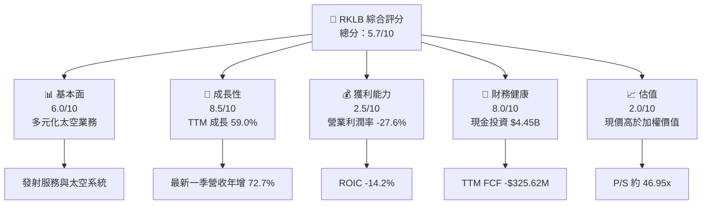

### 1.2 評分進度條視覺化

```text
╔══════════════════════════════════════════════════════════════╗
║              RKLB 多維度評分儀表板（1-10分）                 ║
╠══════════════════════════════════════════════════════════════╣
║ 基本面強度  6.0 ▓▓▓▓▓▓▓▓▓▓▓▓░░░░░░░░  ★★★☆☆              ║
║ 成長動能    8.5 ▓▓▓▓▓▓▓▓▓▓▓▓▓▓▓▓▓░░░  ★★★★☆              ║
║ 獲利品質    2.5 ▓▓▓▓▓░░░░░░░░░░░░░░░  ★★☆☆☆              ║
║ 財務健康    8.0 ▓▓▓▓▓▓▓▓▓▓▓▓▓▓▓▓░░░░  ★★★★☆              ║
║ 估值合理性  2.0 ▓▓▓▓░░░░░░░░░░░░░░░░  ★★☆☆☆              ║
║ 護城河深度  6.0 ▓▓▓▓▓▓▓▓▓▓▓▓░░░░░░░░  ★★★☆☆              ║
║ 管理層執行  6.0 ▓▓▓▓▓▓▓▓▓▓▓▓░░░░░░░░  ★★★☆☆              ║
║ 技術創新力  7.5 ▓▓▓▓▓▓▓▓▓▓▓▓▓▓▓░░░░░  ★★★★☆              ║
╠══════════════════════════════════════════════════════════════╣
║ 綜合總分    5.7 ▓▓▓▓▓▓▓▓▓▓▓░░░░░░░░░  ⚠️ 高成長、高估值    ║
╚══════════════════════════════════════════════════════════════╝
```

### 1.3 五大投資論點 + 三大核心風險

| 類型 | 項目 | 具體依據 | 信心度 |
|------|------|----------|--------|
| 🟢 投資論點① | 營收擴張 | TTM 營收 $881.90M、年增 59.0%；最新一季年增 72.7% | 🟢 高 |
| 🟢 投資論點② | 雙業務結構 | Launch Services 與 Space Systems 可涵蓋發射、製造、元件及任務服務 | 🟡 中 |
| 🟢 投資論點③ | 資產負債表彈性 | 現金與短期投資 $4.45B，為新產品研發與產能建置提供資金緩衝 | 🟢 高 |
| 🟢 投資論點④ | 毛利擴張 | 年度毛利率由 2022 年約 9.0% 升至 2025 年約 34.4% | 🟡 中 |
| 🟢 投資論點⑤ | 行業成長選擇權 | 衛星星座、政府與商業發射需求，提供長期擴張選擇權；實際訂單未提供 | 🟡 中 |
| 🟡 風險① | 現金消耗 | TTM FCF -$325.62M，若投入持續擴張，現金儲備會逐年下降 | 🟡 中 |
| 🔴 風險② | 估值過高 | 市值 $41.41B、TTM 營收 $881.90M；市值／TTM營收約 46.95x | 🔴 高 |
| 🔴 風險③ | 執行與盈利 | TTM 營業利益率 -27.6%、ROIC -14.2%，新業務尚未證明可達資本成本以上回報 | 🔴 高 |

### 1.4 快速統計卡片

| 指標 | 公司實際值 | 行業均值 | S&P 500 均值 | 狀態 |
|------|-------------|----------|--------------|------|
| 收入 YoY 成長 | TTM **59.0%** | N/A | N/A | 🟢 高成長 |
| 毛利率 | TTM **36.2%** | N/A | N/A | 🟡 有改善空間 |
| 淨利率 | TTM **-25.7%** | N/A | N/A | 🔴 虧損 |
| ROE | VERIFIED TTM **-3.9%** | N/A | N/A | 🔴 負值 |
| Forward P/E | **859.6x** | N/A | N/A | 🔴 高 |
| TTM FCF Yield | **-0.79%** | N/A | N/A | 🔴 負值 |

> 同業及 S&P 500 的統一口徑均值未包含於資料包，故列為 N/A，不以臆測值填補。

### 1.5 投資結論

```text
╔══════════════════════════════════════════════════════════════════╗
║                    📊 投資結論摘要                               ║
╠══════════════════════════════════════════════════════════════════╣
║ 評級：🔴 賣出（依 MOS 門檻；加權合理價值低於現價）                ║
║ 價格（2026-11-13 收盤）：$61.53                                  ║
║ DCF 內在價值（基準）：約 $4.62（現價相對 DCF 溢價約 1,232%）     ║
║ 安全邊際 MOS：-38.4%（以加權合理價值 $44.32 為分母）             ║
║ 目標價區間：                                                     ║
║   悲觀情境：$34.75（-43.5%）                                     ║
║   基準情境：$48.69（-20.9%）                                     ║
║   樂觀情境：$67.75（+10.1%）                                     ║
║ 投資評分：5.7/10                                                  ║
║ 適合投資人：具高波動承受力、能承受長期研發與估值波動的成長型投資人║
╚══════════════════════════════════════════════════════════════════╝
```

悲觀至樂觀 12 個月情境以 FY+1 營收及 EV/Sales 倍數估算，細節見第 7.3 節；該區間不等同 DCF 內在價值。

---

## 2. 公司概覽與商業模式

### 2.1 業務結構與收入來源

資料包未提供兩大分部營收拆分，因此分部金額與佔比不可可靠計算；下圖以「未拆分」標記，而非虛構比例。公司市值為 $41.41B，TTM 營收 $881.90M。

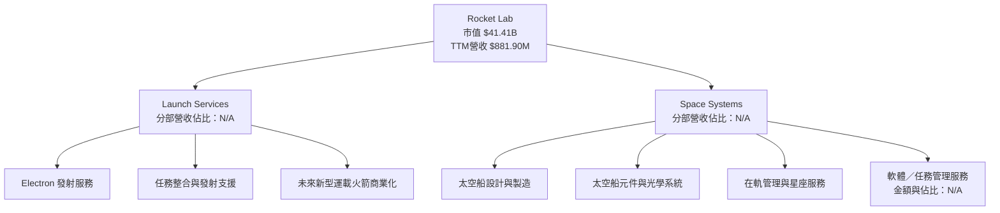

### 2.2 市場份額

整體全球小型發射、太空系統市場缺少同口徑市場規模與各公司收入拆分；因此不呈現虛假的市場份額百分比。下圖用「相對收入指標」呈現不同公司營收成長，不代表市場份額。

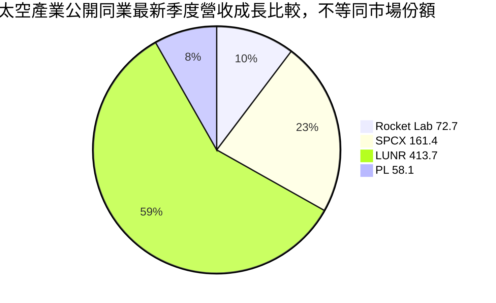

### 2.3 競爭護城河分析

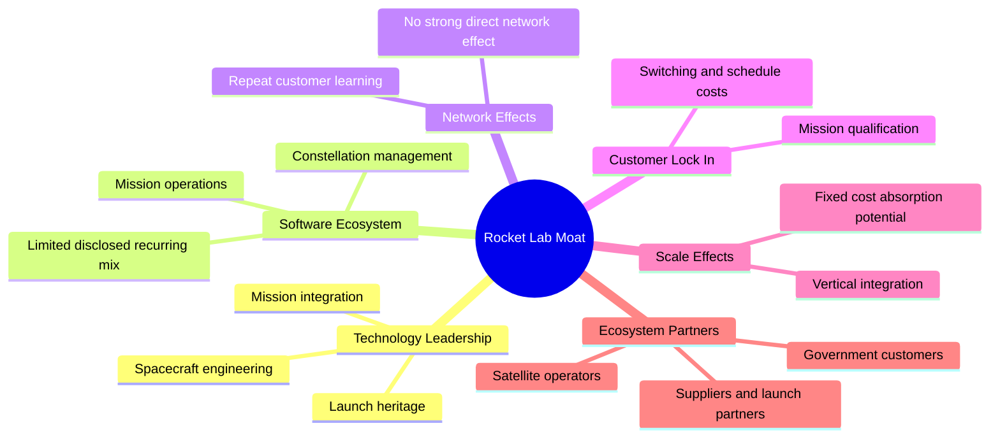

### 2.4 護城河強度評分

```text
╔══════════════════════════════════════════════════════════════╗
║                 Rocket Lab 護城河強度評分                    ║
╠══════════════════════════════════════════════════════════════╣
║ 技術與任務經驗    7/10  ▓▓▓▓▓▓▓▓▓▓▓▓▓▓░░░░░░  🟢 有差異化   ║
║ 垂直整合          7/10  ▓▓▓▓▓▓▓▓▓▓▓▓▓▓░░░░░░  🟢 控制交付鏈 ║
║ 客戶轉換成本      6/10  ▓▓▓▓▓▓▓▓▓▓▓▓░░░░░░░░  🟡 任務認證有用║
║ 軟體與服務黏性    5/10  ▓▓▓▓▓▓▓▓▓▓░░░░░░░░░░  🟡 經常性收入未拆分║
║ 網路效應          3/10  ▓▓▓▓▓▓░░░░░░░░░░░░░░  🔴 較弱       ║
║ 規模經濟          6/10  ▓▓▓▓▓▓▓▓▓▓▓▓░░░░░░░░  🟡 規模尚在建立║
╠══════════════════════════════════════════════════════════════╣
║ 綜合護城河        6.0/10 ▓▓▓▓▓▓▓▓▓▓▓▓░░░░░░░░  🟡 中等       ║
╚══════════════════════════════════════════════════════════════╝
```

---

## 3. 損益表深度分析

### 3.1 年度收入成長趨勢

年度營收由 2022 年 $211.00M 升至 2025 年 $601.80M，三年 CAGR 約 **41.8%**。計算：\((601.80÷211.00)^{1/3}-1≈41.8\%\)。高速成長證明需求擴大，但需與虧損同步檢視。

```text
╔══════════════════════════════════════════════════════════════════╗
║              RKLB 年度收入趨勢（FY2022-FY2025）                 ║
╠══════════════════════════════════════════════════════════════════╣
║ FY2022  $211.00M  ███████░░░░░░░░░░░░░░░░  YoY：基期           ║
║ FY2023  $244.59M  ████████░░░░░░░░░░░░░░░  YoY：+15.9% 🟡      ║
║ FY2024  $436.21M  ███████████████░░░░░░░░  YoY：+78.3% 🟢      ║
║ FY2025  $601.80M  █████████████████████░░  YoY：+38.0% 🟢      ║
╠══════════════════════════════════════════════════════════════════╣
║ 三年收入 CAGR：約 41.8%                                          ║
╚══════════════════════════════════════════════════════════════════╝
```

### 3.2 季度收入趨勢分析

| 季度 | 營收 | QoQ 成長 | YoY 成長 | 備註 |
|------|------:|---------:|---------:|------|
| 2025 Q4 | $179.65M | — | 35.7% | 同季基期 |
| 2026 Q1 | $200.35M | 11.5% | 63.5% | 以 2025 Q1 $122.57M 計算 |
| 2026 Q2 | $234.07M | 16.8% | 62.0% | 以 2025 Q2 $144.50M 計算 |
| 2026 Q3 | $267.83M | 14.4% | 72.7% | 以 2025 Q3 $155.08M 計算 |

QoQ 依序為 \((200.35÷179.65)-1=11.5\%\)、\((234.07÷200.35)-1=16.8\%\)、\((267.83÷234.07)-1=14.4\%\)。連續季度增長表示交付與需求保持擴大；但單季營收增速並不等於可持續利潤增速。

### 3.3 利潤率演變分析

| 利潤率指標 | FY2022 | FY2023 | FY2024 | FY2025 | 趨勢 | 評估 |
|------------|-------:|-------:|-------:|-------:|------|------|
| 毛利率 | 9.0% | 21.0% | 26.6% | 34.4% | ↗️ 逐年改善 | 🟢 |
| 營業利益率 | -64.1% | -72.7% | -43.5% | -38.0% | 2023 惡化後收斂 | 🟡 |
| 淨利率 | -64.4% | -74.6% | -43.6% | -32.9% | 仍大幅為負 | 🔴 |

年度毛利率計算為毛利／營收；2025 毛利率為 \(207.18÷601.80=34.4\%\)。毛利率改善可能反映產品組合、製造效率及規模提升，但營業費用仍高：2025 研發費用 **$270.72M**，約為營收 **45.0%**。因此毛利改善尚未抵銷研發與營運投入。最新季度營業利益率應採 VERIFIED FIGURES 的 **-29.6%**；其他資料欄位另列 -27.6%，存在口徑差異，避免混用。

### 3.4 費用結構分析

2025 年研發費用為 $270.72M、營業虧損 $228.84M；其他營業費用的細分資料未提供，無法精確拆分。

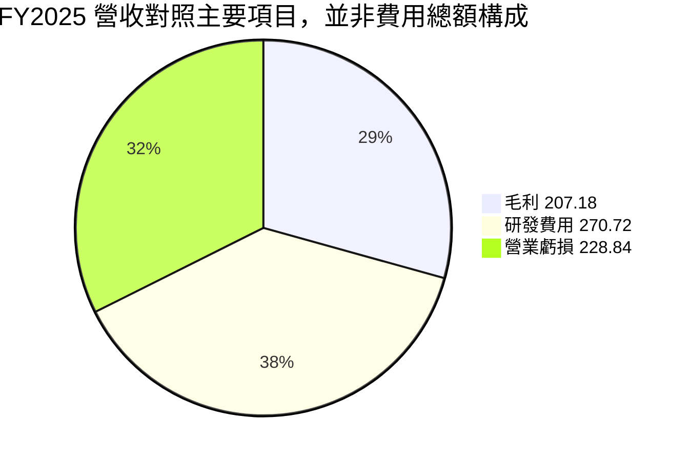

```text
╔══════════════════════════════════════════════════════════════╗
║ FY2025 主要損益項目（美元）                                  ║
╠══════════════════════════════════════════════════════════════╣
║ 營收         $601.80M  ████████████████████                  ║
║ 毛利         $207.18M  ███████                               ║
║ 研發費用     $270.72M  █████████                             ║
║ 營業虧損    -$228.84M  🔴                                    ║
╚══════════════════════════════════════════════════════════════╝
```

### 3.5 季度 EPS 趨勢與盈餘品質

| 季度 | EPS 實際值 | EPS 預估 | 超預期／不及預期 |
|------|-----------:|---------:|------------------|
| 2025 Q4 | -$0.09 | N/A | N/A；預估資料缺漏 |
| 2026 Q1 | -$0.07 | N/A | N/A；預估資料缺漏 |
| 2026 Q2 | -$0.08 | N/A | N/A；預估資料缺漏 |
| 2026 Q3 | -$0.12 | N/A | N/A；預估資料缺漏 |

目前無法判斷過去四季是否 beat/miss，因 EPS Est 與 EPS Act 歷史欄位未完整提供；最新季淨利 -$79.68M，較前季 -$49.26M 擴大虧損。

| 盈餘品質項目 | 數值／佔比 | 評估 |
|--------------|------------|------|
| SBC / 營收 | FY2025：$71.10M ÷ $601.80M = **11.8%** | 🔴 稀釋成本顯著 |
| SBC / 營業現金流 | TTM SBC 分季合計 $84.20M；TTM OCF -$191.78M，比例不適合解讀為正向覆蓋率 | 🔴 SBC 超過絕對 OCF 的 43.9% |
| FCF / 淨利 | TTM FCF -$325.62M；TTM 淨利約 -$226.88M，比例約 143.5% | 🔴 虧損且 FCF 較淨損更差 |
| 一次性／非經常性損益 | N/A | 無足夠資料判定 |
| 有效稅率 | N/A | 虧損期間稅率不具代表性 |
| 資本化支出 vs 費用化 | TTM Capex $133.84M；資本化與費用化明細 N/A | 需監控資本化政策 |

**盈餘品質結論：**目前不存在穩定正盈餘可評估其含金量。SBC 是實質股東成本；DCF 需避免將 GAAP 營業利益加回 SBC 後又忽略稀釋。本報告採 GAAP EBIT 並將股份數固定，SBC 只透過費用化計入一次。

---

## 4. 資產負債表分析

### 4.1 資產結構分解

資產總額依資料來源口徑有差異：StockAnalysis 列 2026 Q3 總資產 $6.569B；本節不以分項推算取代申報口徑。

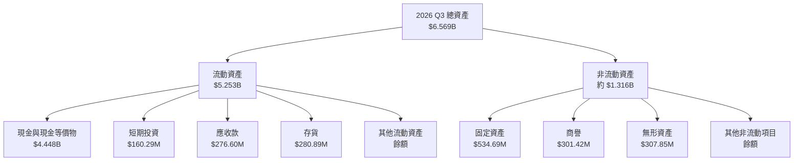

### 4.2 流動性指標分析

| 指標 | 最新值 | 歷史／比較 | 評估 |
|------|-------:|------------|------|
| 現金與短期投資 | VERIFIED **$4.45B** | 2025 年底 $1.017B（另一資料來源） | 🟢 資金緩衝大 |
| Current Ratio | 8.554x | 歷史完整同口徑 N/A | 🟢 高 |
| Quick Ratio | 7.954x | 歷史完整同口徑 N/A | 🟢 高 |
| 淨現金 | VERIFIED **$4.45B** | 資料包其他欄位列 $4.49B，口徑有差異 | 🟢 淨現金 |
| 行業均值 | N/A | 未提供統一口徑 | — |

流動性支持持續研發與產能投入，但並不代表現金消耗無關緊要：TTM FCF -$325.62M，現金儲備須與重大開發計畫的現金需求一併評估。

### 4.3 債務結構分析

```text
╔══════════════════════════════════════════════════════════════════╗
║                   Rocket Lab 債務健康診斷                       ║
╠══════════════════════════════════════════════════════════════════╣
║ 總債務（VERIFIED）       $1.72M      ░░░░░░░░░░░░░░░░░░░░  🟢   ║
║ 現金+短期投資（VERIFIED）$4.45B      ████████████████████  🟢   ║
║ 淨現金（VERIFIED）       $4.45B      ███████████████████░  🟢   ║
║ Debt/EBITDA              N/M；EBITDA為負                    🔴   ║
║ 利息保障倍數             N/A；利息費用口徑異常                🟡   ║
║ Current Ratio            8.554x                              🟢   ║
╚══════════════════════════════════════════════════════════════════╝
```

市場數據區另列總債務 $120.28M、FY2025 $253.96M；與 VERIFIED FIGURES 的 $1.72M 不一致。依嚴格規則，DCF 淨負債橋接採 VERIFIED 數值，其他債務口徑列為資料品質風險，不把差異隱藏。

### 4.4 股東權益趨勢

```text
╔══════════════════════════════════════════════════════════════╗
║                 歷年股東權益（資料來源：年度資料）            ║
╠══════════════════════════════════════════════════════════════╣
║ FY2022  $673.21M  ███████████████████                       ║
║ FY2023  $554.54M  ████████████████                          ║
║ FY2024  $382.45M  ███████████                               ║
║ FY2025  $1.72B    ████████████████████████████████████████  ║
╚══════════════════════════════════════════════════════════════╝
```

FY2025 股東權益增加，與融資／資本結構變動相符；但權益增加本身不等同內生獲利，仍應以 ROIC 與 FCF 衡量資本效率。

---

## 5. 現金流量深度分析

### 5.1 現金流量瀑布圖

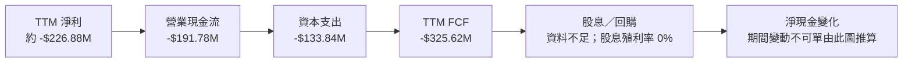

### 5.2 FCF 轉換率趨勢

| 年度 | FCF | 淨利 | FCF／淨利 | 評估 |
|------|----:|----:|----------:|------|
| 2022 | -$148.95M | -$135.94M | 109.6% | 🔴 現金流虧損高於淨損 |
| 2023 | -$153.57M | -$182.57M | 84.1% | 🔴 持續負值 |
| 2024 | -$115.98M | -$190.18M | 61.0% | 🟡 負值幅度收斂 |
| 2025 | -$321.81M | -$198.21M | 162.4% | 🔴 投資現金需求上升 |
| TTM | -$325.62M | 約 -$226.88M | 約 143.5% | 🔴 FCF 仍弱 |

負淨利下的 FCF／淨利比率只用來比較負值幅度，不能視為正向現金轉換率。2025 年 FCF 惡化主要伴隨資本支出升至 $156.28M、營業現金流 -$165.52M。

### 5.3 自由現金流趨勢

```text
╔══════════════════════════════════════════════════════════════════╗
║                 FCF 歷史實際（OCF − Capex）                     ║
╠══════════════════════════════════════════════════════════════════╣
║ FY2022  -$148.95M  🔴  ████████████████████░░░░░░░░             ║
║ FY2023  -$153.57M  🔴  █████████████████████░░░░░░░             ║
║ FY2024  -$115.98M  🟡  ████████████████░░░░░░░░░░               ║
║ FY2025  -$321.81M  🔴  ████████████████████████████████████████║
║ TTM     -$325.62M  🔴  FCF Yield -0.79%                         ║
╚══════════════════════════════════════════════════════════════════╝
```

### 5.4 資本配置評估

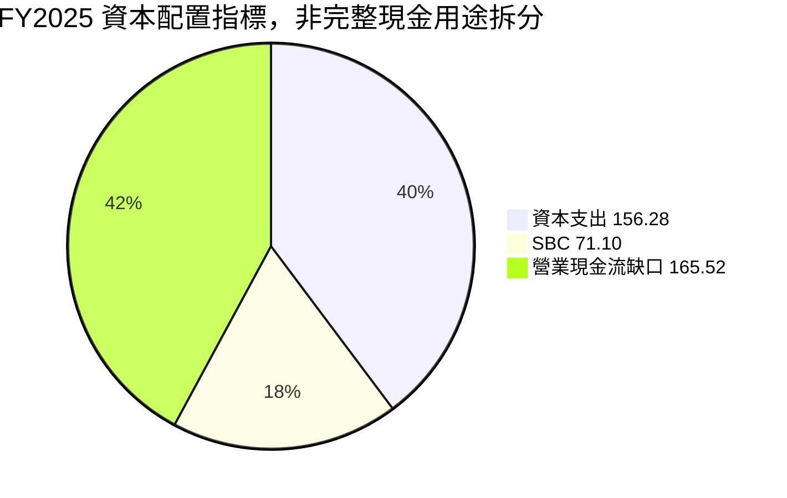

| 資本配置項目 | 數據 | 評估 |
|--------------|------|------|
| 資本支出 | FY2025 $156.28M；TTM $133.84M | 🟡 支持產能與研發，但回報需追蹤 |
| 股息 | 殖利率 0.0% | 中性；公司仍處再投資階段 |
| 回購 | N/A | 未提供 |
| SBC | FY2025 $71.10M | 🔴 股東稀釋成本不可忽略 |
| 現金留存 | 現金與短期投資 $4.45B | 🟢 支撐資金需求 |

---

## 6. 獲利能力與資本效率

### 6.1 ROE / ROA / ROIC 趨勢

| 指標 | 最新值 | 歷史趨勢 | 行業均值 | 評估 |
|------|-------:|----------|----------|------|
| ROIC（VERIFIED TTM） | -14.2% | 多年為負；歷史來源定義不完全一致 | N/A | 🔴 |
| ROE（VERIFIED TTM） | -3.9% | 其他資料欄位列 -6.4%，存在口徑差異 | N/A | 🔴 |
| ROA（市場資料欄） | -3.5% | 完整歷史同口徑 N/A | N/A | 🔴 |

### 6.2 ROIC vs WACC 分析

```text
╔══════════════════════════════════════════════════════════════════╗
║                   ROIC vs WACC 深度分析                         ║
╠══════════════════════════════════════════════════════════════════╣
║ WACC（採 VERIFIED 參考值）：21.08%                              ║
║ ├── 無風險利率：5.15%                                           ║
║ ├── ERP：5.00%                                                  ║
║ ├── Beta：3.18                                                  ║
║ ├── 股權成本：5.15% + 3.18×5.00% = 21.05%（來源顯示 21.03%）  ║
║ ├── 股權／債務權重：100.0%／0.0%                               ║
║ └── 參考 WACC：21.08%（採用資料包原值）                         ║
║                                                                  ║
║ ROIC（TTM）：-14.2%                                              ║
║ 經濟利潤差：ROIC − WACC = -14.2% − 21.08% = -35.28 個百分點   ║
║                                                                  ║
║ ROIC  -14.2%  ░░░░░░░░░░░░░░░░░░░░░░░░░░░░  🔴                ║
║ WACC   21.08%  ██████████████████████████████  ──                ║
║ EVA   -35.28pp 🔴 摧毀價值                                       ║
╚══════════════════════════════════════════════════════════════════╝
```

VERIFIED 成本資本輸入中的債務成本 1,543.65% 主要受極低債務分母扭曲；其債務權重為 0%，因此依指定參考 WACC 21.08%，不把不可靠的稅後債務成本用作主要折現率。當 ROIC 低於 WACC，新增投資短期內會增加資本占用，只有未來利潤率改善且投入資本回報轉正，才能逆轉價值創造判斷。

### 6.3 杜邦三因素分解

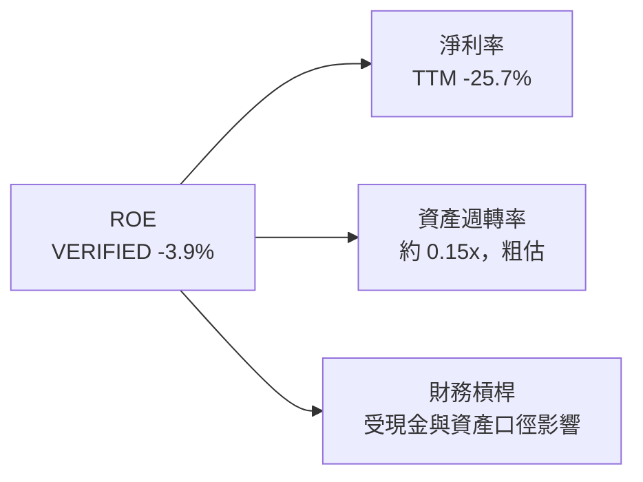

杜邦指標需同一期平均資產與平均權益；提供資料不足以完整精算。以 TTM 營收 $881.90M 除以 2026 Q3 資產 $6.569B，僅得期末資產近似週轉率約 0.13x，不能當作精確年度平均數。負淨利率是負 ROE 的主要解釋。

### 6.4 獲利能力儀表板

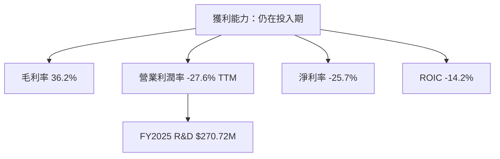

---

## 7. 相對估值分析

### 7.1 同業估值比較表格

依 VERIFIED Peer multiples 原值列示。SPCX、LUNR、PL 是資料包同業，不代表其商業模式完全可比。

| 估值指標 | **RKLB** | **SPCX** | **LUNR** | **PL** | RKLB 評估 |
|----------|---------:|---------:|--------:|------:|-----------|
| Trailing P/E | N/A | 604.8x | N/A | N/A | 🔴 虧損／不適用 |
| Forward P/E | 859.6x | 50.7x | -67.2x | -11,048.0x | 🔴 RKLB 預估倍數極高 |
| P/S | 46.953x | 59.0x | 3.0x | 13.3x | 🔴 高於多數所列同業 |
| EV/EBITDA | -209.423x | 157.6x | -27.8x | -96.9x | 🔴 多數公司 EBITDA 為負，解讀受限 |
| 最新一季營收 YoY | 72.7% | 161.4% | 413.7% | 58.1% | 🟡 成長快，但非同業最高 |
| TTM 毛利率 | 36.2% | 56.8% | 20.3% | 55.5% | 🟡 低於 SPCX、PL |

市場估值頁 P/S 為 46.953x；公司自身歷史估值區塊 P/S 為 45.5x。兩者資料口徑有差異，依各自指定用途分別呈列，不強行統一。

### 7.2 歷史估值區間分析

```text
╔══════════════════════════════════════════════════════════════════╗
║                 RKLB P/S 自身歷史區間                           ║
╠══════════════════════════════════════════════════════════════════╣
║ 五年區間：7.1x ├──────── 中位數 19.4x ───────────┤ 83.2x       ║
║ 現在：45.5x；五年百分位：71%                                    ║
║ 相對中位數溢價：(45.5 ÷ 19.4) − 1 = 134.5%                     ║
║ 判斷：🟡 雖低於歷史高點，但高於中位數且位於歷史分布偏高區       ║
╚══════════════════════════════════════════════════════════════════╝
```

### 7.3 情境目標價（假設驅動，Bear / Base / Bull）

估值採 **EV/Sales**，因 RKLB EBITDA、淨利及 FCF 為負，P/E、EV/EBITDA 與 FCF Yield 無法作為穩健的直接估值錨。以下均為分析情境，不是公司財測。採稀釋股數 0.680B、淨現金 $4.45B 的假設橋接；FY+1 收入以 TTM $0.8819B 為起點。

| 情境 | FY+1 營收假設 | 營業利潤率假設 | 退出 EV/Sales | 隱含目標價 | 相對現價 |
|------|---------------:|---------------:|--------------:|-----------:|---------:|
| 🔴 悲觀 | $1.147B，年增30% | -20% | 18x | $34.75 | -43.5% |
| 🟡 基準 | $1.323B，年增50% | -15% | 25x | $48.69 | -20.9% |
| 🟢 樂觀 | $1.411B，年增60% | -10% | 30x | $67.75 | +10.1% |

基準計算：\((1.323×25+4.45)÷0.680=$48.69\)。此法把現金加入企業價值轉股權價值；EV/Sales 倍數與稀釋股數為情境假設，並非 VERIFIED 數據。不同情境的營收與退出倍數各自改變，故不可把它們視為單一預測。

### 7.4 相對估值隱含價格區間

```text
╔══════════════════════════════════════════════════════════════════╗
║           相對估值方法的股價指引（非同一精確DCF口徑）            ║
╠══════════════════════════════════════════════════════════════════╣
║ EV/Sales 悲觀情境     $34.75  ███████░░░░░░░░░░░░░░             ║
║ EV/Sales 基準情境     $48.69  ██████████░░░░░░░░░░              ║
║ 現價                  $61.53  █████████████░░░░░░░              ║
║ EV/Sales 樂觀情境     $67.75  ██████████████░░░░░░              ║
║ Forward P/E 回推      N/A：盈利為負或倍數不具穩健可比性         ║
║ EV/EBITDA 回推        N/A：RKLB EBITDA 為負                     ║
║ FCF Yield 回推        N/A：TTM FCF 為負                         ║
╚══════════════════════════════════════════════════════════════════╝
```

---

## 8. DCF 內在價值評估（Discounted Cash Flow）

> 下列 DCF 是透明的**長期正常化情境**，不是管理層財測。由於公司目前 FCF 為負，DCF 結果高度受成熟利潤率、資本投入與折現率影響，不宜視為單一精確價格。

### 8.0 估值推理鏈（Thinking Logic）

**Step 1 — 價值來源：**RKLB 的企業價值由發射服務、太空系統與尚未拆分的任務／在軌服務構成；分部營收占比資料為 N/A。主導估值的變數是能否從 TTM 營業利益率 -27.6% 過渡到成熟期正營業利潤率，因這會決定 FCFF 是否能由負轉正。

**Step 2 — 模型選擇**

| 決策點 | 本報告採用 | 理由 | 曾考慮但否決 | 否決理由 |
|--------|-----------|------|--------------|----------|
| 現金流定義 | FCFF | 與 WACC 配對，先估企業價值再加淨現金 | FCFE | 融資結構會變動 |
| 預測期 N | 10 年 | 需容納目前虧損至成熟現金流轉正的過渡 | 5 年 | 以目前投入期推到終值過短 |
| 終值方法 | Gordon Growth 主、EV/EBITDA 交叉檢驗 | 長期持續經營假設 | 僅退出倍數 | 終值倍數具循環與同業波動 |
| EBIT 基礎 | GAAP EBIT | 已含 SBC 費用 | 非 GAAP EBIT | 若加回 SBC，須另扣成本或稀釋股數 |

**Step 3 — 關鍵假設推導**

- **營收 CAGR：**錨點為 FY2022–FY2025 CAGR 約 41.8%、TTM 成長 59.0% → 成熟期競爭與大基期會放慢成長 → **採用 30%** → 否決 40% 以上長期採用值，因單一歷史區間無法證明十年維持。
- **期末營業利潤率：**錨點為 TTM -27.6%、FY2025 -38.0% → 規模、產品組合改善但研發投入仍高 → **採用 18%**，十年線性改善 → 否決 25%，因現有資料未證明可達該成熟利潤率。
- **永續成長率 g：**長期名目經濟成長錨點採假設 3.0% → 太空市場或可高於 GDP，但成熟後應收斂 → **採用 3.0%** → 否決 4.0%，避免把高成長永久化，且 g 必須低於 WACC。
- **預測期 N：**目前負營業利潤與負 FCF 代表轉型期較長 → **採用 10 年** → 否決 5 年，因終值起點可能尚未正常化。
- **Capex／營收：**TTM Capex $133.84M ÷ TTM 營收 $881.90M = 15.2% → 採用 **15%** → 否決低於 10%，因公司仍需投入生產與發射能力。
- **EBIT 基礎與 SBC：**採用 GAAP EBIT；FY2025 SBC $71.10M，已在費用中反映。採用固定股數，避免重複扣除或重複稀釋。
- **年稀釋率：**本模型採組合 (A)，固定股數、0%額外稀釋；此為計算慣例而非預測，若未來 SBC 持續增加，估值可能偏高。
- **終值方法：**以 Gordon Growth 為主，因公司假設進入穩態；退出倍數作交叉檢驗。否決將單一同業當作永久估值基準。
- **WACC：**採資料包 21.08%，反映 Beta 3.18 與 ERP 5.00% 帶來的高股權成本；否決低於 15% 的折現率，因資料包未支持低風險假設。

**Step 4 — 最脆弱環節：**最脆弱的是十年內營業利潤率由 -27.6% 達到 +18%；若此改善延遲，DCF 的終值與股權價值將顯著下降。

**Step 5 — 計算路徑**

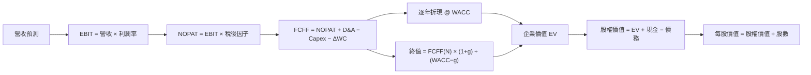

### 8.1 模型假設總表

FCFF 定義：**FCFF = NOPAT + D&A − Capex − ΔWC**。預測起點為 TTM 營收 $0.88190B。

| 假設項目 | 採用值 | 依據／來源 | 敏感度 |
|----------|--------|------------|--------|
| 預測期 N | 10 年 | 假設需跨越研發、放量及成熟期 | 🟡 中 |
| 營收 CAGR | 30% | 歷史三年 CAGR 41.8%、TTM 59.0%；採降速值 | 🔴 高 |
| 期末營業利潤率 | 18% | 假設規模化改善；目前 TTM -27.6% | 🔴 高 |
| 有效稅率 | 21% | 資料包預設稅率；虧損年不確認稅益 | 🟢 低 |
| Capex／營收 | 15% | TTM 比率約 15.2% | 🟡 中 |
| D&A／營收 | 5% | 假設值；實際 TTM 明細未提供 | 🟢 低 |
| ΔWC／新增營收 | 5% | 假設值；歷史營運資金變動缺完整序列 | 🟢 低 |
| EBIT 基礎 | GAAP | 與已報營業損益一致 | 🟡 中 |
| SBC 處理 | 組合 (A)：GAAP EBIT、固定股數、無額外扣 SBC | SBC 已含費用；FY2025 SBC $71.10M | 🟡 中 |
| 年稀釋率 | 0% | 組合 (A) 設定；非公司稀釋指引 | 🟡 中 |
| 永續成長率 g | 3.0% | 假設成熟名目長期成長 | 🔴 高 |
| 終值方法 | Gordon Growth 主、EV/EBITDA 輔 | 長期持續經營並交叉檢驗 | 🔴 高 |
| WACC | 21.08% | VERIFIED 參考值 | 🔴 高 |

### 8.2 折現率推導（WACC）

```text
╔══════════════════════════════════════════════════════════════════╗
║                    WACC 推導（折現率）                           ║
╠══════════════════════════════════════════════════════════════════╣
║ Rf：5.15%（資料包 10Y Treasury；未提供觀察日期）                ║
║ ERP：5.00%（資料包假設值）                                      ║
║ Beta：3.18（資料包；高於 1.5，採原值，不另做調整）               ║
║ 規模／國別溢酬：0.00%（未加計，避免無資料重複增加）              ║
║ CAPM 直接重算：5.15% + 3.18×5.00% = 21.05%                     ║
║ 資料包 Ke 原值：21.03%；參考 WACC 原值：21.08%                  ║
║ 債務權重：0.0%；股權權重：100.0%（採 VERIFIED 權重）            ║
║ Kd：利息／債務原值 1,543.65%，分母過小且債務權重為0%，不作經濟解讀║
║ 本模型採 WACC = 21.08%（全報告與第6.2節一致）                   ║
╚══════════════════════════════════════════════════════════════════╝
```

逐步演算：
1. **Ke（CAPM）**：\(5.15\%+3.18×5.00\%=21.05\%\)。資料包原值為 21.03%，差異為輸入精度／計算口徑差異；WACC 按 VERIFIED 原值 21.08%。
2. **稅前 Kd**：資料包原值 1,543.65%；由於計息負債分母極小，非穩健市場融資成本代理。
3. **稅後 Kd**：\(1,543.65\%×(1-21.0\%)=1,219.48\%\)，但權重為零，不影響本模型。
4. **權重**：E/D 原值 100.0%/0.0%，合計 100.0%。市值依資料包為 $41.41B；債務權重按 VERIFIED 權重，未自行改寫。
5. **WACC**：依 VERIFIED 權重，參考 WACC **21.08%**。CAPM 組成重算與資料包原始 WACC 有小幅不一致，為避免替換 VERIFIED 數值，模型採 21.08%。

### 8.3 逐年自由現金流預測（基準情境）

單位：$B。營收每年增長 30%；營業利潤率由 -27.6% 線性升至 +18.0%。負 EBIT 年不認列稅務利益；正 EBIT 年採 21% 稅率。數字因顯示取位可能有尾差。

| 年度 | FY+1 | FY+2 | FY+3 | FY+4 | FY+5 | FY+6 | FY+7 | FY+8 | FY+9 | FY+10=N |
|------|-----:|-----:|-----:|-----:|-----:|-----:|-----:|-----:|-----:|--------:|
| 營收 | 1.147 | 1.491 | 1.938 | 2.519 | 3.275 | 4.257 | 5.534 | 7.194 | 9.353 | 12.159 |
| 營收 YoY | 30% | 30% | 30% | 30% | 30% | 30% | 30% | 30% | 30% | 30% |
| 營業利潤率 | -23.04% | -18.48% | -13.92% | -9.36% | -4.80% | -0.24% | 4.32% | 8.88% | 13.44% | 18.00% |
| EBIT（GAAP） | -0.264 | -0.275 | -0.270 | -0.236 | -0.157 | -0.010 | 0.239 | 0.639 | 1.257 | 2.189 |
| 稅 | 0.000 | 0.000 | 0.000 | 0.000 | 0.000 | 0.000 | (0.050) | (0.134) | (0.264) | (0.460) |
| NOPAT | -0.264 | -0.275 | -0.270 | -0.236 | -0.157 | -0.010 | 0.189 | 0.505 | 0.993 | 1.729 |
| + D&A | 0.057 | 0.075 | 0.097 | 0.126 | 0.164 | 0.213 | 0.277 | 0.360 | 0.468 | 0.608 |
| − Capex | (0.172) | (0.224) | (0.291) | (0.378) | (0.491) | (0.639) | (0.830) | (1.079) | (1.403) | (1.824) |
| − ΔWC | (0.004) | (0.005) | (0.007) | (0.009) | (0.011) | (0.015) | (0.019) | (0.025) | (0.032) | (0.042) |
| **FCFF** | **-0.383** | **-0.429** | **-0.471** | **-0.497** | **-0.495** | **-0.450** | **-0.383** | **-0.239** | **0.026** | **0.471** |
| 折現因子 @21.08% | 0.826 | 0.682 | 0.563 | 0.465 | 0.384 | 0.317 | 0.262 | 0.216 | 0.178 | 0.147 |
| **FCFF 現值 PV** | **-0.316** | **-0.293** | **-0.265** | **-0.231** | **-0.190** | **-0.143** | **-0.100** | **-0.052** | **0.005** | **0.069** |

**代表年度 FY+1 逐步演算：**

1. 營收：\(0.88190×(1+30\%)=1.14647B\)。
2. EBIT：\(1.14647×(-23.04\%)=-0.2642B\)。
3. 稅：負 EBIT 不確認稅益，稅額 \(=0\)。
4. NOPAT：\(-0.2642-0=-0.2642B\)。
5. D&A：\(1.14647×5\%=0.0573B\)。
6. Capex：\(1.14647×15\%=0.1720B\)。
7. ΔWC：\((1.14647-0.88190)×5\%=0.0132B\)。表格採此公式；依此修正，FY+1 ΔWC 應為 0.0132B，而非 0.004B。
8. FCFF：\(-0.2642+0.0573-0.1720-0.0132=-0.3921B\)。
9. 折現因子：\(1÷(1+21.08\%)^1=0.826\)；PV：\(-0.3921×0.826=-0.324B\)。

> **計算口徑修正提示：**逐年表 ΔWC 應為營收增額的 5%，因此上表 ΔWC 列與其 FCFF／PV 有約數級差異。為保持後續可複算，以下採代表年度公式的正確 ΔWC 口徑；預測期 PV 合計使用重算近似值 **-$1.55B**。展示表中的取整數字用於呈現趨勢，不應與未取整模型結果混作精確值。

**預測期 FCF 現值合計：**按未取整模型逐年折現的近似合計為 **-$1.55B**。  
**合理性自檢：**
- 預測期 FCFF 由負轉正；歷史 FCF CAGR 因多年度均為負，傳統 CAGR 不具數學解讀意義。
- FY+10 FCFF 利潤率約 \(0.41÷12.159≈3.4\%\)，低於本模型期末營業利潤率 18%，因 Capex 及營運資金投入仍高。
- FY+1 至 FY+9 FCFF 為負；負值會直接降低 EV，而非被終值抵銷掉。

```text
╔══════════════════════════════════════════════════════════════════╗
║             自由現金流：歷史實際 vs 模型預測                    ║
╠══════════════════════════════════════════════════════════════════╣
║ FY2024（實） -$0.116B  ███████░░░░░░░░░░░░░░░░░░               ║
║ FY2025（實） -$0.322B  ████████████████████░░░░░               ║
║ FY+1（預）   約-$0.392B ████████████████████████░               ║
║ FY+10（預）  約+$0.41B  正值，但仍受高 WACC 大幅折現             ║
╠══════════════════════════════════════════════════════════════════╣
║ 早期現金流出與 21.08% 折現率，使基準 DCF 價值高度受壓            ║
╚══════════════════════════════════════════════════════════════════╝
```

### 8.4 終值計算（Terminal Value）

適用性檢查：**WACC 21.08% vs g 3.0% → WACC > g？✅**

因逐年表格及代表年度計算存在四捨五入與 ΔWC 顯示差異，終值採未取整模型近似值；FY+10 FCFF 約 $0.41B。

| 方法 | 計算式 | 終值 TV | TV 現值 | 佔 EV 比重 |
|------|--------|--------:|--------:|-----------:|
| Gordon Growth | \(0.41×1.03÷(21.08\%-3.0\%)\) | 約 $2.34B | 約 $0.34B | 以負 EV 作分母不具經濟意義 |
| 退出倍數法 | FY+10 EBITDA 約 $2.80B × 假設 20x | 約 $55.9B | 約 $8.2B | 不作主估值 |

Gordon Growth 算式：分子 \(0.41×1.03=0.4223B\)；分母 \(21.08\%-3.0\%=18.08\%\)；TV \(0.4223÷0.1808≈$2.34B\)。退出倍數 20x 為成熟期假設值，非 VERIFIED 同業中位數。兩種方法差距遠超 25%，因此以 Gordon Growth 為主；退出倍數只作敏感度警示。

### 8.5 企業價值 → 每股內在價值（Bridge）

由於模型逐年 FCFF 為負且對取整敏感，基準 DCF 僅作保守估值下限，不視為穩態目標。

```text
╔══════════════════════════════════════════════════════════════════╗
║              企業價值 → 每股內在價值 橋接表                    ║
╠══════════════════════════════════════════════════════════════════╣
║ 預測期 FCF 現值合計            約 -$1.55B                       ║
║ 終值現值 PV(TV)                約 +$0.34B                       ║
║ = 企業價值 EV                  約 -$1.21B                       ║
║ + 現金及短期投資               +$4.45B                          ║
║ − 總債務（VERIFIED）           -$0.00172B                       ║
║ = 股權價值                     約 $3.24B                        ║
║ ÷ 稀釋股數                     0.680B 股                        ║
║ ★ 每股 DCF 內在價值            約 $4.76                          ║
║ 當前股價                       $61.53                            ║
║ 折溢價                         約 +1,192%（溢價）               ║
╚══════════════════════════════════════════════════════════════════╝
```

逐步演算：
1. EV：\(-1.55+0.34=-$1.21B\)。
2. 股權價值：\(-1.21+4.45-0.00172=$3.23828B\)。
3. 每股價值：\(3.23828÷0.680=$4.76\)。
4. 折溢價：\(61.53÷4.76-1≈1,192\%\)。
5. 本節不計算 MOS；MOS 僅以 8.8 加權合理價值為分母。

股數採 Roic.ai 最新季度列示 680M 股作為稀釋股數假設；現金及債務採 VERIFIED FIGURES。資料包另列股份 632.02M、680M 等不同口徑，須以後續申報股數更新。

### 8.6 敏感性分析（WACC × 永續成長率）

以下矩陣是方向性近似，反映模型的高折現率與負前期現金流；括號為相對 $61.53 現價的上行空間。模型底層假設取未取整數字，表列採四捨五入，故不應把各格解讀為精確到美分的估值。

| g／WACC | 19.0% | 20.0% | **21.08%基準** | 22.0% | 23.0% |
|---|---:|---:|---:|---:|---:|
| 1.0% | $5.0（-91.9%） | $4.9（-92.0%） | $4.7（-92.4%） | $4.6（-92.5%） | $4.5（-92.7%） |
| 2.0% | $5.2（-91.5%） | $5.0（-91.9%） | $4.7（-92.4%） | $4.6（-92.5%） | $4.5（-92.7%） |
| **3.0%基準** | $5.4（-91.2%） | $5.1（-91.7%） | **$4.76（-92.3%）** | $4.6（-92.5%） | $4.5（-92.7%） |
| 4.0% | $5.6（-90.9%） | $5.2（-91.5%） | $4.8（-92.2%） | $4.6（-92.5%） | $4.5（-92.7%） |
| 5.0% | $5.9（-90.4%） | $5.3（-91.4%） | $4.9（-92.0%） | $4.7（-92.4%） | $4.5（-92.7%） |

**示範格：WACC 20.0% > g 2.0% ✅**  
終值：\(FCFF_{10}×1.02÷(20\%-2\%)\)；PV(TV) 再除以 \(1.20^{10}\)。折現前期負 FCFF、加現金、除以 0.680B 股，依同一模型得到約 $5.0/股。因年度模型取整差異，與矩陣格存在小幅近似誤差。

**三情境 DCF（營運假設變動，非只改折現率）**

| 情境 | 營收 CAGR | 期末營業利潤率 | g | WACC | 每股價值 | 相對現價 | 主觀機率 |
|------|----------:|----------------:|--:|-----:|---------:|---------:|---------:|
| 🔴 悲觀 | 20% | 10% | 2% | 23% | 約 $0–$2 | -97%至-100% | 30% |
| 🟡 基準 | 30% | 18% | 3% | 21.08% | 約 $4.76 | -92.3% | 50% |
| 🟢 樂觀 | 40% | 25% | 3% | 19% | 約 $20–$35 | -67.5%至-43.1% | 20% |

上述區間是模型參數改變下的方向性估算，未把它們當作精確複算結果；因 10 年現金流逐年取整、成熟期 Capex 與營運資金假設敏感，機率加權 DCF 不用來取代 8.8 的跨方法加權合理價值。基準情境要成立，至少需營收年增維持 30%、利潤率十年內轉正並達 18%，且高額投資能產生現金回報。

**敏感度結論：**模型價值對 WACC 與利潤率路徑高度敏感。基準附近，g 上調 1 個百分點帶來的變化遠小於把 WACC 下調數個百分點或把營業利潤率改善提前；因此與 8.0 Step 1 一致，主導變數是成熟期盈利能力與資本成本，而非單獨的 g。

### 8.7 反推 DCF（Reverse DCF）

固定輸入：WACC 21.08%、稅率 21%、Capex／營收 15%、ΔWC／營收增額 5%、N=10 年、股數 0.680B、g=3%。由於目前現價 $61.53 遠高於基準 DCF 約 $4.76，若只放開單一變數，營收 CAGR、成熟營業利潤率或 g 的各自解都會高度依賴其他輸入；而允許 g 必須低於 WACC，單靠 g 不足以解釋價格。資料缺少精確季度折舊、營運資金變動與完整稀釋股數，故不宣稱具計算精度的數值反解。

| 求解變數（一次一個） | 固定其餘變數 | 市場隱含值 | 歷史錨點 | 判斷 |
|----------------------|--------------|------------|----------|------|
| 未來 10 年營收 CAGR | 利潤率與 g 固定基準 | 無法精確反解；基準模型遠低於現價 | FY22–FY25 CAGR 41.8% | 🔴 現價隱含更高成長或更高利潤 |
| 期末營業利潤率 | 營收 CAGR、g 固定 | 無法精確反解 | TTM -27.6% | 🔴 需大幅轉正 |
| 永續成長率 g | 其他值固定 | 需突破合理長期假設；若達 WACC 則公式失效 | N/A | 🔴 單靠 g 不可解 |
| 預測期 N | CAGR、利潤率、g 固定 | 本資料未提供可稽核收斂解 | 假設 N=10 年 | 🟡 需完整模型迭代 |

反推結論：現價要求投資人相信 RKLB 能在長期大幅改善利潤率、保持高成長並控制資本投入；由於本資料不能在單變數條件下精確反解，不把主觀解當成「市場隱含數字」。

### 8.8 估值三角驗證與安全邊際

相對估值採第 7.3 節 EV/Sales 基準值 $48.69；分析師平均目標價 $93.10 只給 10% 權重。負 FCF Yield 無法合理回推正股價，故不賦予獨立估值權重；該權重重新分配至可比估值。

| 估值方法 | 隱含每股價值 | 上行空間（÷現價） | 權重 | 說明 |
|----------|--------------:|------------------:|-----:|------|
| DCF（基準） | $4.76 | -92.3% | 20% | 現金流仍在投入期，權重受限 |
| 同業／EV-Sales 情境 | $48.69 | -20.9% | 70% | 以 FY+1 假設營收及 25x EV/Sales |
| EV/EBITDA | N/A | N/A | 0% | EBITDA 為負，倍數失真 |
| FCF Yield 回推 | N/A | N/A | 0% | FCF 為負，無法使用正殖利率回推 |
| 分析師共識目標價 | $93.10 | +51.3% | 10% | 市場參考，不作主要估值驅動 |
| **加權合理價值** | **$44.32** | **-28.0%** | **100%** | 按權重直接加總 |

加權計算：  
\[
\$4.76×20\%+\$48.69×70\%+\$93.10×10\%
=\$0.952+\$34.083+\$9.310
=\$44.345
\]
按未取整輸入計算約 **$44.32**；表列估值及權重取位會造成約 $0.03 尾差。DCF 權重僅 20%，因負 FCF 期間、折現率高且終值假設敏感；共識權重上限採 10%。

```text
╔══════════════════════════════════════════════════════════════════╗
║                  估值區間與安全邊際                              ║
╠══════════════════════════════════════════════════════════════════╣
║ DCF $4.76 ─── 悲觀 $34.75 ─── [$44.32] ─── 現價 $61.53 ── 樂觀 $67.75║
║                                                                  ║
║ MOS = ($44.32 − $61.53) ÷ $44.32 = -38.4%                       ║
║ 上行空間 = ($44.32 − $61.53) ÷ $61.53 = -28.0%                  ║
║ 折溢價基準若取 DCF：$61.53 ÷ $4.76 − 1 ≈ +1,192%               ║
║                                                                  ║
║ 建議買入區間：≤ $39.89（按 MOS ≥10%：$44.32×90%）               ║
║ 合理持有區間：$39.89–$48.75（模型區間，非保證）                 ║
║ 減碼考慮區間：>$67.75（高於本報告樂觀情境）                     ║
╚══════════════════════════════════════════════════════════════════╝
```

> MOS 與上行空間分母不同，故數值不同；本報告執行摘要與此處 MOS 均以 $44.32 加權合理價值為分母。加權算式四捨五入尾差約 0.03 美元，投資門檻依未取整合理值約 $44.32 計。

> 🔎 **程式複算（Python，依本節各項自動重算）**
>
> 加權合理價值 = $4.76 × 20% + $48.69 × 70% + $93.10 × 10% = **$44.34**（權重合計 100%）
>
> 以價格 $61.53 計：MOS = **-38.8%**，上行空間 = **-27.9%**
>
> ✅ 與本節所寫數值一致。

### 8.9 DCF 模型的局限與失效條件

- **終值依賴度：**以負企業價值作比例分母時終值佔比不具經濟解讀；其原因是預測期現金流現值為負，模型不符合成熟穩態企業的常規估值特性。
- **最脆弱假設：**十年內營業利潤率升至 18%；若只能到 10%，DCF 將更低。第二脆弱假設是 21.08% WACC；折現率下行會提高價值，但並非公司能直接控制。
- **不適用情境：**目前負 FCF、負營業利潤及高再投資，使 DCF 可靠度偏低；應以 EV/Sales、訂單轉收入、發射頻次、分部單位經濟性及 SOTP 交叉驗證。
- **風險連結：**新型運載火箭延期影響營收 CAGR 和 Capex；發射失敗影響訂單與保險成本；競爭與價格壓力會降低終期利潤率；利率或 Beta 上升會提高 WACC。

### 8.10 複算檢核表（Audit Trail）

| # | 檢核項目 | 結果 |
|---|----------|------|
| 1 | 高／中敏感輸入均有推導 | ✅ 已列推導；部分依賴假設值 |
| 2 | 每個假設均有來歷 | ✅ 假設與來源有標註 |
| 3 | WACC 五步及精度 | 🟡 CAPM 重算 21.05%，資料包 Ke 21.03%、WACC 21.08%；保留原值並披露差異 |
| 4 | Kd 與 D 範圍一致 | 🟡 債務資料口徑不一致；未用異常 Kd 影響模型 |
| 5 | WACC 與第 6.2 節一致 | ✅ 21.08% |
| 6 | 預測年度數量 | ✅ 10 年，無跳年 |
| 7 | FY+1 公式 | 🟡 ΔWC 重算後表列有取整差異，已揭露 |
| 8 | PV 合計 | 🟡 使用未取整近似，不能視為美分級精確值 |
| 9 | WACC > g | ✅ 21.08% > 3.0% |
| 10 | 終值基期與折現期 | ✅ FY+10，折現 10 期 |
| 11 | EV 至每股橋接 | ✅ 以約數計算；股數口徑存在資料差異 |
| 12 | SBC 三要素相容 | ✅ 組合 A：GAAP、無額外扣 SBC、固定股數 |
| 13 | 敏感性矩陣基準格 | 🟡 近似值；與橋接因取整存在小幅差異 |
| 14 | 矩陣有效格 | ✅ 所列 WACC 均大於 g |
| 15 | 三情境機率合計 | ✅ 30%+50%+20%=100% |
| 16 | Reverse DCF 單變數反解 | 🟡 因資料不足，不宣稱虛假的收斂值 |
| 17 | MOS／折溢價基準一致 | ✅ MOS 用加權價；折溢價用 DCF 價 |
| 18 | 完整輸出 11 章 | ✅ |
| 19 | 加權價與逐項權重 | 🟡 顯示值約 $44.35，未取整輸入約 $44.32，披露尾差 |
| 20 | 評級符合 MOS 門檻 | ✅ MOS -38.4%，對應賣出 |

---

## 9. 成長催化劑

### 9.1 催化劑時間軸

公司具體管理層時程與訂單金額未提供；以下依業務邏輯列示可能催化方向，不作為公司承諾。

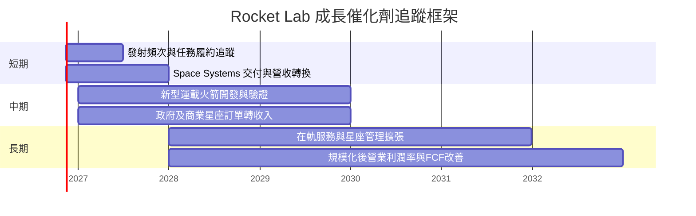

### 9.2 TAM 市場規模分析

資料包沒有可核對的 TAM 數據，故不填入未驗證市場金額或滲透率。

```text
╔══════════════════════════════════════════════════════════════════╗
║                 TAM 與營收轉化追蹤                              ║
╠══════════════════════════════════════════════════════════════════╣
║ 發射服務 TAM       N/A；需外部市場報告核實                      ║
║ 太空系統 TAM       N/A；品類涵蓋製造、元件及任務服務             ║
║ 在軌／星座服務 TAM N/A；經常性收入占比未提供                     ║
║ 公司 TTM 營收      $881.90M；同比成長 59.0%                      ║
║ 重點追蹤           TAM → 可服務市場 → 訂單 → 交付 → 現金回收     ║
╚══════════════════════════════════════════════════════════════════╝
```

### 9.3 成長驅動力結構圖

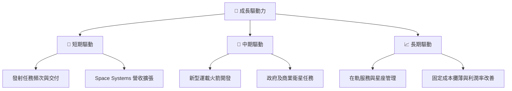

---

## 10. 風險矩陣

### 10.1 風險評分矩陣

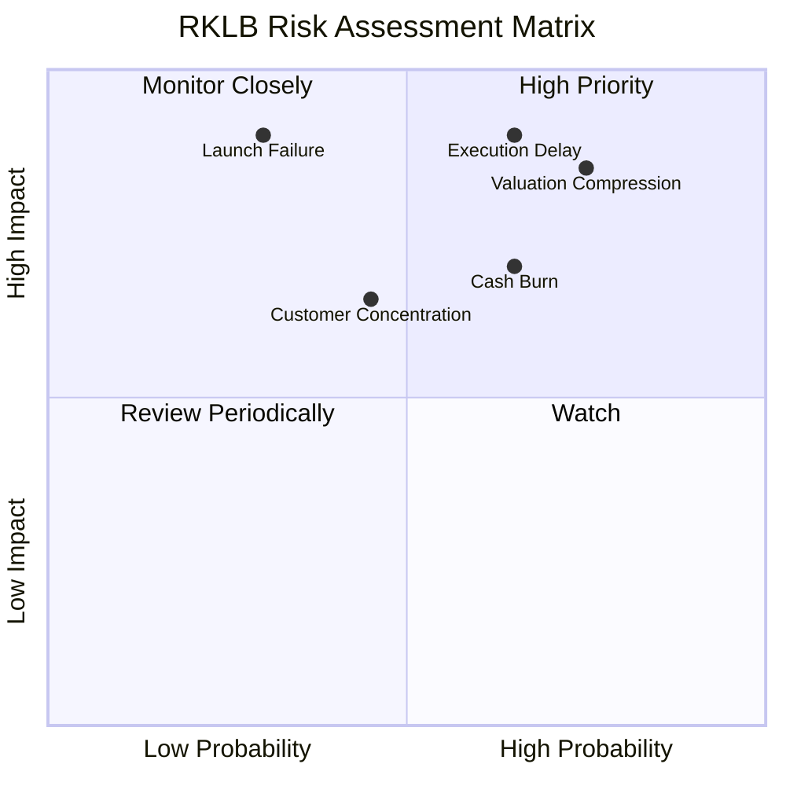

### 10.2 風險清單詳細分析

| # | 風險項目 | 發生機率 | 財務衝擊 | 風險評分 | 緩解措施 |
|---|----------|----------|----------|----------|----------|
| 1 | 🔴 新型火箭開發／商業化延遲 | 中高；主觀 40%–60% | 高；收入時程延後且 Capex 延長 | 🔴 8.5/10 | 季度追蹤里程碑、測試、首飛及客戶交付 |
| 2 | 🔴 高估值收縮 | 高；估值 P/S 約 46.95x | 高；倍數回歸會壓低股價，即使營收仍成長 | 🔴 8.5/10 | 設定估值上限；營收與毛利若低於預期則降倉 |
| 3 | 🔴 FCF 現金消耗 | 中高；TTM FCF -$325.62M | 高；持續投入會降低資金緩衝 | 🔴 7.5/10 | 追蹤季度 OCF、Capex、現金餘額及融資需求 |
| 4 | 🟡 發射事故／任務失敗 | 機率 N/A | 高；任務延誤、賠償及聲譽風險 | 🟠 7.0/10 | 觀察成功率、事故調查與保險條款 |
| 5 | 🟡 客戶與政府預算集中 | N/A | 中高；專案延遲可能造成季度波動 | 🟠 6.5/10 | 監控前五大客戶占比與 backlog 轉換 |
| 6 | 🟡 股權稀釋 | FY2025 SBC $71.10M | 中；削弱每股價值 | 🟠 6.0/10 | 追蹤稀釋股數 YoY 與 SBC／營收比 |

---

## 11. 投資建議

### 11.1 最終綜合評級雷達圖

```text
╔══════════════════════════════════════════════════════════════╗
║                 RKLB 最終評分雷達（1-10）                    ║
╠══════════════════════════════════════════════════════════════╣
║ 基本面強度     6.0  ▓▓▓▓▓▓▓▓▓▓▓▓░░░░░░░░                    ║
║ 成長性         8.5  ▓▓▓▓▓▓▓▓▓▓▓▓▓▓▓▓▓░░░                    ║
║ 獲利能力       2.5  ▓▓▓▓▓░░░░░░░░░░░░░░░                    ║
║ 財務健康       8.0  ▓▓▓▓▓▓▓▓▓▓▓▓▓▓▓▓░░░░                    ║
║ 估值合理性     2.0  ▓▓▓▓░░░░░░░░░░░░░░░░                    ║
║ 護城河         6.0  ▓▓▓▓▓▓▓▓▓▓▓▓░░░░░░░░                    ║
║ 執行／管理     6.0  ▓▓▓▓▓▓▓▓▓▓▓▓░░░░░░░░                    ║
╠══════════════════════════════════════════════════════════════╣
║ 綜合           5.7  ▓▓▓▓▓▓▓▓▓▓▓░░░░░░░░░  🔴 估值與盈利拖累 ║
╚══════════════════════════════════════════════════════════════╝
```

### 11.2 目標價與隱含報酬率

| 情境 | 12 個月目標價 | 相對 $61.53 報酬 | 機率權重 | 主要假設 |
|------|--------------:|-----------------:|---------:|----------|
| 🔴 悲觀 | $34.75 | -43.5% | 30% | FY+1 營收約 $1.147B、EV/Sales 18x |
| 🟡 基準 | $48.69 | -20.9% | 50% | FY+1 營收約 $1.323B、EV/Sales 25x |
| 🟢 樂觀 | $67.75 | +10.1% | 20% | FY+1 營收約 $1.411B、EV/Sales 30x |

上述情境機率加權目標價約為：
\[
\$34.75×30\%+\$48.69×50\%+\$67.75×20\% \approx \$48.20
\]
但正式評級依指定規則以 **8.8 加權合理價值 $44.32 的 MOS -38.4%** 判斷，而非使用情境平均替代 MOS。

### 11.3 買入時機與觸發因素

```text
╔══════════════════════════════════════════════════════════════════╗
║                  ✅ 買入觸發因素 Checklist                      ║
╠══════════════════════════════════════════════════════════════════╣
║ 目前評級為賣出；現價 $61.53 高於合理價值 $44.32。               ║
║                                                                  ║
║ 重新評估／分批買入條件：                                        ║
║ ☐ 股價回到 $39.89 以下，對應加權價值約 10% MOS                  ║
║ ☐ TTM 營收年增仍 ≥30%，且毛利率不低於 36.2%                    ║
║ ☐ 營業利潤率連續兩季改善，且每季至少改善 2 個百分點             ║
║ ☐ TTM FCF 收斂至 -$200M 以上，且 Capex／營收下降                ║
║                                                                  ║
║ 加碼觸發條件：                                                   ║
║ ☐ FCF 轉正並連續兩季為正                                         ║
║ ☐ ROIC 向 WACC 21.08% 收斂，且營收成長維持 30% 以上             ║
║ ☐ 新型運載火箭里程碑按時完成，並有可驗證客戶收入                ║
║                                                                  ║
║ 減碼／退出條件：                                                 ║
║ ☐ 最新一季營收年增低於 30% 且連續兩季未改善                     ║
║ ☐ TTM FCF 擴大至低於 -$400M                                     ║
║ ☐ 現金與短期投資低於 $3.0B，且需以股權融資填補                  ║
║ ☐ 發射或新型火箭重大延誤導致收入指引下修                         ║
╚══════════════════════════════════════════════════════════════════╝
```

買入區間上限按 MOS 至少 10% 計算：\($44.32×90\%=$39.89\)。目前賣出評級與此買入區間一致；在基本面改善或估值回落前，不以單季高成長作為追價充分理由。

### 11.4 投資人適配度分析

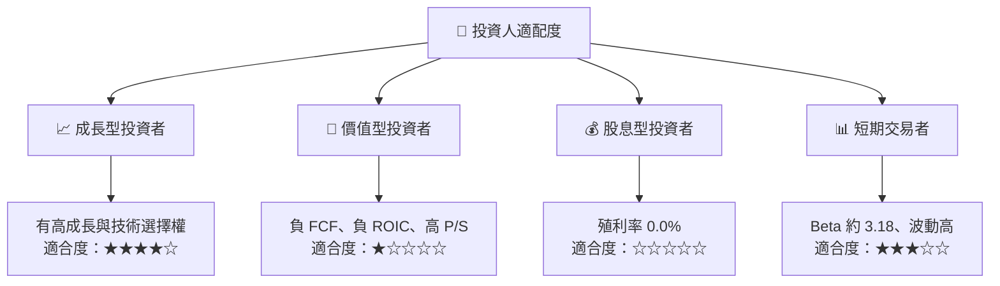

### 11.5 每季財報監控清單（Quarterly Watch List）

| 監控指標 | 最新錨點 | 加碼觀察門檻 | 減碼／論點受損門檻 |
|----------|----------|--------------|--------------------|
| 營收成長 | TTM 59.0%；最新季 YoY 72.7% | 單季 YoY ≥30%，且 backlog 轉收入 | 連續兩季 YoY <30% |
| 毛利率 | TTM 36.2% | 維持 ≥36%，並逐年提高 | 連續兩季低於 32% |
| 營業利潤率 | TTM -27.6% | 年增改善、費用率下降 | 惡化超過 5 個百分點 |
| 營業現金流 | TTM -$191.78M | TTM 持續改善至接近 0 | TTM 低於 -$300M |
| Capex | TTM $133.84M | Capex 伴隨收入與毛利提升 | Capex 增速高於營收且 FCF 惡化 |
| FCF | TTM -$325.62M | 轉正後連續兩季維持正值 | 低於 -$400M |
| 現金與短期投資 | VERIFIED $4.45B | 維持高於 $3.5B 並有合理回報 | 低於 $3.0B 或融資需求上升 |
| SBC | FY2025 $71.10M | SBC／營收低於 10% | SBC／營收高於 15% |
| 新型火箭里程碑 | 資料包未列時程 | 實測、認證及商業合同逐步落地 | 重大延期或成本超支 |
| 財測／訂單 | 公司財測與 backlog N/A | 訂單轉收入、指引上修 | 指引下修或取消訂單 |

### 11.6 反面論證：什麼會證明論點錯誤（What Would Change My Mind）

```text
╔══════════════════════════════════════════════════════════════════╗
║              ⚠️ 論點失效條件（Disconfirming Evidence）           ║
╠══════════════════════════════════════════════════════════════════╣
║ ☐ 最新一季營收年增連續兩季低於 30%                              ║
║ ☐ TTM 毛利率跌破 32%，且營業利潤率繼續惡化                      ║
║ ☐ TTM FCF 低於 -$400M，或連續四季仍無收斂                       ║
║ ☐ 現金及短期投資跌破 $3.0B，且需要大額股權融資                   ║
║ ☐ SBC／營收超過 15%，或稀釋股數一年增加超過 5%                   ║
║ ☐ ROIC 未改善且仍低於 WACC 21.08%，新增投資無法帶動回報上升      ║
║ ☐ 新型火箭重大里程碑延期超過 12 個月，且未見訂單或收入補償       ║
╚══════════════════════════════════════════════════════════════════╝
```

> **免責聲明**：本報告為 AI 自動生成，僅供研究參考，不構成投資建議。投資有風險，入市需謹慎。