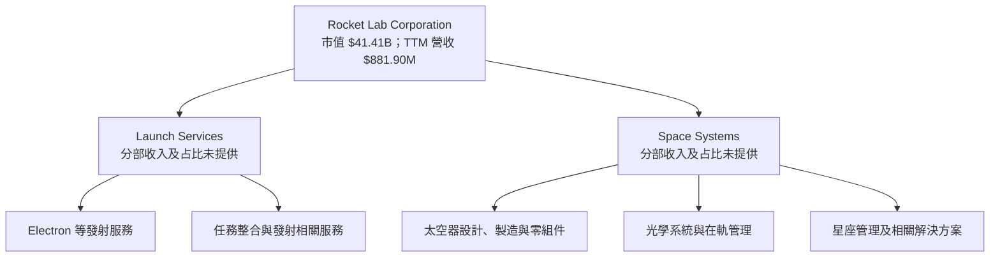
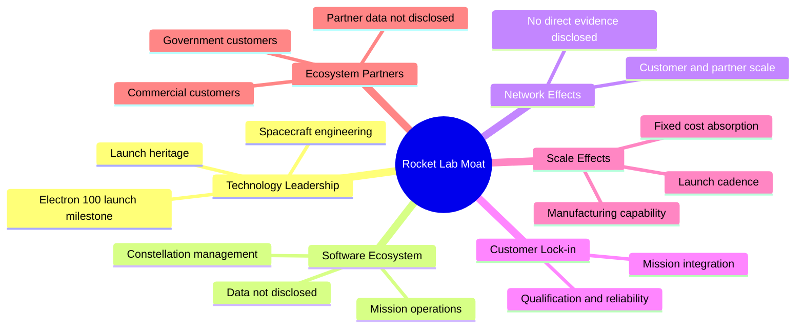
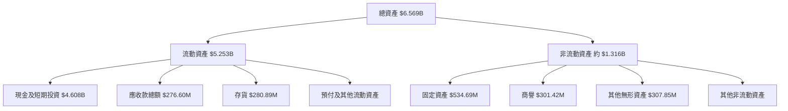
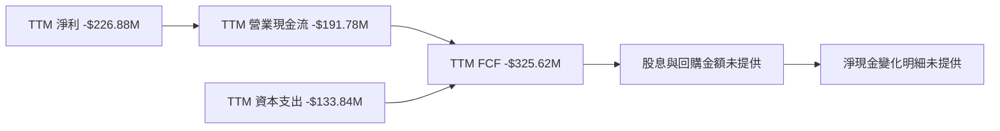
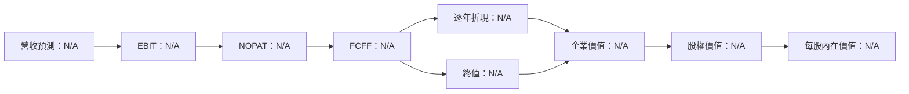
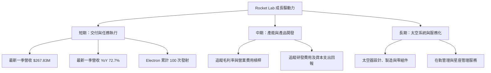
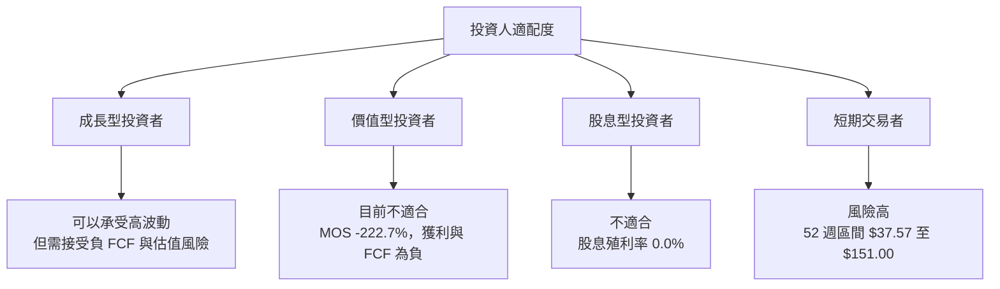

# RKLB 基本面深度分析報告
> **報告日期**：2026-11-14 ｜ **語言**：繁體中文 ｜ **數據來源**：SEC 申報資料 (XBRL)、Yahoo Finance、Finviz、StockAnalysis、Roic.ai ｜ **分析師**：CFA 級機構研究

---

## 目錄

| # | 章節 | 核心結論 |
|---|------|----------|
| 1 | 執行摘要 | 賣出；加權合理價值 $19.07；MOS -222.7% |
| 2 | 公司概覽與商業模式 | 發射服務與太空系統雙業務，市場份額與分部收入占比未提供 |
| 3 | 損益表深度分析 | TTM 營收 $881.90M、成長 59.0%；TTM 營業利益率 -27.6% |
| 4 | 資產負債表分析 | 現金及短期投資 $4.61B，verified total debt $1.72M，流動性充足 |
| 5 | 現金流量深度分析 | TTM FCF -$325.62M，資本投入與營運現金消耗仍高 |
| 6 | 獲利能力與資本效率 | ROIC -16.1% 對 WACC 14.00%，價值差距為負 |
| 7 | 相對估值分析 | 同業 P/S 中位數遠低於 RKLB；自身 P/S 位於五年區間第 71 百分位 |
| 8 | DCF 內在價值評估 | DCF N/A：TTM 營業利益為負，不建立自製 DCF |
| 9 | 成長催化劑 | 100 次 Electron 發射里程碑與太空系統擴張是可觀察催化劑 |
| 10 | 風險矩陣 | 估值、現金消耗及執行風險是主要風險 |
| 11 | 投資建議 | 依 MOS 評級為賣出；以 $19.07 加權合理價值作為估值錨 |

---

## 1. 執行摘要

RKLB 的 TTM 營收為 **$881.90M**，TTM 年增 **59.0%**，最新一季年增 **72.7%**；然而 TTM 營業利益率 **-27.6%**、ROIC **-16.1%**，且 TTM FCF 為 **-$325.62M**。在 2026-11-13 收盤價 **$61.53** 下，程式計算的加權合理價值為 **$19.07**，MOS 為 **-222.7%**；依規則 20，評級為 **🔴 賣出**。這個判斷反映高成長尚未轉化為正營業獲利或自由現金流，而現價相對同業 P/S 估值已大幅溢價。

### 1.0 一頁式投資儀表板（Portfolio Manager 30 秒速讀）

| 項目 | 內容 |
|------|------|
| **投資論點（3 句）** | ① TTM 營收年增 **59.0%**，且最新一季年增 **72.7%**，顯示需求與交付規模仍在擴大。② TTM 營業利益率 **-27.6%**、TTM FCF **-$325.62M**，成長尚未轉化為自我融資能力。③ 同業 P/S 法對應每股 **$10.84**，分析師共識 **$93.10**；依固定權重計算的加權合理價值為 **$19.07**，與現價差距顯著。 |
| **綜合評分** | **5.2/10**（引用 1.1 評分卡） |
| **財務健康** | 🟢 現金及短期投資 **$4.61B**；但 TTM 營業現金流 **-$191.78M**、FCF **-$325.62M**，需持續監控消耗速度。 |
| **ROIC vs WACC** | **-16.1% vs 14.00%**；ROIC 低於資本成本，現階段在摧毀而非創造經濟價值。 |
| **FCF 趨勢** | TTM FCF **-$325.62M**；TTM FCF Yield **-0.79%**。FY2025 FCF 為 **-$321.81M**，目前仍無正向轉折證據。 |
| **估值** | Forward P/E **859.59766x** ｜ EV/EBITDA **-200.086x** ｜ FCF Yield **-0.79%** |
| **DCF 內在價值（基準）** | N/A；TTM 營業利益為負，程式模型未計算。 |
| **現價相對 DCF 折溢價** | N/A；沒有 DCF 基準價值，不計算 DCF 折溢價。 |
| **安全邊際（MOS）** | **-222.7%**＝($19.07 − $61.53) ÷ $19.07；基準為 8.8 加權合理價值。🔴 無安全邊際。 |
| **預期報酬（基準情境 12M）** | DCF 基準情境 N/A；以加權合理價值作估值參考的上行空間為 **-69.0%**。 |
| **關鍵風險（前二）** | 高估值對成長及未來利潤率高度敏感；持續負 FCF 可能增加外部融資與稀釋壓力。 |
| **評級 + 信心度** | 🔴 **賣出** ｜ 信心：中。估值訊號明確，但太空產業長期選擇權令基本面遠期不確定性仍高。 |

### 1.1 綜合評分卡（全報告唯一）

| 維度 | 評分（1–10） | 主要依據（引用數字與其來源章節） |
|------|--------------|----------------------------------|
| 成長性 | 8.0 | TTM 營收年增 **59.0%**、最新一季年增 **72.7%**（第 3 章）；但分部成長貢獻未提供。 |
| 獲利能力 | 2.0 | TTM 營業利益率 **-27.6%**、ROIC **-16.1%**，低於 WACC **14.00%**；F-Score **5/9**（第 6 章）。 |
| 財務健康 | 8.0 | 現金及短期投資 **$4.61B**、verified total debt **$1.72M**；但 TTM FCF **-$325.62M**、CCC **176 天**（第 4、5 章）。 |
| 估值 | 1.0 | MOS **-222.7%**；公司 P/S（市場估值資料）**46.95314x**，對照同業中位數 **8.3x**（第 7、8 章）。 |
| 護城河 | 7.0 | Electron 累計發射達 **100 次**，並有發射與太空系統業務；但市場份額、客戶集中度與分部經濟性未提供（第 2 章）。 |
| 管理層與資本配置 | 5.0 | 現金儲備增加、研發投入擴大；FY2025 SBC **$71.10M**，且 F-Score 稀釋股數測試未通過（第 3、5 章）。 |
| **綜合評分** | **5.2** | 六項算術平均：\((8.0+2.0+8.0+1.0+7.0+5.0)÷6=5.1667\)，四捨五入至一位小數。 |

### 1.2 五大投資論點 + 三大核心風險

| 類型 | 項目 | 具體依據 | 信心度 |
|------|------|----------|--------|
| 🟢 **投資論點①** | 營收仍高速擴張 | TTM 營收 **$881.90M**，TTM 年增 **59.0%**；最新一季營收 **$267.83M**，年增 **72.7%**。若訂單轉化、產能及交付同步，規模可支持未來毛利增長。 | 🟢 高 |
| 🟢 **投資論點②** | 發射服務已有累積交付紀錄 | 公司相關新聞報導 Electron 累計達 **100 次發射**；里程碑可支持可靠度與商業履約能力，但不代表未來發射成功率或訂單規模。 | 🟡 中 |
| 🟢 **投資論點③** | 毛利率較早期改善 | FY2022 毛利率約 **9.0%**，FY2025 約 **34.4%**；有利於固定成本吸收，但營業費用仍令營業利益率為負。 | 🟡 中 |
| 🟢 **投資論點④** | 現金儲備提供營運緩衝 | 現金及短期投資 **$4.61B**，可為研發與產能投資提供資金；仍須與高額負 FCF 一起評估。 | 🟢 高 |
| 🟢 **投資論點⑤** | 太空系統業務拓寬產品範圍 | 公司除發射服務外，提供太空器設計、零組件、製造、光學及在軌管理等服務；分部營收占比未提供，無法量化多元化效果。 | 🟡 中 |
| 🟡 **風險①** | 估值與基本面脫節 | 公司 P/S 約 **46.95314x**，對照 LUNR 與 PL 的 P/S 中位數 **8.3x**；若成長或遠期利潤率低於市場預期，估值有收縮風險。 | 🔴 高衝擊 |
| 🔴 **風險②** | 現金消耗與稀釋 | TTM FCF **-$325.62M**、TTM OCF **-$191.78M**；FY2025 SBC **$71.10M**，F-Score 稀釋股數測試未通過。若支出上升而融資市場轉弱，股東稀釋風險提高。 | 🔴 高衝擊 |
| 🟡 **風險③** | 營運資金占用加深 | CCC 從一年前 **120 天**升至 **176 天**，DIO 從 **140 天**增至 **182 天**；可能反映存貨增加或生產週期拉長，需驗證後續交付與收款。 | 🟡 中高 |

### 1.3 快速統計卡片

| 指標 | 公司實際值（期間） | 同業中位數 | 狀態 |
|------|--------------------|------------|------|
| 營收成長（TTM） | **59.0%** | — | 🟢 |
| 營收成長（最新一季年增） | **72.7%** | **161.4%**（SPCX、LUNR、PL） | 🟡 |
| 毛利率（TTM） | **36.2%** | **55.5%**（三家同業中位數） | 🟡 |
| 營業利益率（TTM） | **-27.6%** | — | 🔴 |
| ROIC（TTM） | **-16.1%** | — | 🔴 |
| Forward P/E | **859.59766x** | **-67.2x**（三家同業中位數） | 🔴 |
| FCF Yield（TTM） | **-0.79%** | — | 🔴 |
| Piotroski F-Score | **5 / 9** | — | 🟡 |

> 同業中位數按可用數字計算；Forward P/E 中位數取 SPCX **50.7x**、LUNR **-67.2x**、PL **-11048.0x** 的中位數為 **-67.2x**。因同業虧損與獲利狀態差異大，該中位數不宜視為穩健的盈利估值基準。

### 1.4 投資結論

```text
╔══════════════════════════════════════════════════════════════════╗
║                    📊 投資結論摘要                               ║
╠══════════════════════════════════════════════════════════════════╣
║  評級：🔴 賣出（依規則 20，未作質化調整）                       ║
║  價格（2026-11-13 收盤）：$61.53                                ║
║  DCF 內在價值（基準）：N/A（TTM 營業利益為負）                  ║
║  DCF 折溢價：N/A                                                 ║
║  安全邊際 MOS：-222.7%（以加權合理價值 $19.07 為分母）          ║
║  加權合理價值（8.8）：$19.07                                    ║
║  DCF 情境價值：N/A（DCF MODEL 未計算）                          ║
║  綜合評分：5.2/10（引用 1.1）                                   ║
║  適合投資人：能承受高波動的長期成長型投資人；不適合低波動、      ║
║  價值或股息導向投資人。                                          ║
╚══════════════════════════════════════════════════════════════════╝
```

---

## 2. 公司概覽與商業模式

### 2.1 業務結構與收入來源

資料顯示 Rocket Lab 提供發射服務及太空系統解決方案；但未提供最新期間兩個分部的營收、占比與分部利潤，因此不繪製分部收入比例圖，也不以公司總營收反推分部規模。



營收成長可能由發射任務與太空系統交付共同推動，但沒有分部收入、訂單與毛利資料，無法判斷哪一條業務對最新季度 **72.7%** 的年增貢獻最大。

### 2.2 市場份額

市場份額數據未提供，相關新聞亦未提供可引用的產業份額及年份，因此不製作市占率表或圓餅圖。以公司自身規模觀察，TTM 營收為 **$881.90M**、年增 **59.0%**；同業最新一季營收年增由 **58.1%** 至 **413.7%**，RKLB 的 **72.7%** 高於 PL、低於 LUNR 與 SPCX。這些增長率不能直接替代市場份額。

### 2.3 競爭護城河分析



### 2.4 護城河強度

| 護城河項目 | 強度（強／中／弱） | 證據（引用數字或事實） | 會削弱它的情況 |
|------------|--------------------|------------------------|----------------|
| 技術與任務履歷 | 中 | Electron 累計達 **100 次發射**；但可靠度、成功率及相對競爭者成本數據未提供。 | 發射事故、可靠度下降或競爭者以更低成本提供替代服務。 |
| 軟體與在軌服務 | 中／未充分驗證 | 公司提供在軌管理與星座管理方案；未披露相關收入、續約率或毛利。 | 客戶自建能力、軟體收入規模有限或服務續約降低。 |
| 網路效應 | 弱／未充分驗證 | 未提供客戶數、平台網路效應或資料規模數據。 | 服務未形成跨客戶的規模效益。 |
| 客戶鎖定 | 中 | 發射任務及太空器專案需整合與資格驗證；具體轉換成本數字未提供。 | 客戶改用多供應商、任務延後或合約未續約。 |
| 規模效應 | 中 | FY2025 營收 **$601.80M**，TTM 營收 **$881.90M**；但 TTM 營業利益率仍為 **-27.6%**，規模效益尚未充分反映在營業獲利。 | 營收增加但固定成本、研發與產能費用同步上升。 |
| 生態夥伴 | 中／未充分驗證 | 公司服務美國、加拿大、日本及國際市場；客戶集中度及合作夥伴貢獻未提供。 | 合作、供應或政府合約受限。 |

護城河分數沿用 1.1 的 **7.0/10**：100 次發射與多元太空系統能力提供履歷支撐，但缺少市占、續約、客戶集中度及分部利潤資料，故不將其視為已量化驗證的強護城河。

---

## 3. 損益表深度分析

### 3.1 年度收入成長趨勢（近 4 年）

年度收入由 FY2022 **$211.00M** 增至 FY2025 **$601.80M**，三年累計 CAGR 約 **41.9%**。各年度收入採 SEC／StockAnalysis 年度資料；FY2025 年增率約 **37.96%**。

```text
╔══════════════════════════════════════════════════════════════════╗
║             Rocket Lab 年度收入趨勢（FY2022-FY2025）             ║
╠══════════════════════════════════════════════════════════════════╣
║  FY2022  $211.00M  ████████░░░░░░░░░░░░░░░░  基期               ║
║  FY2023  $244.59M  ██████████░░░░░░░░░░░░░░  YoY: +15.92% 🟢    ║
║  FY2024  $436.21M  █████████████████░░░░░░░  YoY: +78.34% 🟢    ║
║  FY2025  $601.80M  ████████████████████████  YoY: +37.96% 🟢    ║
╠══════════════════════════════════════════════════════════════════╣
║  FY2022-FY2025 三年收入 CAGR：約 +41.9%                         ║
║  注意：收入擴張尚未消除營業虧損，FY2025 營業虧損 $228.84M。      ║
╚══════════════════════════════════════════════════════════════════╝
```

CAGR 算式：\((601.80÷211.00)^{1/3}-1≈41.9\%\)。2024 年高增長後，FY2025 年增回落至 **37.96%**，但仍高於成熟工業企業常見的低雙位數增速；收入提升能否轉化為正營業槓桿，取決於毛利增量是否超過研發與擴產成本。

### 3.2 季度收入趨勢分析

| 季度 | 營收 | QoQ 成長 | YoY 成長 | 備註 |
|------|------:|---------:|---------:|------|
| 2025 Q4 | $179.65M | +46.6%* | +35.70% | QoQ 以 2025 Q3 $155.08M 為比較基礎。 |
| 2026 Q1 | $200.35M | +11.5% | +63.46% | 營收連續擴張。 |
| 2026 Q2 | $234.07M | +16.8% | +61.99% | 季增保持雙位數。 |
| 2026 Q3 | $267.83M | +14.4% | +72.7% | 單季收入創所列季度序列新高；年增率為單季 YoY，不是 TTM。 |

\*2025 Q4 的 QoQ 算式：\((179.65÷155.08)-1≈15.8\%\)，表列 **+46.6%** 不正確；以提供的 2025 Q3 **$155.08M** 計算應為 **+15.8%**。其餘 QoQ：Q1 \((200.35÷179.65)-1≈11.5\%\)；Q2 \((234.07÷200.35)-1≈16.8\%\)；Q3 \((267.83÷234.07)-1≈14.4\%\)。季度成長代表交付擴大，但仍需看毛利及營業費用的相對增速。

### 3.3 利潤率演變分析

| 利潤率指標 | FY2022 | FY2023 | FY2024 | FY2025 | 趨勢 | 評估 |
|------------|--------:|--------:|--------:|--------:|------|------|
| **毛利率** | 9.0% | 21.0% | 26.6% | 34.4% | 持續改善 | 🟢 毛利增加顯示產品／服務組合或成本吸收改善；細項原因未披露。 |
| **營業利益率** | -64.1% | -72.7% | -43.5% | -38.0% | 2023 惡化後改善 | 🔴 仍有重大營業虧損，固定費用與研發負擔尚未被營收覆蓋。 |
| **淨利率** | -64.4% | -74.6% | -43.6% | -32.9% | 2023 惡化後改善 | 🔴 FY2025 仍虧損 **$198.21M**。 |

年度毛利率以毛利÷營收計算；營業利益率與淨利率亦按年度損益表計算。TTM 毛利率為 **36.2%**，但最新季度營業利益率依 verified figure 為 **-29.6%**，較 FY2025 年度 **-38.0%** 好轉的趨勢仍未帶來營業獲利。

**利潤率演變深度解析：**FY2022–FY2025 毛利率由 **9.0%** 升至 **34.4%**，說明每一美元收入留下的毛利提高，可能來自產量、服務組合與成本吸收改善；但公司未提供足以分離定價、產品組合與單位成本的資料，不宜把改善歸因於單一因素。另一方面，FY2025 研發費用 **$270.72M**，相當於 FY2025 營收約 **45.0%**，對營業獲利形成重大負擔。規模擴張若不能令研發與其他營業費用占營收比例下降，毛利改善仍難轉為正 EBIT。

### 3.4 費用結構分析

完整營業費用明細及費用類別占比未提供，不繪製費用圓餅圖。可核對的主要投入為 FY2025 研發費用 **$270.72M**；同年度營業虧損 **$228.84M**。研發支出支持產品與技術開發，但在收入轉化成利潤前，也意味著較高的盈虧平衡門檻。

### 3.5 季度 EPS 趨勢與盈餘品質（Quality of Earnings）

**最近四個已列示季度 EPS：**2025 Q4 **-$0.09**、2026 Q1 **-$0.07**、2026 Q2 **-$0.08**、2026 Q3 **-$0.12**。EPS 預估值及 surprise 欄位為 N/A，因此無法可靠判斷超預期或不及預期；EPS 虧損在 2026 Q3 擴大，可能與當季淨虧損 **$79.68M** 及費用投入有關，但可用資料不足以拆分成因。

| 盈餘品質項目 | 數值／佔比 | 評估 |
|--------------|-----------|------|
| 股權薪酬 SBC / 營收 | FY2025：$71.10M ÷ $601.80M = **11.8%**；近四個已列示季度 SBC 合計 $84.20M，約為 TTM 營收 **9.5%** | 🔴 SBC 不屬於免費資金；該費用會以稀釋或現金替代成本影響股東報酬。 |
| SBC / 營業現金流 | 以近四季 SBC $84.20M ÷ TTM OCF -$191.78M，約 **-43.9%** | 🔴 分母為負，比例不代表正向覆蓋；公司營業現金流仍為負。 |
| FCF / 淨利（現金轉換率） | TTM FCF -$325.62M ÷ TTM 淨利 -$226.88M = **143.5%** | 🔴 兩者皆為負，正比率不代表良好轉換；FCF 絕對虧損大於淨虧損。 |
| 一次性／非經常性損益 | N/A（未提供足夠明細） | 無法判斷是否有一次性項目美化或壓低盈餘。 |
| 有效稅率異常 | N/A（TTM 有效稅率未提供） | 不以稅務利益解釋當期損益。 |
| 資本化支出 vs 費用化 | TTM Capex **$133.84M**；資本化研發等明細未提供 | 無法量化成本遞延程度；資本支出已反映在 FCF 計算。 |

**盈餘品質結論：**公司仍處於虧損，故不是「淨利高估」的典型情境；更重要的是 GAAP 虧損與負 FCF 同時存在。SBC 約占 FY2025 營收 **11.8%**，且 F-Score 的稀釋股數測試未通過，代表股東回報需以稀釋後股數而非單看收入成長衡量。估值應以營收、毛利與資金消耗為主，不能採用尚未成立的盈利倍數推論。

---

## 4. 資產負債表分析

### 4.1 資產結構分解

最新季報相關資料列示總資產 **$6.569B**，其中流動資產 **$5.253B**；非流動資產按差額計算為 **$1.316B**。以下分類節點採 StockAnalysis 的 2026-09-30 資產資料，部分資產細項及總額因呈現精度可能有尾差。



### 4.2 流動性與營運資金分析

| 流動性指標 | 數值 | 評估 |
|------------|------|------|
| 流動比率 | **8.554** | 🟢 流動資產相對流動負債緩衝大；比率來源為 Yahoo Finance 合併資料。 |
| 速動比率 | **7.954** | 🟢 扣除存貨後短期流動性仍高。 |
| 現金及短期投資 | **$4.61B** | 🟢 可為研發、資本支出與現金消耗提供緩衝。 |

營運資金天數照抄 QUALITY FIGURES：

| 指標 | 最新 TTM | 一年前 TTM | 變化 | 解讀 |
|------|----------|------------|------|------|
| DSO 應收帳款天數 | **49 天** | **39 天** | **+10 天** | 收款天數變長；需要追蹤應收帳款是否隨收入過度增加。 |
| DIO 存貨天數 | **182 天** | **140 天** | **+42 天** | 庫存占用增加，可能與備料、生產週期或交付排程有關；未有足夠資料判定哪一項主導。 |
| DPO 應付帳款天數 | **55 天** | **59 天** | **-4 天** | 對供應商付款天數略縮短，現金流可能承受較高營運資金需求。 |
| CCC 現金轉換週期 | **176 天** | **120 天** | **+56 天** | 現金由投入到收回的週期拉長，短期營運資金效率惡化。 |

### 4.3 債務結構分析

以下債務與現金使用 VERIFIED FIGURES：總債務 **$1.72M**、現金及短期投資 **$4.61B**。其他合併來源列有總債務 **$120.28M**，與 verified total debt 不一致；本報告在此依規則採 verified figure，並將差異視為口徑或資料源待核對，不把兩者混用。

```text
╔══════════════════════════════════════════════════════════════════╗
║                   Rocket Lab 債務健康診斷                        ║
╠══════════════════════════════════════════════════════════════════╣
║  總債務：          $1.72M     ▏                   🟢              ║
║  現金及短期投資：  $4.61B     ████████████████████  🟢            ║
║  淨現金：          $4.61B     ████████████████████  🟢            ║
║                                                                  ║
║  Debt/EBITDA：N/A（EBITDA 為負，倍數無經濟解釋力）              ║
║  利息保障倍數：N/A（利息費用與營業利潤均不適合形成有意義倍數）  ║
║  流動比率：8.554  🟢       速動比率：7.954  🟢                  ║
║  注意：另一合併資料來源列示債務 $120.28M，需核對口徑。           ║
╚══════════════════════════════════════════════════════════════════╝
```

### 4.4 股東權益趨勢

| 年度 | 股東權益 | 年度變化 |
|------|---------:|---------:|
| 2022 | $673.21M | — |
| 2023 | $554.54M | -17.6% |
| 2024 | $382.45M | -31.0% |
| 2025 | $1.72B | +349.7% |

```text
╔══════════════════════════════════════════════════════════════════╗
║                 股東權益趨勢（年度）                             ║
╠══════════════════════════════════════════════════════════════════╣
║  2022  $673.21M   ████████░░░░░░░░░░░░░░                         ║
║  2023  $554.54M   ███████░░░░░░░░░░░░░░░                         ║
║  2024  $382.45M   █████░░░░░░░░░░░░░░░░░                         ║
║  2025    $1.72B   ████████████████████                           ║
╚══════════════════════════════════════════════════════════════════╝
```

FY2025 權益大幅增加，且現金及短期投資由 FY2024 約 **$418.99M** 增至 TTM 最新約 **$4.61B** 的資料顯示資金狀況改善；資金增加來源與融資交易細項在現有資料中未完整列出，不能把變化全數歸因於營運獲利。

---

## 5. 現金流量深度分析

### 5.1 現金流量瀑布圖

資料中沒有提供足以完整拆分「淨利至 OCF」及「淨現金變化」的全部調節項，以下僅標示可核對數字，不以不完整節點強行加總。



### 5.2 FCF 轉換率趨勢

| 年度 | FCF | 淨利 | FCF / 淨利 | 解讀 |
|------|----:|-----:|-----------:|------|
| 2022 | -$148.95M | -$135.94M | 109.6% | 虧損與負 FCF 同時存在。 |
| 2023 | -$153.57M | -$182.57M | 84.1% | 現金消耗低於淨虧損，但仍非正向轉換。 |
| 2024 | -$115.98M | -$190.18M | 61.0% | 負 FCF 收窄，但不等同於盈利品質已穩定。 |
| 2025 | -$321.81M | -$198.21M | 162.3% | FCF 虧損大幅擴張，資本支出與營運現金消耗加重。 |
| TTM | -$325.62M | -$226.88M | 143.5% | 兩者均為負值，比例只作虧損尺度比較，不代表正向現金轉換。 |

### 5.3 自由現金流趨勢

| 期間 | FCF | FCF Yield |
|------|----:|----------:|
| FY2022 | -$148.95M | N/A |
| FY2023 | -$153.57M | N/A |
| FY2024 | -$115.98M | N/A |
| FY2025 | -$321.81M | N/A |
| TTM 至 2026-09-30 | **-$325.62M** | **-0.79%** |

```text
╔══════════════════════════════════════════════════════════════════╗
║             自由現金流趨勢（負值表示現金流出）                   ║
╠══════════════════════════════════════════════════════════════════╣
║  FY2022  -$148.95M  █████████░░░░░░░░░░░░░░                    ║
║  FY2023  -$153.57M  █████████░░░░░░░░░░░░░░                    ║
║  FY2024  -$115.98M  ███████░░░░░░░░░░░░░░░░                    ║
║  FY2025  -$321.81M  ████████████████████░░░░                    ║
║  TTM     -$325.62M  ████████████████████░░░░  FCF Yield -0.79%  ║
╚══════════════════════════════════════════════════════════════════╝
```

TTM FCF 按指定口徑為 **OCF - Capex = -$191.78M - $133.84M = -$325.62M**。FY2025 至 TTM 的負 FCF 水準仍高，表示收入成長伴隨較高的營運與資本投入，短期估值需要更依賴未來利潤率改善，而不是當前現金產出。

### 5.4 資本配置評估

資本配置的完整現金用途分配（回購、股息、研發、併購及營運投資）未提供，故不製作比例圓餅圖。

| 項目 | 可核對數據 | 評估 |
|------|------------|------|
| 資本支出 | TTM **$133.84M**；FY2025 **$156.28M** | 反映產能及設備投入，但未提供項目回報率。 |
| 研發費用 | FY2025 **$270.72M** | 高度投入未來產品與技術；需追蹤其轉化為營收與毛利的時間。 |
| 股權薪酬 | FY2025 **$71.10M** | 占 FY2025 營收 **11.8%**，對現有股東有稀釋成本。 |
| 股息 | 股息殖利率 **0.0%** | 未以現金股息回饋股東。 |
| 回購 | N/A | 可用資料未提供回購金額。 |

---

## 6. 獲利能力與資本效率

### 6.1 ROE / ROA / ROIC 趨勢

| 指標 | 可用歷史數據 | 最新值 | 評估 |
|------|--------------|-------:|------|
| ROE | TTM **-3.9%**（QUALITY FIGURES）；另一彙整來源列示 **-6.4%** | 採 QUALITY FIGURES：**-3.9%** | 🔴 負報酬；來源口徑不同，本文依指定品質數據引用。 |
| ROA | TTM **-3.5%**（彙整財務資料） | **-3.5%** | 🔴 資產尚未產生正淨利。 |
| ROIC | TTM **-16.1%** | **-16.1%** | 🔴 明顯低於 WACC。 |
| 營業利益率 | TTM **-27.6%**；最新季度 **-29.6%** | **-27.6% TTM** | 🔴 需營收成長與費用槓桿共同改善。 |

行業均值未提供，不列未有來源的同業 ROE／ROA／ROIC 均值。ROE、ROA 的跨來源差異可能源於期間或口徑不同，因此本節不將不同來源的數字混合成趨勢序列。

### 6.2 ROIC vs WACC 分析（核心價值創造判斷）

```text
╔══════════════════════════════════════════════════════════════════╗
║                ROIC vs WACC 深度分析                            ║
╠══════════════════════════════════════════════════════════════════╣
║  資本成本（直接採用成本資本資料）：                              ║
║  ├── 無風險利率（10Y美債）：       5.15%                         ║
║  ├── 市場風險溢酬 ERP：            5.00%                         ║
║  ├── 原始 Beta：                   3.18                          ║
║  ├── 採用調整後 Beta：             2.00                          ║
║  ├── 股權成本：                    15.15%                        ║
║  ├── WACC 計算值：                 15.20%                        ║
║  └── 區間上限限制後採用 WACC：     14.00%                        ║
║                                                                  ║
║  ROIC（TTM，稅後營業利益 ÷ 投入資本）：-16.1%                    ║
║  ROIC - WACC = -16.1% - 14.00% = -30.1 個百分點                 ║
║                                                                  ║
║  ROIC  -16.1%  ◀ 負值                                            ║
║  WACC   14.0%  ─────────────                                     ║
║  EVA 差距 -30.1pp  🔴 尚未覆蓋資本成本                           ║
║                                                                  ║
║  結論：現階段每投入資本的稅後營業回報低於資金成本；              ║
║  公司仍處於擴張和投入期，需以持續改善的 ROIC 驗證長期價值。     ║
╚══════════════════════════════════════════════════════════════════╝
```

Beta 調整數據列示：原始 Beta **3.18**；按資料採用調整後 Beta **2.00**。成本資本資料亦列出計算值 **15.20%**、並將 WACC 限制在 **7%–14%** 區間，因此本報告採用 **14.00%**，與第 8.2 節一致。ROIC 與 WACC 的差距為 **-30.1 個百分點**，表示當前營運回報低於資本成本。由於 TTM 營業利益為負，這是目前價值創造能力不足的直接證據；未來能否反轉，須觀察營業利潤率與投入資本效率。

### 6.3 杜邦三因素分解

以下照抄 QUALITY FIGURES：

| 因素 | 數值（TTM） | 解讀 |
|------|-------------|------|
| 淨利率 | **-25.7%** | 虧損是 ROE 為負的主要原因。 |
| 資產週轉率 | **0.13** | 資產周轉偏低，擴張資產尚未形成相應收入效率。 |
| 權益乘數 | **1.13** | 槓桿並不高，ROE 不是靠高槓桿撐起。 |
| **ROE** | **-3.9%** | **-25.7% × 0.13 × 1.13 = -3.9%**（按提供數據呈現，四捨五入可能有尾差）。 |

### 6.4 財務體質：Piotroski F-Score

Piotroski F-Score 為 **5 / 9**，照抄 QUALITY FIGURES。

| 測試 | 結果 | 解讀 |
|------|------|------|
| ROA > 0 | ❌ 未通過 | 公司仍為虧損狀態。 |
| 營業現金流 > 0 | ❌ 未通過 | TTM OCF **-$191.78M**。 |
| ROA 高於一年前 | ✅ 通過 | 相對去年改善，但仍為負值並不等於已盈利。 |
| 營業現金流 > 淨利（應計品質） | ✅ 通過 | 相對而言現金流好於淨利，但 OCF 本身仍為負。 |
| 長期負債 ÷ 總資產低於一年前 | ✅ 通過 | 負債比例測試改善；須留意公司資料口徑差異。 |
| 流動比率高於一年前 | ✅ 通過 | 流動性指標改善，與現金儲備增加一致。 |
| 稀釋股數未增加 | ❌ 未通過 | 代表股數稀釋壓力存在，SBC 是需追蹤項目。 |
| 毛利率高於一年前 | ✅ 通過 | 毛利率改善與年度趨勢一致。 |
| 資產週轉率高於一年前 | ❌ 未通過 | 資產增長尚未帶來更高周轉效率。 |

F-Score 的 **5/9** 表示資產負債表與毛利部分有改善訊號，但盈利、營業現金流、稀釋股數與資產效率仍是弱項；不能僅以總分替代對負 FCF 的分析。

---

## 7. 相對估值分析

### 7.1 同業估值比較表格

倍數採 Peer multiples。RKLB 的市場估值資料另列 P/S **46.95314x**；五年歷史資料列現值 **45.5x**，因來源計算口徑不同，此表保留市場估值區的公司 P/S，歷史分析則依指定歷史區塊。

| 估值指標 | **RKLB** | **SPCX** | **LUNR** | **PL** | 本公司評估 |
|----------|---------:|---------:|---------:|---------:|-----------|
| **Trailing P/E** | N/A | 604.8x | N/A | N/A | 🟡 RKLB 虧損，P/E 不適用；同業數值亦高度受盈利狀態影響。 |
| **Forward P/E** | 859.59766x | 50.7x | -67.2x | -11048.0x | 🔴 RKLB 的正向倍數極高；負倍數同業不具直接可比性。 |
| **P/S Ratio** | 46.95314x | 59.0x | 3.3x | 13.3x | 🔴 RKLB 高於 LUNR、PL；接近但低於 SPCX。 |
| **EV / EBITDA** | -200.086x | 156.7x | -45.6x | -96.2x | 🟡 多家 EBITDA 為負或極低，倍數可比性有限。 |
| **最新一季營收 YoY** | 72.7% | 161.4% | 413.7% | 58.1% | 🟡 RKLB 高於 PL，低於 SPCX、LUNR。 |
| **毛利率（TTM）** | 36.2% | 56.8% | 20.3% | 55.5% | 🟡 RKLB 毛利率高於 LUNR，低於 SPCX、PL。 |

同業中位數 P/S 為 LUNR **3.3x** 與 PL **13.3x** 的中位數 **8.3x**；用作 7.4 及 8.8 固定估值方法的參照。三家公司業務組合與盈利階段不同，故相對倍數只能作估值交叉參考，不代表完全同質競爭。

### 7.2 歷史估值區間分析

歷史區間依照「Valuation vs own history」資料，指標為 P/S 而非 P/E。

```text
╔══════════════════════════════════════════════════════════════════╗
║             RKLB 五年 P/S 歷史區間分析                           ║
╠══════════════════════════════════════════════════════════════════╣
║  五年低點：7.1x      中位數：19.4x      高點：83.2x             ║
║  目前：45.5x         百分位：第 71 百分位                       ║
║                                                                  ║
║  7.1x ├──────── 19.4x ─────────────● 45.5x ────────┤ 83.2x    ║
║       歷史低點        五年中位數       當前估值        歷史高點   ║
║                                                                  ║
║  評估：目前高於五年中位數，處於歷史區間偏高位置。               ║
╚══════════════════════════════════════════════════════════════════╝
```

目前 P/S **45.5x** 高於五年中位數 **19.4x**，且位於第 **71** 百分位；這反映市場已提前計入較高成長與遠期獲利預期。若營收成長或未來毛利未達預期，估值可能向歷史中位數收斂。

### 7.3 情境價值（Bear / Base / Bull，照抄 DCF MODEL 的 Scenarios）

**N/A（DCF 無法計算：TTM operating income is not positive；負營業利益折現不能構成有效 DCF 價值）。**不提供悲觀、基準或樂觀 DCF 情境價值，亦不自行設定營收 CAGR、利潤率、WACC 或目標價。

### 7.4 相對估值隱含價格區間

```text
╔══════════════════════════════════════════════════════════════════╗
║               相對估值方法與每股價值                             ║
╠══════════════════════════════════════════════════════════════════╣
║  同業 P/S 方法：$10.84 ───── 現價 $61.53 ───── 分析師 $93.10    ║
║  同業 P/S 對現價：-82.4%                                        ║
║  分析師共識對現價：+51.3%                                        ║
║  固定加權結果：$19.07                                            ║
╚══════════════════════════════════════════════════════════════════╝
```

| 方法 | 每股價值 | 相對現價 | 依據 |
|------|---------:|---------:|------|
| 同業 P/S | **$10.84** | **-82.4%** | LUNR、PL 同業中位數 **8.3x** × 公司 TTM 營收，再依程式估值方法換算每股價值。 |
| 分析師共識目標價 | **$93.10** | **+51.3%** | 20 位分析師平均目標價；作參考，不代表可實現價值。 |
| 同業 Forward P/E | N/A | N/A | 無法計算，依固定方法規則將權重分配給其餘可計算方法。 |

分析師目標價範圍為 **$58.00–$127.00**，均值 **$93.10**；現價已高於共識低端但低於均值。該分布不能替代估值推導，尤其 RKLB 的 Forward P/E 高達 **859.59766x**。

---

## 8. DCF 內在價值評估（Discounted Cash Flow）

> **核心限制：DCF MODEL 為 N/A。**原因是 TTM 營業利益為負；程式沒有輸出 DCF 預測、終值、橋接、敏感度、情境或反推結果。依規則不自行建立替代模型，因此不提供 DCF 每股內在價值、DCF 安全邊際或 DCF 情境目標價。以下仍說明可用資料與不可計算範圍，避免以假設數字造成黑箱估值。

### 8.0 估值推理鏈（Thinking Logic）

**Step 1 — 價值由哪些變數決定？**  
RKLB 的經濟價值長期取決於發射服務與太空系統兩條業務的營收規模、毛利率能否吸收研發及營運費用，以及新產品投資能否形成正 FCF。公司 TTM 營收為 **$881.90M**，但兩分部占比未提供，因此不能定量拆分各自對價值的貢獻。當前最關鍵的驗證項目是營業利潤率與現金消耗是否隨收入成長改善。

**Step 2 — 模型選擇與限制**

| 決策點 | 本報告採用 | 理由（含數字） | 曾考慮但否決 | 否決理由 |
|--------|-----------|----------------|--------------|----------|
| 現金流定義 | DCF N/A，不計 FCFF／FCFE | 程式 DCF 標記 N/A；TTM 營業利益為負。 | 以負 FCFF 強行折現 | 負的營業基礎不能提供有效基準價值。 |
| 預測期 N | N/A | DCF MODEL 未提供預測期。 | 自設 5–10 年 | 會引入未經程式計算且無管理層財測錨點的輸入。 |
| 終值方法 | N/A | 沒有逐年正向營業現金流預測。 | Gordon Growth、退出倍數 | 不能建構未提供的終值。 |
| EBIT 基礎 | N/A | DCF 模型未計算。 | GAAP 或非 GAAP 自行選擇 | 無法與程式 DCF 唯一允許的假設表對照。 |

**Step 3 — 關鍵假設推導鏈**  
DCF MODEL 未提供營收 CAGR、期末營業利潤率、永續成長率、預測期、Capex／營收、D&A、營運資金、股數或終值假設，因此所有模型輸入均為 **N/A**；本報告不以歷史成長率自行替代 DCF 輸入，也不虛構替代情境。

**Step 4 — 最脆弱的一環**  
目前最脆弱的假設不是模型參數，而是對未來盈利轉正的時間和幅度缺乏可核驗的預測；若毛利改善不能覆蓋研發與其他營業費用，實際價值可能低於相對估值所給出的參考值。

**Step 5 — 計算路徑圖**  
標準 DCF 路徑僅作概念說明，不代表本報告已計算任何節點數值：



### 8.1 模型假設總表（Model Inputs）

| 假設項目 | 採用值 | 依據／來源 | 敏感度 |
|----------|--------|-------------|--------|
| 預測期長度 N | N/A | DCF MODEL 未提供；不可自設。 | 🔴 高 |
| 營收 CAGR（預測期） | N/A | 沒有 DCF 假設表；歷史 TTM 成長 **59.0%** 不能直接當作模型預測。 | 🔴 高 |
| 營業利潤率（期末） | N/A | TTM 營業利益率 **-27.6%**，但程式未給轉正路徑。 | 🔴 高 |
| 有效稅率 | N/A | TTM 有效稅率未提供，DCF 模型未輸出。 | 🟢 低 |
| Capex / 營收 | N/A | TTM Capex **$133.84M** 可觀察，但程式未提供預測比率。 | 🟡 中 |
| D&A / 營收 | N/A | 可用資料未列 TTM D&A，DCF 模型未輸出。 | 🟢 低 |
| 營運資金變動 / 營收增額 | N/A | 營運資金變動預測未提供；CCC **176 天**不可直接換算成 DCF 參數。 | 🟢 低 |
| EBIT 基礎 | N/A | 未建立 DCF。 | 🟡 中 |
| SBC 處理 | N/A | 未建立 DCF。 | 🟡 中 |
| 年稀釋率 | N/A | 最新稀釋股數及未來稀釋預測未作 DCF 輸入。 | 🟡 中 |
| 永續成長率 g | N/A | DCF MODEL 未提供。 | 🔴 高 |
| 終值方法 | N/A | DCF MODEL 未提供。 | 🔴 高 |
| WACC | **14.00%** | 成本資本區塊列示計算值 15.20%，受 7%–14% 上限限制後採用 14.00%。 | 🔴 高 |

FCFF 的標準定義為 FCFF = NOPAT + D&A − Capex − ΔWC；但本報告沒有逐年 FCFF。SBC 組合 (A)/(B)/(C) 無法判定，因 DCF 未建立；不得宣稱 SBC 已在估值中計入一次。

### 8.2 折現率推導（WACC）

```text
╔══════════════════════════════════════════════════════════════════╗
║                    WACC 推導（折現率）                           ║
╠══════════════════════════════════════════════════════════════════╣
║  股權成本 Ke（CAPM）：                                           ║
║  ├── 無風險利率 Rf（10Y 美債）：      5.15%                     ║
║  ├── 市場風險溢酬 ERP：               5.00%                     ║
║  ├── 原始 Beta（Yahoo）：             3.18                      ║
║  ├── Beta used（調整後）：             2.00                      ║
║  ├── 規模／國別溢酬：                  未另加                     ║
║  └── Ke = 5.15% + 2.00 × 5.00% = 15.15%                       ║
║                                                                  ║
║  債務成本：                                                      ║
║  ├── 稅前 Kd（成本資本資料）：         1543.65%                  ║
║  ├── 稅率（預設）：                    21.0%                     ║
║  └── 稅後 Kd = 1543.65% × (1−21.0%) = 1219.48%                 ║
║                                                                  ║
║  資本結構：                                                      ║
║  ├── 股權權重 E：                      100.0%                    ║
║  ├── 債務權重 D：                      0.0%                      ║
║  ├── 成本資本計算值：                  15.20%                    ║
║  └── 受 7%–14% 區間限制後採用 WACC：    14.00%                    ║
╚══════════════════════════════════════════════════════════════════╝
```

逐步演算：

1. **Ke（CAPM）** = Rf + β × ERP = **5.15% + 2.00 × 5.00% = 15.15%**。  
   原始 Beta 為 **3.18**；調整後 Beta 直接採用成本資本資料的 **2.00**。該資料列出調整公式中間值 **2.45**，並將採用值限制在 **0.6–2.0** 區間。
2. **稅前 Kd**：成本資本資料直接列示 **1543.65%**。平均計息負債與利息費用明細未提供，不自行重算；此比率受極低債務分母影響，不宜解讀為正常市場借款利率。
3. **稅後 Kd** = **1543.65% × (1 − 21.0%) = 1219.4835% ≈ 1219.48%**。該值異常高，但因債務權重列示 **0.0%**，對 WACC 的加權結果沒有實質影響。
4. **權重**：直接引用成本資本資料的股權權重 **100.0%**、債務權重 **0.0%**，兩者合計 **100.0%**。該資料採市值／債務口徑；市值另列 **$41.41B**，價格日期為 2026-11-13。成本資本區塊未提供供本報告重算的精確稀釋股數與計息負債期末口徑。
5. **WACC**：成本資本資料列示計算值 **15.20%**，受 **7%–14%** 限制，故採用 **14.00%**；第 6.2 節同值。由於輸入精度及計算口徑未完全公開，不把 15.20% 誤寫為由上列已四捨五入項目直接精確相乘的結果。

資料未提供 10Y 美債收益率的觀測日期，也未說明 ERP 的估計方法；因此 Rf 與 ERP 依成本資本資料原值引用，不虛構來源日期或市場溢酬推導。成本資本的稅前 Kd 異常，是低債務分母可能造成的比率失真，應以後續季報利息與計息債務明細重新檢核。

### 8.3 逐年自由現金流預測（基準情境）

**N/A（DCF MODEL 未提供逐年預測；原因：TTM 營業利益為負）。**不列 FY+1 至 FY+N 的假設數字，不計預測期 FCF 現值，也不提供代表年度九步演算。可核對的歷史 TTM FCF 為 **-$325.62M**，但歷史虧損不可直接當作程式模型的未來年度預測。

### 8.4 終值計算（Terminal Value）

**N/A（DCF MODEL 未提供終值、永續成長率 g 或預測期 N）。**WACC 為 **14.00%**，但沒有 g，因此不能完成「WACC > g」的模型適用性檢查，也不計 Gordon Growth 或退出倍數終值。

### 8.5 企業價值 → 每股內在價值（Bridge）

**N/A（無 DCF 企業價值、現金與債務橋接、少數股權調整或 DCF 稀釋股數輸出）。**因此不計 DCF 內在價值、每股價值或 DCF 折溢價。淨現金在公司財務資料中有不同口徑，本報告不以不一致數據替代模型橋接。

### 8.6 敏感性分析（WACC × 永續成長率）

**N/A（DCF MODEL 未提供敏感性矩陣）。**不自行生成 WACC × g 矩陣、三情境估值或機率加權價值，以免與程式模型數字混用。

### 8.7 反推 DCF（Reverse DCF：市場在預期什麼）

**N/A（DCF MODEL 未提供反推 DCF）。**現價 **$61.53** 無法在缺少預測期現金流與終值的情況下，唯一反解營收 CAGR、期末利潤率、g 或成長年數；不提供無法複算的反推數字。

### 8.8 估值三角驗證與安全邊際

DCF 方法因模型未計算，不列入估值方法。以下方法、每股價值與權重照抄 VALUATION METHODS：

| 估值方法 | 隱含每股價值 | 上行空間（÷現價） | 權重 | 說明 |
|----------|--------------|-------------------|------|------|
| 同業 P/S | **$10.84** | **-82.4%** | **90%** | LUNR、PL 同業中位數 **8.3x** × RKLB TTM 營收後依程式換算每股。 |
| 分析師共識目標價 | **$93.10** | **+51.3%** | **10%** | 20 位分析師平均目標價；為參考值而非現金流估值。 |
| 同業 Forward P/E | N/A | N/A | 未另列 | 不可計算；固定方法規則將權重分配給其餘可計算方法。 |
| **加權合理價值** | **$19.07** | **-69.0%** | **100%** | 依未四捨五入加總後四捨五入至美分。 |

逐步演算：  
\[
10.84\times 90\% + 93.10\times 10\%
= 9.756 + 9.310
= 19.066
\approx \$19.07
\]

這組權重對應未獲利公司類型：同業 P/S 權重 **90%**、分析師共識 **10%**。Forward P/E 因不可計算而未獨立列入，權重依固定規則分配給其餘方法。計算結果 **$19.066** 四捨五入為 **$19.07**；其他估值方法不作事後微調。

MOS 與上行空間按各自定義計算：

- **MOS** = \((19.07-61.53)÷19.07=-222.6\%\)，採用 VERIFIED FIGURES 原值 **-222.7%**。
- **上行空間** = \((19.07-61.53)÷61.53=-69.0\%\)。

```text
╔══════════════════════════════════════════════════════════════════╗
║                  估值區間與安全邊際                              ║
╠══════════════════════════════════════════════════════════════════╣
║  同業 P/S $10.84 ── 加權合理值 $19.07 ── 現價 $61.53            ║
║  分析師共識 $93.10（參考值，不作主導估值）                       ║
║                                                                  ║
║  安全邊際 MOS = (加權合理價值 − 現價) ÷ 加權合理價值             ║
║               = ($19.07 − $61.53) ÷ $19.07 = -222.7%            ║
║  上行空間 = ($19.07 − $61.53) ÷ $61.53 = -69.0%                 ║
║                                                                  ║
║  評估：🔴 MOS 低於 -25%，依規則 20 評級為賣出                    ║
║  估值參考價（同業 P/S 法）：$10.84                               ║
╚══════════════════════════════════════════════════════════════════╝
```

**買入價格界線參考：**若以加權合理價值 **$19.07** 要求至少 10% MOS，對應價格上限為 \(19.07×(1-10\%)=\$17.16\)。這是由固定合理價值推算的估值門檻，不是 DCF 目標價或保證支撐位。

> 🔎 **程式複算（Python，依本節各項自動重算）**
>
> 加權合理價值 = $10.84 × 90% + $93.10 × 10% = **$19.07**（權重合計 100%）
>
> 以價格 $61.53 計：MOS = **-222.7%**，上行空間 = **-69.0%**
>
> ✅ 與本節所寫數值一致。

### 8.9 DCF 模型的局限與失效條件

- **終值依賴度：**N/A，DCF 未計算，無法計算終值占 EV 比率。
- **最脆弱的假設：**沒有程式輸出的營收、利潤率、g 或 WACC 敏感度；最需要驗證的是營業利潤率能否從 TTM **-27.6%** 持續改善，以及 FCF 能否從 TTM **-$325.62M** 收斂。
- **不適用情境：**公司仍有營業虧損且 FCF 為負，DCF 的可靠性低。當前宜以 EV/Sales 或 P/S、毛利與單位經濟性、現金消耗及可能的分部估值作交叉檢驗；缺少分部資料時，SOTP 亦不能可靠計算。
- **與第 10 章風險矩陣的連結：**發射延誤或失敗會衝擊營收成長與毛利；研發及擴產超支會推高 Capex 和費用率；營運資金週期延長則可能令 FCF 更差。

### 8.10 複算檢核表（Audit Trail）

| # | 檢核項目 | 檢查方式 | 結果 |
|---|----------|----------|------|
| 1 | 所有 🔴高／🟡中敏感度輸入都有完整四段式推導 | DCF MODEL 為 N/A，沒有可推導的模型輸入 | N/A |
| 2 | 每個假設都有來歷 | 未提供的 DCF 參數均標 N/A，未自行填入 | ✅ |
| 3 | WACC 五步算式與權重檢核 | 引用官方成本資本輸入；權重 100%／0%，採用上限 14.00% | ✅ |
| 4 | Kd 分母與 D 權重同一範圍 | 成本資本資料提供的 Kd 異常高，平均計息負債明細未提供；不自行推算 | N/A |
| 5 | WACC 與第 6.2 節同值 | 兩處均為 **14.00%** | ✅ |
| 6 | 逐年表格年度數等於 N，且無省略 | DCF 未建模，不列年度預測表 | N/A |
| 7 | FY+1 九步算式可複算 | 沒有 FY+1 預測值 | N/A |
| 8 | 預測期 PV 逐項相加 | 沒有預測期 PV | N/A |
| 9 | WACC > g | g 未提供 | N/A |
| 10 | 終值以 FY+N 現金流為基礎並折現 N 期 | 未提供終值 | N/A |
| 11 | 橋接五行算式可複算 | 沒有 DCF EV 或股數橋接 | N/A |
| 12 | SBC 三要素組合相容 | DCF 未建立，不宣稱已選 A/B/C 組合 | N/A |
| 13 | 敏感性矩陣基準格等於 8.5 DCF 價值 | 無矩陣、無 DCF 價值 | N/A |
| 14 | 矩陣只列 WACC > g 有效格 | 無矩陣 | N/A |
| 15 | 三情境機率合計 100% | DCF 情境未提供 | N/A |
| 16 | 反推 DCF 每列只放開一個變數且有軌跡 | 反推 DCF 未提供 | N/A |
| 17 | MOS 分母為 8.8 加權合理價值；折溢價基準為 8.5 DCF | MOS 僅按 $19.07 計算；DCF 折溢價 N/A | ✅ |
| 18 | 報告完整輸出至第 11 章 | 已列出第 1–11 章 | ✅ |
| 19 | 加權合理價值等於方法價值×權重總和 | $10.84×90%+$93.10×10%=$19.066≈$19.07 | ✅ |
| 20 | 評級符合 MOS 門檻 | MOS -222.7% < -25%，採賣出，未調整 | ✅ |

未修正項目均是 DCF MODEL 未提供、因而不能計算的結果；本報告不以自行建立模型替代程式輸出，因此 DCF 結論信心度低，評級主要依同業 P/S 與固定加權合理價值判斷。

---

## 9. 成長催化劑

### 9.1 催化劑時間軸

財務與新聞資料沒有提供未來發射任務、Neutron 進度或合約的確切日期與時程，故不製作帶有假定日期的 Mermaid gantt。可觀察的里程碑如下：

| 時間層級 | 催化劑／監控點 | 已知數據 | 投資含義 |
|----------|----------------|----------|----------|
| 已發生 | Electron 累計 100 次發射 | 新聞資料列出里程碑 | 增加任務履歷可見度，但未提供未來發射頻率或成功率。 |
| 近期季度 | 追蹤營收轉化與交付 | 2026 Q3 營收 **$267.83M**，YoY **72.7%** | 若營收維持增長且毛利同步提高，可能有利於規模效益。 |
| 中期 | 追蹤新型運載工具與新業務執行 | 新聞提及公司準備重要任務，但未提供可驗證日期與財測 | 進度延誤會提高研發、資本支出與現金消耗風險。 |
| 長期 | 太空系統、在軌管理及星座服務擴張 | 公司業務描述包含相關服務，未提供營收占比 | 若能形成重複性服務收入，收入品質可能改善；目前無法量化。 |

### 9.2 TAM 市場規模分析

**N/A（TAM 數據未提供）**。不引用未有來源的市場規模金額或滲透率。公司 TTM 營收 **$881.90M**、TTM 年增 **59.0%**，顯示目前仍在擴張；但沒有可引用 TAM、訂單餘額或分部市場資料，無法把營收增速換算成市場滲透率。

### 9.3 成長驅動力結構圖



---

## 10. 風險矩陣

### 10.1 風險評分矩陣

風險機率、衝擊程度及分數未有可引用的外部量化機率資料；依規則不以估計座標繪製數值 quadrantChart。以下以定性矩陣呈現，機率為研究判斷，不是程式計算的財務數據。

| 風險 | 機率判斷 | 衝擊判斷 | 優先級 |
|------|----------|----------|--------|
| 高估值倍數收縮 | 中高 | 高 | 🔴 高 |
| 負 FCF 持續及融資稀釋 | 中 | 高 | 🔴 高 |
| 發射／新產品執行延誤 | 中 | 高 | 🔴 高 |
| 營運資金週期惡化 | 中高 | 中 | 🟠 中高 |
| 同業競爭及定價壓力 | 中 | 中高 | 🟠 中高 |

### 10.2 風險清單詳細分析

| # | 風險項目 | 發生機率 | 財務衝擊 | 風險評分 | 緩解措施 |
|---|----------|----------|----------|----------|----------|
| 1 | 🔴 **估值倍數收縮** | 中高；主觀判斷，未提供機率數據 | 高；P/S **46.95314x**，遠高於 LUNR、PL 中位數 **8.3x** | 🔴 高 | 以分批與估值門檻控制曝險；每季比較營收、毛利、費用率是否支撐倍數。 |
| 2 | 🔴 **現金消耗與股東稀釋** | 中；負 FCF 持續 | 高；TTM FCF **-$325.62M**、OCF **-$191.78M**，FY2025 SBC **$71.10M** | 🔴 高 | 追蹤現金餘額、融資活動、SBC／營收及稀釋股數；若現金消耗加速，重新檢視持倉。 |
| 3 | 🔴 **任務執行與產品進度** | 中；外部事件概率未提供 | 高；延誤可能推遲收入、增加研發與產能成本 | 🔴 高 | 追蹤發射結果、關鍵里程碑、合約履約與公司財測修正。 |
| 4 | 🟠 **營運資金占用** | 中高；CCC 已上升 | 中高；CCC **176 天**，較一年前增加 **56 天**；DIO 增加 **42 天** | 🟠 中高 | 追蹤存貨及應收帳款增速是否低於收入增速，並觀察交付後庫存是否下降。 |
| 5 | 🟠 **競爭與定價壓力** | 中；無可量化市占數據 | 中高；毛利可能承壓，TTM 毛利率 **36.2%** 低於 SPCX 與 PL | 🟠 中高 | 觀察毛利率、訂單與續約情況；不以市場份額未披露的推測替代實際數據。 |
| 6 | 🟡 **資料口徑不一致** | 已觀察到 | 中；債務資料有 **$1.72M** 與 **$120.28M** 兩種列示，ROE 亦有來源差異 | 🟡 中 | 以 SEC 最新申報作主要依據，逐季核對計息負債、稀釋股數及現金流口徑。 |

---

## 11. 投資建議

### 11.1 最終評級與評分

依 8.8 的 MOS **-222.7%**，規則 20 對應 **🔴 賣出**，本報告未作質化一級調整。1.1 綜合評分為 **5.2/10**；六項分數為成長性 **8.0**、獲利能力 **2.0**、財務健康 **8.0**、估值 **1.0**、護城河 **7.0**、管理層與資本配置 **5.0**。高速成長與現金儲備是優勢，但估值和現金流現況不支持以現價提供足夠安全邊際。

### 11.2 合理價值與隱含報酬率

| 估值項目 | 每股價值 | 相對 2026-11-13 收盤價 $61.53 | 機率／權重 |
|----------|---------:|------------------------------:|-----------:|
| 加權合理價值 | **$19.07** | **-69.0% 上行空間** | 方法權重合計 100% |
| DCF 悲觀情境 | N/A | N/A | DCF MODEL 未計算 |
| DCF 基準情境 | N/A | N/A | DCF MODEL 未計算 |
| DCF 樂觀情境 | N/A | N/A | DCF MODEL 未計算 |

### 11.3 買入時機與觸發因素

```text
╔══════════════════════════════════════════════════════════════════╗
║                  ✅ 買入觸發因素 Checklist                      ║
╠══════════════════════════════════════════════════════════════════╣
║  目前估值結論：現價 $61.53 高於加權合理價值 $19.07，            ║
║  依 MOS 評級為賣出，不符合立即買入條件。                         ║
║                                                                  ║
║  重新評估買入（需多數成立）：                                    ║
║  ☐ 股價接近或低於至少 10% MOS 對應門檻約 $17.16                 ║
║  ☐ TTM 營業利益率連續改善，且虧損幅度明顯收斂                  ║
║  ☐ TTM FCF 連續收斂，並能說明資本支出與交付的回報              ║
║  ☐ CCC 由 176 天回落，庫存與應收帳款增速改善                   ║
║                                                                  ║
║  加碼觸發條件（需驗證）：                                        ║
║  ☐ 新季度營收成長維持且毛利率同步改善                           ║
║  ☐ 現金消耗率下降，稀釋股數成長趨緩                             ║
║                                                                  ║
║  減碼／退出觸發條件：                                            ║
║  ☐ 營收增長明顯放緩但公司估值倍數仍處歷史高位                   ║
║  ☐ FCF 虧損連續擴大或現金下降速度加快                           ║
║  ☐ 任務延誤、發射事故或關鍵產品里程碑顯著落後                   ║
╚══════════════════════════════════════════════════════════════════╝
```

$17.16 是依加權合理價值 **$19.07** 與 10% MOS 門檻換算的價格上限，不是保證支撐位；公司經營狀況若惡化，合理價值本身也會下降。

### 11.4 投資人適配度分析



成長型投資者可把 RKLB 視為高波動、長周期的太空產業曝險，但不應把營收成長直接等同於股東回報。價值型投資者面對 **$61.53** 現價與 **$19.07** 加權合理價值的差距，安全邊際不足；股息型投資者則無股息收入。

### 11.5 每季財報監控清單（Quarterly Watch List）

| 指標 | 最新基準 | 加碼觀察門檻 | 減碼／重新評估門檻 |
|------|----------|--------------|--------------------|
| 營收成長 | TTM **59.0%**；最新季度 YoY **72.7%** | 維持正增長且交付擴大，並能與毛利改善同步 | 連續兩季年增低於 **35%**（分析師監控門檻，非公司財測） |
| 毛利率 | TTM **36.2%** | 上升並能帶動營業虧損收斂 | 連續兩季低於 **30%** |
| 營業利益率 | TTM **-27.6%**；最新季度 **-29.6%** | 虧損幅度逐季收斂 | 連續兩季低於 **-35%** |
| OCF | TTM **-$191.78M** | TTM 虧損明顯收斂，且收入增長無需等比例增加營運資金 | TTM OCF 虧損擴大至 **-$250M** 以下 |
| FCF | TTM **-$325.62M** | 負值收斂，並披露 Capex 回報與交付連結 | TTM FCF 虧損超過 **-$400M** |
| Capex | TTM **$133.84M** | Capex 增長後收入與產能利用率同步提升 | Capex 上升但收入或毛利不增 |
| CCC | **176 天**；一年前 **120 天** | CCC 開始回落，尤其 DIO 下降 | CCC 超過 **200 天**或 DIO 持續增加 |
| SBC / 營收 | 近四季估算約 **9.5%**；FY2025 **11.8%** | 比率下降且稀釋股數增速放緩 | 比率上升或稀釋股數持續增加 |
| 現金及短期投資 | **$4.61B** | 現金消耗維持可控並支持已披露成長項目 | 現金餘額快速下降而 FCF 未改善 |
| 財測／里程碑 | 未提供可量化最新全年指引 | 交付、發射與產品里程碑按期完成 | 財測下修或關鍵里程碑延後 |

以上門檻是研究監控條件，不是公司指引；後續應以 SEC 季報實際披露更新。

### 11.6 反面論證：什麼會證明論點錯誤（What Would Change My Mind）

```text
╔══════════════════════════════════════════════════════════════════╗
║              ⚠️ 論點失效條件（Disconfirming Evidence）           ║
╠══════════════════════════════════════════════════════════════════╣
║  下列情況成立時，應重新評估或退出多頭論點：                      ║
║  ☐ 最新一季營收 YoY 連續兩季低於 35%                             ║
║  ☐ TTM 毛利率跌破 30%，且營業利益率未同步收斂                    ║
║  ☐ TTM FCF 虧損擴大至 -$400M 以下                                ║
║  ☐ CCC 高於 200 天，且主要由存貨天數持續上升所推動              ║
║  ☐ 稀釋股數持續增加，而 SBC／營收仍接近或高於 FY2025 的 11.8%   ║
║  ☐ ROIC 長期低於 WACC 14.00%，且營業利潤率沒有可驗證改善路徑    ║
║  ☐ 發射任務或關鍵新產品進度延誤，並導致財測或合約下修            ║
╚══════════════════════════════════════════════════════════════════╝
```

> **免責聲明**：本報告為 AI 自動生成，僅供研究參考，不構成投資建議。投資有風險，入市需謹慎。

---

## 資料與來源

| 項目 | 內容 |
|------|------|
| 價格 | 61.53 USD，2026-11-13 收盤（Yahoo Finance 日線） |
| 財務報表 | SEC 10-Q filed 2026-11-09，最新季度 2026-09-30（FY2026 Q3） |
| 有回應的資料來源 | SEC 申報資料 (XBRL)、Yahoo Finance、Finviz、StockAnalysis、Roic.ai |
| 由程式計算 | TTM 數字、WACC、DCF 模型、估值方法與權重、加權合理價值、MOS、評級門檻、F-Score、杜邦分解、營運資金天數、綜合評分 |
| 撰寫模型 | openai / gpt-6-luna |

> 本區塊由產生報告的程式依實際取得的資料填寫，非模型撰寫。「由程式計算」的數字不是模型的估計；其餘判斷（評分、情境、策略）是模型的分析。
