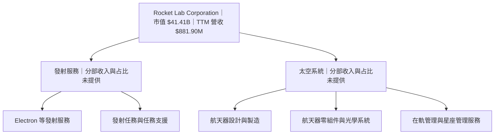
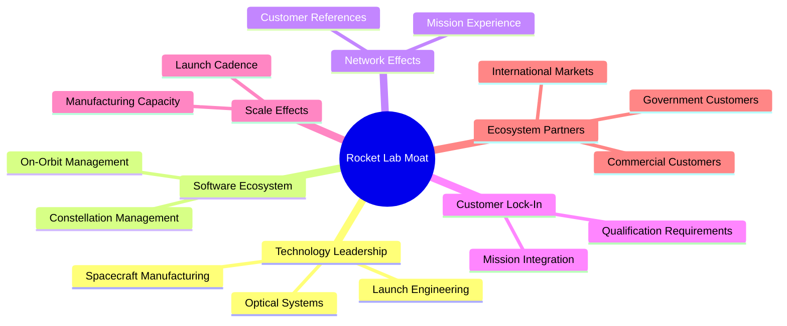
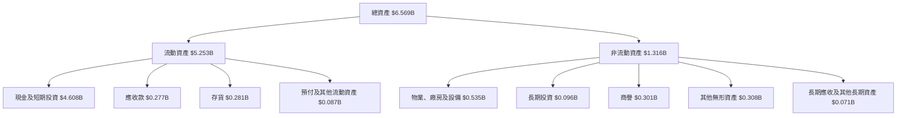
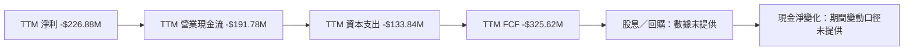
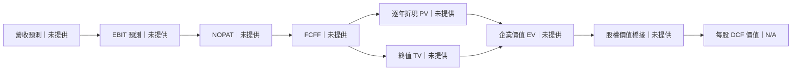
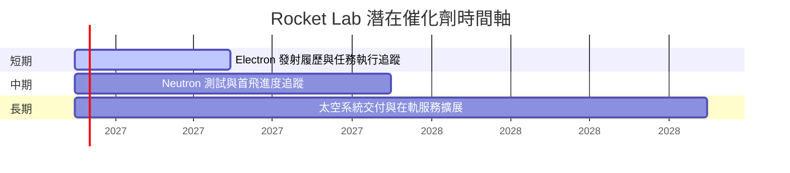
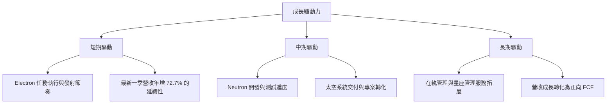
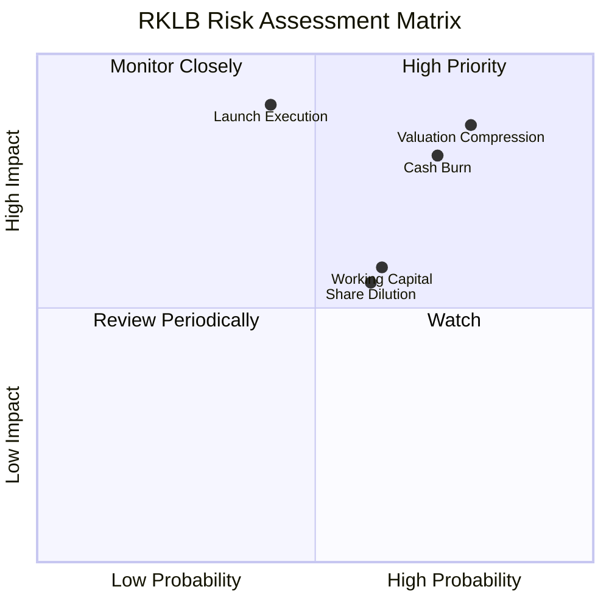
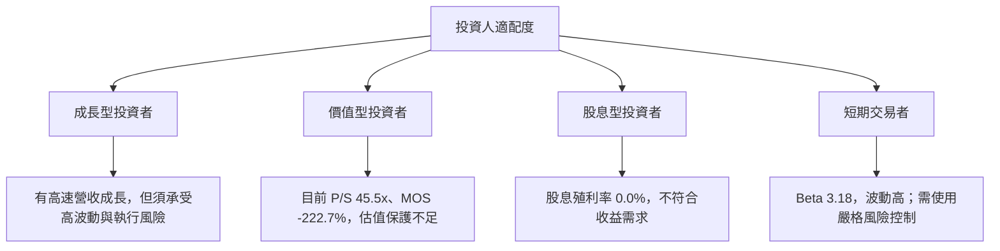

# RKLB 基本面深度分析報告
> **報告日期**：2026-11-15 ｜ **語言**：繁體中文 ｜ **數據來源**：SEC 申報資料 (XBRL)、Yahoo Finance、Finviz、StockAnalysis、Roic.ai ｜ **分析師**：CFA 級機構研究

## 目錄

| # | 章節 | 核心結論 |
|---|------|----------|
| 1 | 執行摘要 | 賣出；加權合理價值 $19.07，MOS -222.7% |
| 2 | 公司概覽與商業模式 | 發射服務與太空系統兩條業務線；市場份額數據未提供 |
| 3 | 損益表深度分析 | TTM 營收 $881.90M、年增 59.0%；仍處大幅營業虧損 |
| 4 | 資產負債表分析 | 現金與短期投資 $4.61B；流動性充足，但營運資金週期拉長 |
| 5 | 現金流量深度分析 | TTM FCF -$325.62M，現金消耗仍高 |
| 6 | 獲利能力與資本效率 | ROIC -16.1% 低於 WACC 14.00%，目前摧毀股東價值 |
| 7 | 相對估值分析 | P/S 45.5x，高於歷史中位數 19.4x；估值要求持續高速成長 |
| 8 | DCF 內在價值評估 | DCF 不適用；以規定的同業 P/S 與分析師共識加權估值 |
| 9 | 成長催化劑 | Electron 發射里程碑與 Neutron 進展可提供催化，但時間與執行風險高 |
| 10 | 風險矩陣 | 主要風險為估值、執行／發射可靠性與持續現金消耗 |
| 11 | 投資建議 | 目前不宜追價；監控營收、利潤率、FCF 與新產品執行 |

## 1. 執行摘要

RKLB 的 TTM 營收為 **$881.90M**、TTM 年增 **59.0%**，最新一季營收年增 **72.7%**，顯示需求與交付規模仍在擴大；但 TTM 營業利益率為 **-27.6%**、ROIC 為 **-16.1%**，低於 **14.00% WACC**，TTM FCF 為 **-$325.62M**，代表成長尚未轉化為正向股東回報。以 **2026-11-13 收盤價 $61.53** 計，規定估值方法得出的加權合理價值為 **$19.07**，MOS 為 **-222.7%**；依規則 20，評級為 **🔴 賣出**。這一結論由估值折價幅度、負 ROIC 與負 FCF 支持，而非僅依賴短期股價走勢。

### 1.0 一頁式投資儀表板（Portfolio Manager 30 秒速讀）

| 項目 | 內容 |
|------|------|
| **投資論點（3 句）** | ① TTM 營收 $881.90M、年增 59.0%，發射服務與太空系統業務提供成長基礎。② 最新一季營收年增 72.7%，但 TTM 營業利益率 -27.6%，成長尚未帶來獲利。③ TTM FCF -$325.62M、ROIC -16.1%，而加權合理價值 $19.07 低於現價 $61.53。 |
| **綜合評分** | **5.0/10**（引用 1.1 評分卡；六項算術平均） |
| **財務健康** | 🟡 現金與短期投資 $4.61B，但 TTM FCF 為 -$325.62M，仍依賴資金緩衝支撐投資 |
| **ROIC vs WACC** | **-16.1% vs 14.00%**；資本回報低於資本成本，現階段摧毀價值 |
| **FCF 趨勢** | 仍為負；TTM FCF Yield **-0.79%** |
| **估值** | Forward P/E **859.6x** ｜ EV/EBITDA **-200.086x** ｜ FCF Yield **-0.79%** |
| **DCF 內在價值（基準）** | **N/A**；因 TTM 營業利益為負，無法採用給定 DCF 模型。DCF 折溢價 N/A |
| **安全邊際（MOS）** | **-222.7%**＝（加權合理價值 **$19.07** − 現價 $61.53）÷ 加權合理價值；🔴 無安全邊際 |
| **預期報酬（基準情境 12M）** | **N/A**；DCF 情境模型未提供，分析師共識不是本報告的基準情境預測 |
| **關鍵風險（前二）** | 高估值在成長放緩時的下修風險；新產品與發射計畫執行不及預期 |
| **評級 + 信心度** | 🔴 **賣出** ｜ 信心：中（估值與現金流證據明確，但新產品未來營運仍有不確定性） |

### 1.1 綜合評分卡（全報告唯一）

| 維度 | 評分（1–10） | 主要依據（引用數字與其來源章節） |
|------|--------------|----------------------------------|
| 成長性 | 8.0 | TTM 營收年增 59.0%、最新一季年增 72.7%（第 3 章），但高速成長的持續性仍有執行風險 |
| 獲利能力 | 2.0 | TTM 營業利益率 -27.6%、ROIC -16.1%、Piotroski F-Score 5/9（第 3、6 章） |
| 財務健康 | 7.0 | 現金與短期投資 $4.61B、F-Score 5/9；但 TTM FCF -$325.62M、CCC 176 天（第 4、5、6 章） |
| 估值 | 1.0 | MOS -222.7%、P/S 45.5x，高於 5 年中位數 19.4x（第 7、8 章） |
| 護城河 | 6.0 | 具發射服務與太空系統一體化能力，且新聞資料指出 Electron 累計達 100 次發射；但缺少市占與客戶集中度資料（第 2 章） |
| 管理層與資本配置 | 6.0 | 現金與短期投資升至 $4.61B，具投資能力；但 FY2025 SBC $71.10M、股數未通過 F-Score 測試，稀釋需持續監控（第 3、4、5 章） |
| **綜合評分** | **5.0** | 六項算術平均：（8.0 + 2.0 + 7.0 + 1.0 + 6.0 + 6.0）÷ 6 = **5.0** |

### 1.2 五大投資論點 + 三大核心風險

| 類型 | 項目 | 具體依據 | 信心度 |
|------|------|----------|--------|
| 🟢 **投資論點①** | 高速營收擴張 | TTM 營收 $881.90M、年增 59.0%；最新一季營收 $267.83M、年增 72.7%。若增長由持續訂單與交付帶動，固定成本攤提可望改善。 | 🟢 高 |
| 🟢 **投資論點②** | 雙業務平台 | 公司同時經營發射服務與太空系統，可涵蓋發射、航天器設計、製造與零組件；但分部收入占比未提供，無法確認成長貢獻分布。 | 🟡 中 |
| 🟢 **投資論點③** | 資金緩衝充足 | 現金與短期投資 $4.61B，相對 TTM FCF 消耗 $325.62M，提供營運與資本投資緩衝；惟消耗速度若加快，緩衝會縮短。 | 🟢 高 |
| 🟢 **投資論點④** | 發射履歷累積 | 最近新聞報導 Electron 達 100 次發射里程碑；累積任務經驗可支持可靠性口碑與客戶信任，但仍不能替代未來成功率與單位經濟性數據。 | 🟡 中 |
| 🟢 **投資論點⑤** | 產業長期需求具選擇權 | 太空系統、發射服務與軌道管理業務可能受商業與政府需求擴張帶動；但 TAM 數值未提供，無法量化可服務市場及滲透率。 | 🟡 中 |
| 🟡 **風險①** | 估值與成長預期錯配 | P/S 45.5x、EV/Revenue 39.007x；估值對營收成長持續性與未來利潤率改善要求高。若增長降速，倍數收縮可能放大股價回撤。 | 🔴 高 |
| 🔴 **風險②** | 長期虧損與現金消耗 | TTM 營業利益率 -27.6%、FCF -$325.62M、ROIC -16.1%；若新產品與規模效益未能改善單位經濟性，資金投入可能延長虧損期。 | 🔴 高 |
| 🔴 **風險③** | 新產品與發射執行 | 發射或新型火箭進度延誤、測試失敗或客戶驗收延後，可能同時影響收入認列、成本與市場信心。新產品財務貢獻尚未在數據中拆分。 | 🟡 中 |

### 1.3 快速統計卡片

| 指標 | 公司實際值（期間） | 同業中位數 | 狀態 |
|------|--------------------|------------|------|
| 營收成長（TTM） | **59.0%** | — | 🟢 |
| 營收成長（最新一季年增） | **72.7%** | **161.4%** | 🟡 |
| 毛利率（TTM） | **36.2%** | **55.5%** | 🟡 |
| 營業利益率（TTM） | **-27.6%** | — | 🔴 |
| ROIC（TTM） | **-16.1%** | — | 🔴 |
| Forward P/E | **859.59766x** | **-73.6x**（LUNR）、**-11,048.0x**（PL）、**50.7x**（SPCX） | 🔴 |
| FCF Yield（TTM） | **-0.79%** | — | 🔴 |
| Piotroski F-Score | **5 / 9** | — | 🟡 |

### 1.4 投資結論

```text
╔══════════════════════════════════════════════════════════════════╗
║                    📊 投資結論摘要                               ║
╠══════════════════════════════════════════════════════════════════╣
║  評級：🔴 賣出（依規則 20；MOS -222.7%）                         ║
║  價格（2026-11-13 收盤）：$61.53                                 ║
║  DCF 內在價值（基準）：N/A（TTM 營業利益為負）                   ║
║  安全邊際 MOS：-222.7%（基準為加權合理價值 $19.07）             ║
║  加權合理價值（8.8）：$19.07                                     ║
║  綜合評分：5.0/10（引用 1.1）                                    ║
║  適合投資人：能承受高波動、願意追蹤執行進度的成長型投資人；       ║
║              不適合以估值保護、穩定獲利或股息為主的投資人         ║
╚══════════════════════════════════════════════════════════════════╝
```

## 2. 公司概覽與商業模式

Rocket Lab Corporation（RKLB）是美國太空公司，員工數 **2,600 人**，主要經營發射服務與太空系統，業務涵蓋美國、加拿大、日本及國際市場。2026-11-13 市值為 **$41.41B**，TTM 營收為 **$881.90M**。公司最新財報為截至 2026-09-30 的 FY2026 Q3，SEC 10-Q 於 2026-11-09 申報。

### 2.1 業務結構與收入來源

分部收入、分部成長率及收入占比未提供，因此不能以可靠數字拆分兩條業務線；下圖呈現已知的業務範圍，不代表收入比重。



發射業務的經濟性受發射頻率、載荷利用率、單次任務成本與可靠性影響；太空系統則涉及硬體交付、工程與任務服務。若太空系統帶來較穩定的訂單與較高附加價值，可能緩和單一發射業務的波動，但目前沒有分部毛利率與營收占比可驗證這一點。

### 2.2 市場份額

市場份額數據未提供，新聞資料亦未提供可引用的市場份額及年份，因此不製作市場份額圖表。RKLB TTM 營收 $881.90M、TTM 成長 59.0%，低於所列競爭標的最新一季年增率中位數 161.4%；但此比較不等同於市場份額，且不同公司業務結構與基期可能差異很大。

### 2.3 競爭護城河分析



### 2.4 護城河強度

| 護城河項目 | 強度（強／中／弱） | 證據（引用數字或事實） | 會削弱它的情況 |
|------------|--------------------|------------------------|----------------|
| 技術與任務經驗 | 中 | 最近新聞報導 Electron 累計達 100 次發射；累積任務有助形成工程經驗與可靠性紀錄 | 發射失敗、可靠性不穩、競爭者在成本或能力上快速追近 |
| 軟體與在軌服務 | 弱至中 | 公司提供在軌管理與星座管理服務，但收入、續約率與客戶數未提供 | 軟體收入規模有限、服務難以形成高轉換成本 |
| 網路效應 | 弱至中 | 任務履歷可能提升客戶信心，但客戶數與跨任務轉介資料未提供 | 客戶決策以價格與任務能力為主，履歷優勢不能形成持續訂單 |
| 客戶鎖定 | 中 | 發射與航天器專案涉及整合、驗證與任務時程，轉換供應商可能有成本 | 大型客戶自行垂直整合、採用替代服務商或專案取消 |
| 規模效應 | 中 | TTM 營收 $881.90M，最新一季營收 $267.83M；若產能利用率提高，固定成本有機會攤薄 | 營收擴張伴隨研發、產能及支援成本更快成長 |
| 生態夥伴 | 弱至中 | 公司服務多國市場，業務涉及商業與政府客戶；合約集中度與合作夥伴收入未提供 | 政府預算變動、供應鏈瓶頸或合作關係改變 |

**1.1 護城河評分為 6.0/10**：公司具備發射與太空系統整合能力，並有可觀察的發射任務履歷；但缺乏市場份額、分部收入、續約率和客戶集中度等數據，尚不足以證明護城河可轉化為長期超額回報。

## 3. 損益表深度分析

### 3.1 年度收入成長趨勢（近 4 年）

年度營收來自年度損益表；圖中的收入金額為原始數據，柱長為視覺化比例。

```text
╔══════════════════════════════════════════════════════════════════╗
║              Rocket Lab 年度收入趨勢（FY2022-FY2025）            ║
╠══════════════════════════════════════════════════════════════════╣
║  FY2022  $211.00M  ████████░░░░░░░░░░░░░░░░  基期              ║
║  FY2023  $244.59M  ██████████░░░░░░░░░░░░░░  YoY: +15.9% 🟡    ║
║  FY2024  $436.21M  █████████████████░░░░░░░  YoY: +78.3% 🟢    ║
║  FY2025  $601.80M  ████████████████████████  YoY: +38.0% 🟢    ║
╠══════════════════════════════════════════════════════════════════╣
║  FY2022 至 FY2025 CAGR：[(601.80 ÷ 211.00)^(1/3) − 1] = 41.8%   ║
╚══════════════════════════════════════════════════════════════════╝
```

FY2024 成長 78.3%，FY2025 放緩至 38.0%；雖然增速降溫，年度營收仍由 FY2022 的 $211.00M 增至 FY2025 的 $601.80M。TTM 營收 $881.90M、年增 59.0%，高於 FY2025 增速，反映最新四季收入動能回升；未來需觀察增長是否伴隨毛利改善，而非只靠增加交付與投入。

### 3.2 季度收入趨勢分析

| 季度 | 營收 | QoQ 成長 | YoY 成長 | 備註 |
|------|------:|---------:|---------:|------|
| 2025 Q4 | $179.65M | — | N/A | 比較基期的前一季資料未提供 |
| 2026 Q1 | $200.35M | +11.5% | +63.5% | 年增率取 StockAnalysis 季度資料 |
| 2026 Q2 | $234.07M | +16.8% | +62.0% | 年增率取 StockAnalysis 季度資料 |
| 2026 Q3 | $267.83M | +14.4% | +72.7% | 最新季度年增率；不是 TTM 成長率 |

QoQ 成長率以本季營收除以上季營收再減 1 計算。2026 年三個已報季度的營收逐季增加；Q3 的 YoY 加速至 72.7%，但若沒有分部拆分與交付數量資料，尚不能判斷增長來自發射服務、太空系統或一次性專案。

### 3.3 利潤率演變分析

下表年度比率由年度損益表營收、毛利與營業利益計算；TTM 比率使用 SEC 申報與核實的 TTM 指標。

| 利潤率指標 | FY2022 | FY2023 | FY2024 | FY2025 | TTM／最新季度 | 趨勢與評估 |
|------------|--------|--------|--------|--------|--------------|------------|
| **毛利率** | 9.0% | 21.0% | 26.6% | 34.4% | TTM 36.2% | ↗️ 持續改善；產品組合、交付規模或成本吸收可能改善，仍低於所列同業中位數 55.5% |
| **營業利益率** | -64.1% | -72.7% | -43.5% | -38.0% | TTM -27.6%；最新季度 -29.6% | 長期虧損收斂，但最新季度仍錄得營業虧損，規模增長尚未覆蓋研發與營運支出 |
| **淨利率** | -64.4% | -74.6% | -43.6% | -32.9% | TTM -25.7% | 較 FY2023 改善，但仍為負；須確認改善是否來自營運，而非一次性或非營運項目 |

**利潤率演變深度解析：** FY2022 至 FY2025 毛利率由約 9.0% 升至 34.4%，同期毛利由 $18.99M 增至 $207.18M，營收增長帶來較好的毛利吸收；但 FY2025 研發費用達 $270.72M，高於當年毛利 $207.18M，說明研發投入仍是營業虧損的重要來源。TTM 營業利益率 -27.6% 較 FY2025 年度 -38.0% 收斂，但最新一季營業利益率 -29.6% 仍顯示盈利轉折尚未完成。產品組合、定價與單位成本細節未提供，不能把改善歸因於某一單獨因素。

### 3.4 費用結構分析

費用細項（例如銷售、一般及行政費用、研發與分部成本）的同一期間明細不完整，且資本配置各項實際支出分配未提供，因此不製作費用圓餅圖。可核對的 FY2025 研發支出為 **$270.72M**，高於 FY2024 的 **$174.39M**，增加約 **55.2%**；這反映公司持續投入新產品與技術，但研發支出增速高於 FY2025 營收年增 38.0%，若後續未轉為商業交付與毛利，將延長虧損期。

### 3.5 季度 EPS 趨勢與盈餘品質（Quality of Earnings）

EPS 預期值與實際值資料為 nan，沒有可驗證的季度 beats/misses。故以下只列已提供的實際 EPS，不將資料缺漏判定為超預期或不及預期。

| 季度 | EPS 實際 | EPS 預期／驚喜 | 說明 |
|------|---------:|----------------|------|
| 2025 Q4 | -$0.09 | N/A | 預期值未提供 |
| 2026 Q1 | -$0.07 | N/A | 預期值未提供 |
| 2026 Q2 | -$0.08 | N/A | 預期值未提供 |
| 2026 Q3 | -$0.12 | N/A | 預期值未提供；單季虧損較前季擴大 |

| 盈餘品質項目 | 數值／佔比 | 評估 |
|--------------|------------|------|
| 股權薪酬 SBC / 營收 | 最新四季 SBC 合計 $84.20M ÷ TTM 營收 $881.90M = **9.5%** | 🔴 SBC 佔營收接近一成，構成股東稀釋成本；最新四季 SBC 由所列季度 $18.32M、$19.56M、$28.12M、$18.20M 加總 |
| SBC / 營業現金流 | $84.20M ÷ -$191.78M；以絕對值比較為 **43.9%** | 🔴 OCF 為負，比例不能解讀為現金流覆蓋；股權薪酬是重要非現金調整項，但並未扭轉現金消耗 |
| FCF / 淨利（現金轉換率） | TTM FCF -$325.62M ÷ TTM 淨利 -$226.88M = **143.5%** | 🔴 兩者皆為負，正比率不代表現金轉換良好；現金流虧損幅度高於會計淨虧損 |
| 一次性／非經常性損益 | N/A | SEC 摘要資料未提供足以量化一次性損益的明細，不推定其存在或不存在 |
| 有效稅率異常 | N/A | 可用資料未提供可靠的 TTM 有效稅率；不以預設稅率推斷實際稅務利益 |
| 資本化支出 vs 費用化 | TTM Capex $133.84M；資本化與費用化政策細節 N/A | Capex 已構成重大現金需求；現有資料不足以判斷是否有成本由費用轉為資本化 |

**盈餘品質結論：** RKLB 仍為虧損公司，GAAP 淨利並未呈現正向獲利；TTM FCF 比淨利虧損更大，顯示現金消耗不低於帳面虧損。SBC 約為 TTM 營收 9.5%，對真實每股回報有稀釋影響。由於一次性損益及資本化明細不足，不適合假設經調整盈餘高於 GAAP 盈餘；估值應優先追蹤營收品質、毛利與現金流改善，而非以單一季度 EPS 變化判斷。

## 4. 資產負債表分析

### 4.1 資產結構分解

以下為截至 2026-09-30 的 StockAnalysis 資產負債表數據；金額為已列報項目，不代表各類資產的變現價值。



截至 2026-09-30，流動資產約占總資產 80.0%（$5.253B ÷ $6.569B）；其中現金及短期投資 $4.608B 是主要流動資產。非流動資產包含設備、商譽及無形資產，若業務計畫延遲，商譽與無形資產可能需要重新檢視其回收性。

### 4.2 流動性與營運資金分析

可用來源的流動比率為 **8.554**、速動比率為 **7.954**；由於其他期間的比率口徑與完整流動負債數據未能一致核實，以下不自行補造歷史比率。

| 指標 | 最新 TTM | 一年前 TTM | 變化 | 解讀 |
|------|----------|------------|------|------|
| 流動比率 | 8.554 | N/A | N/A | 流動資產對短期負債覆蓋充足；現金及短期投資提供主要緩衝 |
| 速動比率 | 7.954 | N/A | N/A | 排除存貨後仍有較高流動性 |
| DSO 應收帳款天數 | 49 天 | 39 天 | +10 天 | 收款天數增加，可能反映收入組合、合約驗收或回款時點變化；需追蹤應收帳款逾期狀況 |
| DIO 存貨天數 | 182 天 | 140 天 | +42 天 | 存貨週轉變慢，可能與生產備料、交付節奏或專案存貨累積有關；若未轉化為收入，會占用資金 |
| DPO 應付帳款天數 | 55 天 | 59 天 | -4 天 | 付款週期縮短，供應商融資緩衝略降；不能單憑此判斷議價能力變化 |
| CCC 現金轉換週期 | 176 天 | 120 天 | +56 天 | 現金由投入至回收的週期拉長，與 DSO、DIO 同時增加一致，需關注營運資金需求 |

**營運資金解讀：** CCC 從 120 天增至 176 天，是負面變化。若營收快速擴張時存貨與應收同步上升，現金流可能比損益表更早承壓。流動性指標目前有現金緩衝支持，但應追蹤 CCC 是否因收入成長、存貨交付而回落，而不是持續延長。

### 4.3 債務結構分析

不同來源對總債務數字不一致：核實指標列示總債務 **$1.72M**；市場資料與資產負債表摘要另列 **$120.28M**，FY2025 年度表則列 **$253.96M**。本節以核實指標的總債務及淨現金為主，不將不同日期、口徑的數字混合相減；差異需以 SEC 最新完整資產負債表附註再核對。

```text
╔══════════════════════════════════════════════════════════════════╗
║                   Rocket Lab 債務健康診斷                        ║
╠══════════════════════════════════════════════════════════════════╣
║  總債務（核實指標）：        $1.72M     ▏                       ║
║  現金及短期投資：             $4.61B     ████████████████████    ║
║  淨現金（核實指標）：         $4.61B     ████████████████████ 🟢 ║
║  現金緩衝：                   充足；但 TTM FCF 為 -$325.62M    ║
║  Debt/EBITDA：                N/A；EBITDA 為負，不宜解讀倍數    ║
║  Interest Coverage：          N/A；利息覆蓋資料不足             ║
║  債務口徑提示：               市場資料另列總債務 $120.28M        ║
╚══════════════════════════════════════════════════════════════════╝
```

**結論：** 流動性目前是資產負債表的優勢，但現金不應被視為永久性價值保障。負 FCF 表示現金餘額可能隨投資與營運消耗下降；債務口徑差異亦代表分析師需以最新 SEC 附註核對租賃負債、借款及現金等價物的分類。

### 4.4 股東權益趨勢

```text
╔══════════════════════════════════════════════════════════════════╗
║                Rocket Lab 歷年股東權益                            ║
╠══════════════════════════════════════════════════════════════════╣
║  FY2022  $673.21M  ████████░░░░░░░░░░░░░░                        ║
║  FY2023  $554.54M  ██████░░░░░░░░░░░░░░░░                        ║
║  FY2024  $382.45M  ████░░░░░░░░░░░░░░░░░                         ║
║  FY2025  $1.72B    ████████████████████                          ║
╚══════════════════════════════════════════════════════════════════╝
```

FY2022 至 FY2024 股東權益逐年降低，FY2025 則升至 $1.72B。股東權益大幅增加可能涉及融資或其他權益變動；單靠彙總資產負債表無法將變動完整拆解。需結合 SEC 股東權益變動表及股數變化判斷融資對既有股東的稀釋程度。

## 5. 現金流量深度分析

### 5.1 現金流量瀑布圖



### 5.2 FCF 轉換率趨勢

年度 FCF 與淨利皆為負，因此以 FCF ÷ 淨利得到的正值不能解讀為傳統意義的高現金轉換率。

| 年度 | FCF | 淨利 | FCF / 淨利 | 解讀 |
|------|----:|----:|-----------:|------|
| FY2022 | -$148.95M | -$135.94M | 109.6% | 現金流虧損略高於淨虧損 |
| FY2023 | -$153.57M | -$182.57M | 84.1% | 現金流虧損低於淨虧損，但仍為負 |
| FY2024 | -$115.98M | -$190.18M | 61.0% | 現金流虧損低於淨虧損，不能視為正向現金轉換 |
| FY2025 | -$321.81M | -$198.21M | 162.3% | 現金消耗明顯高於會計淨虧損 |
| TTM | -$325.62M | -$226.88M | 143.5% | 持續現金消耗；正比率是負數除以負數的結果 |

### 5.3 自由現金流趨勢

```text
╔══════════════════════════════════════════════════════════════════╗
║                Rocket Lab 自由現金流趨勢                         ║
╠══════════════════════════════════════════════════════════════════╣
║  FY2022  -$148.95M  ◀████████░░░░░░░░░░░░  FCF 為負             ║
║  FY2023  -$153.57M  ◀████████░░░░░░░░░░░░  FCF 為負             ║
║  FY2024  -$115.98M  ◀██████░░░░░░░░░░░░░░  FCF 為負             ║
║  FY2025  -$321.81M  ◀████████████████░░░░  FCF 為負             ║
║  TTM     -$325.62M  ◀████████████████░░░░  Yield: -0.79%        ║
╠══════════════════════════════════════════════════════════════════╣
║  TTM FCF = 營業現金流 -$191.78M − 資本支出 $133.84M             ║
║          = -$325.62M                                             ║
╚══════════════════════════════════════════════════════════════════╝
```

TTM 營業現金流 **-$191.78M**、資本支出 **$133.84M**，依規定的 FCF 定義得到 **-$325.62M**。FY2025 FCF 為 -$321.81M，顯示最近一年仍處高現金消耗區間。營業現金流在 2026 Q3 單季為正 $7.15M，但同季資本支出 $31.07M，單季 FCF 仍為 -$23.92M；單季轉正 OCF 尚不足以證明 FCF 已轉正。

### 5.4 資本配置評估

回購、股息、投資及留存現金的同期間分配資料未提供，故不製作比例圓餅圖。

| 項目 | 可核對數據 | 評估 |
|------|------------|------|
| 資本支出 | TTM $133.84M；FY2025 $156.28M | 支持生產與營運能力，但需檢視投資回報與產能利用率 |
| 研發投入 | FY2025 $270.72M | 研發支出增加可支持新產品，但需以後續商業收入與毛利驗證回報 |
| 股權薪酬 | FY2025 $71.10M；TTM 按季度加總 $84.20M | SBC 有助留才，但會增加稀釋，應與每股營收及每股現金流一併追蹤 |
| 股息／回購 | 股息殖利率 0.0%；回購金額 N/A | 目前沒有股息回報；回購資料不足，不能推定有回購 |

## 6. 獲利能力與資本效率

### 6.1 ROE / ROA / ROIC 趨勢

長期年度 ROIC、ROE、ROA 的一致口徑歷史序列未提供，因此不補造歷年比率。可核實的最新期間指標如下：

| 指標 | 最新數值 | 其他來源數值 | 評估 |
|------|---------:|---------------:|------|
| ROIC（TTM） | **-16.1%** | — | 低於 WACC 14.00%，資本回報為負，未創造經濟價值 |
| ROE（TTM，Quality Figures） | **-3.9%** | Yahoo 摘要列示 -6.4% | 來源口徑有差異；採用品質指標區塊的杜邦值，兩者均為負 |
| ROA（TTM） | N/A（此處無品質指標精確值） | Yahoo 摘要列示 -3.5% | 資產回報為負；F-Score 的 ROA 測試亦未通過 |

Yahoo 摘要中的 ROE -6.4% 與品質指標的 -3.9% 口徑不一致，本報告在杜邦分析採用後者，避免混合不同資料源的分母口徑。

### 6.2 ROIC vs WACC 分析（核心價值創造判斷）

```text
╔══════════════════════════════════════════════════════════════════╗
║                ROIC vs WACC 深度分析                            ║
╠══════════════════════════════════════════════════════════════════╣
║  資本成本輸入（依 Cost of capital 資料）：                       ║
║  ├── 無風險利率（10Y 美債）：             5.15%                  ║
║  ├── 市場風險溢酬 ERP：                   5.00%                  ║
║  ├── 原始 Beta：                          3.18                   ║
║  ├── 採用調整後 Beta：                    2.00                   ║
║  ├── 股權成本 Ke：                       15.15%                  ║
║  ├── 債務權重：                           0.0%                   ║
║  └── 採用 WACC：                         14.00%                  ║
║                                                                  ║
║  最新 ROIC（TTM）：                       -16.1%                 ║
║  EVA = ROIC − WACC = -16.1% − 14.0% = -30.1 個百分點             ║
║                                                                  ║
║  ROIC  -16.1%  ◀████████░░░░░░░░░░░░░░░  🔴                    ║
║  WACC   14.0%  ▓▓▓▓▓▓▓░░░░░░░░░░░░░░░░░  ──                    ║
║  結論：ROIC 低於 WACC，當前資本配置尚未覆蓋資本成本             ║
╚══════════════════════════════════════════════════════════════════╝
```

**結論：** ROIC -16.1% 相對 WACC 14.00%，差距為 **-30.1 個百分點**，代表公司目前投入資本尚未產生足以覆蓋資本成本的營業回報。資本成本數據採用指定的 WACC；其內部計算值 15.20% 被限制在 7%–14% 區間，因此本報告使用區間上限 **14.00%**。原始 Beta 3.18 經調整並受限後採用 Beta 2.00；CAPM 股權成本依資料列示為 15.15%。資料列示的稅前債務成本 1,543.65% 異常高，且債務權重為 0.0%，不應將其當作代表性融資成本。

### 6.3 杜邦三因素分解

| 因素 | 數值（TTM） | 解讀 |
|------|-------------|------|
| 淨利率 | -25.7% | 淨虧損是 ROE 為負的主要來源 |
| 資產週轉率 | 0.13 | 資產規模相對營收較大，週轉率偏低 |
| 權益乘數 | 1.13 | 槓桿倍數不高，負 ROE 不是主要由高槓桿造成 |
| **ROE** | **-3.9%** | **-25.7% × 0.13 × 1.13 = -3.9%**；與品質指標區塊列示結果一致 |

### 6.4 財務體質：Piotroski F-Score

**Piotroski F-Score：5 / 9。** 九項測試的結果照列如下：

| 測試 | 結果 | 解讀 |
|------|------|------|
| ROA > 0 | ❌ 未通過 | 仍未產生正資產回報 |
| 營業現金流 > 0 | ❌ 未通過 | TTM 營業現金流為 -$191.78M |
| ROA 高於一年前 | ✅ 通過 | 資產回報方向較前期改善，但仍未轉正 |
| 營業現金流 > 淨利（應計品質） | ✅ 通過 | 依測試口徑，現金流相對淨利的品質測試通過；不代表現金流已為正 |
| 長期負債 ÷ 總資產低於一年前 | ✅ 通過 | 槓桿相對資產的趨勢符合測試條件 |
| 流動比率高於一年前 | ✅ 通過 | 流動性相較去年改善 |
| 稀釋股數未增加 | ❌ 未通過 | 股數增加可能稀釋既有股東的每股經濟利益 |
| 毛利率高於一年前 | ✅ 通過 | 毛利率改善支持經營效率提升 |
| 資產週轉率高於一年前 | ❌ 未通過 | 資產擴張尚未同步轉成更高的資產週轉效率 |

分數 5/9 表示部分經營指標改善，但盈利、營業現金流與稀釋仍是扣分項。對成長型資本密集企業而言，應特別監控營收成長能否轉化為更高資產週轉與毛利，以及股數增幅是否逐步下降。

## 7. 相對估值分析

### 7.1 同業估值比較表格

同業倍數採 Yahoo Finance 的 Peer multiples。RKLB 的 Forward P/E 等公司本身倍數採估值資料列示值；同業倍數依核實同業資料引用。

| 估值指標 | **RKLB** | **SPCX** | **LUNR** | **PL** | 本公司評估 |
|----------|---------:|---------:|---------:|------:|-----------|
| **Trailing P/E** | N/A | 604.8x | N/A | N/A | 🔴 RKLB TTM 虧損，P/E 無法使用 |
| **Forward P/E** | 859.59766x | 50.7x | -73.6x | -11,048.0x | 🔴 RKLB 正向倍數極高；其他虧損公司負倍數不具直接可比性 |
| **P/S Ratio** | 45.5x | 59.0x | 3.3x | 13.3x | 🔴 高於 LUNR、PL；低於 SPCX，整體仍屬高營收倍數 |
| **EV/EBITDA** | -200.086x | 156.7x | -45.6x | -96.2x | 🟡 多家公司 EBITDA 為負，倍數失去一般估值解讀力 |
| **最新一季營收 YoY** | 72.7% | 161.4% | 413.7% | 58.1% | 🟡 高於 PL，低於 SPCX 與 LUNR；業務與基期不同 |
| **毛利率（TTM）** | 36.2% | 56.8% | 20.3% | 55.5% | 🟡 RKLB 高於 LUNR，低於 SPCX 與 PL |

同業 P/S 中位數為 **8.3x**（LUNR 3.3x 與 PL 13.3x 的中位數）；SPCX 因不同業務與估值口徑未納入本次固定同業 P/S 估值方法。RKLB 目前 P/S 45.5x，約為該同業中位數的 5.5 倍；這要求 RKLB 維持高成長並逐步提升毛利與獲利能力。

### 7.2 歷史估值區間分析

```text
╔══════════════════════════════════════════════════════════════════╗
║               RKLB 歷史 P/S 估值位置（5 年）                     ║
╠══════════════════════════════════════════════════════════════════╣
║  區間低點 7.1x ├──────── 中位數 19.4x ──────────┤ 高點 83.2x   ║
║  當前 45.5x：位於歷史第 71 百分位                               ║
║  相對中位數溢價 = 45.5 ÷ 19.4 − 1 = 134.5%                     ║
╚══════════════════════════════════════════════════════════════════╝
```

目前 P/S 位於自身五年區間較高位置。歷史高點達 83.2x，說明股價波動與市場預期變化大；高百分位不必然代表立即回落，但在 TTM 營業利益率 -27.6%、FCF 為負的背景下，估值容錯空間有限。

### 7.3 情境價值（Bear / Base / Bull）

**N/A（DCF 無法計算：TTM 營業利益為負，給定 DCF MODEL 不提供情境價值；不得另建模型）。** 因此不提供悲觀、基準與樂觀情境目標價或機率。

### 7.4 相對估值隱含價格區間

```text
╔══════════════════════════════════════════════════════════════════╗
║             相對估值方法隱含價值與現價位置                       ║
╠══════════════════════════════════════════════════════════════════╣
║  $10.84 ────────────────────── $19.07 ─────────────── $61.53    ║
║  同業 P/S                   加權合理價值             現價        ║
║                                                                  ║
║  同業 P/S：$10.84／股；依 LUNR 與 PL 的中位數 8.3x × TTM 營收   ║
║  分析師共識：$93.10／股；20 位分析師平均目標價                  ║
║  加權合理價值：$19.07／股；按固定權重加權                         ║
╚══════════════════════════════════════════════════════════════════╝
```

同業 P/S 方法對應 **8.3x × 公司 TTM 營收**，換算價值為 $10.84／股；分析師共識平均目標價為 $93.10／股。兩者分歧很大，反映估值對未來成長與獲利路徑高度敏感；加權時使用指定的 90% 與 10% 權重，不因分析師目標較高而調整。

## 8. DCF 內在價值評估（Discounted Cash Flow）

### 8.0 估值推理鏈（Thinking Logic）

**Step 1 — 價值驅動來源**

RKLB 的長期價值主要取決於發射服務、太空系統及新產品能否形成可持續營收與正向現金流；目前 TTM 營收為 $881.90M，但兩條業務的收入占比未提供，不能量化各自貢獻。估值最受未來營業利潤率與現金流轉正時間影響，但由於公司 TTM 營業利益仍為負，核實 DCF 模型明確標示不適用。

**Step 2 — 模型選擇**

| 決策點 | 本報告採用 | 理由（含數字） | 曾考慮但否決 | 否決理由 |
|--------|-----------|----------------|--------------|----------|
| 現金流定義 | DCF N/A | TTM 營業利益為負，核實模型不提供估值 | 另行建立 FCFF／FCFE 模型 | 嚴格採用已核實的 DCF 輸出，不自建模型或填入未提供假設 |
| 預測期 N | N/A | DCF MODEL 未提供預測期 | 5–10 年預測 | 缺少核實逐年營收、利潤率及現金流假設 |
| 終值方法 | N/A | 模型未提供終值輸出 | Gordon Growth／退出倍數 | 不可自行補造終值 |
| EBIT 基礎 | N/A | 模型未提供預測 EBIT | GAAP／非 GAAP 預測 | 不能自行決定模型口徑與 SBC 處理 |

**Step 3 — 關鍵假設推導鏈**

核實 DCF MODEL 為 N/A，沒有可引用的營收 CAGR、期末營業利潤率、永續成長率、預測期、Capex、D&A、營運資金或稀釋股數假設。因此不能逐項提供假設錨點、採用值與替代值，也不能用自建假設填補缺失。

**Step 4 — 最脆弱一環**

公司需要在未來把快速營收成長轉為正向營業利潤與 FCF；若毛利改善無法覆蓋研發、產能及營運成本，使用長期現金流估值會失去可靠基礎。這是 DCF 無法計算的核心原因，也與第 8.9 節的估值限制一致。

**Step 5 — 計算路徑**

因 DCF 模型不可計算，以下僅說明一般關係，不輸入假設值或估值結果：



### 8.1 模型假設總表（Model Inputs）

**N/A（數據未提供：核實 DCF MODEL 因 TTM 營業利益為負而不適用；預測期、營收 CAGR、利潤率、終值、逐年現金流與稀釋股數均無可引用模型輸出）。** 不另建 DCF。

### 8.2 折現率推導（WACC）

公司層面的 WACC 按核實資本成本資料採用 **14.00%**，但這不代表本報告可以自行用該折現率建立 DCF。原始 Beta、調整方式、資本權重與區間限制如下：

```text
╔══════════════════════════════════════════════════════════════════╗
║                    WACC 資料與採用值                             ║
╠══════════════════════════════════════════════════════════════════╣
║  無風險利率（10Y 美債）：             5.15%                      ║
║  市場風險溢酬 ERP：                   5.00%                      ║
║  原始 Beta（Yahoo）：                 3.18                       ║
║  調整後 Beta（採用）：                2.00                       ║
║  股權成本 Ke（資料列示）：            15.15%                     ║
║  股權／債務權重：                     100.0%／0.0%               ║
║  WACC 計算值：                        15.20%                     ║
║  區間限制後採用 WACC：                14.00%                     ║
║  說明：計算值高於 14% 上限，依規定採用上限 14.00%               ║
╚══════════════════════════════════════════════════════════════════╝
```

調整後 Beta 的資料說明為原始 Beta 3.18 經調整後受 0.6–2.0 區間限制，最終採用 **2.00**。10Y 無風險利率日期未另提供，故不補寫日期。債務成本資料列示為 1,543.65%，但債務權重為 0.0%，且債務口徑存在來源差異；此成本數字不適合用作實際融資利率推論。由於 DCF MODEL 為 N/A，本節不另以 CAPM 重算或替代指定的 WACC。

### 8.3 逐年自由現金流預測（基準情境）

**N/A（數據未提供：DCF MODEL 因 TTM 營業利益為負而不提供預測期逐年現金流；不得自行建立模型）。** 因此沒有 FY+1 至 FY+N 表格、FCFF 現值合計、代表年度演算或模型預測軌跡。歷史 TTM FCF 為 -$325.62M，不能將其誤作未來預測值。

### 8.4 終值計算（Terminal Value）

**N/A（數據未提供：模型未提供預測期最後年度 FCFF、永續成長率 g、終值倍數或終值折現值）。** 因此無法執行 WACC 與 g 的適用性檢查，也不提供 Gordon Growth 或退出倍數計算。

### 8.5 企業價值 → 每股內在價值（Bridge）

**N/A（數據未提供：無預測期 FCFF 現值、終值現值、模型股權價值與稀釋股數）。** 不計算 DCF 每股價值，也不計算以 DCF 為基準的折溢價。現金、債務與股數在不同來源中存在口徑差異，不以不一致資料自行拼接 DCF 橋接。

### 8.6 敏感性分析（WACC × 永續成長率）

**N/A（數據未提供：沒有 DCF 基準現金流、g 或估值敏感度矩陣）。** 不提供自建敏感性數字。

### 8.7 反推 DCF（Reverse DCF：市場在預期什麼）

**N/A（數據未提供：DCF MODEL 無基準估值與可調假設，不能用單一現價解出多項模型變數）。** 現價為 $61.53，但不能在缺少逐年現金流模型時反推營收 CAGR、利潤率、g 或預測期。

### 8.8 估值三角驗證與安全邊際

DCF 因 TTM 營業利益為負而不適用。依固定估值方法與權重，採同業 P/S 及分析師共識目標價計算加權合理價值：

| 估值方法 | 隱含每股價值 | 上行空間（÷現價） | 權重 | 說明 |
|----------|--------------:|-------------------:|------:|------|
| 同業 P/S | $10.84 | -82.4% | 90% | LUNR、PL 的同業 P/S 中位數 8.3x × RKLB TTM 營收 |
| 分析師共識目標價 | $93.10 | +51.3% | 10% | 20 位分析師平均目標價；參考值而非 DCF |
| **加權合理價值** | **$19.07** | **-69.0%** | **100%** | 公司類型為未獲利公司，按固定權重加權 |

**逐步演算（權重外顯）：**

- 加權合理價值 = $10.84 × 90% + $93.10 × 10%
- = $9.756 + $9.310
- = $19.066
- = **$19.07**（四捨五入至美分）

此權重對應未獲利公司的固定估值方法；同業 Forward P/E 不可計算，因此其權重依規定由其餘方法分配。權重與估值方法均照列，不另作調整。

```text
╔══════════════════════════════════════════════════════════════════╗
║                  估值區間與安全邊際                              ║
╠══════════════════════════════════════════════════════════════════╣
║  $10.84 ───────── $19.07 ─────────────────────── $61.53         ║
║  同業 P/S          加權合理價值                     現價          ║
║                                                                  ║
║  安全邊際 MOS =（$19.07 − $61.53）÷ $19.07 = -222.7%           ║
║  上行空間 =（$19.07 − $61.53）÷ $61.53 = -69.0%                 ║
║  折溢價基準：DCF N/A；無法計算現價相對 DCF 基準的折溢價         ║
║                                                                  ║
║  價格達到 MOS 10% 的參考上限：$19.07 ×（1 − 10%）= $17.16       ║
║  此為加權合理價值推導的參考門檻，不是 DCF 目標價                 ║
╚══════════════════════════════════════════════════════════════════╝
```

> 🔎 **程式複算（Python，依本節各項自動重算）**
>
> 加權合理價值 = $10.84 × 90% + $93.10 × 10% = **$19.07**（權重合計 100%）
>
> 以價格 $61.53 計：MOS = **-222.7%**，上行空間 = **-69.0%**
>
> ✅ 與本節所寫數值一致。

### 8.9 DCF 模型的局限與失效條件

- **終值依賴度：** N/A；沒有終值或企業價值可供計算占比。
- **最脆弱的假設：** 本報告未建立 DCF 假設，因此不提供模型內的假設衝擊價格。對實際業務而言，營業利潤率轉正時間與 FCF 轉正時間是核心未知數。
- **不適用情境說明：** 公司 TTM 營業利益率 -27.6%、TTM FCF -$325.62M，屬尚未獲利且高再投資階段。DCF 對未來利潤率與終值高度敏感，因此本次不適用；較合適的補充方式是追蹤 EV/Sales、分部收入與毛利、交付／發射頻率及單位經濟性。
- **與第 10 章風險矩陣的連結：** 發射失敗、產品延誤或需求下降會打擊營收增長；成本超支與利用率不足會壓低毛利及營業利潤率；存貨和應收繼續上升則會提高現金需求並拖延 FCF 轉正。

### 8.10 複算檢核表（Audit Trail）

| # | 檢核項目 | 檢查方式 | 結果 |
|---|----------|----------|------|
| 1 | 所有 DCF 敏感度輸入均有四段式推導 | DCF MODEL 為 N/A，無模型輸入可核對 | N/A |
| 2 | 每個 DCF 假設都有來歷 | 未另建 DCF；缺漏項目未填假設值 | ✅ |
| 3 | WACC 計算與採用值一致 | 引用計算值 15.20% 及區間限制後 14.00% | ✅ |
| 4 | Kd 分母與債務權重範圍一致 | DCF 未重算 WACC；原始債務口徑差異已揭露 | N/A |
| 5 | WACC 與第 6.2 節同值 | 均引用採用值 14.00% | ✅ |
| 6 | 逐年預測年度數等於 N | 預測期未提供 | N/A |
| 7 | FY+1 FCFF 與 PV 可複算 | 無模型逐年現金流 | N/A |
| 8 | 預測期 PV 逐項加總 | 無預測期 PV | N/A |
| 9 | WACC > g | 永續成長率未提供 | N/A |
| 10 | 終值以 FY+N 現金流為基礎 | 預測期與終值均未提供 | N/A |
| 11 | EV 至每股價值橋接可複算 | DCF 橋接未提供 | N/A |
| 12 | SBC 組合經濟一致 | 未建立 DCF，未自行處理 SBC／稀釋 | N/A |
| 13 | 敏感性矩陣基準格等於 DCF 基準價值 | 無敏感性矩陣 | N/A |
| 14 | 矩陣有效格符合 WACC > g | 無敏感性矩陣 | N/A |
| 15 | 三情境權重相加為 100% | DCF 情境未提供 | N/A |
| 16 | 反推 DCF 每列只放開一個變數 | 不進行反推 | N/A |
| 17 | MOS 與 1.0 一致；折溢價基準為 DCF | MOS 均引用加權合理價值 $19.07；DCF 折溢價 N/A | ✅ |
| 18 | 報告完整至第 11 章 | 章節 1–11 均完整呈現 | ✅ |
| 19 | 加權合理價值等於方法價值乘權重之和 | $10.84 × 90% + $93.10 × 10% = $19.066，列示 $19.07 | ✅ |
| 20 | 評級符合 MOS 門檻 | MOS -222.7%，評級為賣出 | ✅ |

**複算限制說明：** DCF MODEL 的 N/A 並非計算錯誤，而是因 TTM 營業利益為負而不適用；相關預測、終值、敏感度及反推項目均未自建，以避免形成不可核實的估值。

## 9. 成長催化劑

### 9.1 催化劑時間軸

財務資料未提供明確的管理層時程或合約日期；下列以新聞所提 Electron 100 次發射里程碑及 Neutron 進展作定性時間分類，不代表公司正式財測。



短期催化重點是 Electron 發射活動是否持續、能否將發射履歷轉為後續訂單。中期市場關注 Neutron 開發及首飛進度，最近新聞將其與 2027 年的業務前景連結；這屬媒體預期，不是已核實管理層財測。長期則需觀察太空系統與在軌管理服務是否形成可持續、毛利較高的收入。

### 9.2 TAM 市場規模分析

**N/A（TAM 數據未提供）。** 公司 TTM 營收為 $881.90M、TTM 年增 59.0%，顯示目前業務規模仍在擴大，但缺少可引用的市場規模、年份與公司滲透率資料，不能量化可服務市場或市場份額。

### 9.3 成長驅動力結構圖



## 10. 風險矩陣

### 10.1 風險評分矩陣

以下座標是研究判斷的相對機率與衝擊位置，不是公司財務數據或精確機率；為符合圖表可讀性，採 0–1 相對尺度。



### 10.2 風險清單詳細分析

| # | 風險項目 | 發生機率 | 財務衝擊 | 風險評分 | 緩解措施 |
|---|----------|----------|----------|----------|----------|
| 1 | 🔴 **估值倍數收縮** | 高；主觀評估約 70% | 高；P/S 45.5x，若倍數向歷史中位數 19.4x 靠近，股價可能承受大幅下修；此為倍數敏感性，不是目標價預測 | 🔴 9/10 | 分批持倉、避免以單一高成長假設估值；追蹤營收成長與毛利能否支撐倍數 |
| 2 | 🔴 **持續現金消耗** | 高；主觀評估約 70% | 高；TTM FCF -$325.62M、營業現金流 -$191.78M | 🔴 8/10 | 追蹤季度 OCF、Capex、現金餘額與融資需求；要求 FCF 消耗逐步收斂 |
| 3 | 🔴 **發射與新產品執行風險** | 中；主觀評估約 45% | 高；延期或失敗可能影響合約、交付、成本與聲譽，財務量化資料未提供 | 🔴 8/10 | 追蹤測試節點、任務成功率、交付里程碑及管理層更新 |
| 4 | 🟡 **營運資金惡化** | 中高；主觀評估約 60% | 中；CCC 由 120 天增至 176 天，DSO +10 天、DIO +42 天 | 🟡 6/10 | 監控應收回款、存貨週轉與專案交付；要求 CCC 停止擴大 |
| 5 | 🟡 **股權稀釋** | 中；主觀評估約 55% | 中；TTM SBC 約為營收 9.5%，F-Score 的「稀釋股數未增加」測試未通過 | 🟡 6/10 | 追蹤加權平均股數、SBC／營收與每股營收成長 |

上述風險機率與評分是定性研究判斷，不是統計模型輸出；可量化的財務暴露則以 TTM FCF、估值倍數、CCC 與 SBC 比率為依據。

## 11. 投資建議

### 11.1 最終評級與評分

依加權合理價值 $19.07、收盤價 $61.53 計算的 MOS 為 **-222.7%**，規則 20 對應 **🔴 賣出**；本報告未依質化因素調整評級。1.1 的綜合評分為 **5.0/10**，六項分數依序為成長性 8.0、獲利能力 2.0、財務健康 7.0、估值 1.0、護城河 6.0、管理層與資本配置 6.0。

### 11.2 合理價值與隱含報酬率

| 估值項目 | 每股價值 | 相對 2026-11-13 收盤價 $61.53 | 機率／權重 | 說明 |
|----------|---------:|----------------------------:|------------|------|
| 同業 P/S | $10.84 | -82.4% | 90% | 同業 P/S 中位數 8.3x × TTM 營收 |
| 分析師共識目標價 | $93.10 | +51.3% | 10% | 20 位分析師平均目標價 |
| **加權合理價值** | **$19.07** | **-69.0% 上行空間** | **100%** | 固定權重加權結果 |
| DCF 悲觀／基準／樂觀情境 | N/A | N/A | N/A | DCF MODEL 不適用，未提供情境目標價 |

### 11.3 買入時機與觸發因素

```text
╔══════════════════════════════════════════════════════════════════╗
║                  ✅ 買入觸發因素 Checklist                      ║
╠══════════════════════════════════════════════════════════════════╣
║  目前操作：現價 $61.53 高於加權合理價值 $19.07，避免追價        ║
║                                                                  ║
║  重新評估買入條件（宜多數符合）：                                ║
║  ☐ TTM 營收年增率維持在 40% 以上，且增長有交付數據支持           ║
║  ☐ TTM 毛利率在 36.2% 基礎上持續改善                             ║
║  ☐ TTM 營業利益率由 -27.6% 顯著收斂，連續季度改善                ║
║  ☐ TTM FCF 消耗由 -$325.62M 明顯收斂，並出現可持續轉正路徑       ║
║                                                                  ║
║  估值觸發參考：                                                  ║
║  ☐ 價格接近 $17.16 或以下，約對應加權合理價值的 10% MOS 門檻     ║
║    （$19.07 × 90% = $17.163；仍須確認基本面未惡化）             ║
║                                                                  ║
║  減碼／重新檢視條件（出現任一）：                                ║
║  ☐ 最新一季營收年增率連續兩季低於 40%                            ║
║  ☐ 毛利率較 TTM 36.2% 明顯下滑，且營業利益率繼續擴大虧損        ║
║  ☐ TTM FCF 消耗高於 -$325.62M，或現金餘額快速下降                ║
║  ☐ 發射、新產品或客戶交付出現重大延誤或失敗                      ║
╚══════════════════════════════════════════════════════════════════╝
```

$17.16 是以加權合理價值推導出的 10% MOS 參考價，不是 DCF 目標價，也不表示價格到達後即可忽略基本面風險。由於評級為賣出，本報告不將現價附近列為建議買入區間。

### 11.4 投資人適配度分析



成長型投資人可把 RKLB 作為高風險研究標的，但應將發射與新產品進度納入投資紀律；價值型投資人目前缺乏估值安全邊際；股息型投資人則不符合其收益需求。短線交易需特別考慮 Beta 3.18 所反映的高波動性。

### 11.5 每季財報監控清單（Quarterly Watch List）

| 指標 | 最新基準 | 觸發加碼／改善條件 | 觸發減碼／警戒條件 |
|------|---------|-------------------|-------------------|
| 營收成長 | TTM +59.0%；最新季度 YoY +72.7% | 最新季度 YoY 持續高於 40%，並有訂單／交付支持 | 連續兩季低於 40% |
| 毛利率 | TTM 36.2% | 連續季度提高，且增長未以過度折價換取 | 連續兩季下滑，或低於目前基準且無改善說明 |
| 營業利益率 | TTM -27.6%；最新季度 -29.6% | 虧損率連續季度收斂 | 虧損率擴大，或收入增長未改善營業槓桿 |
| 營業現金流 | TTM -$191.78M | TTM 消耗明顯收斂，季度轉正具有持續性 | TTM 消耗擴大 |
| Capex／FCF | TTM Capex $133.84M；FCF -$325.62M | 投資後 FCF 消耗下降，產能利用率提高 | Capex 增長但收入、毛利與 FCF 未改善 |
| 存貨與 CCC | DIO 182 天；CCC 176 天 | DIO、CCC 逐季回落 | CCC 高於 176 天且應收／存貨同步增加 |
| SBC／稀釋 | TTM SBC 約為營收 9.5%；F-Score 股數測試未通過 | SBC／營收下降，股數增幅收斂 | SBC／營收上升或股數持續快速增加 |
| 發射與新產品 | 新聞報導 Electron 累計 100 次發射；Neutron 財務貢獻未提供 | 里程碑依時完成，任務可靠性與商業交付可驗證 | 重大延誤、測試失敗或客戶任務取消 |
| 管理層財測 | 本資料未提供可引用財測 | 實際營收、毛利與現金流達成正式財測 | 財測下修，或連續未達公司自身指引 |

### 11.6 反面論證：什麼會證明論點錯誤（What Would Change My Mind）

```text
╔══════════════════════════════════════════════════════════════════╗
║              ⚠️ 論點失效條件（Disconfirming Evidence）           ║
╠══════════════════════════════════════════════════════════════════╣
║  本報告的審慎／偏空論點在下列情況出現時應重新檢視：             ║
║                                                                  ║
║  ☐ 營收連續兩季年增高於 60%，且毛利率同步持續上升               ║
║  ☐ TTM 營業利益率由 -27.6% 持續收斂，並有明確轉正路徑           ║
║  ☐ TTM FCF 由 -$325.62M 顯著收斂，且非僅單季營業現金流波動      ║
║  ☐ CCC 由 176 天開始連續下降，應收與存貨增幅低於營收增幅         ║
║  ☐ SBC／營收低於目前約 9.5%，且稀釋股數停止增加                 ║
║  ☐ 新產品與發射里程碑依期完成，且能以正式財報證明收入與毛利貢獻   ║
║                                                                  ║
║  以下情況會強化賣出／減碼論點：                                  ║
║  ☐ 最新季度營收年增連續兩季低於 40%                              ║
║  ☐ TTM 營業利益率低於 -27.6% 且毛利率低於 36.2%                 ║
║  ☐ TTM FCF 低於 -$325.62M，或現金與短期投資明顯下降             ║
║  ☐ ROIC 持續低於 WACC 14.00%，且無可驗證的改善趨勢              ║
║  ☐ 發射或新產品重大延誤，導致訂單、交付或現金消耗惡化            ║
╚══════════════════════════════════════════════════════════════════╝
```

> **免責聲明**：本報告為 AI 自動生成，僅供研究參考，不構成投資建議。投資有風險，入市需謹慎。

---

## 資料與來源

| 項目 | 內容 |
|------|------|
| 價格 | 61.53 USD，2026-11-13 收盤（Yahoo Finance 日線） |
| 財務報表 | SEC 10-Q filed 2026-11-09，最新季度 2026-09-30（FY2026 Q3） |
| 有回應的資料來源 | SEC 申報資料 (XBRL)、Yahoo Finance、Finviz、StockAnalysis、Roic.ai |
| 由程式計算 | TTM 數字、WACC、DCF 模型、估值方法與權重、加權合理價值、MOS、評級門檻、F-Score、杜邦分解、營運資金天數、綜合評分 |
| 撰寫模型 | openai / gpt-6-luna |

> 本區塊由產生報告的程式依實際取得的資料填寫，非模型撰寫。「由程式計算」的數字不是模型的估計；其餘判斷（評分、情境、策略）是模型的分析。
