# RKLB 基本面深度分析報告
> **報告日期**：2026-11-17 ｜ **語言**：繁體中文 ｜ **數據來源**：SEC 申報資料 (XBRL)、Yahoo Finance、Finviz、StockAnalysis、Roic.ai ｜ **分析師**：CFA 級機構研究

## 目錄

| # | 章節 | 核心結論 |
|---|------|----------|
| 1 | 執行摘要 | 賣出；加權合理價值 $18.26，MOS -214.2% |
| 2 | 公司概覽與商業模式 | 發射服務與太空系統雙業務；市場份額數據未提供，護城河來自技術與交付能力 |
| 3 | 損益表深度分析 | TTM 營收 $881.90M、成長 59.0%；營業利益率 -27.6% |
| 4 | 資產負債表分析 | 現金及短期投資 $4.61B；流動性充足，但庫存與現金轉換週期上升 |
| 5 | 現金流量深度分析 | TTM FCF -$325.62M，資本投入仍高於內部現金創造 |
| 6 | 獲利能力與資本效率 | ROIC -16.1% 對 WACC 14.00%，目前仍在摧毀股東價值 |
| 7 | 相對估值分析 | 同業 P/S 法估值 $9.94；現價遠高於加權合理價值 |
| 8 | DCF 內在價值評估 | DCF 不適用：TTM 營業利益為負；以相對估值與分析師共識三角驗證 |
| 9 | 成長催化劑 | 成長潛力取決於發射業務與太空系統交付，但近期里程碑及 TAM 數字未提供 |
| 10 | 風險矩陣 | 估值、持續虧損與執行／競爭風險居前 |
| 11 | 投資建議 | 依 MOS 評級為賣出；以盈利改善、現金消耗與估值收斂作為監控重點 |

---

## 1. 執行摘要

### 1.0 一頁式投資儀表板（Portfolio Manager 30 秒速讀）

| 項目 | 內容 |
|------|------|
| **投資論點（3 句）** | ① TTM 營收 $881.90M、年增 59.0%，最新一季年增 72.7%，顯示需求與交付規模擴大。② TTM 營業利益率 -27.6%、ROIC -16.1%，目前成長尚未轉化為經濟利潤。③ TTM FCF -$325.62M、FCF Yield -0.84%，且 P/S 自身五年中位數為 19.4x、目前 42.4x，估值對未來執行要求很高。 |
| **綜合評分** | **5.3/10**（引用 1.1；六項算術平均） |
| **財務健康** | 🟢 現金及短期投資 $4.61B、流動比率 8.554；但營運現金流仍為負，流動性好不等於商業模式已自我融資。 |
| **ROIC vs WACC** | **-16.1% vs 14.00%**；差距 -30.1 個百分點，現階段摧毀股東價值。 |
| **FCF 趨勢** | TTM FCF -$325.62M，仍為負；FCF Yield **-0.84%**。 |
| **估值** | Forward P/E **801.48083x** ｜ EV/EBITDA **-184.794x** ｜ FCF Yield **-0.84%**。負 EBITDA 下 EV/EBITDA 缺乏正向解讀。 |
| **DCF 內在價值（基準）** | **N/A**；TTM 營業利益為負，DCF MODEL 未提供可用估值。DCF 折溢價亦不適用。 |
| **安全邊際（MOS）** | **-214.2%＝($18.26 − $57.37) ÷ $18.26**；基準為 8.8 加權合理價值 $18.26。🔴 無安全邊際。 |
| **預期報酬（基準情境 12M）** | DCF 情境 N/A；以 8.8 加權合理價值衡量的隱含上行空間為 **-68.2%**，不是分析師目標價預測。 |
| **關鍵風險（前二）** | ① 現價相對加權合理價值溢價高；② 營業虧損與負 FCF 持續，現金消耗可能延長。 |
| **評級 + 信心度** | 🔴 **賣出** ｜ 信心：中。評級依 MOS 門檻直接判定；公司長期成長潛力與執行結果仍有不確定性。 |

> **評級形成過程：**2026-11-16 收盤價 $57.37；同業 P/S 法每股價值 $9.94（權重 90%），分析師共識目標價 $93.15（權重 10%），加權合理價值 $18.26。MOS = -214.2%，低於 -25% 賣出門檻；同時 ROIC -16.1% 低於 WACC 14.00%，TTM FCF -$325.62M。以上證據共同支持「賣出」，未作質化調整。

### 1.1 綜合評分卡（全報告唯一）

| 維度 | 評分（1–10） | 主要依據（引用數字與其來源章節） |
|------|--------------|----------------------------------|
| 成長性 | 8.0 | TTM 營收年增 59.0%，最新一季營收年增 72.7%（第 3 章）；成長速度高，但季度成長不等同持續盈利。 |
| 獲利能力 | 2.5 | TTM 營業利益率 -27.6%、ROIC -16.1%，低於 WACC 14.00%；Piotroski F-Score 5/9（第 3、6 章）。 |
| 財務健康 | 8.0 | 現金及短期投資 $4.61B、流動比率 8.554；但 CCC 由 120 天增至 176 天、TTM OCF -$191.78M（第 4、5 章）。 |
| 估值 | 1.0 | 加權合理價值 $18.26、MOS -214.2%；P/S 42.4x，高於五年中位數 19.4x（第 7、8 章）。 |
| 護城河 | 7.0 | 發射與太空系統具技術、製造及整合門檻；但市場份額、客戶留存率與分部收入數據未提供（第 2 章）。 |
| 管理層與資本配置 | 5.0 | 2025 年 SBC $71.10M，約佔營收 11.8%；無回購與具體資本配置目標資料，股數未通過 F-Score 測試（第 3、5、6 章）。 |
| **綜合評分** | **5.3** | **(8.0 + 2.5 + 8.0 + 1.0 + 7.0 + 5.0) ÷ 6 = 5.25，四捨五入至 5.3。** |

### 1.2 五大投資論點 + 三大核心風險

| 類型 | 項目 | 具體依據 | 信心度 |
|------|------|----------|--------|
| 🟢 **投資論點①** | 營收維持快速擴張 | TTM 營收 $881.90M、年增 59.0%；FY2025 營收 $601.80M，較 FY2024 成長 37.96%。收入擴張提供未來吸收固定成本的基礎。 | 🟢 高 |
| 🟢 **投資論點②** | 最新季度成長加快 | FY2026 Q3 營收 $267.83M，年增 72.7%、季增 14.4%；若交付能轉化為毛利與現金流，營運槓桿有改善空間。 | 🟡 中 |
| 🟢 **投資論點③** | 現金緩衝可支持投資 | 現金及短期投資 $4.61B，遠高於 Verified Figures 列示的總債務 $1.72M；公司目前有較充足的資金緩衝。 | 🟢 高 |
| 🟢 **投資論點④** | 毛利率近年上升 | 年度毛利率由 FY2022 約 9.0% 升至 FY2025 約 34.4%；TTM 毛利率為 36.2%，顯示收入組合或製造效率有所改善。 | 🟡 中 |
| 🟢 **投資論點⑤** | 具發射與太空系統的整合能力 | 公司涵蓋發射服務、太空載具製造、零組件及在軌管理；業務橫跨硬體與服務，有機會增加單一客戶的解決方案深度。 | 🟡 中 |
| 🟡 **風險①** | 高估值可能放大回檔 | P/S 42.4x，高於五年中位數 19.4x；同業 P/S 法估值 $9.94，顯著低於 $57.37 現價。 | 🔴 高衝擊 |
| 🔴 **風險②** | 虧損與負 FCF 尚未收斂 | TTM 營業利益率 -27.6%、FCF -$325.62M；若收入增加仍未帶來利潤率改善，估值支撐可能下降。 | 🔴 高衝擊 |
| 🟡 **風險③** | 庫存與收款週期延長 | DIO 182 天（前一年 140 天）、DSO 49 天（前一年 39 天），CCC 增至 176 天，意味更多資金被營運資金占用。 | 🟡 中度 |

### 1.3 快速統計卡片

| 指標 | 公司實際值（期間） | 同業中位數 | 狀態 |
|------|--------------------|------------|------|
| 營收成長（TTM） | **59.0%** | — | 🟢 |
| 營收成長（最新一季年增） | **72.7%** | **161.4%**（SPCX、LUNR、PL 三者中位數） | 🟡 |
| 毛利率（TTM） | **36.2%** | **55.5%**（同業毛利率中位數） | 🔴 |
| 營業利益率（TTM） | **-27.6%** | — | 🔴 |
| ROIC（TTM） | **-16.1%** | — | 🔴 |
| Forward P/E | **801.48083x** | 不宜計算中位數：同業 Forward P/E 含負值且倍數差異極大 | 🔴 |
| FCF Yield（TTM） | **-0.84%** | — | 🔴 |
| Piotroski F-Score | **5 / 9** | — | 🟡 |

> 同業最新一季營收年增中位數為排序後的中位數：PL 58.1%、SPCX 161.4%、LUNR 413.7%，因此中位數為 **161.4%**。毛利率中位數為 20.3%、55.5%、56.8% 的中位數 **55.5%**。

### 1.4 投資結論

```text
╔══════════════════════════════════════════════════════════════════╗
║                    📊 投資結論摘要                               ║
╠══════════════════════════════════════════════════════════════════╣
║  評級：賣出（MOS -214.2%，低於 -25% 門檻；未作質化調整）         ║
║  價格（2026-11-16 收盤）：$57.37                                ║
║  DCF 內在價值（基準）：N/A（TTM 營業利益為負）                   ║
║  安全邊際 MOS：-214.2%（＝($18.26−$57.37)÷$18.26）              ║
║  加權合理價值（8.8）：$18.26                                     ║
║  DCF 情境價值：N/A（DCF MODEL 未提供可用估值）                   ║
║  綜合評分：5.3/10（引用 1.1）                                    ║
║  適合投資人：可承受高波動、願意追蹤商業化進展的成長型投資人；    ║
║              不適合以當期現金流、低估值或股息為主要目標者。      ║
╚══════════════════════════════════════════════════════════════════╝
```

---

## 2. 公司概覽與商業模式

### 2.1 業務結構與收入來源

公司資料指出 Rocket Lab 在美國、加拿大、日本及其他國際市場營運，涵蓋發射服務與太空系統；但最新期間的分部營收金額與佔比未提供，不能把 TTM 營收任意拆分。

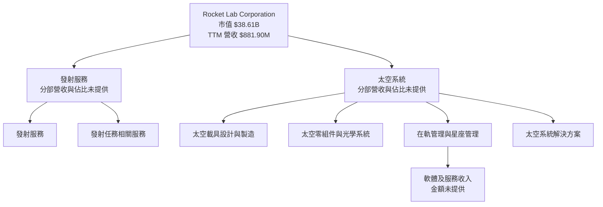

**收入結構判讀：**公司採「發射服務＋太空系統」模式，太空系統包含製造、零組件及在軌管理等業務。FY2025 全年營收 $601.80M、TTM 營收 $881.90M，但因未提供分部數據，無法判斷近期增長由哪一板塊主導，也無法精確計算高毛利服務收入占比。

### 2.2 市場份額

市場份額數據未提供，因此不提供份額估計或市場份額圖表。以可比較數字觀察，RKLB TTM 營收 $881.90M、TTM 年增 59.0%；同業資料顯示最新一季營收年增率由 PL 的 58.1% 至 LUNR 的 413.7%，RKLB 的 72.7% 高於 PL、低於 SPCX 與 LUNR。這些數字反映增長速度，不等於市場份額。

### 2.3 競爭護城河分析

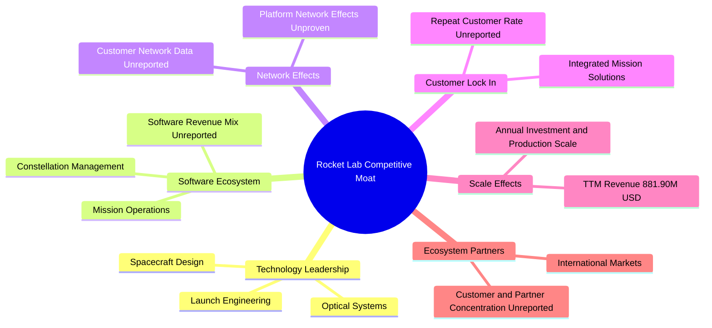

### 2.4 護城河強度

| 護城河項目 | 強度（強／中／弱） | 證據（引用數字或事實） | 會削弱它的情況 |
|------------|--------------------|------------------------|----------------|
| 技術與工程能力 | 中至強 | 公司同時提供發射服務、太空載具設計製造、光學系統及太空零組件；TTM 營收 $881.90M。 | 發射可靠度、任務成功率或產品性能落後；競爭者以更低成本提供替代服務。 |
| 軟體與在軌服務 | 中 | 公司提供在軌管理及星座管理，但相關收入占比及續約數據未提供。 | 服務收入未能規模化，或客戶改採自建管理系統。 |
| 網路效應 | 弱至中 | 未提供客戶數、平台使用者或資料網路規模，尚不足以證明強網路效應。 | 客戶價值不隨其他客戶或任務數增加，產品仍以專案交付為主。 |
| 客戶鎖定 | 中 | 發射、製造、零組件及在軌服務整合，可能增加轉換成本；客戶留存率未提供。 | 客戶採購以單次競標為主、沒有重複訂單或長期服務合約。 |
| 規模效應 | 中 | FY2025 營收 $601.80M，TTM 營收增至 $881.90M；但 TTM 營業利益率仍為 -27.6%。 | 產能擴張快於需求，固定成本與資本支出持續增加而無法攤薄。 |
| 生態夥伴 | 中 | 公司在美國、加拿大、日本及國際市場營運；合作夥伴與客戶集中度資料未提供。 | 關鍵供應商、客戶或發射場資源不足，造成交付延誤。 |

1.1「護城河」評分 **7.0/10**，理由是公司具多項工程與系統能力、業務鏈條完整，但市場份額、客戶留存、服務收入占比與競爭成本資料不足，尚不能把技術門檻等同已證實的持續定價權。

---

## 3. 損益表深度分析

### 3.1 年度收入成長趨勢（近4年）

年度營收及成長率來源為 SEC 申報資料與 StockAnalysis。FY2022 至 FY2025 收入 CAGR 約 41.8%，算式為 `(601.80 ÷ 211.00)^(1/3) − 1`；FY2023 增速較低，FY2024 加速，FY2025 成長放緩但仍達 37.96%。

```text
╔══════════════════════════════════════════════════════════════════╗
║              Rocket Lab 年度收入趨勢（FY2022-FY2025）            ║
╠══════════════════════════════════════════════════════════════════╣
║  FY2022  $211.00M  ███████░░░░░░░░░░░░░░░░  基期                ║
║  FY2023  $244.59M  █████████░░░░░░░░░░░░░░  YoY: +15.92% 🟡     ║
║  FY2024  $436.21M  ███████████████░░░░░░░░  YoY: +78.34% 🟢     ║
║  FY2025  $601.80M  █████████████████████░░  YoY: +37.96% 🟢     ║
╠══════════════════════════════════════════════════════════════════╣
║  2022-2025 營收 CAGR：約 +41.8%                                  ║
║  註：收入與年度成長率來自財報／StockAnalysis；圖形只作相對呈現。 ║
╚══════════════════════════════════════════════════════════════════╝
```

FY2025 營收較 FY2024 增加 $165.59M，代表業務仍在擴張；然而年度營業虧損也由 FY2024 的 -$189.80M 擴大至 FY2025 的 -$228.84M，收入規模擴大尚未抵銷研發與營運費用。

### 3.2 季度收入趨勢分析

| 季度 | 營收 | QoQ 成長 | YoY 成長 | 備註 |
|------|------:|---------:|---------:|------|
| FY2025 Q4 | $179.65M | +16.5% | +35.7% | QoQ 以 FY2025 Q3 $155.08M 計算；YoY 依季度歷史資料。 |
| FY2026 Q1 | $200.35M | +11.5% | +63.5% | 同比 FY2025 Q1 $122.57M；年增加速。 |
| FY2026 Q2 | $234.07M | +16.8% | +62.0% | 同比 FY2025 Q2 $144.50M。 |
| FY2026 Q3 | $267.83M | +14.4% | +72.7% | 同比 FY2025 Q3 $155.08M；72.7% 是單季年增，非 TTM。 |

最近四季營收逐季提高，FY2026 Q3 亦維持雙位數季增。營收動能有利於固定成本攤薄，但若新增營收需要較高研發、製造與產能支出，收入成長不會自動轉化為自由現金流。

### 3.3 利潤率演變分析

年度毛利率與營業利益率依年度營收、毛利及營業利益計算；TTM 與最新季度數字引用 SEC 申報資料統計。

| 利潤率指標 | FY2022 | FY2023 | FY2024 | FY2025 | 趨勢 | 評估 |
|------------|-------:|-------:|-------:|-------:|------|------|
| **毛利率** | 9.0% | 21.0% | 26.6% | 34.4% | 持續改善 | 🟢 |
| **營業利益率** | -64.1% | -72.7% | -43.5% | -38.0% | FY2023 惡化後改善，但仍大幅為負 | 🔴 |
| **淨利率** | -64.4% | -74.6% | -43.6% | -32.9% | FY2023 惡化後回升 | 🔴 |
| **TTM 毛利率** | — | — | — | **36.2%** | 近期高於 FY2025 全年 | 🟢 |
| **TTM 營業利益率** | — | — | — | **-27.6%** | 虧損率較 FY2025 年度改善 | 🔴 |
| **最新季度營業利益率** | — | — | — | **-29.6%** | 單季仍虧損；與 TTM 期間口徑不同 | 🔴 |

**利潤率演變深度解析：**

- FY2022 至 FY2025 毛利率提升約 25.4 個百分點，顯示收入規模與產品／服務組合改善，或生產效率提升；但缺少分部毛利、定價與單位成本資訊，無法將改善精確拆解到特定業務。
- FY2025 營業利益率約 -38.0%，較 FY2024 的 -43.5% 改善約 5.5 個百分點。TTM 營業利益率 -27.6% 進一步收窄，但最新季度為 -29.6%，代表季度盈利改善並非單向。
- 研發費用由 FY2024 $174.39M 增至 FY2025 $270.72M，約增 55.2%；這可能支持後續產品與產能發展，但也限制短期營業槓桿。
- 後續利潤率關鍵不是只看毛利率，而是觀察毛利提升是否快於研發、銷售管理費用與資本需求增長。

### 3.4 費用結構分析

**FY2025 費用構成推算**：成本與營業費用合計約 $830.64M，由營收 $601.80M 減營業利益 -$228.84M 得出。財報提供銷貨成本可由營收減毛利計算；研發費用有列示；其餘營業費用以「毛利－研發－營業利益」計算，僅為彙總餘額，不代表單一費用科目。

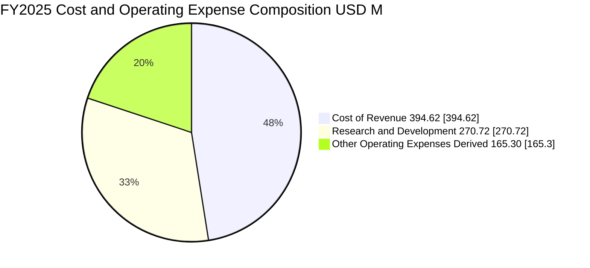

```text
╔══════════════════════════════════════════════════════════════════╗
║              FY2025 費用結構（單位：USD M）                     ║
╠══════════════════════════════════════════════════════════════════╣
║  銷貨成本                    $394.62M   約佔費用總額 47.5%       ║
║  研發費用                    $270.72M   約佔費用總額 32.6%       ║
║  其他營業費用（推算餘額）    $165.30M   約佔費用總額 19.9%       ║
║  費用合計                    $830.64M                            ║
║  註：其他營業費用是彙總差額，不是 SEC 單一列報科目。             ║
╚══════════════════════════════════════════════════════════════════╝
```

研發占費用總額約三分之一，反映公司仍處投資與擴張階段。此結構有助於技術與產品布局，但必須以後續營收轉化、毛利改善和費用增速放緩驗證其投資回報。

### 3.5 季度 EPS 趨勢與盈餘品質（Quality of Earnings）

#### 最近四季 EPS 與預期落差

| 季度 | EPS 實際值 | 預期值 | 超預期／不及預期 | 說明 |
|------|-----------:|-------:|------------------|------|
| FY2025 Q4 | -$0.09 | N/A | N/A | 季度 EPS 歷史資料可得，但預期值未提供。 |
| FY2026 Q1 | -$0.07 | N/A | N/A | EPS 虧損較 FY2025 Q4 收窄；無一致預期值。 |
| FY2026 Q2 | -$0.08 | N/A | N/A | 虧損略增；無一致預期值。 |
| FY2026 Q3 | -$0.12 | N/A | N/A | 虧損擴大；Earnings History 的 EPS estimate 與 actual 為 NaN。 |

目前提供的 EPS Beat/Miss 歷史資料中，估計值與實際值均為缺失，無法可靠判定最近四季是否超預期或不及預期；不能以營收或事後資料替代 EPS 一致預期。

#### 盈餘品質量化

| 盈餘品質項目 | 數值／佔比 | 評估 |
|--------------|------------|------|
| 股權薪酬 SBC / 營收 | TTM SBC 約 $84.20M ÷ TTM 營收 $881.90M = **9.5%** | 🔴 SBC 已占收入近一成，屬實質股東成本；若股數持續增加，現有股東將被稀釋。 |
| SBC / 營業現金流 | $84.20M ÷ -$191.78M = **-43.9%**（帶符號）；以 OCF 絕對值作比較為 **43.9%** | 🔴 OCF 為負，此比值不應被解讀為正向現金覆蓋；SBC 並未使公司產生正現金。 |
| FCF / 淨利（現金轉換率） | -$325.62M ÷ -$226.88M = **143.5%** | 🔴 分子與分母均為負，不能用一般獲利公司的「現金轉換率越高越好」解讀；現金流出高於帳面淨虧損。 |
| 一次性／非經常性損益 | N/A（未提供可分辨項目） | 🟡 無法確認本期盈餘是否受一次性項目影響。 |
| 有效稅率異常 | N/A（未提供可計算的稅前損益與所得稅明細） | 🟡 不能判斷稅務利益是否影響淨損。 |
| 資本化支出 vs 費用化 | TTM Capex $133.84M；資本化明細 N/A | 🟡 資本支出為重要現金流出，資本化政策及研發費用化明細未提供，無法量化是否遞延成本。 |

**盈餘品質結論：**Rocket Lab 目前處於虧損而非穩定獲利狀態，因此盈餘品質的重點是現金消耗與股權稀釋，而非正 EPS 的現金轉換。TTM FCF -$325.62M、SBC 約占 TTM 營收 9.5%，且 Piotroski 測試指出稀釋股數未能通過；以現金流和每股價值角度看，SBC 不應被視為無成本。估值應避免只套用未來 EPS 倍數，而應持續檢驗營收、毛利、現金流與股數的共同變化。

---

## 4. 資產負債表分析

### 4.1 資產結構分解

以下依 StockAnalysis 2026-09-30 資產負債表資料整理。各項以原列數字呈現，因四捨五入，子項加總可能與總額略有差異。

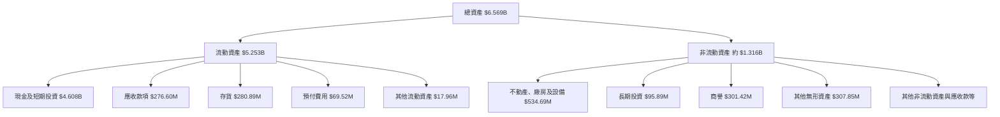

流動資產約占總資產 80.0%，其中現金及短期投資占比高。另一方面，存貨 $280.89M、應收款項 $276.60M，合計約 $557.49M；相對於 TTM 營收，這些營運資產會影響現金轉換效率。

### 4.2 流動性與營運資金分析

| 指標 | 最新 TTM | 一年前 TTM | 變化 | 解讀 |
|------|----------|------------|------|------|
| DSO 應收帳款天數 | 49 天 | 39 天 | +10 天 | 收款週期延長；可能與收入結構、合約條款或收款時點有關，需追蹤應收帳款品質。 |
| DIO 存貨天數 | 182 天 | 140 天 | +42 天 | 存貨占用時間增加，可能反映產能準備、長週期生產或交付節奏變化，也增加庫存過時風險。 |
| DPO 應付帳款天數 | 55 天 | 59 天 | -4 天 | 對供應商付款略快，短期而言較少依賴延長付款週期支持營運資金。 |
| CCC 現金轉換週期 | 176 天 | 120 天 | +56 天 | 現金在營運循環中被占用更久，與 DIO、DSO 同向惡化一致。 |

流動比率由 Yahoo Finance 財務資料顯示為 **8.554**，速動比率 **7.954**，短期償債緩衝充足。但 DIO 上升 42 天與 CCC 上升 56 天是值得注意的營運信號：若存貨增長源自未完成產品或預期交付，可能在未來帶來收入；若交付延遲或需求不及預期，則可能延長現金回收並提高減值風險。

### 4.3 債務結構分析

資料來源間的債務口徑存在差異：VERIFIED FIGURES 列示總債務 **$1.72M**、淨現金 **$4.61B**；市場資料與其他財務表列示總債務 **$120.28M** 或淨現金 **$4.49B**。以下以 VERIFIED FIGURES 指定的 $1.72M 與 $4.61B 為主，另列資料差異而不自行調和。

```text
╔══════════════════════════════════════════════════════════════════╗
║                   Rocket Lab 債務健康診斷                        ║
╠══════════════════════════════════════════════════════════════════╣
║  總債務（VERIFIED）： $1.72M                                     ║
║  現金及短期投資：     $4.61B                                     ║
║  淨現金（VERIFIED）：  $4.61B  🟢                                 ║
║                                                                  ║
║  流動比率：            8.554x  🟢                                 ║
║  速動比率：            7.954x  🟢                                 ║
║  Debt/EBITDA：         N/A；EBITDA 為負，不具常規解讀意義         ║
║  利息保障倍數：        N/A；利息費用及可比口徑未提供              ║
║                                                                  ║
║  口徑提醒：另一資料欄列示總債務 $120.28M、淨現金 $4.49B；        ║
║  未以該資料替換 VERIFIED FIGURES 的指定數值。                    ║
╚══════════════════════════════════════════════════════════════════╝
```

### 4.4 股東權益趨勢

```text
╔══════════════════════════════════════════════════════════════════╗
║            股東權益趨勢（年度期末，USD B）                       ║
╠══════════════════════════════════════════════════════════════════╣
║  2022  $0.673B  ████████████████░░░░░░░░░░░░░░                 ║
║  2023  $0.555B  █████████████░░░░░░░░░░░░░░░░░                 ║
║  2024  $0.382B  █████████░░░░░░░░░░░░░░░░░░░░                 ║
║  2025  $1.720B  ██████████████████████████████                 ║
╠══════════════════════════════════════════════════════════════════╣
║  FY2025 股東權益較 FY2024 增加；同期現金及短期投資亦上升。      ║
║  發行股份與其他權益變動的完整歸因資料未提供，避免過度推斷。     ║
╚══════════════════════════════════════════════════════════════════╝
```

FY2025 股東權益從 $382.45M 升至 $1.72B，數據顯示資本基礎擴大；然而權益增加不等同經營獲利，應與股份數、資本募集、併購與累積虧損等科目一併檢視。當期股數變化與融資明細不足以完整拆解此增幅。

---

## 5. 現金流量深度分析

### 5.1 現金流量瀑布圖

TTM OCF、Capex 及 FCF 均採用指定口徑：FCF = 營業現金流 − 資本支出。股息與回購實際金額未提供；公司股息殖利率為 0.0%。

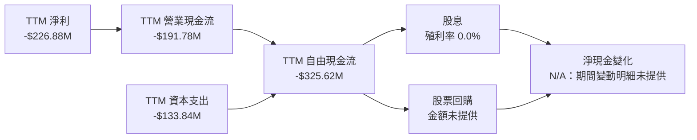

### 5.2 FCF 轉換率趨勢

| 年度 | OCF | Capex | FCF | 淨利 | FCF / 淨利 | 判讀 |
|------|----:|------:|----:|-----:|-----------:|------|
| FY2022 | -$106.54M | $42.41M | -$148.95M | -$135.94M | 109.6% | 雙雙為負，百分比只表示相對虧損幅度。 |
| FY2023 | -$98.87M | $54.71M | -$153.57M | -$182.57M | 84.1% | 現金流出低於帳面虧損，但不代表正向現金轉換。 |
| FY2024 | -$48.89M | $67.09M | -$115.98M | -$190.18M | 61.0% | 現金流出低於淨損，但資本支出增加。 |
| FY2025 | -$165.52M | $156.28M | -$321.81M | -$198.21M | 162.4% | 負現金流較淨損擴大，反映資本投入及營運現金消耗。 |
| TTM 至 2026-09-30 | -$191.78M | $133.84M | -$325.62M | -$226.88M | 143.5% | 數值為負轉負比值，不能視為正向轉換率。 |

年度 FCF 與 TTM FCF 可能因報表口徑、期間與四捨五入略有差異；TTM FCF 以指定的 -$325.62M 為準。FY2025 資本支出 $156.28M，佔收入約 26.0%，顯示擴張所需投資不可忽略。

### 5.3 自由現金流趨勢

```text
╔══════════════════════════════════════════════════════════════════╗
║              Rocket Lab 自由現金流趨勢（USD M）                 ║
╠══════════════════════════════════════════════════════════════════╣
║  FY2022  -$148.95M  ◀██████████████░░░░░░░░░░░░░░░             ║
║  FY2023  -$153.57M  ◀███████████████░░░░░░░░░░░░░░             ║
║  FY2024  -$115.98M  ◀███████████░░░░░░░░░░░░░░░░░             ║
║  FY2025  -$321.81M  ◀██████████████████████████████             ║
║  TTM     -$325.62M  ◀██████████████████████████████             ║
╠══════════════════════════════════════════════════════════════════╣
║  TTM FCF Yield：-0.84%                                           ║
║  注意：負 FCF 的柱長表示現金流出規模，不代表正向成長。           ║
╚══════════════════════════════════════════════════════════════════╝
```

FY2024 FCF 曾改善至 -$115.98M，但 FY2025 與 TTM 均回到約 -$322M 至 -$326M 的流出水準。FY2026 Q3 單季 OCF 為正 $7.15M，但該季 Capex 為 $31.07M，季度 FCF 仍為 -$23.92M；單季 OCF轉正不足以證明現金流已經反轉。

### 5.4 資本配置評估

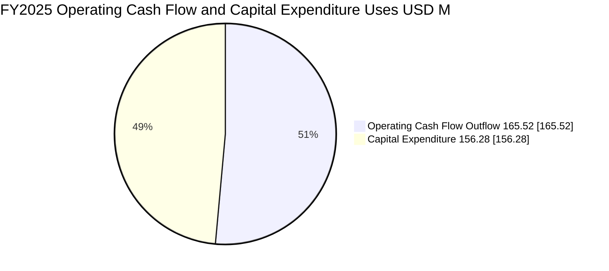

| 資本配置項目 | 已知數據 | 評估 |
|--------------|----------|------|
| 資本支出 | FY2025 $156.28M；TTM $133.84M | 🟡 投資額顯著，需追蹤投資是否帶來新增交付能力與收入。 |
| 研發投入 | FY2025 $270.72M，較 FY2024 $174.39M 增加約 55.2% | 🟡 研發支出支持產品與技術發展，但目前仍未轉化為正營業利益。 |
| 股息 | 殖利率 0.0% | 🟡 無股息現金支出，資本優先投入營運。 |
| 股票回購 | 金額未提供 | N/A；不能判斷是否透過回購抵銷 SBC 稀釋。 |
| 淨現金變化 | N/A（期間現金流與融資明細不足） | 🟡 現金存量充足，但須以後續融資與營運現金流核對消耗速度。 |

---

## 6. 獲利能力與資本效率

### 6.1 ROE / ROA / ROIC 趨勢

歷年完整 ROIC、ROE、ROA 同口徑資料未提供。依要求不以零散來源自行推算或補齊歷史 ROIC。以下列出可用的 TTM 指標及盈利表現。

| 指標 | 可用數值 | 趨勢／同業均值 | 評估 |
|------|----------|----------------|------|
| ROE（TTM，品質指標口徑） | -3.9% | 歷年同口徑趨勢 N/A；同業均值未提供 | 🔴 負報酬，股東權益尚未產生正收益。 |
| ROA（TTM，市場資料欄） | -3.5% | 歷年同口徑趨勢 N/A；同業均值未提供 | 🔴 資產未產生正會計回報。 |
| ROIC（TTM，Verified） | -16.1% | 歷年同口徑趨勢 N/A；同業均值未提供 | 🔴 遠低於 14.00% WACC。 |
| TTM 淨利率 | -25.7% | — | 🔴 每 $1 營收仍對應約 $0.257 淨損。 |

來源資料的其他財務摘要另列 ROE -6.4%、ROA -3.5%；本表 ROE 採 QUALITY FIGURES 明列的 TTM 杜邦結果 **-3.9%**，並保留來源差異，不混用不同計算口徑。

### 6.2 ROIC vs WACC 分析（核心價值創造判斷）

```text
╔══════════════════════════════════════════════════════════════════╗
║                ROIC vs WACC 深度分析                            ║
╠══════════════════════════════════════════════════════════════════╣
║  WACC（依 Cost of Capital 指定值）：14.00%                       ║
║  ├── 無風險利率（10Y 美債）：       5.12%                       ║
║  ├── 股權風險溢酬 ERP：              5.00%                       ║
║  ├── Beta（Yahoo 原始）：            3.18                        ║
║  ├── Beta（採用調整後）：            2.00                        ║
║  ├── 股權成本：                      15.12%                      ║
║  ├── 資本結構權重 E / D：            100.0% / 0.0%               ║
║  ├── 系統計算 WACC：                 15.17%                      ║
║  └── 區間限制後採用 WACC：           14.00%                      ║
║                                                                  ║
║  ROIC（TTM，稅後營業利益口徑）：    -16.1%                       ║
║  ├── 經濟利差 = ROIC − WACC：         -16.1% − 14.00% = -30.1 pp ║
║  └── 結論：目前摧毀股東價值；未達資本成本。                      ║
║                                                                  ║
║  ROIC  -16.1%  ◀負值，低於 WACC                                  ║
║  WACC   14.00%  ▓▓▓▓▓▓▓▓▓▓▓▓▓▓░░░░░░░░░░░░░░░                  ║
║  EVA 差距 -30.1pp  🔴                                            ║
╚══════════════════════════════════════════════════════════════════╝
```

Beta 調整按指定資料描述為 ⅔ × 原始 Beta 3.18 + ⅓ = 2.45，再受 0.6–2.0 區間限制而採用 2.00。指定股權成本為 15.12%，系統 WACC 計算值 15.17%，因限定在 7%–14% 區間而採用 14.00%。本報告不另行重算或替換該 WACC。

ROIC 與 WACC 的差距是 -30.1 個百分點。公司若要創造股東價值，長期 ROIC 必須高於 14.00%；短期虧損期的 ROIC 不足以預測終局，但現有數據明確顯示目前尚未覆蓋資本成本。

### 6.3 杜邦三因素分解

| 因素 | 數值（TTM） | 解讀 |
|------|-------------|------|
| 淨利率 | -25.7% | 淨虧損是 ROE 為負的主要來源。 |
| 資產週轉率 | 0.13 | 每單位資產產生的營收偏低，與資產擴充及資本密集型業務相符。 |
| 權益乘數 | 1.13 | 財務槓桿溫和，ROE 並非主要由高槓桿推動。 |
| **ROE** | **-3.9%** | **-25.7% × 0.13 × 1.13 = -3.9%（依品質指標原列結果）** |

杜邦結果顯示負淨利率是核心拖累，資產週轉率亦不高；權益乘數只有 1.13，並非以加槓桿掩蓋經營問題。

### 6.4 財務體質：Piotroski F-Score

Piotroski F-Score **5 / 9**。此分數是依 TTM 至 2026-09-30 與 TTM 至 2025-09-30 比較；缺少輸入的測試依原資料處理，不自行補值。

| 測試 | 結果 | 解讀 |
|------|------|------|
| ROA > 0 | ❌ 未通過 | 公司尚未由資產創造正會計報酬。 |
| 營業現金流 > 0 | ❌ 未通過 | TTM OCF -$191.78M，尚未自我融資。 |
| ROA 高於一年前 | ✅ 通過 | 即使仍為負，年度比較有所改善。 |
| 營業現金流 > 淨利（應計品質） | ✅ 通過 | OCF 相對淨利較佳，但兩者仍為負，不能據此推導出盈利品質良好。 |
| 長期負債 ÷ 總資產低於一年前 | ✅ 通過 | 負債相對資產的比例方向改善。 |
| 流動比率高於一年前 | ✅ 通過 | 短期流動性較前一年改善。 |
| 稀釋股數未增加 | ❌ 未通過 | 股數增加，現有股東持股比例可能被稀釋。 |
| 毛利率高於一年前 | ✅ 通過 | 毛利率比較改善，與 TTM 毛利率 36.2% 相符。 |
| 資產週轉率高於一年前 | ❌ 未通過 | 營收成長未使資產使用效率同比提升。 |

整體分數反映流動性、毛利改善與負債相對指標較好，但盈利、營運現金流、股數稀釋及資產週轉仍存在弱項。

---

## 7. 相對估值分析

### 7.1 同業估值比較表格

同業倍數依指定 Peer multiples；RKLB 自身倍數依市場估值資料。負值或極端 Forward P/E 不適合當作一般盈利倍數解讀。

| 估值指標 | **RKLB** | **SPCX** | **LUNR** | **PL** | 本公司評估 |
|----------|---------:|--------:|--------:|------:|-----------|
| **Trailing P/E** | N/A | 597.2x | N/A | N/A | 🔴 RKLB 虧損，無法用 TTM P/E 比較。 |
| **Forward P/E** | 801.48083x | 50.1x | -66.4x | -10176.0x | 🔴 RKLB 倍數極高；同業兩家 Forward P/E 為負，整體比較受虧損影響。 |
| **P/S Ratio** | 43.77867x | 58.2x | 2.9x | 12.2x | 🔴 RKLB 高於 LUNR、PL，低於 SPCX；三家商業模式與成長階段不同。 |
| **EV/EBITDA（TTM）** | -184.794x | 154.6x | -42.4x | -88.0x | 🔴 RKLB EBITDA 為負，倍數無一般估值含義；不可將負倍數作低估訊號。 |
| **最新季度營收年增** | 72.7% | 161.4% | 413.7% | 58.1% | 🟡 RKLB 高於 PL，低於 SPCX 與 LUNR。 |
| **毛利率（TTM）** | 36.2% | 56.8% | 20.3% | 55.5% | 🔴 低於 SPCX、PL，高於 LUNR。 |

### 7.2 歷史估值區間分析

提供的五年歷史估值指標為 P/S，非 P/E。當前 P/S 42.4x，五年中位數 19.4x，區間 7.1x–83.2x，現值位於歷史第 67 百分位。

```text
╔══════════════════════════════════════════════════════════════════╗
║              P/S 歷史估值區間（五年）                           ║
╠══════════════════════════════════════════════════════════════════╣
║  低點 7.1x ───────── 中位數 19.4x ───────── 當前 42.4x ─ 83.2x ║
║                                                    ▲             ║
║                                   當前歷史百分位：67%             ║
║  評估：目前倍數高於歷史中位數，落在歷史區間偏高位置。            ║
╚══════════════════════════════════════════════════════════════════╝
```

依提供的自身歷史數據，P/S 目前為五年中位數的約 2.19 倍（42.4 ÷ 19.4），顯示市場已為未來增長預付較高估值。歷史區間上限 83.2x 代表過去亦曾出現更高倍數，但不表示當前估值因此合理。

### 7.3 情境價值（Bear / Base / Bull）

**N/A（DCF 無法計算：TTM 營業利益不是正值，DCF MODEL 標示為 N/A；不得自行建立模型或設定情境目標價。）**

### 7.4 相對估值隱含價格區間

```text
╔══════════════════════════════════════════════════════════════════╗
║              相對估值方法每股價值與當前價格                      ║
╠══════════════════════════════════════════════════════════════════╣
║  同業 P/S 法         $9.94  ──●                                  ║
║  加權合理價值        $18.26 ───────●                             ║
║  2026-11-16 現價     $57.37 ───────────────────────────●         ║
║  分析師共識均值      $93.15 ───────────────────────────────────● ║
╠══════════════════════════════════════════════════════════════════╣
║  同業 P/S：LUNR、PL 中位數 7.6x × RKLB TTM 營收回推每股價值。    ║
║  分析師共識：20 位分析師平均目標價 $93.15。                       ║
╚══════════════════════════════════════════════════════════════════╝
```

同業 P/S 法每股價值 **$9.94**，其依據為 LUNR 與 PL 同業中位數 P/S **7.6x** 乘以 RKLB TTM 營收後回推；分析師共識方法為 20 位分析師平均目標價 **$93.15**。兩者分歧很大：前者反映可觀察到的同業銷售倍數，後者是分析師預期的平均結果，不能把共識目標價當作已實現價值。

---

## 8. DCF 內在價值評估（Discounted Cash Flow）

### 8.0 估值推理鏈（Thinking Logic）

#### Step 1 — 價值由哪些變數決定？

Rocket Lab 的長期價值取決於發射服務與太空系統收入能否持續增加、毛利改善能否轉化為正營業利益與現金流，以及高估值能否由未來每股現金流支撐。目前 TTM 營收為 $881.90M，但兩個業務板塊的收入占比未提供，因此不能量化主業、第二成長曲線或新業務選擇權各自貢獻。

**估值主導變數**在可用資料下是「轉虧為盈並形成正現金流」；但由於 TTM 營業利益為負，指定模型明確不輸出 DCF，不能以任意假設將負數折現來創造看似精確的每股價值。

#### Step 2 — 模型選擇

| 決策點 | 本報告採用 | 理由（含數字） | 曾考慮但否決 | 否決理由 |
|--------|-----------|----------------|--------------|----------|
| 現金流定義 | FCFF DCF：N/A | 指定 DCF MODEL 顯示 TTM 營業利益非正；目前 TTM OCF -$191.78M、FCF -$325.62M。 | 自建 FCFF／FCFE | 與規定的程式 DCF MODEL 僅能照抄相衝突，且公司仍在虧損，預測假設無足夠錨點。 |
| 預測期 N | N/A | DCF MODEL 未提供預測期與逐年現金流。 | 自訂 5–10 年 | 缺少公司指引與程式模型假設；自行選定會變成新模型。 |
| 終值方法 | N/A | 無可用預測期現金流與終值數據。 | Gordon Growth／退出倍數 | 無法建立可稽核終值。 |
| EBIT 基礎 | N/A | 指定模型明確為 N/A。 | 自行用 GAAP／非 GAAP EBIT | 無權自行建立 DCF，亦缺少完整預測與折現輸入。 |

#### Step 3 — 關鍵假設推導鏈

指定的 DCF MODEL 為 N/A，因此營收 CAGR、期末營業利潤率、永續成長率、預測期、Capex／營收、D&A／營收、營運資金變動、稀釋股數與終值方法均無可照抄的模型值。若自行補入這些假設，會違反不得自建 DCF 的要求；故不提供「錨點—調整—採用值—替代值」的虛構推導。

已知歷史錨點包括 TTM 營收 $881.90M、TTM 營業利益率 -27.6%、TTM Capex $133.84M 及 TTM FCF -$325.62M。這些數字可用於評估盈利轉換和資金需求，不能單獨決定遠期 DCF。

#### Step 4 — 最脆弱的一環

最脆弱的假設不是單一折現率，而是公司何時能由營業虧損與負 FCF 轉向可持續正現金流；若轉虧時間延後，任何依賴遠期終值的估值都會向下。由於指定 DCF MODEL 沒有輸出，無法可靠量化下修幅度。

#### Step 5 — 計算路徑圖

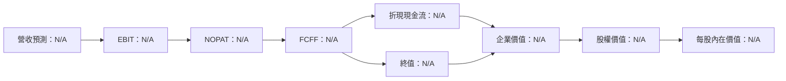

### 8.1 模型假設總表（Model Inputs）

**N/A（數據未提供：指定 DCF MODEL 未計算；原因是 TTM 營業利益不是正值。）**以下假設不可自行補入作為另一套 DCF。

| 假設項目 | 採用值 | 依據／來源 | 敏感度 |
|----------|--------|------------|--------|
| 預測期長度 N | N/A | DCF MODEL 未提供 | N/A |
| 營收 CAGR | N/A | DCF MODEL 未提供預測假設 | N/A |
| 期末營業利潤率 | N/A | TTM 營業利益率 -27.6%，但模型未提供回升路徑 | N/A |
| 有效稅率 | N/A | DCF MODEL 未提供；歷史有效稅率亦未提供 | N/A |
| Capex / 營收 | N/A | 可知 TTM Capex $133.84M，但模型資本支出率未提供 | N/A |
| D&A / 營收 | N/A | 逐年模型數據未提供 | N/A |
| 營運資金變動 / 營收增額 | N/A | DCF MODEL 未提供 | N/A |
| EBIT 基礎 | N/A | DCF MODEL 未提供 | N/A |
| 股權薪酬 SBC 處理 | N/A | 不適用於未建立之 DCF | N/A |
| 年稀釋率 | N/A | DCF MODEL 未提供 | N/A |
| 永續成長率 g | N/A | DCF MODEL 未提供 | N/A |
| 終值方法 | N/A | DCF MODEL 未提供 | N/A |
| WACC | **14.00%** | 指定 Cost of Capital 採用值；模型本身仍為 N/A | 不適用於重建模型 |

FCFF 的理論定義為 `NOPAT + D&A − Capex − ΔWC`，但本節沒有預測值，不能計算逐年 FCFF。SBC 組合 A／B／C、稀釋股數及終值都不適用；不以部分歷史數據拼造模型。

### 8.2 折現率推導（WACC）

ROIC 與 WACC 分析使用指定成本資本數據，且與第 6.2 節一致。

```text
╔══════════════════════════════════════════════════════════════════╗
║                    WACC 推導（指定成本資本資料）                 ║
╠══════════════════════════════════════════════════════════════════╣
║  股權成本 Ke（CAPM）：                                           ║
║  ├── 無風險利率 Rf（10Y 美債）：      5.12%                     ║
║  ├── 市場風險溢酬 ERP：               5.00%（假設值）            ║
║  ├── 原始 Beta（Yahoo）：             3.18                      ║
║  ├── Beta used（adjusted）：          2.00                      ║
║  └── Ke = 5.12% + 2.00 × 5.00% = 15.12%                        ║
║                                                                  ║
║  債務與資本結構：                                                 ║
║  ├── 稅前債務成本：                   1543.65%（指定資料）       ║
║  ├── 稅率：                           21.0%                     ║
║  ├── 股權權重 E：                     100.0%                    ║
║  ├── 債務權重 D：                     0.0%                      ║
║  ├── WACC 計算值：                    15.17%                    ║
║  └── 區間限制後採用 WACC：            14.00%                    ║
╚══════════════════════════════════════════════════════════════════╝
```

1. **Ke（CAPM）** = 5.12% + 2.00 × 5.00% = **15.12%**。  
   指定資料提供無風險利率與 ERP 假設值；ERP 沒有另列日期與來源細節。Beta 原始值 3.18，採用調整後 Beta 2.00；提供資料記載調整公式結果 2.45 後受 0.6–2.0 區間限制。

2. **稅前 Kd** = **1543.65%（指定數值）**。  
   利息費用與平均計息負債的明細未提供，故不把該數值改算或另行解釋為正常債券殖利率；指定資本結構中債務權重為 0.0%。

3. **稅後 Kd** = 1543.65% × (1 − 21.0%) = **N/A（債務權重為 0.0%，且稅前 Kd 口徑資料不足，不將其當作有效成本輸入）**。

4. **權重** = 股權 100.0% + 債務 0.0% = **100.0%**。指定資本結構權重依市值與債務估算；未提供可用於重建該權重的完整平均計息負債明細，因此不以帳面負債重新推導。

5. **WACC**：指定計算值為 **15.17%**，因限制於 7%–14% 區間，採用 **14.00%**。本報告依指定數值使用，不以缺漏的債務輸入自建 WACC。

Rf 的觀察日期未在資料中標出，ERP 為假設值。由於公司 Beta 原始值 3.18 大於 1.5，採用調整後 Beta 2.00。無額外規模或國別溢酬數據，故不另加。第 6.2 節與本節 WACC 均為 **14.00%**。

### 8.3 逐年自由現金流預測（基準情境）

**N/A（數據未提供：指定 DCF MODEL 因 TTM 營業利益非正而未計算；不得自行建立逐年現金流預測。）**

| 年度 | FY+1 至 FY+N | 結果 |
|------|--------------|------|
| 預測營收、營業利潤率、EBIT、NOPAT | N/A | DCF MODEL 未提供預測期或假設。 |
| D&A、Capex、ΔWC、FCFF | N/A | 無逐年模型輸入。 |
| 折現因子與 FCFF 現值 | N/A | 不另建 DCF。 |
| 預測期現金流現值合計 | N/A | 不適用。 |

代表年度逐步演算、預測期 FCF 現值加總、FCF CAGR 自檢與歷史實際／預測 FCF 圖表均為 **N/A**。歷史錨點為 FY2024 FCF -$115.98M、FY2025 FCF -$321.81M、TTM FCF -$325.62M；三者皆為負且年度口徑不同，不能作為正向預測曲線。

### 8.4 終值計算（Terminal Value）

**N/A（數據未提供：沒有預測期末 FCFF、永續成長率 g 或模型終值。）**  
適用性檢查 `WACC 14.00% vs g N/A → WACC > g？N/A`。因 g 與 FY+N 現金流均不存在，不計 Gordon Growth 或退出倍數終值，也不計終值現值占企業價值比重。

### 8.5 企業價值 → 每股內在價值（Bridge）

**N/A（數據未提供：指定 DCF MODEL 無企業價值、終值現值及每股估值輸出。）**

| 橋接項目 | 數值 |
|----------|------|
| 預測期 FCF 現值合計 | N/A |
| 終值現值 PV(TV) | N/A |
| 企業價值 EV | N/A |
| 現金及短期投資 | $4.61B（指定財務數據；但不能在無 EV 時完成橋接） |
| 總債務 | $1.72M（指定財務數據；其他來源口徑有差異） |
| 少數股東權益／其他 | N/A |
| 股權價值 | N/A |
| 稀釋後流通股數 | N/A（DCF 模型股數未提供） |
| 每股 DCF 內在價值 | **N/A** |
| DCF 折溢價 | **N/A** |

本節不計算 MOS。MOS 僅以 8.8 加權合理價值為分母；因 DCF 每股價值為 N/A，折溢價亦不適用。以上現金與債務資料不能代替完整 EV 到股權價值橋接。

### 8.6 敏感性分析（WACC × 永續成長率）

**N/A（數據未提供：DCF MODEL 未輸出敏感性矩陣，且基準 g、預測現金流與每股估值均不存在。）**  
不自行填造 5×5 矩陣、三情境、機率加權結果或敏感度彈性；因此也沒有可示範重算的有效矩陣格。

### 8.7 反推 DCF（Reverse DCF：市場在預期什麼）

**N/A（數據未提供：DCF MODEL 無基準情境，無法固定其餘輸入後以現價反推營收 CAGR、利潤率、永續成長率或預測期。）**  
現價 $57.37、TTM 營收 $881.90M 與 TTM 營業利益率 -27.6% 可用於市場估值觀察，但不足以形成唯一的反推 DCF 解。不得以任意反推數字宣稱市場隱含預期。

### 8.8 估值三角驗證與安全邊際

| 估值方法 | 隱含每股價值 | 上行空間（÷現價） | 權重 | 說明 |
|----------|--------------:|-------------------:|------:|------|
| 同業 P/S | $9.94 | -82.7% | 90% | LUNR、PL 同業 P/S 中位數 7.6x，乘以 RKLB TTM 營收後回推。 |
| 分析師共識目標價 | $93.15 | +62.4% | 10% | 20 位分析師平均目標價；參考性質，不代表已實現價值。 |
| **加權合理價值** | **$18.26** | **-68.2%** | **100%** | 依 unprofitable 公司類型固定權重；不另作調整。 |

**逐步演算（權重外顯）：**

- 同業 P/S 法加權值：`$9.94 × 90% = $8.946`
- 分析師共識加權值：`$93.15 × 10% = $9.315`
- 加權合理價值：`$8.946 + $9.315 = $18.261 ≈ $18.26`
- 權重：`90% + 10% = 100%`
- Forward P/E 法因無法計算而排除，其權重依指定規則分配至其他方法；本報告不新增估值方法、不更改權重。

安全邊際與上行空間採不同分母：

- **MOS** = `($18.26 − $57.37) ÷ $18.26` = `-$39.11 ÷ $18.26` = **-214.2%**。
- **上行空間** = `($18.26 − $57.37) ÷ $57.37` = `-$39.11 ÷ $57.37` = **-68.2%**。

```text
╔══════════════════════════════════════════════════════════════════╗
║                  估值區間與安全邊際                              ║
╠══════════════════════════════════════════════════════════════════╣
║  $9.94 ─── [$18.26 加權合理價值] ───────── $57.37 現價 ─ $93.15║
║  同業 P/S          加權價值                    現價       共識均值║
║                                                                  ║
║  安全邊際 MOS = ($18.26 − $57.37) ÷ $18.26 = -214.2%            ║
║  MOS 評估：🔴 低於 -25%，依規則 20 為賣出                        ║
║  上行空間 = ($18.26 − $57.37) ÷ $57.37 = -68.2%                ║
║  DCF 基準內在價值：N/A；不提供 DCF 買入區間。                    ║
╚══════════════════════════════════════════════════════════════════╝
```

> 🔎 **程式複算（Python，依本節各項自動重算）**
>
> 加權合理價值 = $9.94 × 90% + $93.15 × 10% = **$18.26**（權重合計 100%）
>
> 以價格 $57.37 計：MOS = **-214.2%**，上行空間 = **-68.2%**
>
> ✅ 與本節所寫數值一致。

### 8.9 DCF 模型的局限與失效條件

- **終值依賴度：**N/A，未提供 DCF 終值及企業價值。
- **最脆弱的假設：**無法量化特定 DCF 假設；核心營運不確定性是營業虧損與 FCF 轉正時間。若 TTM 營業利益率 -27.6% 長期無改善、TTM FCF -$325.62M 持續，任何以遠期現金流支持高估值的論點均會削弱。
- **不適用情境說明：**公司 TTM 營業利益為負、TTM FCF 為負，且處於高投資階段，因此目前 DCF 可靠度偏低。估值應優先參考同業 EV/Sales 或 P/S、分部與單位經濟性，以及未來可驗證的盈利路徑；若日後轉正，再以可稽核的 FCFF 模型估值。
- **與第 10 章風險矩陣的連結：**競爭或發射延誤會影響營收成長與費用吸收；產能或研發投入高於回收速度會壓低 FCF；估值倍數收縮則不需要基本面惡化，也可能造成股價下跌。

### 8.10 複算檢核表（Audit Trail）

| # | 檢核項目 | 檢查方式 | 結果 |
|---|----------|----------|------|
| 1 | 所有 DCF 高／中敏感度輸入均有推導 | DCF MODEL 為 N/A，未設定輸入 | ✅ 不適用；未另建模型 |
| 2 | 每個 DCF 假設均有來歷 | 8.1 將未提供輸入列為 N/A | ✅ |
| 3 | WACC 五步算式齊全且正確 | 沿用指定 WACC 與資本成本，不重建缺失債務資料 | 🟡 指定採用 14.00%；債務成本明細不足 |
| 4 | Kd 與債務權重使用一致負債範圍 | 指定權重 D 為 0.0%；資料未列平均計息債務明細 | 🟡 限制重建；未自行推導 |
| 5 | WACC 與第 6.2 節一致 | 兩處均為 14.00% | ✅ |
| 6 | 逐年預測欄數與 N 一致 | 無指定 DCF 預測期 | ✅ 不適用；未輸出虛構年度 |
| 7 | FY+1 九步現金流算式可複算 | 無 FY+1 模型輸入 | ✅ 不適用 |
| 8 | 預測期 PV 加總 | 無逐年 PV | ✅ 不適用 |
| 9 | WACC > g | g 未提供 | ✅ 不適用 |
| 10 | 終值以 FY+N 現金流折現 | 終值與 N 未提供 | ✅ 不適用 |
| 11 | EV 至每股價值橋接可複算 | DCF EV 未提供，未作橋接 | ✅ 不適用 |
| 12 | SBC、EBIT 基礎及股數組合相容 | DCF 模型未建立，沒有 SBC 扣除與稀釋假設 | ✅ 不適用 |
| 13 | 敏感性矩陣基準格與 DCF 每股價值一致 | 矩陣及 DCF 價值均 N/A | ✅ 不適用 |
| 14 | 矩陣中 WACC ≤ g 的格子處理正確 | 未提供矩陣，未填假設數值 | ✅ 不適用 |
| 15 | 三情境機率合計 100% | DCF Scenarios 未提供 | ✅ 不適用 |
| 16 | 反推 DCF 一次只放開一個變數 | DCF 模型無基準輸入，不反推 | ✅ 不適用 |
| 17 | MOS、折溢價基準正確 | MOS 僅以 $18.26 加權合理價值計算；DCF 折溢價標 N/A | ✅ |
| 18 | 報告完整輸出至第 11 章 | 已包含第 1–11 章 | ✅ |
| 19 | 加權合理價值等於加權總和 | $9.94×90% + $93.15×10% = $18.261 ≈ $18.26 | ✅ |
| 20 | 評級符合 MOS 門檻 | MOS -214.2% < -25%，評級賣出 | ✅ |

---

## 9. 成長催化劑

### 9.1 催化劑時間軸

以下時間軸為研究監控區間，不是公司公布的財務預測或已確認交付日期；具體訂單與任務日程未提供。

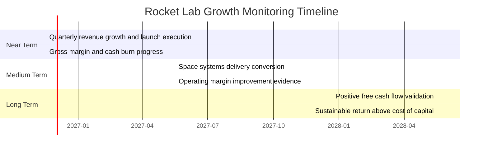

短期主要觀察營收成長能否維持並轉化為更高毛利；中期觀察太空系統交付與營運費用吸收；長期則以 FCF 轉正與 ROIC 超過 WACC 作為經濟價值創造的驗證門檻。資料中沒有可核對的未來發射日期或已簽約金額，不把上述監控項目描述為已確認催化劑。

### 9.2 TAM 市場規模分析

**N/A（TAM 數據未提供）。**目前可用的公司營收錨點為 TTM $881.90M、TTM 年增 59.0%，最新一季年增 72.7%。營收增長顯示業務擴張，但在沒有可引用 TAM、訂單與市場份額資料時，無法計算市場滲透率或剩餘市場空間。

### 9.3 成長驅動力結構圖

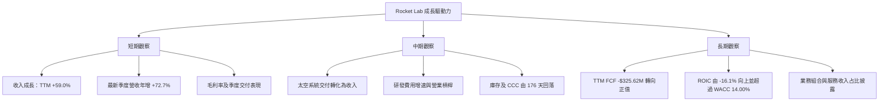

---

## 10. 風險矩陣

### 10.1 風險評分矩陣

下列位置為分析師對相對發生可能性與衝擊的質化排序，不是公司公布機率或統計預測。

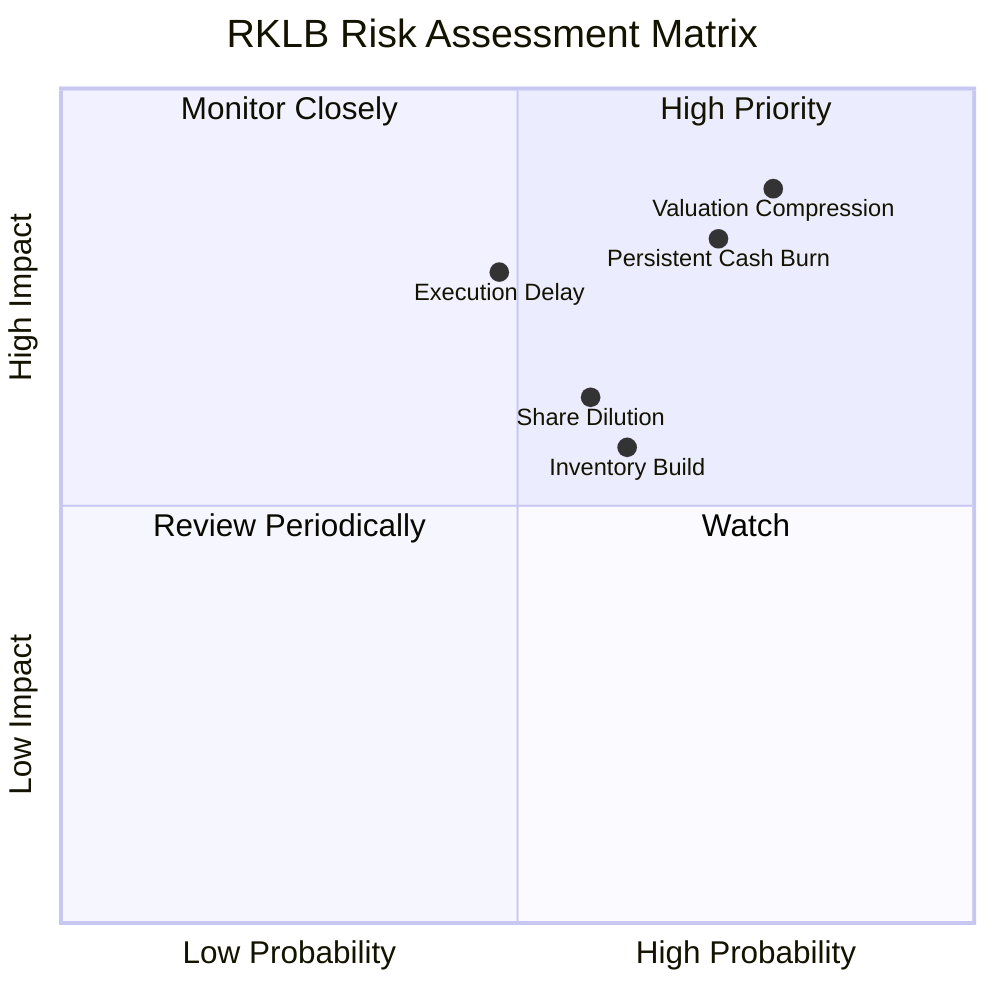

### 10.2 風險清單詳細分析

| # | 風險項目 | 發生機率 | 財務衝擊 | 風險評分 | 緩解措施 |
|---|----------|----------|----------|----------|----------|
| 1 | 🔴 **估值倍數收縮** | 高（主觀） | 高；當前 P/S 42.4x，高於歷史中位數 19.4x。估值回落不需基本面大幅惡化即可造成股價壓力。 | 🔴 9.0/10 | 以分批建倉、估值上限與事件風險控管降低單一高倍數曝險；追蹤 P/S 與實際營收增長是否匹配。 |
| 2 | 🔴 **負 FCF 延續與資本需求增加** | 高（主觀） | 高；TTM FCF -$325.62M、TTM OCF -$191.78M。若投資持續高於內部現金生成，可能消耗現金或增加融資需求。 | 🔴 8.8/10 | 每季追蹤 OCF、Capex、現金及短期投資；以 FCF 改善而非單季收入作為投資確認條件。 |
| 3 | 🔴 **營運執行與交付延誤** | 中（主觀） | 高；交付延遲可能造成收入遞延、庫存增加與客戶信心下降。DIO 已由 140 天升至 182 天。 | 🔴 8.0/10 | 追蹤季度收入、存貨、應收帳款及 CCC；重大任務或交付延期時重新評估成長假設。 |
| 4 | 🟡 **股權稀釋與 SBC** | 中（主觀） | 中至高；TTM SBC 約 $84.20M，約佔 TTM 收入 9.5%；F-Score 顯示稀釋股數測試未通過。 | 🟡 7.0/10 | 追蹤稀釋股數年增率、SBC／營收與每股營收；若股數增長持續快於營收，降低每股價值假設。 |
| 5 | 🟡 **營運資金壓力** | 中（主觀） | 中；CCC 一年增加 56 天至 176 天，庫存及收款週期延長可能拖累現金流。 | 🟡 6.8/10 | 追蹤 DIO、DSO、DPO 與存貨減值；若 DIO 持續增加且收入未加速，重新評估交付與庫存風險。 |
| 6 | 🟡 **競爭與定價壓力** | 中（主觀） | 中至高；同業毛利率資料從 20.3% 至 56.8%，RKLB TTM 毛利率 36.2%，公司尚未證明具穩定定價優勢。 | 🟡 6.5/10 | 追蹤毛利率、分部組合與重複訂單；觀察收入成長是否以毛利率折讓換取。 |

---

## 11. 投資建議

### 11.1 最終評級與評分

依 8.8 加權合理價值 $18.26 與 2026-11-16 收盤價 $57.37 計算，MOS 為 -214.2%，依規則 20 評級為 **賣出**，沒有作一級質化調整。1.1 綜合評分為 **5.3/10**，其六項分數依序為成長性 8.0、獲利能力 2.5、財務健康 8.0、估值 1.0、護城河 7.0、管理層與資本配置 5.0；評分反映公司成長與資金條件尚可，但盈利、現金流和估值風險顯著。

### 11.2 合理價值與隱含報酬率

| 方法／情境 | 每股價值 | 相對現價 $57.37 | 機率／權重 | 說明 |
|------------|---------:|----------------:|------------:|------|
| 同業 P/S 法 | $9.94 | -82.7% | 90% | LUNR、PL 同業 P/S 中位數 7.6x 回推。 |
| 分析師共識目標價 | $93.15 | +62.4% | 10% | 20 位分析師平均目標價。 |
| **加權合理價值** | **$18.26** | **-68.2%** | **100%** | 方法價值按固定權重加權；不等同 12 個月價格保證。 |
| 悲觀 DCF 情境 | N/A | N/A | N/A | DCF MODEL 為 N/A。 |
| 基準 DCF 情境 | N/A | N/A | N/A | DCF MODEL 為 N/A。 |
| 樂觀 DCF 情境 | N/A | N/A | N/A | DCF MODEL 為 N/A。 |

### 11.3 買入時機與觸發因素

```text
╔══════════════════════════════════════════════════════════════════╗
║                  ✅ 買入觸發因素 Checklist                      ║
╠══════════════════════════════════════════════════════════════════╣
║  重新考慮買入的條件（多數符合）：                                ║
║  ☐ 營業利益率連續改善，且改善不只由單季收入波動造成              ║
║  ☐ TTM FCF 顯著收斂，並展現可重複的 OCF 改善                    ║
║  ☐ 毛利率提升能覆蓋研發與營業費用增速                            ║
║  ☐ DIO、DSO 與 CCC 停止惡化，CCC 由 176 天回落                   ║
║  ☐ 股數增速與 SBC 佔營收比率下降，改善每股經濟性                 ║
║                                                                  ║
║  加碼觸發條件：                                                  ║
║  ☐ 估值回落、而營收成長與毛利率仍保持正向趨勢                    ║
║  ☐ ROIC 由 -16.1% 持續改善，且有可信路徑接近／高於 WACC 14.00%  ║
║                                                                  ║
║  減碼／退出觸發條件：                                            ║
║  ☐ 營收增速連續兩季明顯放緩，且毛利率同步下滑                    ║
║  ☐ FCF 流出超過 TTM -$325.62M 的水平並持續擴大                  ║
║  ☐ CCC 在 176 天之上持續上升，或存貨增加而交付收入未跟上         ║
║  ☐ 稀釋股數與 SBC 快速增加，導致每股營收或每股價值持續被稀釋     ║
╚══════════════════════════════════════════════════════════════════╝
```

### 11.4 投資人適配度分析

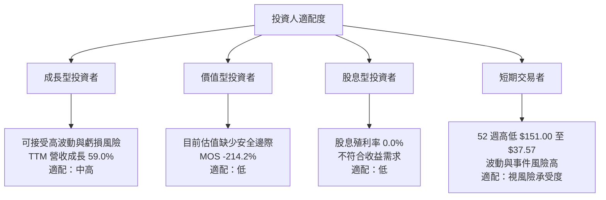

### 11.5 每季財報監控清單（Quarterly Watch List）

| 監控指標 | 最新基準 | 加碼觀察條件 | 減碼／重新評估條件 |
|----------|----------|--------------|--------------------|
| 營收成長 | TTM +59.0%；最新季度 YoY +72.7% | 成長能延續，且季度營收增加伴隨毛利改善 | 同比成長連續兩季低於 30%，或收入下滑且未有交付解釋 |
| 毛利率 | TTM 36.2% | 維持上升，並帶動營業虧損率收斂 | 連續兩季下降，尤其收入仍成長但毛利率走弱 |
| 營業利益率 | TTM -27.6%；最新季度 -29.6% | 連續改善，虧損率明確收窄 | 連續兩季較 TTM 基準惡化，或費用增速長期高於收入 |
| 營業現金流 | TTM -$191.78M | TTM OCF 流出持續縮小並接近轉正 | 現金消耗明顯擴大，且無明確可驗證的收入轉化 |
| 資本支出 | TTM $133.84M | 新增投資對應可驗證產能、交付或收入 | Capex 增加而交付、營收與毛利均未同步改善 |
| 自由現金流 | TTM -$325.62M；FCF Yield -0.84% | FCF 持續收斂，並朝正值移動 | FCF 流出高於當前 TTM 水準並連續擴大 |
| 存貨與 DIO | DIO 182 天；前一年 140 天 | DIO 趨穩或下降，收入與交付同步增長 | DIO 繼續上升、庫存減值增加或收入未吸收存貨 |
| 應收帳款與 DSO | DSO 49 天；前一年 39 天 | DSO 穩定或回落 | DSO 持續上升且 OCF 惡化 |
| CCC | 176 天；前一年 120 天 | CCC 回落，現金轉換改善 | CCC 連續增加，顯示營運資金壓力擴大 |
| SBC 與稀釋股數 | TTM SBC 約 $84.20M；SBC／營收約 9.5% | SBC／營收與股數增速下降 | SBC 佔營收上升、股數持續增加且沒有每股營收成長抵銷 |
| 財測與任務執行 | 管理層財測與未來任務資料未提供 | 後續財報提供明確交付、收入與毛利指引，且實際達成 | 指引下修、任務延誤或客戶驗收推遲 |

### 11.6 反面論證：什麼會證明論點錯誤（What Would Change My Mind）

```text
╔══════════════════════════════════════════════════════════════════╗
║              ⚠️ 論點失效條件（Disconfirming Evidence）           ║
╠══════════════════════════════════════════════════════════════════╣
║  多頭論點須在下列情況重新檢視或退出：                            ║
║  ☐ 最新一季營收年增連續兩季低於 30%，且無交付時點因素解釋        ║
║  ☐ TTM 營業利益率低於目前 -27.6%，且連續兩季未見改善            ║
║  ☐ TTM FCF 低於目前 -$325.62M，且 OCF 未同步改善                 ║
║  ☐ DIO 高於 182 天並持續上升，或 CCC 長期高於 176 天             ║
║  ☐ SBC／營收高於目前約 9.5%，且稀釋股數持續增加                 ║
║  ☐ ROIC 長期低於 WACC 14.00%，且管理層沒有可驗證的改善路徑       ║
║  ☐ 同業 P/S 法所依據的收入成長、毛利改善假設不再成立             ║
╚══════════════════════════════════════════════════════════════════╝
```

**投資結論：**RKLB 的營收擴張、毛利率改善與 $4.61B 現金及短期投資提供了長期發展基礎；但 TTM ROIC -16.1%、TTM FCF -$325.62M、營業利益率 -27.6% 及高於自身歷史中位數的 P/S，尚不足以支持現價。以加權合理價值 $18.26、MOS -214.2% 與規則 20 門檻判定，評級為 **賣出**；後續若盈利能力、現金流和營運資金效率出現可驗證改善，應重新估值。

> **免責聲明**：本報告為 AI 自動生成，僅供研究參考，不構成投資建議。投資有風險，入市需謹慎。

---

## 資料與來源

| 項目 | 內容 |
|------|------|
| 價格 | 57.37 USD，2026-11-16 收盤（Yahoo Finance 即時報價（該交易日已收盤）） |
| 財務報表 | SEC 10-Q filed 2026-11-09，最新季度 2026-09-30（FY2026 Q3） |
| 有回應的資料來源 | SEC 申報資料 (XBRL)、Yahoo Finance、Finviz、StockAnalysis、Roic.ai |
| 由程式計算 | TTM 數字、WACC、DCF 模型、估值方法與權重、加權合理價值、MOS、評級門檻、F-Score、杜邦分解、營運資金天數、綜合評分 |
| 撰寫模型 | openai / gpt-6-luna |

> 本區塊由產生報告的程式依實際取得的資料填寫，非模型撰寫。「由程式計算」的數字不是模型的估計；其餘判斷（評分、情境、策略）是模型的分析。
