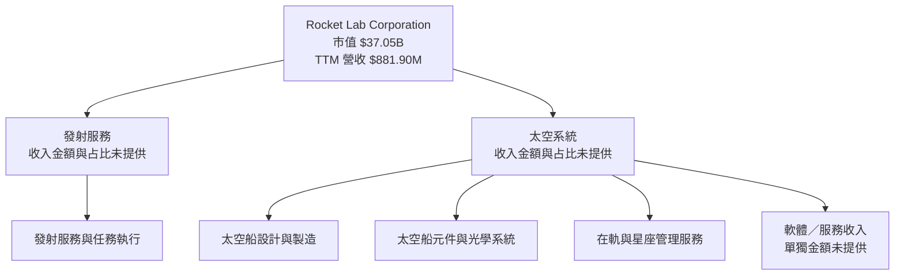
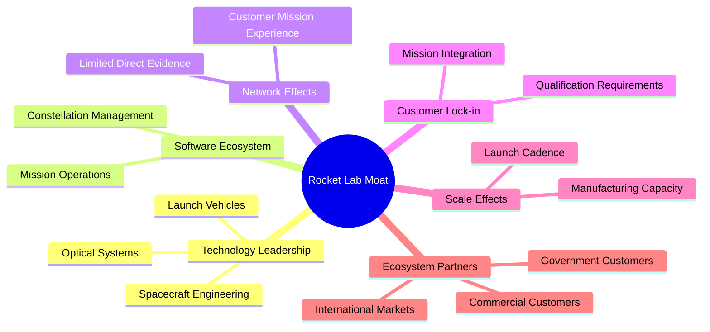
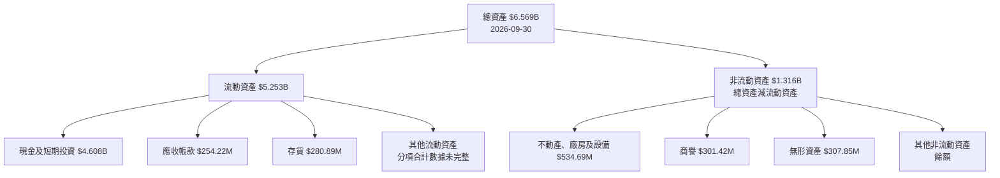
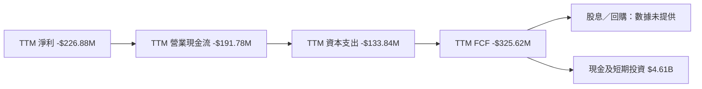
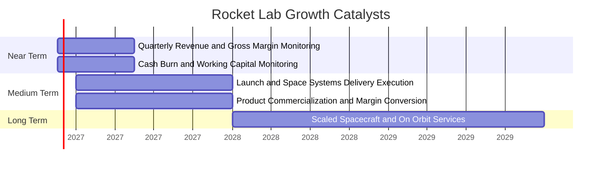
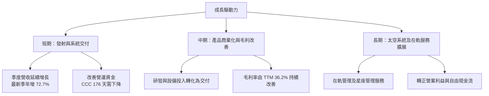
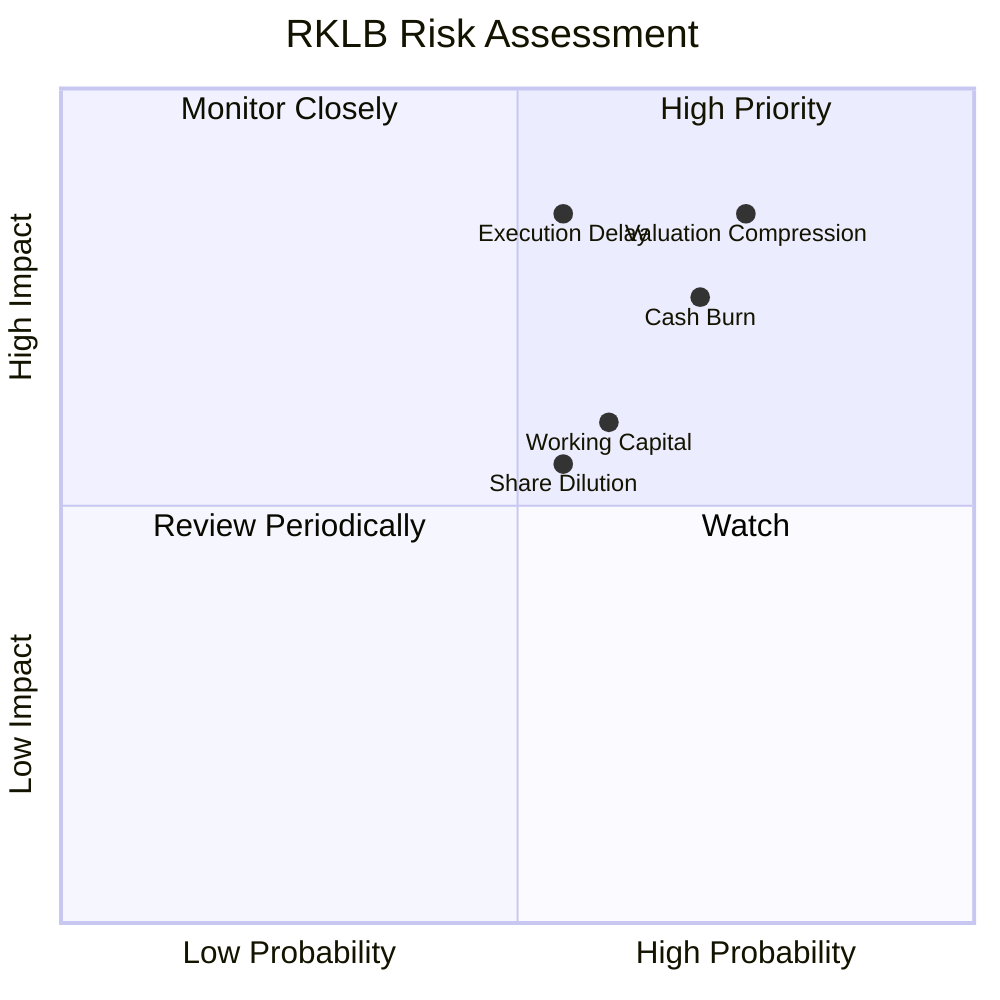
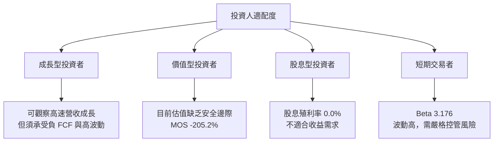

# RKLB 基本面深度分析報告
> **報告日期**：2026-11-18 ｜ **語言**：繁體中文 ｜ **數據來源**：SEC 申報資料 (XBRL)、Yahoo Finance、Finviz、StockAnalysis、Roic.ai ｜ **分析師**：CFA 級機構研究

## 目錄

| # | 章節 | 核心結論 |
|---|------|----------|
| 1 | 執行摘要 | 賣出；加權合理價值 $18.04，MOS -205.2% |
| 2 | 公司概覽與商業模式 | 發射服務與太空系統並行；市場份額資料未提供 |
| 3 | 損益表深度分析 | TTM 營收 $881.90M、年增 59.0%；營業利益率 -27.6% |
| 4 | 資產負債表分析 | 現金及短期投資 $4.61B；流動性充足，但營運資金週期拉長 |
| 5 | 現金流量深度分析 | TTM FCF -$325.62M，仍處於大額投資與現金消耗期 |
| 6 | 獲利能力與資本效率 | ROIC -16.1% 對 WACC 14.0%，目前摧毀股東價值 |
| 7 | 相對估值分析 | P/S 40.7x，高於五年中位數 19.4x；同業估值差異大 |
| 8 | DCF 內在價值評估 | N/A：TTM 營業利益為負，不建立虧損折現模型 |
| 9 | 成長催化劑 | 營收成長與新產品商業化是主要催化劑；量化 TAM 未提供 |
| 10 | 風險矩陣 | 估值、執行及現金消耗為主要風險 |
| 11 | 投資建議 | 按規則 20 評級為賣出；以營運改善與估值回落作為重新評估條件 |

---

## 1. 執行摘要

RKLB 的營收成長仍快：TTM 營收為 **$881.90M**，TTM 年增 **59.0%**，2026 財年第三季單季營收年增 **72.7%**；但同一 TTM 的營業利益率為 **-27.6%**、ROIC 為 **-16.1%**，TTM FCF 為 **-$325.62M**。2026-11-17 收盤價 **$55.05** 對應 TTM P/S **40.7x**，而固定權重估值方法得出的加權合理價值為 **$18.04**，MOS 為 **-205.2%**。依規則 20，評級為 **🔴 賣出**：公司具成長性且現金部位充足，但目前價格對照相對估值結果偏高，且尚未證明可持續獲利與正向 ROIC。

### 1.0 一頁式投資儀表板

| 項目 | 內容 |
|------|------|
| **投資論點（3 句）** | ① TTM 營收年增 59.0%、最新季度年增 72.7%，需求與交付仍在擴張。② TTM 營業利益率 -27.6%、ROIC -16.1%，規模成長尚未轉化成股東價值。③ TTM FCF -$325.62M，現金及短期投資 $4.61B 提供資金緩衝，但 P/S 40.7x 已反映相當高的成長預期。 |
| **綜合評分** | **5.0/10**（引用 1.1 評分卡） |
| **財務健康** | 🟢 現金及短期投資 $4.61B、流動比率 8.554；惟現金流持續為負且現金轉換週期升至 176 天。 |
| **ROIC vs WACC** | **-16.1% vs 14.0%**；差距 -30.1 個百分點，現階段摧毀股東價值。 |
| **FCF 趨勢** | TTM FCF 為 -$325.62M；FCF Yield **-0.88%**，仍需外部資金或現金存量支持投資。 |
| **估值** | Forward P/E **769.0696x** ｜ EV/EBITDA **-176.449x** ｜ FCF Yield **-0.88%** |
| **DCF 內在價值（基準）** | **N/A**；TTM 營業利益為負，DCF MODEL 不適用，故不計算 DCF 折溢價。 |
| **安全邊際（MOS）** | **-205.2%**＝($18.04 − $55.05) ÷ $18.04；🔴 無安全邊際。基準為 8.8 節加權合理價值。 |
| **預期報酬（基準情境 12M）** | DCF 情境 N/A；加權合理價值相對現價的隱含上行空間為 **-67.2%**，不等同 12 個月預測。 |
| **關鍵風險（前二）** | ① 高估值遇上成長放緩；② 發射、新產品及產能執行不及預期，延長虧損與現金消耗。 |
| **評級 + 信心度** | 🔴 **賣出** ｜ 信心：中（估值訊號明確，但公司仍處高成長與高不確定性階段） |

### 1.1 綜合評分卡（全報告唯一）

| 維度 | 評分（1–10） | 主要依據（引用數字與其來源章節） |
|------|--------------|----------------------------------|
| 成長性 | 8.0 | TTM 營收年增 59.0%、最新季度年增 72.7%（第 3 章）；成長高，但需留意季度基期與交付波動。 |
| 獲利能力 | 2.0 | TTM 營業利益率 -27.6%、ROIC -16.1%，低於 14.0% WACC；F-Score 5/9（第 6 章）。 |
| 財務健康 | 8.0 | 現金及短期投資 $4.61B、流動比率 8.554；CCC 176 天且 TTM FCF -$325.62M（第 4、5 章）。 |
| 估值 | 1.0 | MOS -205.2%；P/S 40.7x，高於五年中位數 19.4x（第 7、8 章）。 |
| 護城河 | 7.0 | 有發射服務、航太製造與太空系統的整合能力，但缺少可引用市占率、訂單集中度及分部營收資料（第 2 章）。 |
| 管理層與資本配置 | 4.0 | 2025 年 SBC $71.10M，約占營收 11.8%；2025 年 Capex $156.28M，未見股息資料以外的完整資本配置分拆（第 3、5 章）。 |
| **綜合評分** | **5.0** | 六項算術平均：(8.0 + 2.0 + 8.0 + 1.0 + 7.0 + 4.0) ÷ 6 = **5.0**。 |

### 1.2 五大投資論點 + 三大核心風險

| 類型 | 項目 | 具體依據 | 信心度 |
|------|------|----------|--------|
| 🟢 **投資論點①** | 營收快速擴張 | TTM 營收 $881.90M、年增 59.0%；最新季度營收 $267.83M、年增 72.7%。 | 🟢 高 |
| 🟢 **投資論點②** | 收入來源涵蓋發射與太空系統 | 公司同時提供發射服務、衛星設計與製造、光學系統及在軌管理，降低只依賴單一產品的風險；分部金額未提供。 | 🟡 中 |
| 🟢 **投資論點③** | 現金儲備提供投資緩衝 | 現金及短期投資 $4.61B，對照 TTM FCF -$325.62M，短期資金緩衝充足；但不能替代營運獲利。 | 🟢 高 |
| 🟢 **投資論點④** | 毛利率逐步提高 | 年度毛利率由 2022 年約 9.0% 升至 2025 年約 34.4%，反映組合與規模可能改善。 | 🟡 中 |
| 🟢 **投資論點⑤** | 航太系統和發射整合有潛在客戶價值 | 具備多項硬體、製造與服務能力，可提供較完整方案；但客戶留存、毛利分部和市場份額未提供，護城河仍須持續驗證。 | 🟡 中 |
| 🟡 **風險①** | 估值與基本面脫節 | P/S 40.7x、加權合理價值 $18.04，相對現價的上行空間 -67.2%；若成長降速，估值收縮可能放大跌幅。 | 🔴 高衝擊 |
| 🔴 **風險②** | 長期虧損與負自由現金流 | TTM 營業利益率 -27.6%、FCF -$325.62M，若擴產與研發支出未帶來單位經濟改善，現金消耗會延續。 | 🔴 高衝擊 |
| 🟡 **風險③** | 股權稀釋與營運資金占用 | 2025 年 SBC $71.10M；CCC 從 120 天升至 176 天，稀釋及庫存占用可能壓低每股價值與現金轉換。 | 🟡 中度 |

### 1.3 快速統計卡片

| 指標 | 公司實際值（期間） | 同業中位數 | 狀態 |
|------|--------------------|------------|------|
| 營收成長（TTM） | **59.0%** | — | 🟢 |
| 營收成長（最新一季年增） | **72.7%** | **161.4%**（SPCX、LUNR、PL） | 🟡 |
| 毛利率（TTM） | **36.2%** | **55.5%**（SPCX、LUNR、PL） | 🟡 |
| 營業利益率（TTM） | **-27.6%** | — | 🔴 |
| ROIC（TTM） | **-16.1%** | — | 🔴 |
| Forward P/E | **769.0696x** | **-62.5x**（同業原始中位數，含虧損或非正盈餘倍數，解讀有限） | 🔴 |
| FCF Yield（TTM） | **-0.88%** | — | 🔴 |
| Piotroski F-Score | **5 / 9** | — | 🟡 |

### 1.4 投資結論

```
╔══════════════════════════════════════════════════════════════════╗
║                    📊 投資結論摘要                               ║
╠══════════════════════════════════════════════════════════════════╣
║  評級：🔴 賣出（依規則 20；MOS -205.2%）                         ║
║  價格（2026-11-17 收盤）：$55.05                                 ║
║  DCF 內在價值（基準）：N/A（TTM 營業利益為負）                   ║
║  安全邊際 MOS：-205.2%（以加權合理價值 $18.04 為分母）           ║
║  加權合理價值（8.8）：$18.04                                     ║
║  DCF 情境價值：N/A（DCF MODEL 不適用）                           ║
║  綜合評分：5.0/10（引用 1.1）                                    ║
║  適合投資人：能承受高波動、且願意追蹤營運里程碑的成長型投資人；  ║
║              不適合重視估值折讓、穩定獲利或股息收入者。          ║
╚══════════════════════════════════════════════════════════════════╝
```

---

## 2. 公司概覽與商業模式

### 2.1 業務結構與收入來源

公司概覽顯示 Rocket Lab 在美國、加拿大、日本及國際市場提供發射服務與太空系統解決方案，僱用約 2,600 人。TTM 營收為 $881.90M，但發射服務、太空系統及軟體／服務的分部營收與占比未提供，以下不推估分拆。



### 2.2 市場份額

市場份額數據未提供，亦無足以計算份額的產業總市場收入。質化來看，RKLB 的 TTM 營收 $881.90M、年增 59.0%，規模已形成一定商業基礎；但其最新季度營收增速低於所列三家同業最新季度年增率中位數 161.4%，而同業業務組合並不完全相同，不能直接把差異解讀為市場份額變化。

### 2.3 競爭護城河分析



### 2.4 護城河強度

| 護城河項目 | 強度（強／中／弱） | 證據（引用數字或事實） | 會削弱它的情況 |
|------------|--------------------|------------------------|----------------|
| 技術與任務整合 | 中 | 業務包含發射服務、太空船設計製造、元件與光學系統；TTM 營收 $881.90M。 | 競爭者降低發射成本、任務可靠度不足或研發投入未轉化為收入。 |
| 客戶鎖定 | 中 | 航太任務涉及整合、驗證與排程，切換可能具工程成本；客戶留存率及合約續約數據未提供。 | 客戶採多供應商策略、取消任務或轉向更低價服務商。 |
| 規模效應 | 中 | 年營收由 2022 年 $211.00M 增至 2025 年 $601.80M；但營業利益仍為負。 | 產能利用不足、固定成本增加快於營收。 |
| 網路效應 | 弱 | 未提供因客戶或衛星數增加而帶動其他客戶價值提升的量化證據。 | 服務缺乏平台互補性、客戶不因既有用戶增加而提升採用。 |
| 軟體生態系統 | 弱至中 | 有在軌管理與星座管理服務描述，獨立軟體收入、續約率和毛利未提供。 | 服務收入規模小，或被客戶內部化及競品替代。 |
| 生態夥伴 | 中 | 業務覆蓋多國市場並涉及政府與商業任務；客戶集中度及夥伴貢獻未提供。 | 政府預算、合作夥伴或供應鏈變化造成訂單延遲。 |

**護城河評分理由**：1.1 的護城河評分為 **7.0/10**，主要基於多業務能力與工程整合的潛在門檻；但因缺乏市占率、客戶留存與分部經濟數據，仍須保留驗證空間。

---

## 3. 損益表深度分析

### 3.1 年度收入成長趨勢（近四年）

FY2022 至 FY2025 收入 CAGR 約 **41.9%**，計算為 \((601.80 ÷ 211.00)^{1/3}-1\)。收入快速擴大，但營業虧損由 FY2022 的 -$135.20M 擴至 FY2025 的 -$228.84M，表示增量收入尚未帶來整體營業獲利。

```
╔══════════════════════════════════════════════════════════════════╗
║           Rocket Lab 年度收入趨勢（FY2022-FY2025）               ║
╠══════════════════════════════════════════════════════════════════╣
║  FY2022  $211.00M  ███████░░░░░░░░░░░░░░░  YoY: 基期            ║
║  FY2023  $244.59M  ████████░░░░░░░░░░░░░░  YoY: +15.9% 🟡       ║
║  FY2024  $436.21M  ███████████████░░░░░░░  YoY: +78.3% 🟢       ║
║  FY2025  $601.80M  █████████████████████░  YoY: +38.0% 🟢       ║
║                                                                  ║
║  FY2022–FY2025 收入 CAGR：約 +41.9%                              ║
╚══════════════════════════════════════════════════════════════════╝
```

### 3.2 季度收入趨勢分析

以下 QoQ 以表列相鄰季度營收計算；YoY 以同季上一年比較。2025 Q4 的 QoQ 受 2025 Q3 數據影響，非季節性調整數字。

| 季度 | 營收 | QoQ | YoY | 備註 |
|------|------:|----:|----:|------|
| 2025 Q4 | $179.65M | +15.9% | +35.7% | 由 2025 Q3 $155.08M 增至 $179.65M。 |
| 2026 Q1 | $200.35M | +11.5% | +63.5% | 年增率較 2025 Q1 $122.57M 明顯提高。 |
| 2026 Q2 | $234.07M | +16.8% | +62.0% | 營收連續季增，顯示交付規模擴大。 |
| 2026 Q3 | $267.83M | +14.4% | +72.7% | 單季營收創表列高點；成長仍需搭配毛利與成本趨勢觀察。 |

### 3.3 利潤率演變分析

| 利潤率指標 | FY2022 | FY2023 | FY2024 | FY2025 | 趨勢 | 評估 |
|------------|-------:|-------:|-------:|-------:|------|------|
| **毛利率** | 9.0% | 21.0% | 26.6% | 34.4% | 持續上升，反映毛利額增速高於營收。 | 🟢 |
| **營業利益率** | -64.1% | -72.7% | -43.5% | -38.0% | 2023 惡化後改善，但仍大幅虧損。 | 🔴 |
| **淨利率** | -64.4% | -74.6% | -43.6% | -32.9% | 虧損率收窄，但 GAAP 淨利仍為負。 | 🔴 |

*計算方式：年度毛利率＝毛利 ÷ 營收；營業利益率＝營業利益 ÷ 營收；淨利率＝淨利 ÷ 營收。*

2022 至 2025 毛利率由約 9.0% 升至 34.4%，毛利額由 $18.99M 增至 $207.18M，說明收入組合或產能利用有所改善。不過 FY2025 營業費用仍使營業虧損達 $228.84M；同期研發支出升至 $270.72M，約占營收 45.0%。此投入可能支持未來產品與能力建置，但短期內也抵銷毛利擴張。最新一季營業利益率依 VERIFIED FIGURES 為 **-29.6%**；TTM 為 **-27.6%**，不可將兩者混為同一期間。

### 3.4 費用結構分析

資料列出 FY2025 研發費用 $270.72M、營收 $601.80M、毛利 $207.18M及營業虧損 -$228.84M；但未提供完整銷管費用拆分、重分類項目及其與其他營業費用的勾稽，因此不畫費用結構圓餅圖，避免把不完整數據誤當總費用占比。研發支出約為營收的 45.0%，是目前費用結構中可量化的重要項目。

### 3.5 季度 EPS 趨勢與盈餘品質（Quality of Earnings）

最近四季 EPS 實際值來自 StockAnalysis；EPS 預估值及 surprise 數據未提供，因此不能判定各季是否超預期或不及預期。

| 季度 | EPS 實際 | EPS 預估／意外幅度 | 營運背景 |
|------|---------:|---------------------|----------|
| 2025 Q4 | -$0.09 | N/A | 淨損 $52.92M。 |
| 2026 Q1 | -$0.07 | N/A | 淨損 $45.02M。 |
| 2026 Q2 | -$0.08 | N/A | 淨損 $49.26M。 |
| 2026 Q3 | -$0.12 | N/A | 淨損 $79.68M；營收季增但虧損擴大。 |

| 盈餘品質項目 | 數值/佔比 | 評估 |
|--------------|-----------|------|
| SBC / 營收 | 2025 年 $71.10M ÷ $601.80M = **11.8%**；四個可列示季度 SBC 合計 $84.20M ÷ TTM 營收 $881.90M = **9.5%** | 🔴 SBC 對股東有實質稀釋成本，需同時追蹤股數變化。 |
| SBC / 營業現金流 | 2025 年 $71.10M ÷ OCF -$165.52M = **-43.0%**；因 OCF 為負，比例不代表正向覆蓋 | 🔴 OCF 為負，SBC 不是可由現金創造吸收的成本。 |
| FCF / 淨利（現金轉換率） | TTM FCF -$325.62M ÷ TTM 淨利 -$226.88M = **143.5%** | 🔴 兩者皆為負，百分比不代表高品質現金轉換；FCF 虧損金額比淨損高。 |
| 一次性／非經常性損益 | N/A（明細未提供） | 無法判斷是否有一次性項目美化或壓低盈餘。 |
| 有效稅率異常 | N/A（TTM 有效稅率明細未提供） | 無法確認稅務利益是否影響淨利。 |
| 資本化支出 vs 費用化 | TTM Capex $133.84M；資本化政策與項目拆分 N/A | 不能據此判定是否有成本遞延或資本化偏高。 |

**盈餘品質結論**：公司仍處虧損階段，GAAP 淨利不能作為成熟期獲利能力的代表；TTM FCF 比淨損更負，表示現金消耗尚未收斂。SBC 約占 FY2025 營收 11.8%，對長期每股回報構成不可忽略的稀釋成本。

---

## 4. 資產負債表分析

### 4.1 資產結構分解

StockAnalysis 列示 2026-09-30 總資產 $6.569B、流動資產 $5.253B；非流動資產以總資產減流動資產計算為 $1.316B。分項來自 StockAnalysis 季度資產負債表，與年度列示期間不同。



### 4.2 流動性與營運資金分析

| 指標 | 最新 TTM | 一年前 TTM | 變化 | 解讀 |
|------|---------:|-----------:|-----:|------|
| DSO 應收帳款天數 | 49 天 | 39 天 | +10 天 | 收款週期拉長，可能與收入擴張、合約付款節點或應收帳款增加有關；需觀察逾期與客戶結構。 |
| DIO 存貨天數 | 182 天 | 140 天 | +42 天 | 存貨周轉變慢，可能反映提前備料或生產週期拉長；若交付延遲，現金占用及減值風險上升。 |
| DPO 應付帳款天數 | 55 天 | 59 天 | -4 天 | 付款天數略縮短，對現金流的供應商融資支持減少。 |
| CCC 現金轉換週期 | 176 天 | 120 天 | +56 天 | 資金從投入營運到收回的時間延長，與負 FCF 一起看是重要營運資金風險。 |

流動比率為 **8.554**、速動比率為 **7.954**，短期償付能力充足。不過流動性比率主要反映資產負債表存量；若 CCC 繼續延長、存貨轉化慢於預期，現金流仍可能承壓。

### 4.3 債務結構分析

VERIFIED FIGURES 列示總債務 **$1.72M**，而其他合併市場資料另列總債務 $120.28M、淨現金／債務 $4.49B；由於核心指標要求優先採用 VERIFIED FIGURES，本報告引用該區塊的現金及短期投資 $4.61B、總債務 $1.72M 與淨現金 $4.61B，並將來源口徑差異列為需回查 10-Q 的資料限制。市場資料中的 debt/equity 2.073 與上述債務口徑不一致，故不以其作債務風險結論。

```
╔══════════════════════════════════════════════════════════════════╗
║                  Rocket Lab 債務健康診斷                         ║
╠══════════════════════════════════════════════════════════════════╣
║  總債務（VERIFIED FIGURES）： $1.72M                             ║
║  現金及短期投資：             $4.61B                             ║
║  淨現金（VERIFIED FIGURES）： $4.61B  🟢                         ║
║                                                                  ║
║  流動比率：                   8.554x  🟢                         ║
║  速動比率：                   7.954x  🟢                         ║
║  Debt/EBITDA：                N/A（EBITDA 為負，倍數無經濟意義） ║
║  Interest Coverage：          N/A（利息及覆蓋倍數口徑未提供）    ║
║                                                                  ║
║  注意：合併市場資料另列總債務 $120.28M；口徑差異須以 SEC 申報核實║
╚══════════════════════════════════════════════════════════════════╝
```

### 4.4 股東權益趨勢

| 年度 | 股東權益 | 年度變化 | 觀察 |
|------|---------:|---------:|------|
| 2022 | $673.21M | — | 基期。 |
| 2023 | $554.54M | -17.6% | 虧損與資本變動共同影響，明細未提供。 |
| 2024 | $382.45M | -31.0% | 股東權益持續下降。 |
| 2025 | $1.72B | +349.7% | 大幅增加；需由 SEC 申報追查股權融資與其他權益變動的貢獻。 |

```
╔══════════════════════════════════════════════════════════════════╗
║              股東權益趨勢（年度，USD）                           ║
╠══════════════════════════════════════════════════════════════════╣
║  FY2022  $673.21M  ████████████░░░░░░░░                        ║
║  FY2023  $554.54M  ██████████░░░░░░░░░░                        ║
║  FY2024  $382.45M  ███████░░░░░░░░░░░░░                        ║
║  FY2025    $1.72B  ████████████████████                         ║
╚══════════════════════════════════════════════════════════════════╝
```

---

## 5. 現金流量深度分析

### 5.1 現金流量瀑布圖

TTM 淨利引用 StockAnalysis TTM -$226.88M；TTM OCF、Capex 與 FCF 按 VERIFIED FIGURES 定義引用。股息與回購金額未提供，故不推定現金分配。



### 5.2 FCF 轉換率趨勢

| 年度 | FCF | 淨利 | FCF / 淨利 | 評估 |
|------|----:|----:|-----------:|------|
| 2022 | -$148.95M | -$135.94M | 109.6% | 兩者皆負，比例不代表正向現金轉換。 |
| 2023 | -$153.57M | -$182.57M | 84.1% | 現金消耗低於會計淨損，但仍為負 FCF。 |
| 2024 | -$115.98M | -$190.18M | 61.0% | 現金消耗縮小，仍未轉正。 |
| 2025 | -$321.81M | -$198.21M | 162.3% | FCF 較淨損更負，Capex 與營運現金流共同造成壓力。 |
| TTM 至 2026-09-30 | -$325.62M | -$226.88M | 143.5% | 口徑不同來源，方向仍顯示現金消耗高於淨損。 |

### 5.3 自由現金流趨勢

```
╔══════════════════════════════════════════════════════════════════╗
║               自由現金流趨勢（營業現金流 − Capex）               ║
╠══════════════════════════════════════════════════════════════════╣
║  FY2022  -$148.95M  ◀█████████░░░░░░░░░░░  FCF Yield：N/A      ║
║  FY2023  -$153.57M  ◀█████████░░░░░░░░░░░  FCF Yield：N/A      ║
║  FY2024  -$115.98M  ◀███████░░░░░░░░░░░░░  FCF Yield：N/A      ║
║  FY2025  -$321.81M  ◀████████████████████  FCF Yield：N/A      ║
║  TTM     -$325.62M  ◀████████████████████  FCF Yield：-0.88%   ║
╚══════════════════════════════════════════════════════════════════╝
```

FY2025 FCF 明顯轉差，反映營業現金流轉負的同時，資本支出仍高。TTM FCF Yield 為 -0.88%，表示目前股價不是以自由現金流收益支撐；後續投資回報需依賴收入增長、毛利改善及資本支出效率提升。

### 5.4 資本配置評估

完整資本配置拆分與股息、回購、併購等明細未提供，不繪製比例圓餅圖。

| 項目 | 可得資料 | 評估 |
|------|----------|------|
| 研發 | FY2025 $270.72M | 研發支出高，須追蹤是否轉化為產品交付、毛利及新增收入。 |
| Capex | FY2025 $156.28M；TTM $133.84M | 反映產能與設備投資；現階段使 FCF 承壓。 |
| 股權薪酬 | FY2025 $71.10M | 約占 FY2025 營收 11.8%，需納入每股價值分析。 |
| 股息 | 殖利率 0.0% | 未派息。 |
| 回購 | N/A | 金額資料未提供。 |

---

## 6. 獲利能力與資本效率

### 6.1 ROE / ROA / ROIC 趨勢

歷史 ROE、ROA 和 ROIC 年度序列未完整提供，因此不補估；下表列示 VERIFIED FIGURES 的 TTM 指標及其他可得資訊。

| 指標 | 可得值 | 解讀 | 評估 |
|------|-------:|------|------|
| ROE（TTM，VERIFIED FIGURES） | -3.9% | 虧損使股東權益回報為負；其他合併資料另列 -6.4%，口徑不一致，本報告依規則優先採用 VERIFIED FIGURES。 | 🔴 |
| ROA（TTM，QUALITY FIGURES） | 未單獨列於 VERIFIED FIGURES；其他合併資料為 -3.5% | 資產尚未產生正向淨利，避免把不同來源口徑混用。 | 🔴 |
| ROIC（TTM） | -16.1% | 低於 14.0% WACC，資本投入目前未創造足夠經營回報。 | 🔴 |
| 行業均值對比 | 未提供 | 不填入無來源均值。 | N/A |

### 6.2 ROIC vs WACC 分析（核心價值創造判斷）

Cost of capital 資料給出 10 年期美債利率 5.10%、ERP 5.00%、調整後 Beta 2.00、股權成本 15.10%。原始 Beta 為 3.18；調整公式為 \(⅔×3.18+⅓=2.45\)，但因規則將 Beta 限制在 0.6–2.0，採用值為 2.00。資料列出的 WACC 計算值為 15.16%，並受 7%–14% 區間限制，故採用 **14.00%**。

```
╔══════════════════════════════════════════════════════════════════╗
║                ROIC vs WACC 深度分析                            ║
╠══════════════════════════════════════════════════════════════════╣
║  資本成本輸入（程式計算）：                                      ║
║  ├── 無風險利率（10Y 美債）：       5.10%                        ║
║  ├── 市場風險溢酬 ERP：             5.00%                        ║
║  ├── 原始 Beta（Yahoo）：           3.18                         ║
║  ├── 調整 Beta：                    2.00                         ║
║  ├── Beta 調整中間值：⅔×3.18+⅓=2.45；依 0.6–2.0 區間採 2.00     ║
║  ├── Ke = 5.10% + 2.00×5.00% = 15.10%                           ║
║  ├── 稅前債務成本：                 1543.65%                      ║
║  ├── E / D 權重：                   100.0% / 0.0%                ║
║  ├── 計算 WACC：                    15.16%                        ║
║  └── 區間限制後採用 WACC：          14.00%                        ║
║                                                                  ║
║  價值創造判斷：                                                  ║
║  ├── ROIC（TTM）：                  -16.1%                       ║
║  ├── WACC：                         14.0%                        ║
║  ├── ROIC − WACC = EVA 利差：       -30.1 個百分點               ║
║  └── 結論：目前經濟利差為負，尚未創造股東價值                    ║
╚══════════════════════════════════════════════════════════════════╝
```

**計算與解讀**：\(ROIC-WACC=-16.1\%-14.0\%=-30.1\) 個百分點。公司仍在虧損與高投入階段，因此 ROIC 為負；若規模效應不能推升營業利潤，收入快速成長並不足以證明價值創造。債務成本資料極高、資本結構債務權重為零，反映微小債務分母造成的比率失真；本報告不將該稅前債務成本當作實際融資成本解讀。

### 6.3 杜邦三因素分解

| 因素 | 數值（TTM） | 解讀 |
|------|-------------|------|
| 淨利率 | -25.7% | 虧損是 ROE 為負的主要來源。 |
| 資產週轉率 | 0.13 | 資產規模相對營收較大，可能與設備、庫存及投資建置相關。 |
| 權益乘數 | 1.13 | 財務槓桿不高，ROE 不是由高槓桿撐起。 |
| **ROE** | **-3.9%** | QUALITY FIGURES 原值；三因素呈現方式有四捨五入差異，照抄計算結果。 |

### 6.4 財務體質：Piotroski F-Score

Piotroski F-Score 為 **5 / 9**。資料區塊說明，缺少輸入的測試不納入分母；本列九項測試均有結果。

| 測試 | 結果 | 解讀 |
|------|------|------|
| ROA > 0 | ❌ 未通過 | 公司尚未產生正資產報酬。 |
| 營業現金流 > 0 | ❌ 未通過 | TTM OCF 為 -$191.78M。 |
| ROA 高於一年前 | ✅ 通過 | 相較一年前改善，但仍未代表已轉正。 |
| 營業現金流 > 淨利（應計品質） | ✅ 通過 | 相對淨利表現通過測試，但 OCF 本身仍為負。 |
| 長期負債 ÷ 總資產低於一年前 | ✅ 通過 | 槓桿指標方向改善。 |
| 流動比率高於一年前 | ✅ 通過 | 短期流動性相較前一年改善。 |
| 稀釋股數未增加 | ❌ 未通過 | 股數增加，稀釋降低既有股東每股權益。 |
| 毛利率高於一年前 | ✅ 通過 | 毛利改善與年度毛利率上升方向一致。 |
| 資產週轉率高於一年前 | ❌ 未通過 | 資產擴張未同步提高周轉效率。 |

---

## 7. 相對估值分析

### 7.1 同業估值比較表格

同業倍數照錄 Peer multiples。SPCX、LUNR、PL 業務組合及獲利狀況差異大，特別是負 Forward P/E 或負 EV/EBITDA 不具傳統估值可比性。

| 估值指標 | **RKLB** | **SPCX** | **LUNR** | **PL** | RKLB 評估 |
|----------|---------:|---------:|--------:|------:|-----------|
| **Trailing P/E** | N/A | 616.1x | N/A | N/A | 🔴 公司虧損；SPCX 倍數極高，其他公司亦無可用 TTM P/E。 |
| **Forward P/E** | 769.0696x | 51.7x | -62.5x | -9992.0x | 🔴 RKLB 遠高於正值同業；虧損同業倍數不可直接比較。 |
| **P/S Ratio** | 42.008293x（市場資料）／40.7x（歷史估值區塊） | 60.1x | 2.8x | 12.0x | 🔴 RKLB 明顯高於 LUNR、PL；估值差異反映高成長預期。 |
| **EV/EBITDA** | -176.449x | 159.7x | -40.7x | -86.3x | 🔴 公司及多數同業 EBITDA 為負，該倍數解讀有限。 |
| **最新季度營收年增** | 72.7% | 161.4% | 413.7% | 58.1% | 🟡 RKLB 成長高於 PL，但低於 SPCX、LUNR。 |
| **毛利率（TTM）** | 36.2% | 56.8% | 20.3% | 55.5% | 🟡 高於 LUNR，低於 SPCX、PL。 |

### 7.2 歷史估值區間分析

下列歷史數據為 **TTM P/S**，不是 P/E 區間。公司五年 P/S 中位數 19.4x，範圍 7.1x–83.2x；目前 40.7x 位於歷史區間約第 62 百分位。

```
╔══════════════════════════════════════════════════════════════════╗
║             RKLB 歷史 TTM P/S 區間（五年）                       ║
╠══════════════════════════════════════════════════════════════════╣
║  最低值 7.1x ───── 中位數 19.4x ───── 現值 40.7x ───── 最高 83.2x║
║                                           ▲                      ║
║                              目前位置：歷史第 62 百分位           ║
║  判斷：高於歷史中位數，估值已處歷史區間偏高側                    ║
╚══════════════════════════════════════════════════════════════════╝
```

### 7.3 情境價值（Bear / Base / Bull）

**N/A（DCF 無法計算：TTM 營業利益不為正；DCF MODEL 不適用）。**依據情境目標價只能取自 DCF MODEL Scenarios；該模型標示 N/A，因此不提供悲觀、基準、樂觀 DCF 情境價值。

### 7.4 相對估值隱含價格區間

估值方法及權重依公司類型「未獲利」所固定的 VALUATION METHODS：

```
╔══════════════════════════════════════════════════════════════════╗
║                相對估值隱含價格與現價位置                        ║
╠══════════════════════════════════════════════════════════════════╣
║  同業 P/S：$9.69 ───────── 現價：$55.05 ───────── 共識：$93.15   ║
║  同業 P/S 權重 90%                            共識權重 10%        ║
╚══════════════════════════════════════════════════════════════════╝
```

| 估值方法 | 每股價值 | 依據 | 權重 |
|----------|---------:|------|-----:|
| 同業 P/S | $9.69 | LUNR、PL 同業中位數 P/S 7.4x × RKLB TTM 營收，再按該估值方法計算每股價值。 | 90% |
| 分析師共識目標價 | $93.15 | 20 位分析師平均目標價。 | 10% |
| 同業 Forward P/E | N/A | 不可計算，權重依規定分配至可計算方法；不另列權重。 | — |

---

## 8. DCF 內在價值評估（Discounted Cash Flow）

### 8.0 估值推理鏈（Thinking Logic）

**Step 1 — 價值由哪些變數決定？**  
理論上，RKLB 價值取決於發射服務現金流、太空系統與製造收入，以及新業務的未來貢獻；但目前分部營收占比未提供，不能把各部分拆成具體占比。對估值最關鍵的因素應是營業利潤率能否轉正及營收成長能否持續，但 TTM 營業利益為負，依 DCF MODEL 的使用規則，本報告不以虧損折現建立內在價值。

**Step 2 — 模型選擇**

| 決策點 | 本報告採用 | 理由（含數字） | 曾考慮但否決 | 否決理由 |
|--------|-----------|----------------|--------------|----------|
| 現金流定義 | N/A | DCF MODEL 標示 N/A；TTM 營業利益率 -27.6%。 | 自建 FCFF | 規則要求不得自行建立 DCF。 |
| 預測期 N | N/A | 模型未輸出預測期。 | 自行設 5–10 年 | 缺少模型依據，會形成不可稽核的假設。 |
| 終值方法 | N/A | DCF MODEL 未計算。 | Gordon Growth／退出倍數 | 模型無法建立可用基礎現金流。 |
| EBIT 基礎 | N/A | 不進行 DCF 預測。 | GAAP／非 GAAP | 不能用自訂 EBIT 預測取代指定模型。 |

**Step 3 — 假設推導鏈**  
營收 CAGR、期末營業利潤率、稅率、Capex、D&A、營運資金、SBC 處理、稀釋率、永續成長率、WACC、預測期與終值方法均未由 DCF MODEL 輸出。依嚴格規則，不補入自行假設或計算的模型輸入。

**Step 4 — 最脆弱環節**  
估值最脆弱的因素是未來營業利潤率能否由目前 TTM -27.6% 大幅改善；但由於模型為 N/A，不能量化該變化對每股價值的敏感度。

**Step 5 — 計算路徑圖**

模型未建立，因此以下僅表示 DCF 的一般依賴關係，不含估算數字：


### 8.1 模型假設總表（Model Inputs）

| 假設項目 | 採用值 | 依據／來源 | 敏感度 |
|----------|--------|-------------|--------|
| 預測期長度 N | N/A | DCF MODEL 未計算；TTM 營業利益不為正。 | N/A |
| 營收 CAGR | N/A | DCF MODEL 未提供預測假設；不得自建。 | N/A |
| 營業利潤率（期末） | N/A | DCF MODEL 未提供；目前 TTM -27.6%。 | N/A |
| 有效稅率 | N/A | DCF MODEL 未提供；公司仍虧損。 | N/A |
| Capex / 營收 | N/A | DCF MODEL 未提供；TTM Capex 為 $133.84M。 | N/A |
| D&A / 營收 | N/A | DCF MODEL 未提供。 | N/A |
| 營運資金變動 / 營收增額 | N/A | DCF MODEL 未提供；CCC 最新為 176 天。 | N/A |
| EBIT 基礎 | N/A | 不建立 DCF 預測。 | N/A |
| SBC 處理 | N/A | 不建立 DCF 預測。 | N/A |
| 年稀釋率 | N/A | DCF MODEL 未提供。 | N/A |
| 永續成長率 g | N/A | DCF MODEL 未提供。 | N/A |
| 終值方法 | N/A | DCF MODEL 未計算。 | N/A |
| WACC | **14.00%** | Cost of capital 區塊：計算值 15.16%，依 7%–14% 限制採 14.00%；第 6.2 節同值。 | 僅供資本成本背景參考，不代表本報告 DCF 折現。 |

**DCF 與 SBC 說明**：因模型標示 N/A，沒有採用 (A)、(B) 或 (C) 任一 DCF SBC 組合，也不建立逐年股數或現金流表。

### 8.2 折現率推導（WACC）

```
╔══════════════════════════════════════════════════════════════════╗
║                    WACC 資本成本背景                             ║
╠══════════════════════════════════════════════════════════════════╣
║  股權成本 Ke（CAPM）：                                           ║
║  ├── 無風險利率 Rf：                 5.10%                       ║
║  ├── 市場風險溢酬 ERP：               5.00%                       ║
║  ├── 原始 Beta（Yahoo）：              3.18                        ║
║  ├── 調整 Beta：                       2.00                        ║
║  ├── 調整未截斷值：⅔×3.18+⅓=2.45；採用 2.00（上限）             ║
║  └── Ke = 5.10% + 2.00×5.00% = 15.10%                           ║
║                                                                  ║
║  債務成本與資本結構（程式計算）：                                ║
║  ├── 稅前債務成本：                    1543.65%                   ║
║  ├── 稅率假設：                        21.0%                      ║
║  ├── E / D 權重：                      100.0% / 0.0%              ║
║  ├── 程式計算 WACC：                   15.16%                     ║
║  └── 依 7%–14% 區間限制採用：          14.00%                     ║
╚══════════════════════════════════════════════════════════════════╝
```

五步計算資料如下；其中債務成本 1543.65% 是程式提供值，因未提供利息費用與平均計息負債明細，不能獨立重建其分子與分母。

1. **Ke（CAPM）** = \(5.10\% + 2.00×5.00\%\) = **15.10%**。ERP 5.00% 為資本成本資料採用值，非公司實際財務數字。
2. **稅前 Kd** = **1543.65%**（原值引用）；利息費用及平均計息負債明細 N/A，不能另行回推。
3. **稅後 Kd**：債務權重為 0.0%，且 Kd 分子、分母細項不足，按原資本成本資料引用，不自行推算稅後債務成本。
4. **權重**：股權 100.0%、債務 0.0%；權重合計 **100.0%**。股權市值與計算權重引用 Cost of capital，不另以股東權益帳面值取代。
5. **WACC**：程式計算值 **15.16%**；依指定 7%–14% 限制採用 **14.00%**。第 6.2 節採用同一數值。

### 8.3 逐年自由現金流預測（基準情境）

**N/A（DCF MODEL 未建立）：** TTM 營業利益不為正，程式明確不對虧損折現。故不提供 FY+1 至 FY+N 的營收、EBIT、NOPAT、FCFF、折現因子、現值合計或代表年度演算；也不以歷史 FCF 外推替代指定 DCF。

### 8.4 終值計算（Terminal Value）

**N/A（DCF MODEL 未建立）：** 未提供預測期末 FCFF、永續成長率 g 或終值倍數，不能進行 Gordon Growth 或退出倍數計算，也無法檢驗 WACC 與 g 的大小關係。

### 8.5 企業價值 → 每股內在價值（Bridge）

**N/A（DCF MODEL 未建立）：** 缺少預測期 FCF 現值與終值現值，故無法橋接企業價值、股權價值及每股 DCF 內在價值。本節不計算 DCF 折溢價，也不計算 MOS。現金及短期投資 $4.61B、總債務 $1.72M 為 VERIFIED FIGURES 原值，但不足以單獨構成 DCF 估值。

### 8.6 敏感性分析（WACC × 永續成長率）

**N/A（DCF MODEL 未建立）：** 沒有基準現金流、基準 g、預測期或敏感性矩陣；不自行生成格值、情境或敏感度算式。

### 8.7 反推 DCF（Reverse DCF）

**N/A（DCF MODEL 未建立）：** 因沒有可運算的基準 DCF，不能以現價反解營收 CAGR、期末利潤率、g 或預測期，也不提供試算軌跡。若以現價反推營運門檻，需先取得可用的正向現金流模型及各輸入假設。

### 8.8 估值三角驗證與安全邊際

因指定 VALUATION METHODS 只列同業 P/S 與分析師共識目標價，以下逐項照錄；DCF 及同業 Forward P/E 不在可計算方法中，不額外加入或重新分配方法。

| 估值方法 | 隱含每股價值 | 上行空間（÷現價） | 權重 | 說明 |
|----------|--------------:|-------------------:|-----:|------|
| 同業 P/S | $9.69 | -82.4% | 90% | LUNR、PL 同業中位數 P/S 7.4x × RKLB TTM 營收，按估值方法計算。 |
| 分析師共識目標價 | $93.15 | +69.2% | 10% | 20 位分析師目標價平均；屬參考值，不取代基本面估值。 |
| **加權合理價值** | **$18.04** | **-67.2%** | **100%** | 依「未獲利」公司類型固定權重。 |

**逐步演算**：

- 同業 P/S 加權值：\($9.69×90\% = $8.721\)
- 分析師共識加權值：\($93.15×10\% = $9.315\)
- 加權合理價值：\($9.69×90\% + $93.15×10\% = $8.721 + $9.315 = $18.036\)，四捨五入為 **$18.04**。
- 權重合計：\(90\%+10\%=100\%\)。

該公司類型為未獲利公司；同業 Forward P/E 不可計算，因此未列入 VALUATION METHODS。權重依程式固定，本報告不調整。

安全邊際以加權合理價值為分母：

\[
MOS=(18.04-55.05)÷18.04=-37.01÷18.04=\mathbf{-205.2\%}
\]

上行空間則以現價為分母：

\[
上行空間=(18.04-55.05)÷55.05=-37.01÷55.05=\mathbf{-67.2\%}
\]

```
╔══════════════════════════════════════════════════════════════════╗
║                  估值區間與安全邊際                              ║
╠══════════════════════════════════════════════════════════════════╣
║  $9.69 ───────── $18.04 ─────────────────── $55.05 ─── $93.15  ║
║  同業 P/S         加權合理值                    現價       共識值 ║
║                                                                  ║
║  安全邊際 MOS = (18.04 − 55.05) ÷ 18.04 = -205.2%              ║
║  上行空間 = (18.04 − 55.05) ÷ 55.05 = -67.2%                   ║
║  評估：🔴 估值缺乏安全邊際；依規則 20 評級為賣出                ║
║  DCF 目標價與 DCF 買入區間：N/A                                 ║
╚══════════════════════════════════════════════════════════════════╝
```

由於加權合理價值低於現價，並且 MOS 遠低於 -25%，按 8.8 對應的估值方法給出的參考上限為 **$18.04**；這是模型估值參考，不是 DCF 目標價或確定的市場底部。

> 🔎 **程式複算（Python，依本節各項自動重算）**
>
> 加權合理價值 = $9.69 × 90% + $93.15 × 10% = **$18.04**（權重合計 100%）
>
> 以價格 $55.05 計：MOS = **-205.2%**，上行空間 = **-67.2%**
>
> ✅ 與本節所寫數值一致。

### 8.9 DCF 模型的局限與失效條件

- **終值依賴度**：N/A，DCF 未建立，沒有終值占企業價值比例。
- **最脆弱的假設**：N/A，程式未生成基準 DCF 假設。
- **不適用情境說明**：TTM 營業利益為負、TTM FCF -$325.62M，傳統 DCF 對長期利潤率和終值假設極敏感，因此本報告不提供模型值。應以同業 EV/Sales、P/S、分部經濟性與單位成本改善作補充觀察。
- **與第 10 章風險矩陣連結**：發射或新產品延遲會壓低收入成長及利潤改善速度；庫存與應收帳款惡化會增加現金流壓力；競爭加劇可能同時壓縮毛利與相對估值。

### 8.10 複算檢核表（Audit Trail）

| # | 檢核項目 | 檢查方式 | 結果 |
|---|----------|----------|------|
| 1 | 高／中敏感度 DCF 輸入是否有四段式推導 | DCF MODEL 為 N/A，沒有模型輸入可推導。 | N/A |
| 2 | 每個 DCF 假設是否有來歷 | 不建立自訂假設；已標示缺項與原因。 | ✅ |
| 3 | WACC 五步算式與權重 | 引用程式計算 15.16%、區間限制採 14.00%；債務成本細項無法獨立重算。 | 部分 N/A |
| 4 | Kd 分母與 D 權重範圍一致 | 原始輸入列示 E/D 為 100%/0%；債務成本細項缺漏，無法稽核完整範圍。 | 部分 N/A |
| 5 | WACC 與第 6.2 節一致 | 兩處均採 14.00%。 | ✅ |
| 6 | 逐年表格年度數等於 N | DCF MODEL 無預測期。 | N/A |
| 7 | FY+1 現金流演算可複算 | 無 FY+1 輸出。 | N/A |
| 8 | 預測期 PV 合計可加總 | 無預測期 PV。 | N/A |
| 9 | WACC > g | g 未提供，不能比較。 | N/A |
| 10 | 終值基於 FY+N 並折現 N 期 | 無終值輸出。 | N/A |
| 11 | EV 到每股價值橋接可複算 | 無 DCF EV。 | N/A |
| 12 | SBC 三要素組合一致 | 未建立 DCF，未宣告 SBC 組合。 | N/A |
| 13 | 敏感性矩陣基準格等於 DCF 基準值 | 矩陣與基準值均 N/A。 | N/A |
| 14 | 敏感性矩陣有效格檢查 | 未產生矩陣。 | N/A |
| 15 | 三情境機率合計為 100% | DCF 情境未計算。 | N/A |
| 16 | 反推 DCF 每列只放開一個變數 | 未做反推。 | N/A |
| 17 | MOS 基準及折溢價基準一致 | MOS 以 $18.04 加權合理價值為分母；DCF 折溢價 N/A。 | ✅ |
| 18 | 完整輸出至第 11 章 | 各章節完整列出。 | ✅ |
| 19 | 加權合理價值等於方法加權總和 | $9.69×90% + $93.15×10% = $18.036，四捨五入 $18.04。 | ✅ |
| 20 | 評級符合 MOS 門檻 | MOS -205.2% < -25%，對應賣出；未作一級調整。 | ✅ |

---

## 9. 成長催化劑

### 9.1 催化劑時間軸

公司財務資料及所列新聞未提供可核實的各項產品交付日期或管理層時間表，因此不將某一特定發射或產品里程碑標為確定事件。以下為依業務結構整理的觀察時間軸，不代表公司已確認日期。



### 9.2 TAM 市場規模分析

**N/A（TAM 數據未提供）**。目前可量化的成長基礎是 TTM 營收 $881.90M、TTM 年增 59.0%，以及最新季度年增 72.7%。未提供可引用的市場規模、年份及市場滲透率，因此不自行估算 TAM。

### 9.3 成長驅動力結構圖



---

## 10. 風險矩陣

### 10.1 風險評分矩陣

以下機率與衝擊座標為分析師的質化判斷，並非財務資料庫計算值；數字表示風險矩陣中的相對位置。



### 10.2 風險清單詳細分析

| # | 風險項目 | 發生機率 | 財務衝擊 | 風險評分 | 緩解措施 |
|---|----------|----------|----------|----------|----------|
| 1 | 🔴 **估值收縮** | 高（分析師質化判斷） | 高：P/S 40.7x；加權合理價值 $18.04，較現價低 67.2% | 🔴 高 | 分批建倉、避免以高成長預期取代現金流證據；觀察 P/S、營收與毛利率同步變化。 |
| 2 | 🔴 **發射與新產品執行延誤** | 中至高（質化判斷） | 高：若延遲，收入認列與固定成本吸收可能同時受壓；單一事件影響額 N/A。 | 🔴 高 | 追蹤發射成功率、延期公告、季度交付節奏及營業利潤率。 |
| 3 | 🔴 **持續現金消耗** | 高：TTM FCF -$325.62M | 高：若現金流改善不及預期，投資需求可能增加融資或稀釋風險。 | 🔴 高 | 追蹤每季 OCF、Capex、FCF、現金餘額及資本市場融資。 |
| 4 | 🟡 **營運資金惡化** | 中：CCC 已由 120 天升至 176 天 | 中至高：庫存占用增加，DSO 增加 10 天，可能拖累現金回收。 | 🟡 中 | 追蹤 DIO、DSO、存貨可交付性與應收帳款回收。 |
| 5 | 🟡 **股權稀釋** | 中：2025 SBC $71.10M、F-Score 稀釋測試未通過 | 中：降低每股盈餘與每股估值；未來稀釋率 N/A。 | 🟡 中 | 追蹤稀釋股數、SBC／營收及融資用途。 |
| 6 | 🟡 **同業競爭與價格壓力** | 中（質化判斷） | 中至高：毛利率可能受壓，降低達到營業損益兩平的速度。 | 🟡 中 | 觀察毛利率、訂單價格、客戶留存及相對同業的交付表現。 |

---

## 11. 投資建議

### 11.1 最終評級與評分

依 8.8 加權合理價值 $18.04、現價 $55.05 計算，MOS 為 -205.2%，符合規則 20 的 **🔴 賣出**門檻，未作質化一級調整。公司品質的 1.1 綜合評分為 **5.0/10**，六項評分依序為成長性 8.0、獲利能力 2.0、財務健康 8.0、估值 1.0、護城河 7.0、管理層與資本配置 4.0。

### 11.2 合理價值與隱含報酬率

| 方法／情境 | 每股價值 | 相對 2026-11-17 收盤價 $55.05 | 機率 |
|------------|---------:|-----------------------------:|-----:|
| 加權合理價值（第 8.8 節） | **$18.04** | **-67.2%** | 不適用 |
| 悲觀 DCF 情境 | N/A | N/A | N/A |
| 基準 DCF 情境 | N/A | N/A | N/A |
| 樂觀 DCF 情境 | N/A | N/A | N/A |

DCF 情境為 N/A，原因是 TTM 營業利益不為正且 DCF MODEL 未計算，不應自行設置目標價或機率。

### 11.3 買入時機與觸發因素

以下價格門檻為依加權合理價值計算的估值參考，不代表 DCF 價格目標。按加權合理價值 $18.04 計算，若要求至少 10% MOS，價格需不高於 \(18.04×(1-10\%)=$16.236\)，約 **$16.24**；現價遠高於此水準。

```
╔══════════════════════════════════════════════════════════════════╗
║                  ✅ 買入觸發因素 Checklist                      ║
╠══════════════════════════════════════════════════════════════════╣
║  重新考慮買入（須多數符合）：                                    ║
║  ☐ 股價回落至不高於 $16.24，達到加權合理價值口徑的 10% MOS      ║
║  ☐ 營業利益率連續改善，且改善不只來自單季收入認列時點           ║
║  ☐ TTM FCF 由 -$325.62M 明確收斂，且 OCF 趨勢持續改善           ║
║  ☐ CCC 由 176 天下降，庫存及應收帳款周轉不再惡化                ║
║                                                                  ║
║  加碼觸發條件：                                                  ║
║  ☐ 營業利益率改善同時伴隨毛利率維持或上升                        ║
║  ☐ 每股稀釋增速下降，SBC / 營收連續數季走低                      ║
║  ☐ 發射與太空系統交付按期完成，收入成長轉化為現金流              ║
║                                                                  ║
║  減碼／退出觸發條件：                                            ║
║  ☐ 營收年增連續兩季低於 30%，且沒有毛利改善抵銷                 ║
║  ☐ FCF 進一步惡化，現金消耗速度高於營收增長所能支持              ║
║  ☐ CCC 持續高於 176 天，或存貨增加但交付未同步成長                ║
║  ☐ 發行股數持續上升，SBC / 營收重新高於 11.8%                    ║
╚══════════════════════════════════════════════════════════════════╝
```

### 11.4 投資人適配度分析



### 11.5 每季財報監控清單（Quarterly Watch List）

| 指標 | 目前基準 | 觸發加碼的觀察條件 | 觸發減碼／重估條件 |
|------|----------|-------------------|---------------------|
| 營收成長 | TTM +59.0%；最新季 YoY +72.7% | 成長延續且季度間交付穩定 | 連續兩季 YoY <30% |
| 毛利率 | TTM 36.2% | 毛利率逐季改善，收入擴張帶來毛利額增長 | 毛利率連續兩季下降 |
| 營業利益率 | TTM -27.6%；最新季 -29.6% | 虧損率收窄且非單季因素 | TTM 虧損率擴大至低於 -30% |
| 營業現金流 | TTM -$191.78M | OCF 持續改善並接近轉正 | OCF 惡化且現金消耗加速 |
| Capex | TTM $133.84M | Capex 帶來可觀察的交付與產能成果 | Capex 上升但營收、毛利不跟進 |
| FCF | TTM -$325.62M；Yield -0.88% | FCF 虧損幅度持續收窄 | FCF 虧損增加或現金部位下降快於預期 |
| 現金及短期投資 | $4.61B | 維持充足資金且無高成本融資 | 現金顯著下降、融資條件惡化 |
| 營運資金 | DSO 49 天、DIO 182 天、CCC 176 天 | CCC 下降、存貨與應收周轉改善 | CCC 再上升、存貨堆積或收款進一步變慢 |
| SBC／稀釋 | FY2025 SBC $71.10M；F-Score 稀釋測試未通過 | SBC 占比下降、稀釋股數增速放緩 | SBC／營收高於 FY2025 的 11.8% 並持續上升 |
| EPS／財測 | 最近四季 EPS 均為負；EPS 預估與 surprise N/A | 虧損收斂且管理層財測可持續達成 | 虧損擴大或財測多次下修 |

### 11.6 反面論證：什麼會證明論點錯誤（What Would Change My Mind）

```
╔══════════════════════════════════════════════════════════════════╗
║              ⚠️ 論點失效條件（Disconfirming Evidence）           ║
╠══════════════════════════════════════════════════════════════════╣
║  本報告的保守估值或賣出論點，若出現以下情況應重新檢視：          ║
║  ☐ 營收年增連續兩季低於 30%，且公司無法以毛利改善抵銷           ║
║  ☐ TTM 營業利益率較目前 -27.6% 進一步惡化，且沒有清楚原因       ║
║  ☐ TTM FCF 低於目前 -$325.62M，現金及短期投資快速下滑           ║
║  ☐ CCC 高於 176 天並持續惡化，顯示存貨與應收款無法有效回收       ║
║  ☐ SBC / 營收持續高於 FY2025 的 11.8%，稀釋速度未趨緩            ║
║  ☐ 即使營收成長延續，ROIC 仍長期低於 14.0% WACC                  ║
║                                                                  ║
║  反之，若收入增長轉化為正 FCF、營業利潤率持續改善且稀釋下降，  ║
║  本報告對獲利品質與估值的負面判斷需更新。                        ║
╚══════════════════════════════════════════════════════════════════╝
```

> **免責聲明**：本報告為 AI 自動生成，僅供研究參考，不構成投資建議。投資有風險，入市需謹慎。

---

## 資料與來源

| 項目 | 內容 |
|------|------|
| 價格 | 55.05 USD，2026-11-17 收盤（Yahoo Finance 即時報價（該交易日已收盤）） |
| 財務報表 | SEC 10-Q filed 2026-11-09，最新季度 2026-09-30（FY2026 Q3） |
| 有回應的資料來源 | SEC 申報資料 (XBRL)、Yahoo Finance、Finviz、StockAnalysis、Roic.ai |
| 由程式計算 | TTM 數字、WACC、DCF 模型、估值方法與權重、加權合理價值、MOS、評級門檻、F-Score、杜邦分解、營運資金天數、綜合評分 |
| 撰寫模型 | openai / gpt-6-luna |

> 本區塊由產生報告的程式依實際取得的資料填寫，非模型撰寫。「由程式計算」的數字不是模型的估計；其餘判斷（評分、情境、策略）是模型的分析。
