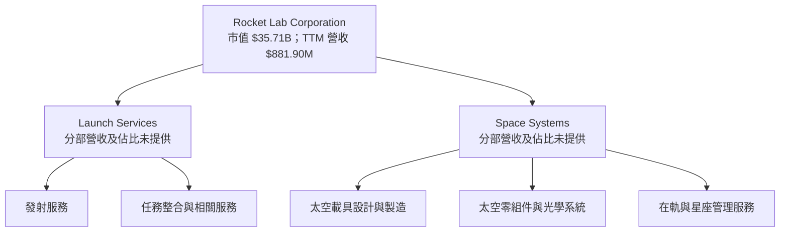
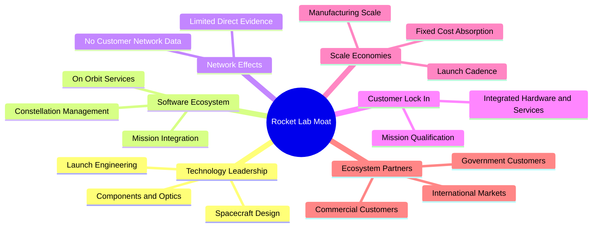
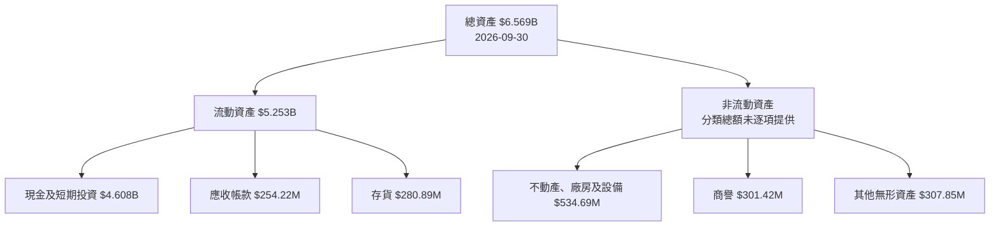
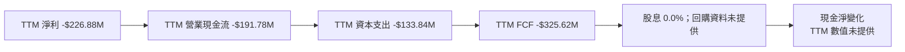
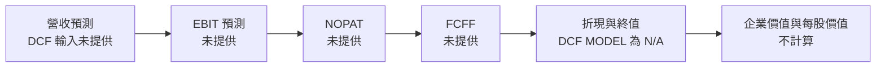
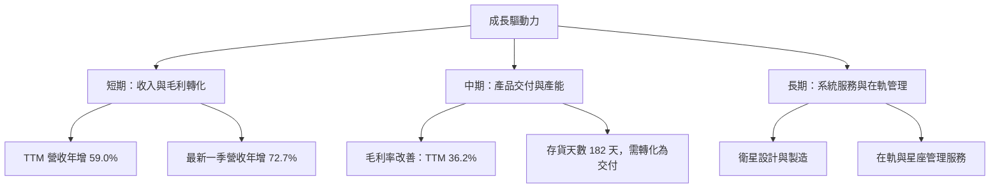
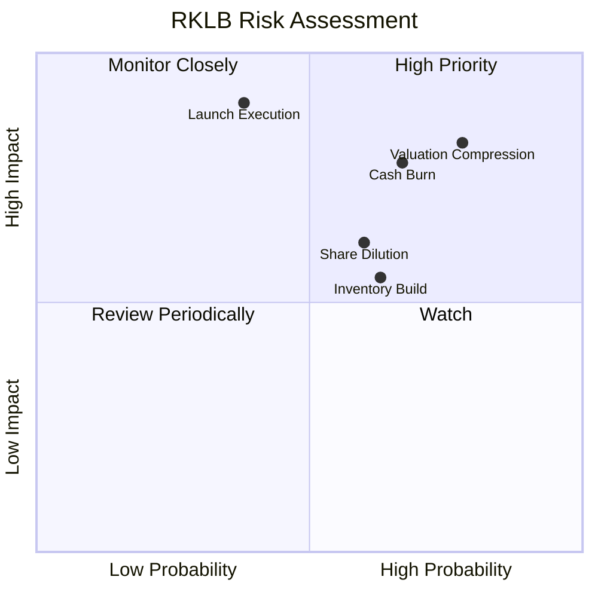
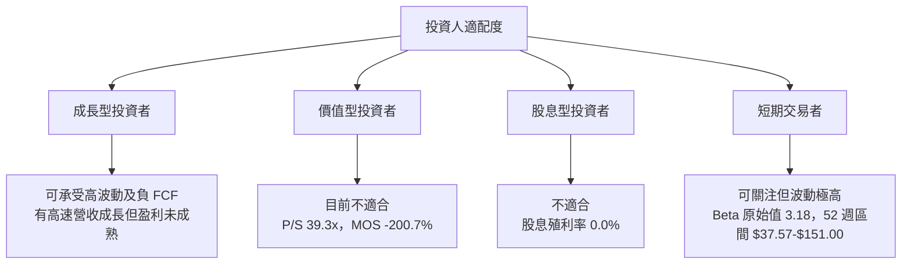

# RKLB 基本面深度分析報告
> **報告日期**：2026-11-19 ｜ **語言**：繁體中文 ｜ **數據來源**：SEC 申報資料 (XBRL)、Yahoo Finance、Finviz、StockAnalysis、Roic.ai ｜ **分析師**：CFA 級機構研究

## 目錄

| # | 章節 | 核心結論 |
|---|------|----------|
| 1 | 執行摘要 | 評級：賣出；加權合理價值 $17.65；MOS -200.7% |
| 2 | 公司概覽與商業模式 | 發射服務與太空系統並行；護城河有技術與客戶關係基礎，但量化資料有限 |
| 3 | 損益表深度分析 | TTM 營收 $881.90M、年增 59.0%；營業利益率 -27.6% |
| 4 | 資產負債表分析 | 現金及短期投資 $4.61B；流動性充足，營運資金週期拉長 |
| 5 | 現金流量深度分析 | TTM FCF -$325.62M；成長仍需外部資本支撐 |
| 6 | 獲利能力與資本效率 | ROIC -16.1% 對 WACC 14.00%，目前摧毀股東價值 |
| 7 | 相對估值分析 | 自身 P/S 39.3x，高於歷史中位數 19.4x |
| 8 | DCF 內在價值評估 | DCF 不適用；依程式估值方法加權合理價值 $17.65 |
| 9 | 成長催化劑 | 新產品、發射服務與太空系統擴張具成長潛力；TAM 數據未提供 |
| 10 | 風險矩陣 | 高估值、現金消耗與執行／技術風險為主要風險 |
| 11 | 投資建議 | 依 MOS 評級為賣出；現價 $53.07 顯著高於加權合理價值 |

---

## 1. 執行摘要

### 1.0 一頁式投資儀表板（Portfolio Manager 30 秒速讀）

| 項目 | 內容 |
|------|------|
| **投資論點（3 句）** | ① TTM 營收年增 **59.0%**、最新一季年增 **72.7%**，顯示需求擴張。② TTM 營業利益率 **-27.6%**、TTM FCF **-$325.62M**，成長尚未轉為獲利與自我融資。③ 以同業 P/S 與分析師共識計算的加權合理價值為 **$17.65**，遠低於 2026-11-18 收盤價 **$53.07**。 |
| **綜合評分** | **5.2/10**（引用 1.1 六項算術平均；不代表投資評級） |
| **財務健康** | 🟢 現金及短期投資 **$4.61B**、流動比率 **8.554**；但 TTM FCF 為 **-$325.62M**，流動性不等同獲利能力。 |
| **ROIC vs WACC** | **-16.1% vs 14.00%**；ROIC 低於資本成本 **30.1 個百分點**，目前摧毀股東價值。 |
| **FCF 趨勢** | TTM FCF **-$325.62M**；FCF Yield **-0.91%**。最新四個季度中的季度 FCF 均為負。 |
| **估值** | Forward P/E **741.4082x** ｜ EV/EBITDA **-168.987x** ｜ FCF Yield **-0.91%** |
| **DCF 內在價值（基準）** | **N/A**；TTM 營業利益為負，程式未提供可用 DCF。DCF 折溢價因此不計算。 |
| **安全邊際（MOS）** | **-200.7%**＝($17.65 − $53.07) ÷ $17.65；🔴 現價高於加權合理價值。 |
| **預期報酬（基準情境 12M）** | **N/A**；DCF 情境模型未提供。以加權合理價值計算的上行空間為 **-66.7%**，不是 DCF 基準情境報酬。 |
| **關鍵風險（前二）** | ① 高估值：自身 P/S **39.3x**。② 燒錢與獲利風險：TTM FCF **-$325.62M**、ROIC **-16.1%**。 |
| **評級 + 信心度** | 🔴 **賣出** ｜ 信心：中。MOS 明顯負值，但公司高速成長、商業化進度可能使短期估值波動劇烈。 |

### 1.1 綜合評分卡（全報告唯一）

| 維度 | 評分（1–10） | 主要依據（引用數字與其來源章節） |
|------|--------------|----------------------------------|
| 成長性 | 8.0 | TTM 營收年增 **59.0%**、最新一季年增 **72.7%**（第 3 章）；但收入組成拆分未提供。 |
| 獲利能力 | 2.0 | TTM 營業利益率 **-27.6%**、ROIC **-16.1%**、Piotroski F-Score **5/9**（第 3、6 章）。 |
| 財務健康 | 8.0 | 現金及短期投資 **$4.61B**、流動比率 **8.554**；CCC **176 天**，較一年前 **120 天**惡化（第 4 章）。 |
| 估值 | 1.0 | MOS **-200.7%**；自身 P/S **39.3x**，高於五年中位數 **19.4x**（第 7、8 章）。 |
| 護城河 | 7.0 | 發射、太空載具設計與零組件製造能力提供技術和客戶整合基礎；但未提供市場份額、客戶留存或分部毛利數據（第 2 章）。 |
| 管理層與資本配置 | 5.0 | FY2025 SBC **$71.10M**，約為 FY2025 營收 **11.8%**；稀釋股數測試未通過，回購與資本回報紀錄未提供（第 3、5 章）。 |
| **綜合評分** | **5.2** | 六項算術平均：(**8.0 + 2.0 + 8.0 + 1.0 + 7.0 + 5.0**) ÷ 6 = **5.2/10**。 |

### 1.2 五大投資論點 + 三大核心風險

| 類型 | 項目 | 具體依據 | 信心度 |
|------|------|----------|--------|
| 🟢 **投資論點①** | 高速營收擴張 | TTM 營收 **$881.90M**、TTM 年增 **59.0%**；最新季度營收 **$267.83M**、年增 **72.7%**。 | 🟢 高 |
| 🟢 **投資論點②** | 發射服務與太空系統的產品組合 | 公司提供發射服務、衛星設計、零組件、製造及在軌管理，能承接不只單次發射的產業需求；各項收入比例未提供。 | 🟡 中 |
| 🟢 **投資論點③** | 資金緩衝足以支持研發與擴產 | 現金及短期投資 **$4.61B**，大幅高於資料列示的債務；可降低近期融資風險，但資金消耗仍須監控。 | 🟢 高 |
| 🟢 **投資論點④** | 毛利率改善 | FY2022 毛利率約 **9.0%**，FY2025 約 **34.4%**；反映產品規模與組合改善，但營業費用尚未被收入吸收。 | 🟡 中 |
| 🟢 **投資論點⑤** | 產業與技術選擇權 | 公司的發射、太空系統與衛星製造能力可參與多類太空需求；目前無可引用的 TAM 數字，選擇權價值不宜直接量化。 | 🟡 中 |
| 🟡 **風險①** | 估值高於估值方法所示合理價值 | 現價 **$53.07**，加權合理價值 **$17.65**；MOS **-200.7%**。 | 🔴 高衝擊 |
| 🔴 **風險②** | 長期現金消耗與負資本回報 | TTM FCF **-$325.62M**、ROIC **-16.1%**，若營業槓桿未改善，需持續投入資金。 | 🔴 高衝擊 |
| 🟡 **風險③** | 技術、排程與執行風險 | 發射服務與新型太空產品高度依賴可靠度、產能爬坡及客戶驗收；提供資料沒有事故率或交付準時率。 | 🟡 中至高 |

### 1.3 快速統計卡片

| 指標 | 公司實際值（期間） | 同業中位數 | 狀態 |
|------|--------------------|------------|------|
| 營收成長（TTM） | **59.0%** | — | 🟢 |
| 營收成長（最新一季年增） | **72.7%** | **161.4%** | 🟡 |
| 毛利率（TTM） | **36.2%** | **55.5%** | 🟡 |
| 營業利益率（TTM） | **-27.6%** | — | 🔴 |
| ROIC（TTM） | **-16.1%** | — | 🔴 |
| Forward P/E | **741.4082x** | N/A（同業含負值或不可比較） | 🔴 |
| FCF Yield（TTM） | **-0.91%** | — | 🔴 |
| Piotroski F-Score | **5 / 9** | — | 🟡 |

*同業成長率與毛利率中位數取 SPCX、LUNR、PL 的 Peer multiples；Forward P/E 同業數值含負值及極端值，無適合的可比中位數。*

### 1.4 投資結論

```text
╔══════════════════════════════════════════════════════════════════╗
║                    📊 投資結論摘要                               ║
╠══════════════════════════════════════════════════════════════════╣
║  評級：賣出（依 MOS 門檻；未作質化調整）                         ║
║  價格（2026-11-18 收盤）：$53.07                                 ║
║  DCF 內在價值（基準）：N/A（TTM 營業利益為負）                   ║
║  安全邊際 MOS：-200.7%＝($17.65−$53.07)÷$17.65                 ║
║  加權合理價值（8.8）：$17.65                                     ║
║  綜合評分：5.2/10（引用 1.1）                                    ║
║  適合投資人：能承受高波動與長期虧損的成長型投資人；不適合以估值  ║
║              折價、當期獲利或股息收入為主要要求的投資人。        ║
╚══════════════════════════════════════════════════════════════════╝
```

---

## 2. 公司概覽與商業模式

### 2.1 業務結構與收入來源

公司收入按「Launch Services」與「Space Systems」兩個分部呈現，但兩分部的營收金額與營收佔比在本次引用數據中未提供，因此不自行拆分收入或繪製比例圖。



公司模式具有垂直整合特徵：發射服務可與衛星設計、製造、元件及在軌管理互相補充。尚無分部收入、分部利潤或訂單資料可證明哪一塊目前是成長主引擎。

### 2.2 市場份額

市場份額數據未提供，亦沒有可引用的市場規模與年份，因此不繪製市場份額圖。公司 TTM 營收 **$881.90M**、年增 **59.0%**，最新一季年增 **72.7%**；其規模介於規模較小的 LUNR 與高銷售倍數的 SPCX、PL 同業參照之間，但業務範圍並非完全相同。

### 2.3 競爭護城河分析



### 2.4 護城河強度

| 護城河項目 | 強度（強／中／弱） | 證據（引用數字或事實） | 會削弱它的情況 |
|------------|--------------------|------------------------|----------------|
| 技術與工程能力 | 中 | 同時提供發射服務、航天器設計、零組件、光學系統與製造；TTM 營收 **$881.90M**。 | 發射可靠度下降、開發延期或競爭者以更低成本提供相近能力。 |
| 軟體與服務生態 | 弱至中 | 公司提供在軌管理與星座管理服務，但經常性服務收入、續約率與毛利未提供。 | 軟體／服務收入占比無法提高，或客戶採用一次性採購而非長期服務。 |
| 網路效應 | 弱 | 未提供平台用戶、客戶數、資料網絡或網絡效應相關數字。 | 客戶可輕易多源採購，且規模不帶來新增資料或交易價值。 |
| 客戶鎖定 | 中 | 太空任務通常涉及資格認證與系統整合，公司產品線涵蓋設計至在軌支援；客戶留存數據未提供。 | 客戶因成本、排程或技術改變而重新設計任務架構。 |
| 規模效應 | 中 | FY2022 至 FY2025 營收由 **$211.00M** 增至 **$601.80M**，毛利率由約 **9.0%** 升至約 **34.4%**。 | 產能利用率未提高，研發、折舊與維護成本隨收入同步或更快成長。 |
| 生態夥伴 | 弱至中 | 公司服務美國、加拿大、日本及國際市場，但合作夥伴與合約集中度未提供。 | 政府採購變化、供應鏈受限或關鍵客戶延後任務。 |

**1.1 護城河評分為 7.0/10**：依據是多環節產品能力與毛利率長期改善；未能取得市場份額、客戶留存與分部經濟性數據，故不將潛在優勢視為已被量化證實。

---

## 3. 損益表深度分析

### 3.1 年度收入成長趨勢（近4年）

下表收入與年度數據取自年度損益表。FY2022 至 FY2025 收入 CAGR 為 **41.9%**：公式為 \((601.80 ÷ 211.00)^{1/3} - 1\)。

```text
╔══════════════════════════════════════════════════════════════════╗
║             Rocket Lab 年度收入趨勢（FY2022-FY2025）              ║
╠══════════════════════════════════════════════════════════════════╣
║  FY2022  $211.00M  ███████░░░░░░░░░░░░░░░░  YoY：+239.0% 🟢    ║
║  FY2023  $244.59M  ████████░░░░░░░░░░░░░░░  YoY：+15.9%  🟡    ║
║  FY2024  $436.21M  ███████████████░░░░░░░░  YoY：+78.3%  🟢    ║
║  FY2025  $601.80M  █████████████████████░░  YoY：+38.0%  🟢    ║
╠══════════════════════════════════════════════════════════════════╣
║  FY2022-FY2025 營收 CAGR：+41.9%                                 ║
╚══════════════════════════════════════════════════════════════════╝
```

FY2022 年增率使用資料所列 **239.0%**；由 FY2021 $62.24M 對照 FY2022 $211.00M 可見基期較低。後續 FY2024 增長較快、FY2025 年增放緩至 **38.0%**，但 FY2026 第三季單季年增已回升至 **72.7%**。年度與季度差異顯示交付與任務收入可能有季度波動，不能將單季增速直接外推為長期增速。

### 3.2 季度收入趨勢分析

| 季度 | 營收 | QoQ 成長 | YoY 成長 | 備註 |
|------|------:|---------:|---------:|------|
| 2025 Q4 | $179.65M | N/A | 35.7% | QoQ 需以前一季 Q3’25 數據比較，未納入近四季表。 |
| 2026 Q1 | $200.35M | 11.5% | 63.5% | 營收較前季增加 $20.70M。 |
| 2026 Q2 | $234.07M | 16.8% | 62.0% | 營收較前季增加 $33.72M。 |
| 2026 Q3 | $267.83M | 14.4% | 72.7% | 營收較前季增加 $33.76M；單季年增是季度率，不是 TTM 成長率。 |

QoQ 算式依序為：\((200.35 ÷ 179.65)-1=11.5\%\)、\((234.07 ÷ 200.35)-1=16.8\%\)、\((267.83 ÷ 234.07)-1=14.4\%\)。連續三季收入增加，支持業務擴張；但單季營業利益仍為負，收入成長尚未形成正向營業槓桿。

### 3.3 利潤率演變分析

| 利潤率指標 | FY2022 | FY2023 | FY2024 | FY2025 | 趨勢 | 評估 |
|------------|-------:|-------:|-------:|-------:|------|------|
| **毛利率** | 9.0% | 21.0% | 26.6% | 34.4% | ↗️ 四年改善，FY2025 毛利率較 FY2022 高約 25.4 個百分點 | 🟢 |
| **營業利益率** | -64.1% | -72.7% | -43.5% | -38.0% | ↗️ FY2023 惡化後回升，但仍大幅虧損 | 🔴 |
| **淨利率** | -64.4% | -74.6% | -43.6% | -32.9% | ↗️ 虧損率收窄，但尚未接近損益兩平 | 🔴 |

*年度比率以年度損益表收入、毛利、營業利益、淨利計算；TTM 官方引用利潤率另見下文。*

TTM 毛利率 **36.2%**，而 FY2025 約 **34.4%**，代表毛利率改善仍延續。合理解釋包括產能利用率、產品組合與規模增加；但沒有分部毛利或單位成本資料，不能將改善完全歸因於單一因素。FY2025 研發費用 **$270.72M**，相較 FY2024 **$174.39M** 增加 **55.2%**；持續研發投入有助產品擴張，也限制短期營業利潤率。最新季度營業利益率為 **-29.6%**，較 TTM **-27.6%** 差，顯示季度虧損率尚未穩定改善。

### 3.4 費用結構分析

公司收入、毛利及研發費用有年度數據，但完整營業費用細項在指定數據中不齊全，不能製作代表完整費用結構的圓餅圖。可確認 FY2025 研發費用 **$270.72M**，相當於收入 **45.0%**（$270.72M ÷ $601.80M）；FY2024 相應比率約 **40.0%**。研發投入增速高於 FY2025 營收增速，短期壓低營業利潤率，是否能在產品放量後轉化為規模效益，是估值關鍵。

### 3.5 季度 EPS 趨勢與盈餘品質（Quality of Earnings）

#### 過去四季 EPS 表現

| 季度 | EPS 實際值 | 預期值 | 超預期／不及預期 | 主要觀察 |
|------|-----------:|-------:|------------------|----------|
| 2025 Q4 | -$0.09 | N/A | N/A | 資料未提供可比預期值。 |
| 2026 Q1 | -$0.07 | N/A | N/A | EPS 較前季虧損收窄；收入增加。 |
| 2026 Q2 | -$0.08 | N/A | N/A | EPS 虧損較 Q1 擴大。 |
| 2026 Q3 | -$0.12 | N/A | N/A | EPS 虧損擴大；營業利益為 -$79.19M。 |

**EPS beat／miss 數據不可判定**：所列 EPS 預期值為 nan／缺漏，故不能宣稱超預期或不及預期。季度 EPS 由 Q1 -$0.07 降至 Q3 -$0.12，與營收成長並存，反映費用與投資支出仍快，或季度成本組合有所波動。

| 盈餘品質項目 | 數值/佔比 | 評估 |
|--------------|-----------|------|
| 股權薪酬 SBC / 營收 | TTM SBC **$84.20M** ÷ TTM 營收 **$881.90M** = **9.5%** | 🔴 SBC 相對收入仍高，具有股東稀釋成本；Piotroski 稀釋股數測試未通過。 |
| SBC / 營業現金流 | **$84.20M / -$191.78M = -43.9%** | 🔴 因營業現金流為負，此比率不具一般正向現金流覆蓋意義；SBC 並未解決現金消耗。 |
| FCF / 淨利（現金轉換率） | 約 **143.5%**（TTM FCF -$325.62M ÷ TTM 淨利 -$226.88M） | 🔴 兩者均為負值，正比率不表示良好現金轉換；現金流出額高於帳面淨損。 |
| 一次性／非經常性損益 | N/A | 未提供足夠拆分資料，不能判定本期淨損受一次性項目影響程度。 |
| 有效稅率異常 | N/A | 未提供可可靠計算的 TTM 現金或 GAAP 有效稅率。 |
| 資本化支出 vs 費用化 | TTM 資本支出 **$133.84M**；資本化政策細節 N/A | 支出中有資本支出，但未提供資本化政策與折舊明細，無法判定費用遞延幅度。 |

**盈餘品質結論**：目前 GAAP 淨利為負，不能用盈餘倍數衡量穩定盈利能力。SBC 佔 TTM 營收約 **9.5%**，對每股經濟價值構成稀釋；同時 FCF 為負，故以 EBITDA、調整後獲利或營收倍數估值時，應保留較大折價與執行風險。

---

## 4. 資產負債表分析

### 4.1 資產結構分解

以下採 2026-09-30 資產負債表數據。各細項僅列有來源數字的項目；不將未列示項目反推補足。



### 4.2 流動性與營運資金分析

| 指標 | 數值／期間 | 評估 |
|------|------------|------|
| 現金及短期投資 | **$4.61B**（最新數據） | 🟢 資金緩衝大，但不能取代改善現金流。 |
| 流動比率 | **8.554** | 🟢 短期償債資源充足；不等於資產可立即變現或業務已獲利。 |
| 速動比率 | **7.954** | 🟢 流動資產中現金與速動資產比重高。 |
| Piotroski 流動比率測試 | 較一年前改善，✅ | 🟢 輔助指標改善。 |

| 指標 | 最新 TTM | 一年前 TTM | 變化 | 解讀 |
|------|----------:|-----------:|-----:|------|
| DSO 應收帳款天數 | **49 天** | **39 天** | **+10 天** | 收款週期變長；可能與營收組合或客戶付款時點有關，需觀察應收款是否快於收入增長。 |
| DIO 存貨天數 | **182 天** | **140 天** | **+42 天** | 存貨增加可能反映備貨、製造週期或交付節奏；若無法轉成出貨，會占用現金並提高減值風險。 |
| DPO 應付帳款天數 | **55 天** | **59 天** | **-4 天** | 付款較一年前略快，沒有延長供應商融資的效果。 |
| CCC 現金轉換週期 | **176 天** | **120 天** | **+56 天** | 現金被營運資金占用的時間拉長，對負 FCF 公司是重要監控項。 |

### 4.3 債務結構分析

```text
╔══════════════════════════════════════════════════════════════════╗
║                   Rocket Lab 債務健康診斷                        ║
╠══════════════════════════════════════════════════════════════════╣
║  總債務（優先引用值）：  $1.72M   ▏                  低          ║
║  現金及短期投資：        $4.61B   ████████████████████ 充足      ║
║  淨現金（引用值）：      $4.61B   ████████████████████ 🟢        ║
║                                                                  ║
║  Debt/EBITDA：N/A（EBITDA 為負，倍數無經濟解讀）                 ║
║  Interest Coverage：N/A（利息費用／利息保障倍數未可靠提供）      ║
║  短期償債：流動比率 8.554；速動比率 7.954                       ║
╠══════════════════════════════════════════════════════════════════╣
║  注意：其他彙整欄位列示總債務 $120.28M 或 FY2025 $253.96M，與     ║
║  本報告優先引用區的 $1.72M 不一致；淨現金採優先引用值 $4.61B。    ║
╚══════════════════════════════════════════════════════════════════╝
```

債務資料來源存在差異，本報告依照 SEC／程式計算優先引用欄採用**總債務 $1.72M、淨現金 $4.61B**；其他欄位數字不混用，也不據此重算淨現金。投資人應在後續申報中核對借款、租賃負債和可轉換證券分類。

### 4.4 股東權益趨勢

| 年度 | 股東權益 | 年度變化 | 解讀 |
|------|---------:|---------:|------|
| 2022 | $673.21M | — | 提供數據中的歷史帳面值。 |
| 2023 | $554.54M | -17.6% | 權益下降，反映累計虧損等因素。 |
| 2024 | $382.45M | -31.0% | 虧損期間持續消耗權益。 |
| 2025 | $1.72B | +349.8% | 權益大幅增加；資本交易與股本變動的詳細拆分未提供，不能將增量視為營運獲利。 |

```text
╔══════════════════════════════════════════════════════════════════╗
║            股東權益（年度，數值依帳面資料）                      ║
╠══════════════════════════════════════════════════════════════════╣
║  2022  $673.21M  ████████░░░░░░░░░░░░░░░░                        ║
║  2023  $554.54M  ██████░░░░░░░░░░░░░░░░░░                        ║
║  2024  $382.45M  ████░░░░░░░░░░░░░░░░░░░░                        ║
║  2025  $1.72B    ████████████████████░░░░                        ║
╚══════════════════════════════════════════════════════════════════╝
```

---

## 5. 現金流量深度分析

### 5.1 現金流量瀑布圖



FCF 按指定定義為營業現金流減資本支出：**-$191.78M − $133.84M = -$325.62M**。股息殖利率為 **0.0%**；回購和 TTM 現金淨變化數據未提供，故不對現金變化作未經證實的歸因。

### 5.2 FCF 轉換率趨勢

| 年度 | FCF | 淨利 | FCF／淨利 | 解讀 |
|------|----:|-----:|----------:|------|
| 2022 | -$148.95M | -$135.94M | 109.6% | 兩者均為負，比例不能作為良好轉換率。 |
| 2023 | -$153.57M | -$182.57M | 84.1% | 現金流出小於淨損，但仍未自我融資。 |
| 2024 | -$115.98M | -$190.18M | 61.0% | FCF 虧損收窄，仍為負值。 |
| 2025 | -$321.81M | -$198.21M | 162.4% | 現金流出大於帳面淨損，投資及資本支出提高。 |
| TTM | -$325.62M | -$226.88M | 約 143.5% | 兩者皆負，不代表正向現金轉換。 |

### 5.3 自由現金流趨勢

```text
╔══════════════════════════════════════════════════════════════════╗
║            自由現金流趨勢（年度已報值，百萬美元）                ║
╠══════════════════════════════════════════════════════════════════╣
║  FY2022  -$148.95M  ◀██████████████░░░░░░░░░░  FCF Yield N/A     ║
║  FY2023  -$153.57M  ◀███████████████░░░░░░░░░  FCF Yield N/A     ║
║  FY2024  -$115.98M  ◀███████████░░░░░░░░░░░░░  FCF Yield N/A     ║
║  FY2025  -$321.81M  ◀████████████████████████  FCF Yield N/A     ║
║  TTM     -$325.62M  ◀████████████████████████  FCF Yield -0.91%  ║
╠══════════════════════════════════════════════════════════════════╣
║  FY2025 與 TTM 現金消耗高於 FY2024；需由營收規模與毛利改善逐步  ║
║  吸收營運投入及資本支出，否則現金緩衝會隨時間下降。            ║
╚══════════════════════════════════════════════════════════════════╝
```

### 5.4 資本配置評估

資本配置金額目前可辨識的是資本支出與 SBC；回購金額、股息支付、收購及留存現金分配的完整數據未提供，因此不以比例圓餅圖呈現。

| 項目 | 可確認數據 | 評估 |
|------|------------|------|
| 資本支出 | TTM **$133.84M**；FY2025 現金流量表列示 **$156.28M** | 反映產能及設備投入；須追蹤投入是否帶來交付與毛利改善。 |
| 研發支出 | FY2025 **$270.72M**，FY2024 **$174.39M** | 產品開發投入大，短期壓低獲利；長期回報取決於新產品商業化。 |
| 股息 | 殖利率 **0.0%** | 目前無股息回報。 |
| 回購 | N/A | 沒有可引用的回購金額。 |
| SBC | TTM 約 **$84.20M**；FY2025 **$71.10M** | 形成非現金損益費用，但對持股比例與每股價值有稀釋成本。 |

---

## 6. 獲利能力與資本效率

### 6.1 ROE / ROA / ROIC 趨勢

| 指標 | FY2022 | FY2023 | FY2024 | FY2025／TTM | 評估 |
|------|-------:|-------:|-------:|------------:|------|
| ROE | N/A | N/A | N/A | **TTM -3.9%**（品質指標口徑） | 負值表示股東權益尚未產生正回報。 |
| ROA | N/A | N/A | N/A | 彙整數據列示 **-3.5%**；品質測試顯示 ROA 未大於零 | 資產回報仍為負。 |
| ROIC | N/A | N/A | N/A | **TTM -16.1%** | 顯著低於 WACC 14.00%。 |

歷史逐年 ROIC／ROE／ROA 的一致口徑序列未提供，故不以不同來源的估算值補齊。不同彙整來源對 ROE 與 ROA 的 TTM 數值有差異；品質指標中的 ROE **-3.9%** 用於杜邦分解，ROIC 則按優先引用數值 **-16.1%**。

### 6.2 ROIC vs WACC 分析（核心價值創造判斷）

```text
╔══════════════════════════════════════════════════════════════════╗
║                ROIC vs WACC 深度分析                            ║
╠══════════════════════════════════════════════════════════════════╣
║  資本成本輸入（日期依資料庫所列）：                              ║
║  ├── 無風險利率（10Y 美債）：       5.07%                       ║
║  ├── 市場風險溢酬 ERP：             5.00%                       ║
║  ├── Beta（調整後）：               2.00                        ║
║  ├── 股權成本：                     15.07%                      ║
║  ├── 債務成本（稅前，輸入值）：     1543.65%                    ║
║  ├── 股權／債務權重：               100.0%／0.0%                ║
║  ├── 計算 WACC：                    15.12%                      ║
║  └── 區間上限限制後採用 WACC：      14.00%                      ║
║                                                                  ║
║  ROIC（TTM）：                       -16.1%                      ║
║  EVA Spread = ROIC − WACC：         -16.1% − 14.00% = -30.1 pp  ║
║                                                                  ║
║  ROIC  -16.1%  ◀██████████████░░░░░░░░░░░░░░░░  🔴             ║
║  WACC   14.0%  ▓▓▓▓▓▓▓▓▓▓▓▓▓▓▓▓▓▓▓▓▓▓▓▓░░░░░░  ──             ║
╠══════════════════════════════════════════════════════════════════╣
║  結論：ROIC 低於 WACC 30.1 個百分點，當前資本回報摧毀股東價值。 ║
╚══════════════════════════════════════════════════════════════════╝
```

Beta 原始值 **3.18**，調整公式為 \(⅔×3.18+⅓=2.45\)；資料庫將結果限制在 **0.6–2.0** 區間，故使用調整後 **2.00**。資料列示的 CAPM 股權成本 **15.07%**；計算 WACC 為 **15.12%**，因設定的採用區間上限為 **14.00%**，因此後續分析按指定採用 **14.00%**。債務成本數值極端，且債務權重為 0.0%，本報告不將它解讀為正常市場借款成本。第 8.2 節同樣引用此 WACC。

### 6.3 杜邦三因素分解

| 因素 | 數值（TTM） | 解讀 |
|------|-------------|------|
| 淨利率 | **-25.7%** | 虧損率主導 ROE 為負，反映公司尚未達營運盈利。 |
| 資產週轉率 | **0.13** | 每單位資產產生的收入有限；資產投入與收入成長需同步提高效率。 |
| 權益乘數 | **1.13** | 槓桿不高，ROE 不是靠高財務槓桿支撐。 |
| **ROE** | **-3.9%** | **-25.7% × 0.13 × 1.13 = -3.77%**；提供的品質指標列示 ROE **-3.9%**，差異來自四捨五入及原始精度。 |

### 6.4 財務體質：Piotroski F-Score

**Piotroski F-Score：5 / 9**。該分數依品質指標原值引用，不另行重算。

| 測試 | 結果 | 解讀 |
|------|------|------|
| ROA > 0 | ❌ 未通過 | 公司仍未達正資產報酬。 |
| 營業現金流 > 0 | ❌ 未通過 | TTM 營業現金流 **-$191.78M**。 |
| ROA 高於一年前 | ✅ 通過 | 相較一年前改善，但仍未轉正。 |
| 營業現金流 > 淨利（應計品質） | ✅ 通過 | 相對淨利的現金流測試通過；不改變現金流仍為負的事實。 |
| 長期負債 ÷ 總資產低於一年前 | ✅ 通過 | 槓桿負擔方向改善。 |
| 流動比率高於一年前 | ✅ 通過 | 短期流動性相對改善。 |
| 稀釋股數未增加 | ❌ 未通過 | 股數稀釋會攤薄每股價值。 |
| 毛利率高於一年前 | ✅ 通過 | 毛利改善支持規模與產品組合優化。 |
| 資產週轉率高於一年前 | ❌ 未通過 | 資產擴張尚未轉化為更高週轉效率。 |

---

## 7. 相對估值分析

### 7.1 同業估值比較表格

| 估值指標 | **RKLB** | **SPCX** | **LUNR** | **PL** | RKLB 評估 |
|----------|---------:|---------:|---------:|-------:|-----------|
| **Trailing P/E** | N/A | 623.9x | N/A | N/A | 🔴 RKLB 虧損，Trailing P/E 不適用。 |
| **Forward P/E** | **741.4082x** | 52.3x | -57.3x | -9640.0x | 🔴 RKLB 正向 Forward P/E 極高；同業含負值，盈利基礎不具可比性。 |
| **P/S Ratio** | **39.3x** | 60.8x | 2.5x | 11.6x | 🔴 RKLB 高於 LUNR、PL；低於 SPCX。 |
| **EV/EBITDA** | **-168.987x** | 161.7x | -38.3x | -83.0x | 🔴 RKLB EBITDA 為負，負倍數不可按一般正倍數解讀。 |
| **最新一季營收 YoY** | **72.7%** | 161.4% | 413.7% | 58.1% | 🟡 RKLB 成長高於 PL，低於 SPCX、LUNR。 |
| **毛利率（TTM）** | **36.2%** | 56.8% | 20.3% | 55.5% | 🟡 高於 LUNR，但低於 SPCX、PL。 |

同業數據取自 Yahoo Finance Peer multiples；各公司業務與盈利階段不同，尤其 LUNR、PL 的負 Forward P/E、負 EV/EBITDA 不宜直接視作正常估值基準。估值方法中的同業 P/S 則依指定模型採 LUNR、PL 中位數 **7.1x**，與本表三家公司完整列示的比較用途不同。

### 7.2 歷史估值區間分析

```text
╔══════════════════════════════════════════════════════════════════╗
║               RKLB 五年 P/S 歷史位置（TTM）                     ║
╠══════════════════════════════════════════════════════════════════╣
║  歷史低點：7.1x                                                  ║
║  五年中位數：19.4x                                               ║
║  目前：39.3x                                                     ║
║  歷史高點：83.2x                                                 ║
║                                                                  ║
║  7.1x ├──────── 19.4x ───────────● 39.3x ────────────┤ 83.2x   ║
║                                    百分位：62%                   ║
╚══════════════════════════════════════════════════════════════════╝
```

目前 P/S **39.3x** 為五年區間約 **62 百分位**，約為五年中位數 **19.4x** 的 **2.0 倍**。此位置表示市場已預先反映較高成長預期；若收入增速、產品交付或毛利率低於預期，倍數回歸可能加劇股價下行。

### 7.3 情境價值（Bear / Base / Bull，照抄 DCF MODEL 的 Scenarios）

**N/A（DCF 無法計算：TTM 營業利益為負，程式未產出 DCF Scenarios；依規則不自行設定情境目標價。）**

### 7.4 相對估值隱含價格區間

```text
╔══════════════════════════════════════════════════════════════════╗
║                相對估值方法與現價位置                            ║
╠══════════════════════════════════════════════════════════════════╣
║  同業 P/S                 $9.26  ├─●                            ║
║  加權合理價值             $17.65 ├────●                          ║
║  現價（2026-11-18）       $53.07 ├──────────────●                ║
║  分析師共識目標價         $93.15 ├────────────────────────●       ║
╚══════════════════════════════════════════════════════════════════╝
```

| 方法 | 隱含每股價值 | 相對現價 | 依據 |
|------|--------------:|---------:|------|
| 同業 P/S | **$9.26** | **-82.6%** | LUNR、PL 同業中位數 P/S **7.1x** × RKLB TTM 營收，依程式估值方法計算。 |
| 分析師共識目標價 | **$93.15** | **+75.5%** | 20 位分析師平均目標價；低端 **$58.00**、高端 **$127.00**。 |

---

## 8. DCF 內在價值評估（Discounted Cash Flow）

> **模型狀態：N/A。** TTM 營業利益為負，DCF MODEL 未提供；本章不自行建立現金流預測、終值、敏感度矩陣或反推 DCF。這避免把未經數據支持的長期利潤率、資本支出與現金流假設包裝成精確內在價值。

### 8.0 估值推理鏈（Thinking Logic）

本公司的價值理論上由發射服務、太空系統及未來在軌／星座管理服務的收入與盈利能力共同決定；但分部營收占比、各分部利潤率及管理層長期財測未提供，無法量化其相對貢獻。

| 決策點 | 本報告採用 | 理由（含數字） | 曾考慮但否決 | 否決理由 |
|--------|-----------|----------------|--------------|----------|
| 現金流定義 | DCF 不適用，N/A | TTM 營業利益率 **-27.6%**、TTM FCF **-$325.62M**。 | 自行建立 FCFF 預測 | 缺少可驗證營業轉正時間、分部盈利及長期資本投入假設。 |
| 預測期 N | N/A | 程式沒有提供 DCF 模型年數。 | 自行採用 5–10 年 | 沒有資料足以選定預測年數及逐年假設。 |
| 終值方法 | N/A | 沒有可供折現的正向營業基礎與 DCF 假設。 | Gordon Growth／退出倍數 | 自行指定終值會形成黑箱估值。 |
| EBIT 基礎 | N/A | DCF MODEL 未啟用。 | GAAP 或非 GAAP EBIT 外推 | 無逐年營業利潤率假設。 |

**Step 3：假設推導鏈**  
營收 CAGR、期末利潤率、稅率、Capex／營收、D&A、營運資金、SBC處理、稀釋率、永續成長率、預測期與終值方法均沒有程式 DCF 輸入值；依規則只能標記 **N/A**，不能自行挑選或回推。

**Step 4：最脆弱環節**  
主要估值缺口是公司何時能把 **59.0% TTM 營收成長**轉化為正營業利潤與正 FCF；若無法改善，任何基於長期正現金流的估值都會偏高。

**Step 5：計算路徑**



### 8.1 模型假設總表（Model Inputs）

**N/A（DCF MODEL 未提供：TTM 營業利益為負，且程式沒有建立可用的正向營業現金流 DCF。）**

| 假設項目 | 採用值 | 依據／來源 | 敏感度 |
|----------|--------|-------------|--------|
| 預測期長度 N | N/A | DCF MODEL 未提供預測年數。 | N/A |
| 營收 CAGR | N/A | 雖有 TTM 成長 **59.0%**，但不能直接替代未來預測。 | N/A |
| 期末營業利潤率 | N/A | TTM 營業利益率 **-27.6%**，未提供轉正路徑。 | N/A |
| 有效稅率 | N/A | 未提供 DCF 稅率假設。 | N/A |
| Capex／營收 | N/A | TTM 資本支出 **$133.84M**，但沒有預測比率。 | N/A |
| D&A／營收 | N/A | 未提供 DCF 模型輸入。 | N/A |
| 營運資金變動／營收增額 | N/A | 未提供 DCF 模型輸入。 | N/A |
| EBIT 基礎 | N/A | 未提供模型設定。 | N/A |
| SBC 處理 | N/A | 未提供模型設定。 | N/A |
| 年稀釋率 | N/A | 稀釋股數測試未通過，但沒有模型稀釋假設。 | N/A |
| 永續成長率 g | N/A | DCF MODEL 未提供。 | N/A |
| 終值方法 | N/A | DCF MODEL 未提供。 | N/A |
| WACC | **14.00%**（引用資本成本資料） | 8.2 節所列程式採用值；不代表有可計算的 DCF。 | 高 |

FCFF 定義、預測期年度表、SBC 三要素組合均因 DCF MODEL 為 N/A 而不適用；不得用上述資料另建模型。

### 8.2 折現率推導（WACC）

```text
╔══════════════════════════════════════════════════════════════════╗
║                    WACC 推導（折現率）                           ║
╠══════════════════════════════════════════════════════════════════╣
║  股權成本 Ke（CAPM，資料庫輸入）：                               ║
║  ├── 無風險利率 Rf（10Y 美債）：       5.07%                    ║
║  ├── 市場風險溢酬 ERP：                5.00%                    ║
║  ├── Beta 原始值：                     3.18                     ║
║  ├── Beta 調整值：                     2.00                     ║
║  ├── 規模／國別溢酬：                  未另加計                 ║
║  └── 資料庫股權成本：                  15.07%                   ║
║                                                                  ║
║  Beta 調整：⅔×3.18 + ⅓ = 2.45；受 0.6–2.0 範圍限制，採 2.00。 ║
║  稅前債務成本（資料輸入）：             1543.65%                 ║
║  資本結構權重 E／D：                   100.0%／0.0%             ║
║  程式計算 WACC：                        15.12%                   ║
║  區間限制 7%–14% 後採用 WACC：         14.00%                   ║
╚══════════════════════════════════════════════════════════════════╝
```

1. **Ke（CAPM）**：資料庫直接列示 **15.07%**；Rf **5.07%**、ERP **5.00%**、採用 Beta **2.00**。  
   原始 Beta **3.18**，調整結果 \(⅔×3.18+⅓=2.45\)，再受上限 **2.0** 限制。

2. **稅前 Kd**：程式列示 **1543.65%**；此值為輸入資料的計算結果，因債務金額很小且債務權重列為 0.0%，不將其視為正常可持續借款成本。

3. **稅後 Kd**：以指定預設稅率 **21.0%** 表示，若形式換算為 \(1543.65\%×(1-21.0\%)\)，為 **1219.48%**；此衍生數僅展示輸入值的稅後算術，非市場融資成本估計。

4. **權重**：程式列示股權／債務權重 **100.0%／0.0%**。因資料庫市值及計息負債口徑有差異，本報告不以另一套價格、股數或債務口徑重新構造權重。

5. **WACC**：程式計算值 **15.12%**，被限制在 **7%–14%** 區間，故採用值為 **14.00%**。第 6.2 節同採 **14.00%**。沒有自行另算替代 WACC。

### 8.3 逐年自由現金流預測（基準情境）

**N/A（沒有 DCF 逐年模型；缺少 FY+1 至 FY+N 的收入、利潤率、稅率、D&A、Capex、營運資金、終值及每股價值假設。）**

### 8.4 終值計算（Terminal Value）

**N/A（沒有 DCF 預測期末 FCFF、永續成長率 g 或終值倍數；不計算 Gordon Growth 或退出倍數。）**

### 8.5 企業價值 → 每股內在價值（Bridge）

**N/A（DCF MODEL 未提供 EV、終值現值、淨現金橋接與 DCF 每股價值。）**

折溢價按規則須以第 8.5 節 DCF 基準內在價值為分母；由於該值為 N/A，本報告不計算 DCF 折溢價。第 8.8 節的 MOS 則仍以加權合理價值為分母，兩者不混用。

### 8.6 敏感性分析（WACC × 永續成長率）

**N/A（沒有 DCF 基準 FCFF、WACC × g 矩陣或情境模型；不自行試算。）**

### 8.7 反推 DCF（Reverse DCF：市場在預期什麼）

**N/A（沒有 DCF 模型，無法固定其餘參數並由現價反解單一變數。）**

### 8.8 估值三角驗證與安全邊際

| 估值方法 | 隱含每股價值 | 上行空間（÷現價） | 權重 | 說明 |
|----------|--------------:|------------------:|------:|------|
| 同業 P/S | **$9.26** | **-82.6%** | **90%** | 同業中位數 P/S **7.1x**（LUNR、PL）乘以公司 TTM 營收，依程式估值輸出。 |
| 分析師共識目標價 | **$93.15** | **+75.5%** | **10%** | 20 位分析師平均目標價；參考性高，但不是公司已實現現金流。 |
| **加權合理價值** | **$17.65** | **-66.7%** | **100%** | 公司類型為未獲利公司；同業 Forward P/E 不可計算，權重依規則分配給可用方法。 |

逐步演算：

\[
\$9.26×90\%+\$93.15×10\%
=\$8.334+\$9.315
=\$17.649
\approx \mathbf{\$17.65}
\]

權重總和為 \(90\%+10\%=100\%\)。MOS 與上行空間使用不同分母：

- **MOS**＝\((\$17.65-\$53.07)÷\$17.65=-200.7\%\)
- **上行空間**＝\((\$17.65-\$53.07)÷\$53.07=-66.7\%\)

```text
╔══════════════════════════════════════════════════════════════════╗
║                  估值區間與安全邊際                              ║
╠══════════════════════════════════════════════════════════════════╣
║  $9.26 ─────── [$17.65] ───────────────────── $53.07             ║
║  同業 P/S       加權合理值                      現價              ║
║                                                                  ║
║  安全邊際 MOS = ($17.65 − $53.07) ÷ $17.65 = -200.7%            ║
║  MOS 評估：🔴 低於 10%，現價沒有估值安全墊                       ║
║  上行空間 = ($17.65 − $53.07) ÷ $53.07 = -66.7%                 ║
║                                                                  ║
║  參考價位：MOS 至少 10% 對應價格上限約 $15.89                   ║
║  （$17.65×(1−10%)；屬於估值門檻，不是獨立 DCF 目標價）           ║
╚══════════════════════════════════════════════════════════════════╝
```

> 🔎 **程式複算（Python，依本節各項自動重算）**
>
> 加權合理價值 = $9.26 × 90% + $93.15 × 10% = **$17.65**（權重合計 100%）
>
> 以價格 $53.07 計：MOS = **-200.7%**，上行空間 = **-66.7%**
>
> ✅ 與本節所寫數值一致。

### 8.9 DCF 模型的局限與失效條件

- **終值依賴度**：N/A；沒有 DCF 預測與終值可供計算。
- **最脆弱的估值環節**：即使採相對估值，結果仍高度依賴可比公司選取及收入倍數；同業 P/S 方法得 **$9.26**，分析師共識為 **$93.15**，差異顯示估值分歧很大。
- **不適用情境**：公司 TTM 營業利益為負、TTM FCF **-$325.62M**，以傳統現金流折現估值可靠度低。現階段適合交叉參考 EV/Sales、同業 P/S、分部估值及單位經濟性；但本報告沒有足夠分部資料進行 SOTP。
- **與第 10 章風險矩陣的連結**：收入增速放緩會壓低銷售倍數；營業利潤率與毛利率惡化會延後正 FCF；發射失敗或新產品延期會影響收入交付與投入回收。

### 8.10 複算檢核表（Audit Trail）

| # | 檢核項目 | 檢查方式 | 結果 |
|---|----------|----------|------|
| 1 | 所有高／中敏感度 DCF 輸入均有四段式推導 | DCF MODEL 為 N/A，沒有此類輸入 | ✅ 不適用，未自行建立輸入 |
| 2 | 每個 DCF 假設有來歷 | 未建模的輸入均明確列 N/A | ✅ |
| 3 | WACC 算式及限制處理 | 引用計算值 15.12%，採用上限值 14.00% | ✅ |
| 4 | Kd 與債務權重口徑一致 | 優先引用權重為 E/D 100%/0%；債務來源有衝突並已揭露 | ⚠️ 原始資料口徑差異，未自行重算 |
| 5 | WACC 與第 6.2 節同值 | 均為 14.00% | ✅ |
| 6 | 逐年模型欄位數等於 N | N/A，未建逐年預測 | ✅ 不適用 |
| 7 | FY+1 現金流算式可複算 | 無 FY+1 數值 | ✅ 不適用 |
| 8 | 預測期 PV 加總 | 無 DCF PV | ✅ 不適用 |
| 9 | WACC > g | g 未提供 | ✅ 不適用 |
| 10 | 終值基礎與折現期 | 未計算終值 | ✅ 不適用 |
| 11 | EV 至每股價值橋接 | DCF Bridge 為 N/A | ✅ 不適用 |
| 12 | SBC 三要素組合相容 | 沒有 DCF EBIT／SBC／股數設定 | ✅ 不適用，未宣稱完成 DCF |
| 13 | 敏感性矩陣基準格一致 | 沒有矩陣 | ✅ 不適用 |
| 14 | 矩陣有效格條件 | 沒有矩陣 | ✅ 不適用 |
| 15 | 三情境機率加總 | 沒有 DCF 情境 | ✅ 不適用 |
| 16 | 反推 DCF 每列只放開一個變數 | 沒有反推模型 | ✅ 不適用 |
| 17 | MOS 以 8.8 加權值為分母 | MOS **-200.7%**，與儀表板一致 | ✅ |
| 18 | 報告完整至第 11 章 | 章節 1–11 均列出 | ✅ |
| 19 | 加權值為方法價值乘權重之和 | $9.26×90%+$93.15×10%=$17.649≈$17.65 | ✅ |
| 20 | 評級符合 MOS 門檻 | MOS -200.7% < -25%，評級賣出 | ✅ |

---

## 9. 成長催化劑

### 9.1 催化劑時間軸

具體發射排程、產品商業化里程碑與合約交付日期未提供，因此不虛構時間點或繪製含自訂日期的甘特圖。可持續追蹤的催化劑為：短期季度收入與毛利；中期新產品交付、產能利用與發射節奏；長期太空系統及在軌管理服務占比。

### 9.2 TAM 市場規模分析

**N/A（TAM 數據未提供）**。目前可引用的公司規模是 TTM 營收 **$881.90M**、TTM 成長 **59.0%**、最新一季年增 **72.7%**。要量化滲透率，仍需可追溯來源與年份的發射服務、衛星製造及在軌服務市場規模。

### 9.3 成長驅動力結構圖



長期服務與星座管理可能提升收入延續性，但資料沒有經常性收入占比或合約續約率，故這是待驗證的成長方向，不是已量化的估值溢價來源。

---

## 10. 風險矩陣

### 10.1 風險評分矩陣

以下座標是定性的分析判斷，不是公司財務預測或歷史發生率。



### 10.2 風險清單詳細分析

| # | 風險項目 | 發生機率 | 財務衝擊 | 風險評分 | 緩解措施 |
|---|----------|----------|----------|----------|----------|
| 1 | 🔴 **估值倍數收縮** | 高（定性） | 高：P/S **39.3x**，高於五年中位數 **19.4x**；倍數回落會放大股價跌幅。 | 🔴 高 | 分批建倉或設定估值上限；每季檢查收入成長、毛利率和倍數。 |
| 2 | 🔴 **現金消耗持續** | 高（定性） | 高：TTM FCF **-$325.62M**，TTM 營業現金流 **-$191.78M**。 | 🔴 高 | 追蹤 FCF、Capex、現金餘額及融資安排；要求收入成長逐步改善現金轉換。 |
| 3 | 🔴 **發射或新產品執行失誤** | 中（定性） | 高：可能造成交付延誤、客戶信任受損及收入遞延；目前沒有事故率或準時率資料。 | 🔴 高 | 追蹤任務成功率、交付時程、客戶驗收及合約延遲揭露。 |
| 4 | 🟡 **存貨與營運資金增加** | 中高（定性） | 中高：DIO **182 天**，較一年前 **140 天**；CCC **176 天**，同比增加 **56 天**。 | 🟡 中高 | 監測存貨周轉、應收帳款及交付轉換；若存貨增速高於收入，檢查減值風險。 |
| 5 | 🟡 **股權稀釋** | 中高（定性） | 中：TTM SBC 約 **$84.20M**，約占營收 **9.5%**；稀釋股數測試未通過。 | 🟡 中高 | 逐季披露稀釋股數、SBC 佔營收及每股收入變化；關注股本融資需要。 |

---

## 11. 投資建議

### 11.1 最終評級與評分

依加權合理價值 **$17.65** 與 2026-11-18 收盤價 **$53.07** 計算，MOS 為 **-200.7%**，低於賣出門檻 **-25%**，故維持 **賣出**，未作一級質化調整。公司品質綜合評分引用 1.1 的 **5.2/10**，六項分數依序為成長性 **8.0**、獲利能力 **2.0**、財務健康 **8.0**、估值 **1.0**、護城河 **7.0**、管理層與資本配置 **5.0**。

### 11.2 合理價值與隱含報酬率

| 方法／情境 | 每股價值 | 相對 2026-11-18 收盤價 $53.07 | 權重／機率 |
|------------|---------:|------------------------------:|-----------:|
| 同業 P/S | $9.26 | -82.6% | 90% |
| 分析師共識目標價 | $93.15 | +75.5% | 10% |
| **加權合理價值** | **$17.65** | **-66.7%** | **100%** |
| DCF 悲觀／基準／樂觀情境 | N/A | N/A | DCF MODEL 未提供 |

分析師平均目標價是參考值，不代表本報告的基準估值；加權合理價值按固定方法與權重計算，未再做主觀折讓或調整。

### 11.3 買入時機與觸發因素

```text
╔══════════════════════════════════════════════════════════════════╗
║                  ✅ 買入觸發因素 Checklist                      ║
╠══════════════════════════════════════════════════════════════════╣
║  目前結論：不建議在 $53.07 追價，因 MOS 為 -200.7%。             ║
║                                                                  ║
║  重新評估買入前的主要條件：                                      ║
║  ☐ 股價回到加權合理價值附近，並重新檢視同業倍數與營收假設。     ║
║  ☐ 營業利益率連續改善，且季度收入增長未以更快費用增長換取。     ║
║  ☐ TTM FCF 消耗持續收窄，資本支出與存貨增加得到交付支撐。       ║
║                                                                  ║
║  加碼觸發條件（需多項同時成立）：                                ║
║  ☐ 毛利率維持或高於 TTM 36.2%，營業利益率改善而非惡化。          ║
║  ☐ CCC 從 176 天下降，DIO 從 182 天回落或由交付成長解釋。        ║
║  ☐ SBC／營收比率低於目前約 9.5%，稀釋股數增長放緩。              ║
║                                                                  ║
║  減碼／重新檢視條件：                                            ║
║  ☐ 最新一季收入年增連續兩季低於 59.0% 的 TTM 成長基準。          ║
║  ☐ 營業利益率較 TTM -27.6% 進一步惡化，或 FCF 消耗擴大。         ║
║  ☐ 存貨與應收帳款持續快於營收增加，CCC 繼續拉長。                ║
╚══════════════════════════════════════════════════════════════════╝
```

上述價位與條件是監控門檻，不是 DCF 目標價。現價若大幅偏離基本面，仍應先核對最新申報與價格資料。

### 11.4 投資人適配度分析



### 11.5 每季財報監控清單（Quarterly Watch List）

| 監控指標 | 當前基準 | 觸發加碼／改善訊號 | 觸發減碼／警訊 |
|----------|----------|-------------------|----------------|
| 營收 | TTM **$881.90M**；TTM 年增 **59.0%**；最新一季年增 **72.7%** | 營收持續增長，且交付支撐應收及存貨 | 最新一季年增連續兩季低於 TTM **59.0%**，需重新評估成長假設 |
| 毛利率 | TTM **36.2%** | 維持或改善，表示收入增長能保留更多毛利 | 連續下滑，或收入增長伴隨毛利率收縮 |
| 營業利益率 | TTM **-27.6%**；最新季度 **-29.6%** | 虧損率逐季收窄 | 單季虧損率持續低於（更負於）**-29.6%** |
| 營業現金流 | TTM **-$191.78M** | 現金流流出收窄，且不是單靠延後付款 | TTM 營業現金流流出進一步擴大 |
| FCF／Capex | TTM FCF **-$325.62M**；Capex **$133.84M** | FCF 虧損收窄，資本投入轉為可辨識交付 | Capex 增長而收入、毛利或交付沒有相應提升 |
| 存貨與 CCC | DIO **182 天**；CCC **176 天** | DIO 與 CCC 下降，或存貨增長可被已交付訂單支持 | DIO／CCC 持續高於當前值，且營收無同步增長 |
| SBC／稀釋 | TTM SBC 約 **$84.20M**；SBC／營收約 **9.5%** | SBC 占收入下降、稀釋股數成長放緩 | SBC 占比上升或股數持續快速增加 |
| 研發費用 | FY2025 **$270.72M** | 研發轉化為新產品交付及新增收入 | 研發費用增加但產品里程碑、交付與毛利沒有進展 |
| 現金及短期投資 | **$4.61B** | 現金消耗率下降且仍保有充足資金緩衝 | 現金快速下降，並需在不利估值下融資 |
| 訂單／客戶／管理層財測 | 數據未提供 | 新申報披露可量化訂單、交付和指引 | 指引下修、交付延後或關鍵客戶取消 |

### 11.6 反面論證：什麼會證明論點錯誤（What Would Change My Mind）

```text
╔══════════════════════════════════════════════════════════════════╗
║              ⚠️ 論點失效條件（Disconfirming Evidence）           ║
╠══════════════════════════════════════════════════════════════════╣
║  多頭論點若要維持，收入增長必須逐步轉為毛利、營業利潤與現金流。 ║
║  出現以下情況時，應重新檢視或退出：                              ║
║                                                                  ║
║  ☐ 最新一季營收年增連續兩季低於 TTM 年增基準 59.0%。             ║
║  ☐ TTM 營業利益率較 -27.6% 進一步惡化，而收入增長未加速。        ║
║  ☐ TTM FCF 流出高於 -$325.62M，或營業現金流流出高於 -$191.78M。 ║
║  ☐ DIO 高於 182 天且沒有更高交付量或收入來支持存貨增加。         ║
║  ☐ SBC／營收高於目前約 9.5%，並伴隨稀釋股數持續增加。            ║
║  ☐ ROIC 維持負值且遠低於 WACC 14.00%，沒有可驗證的改善路徑。     ║
║  ☐ 產品延期、任務失敗或客戶取消合約，令營收增長與毛利改善中斷。 ║
╚══════════════════════════════════════════════════════════════════╝
```

> **免責聲明**：本報告為 AI 自動生成，僅供研究參考，不構成投資建議。投資有風險，入市需謹慎。

---

## 資料與來源

| 項目 | 內容 |
|------|------|
| 價格 | 53.07 USD，2026-11-18 收盤（Yahoo Finance 日線） |
| 財務報表 | SEC 10-Q filed 2026-11-09，最新季度 2026-09-30（FY2026 Q3） |
| 有回應的資料來源 | SEC 申報資料 (XBRL)、Yahoo Finance、Finviz、StockAnalysis、Roic.ai |
| 由程式計算 | TTM 數字、WACC、DCF 模型、估值方法與權重、加權合理價值、MOS、評級門檻、F-Score、杜邦分解、營運資金天數、綜合評分 |
| 撰寫模型 | openai / gpt-6-luna |

> 本區塊由產生報告的程式依實際取得的資料填寫，非模型撰寫。「由程式計算」的數字不是模型的估計；其餘判斷（評分、情境、策略）是模型的分析。
