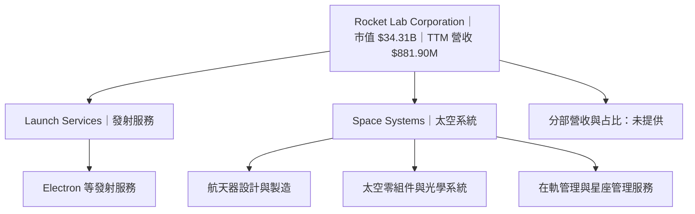
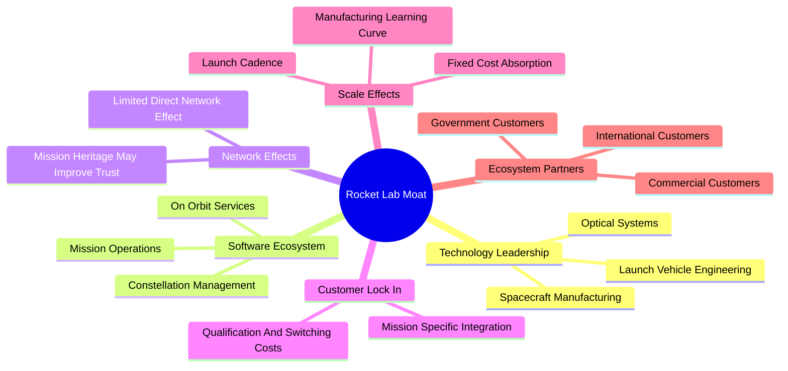
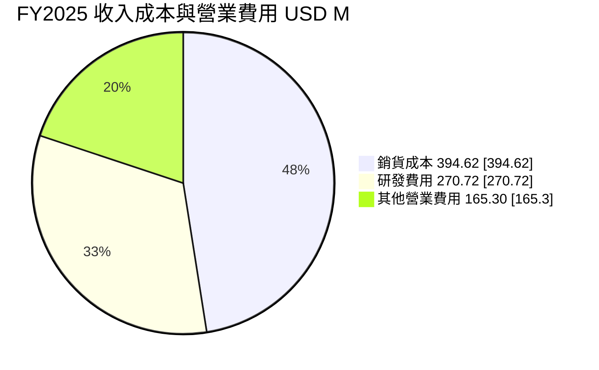
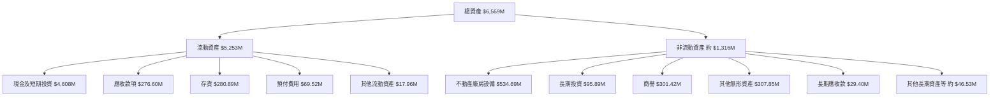
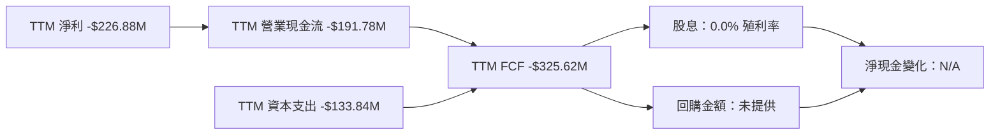
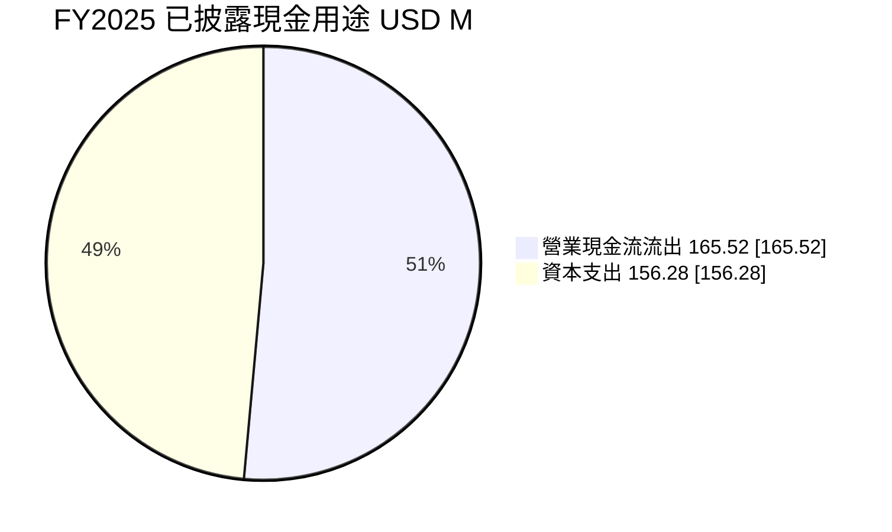
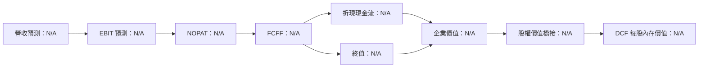
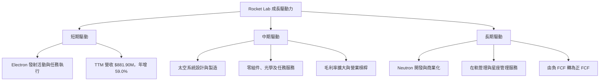
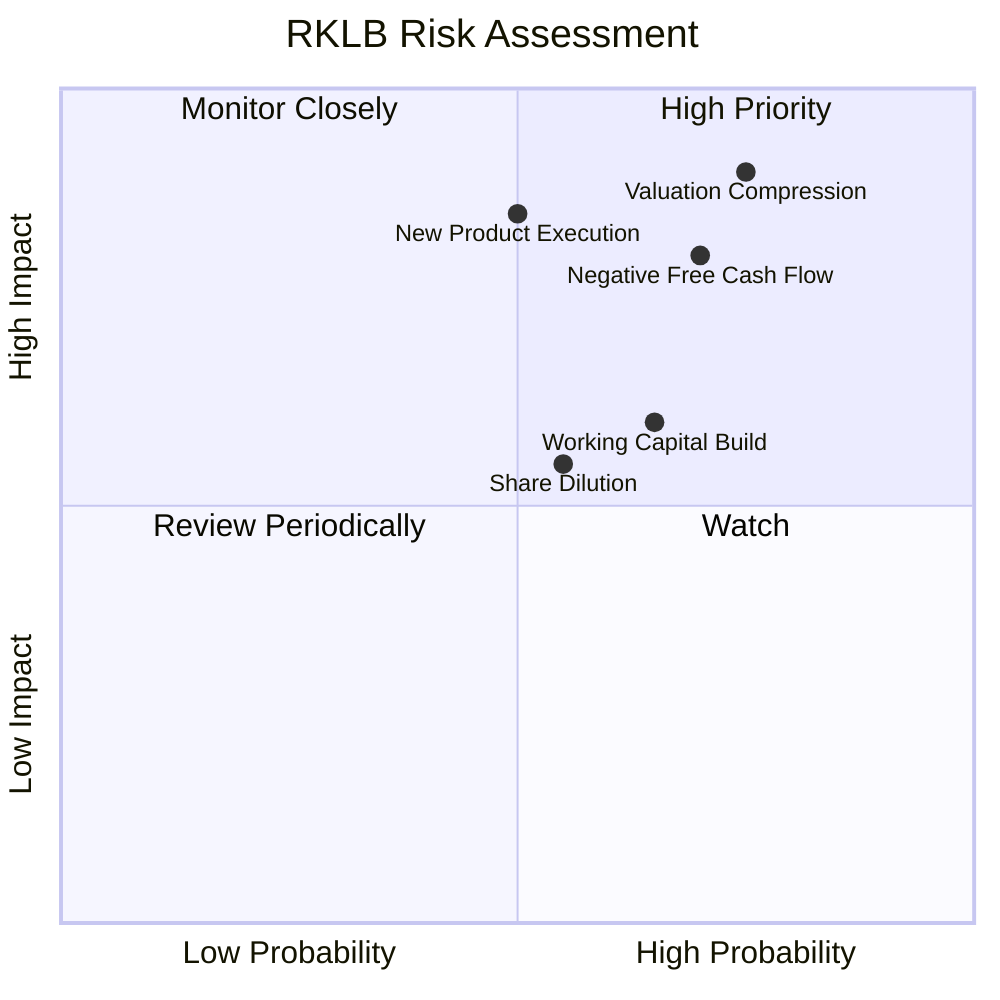
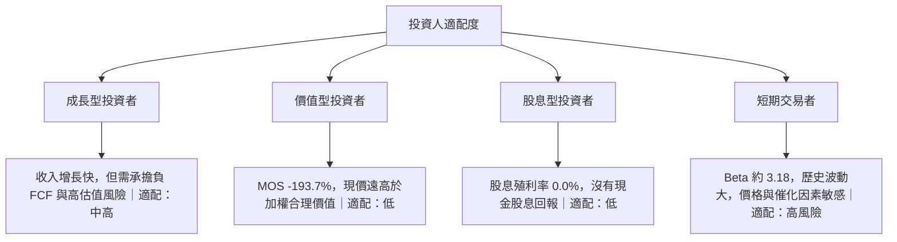

# RKLB 基本面深度分析報告
> **報告日期**：2026-11-20 ｜ **語言**：繁體中文 ｜ **數據來源**：SEC 申報資料 (XBRL)、Yahoo Finance、Finviz、StockAnalysis、Roic.ai ｜ **分析師**：CFA 級機構研究

## 目錄

| # | 章節 | 核心結論 |
|---|------|----------|
| 1 | 執行摘要 | **賣出**；加權合理價值 $17.36，MOS -193.7% |
| 2 | 公司概覽與商業模式 | 涵蓋發射服務與太空系統；市場份額及部門收入占比未提供，護城河來自技術、執行與客戶關係 |
| 3 | 損益表深度分析 | TTM 營收 $881.90M、年增 59.0%；仍錄得負營業利潤率 |
| 4 | 資產負債表分析 | 現金及短期投資 $4.61B，流動性充足；債務資料來源間存在差異 |
| 5 | 現金流量深度分析 | TTM FCF -$325.62M，營業現金流和資本支出合計造成持續現金消耗 |
| 6 | 獲利能力與資本效率 | ROIC -16.1% 對 WACC 14.00%，目前摧毀股東價值 |
| 7 | 相對估值分析 | 公司 P/S 高於 LUNR、PL；自身 P/S 亦高於五年中位數 |
| 8 | DCF 內在價值評估 | DCF 為 N/A；TTM 營業利益為負，依規則不建模，改以固定估值方法交叉驗證 |
| 9 | 成長催化劑 | Electron 發射活動及 Neutron 相關新聞提供催化線索；可核實的 TAM、收入拆分及日期未提供 |
| 10 | 風險矩陣 | 主要風險為高估值、負 FCF／負利潤率，以及新產品執行與產業競爭 |
| 11 | 投資建議 | 依 MOS 門檻為賣出；若採估值方法所示的買入門檻，價格需顯著低於現價 |

---

## 1. 執行摘要

RKLB 的營收增長與資產負債表流動性是正面因素：TTM 營收為 **$881.90M**，較前一 TTM 成長 **59.0%**，最新一季營收年增 **72.7%**；現金及短期投資為 **$4.61B**。但同一期間營業利益率為 **-27.6%**、ROIC 為 **-16.1%**、TTM FCF 為 **-$325.62M**，相對於 **14.00% WACC** 尚未創造經濟價值。以同業 P/S 與分析師共識目標價依固定權重計算，加權合理價值為 **$17.36**；對照 **2026-11-19 收盤價 $50.99**，MOS 為 **-193.7%**、上行空間為 **-66.0%**。因此，依 MOS 門檻評級為 **🔴 賣出**；高成長與現金儲備不足以抵銷現價相對估值的巨大落差。

### 1.0 一頁式投資儀表板（Portfolio Manager 30 秒速讀）

| 項目 | 內容 |
|------|------|
| **投資論點（3 句）** | ① TTM 營收年增 **59.0%**、最新一季年增 **72.7%**，顯示需求與交付規模仍在擴張。② 現金及短期投資 **$4.61B**，可為高研發與資本支出提供緩衝。③ 但 ROIC **-16.1%**、WACC **14.00%**、TTM FCF **-$325.62M**，加權合理價值 **$17.36** 遠低於現價。 |
| **綜合評分** | **4.9/10**（引用 1.1 六項平均） |
| **財務健康** | 🟡 現金儲備高、流動性充裕，但現金流為負且營運資金週期延長 |
| **ROIC vs WACC** | **-16.1% vs 14.00%**（相差 -30.1 個百分點；目前摧毀股東價值） |
| **FCF 趨勢** | TTM FCF **-$325.62M**；TTM FCF Yield **-0.95%**。FY2025 FCF 較 FY2024 惡化 |
| **估值** | Forward P/E **712.34985x** ｜ EV/EBITDA **-161.34x** ｜ FCF Yield **-0.95%** |
| **DCF 內在價值（基準）** | **N/A**；TTM 營業利益為負，DCF MODEL 不適用，故 DCF 折溢價不計算 |
| **安全邊際（MOS）** | **-193.7%＝($17.36 − $50.99) ÷ $17.36**；基準為 8.8 加權合理價值，🔴 無安全邊際 |
| **預期報酬（基準情境 12M）** | DCF 基準情境未提供；以 8.8 加權合理價值衡量，隱含上行空間 **-66.0%**，非分析師預測報酬 |
| **關鍵風險（前二）** | 高估值與負 FCF；Neutron 等新產品的開發、交付及資本需求 |
| **評級 + 信心度** | 🔴 **賣出** ｜ 信心：中（固定估值輸入可核對，但公司快速成長與新業務不確定性高） |

### 1.1 綜合評分卡（全報告唯一）

| 維度 | 評分（1–10） | 主要依據（引用數字與其來源章節） |
|------|--------------|----------------------------------|
| 成長性 | 8.5 | TTM 營收年增 59.0%、最新一季年增 72.7%（第 3 章）；成長率高，但單季業務組合與持續性仍需追蹤 |
| 獲利能力 | 2.0 | TTM 營業利益率 -27.6%、ROIC -16.1%，低於 WACC 14.00%；Piotroski F-Score 5/9（第 3、6 章） |
| 財務健康 | 7.0 | 現金及短期投資 $4.61B、流動比率 8.554；但 FCF -$325.62M、CCC 由 120 天升至 176 天（第 4、5 章） |
| 估值 | 1.0 | 加權合理價值 $17.36，MOS -193.7%；P/S 37.7x，高於五年中位數 19.4x（第 7、8 章） |
| 護城河 | 6.0 | Electron 發射能力與太空系統業務形成技術及客戶關係優勢；部門收入、續約與市場份額資料未提供（第 2 章） |
| 管理層與資本配置 | 5.0 | FY2025 SBC $71.10M、FY2025 Capex $156.28M；資料顯示稀釋股數未通過 F-Score 測試，缺乏回購與資本回報證據（第 3、5 章） |
| **綜合評分** | **4.9** | 六項算術平均：(8.5 + 2.0 + 7.0 + 1.0 + 6.0 + 5.0) ÷ 6 = 4.9167，四捨五入至一位小數 |

### 1.2 五大投資論點 + 三大核心風險

| 類型 | 項目 | 具體依據 | 信心度 |
|------|------|----------|--------|
| 🟢 **投資論點①** | 營收成長快速 | TTM 營收 $881.90M、年增 59.0%；最新一季年增 72.7%。若增長由可重複的發射和太空系統需求支撐，可提升規模與固定成本吸收 | 🟢 高 |
| 🟢 **投資論點②** | 太空系統擴展收入來源 | 公司同時提供發射服務、航天器設計與製造、零組件及在軌管理等服務；可降低單一發射業務對收入的依賴，但各分部收入占比未提供 | 🟡 中 |
| 🟢 **投資論點③** | 現金儲備帶來執行緩衝 | 現金及短期投資 $4.61B，對比 TTM FCF -$325.62M，流動性短期並非主要約束；但現金消耗若加速，緩衝會逐年縮小 | 🟢 高 |
| 🟢 **投資論點④** | 毛利率呈長期改善 | 年度毛利率由 FY2022 約 9.0% 升至 FY2025 約 34.4%；反映收入規模擴張與產品組合改善的可能性，但仍未轉為營業獲利 | 🟡 中 |
| 🟢 **投資論點⑤** | 新產品與積壓訂單可能帶來增量 | 近期新聞標題提到 Neutron 在首次飛行前已售罄至 2030 年代；若訂單能按期轉為收入，可能形成增長選擇權，惟新聞摘要未提供訂單金額與合約條款 | 🟡 中 |
| 🟡 **風險①** | 估值與基本面落差大 | P/S 37.7x、自身五年中位數 19.4x；加權合理價值 $17.36，低於現價 $50.99 | 🔴 高衝擊 |
| 🔴 **風險②** | 負 FCF 與虧損延續 | TTM FCF -$325.62M、TTM 營業利益率 -27.6%、ROIC -16.1%；若成長無法轉化為毛利與現金流改善，估值支撐會弱化 | 🔴 高衝擊 |
| 🟡 **風險③** | 開發與交付風險 | 發射服務與新型火箭開發涉及技術、測試、供應鏈與資本支出；未提供 Neutron 預算、里程碑或成本超支資料，難以精確估算延誤影響 | 🟡 中 |

### 1.3 快速統計卡片

| 指標 | 公司實際值（期間） | 同業中位數 | 狀態 |
|------|--------------------|------------|------|
| 營收成長（TTM） | **59.0%** | — | 🟢 |
| 營收成長（最新一季年增） | **72.7%** | 161.4% | 🟡 |
| 毛利率（TTM） | **36.2%** | 55.5% | 🟡 |
| 營業利益率（TTM） | **-27.6%** | — | 🔴 |
| ROIC（TTM） | **-16.1%** | — | 🔴 |
| Forward P/E | **712.34985x** | -55.4x | 🔴（同業負值及極端倍數令中位數參考性有限） |
| FCF Yield（TTM） | **-0.95%** | — | 🔴 |
| Piotroski F-Score | **5 / 9** | — | 🟡 |

> 同業中位數依 SPCX、LUNR、PL 的 Peer multiples 資料計算。Forward P/E 中位數採三者數值（50.5x、-55.4x、-9304.0x）的中位數 -55.4x，因同業盈利狀態與估值極不一致，不宜視為成熟可比公司的正常估值錨點。

### 1.4 投資結論

```text
╔══════════════════════════════════════════════════════════════════╗
║                    📊 投資結論摘要                               ║
╠══════════════════════════════════════════════════════════════════╣
║  評級：🔴 賣出（依規則 20；MOS -193.7%）                         ║
║  價格（2026-11-19 收盤）：$50.99                                 ║
║  DCF 內在價值（基準）：N/A（TTM 營業利益為負，DCF 未計算）       ║
║  安全邊際 MOS：-193.7%（＝($17.36−$50.99)÷$17.36）              ║
║  加權合理價值（8.8）：$17.36                                     ║
║  DCF 情境價值：N/A（DCF MODEL 未提供情境估值）                   ║
║  綜合評分：4.9/10（引用 1.1）                                    ║
║  適合投資人：可承受高波動、以長期商業化選擇權為主題的投資人；    ║
║              不適合重視價值、安全邊際或現金股息的投資人          ║
╚══════════════════════════════════════════════════════════════════╝
```

---

## 2. 公司概覽與商業模式

### 2.1 業務結構與收入來源

公司資料指出 Rocket Lab 提供發射服務及太空系統解決方案，業務包含發射、航天器設計、零組件、製造、光學系統、在軌管理與星座管理。TTM 營收為 **$881.90M**，市值為 **$34.31B**。分部營收及占比未提供，故不以估計比例拆分。



**業務經濟含義：**發射服務可提供進入太空的運力與任務服務；太空系統則涵蓋硬體及任務管理，可參與較廣泛的太空供應鏈。多元化可能平滑發射需求波動，但若缺少分部毛利、訂單轉換及客戶集中度資料，無法確認哪一板塊貢獻主要增長或利潤。

### 2.2 市場份額

市場份額數據未提供，近期新聞摘要亦未提供可核實的市場份額比例與年份。以目前可比數據看，RKLB TTM 營收 **$881.90M**、最新一季年增 **72.7%**；PL 最新一季年增 **58.1%**，LUNR 為 **413.7%**。同業業務組合與收入規模差異很大，這些成長率只能作相對動能參考，不能直接推導市場份額。

### 2.3 競爭護城河分析



護城河更可能由工程能力、任務成功紀錄、客戶資格審核及系統整合成本構成，而不是典型軟體網路效應。資料中沒有任務成功率、重複客戶率、合約續約率、客戶集中度等數字，不能把潛在優勢直接等同持續定價權。

### 2.4 護城河強度

| 護城河項目 | 強度（強／中／弱） | 證據（引用數字或事實） | 會削弱它的情況 |
|------------|--------------------|------------------------|----------------|
| 技術與工程能力 | 中 | 公司提供發射服務、航天器製造、零組件與光學系統；近況新聞提到 Electron 達成 100 次發射 | 發射失敗、測試延誤、成本或可靠度落後競品 |
| 軟體及任務服務 | 弱至中 | 提供在軌管理及星座管理，但收入、客戶數及續約數未提供 | 服務附加率低、軟體服務難以形成持續收入 |
| 網路效應 | 弱 | 現有資料沒有顯示使用者或客戶數增加會直接提高其他客戶價值 | 客戶選擇主要由價格、可靠度與任務適配決定 |
| 客戶鎖定 | 中 | 航天器及任務整合具有客製化特性；實際續約率、切換成本金額未提供 | 客戶改採競品、政府合約重新競標或整合成本下降 |
| 規模效應 | 中 | FY2022–FY2025 收入由 $211.00M 增至 $601.80M，年度毛利率同步由約 9.0% 升至 34.4% | 發射頻率不足、固定成本增長快於營收、研發及折舊持續上升 |
| 生態夥伴 | 中 | 客戶及服務範圍涵蓋美國、加拿大、日本及國際市場 | 供應鏈受限、客戶集中或監管與出口限制 |

護城河評分 **6.0/10** 的依據是公司具備多項工程與系統整合業務，且毛利率隨收入規模擴大而改善；但市場份額、重複客戶、服務續約及單位經濟數據不足，尚不能確認優勢可轉化為長期超額回報。

---

## 3. 損益表深度分析

### 3.1 年度收入成長趨勢（近 4 年）

年度營收由 FY2022 的 **$211.00M** 增至 FY2025 的 **$601.80M**。FY2025 同比增長率由年度數據計算；FY2022 之前未列出 FY2021 收入，故四年收入序列中的 FY2022 年增率無法從該表計算。

```text
╔══════════════════════════════════════════════════════════════════╗
║              Rocket Lab 年度收入趨勢（FY2022-FY2025）           ║
╠══════════════════════════════════════════════════════════════════╣
║  FY2022  $211.00M  ███████░░░░░░░░░░░░░░░░  YoY：N/A            ║
║  FY2023  $244.59M  █████████░░░░░░░░░░░░░  YoY：+15.9%          ║
║  FY2024  $436.21M  ████████████████░░░░░░  YoY：+78.3%          ║
║  FY2025  $601.80M  ██████████████████████  YoY：+37.9%          ║
╠══════════════════════════════════════════════════════════════════╣
║  FY2022 至 FY2025 累計 CAGR：(601.80 ÷ 211.00)^(1/3) − 1 = 41.9%║
╚══════════════════════════════════════════════════════════════════╝
```

FY2024 收入加速，FY2025 仍增長但增速放緩，與 FY2025 部分季度收入逐步提高相符。TTM 成長率 **59.0%** 高於 FY2025 年增率 **37.9%**，表示最近四季收入動能再度加快；但營業費用與研發支出亦上升，營收增長尚未帶來整體獲利。

### 3.2 季度收入趨勢分析

QoQ 由同一表列季度營收計算；YoY 優先引用季度資料來源提供的單季年增率。金額單位為 USD 百萬。

| 季度 | 營收 | QoQ 成長 | YoY 成長 | 備註 |
|------|------:|---------:|---------:|------|
| 2025 Q4 | $179.65M | +15.8%（對 2025 Q3） | +35.70% | 季度收入高於 2025 Q3 的 $155.08M |
| 2026 Q1 | $200.35M | +11.5% | +63.46% | 年增加速；收入基數仍低於後續季度 |
| 2026 Q2 | $234.07M | +16.8% | +61.99% | 季增擴大，收入持續增加 |
| 2026 Q3 | $267.83M | +14.4% | +72.7% | 最新季年增率為單季數字，不是 TTM 成長率 |

QoQ 算式示例：2026 Q3 QoQ = ($267.83M ÷ $234.07M) − 1 = **14.4%**。連續季度收入提高說明交付與業務活動擴大，但單季收入上升是否來自非經常性任務或可延續合約，須以後續分部揭露及訂單轉收入進度核實。

### 3.3 利潤率演變分析

年度毛利率以年度毛利 ÷ 年度營收計算；年度營業利益率以年度營業利益 ÷ 年度營收計算。數字四捨五入至一位小數。

| 利潤率指標 | FY2022 | FY2023 | FY2024 | FY2025 | 趨勢 | 評估 |
|------------|-------:|-------:|-------:|-------:|------|------|
| **毛利率** | 9.0% | 21.0% | 26.6% | 34.4% | ↗️ 四年連續改善 | 🟢 單位經濟改善，但仍須觀察可持續性 |
| **營業利益率** | -64.1% | -72.7% | -43.5% | -38.0% | ↗️ FY2023 後收窄虧損 | 🔴 仍大幅虧損 |
| **淨利率** | N/A | N/A | N/A | -32.9% | 歷史完整序列未提供；FY2025 為負 | 🔴 需改善至盈虧平衡 |

年度毛利率從 FY2022 約 9.0% 升至 FY2025 約 34.4%，代表營收成長速度高於成本端增長，可能反映規模提升、產品組合改善或較高附加價值系統收入增加。另一方面，FY2025 營業損失 **-$228.84M**，收入 **$601.80M**，營業利益率仍為 **-38.0%**。因此毛利增量仍不足以覆蓋研發、銷售管理及公司層級費用。

研發費用由 FY2022 的 **$65.17M** 增至 FY2025 的 **$270.72M**，同步支持產品與平台開發，也使營業虧損持續。若新增收入的毛利率保持在較高水平，規模增長可提高營業槓桿；若新產品研發與基礎設施支出持續快於毛利增長，利潤改善可能延後。

### 3.4 費用結構分析

FY2025 可由年度數據計算的成本結構如下：銷貨成本 = 營收 − 毛利；營業費用 = 毛利 − 營業利益。此處把營業費用再拆成研發費用及其他營業費用，其他營業費用是殘差，並非公司單獨披露的科目。



FY2025 算式：銷貨成本 = $601.80M − $207.18M = **$394.62M**；營業費用 = $207.18M − (-$228.84M) = **$436.02M**；其他營業費用 = $436.02M − $270.72M = **$165.30M**。

```text
╔══════════════════════════════════════════════════════════════════╗
║                 FY2025 成本與費用結構（USD M）                   ║
╠══════════════════════════════════════════════════════════════════╣
║  營收                  $601.80M                                  ║
║  ├─ 銷貨成本           $394.62M ＝ 65.6% 營收                    ║
║  └─ 毛利               $207.18M ＝ 34.4% 營收                    ║
║     ├─ 研發費用        $270.72M ＝ 45.0% 營收                    ║
║     └─ 其他營業費用    $165.30M ＝ 27.5% 營收                    ║
║  營業損失              -$228.84M                                 ║
╚══════════════════════════════════════════════════════════════════╝
```

以上費用結構說明，研發支出高於毛利，且其餘營業費用亦重大；要轉為營業獲利，除收入增長外，還需依靠毛利額持續擴大、研發效率改善或費用增速低於收入增速。

### 3.5 季度 EPS 趨勢與盈餘品質（Quality of Earnings）

估計 EPS 與實際 EPS 欄位在 EPS 歷史資料中為 N/A，因此不能判斷季度盈餘是否超預期或不及預期。可觀察的實際季度 EPS 分別為 2025 Q4 **-$0.09**、2026 Q1 **-$0.07**、2026 Q2 **-$0.08**、2026 Q3 **-$0.12**；最新季每股虧損較前季擴大。來源未提供可比較的分析師預估 EPS，故不把 EPS 變化標記為 beat 或 miss。

| 盈餘品質項目 | 數值／佔比 | 評估 |
|--------------|-----------|------|
| 股權薪酬 SBC / 營收 | 估計 TTM SBC $84.20M ÷ TTM 營收 $881.90M = **9.5%** | 🔴 股權薪酬對股東有實質稀釋成本；計算採用最近四個披露季度 SBC 合計 |
| SBC / 營業現金流 | $84.20M ÷ \|-$191.78M\| = **43.9%** | 🔴 SBC 規模相當於營業現金流流出絕對值的 43.9%；這不是現金流覆蓋率 |
| FCF / 淨利（現金轉換率） | -$325.62M ÷ -$226.88M = **143.5%** | 🟡 兩者均為負值；比例大於 100% 表示現金流出高於會計淨虧損，不能解讀為高品質正向轉換 |
| 一次性／非經常性損益 | 具體金額 N/A | N/A（資料未提供足夠的非經常項目明細，不能判定本期盈餘是否受一次性項目美化） |
| 有效稅率異常 | N/A | N/A（未提供可用的 TTM 稅前利益與所得稅費用拆分） |
| 資本化支出 vs 費用化 | TTM Capex **$133.84M**；資本化與費用化明細 N/A | Capex 反映資產投資，不能單獨判斷資本化是否遞延成本；細項未提供 |
| 估計 TTM 淨利 | -$226.88M | 取 StockAnalysis 所列 TTM 淨利；對照 TTM FCF 可見現金流出較會計虧損更大 |

TTM SBC **$84.20M** 由最近四個季度披露數字相加而來：$18.20M + $28.12M + $19.56M + $18.32M。年度披露顯示 FY2025 SBC 為 **$71.10M**，相當於 FY2025 營收的約 **11.8%**。無論以 TTM 或 FY2025 衡量，股權薪酬皆不可忽略；它是公司吸引與留用人才的成本，也會透過股數增加稀釋現有股東。

**盈餘品質結論：**目前公司仍處於虧損與投資期，GAAP 淨利並非正向獲利指標。TTM FCF **-$325.62M** 比 TTM 淨虧損 **-$226.88M** 更差，顯示現金消耗包含資本支出與營運現金流壓力。由於一次性損益、稅務與資本化細節缺漏，不能將虧損簡單調整成「正常化盈餘」；估值應更依賴營收、毛利改善與現金消耗趨勢，而不是遠期 P/E。

---

## 4. 資產負債表分析

### 4.1 資產結構分解

截至 2026-09-30，StockAnalysis 顯示總資產約 **$6.569B**，流動資產約 **$5.253B**。以下為可由披露資產項目構成的結構；金額以 USD 百萬列示，部分細項相加因四捨五入可能有小幅差異。



大量現金及短期投資有助支付研發、設備與產品開發投入；同時，存貨 **$280.89M** 與應收款項約 **$276.60M** 代表相當資本被占用。若庫存轉成可交付產品及收入，營運資金投入可能有回報；若交付延後或需求改變，庫存周轉與減值風險會上升。

### 4.2 流動性與營運資金分析

市場財務資料顯示流動比率 **8.554**、速動比率 **7.954**。這些高比率主要與現金及短期投資增加有關，表示短期償債緩衝充足；但比率本身不能抵銷負 FCF 或存貨周轉變慢。

| 指標 | 最新 TTM | 一年前 TTM | 變化 | 解讀 |
|------|----------:|----------:|------:|------|
| DSO 應收帳款天數 | 49 天 | 39 天 | +10 天 | 收款週期延長；可能與收入組合、合約付款節點或應收款上升有關，需追蹤逾期與合約資產 |
| DIO 存貨天數 | 182 天 | 140 天 | +42 天 | 存貨占用增加；可能是為交付或新產品備料，也可能反映周轉放慢 |
| DPO 應付帳款天數 | 55 天 | 59 天 | -4 天 | 付款天數減少，短期供應商融資貢獻下降；原因無法由現有資料確認 |
| CCC 現金轉換週期 | 176 天 | 120 天 | +56 天 | 現金被營運週期占用的時間變長，增加外部資金與現金管理的重要性 |

DSO、DIO、DPO 與 CCC 依 QUALITY FIGURES 數字照錄，不另行重算。CCC 擴大 56 天，是相較流動比率更值得持續關注的營運訊號：若後續存貨天數再升、而 FCF 仍為負，現金儲備雖大，現金轉換效率仍在下降。

### 4.3 債務結構分析

SEC 計算區塊與其他財務摘要對債務金額存在來源差異：計算區塊列總債務 **$1.72M**、現金及短期投資 **$4.61B**；市場財務摘要則列總債務 **$120.28M**、淨現金 **$4.49B**。以下以已核實財務數據區塊數字為主，不將兩種口徑混合；債務口徑差異需在後續申報資料中核對。

```text
╔══════════════════════════════════════════════════════════════════╗
║                 Rocket Lab 債務健康診斷                         ║
╠══════════════════════════════════════════════════════════════════╣
║  總債務（核實數據口徑）：       $1.72M                           ║
║  現金及短期投資：               $4.61B                           ║
║  淨現金（核實數據口徑）：       $4.61B                           ║
║  ─────────────────────────────────────────────────────────────  ║
║  流動比率：                     8.554                            ║
║  速動比率：                     7.954                            ║
║  Debt/EBITDA：                  N/A（EBITDA 為負，不具解讀性）   ║
║  利息保障倍數：                 N/A（可比利息與營業利益資料不足）║
║  評估：短期流動性充足；須核對其他來源所列 $120.28M 債務口徑     ║
╚══════════════════════════════════════════════════════════════════╝
```

債務規模相對現金儲備低，短期償債壓力有限。但由於來源間總債務數字相差顯著，且 ROIC 與 WACC 的資本結構權重已有固定口徑，本報告不以其他摘要數值替代正式計算值，也不據此自行改算 WACC。

### 4.4 股東權益趨勢

| 年度 | 股東權益 | 年度變化 | 解讀 |
|------|---------:|---------:|------|
| 2022-12-31 | $673.21M | — | 歷史基期 |
| 2023-12-31 | $554.54M | -$118.67M | 下降，與持續虧損相符 |
| 2024-12-31 | $382.45M | -$172.09M | 持續下降 |
| 2025-12-31 | $1.72B | +$1.34B | 大幅增加；資本交易與發行影響可能重大，資料未提供完整拆解 |

```text
╔══════════════════════════════════════════════════════════════════╗
║               股東權益趨勢（年度，USD B）                       ║
╠══════════════════════════════════════════════════════════════════╣
║  2022  $0.673B  ████████░░░░░░░░░░░░░░░░                       ║
║  2023  $0.555B  ███████░░░░░░░░░░░░░░░░░                       ║
║  2024  $0.382B  █████░░░░░░░░░░░░░░░░░░░                       ║
║  2025  $1.720B  █████████████████████████                       ║
╚══════════════════════════════════════════════════════════════════╝
```

FY2025 權益大幅增加與當年淨虧損並存，顯示股東權益變動不能只用留存盈餘解釋。資料未提供足夠的增資、股權發行或其他權益變動拆分，因此不把全部增加額歸因於單一資本交易；投資人應關注稀釋股數及新增資金用途。

---

## 5. 現金流量深度分析

### 5.1 現金流量瀑布圖

TTM 營業現金流 **-$191.78M**，資本支出 **$133.84M**；依統一定義，TTM FCF = OCF − Capex = **-$325.62M**。股息殖利率及派息率為 0%，回購金額未提供。



此圖呈現的是現金流關係而非各節點可逐項相加的會計對帳表。營業現金流較淨利虧損少流出，不代表營運產生正現金；加入資本支出後，FCF 流出進一步擴大。

### 5.2 FCF 轉換率趨勢

FCF 與淨利均為負數時，直接相除會得到正值，但不代表現金轉換良好。下表列出可由年度資料計算的數字，並在解讀欄說明此限制。

| 年度 | FCF | 淨利 | FCF / 淨利 | 趨勢解讀 |
|------|----:|----:|-----------:|----------|
| FY2022 | -$148.95M | -$135.94M | 109.6% | FCF 流出大於淨虧損 |
| FY2023 | -$153.57M | -$182.57M | 84.1% | 現金流出低於淨虧損，但仍未產生正 FCF |
| FY2024 | -$115.98M | -$190.18M | 61.0% | FCF 流出進一步收窄 |
| FY2025 | -$321.81M | -$198.21M | 162.4% | 現金流出大幅擴大，資本支出增加是重要因素之一 |

2025 年 FCF 惡化，不宜只用會計虧損衡量。FY2025 營業現金流 **-$165.52M**、Capex **$156.28M**，合計構成 **-$321.81M** FCF。這代表公司在擴大營運及建置能力時，實際資金需求仍高於帳面虧損所顯示的程度。

### 5.3 自由現金流趨勢

```text
╔══════════════════════════════════════════════════════════════════╗
║               自由現金流趨勢（年度，USD M）                     ║
╠══════════════════════════════════════════════════════════════════╣
║  FY2022  -$148.95M  ◀██████████████░░░░░░  FCF Yield：N/A       ║
║  FY2023  -$153.57M  ◀███████████████░░░░░  FCF Yield：N/A       ║
║  FY2024  -$115.98M  ◀███████████░░░░░░░░░  FCF Yield：N/A       ║
║  FY2025  -$321.81M  ◀████████████████████  FCF Yield：N/A       ║
║  TTM     -$325.62M  ◀████████████████████  FCF Yield：-0.95%    ║
╚══════════════════════════════════════════════════════════════════╝
```

歷史年度 FCF Yield 因各年度同期市值未提供而不計算。TTM FCF Yield **-0.95%** 依核實數字引用；負值表示公司尚未以自由現金流支持其市值。FY2024 現金流流出一度收窄，FY2025 又明顯擴大，需將未來 Capex 與營收、毛利改善放在一起觀察。

### 5.4 資本配置評估



| 資本配置項目 | 數據 | 評估 |
|--------------|------|------|
| 資本支出 | FY2025 **$156.28M**；TTM **$133.84M** | 支持產能與技術建置；需驗證投資後是否提高營收和毛利 |
| 研發 | FY2025 **$270.72M** | 是發展新產品及工程能力的重要投入，也拉長達到營業獲利的時間 |
| 股息 | 殖利率 **0.0%** | 公司目前沒有股息回報 |
| 回購 | N/A | 未提供回購金額，不能假設有抵銷稀釋 |
| 留存及籌資用途 | 資料未完整拆分 | 現金及短期投資 $4.61B 提供流動性，但現金變動對帳未提供 |

公司現階段以營運、研發與資本投入為主，而非股東現金回報。資本配置的核心考核不是短期是否派息，而是每一美元研發與 Capex 是否帶來新增收入、毛利及最終正向 FCF。

---

## 6. 獲利能力與資本效率

### 6.1 ROE / ROA / ROIC 趨勢

QUALITY FIGURES 提供 TTM ROIC、ROE 及杜邦分解。由於歷史年度口徑及 ROA 序列不完整，本表不補造歷史年度數字，也不加入缺乏來源的行業平均。

| 指標 | 最新資料 | 歷史趨勢資料 | 評估 |
|------|---------:|--------------|------|
| ROE（TTM） | **-3.9%** | N/A（同口徑歷史序列未提供） | 🔴 負回報；杜邦顯示負淨利率是主要原因 |
| ROA（TTM） | N/A | N/A | Piotroski 測試顯示 ROA 未大於 0；具體比率未在核實區塊列出 |
| ROIC（TTM） | **-16.1%** | N/A（同口徑歷史序列未提供） | 🔴 低於 WACC 14.00%，資本投入尚未創造價值 |

來源另有摘要列出 ROE **-6.4%**、ROA **-3.5%**，與 QUALITY FIGURES 的 ROE **-3.9%** 不一致；本分析涉及品質指標時依優先規則使用 QUALITY FIGURES 的 ROE **-3.9%**。ROIC 僅引用核實數字 **-16.1%**。

### 6.2 ROIC vs WACC 分析（核心價值創造判斷）

ROIC 與 WACC 使用同一組核實數字：ROIC **-16.1%**，WACC **14.00%**。差額為 **-30.1 個百分點**，表示目前投入資本的稅後營業回報低於資本成本。

```text
╔══════════════════════════════════════════════════════════════════╗
║                ROIC vs WACC 深度分析                             ║
╠══════════════════════════════════════════════════════════════════╣
║  資本成本（核實數據口徑）：                                      ║
║  ├── 無風險利率（10Y 美債）：             5.05%                  ║
║  ├── 市場風險溢酬 ERP：                   5.00%                  ║
║  ├── Beta used（調整後）：                2.00                   ║
║  ├── 股權成本 Ke：                       15.05%                 ║
║  ├── 權重 E / D：                        100.0% / 0.0%          ║
║  └── ✅ 採用 WACC：                      14.00%                 ║
║                                                                  ║
║  ROIC（TTM）：                            -16.1%                 ║
║  價值利差 ROIC − WACC：                   -30.1 個百分點          ║
║                                                                  ║
║  ROIC   -16.1%  ◀████████░░░░░░░░░░░░░░░░░░░░  🔴              ║
║  WACC    14.0%  ▓▓▓▓▓▓▓▓▓▓▓▓▓▓▓░░░░░░░░░░░░░░  ──              ║
║                                                                  ║
║  結論：目前 ROIC 明顯低於 WACC，仍在摧毀股東經濟價值            ║
╚══════════════════════════════════════════════════════════════════╝
```

此處直接採用資本成本區塊列出的 **14.00% WACC**，不自行重算。資本成本區塊說明未封頂計算值為 **15.11%**，採用值受到 7%–14% 區間限制，故使用上限 **14.00%**。原始 Beta 為 **3.18**；資料指定調整後 Beta **2.00**，並說明原始調整公式 \(⅔ × 3.18 + ⅓ = 2.45\) 後受到 0.6–2.0 範圍限制。股權成本為資料列示的 **15.05%**，WACC 依既定資本成本輸入及上限採 **14.00%**。因此本分析的價值創造結論是：只有當 ROIC 從負值改善並超過 14.00%，公司才開始創造正的經濟利潤。

### 6.3 杜邦三因素分解

以下照錄 QUALITY FIGURES 的 TTM 杜邦數據。

| 因素 | 數值（TTM） | 解讀 |
|------|-------------|------|
| 淨利率 | **-25.7%** | 負淨利率是 ROE 為負的主要來源 |
| 資產週轉率 | **0.13** | 每單位資產產生的收入偏低；擴張資產未完全轉化為營收 |
| 權益乘數 | **1.13** | 財務槓桿不高，ROE 並非由高槓桿支撐 |
| **ROE** | **-3.9%** | 核實區塊列示：-25.7% × 0.13 × 1.13 = -3.9% |

ROE 的負值主要由淨利率驅動，不是高槓桿放大的結果。改善 ROE 的關鍵應是提高毛利額、控制營業費用並讓現有資產產生更多收入，而非擴大負債。

### 6.4 財務體質：Piotroski F-Score

| 測試 | 結果 | 解讀 |
|------|------|------|
| ROA > 0 | ❌ 未通過 | 公司仍未取得正資產報酬 |
| 營業現金流 > 0 | ❌ 未通過 | TTM 營業現金流為 -$191.78M |
| ROA 高於一年前 | ✅ 通過 | 相對一年前改善，但仍未轉正 |
| 營業現金流 > 淨利（應計品質） | ✅ 通過 | 相對淨利表現較佳；兩者仍為負值，不能視為正現金獲利 |
| 長期負債 ÷ 總資產低於一年前 | ✅ 通過 | 相對債務負擔指標改善 |
| 流動比率高於一年前 | ✅ 通過 | 流動性改善 |
| 稀釋股數未增加 | ❌ 未通過 | 股數增加會稀釋每股經濟利益 |
| 毛利率高於一年前 | ✅ 通過 | 毛利改善為正面信號 |
| 資產週轉率高於一年前 | ❌ 未通過 | 資產增長未同步帶來更高週轉效率 |

**Piotroski F-Score：5 / 9。**分數呈現混合訊號：毛利、流動性及部分資產負債表指標改善，但營業現金流、ROA、資產週轉率及稀釋股數仍是弱項。對早期成長公司而言，F-Score 不是單獨的投資結論；但目前幾個未通過項目恰好與負 FCF、負 ROIC 的風險方向一致。

---

## 7. 相對估值分析

### 7.1 同業估值比較

公司及同業估值倍數均採指定的 Yahoo Finance Peer multiples。公司自身倍數取估值資料；P/S 當前值在來源間略有差異：市場估值摘要列 **38.910137x**，而自身五年歷史區塊列 **37.7x**。下表採市場估值摘要列示的 P/S；歷史比較則使用五年歷史區塊的 37.7x。

| 估值指標 | **RKLB** | **SPCX** | **LUNR** | **PL** | 本公司評估 |
|----------|---------:|---------:|---------:|---------:|-----------|
| **Trailing P/E** | N/A | 601.9x | N/A | N/A | 🔴 RKLB 為虧損，P/E 不適用；SPCX 單一可用倍數也不是穩健錨點 |
| **Forward P/E** | 712.34985x | 50.5x | -55.4x | -9304.0x | 🔴 極端且同業差異大；虧損公司或極低遠期 EPS 使倍數失真 |
| **P/S Ratio** | 38.910137x | 58.7x | 2.5x | 11.2x | 🔴 高於 LUNR、PL；低於 SPCX，需考慮業務與成長差異 |
| **EV / EBITDA** | -161.34x | 155.9x | -37.4x | -79.8x | 🔴 RKLB EBITDA 為負，倍數無經濟可比性 |
| **最新一季營收年增** | 72.7% | 161.4% | 413.7% | 58.1% | 🟡 高於 PL、低於 SPCX 與 LUNR |
| **毛利率（TTM）** | 36.2% | 56.8% | 20.3% | 55.5% | 🟡 低於 SPCX、PL，高於 LUNR |

SPCX 在此依指定同業數據引用；其性質與 RKLB 的業務可比性有限，應避免把其倍數直接當成唯一估值基準。LUNR、PL 的 P/S 中位數為 **6.8x**（固定估值方法採用值），遠低於 RKLB 的當前 P/S。由於 RKLB 的增長與毛利率具差異，直接套用同業倍數也有局限；但當現價倍數為同業的數倍時，市場已隱含較高的長期增長與利潤率轉化預期。

### 7.2 歷史估值區間分析

核實的自身五年估值資料為 **P/S**，不是 P/E。因公司尚未盈利，P/E 區間不適用；以下依資料列示 P/S。

```text
╔══════════════════════════════════════════════════════════════════╗
║             RKLB 五年 P/S 歷史估值區間（TTM）                   ║
╠══════════════════════════════════════════════════════════════════╣
║  五年區間下限： 7.1x                                            ║
║  五年中位數：   19.4x                                           ║
║  當前 P/S：     37.7x                                           ║
║  五年區間上限： 83.2x                                           ║
║  當前百分位：   62%                                             ║
║                                                                  ║
║  7.1x ├──────── 19.4x ─────────────●37.7x──────────────┤83.2x ║
║                                  當前位置 62%                    ║
╚══════════════════════════════════════════════════════════════════╝
```

當前 P/S **37.7x** 高於五年中位數 **19.4x**，但仍低於區間高點 **83.2x**；62 百分位代表其位於歷史範圍偏高位置。該歷史範圍包含估值情緒及公司階段變化，並不代表中位數必然是合理價；但目前估值確實要求收入持續快速成長，且未來毛利改善能進一步轉為營業利潤與現金流。

### 7.3 情境價值（Bear / Base / Bull）

**N/A（DCF 無法計算：TTM 營業利益不為正，DCF MODEL 未提供悲觀／基準／樂觀情境。）**依規則不自行設定情境目標價、營收 CAGR、退出倍數或機率。

### 7.4 相對估值隱含價格區間

```text
╔══════════════════════════════════════════════════════════════════╗
║                 相對估值方法隱含每股價值                        ║
╠══════════════════════════════════════════════════════════════════╣
║  同業 P/S：               $8.94                                  ║
║  分析師共識目標價：       $93.15                                 ║
║  當前股價：               $50.99                                 ║
║                                                                  ║
║  $8.94 ───────────────────── $50.99 ────────────────── $93.15  ║
║  同業 P/S 隱含值             現價                  分析師共識    ║
╚══════════════════════════════════════════════════════════════════╝
```

- **同業 P/S：$8.94。**依固定方法，使用 LUNR、PL 的同業中位數 P/S **6.8x** 乘以 RKLB TTM 營收，再按估值方法區塊計算的每股價值引用；此方法權重 **90%**。此為固定方法輸出，不以公司現有 P/S 替代同業倍數。
- **分析師共識目標價：$93.15。**20 位分析師平均目標價，權重 **10%**；其高於現價 **82.7%**，反映分析師對成長及商業化的預期，不代表可實現的內在價值。
- **同業 Forward P/E：未納入。**估值方法區塊列為不可計算，權重已依固定規則分配至可計算的方法；不另補估。

---

## 8. DCF 內在價值評估（Discounted Cash Flow）

> **總結：DCF MODEL 為 N/A。**公司 TTM 營業利益為負，核實估值資料明確不對負的營業利益進行折現，故本報告不自行建立 DCF、不輸出預測期 FCFF、終值、DCF 每股價值、敏感性矩陣、DCF 情境價格或反推 DCF。此處將模型失效原因、替代估值與可複核的加權估值分開呈現。

### 8.0 估值推理鏈（Thinking Logic）

**Step 1 — 價值由哪些變數決定？**  
RKLB 的長期價值取決於發射服務的任務需求與可持續性、太空系統業務能否提高收入和毛利，以及公司能否把毛利成長轉化為正營業利潤與 FCF。TTM 總營收為 **$881.90M**，但發射服務與太空系統各自的營收占比未提供，故不能為兩項業務指定比例。對價值影響最大的可驗證變數，是 **營業利潤率與現金流何時轉正**：目前 TTM 營業利潤率 **-27.6%**，TTM FCF **-$325.62M**。

**Step 2 — 模型選擇及限制**

| 決策點 | 本報告採用 | 理由（含數字） | 曾考慮但否決 | 否決理由 |
|--------|-----------|----------------|--------------|----------|
| 現金流模型 | DCF 不建模；改用指定相對估值方法 | TTM 營業利益為負，依核實估值資料 DCF MODEL 為 N/A | 自行建立五至十年 FCFF | 缺乏由負營業利益通往正 FCFF 的可靠盈利路徑與模型輸入，且規則要求不自建 |
| 預測期 N | N/A | DCF MODEL 未提供可用預測期 | 自行指定年數 | 會引入未核實的營收、利潤率與 Capex 假設 |
| 終值方法 | N/A | 無有效 DCF 現金流與終值模型 | Gordon Growth、退出倍數 | 對負營業利益公司自行設定終值會形成黑箱估值 |
| EBIT 基礎與 SBC 處理 | N/A | DCF MODEL 未提供 EBIT 預測或 SBC 處理組合 | GAAP／非 GAAP 模型假設 | 無程式模型可引用，不能自行選用組合 |

**Step 3 — 關鍵模型假設的推導鏈**  
營收 CAGR、期末營業利潤率、有效稅率、Capex/營收、D&A/營收、營運資金需求、SBC 處理、股數稀釋、永續成長率、終值方法及 WACC 在 DCF MODEL 中均未提供可用預測假設。故逐項均為 **N/A（DCF MODEL 未計算：TTM 營業利益為負）**，不以歷史營收增長率或任意同業數字替代模型輸入。現有營收和毛利率資料可支持對業務趨勢的討論，不能單獨推出未來 FCFF。

**Step 4 — 最脆弱環節**  
目前最脆弱的是負營業利益率能否轉為正值，以及正營業利潤能否在持續投入研發與 Capex 後形成 FCF；若轉盈時間延後，價值將承受下修，但由於 DCF 情境表未提供，無法以模型量化下修金額。

**Step 5 — 計算路徑圖**

下圖展示 DCF 通常的推導路徑，不代表本報告已建立或計算模型。



### 8.1 模型假設總表（Model Inputs）

**N/A（DCF MODEL 未計算：TTM 營業利益不為正。）**依規則不建立自行預測的模型，以下不以假設值填補缺失項目。

| 假設項目 | 採用值 | 依據／來源 | 敏感度 |
|----------|--------|-------------|--------|
| 預測期長度 N | N/A | DCF MODEL 未提供；不自行設定 | N/A |
| 營收 CAGR（預測期） | N/A | DCF MODEL 未提供；歷史 TTM 增長不等同未來模型假設 | N/A |
| 營業利潤率（期末） | N/A | DCF MODEL 未提供；TTM 營業利益率為 -27.6% | N/A |
| 有效稅率 | N/A | DCF MODEL 未提供預測稅率 | N/A |
| Capex / 營收 | N/A | DCF MODEL 未提供預測比率；TTM Capex $133.84M 不足以構成預測路徑 | N/A |
| 折舊攤銷 D&A / 營收 | N/A | DCF MODEL 未提供可用預測輸入 | N/A |
| 營運資金變動 / 營收增額 | N/A | DCF MODEL 未提供預測輸入 | N/A |
| EBIT 基礎 | N/A | DCF MODEL 未建模 | N/A |
| 股權薪酬 SBC 處理 | N/A | 無可引用的 DCF 模型處理方式 | N/A |
| 年稀釋率（股數） | N/A | DCF MODEL 未提供預測股數 | N/A |
| 永續成長率 g | N/A | DCF MODEL 未提供終值假設 | N/A |
| 終值方法 | N/A | DCF MODEL 未計算 | N/A |
| WACC | N/A（DCF 不適用） | 公司整體 WACC 採用值 14.00%，但本節沒有 DCF 計算 | N/A |

**FCFF 定義與 SBC 防呆：**本節沒有輸出 FCFF 預測，亦未採用 SBC 模型組合 (A)、(B) 或 (C)；因此不得把本報告的歷史 FCF 誤認為預測 FCFF。FCF 的歷史數字仍依固定定義 OCF − Capex 引用。

### 8.2 折現率推導（WACC）

本節使用公司資本效率分析與核實資本成本資料的**採用 WACC 14.00%**。由於 DCF MODEL 為 N/A，此 WACC 不被代入 DCF 現金流。

```text
╔══════════════════════════════════════════════════════════════════╗
║                    WACC 推導（公司資本成本口徑）                 ║
╠══════════════════════════════════════════════════════════════════╣
║  核實資本成本輸入：                                              ║
║  ├── 無風險利率 Rf（10Y 美債）：      5.05%                     ║
║  ├── 市場風險溢酬 ERP：               5.00%                     ║
║  ├── 原始 Beta：                      3.18                      ║
║  ├── 調整後 Beta：                    2.00                      ║
║  ├── 股權成本 Ke（資料列示）：        15.05%                    ║
║  ├── E / D 權重：                     100.0% / 0.0%             ║
║  ├── 未封頂計算 WACC：                15.11%                    ║
║  └── ✅ 採用 WACC（7%–14% 上限）：     14.00%                    ║
╚══════════════════════════════════════════════════════════════════╝
```

原始 Beta **3.18** 經指定調整公式 \(⅔ × 3.18 + ⅓ = 2.45\)，再依資本成本區塊所列 0.6–2.0 範圍限制，採用調整後 Beta **2.00**。無風險利率與 ERP 依核實資本成本數字照錄；未另加規模或國別溢酬。資料列示股權成本 **15.05%**、未封頂 WACC **15.11%**；採用值受 7%–14% 區間限制後為 **14.00%**。此處不以不一致的其他債務摘要資料重新計算權重或 WACC。

### 8.3 逐年自由現金流預測（基準情境）

**N/A（DCF MODEL 未提供逐年預測；原因為 TTM 營業利益不為正。）**因此沒有 FY+1 至 FY+N 年度表、預測期 FCF 現值加總或 FY+1 的逐步演算。歷史 TTM FCF 為 **-$325.62M**，但這不是未來 FCFF 預測，不能拿來填入 DCF 表格。

### 8.4 終值計算（Terminal Value）

**N/A（DCF MODEL 未提供終值。）**預測期末 FCFF、永續成長率 g、終值倍數及終值折現因子均未提供，不計算 Gordon Growth 或退出倍數終值。

### 8.5 企業價值 → 每股內在價值（Bridge）

**N/A（DCF MODEL 未提供企業價值與每股價值橋接。）**公司現金及短期投資、債務與股數資料並不足以在沒有預測營業現金流的情況下獨立推出 DCF 每股價值。

| DCF 橋接項目 | 數值 |
|--------------|------|
| 預測期 FCF 現值合計 | N/A |
| 終值現值 | N/A |
| 企業價值 EV | N/A |
| 現金及短期投資 | N/A（不代入未提供的 DCF 橋接） |
| 總債務 | N/A（不代入未提供的 DCF 橋接） |
| 稀釋後股數 | N/A（DCF 股數輸入未提供） |
| **DCF 每股內在價值** | **N/A** |
| 2026-11-19 收盤價 | $50.99 |
| DCF 折溢價 | N/A |
| DCF MOS | 不計算；MOS 固定以 8.8 加權合理價值為基準 |

### 8.6 敏感性分析（WACC × 永續成長率）

**N/A（DCF MODEL 未提供敏感性矩陣。）**由於缺少基準 DCF 價值、終值與現金流預測，不能自行製作 WACC × g 矩陣、三情境 DCF 或機率加權 DCF。

### 8.7 反推 DCF（Reverse DCF：市場在預期什麼）

**N/A（DCF MODEL 未提供反推 DCF 結果，且不能僅用現價自行建立反推模型。）**現價為 **$50.99**；然而要反推出營收 CAGR、期末營業利潤率或高成長期間，必須先固定其他 DCF 輸入及模型現金流，現有資料不具備這些必要輸入。因此不輸出市場隱含變數、疊代表或反推里程碑。

### 8.8 估值三角驗證與安全邊際

DCF 基準價值為 N/A；可用的估值方法只有指定的**同業 P/S**與**分析師共識目標價**。依公司類型「unprofitable」所設定的固定權重，兩項權重分別為 90% 和 10%。

| 估值方法 | 隱含每股價值 | 上行空間（÷現價） | 權重 | 說明 |
|----------|--------------:|-------------------:|-----:|------|
| 同業 P/S | $8.94 | -82.5% | 90% | LUNR、PL 同業中位數 P/S 6.8x × RKLB TTM 營收，依固定估值方法計算 |
| 分析師共識目標價 | $93.15 | +82.7% | 10% | 20 位分析師平均目標價；作為次要參考 |
| **加權合理價值** | **$17.36** | **-66.0%** | **100%** | 估值方法固定權重；同業 Forward P/E 無法計算，已依方法規則排除 |

**逐步演算（加權合理價值）：**

- 同業 P/S 加權值：$8.94 × 90% = **$8.046**
- 分析師共識加權值：$93.15 × 10% = **$9.315**
- 加總：$8.046 + $9.315 = **$17.361**
- 四捨五入至美分：**$17.36**

估值方法區塊列示的 $17.36、MOS -193.7%、上行空間 -66.0% 皆依原值引用。未四捨五入的加權總和為 $17.361，呈列美元價格時四捨五入至 $17.36。未計算的同業 Forward P/E 方法不另增加或調整權重。

```text
╔══════════════════════════════════════════════════════════════════╗
║                  估值區間與安全邊際                              ║
╠══════════════════════════════════════════════════════════════════╣
║  $8.94 ───────── [$17.36] ───────────────────── $50.99 ─ $93.15║
║  同業 P/S       加權合理值                          現價   共識價 ║
║                                                                  ║
║  安全邊際 MOS = ($17.36 − $50.99) ÷ $17.36 = -193.7%            ║
║  MOS 評估：🔴 無安全邊際                                         ║
║  上行空間 = ($17.36 − $50.99) ÷ $50.99 = -66.0%                 ║
║  折溢價以 DCF 基準價值計算：N/A（DCF 不適用）                    ║
║                                                                  ║
║  買入價格門檻（MOS ≥ 10%）：≤ $17.36 × 90% = $15.62              ║
║  合理持有／觀察區：$15.62 至 $21.70                              ║
║  減碼考慮門檻（MOS < -25%）：高於 $17.36 × 125% = $21.70         ║
╚══════════════════════════════════════════════════════════════════╝
```

以上價格門檻是依加權合理價值及 MOS 定義的算術推導，不是 DCF 情境目標價。現價 **$50.99** 高於估值方法所示的減碼門檻 **$21.70**，亦高於買入門檻 **$15.62**。依規則 20，MOS **-193.7%** 對應 **賣出**；本報告未作質化上調或下調。

> 🔎 **程式複算（Python，依本節各項自動重算）**
>
> 加權合理價值 = $8.94 × 90% + $93.15 × 10% = **$17.36**（權重合計 100%）
>
> 以價格 $50.99 計：MOS = **-193.7%**，上行空間 = **-66.0%**
>
> ✅ 與本節所寫數值一致。

### 8.9 DCF 模型的局限與失效條件

- **終值依賴度：**N/A；沒有 DCF 企業價值與終值現值，不能計算終值占 EV 比重。
- **最脆弱的假設：**本報告沒有設定 DCF 假設，因此不存在可量化的模型敏感度。基本面上最需要驗證的是營業利潤率改善速度，以及 Capex 與營運資金能否隨收入規模下降。
- **模型適用性：**TTM 營業利益率 **-27.6%**、TTM FCF **-$325.62M**，負營業利益下 DCF 的終值容易由遠期假設主導。現階段相對估值、收入增長、毛利率、營運資金與現金消耗較適合作為追蹤指標，但相對估值也有較大不確定性。
- **與第 10 章風險矩陣的連結：**新產品延誤可能降低收入增長或推高 Capex；毛利率下降會削弱未來盈利轉正的可能；庫存天數及 CCC 上升可能使 FCF 惡化。

### 8.10 複算檢核表（Audit Trail）

由於 DCF MODEL 為 N/A，涉及 DCF 逐年預測、終值、橋接、敏感性與反推的項目不適用；可複核的相對估值加權總和及 MOS 按現有估值方法計算。

| # | 檢核項目 | 檢查方式 | 結果 |
|---|----------|----------|------|
| 1 | 所有 DCF 高／中敏感度輸入均有推導 | DCF MODEL 為 N/A；未自行填入假設 | ✅ 不適用並已說明 |
| 2 | 每個 DCF 假設都有來歷 | 8.1 缺失輸入均列 N/A 及原因 | ✅ |
| 3 | WACC 五步算式及模型相乘 | 公司資本成本採用值引用 14.00%；未另建 DCF WACC 算式 | ✅ 公司 WACC 已按核實值引用；DCF 不適用 |
| 4 | Kd 分母與 D 的債務範圍一致 | 本報告未另行計算 Kd 或債務權重 | ✅ DCF 不適用；債務口徑差異已揭露 |
| 5 | WACC 與第 6.2 節同值 | 比對公司資本成本採用值 | ✅ 14.00% |
| 6 | 逐年表格欄數等於 N | N 未提供，逐年表不適用 | ✅ 不適用並已說明 |
| 7 | FY+1 九步演算可複算 | 沒有 FY+1 模型輸入 | ✅ 不適用並已說明 |
| 8 | 預測期 PV 加總 | 無 DCF 預測 PV | ✅ 不適用並已說明 |
| 9 | WACC > g | g 未提供，沒有 Gordon Growth 終值 | ✅ 不適用並已說明 |
| 10 | 終值以 FY+N 現金流計算 | 無 FY+N 現金流 | ✅ 不適用並已說明 |
| 11 | EV 至每股價值橋接 | DCF 橋接為 N/A | ✅ 不適用並已說明 |
| 12 | SBC 組合相容 | 無 DCF EBIT 與股數預測，未採組合 A/B/C | ✅ 不適用並已說明 |
| 13 | 敏感性基準格與 8.5 一致 | 無 DCF 敏感性矩陣 | ✅ 不適用並已說明 |
| 14 | 敏感性矩陣只含有效格 | 無矩陣 | ✅ 不適用並已說明 |
| 15 | 三情境機率加總 | 無 DCF 情境資料 | ✅ 不適用並已說明 |
| 16 | Reverse DCF 每列只解一個變數 | 無反推 DCF | ✅ 不適用並已說明 |
| 17 | MOS 與折溢價基準一致 | MOS 以 $17.36 加權合理價值計算；DCF 折溢價不計算 | ✅ |
| 18 | 報告完整輸出至第 11 章 | 已包含第 1 至第 11 章 | ✅ |
| 19 | 加權合理價值等於各方法加權總和 | $8.94 × 90% + $93.15 × 10% = $17.361，呈列 $17.36 | ✅ |
| 20 | 評級符合 MOS 門檻 | MOS -193.7% 小於 -25%，對應賣出 | ✅ |

---

## 9. 成長催化劑

### 9.1 催化劑時間軸

可用資料沒有提供 Electron 100 次發射或 Neutron 計畫的確切未來日期與季度里程碑，因此不以猜測日期繪製 Gantt 時間軸。近期新聞摘要提及 Electron 完成 100 次發射，以及 Neutron 相關訂單與成長機會；這些內容可作催化線索，但新聞摘要本身不足以驗證未來時間表、收入金額或毛利貢獻。

| 時間分類 | 催化因素 | 可引用證據 | 主要驗證指標 |
|----------|----------|------------|--------------|
| 短期 | Electron 發射活動與客戶任務執行 | 近期新聞標題提及 Electron 達成 100 次發射 | 發射頻率、任務成功、發射收入與毛利 |
| 中期 | 太空系統收入擴大 | 公司提供航天器、零組件、光學及任務管理服務；分部收入未提供 | 分部收入增長、毛利率、訂單轉收入 |
| 中長期 | Neutron 產品及相關合約商業化 | 近期新聞標題稱其首次飛行前已售罄至 2030 年代；合約金額及日期未提供 | 開發里程碑、首飛時間、實際交付、合約收入及成本 |
| 長期 | 在軌管理與星座管理服務 | 公司概覽列出相關服務，但客戶數與經常性收入占比未提供 | 經常性收入占比、客戶續約與服務毛利 |

### 9.2 TAM 市場規模分析

**N/A（TAM 數據未提供）。**現有資料沒有可引用的市場規模數字、來源年份或公司市場滲透率，故不估算 TAM。公司 TTM 營收 **$881.90M**、年增 **59.0%**，最新一季營收年增 **72.7%**，可支持公司自身仍在擴張的判斷，但不能據此推出市場總額或可服務市場規模。

### 9.3 成長驅動力結構圖



長期驅動力的關鍵不只是新增產品或市場，而是能否把收入增長轉換成利潤與現金。TTM 毛利率 **36.2%** 尚高於零，但 TTM 營業利益率 **-27.6%**，顯示毛利與整體營業費用之間仍有顯著缺口。

---

## 10. 風險矩陣

### 10.1 風險評分矩陣

下圖的機率與衝擊位置為分析師定性評估，不是公司披露的財務數據；分數詳列於 10.2。象限圖使用英文標籤以符合圖表語法要求。



### 10.2 風險清單詳細分析

| # | 風險項目 | 發生機率 | 財務衝擊 | 風險評分 | 緩解措施 |
|---|----------|----------|----------|----------|----------|
| 1 | 🔴 **估值倍數收縮** | 高（分析師估計 70%） | 高；同業 P/S 方法隱含 $8.94，而現價 $50.99 | 🔴 9.0/10 | 分批持有、設定估值紀律；以營收增長與毛利提升是否持續作為持倉條件 |
| 2 | 🔴 **負 FCF 持續** | 高（分析師估計 70%） | 高；TTM FCF -$325.62M，若持續會消耗 $4.61B 現金儲備 | 🔴 8.0/10 | 每季監控營業現金流、Capex、現金餘額及 FCF；確認投資回報而非單看收入 |
| 3 | 🔴 **新產品開發或交付延誤** | 中（分析師估計 50%） | 高；可能延後新收入並提高研發與資本支出 | 🔴 8.0/10 | 追蹤測試、首飛、交付及成本里程碑；若多季延誤，重新評估增長敘事 |
| 4 | 🟡 **營運資金占用上升** | 中高（分析師估計 65%） | 中至高；DIO +42 天、CCC +56 天 | 🟡 6.0/10 | 追蹤存貨、應收款與預收款；確認庫存增長對應實際交付與訂單 |
| 5 | 🟡 **稀釋與股權薪酬** | 中（分析師估計 55%） | 中；TTM SBC 約 $84.20M、稀釋股數未通過 F-Score 測試 | 🟡 5.5/10 | 追蹤稀釋後股數、SBC/營收及每股營收增長，避免只以總營收評估股東回報 |
| 6 | 🟡 **來源間債務數字不一致** | 中（分析師估計 40%） | 中；不同財務摘要列 $1.72M 與 $120.28M | 🟡 4.5/10 | 以 SEC 最新 10-Q 對帳債務、租賃與現金科目，避免錯用資本結構數據 |

發生機率百分比與風險分數為分析師估計，不是公司財報預測。估值壓縮的量化參照是估值方法中的同業 P/S 隱含值 **$8.94**；這不是必然股價目標，而是顯示相對估值對假設極度敏感。負 FCF 的直接緩衝是 **$4.61B** 現金及短期投資，但若現金消耗長期維持在高位，該緩衝仍會降低。

---

## 11. 投資建議

### 11.1 最終評級與評分

依 8.8 加權合理價值 **$17.36** 與 2026-11-19 收盤價 **$50.99** 計算，MOS 為 **-193.7%**，依規則 20 對應 **🔴 賣出**，本報告未作質化調整。1.1 綜合評分為 **4.9/10**；六項分數依序為成長性 8.5、獲利能力 2.0、財務健康 7.0、估值 1.0、護城河 6.0、管理層與資本配置 5.0。

### 11.2 合理價值與隱含報酬率

| 估值參考 | 每股價值 | 相對現價 $50.99 | 機率／權重 | 說明 |
|----------|---------:|-----------------:|------------:|------|
| 加權合理價值 | **$17.36** | **-66.0%** | 估值權重 100% | 同業 P/S 90% + 分析師共識 10% |
| DCF 悲觀情境 | N/A | N/A | N/A | DCF MODEL 未提供情境 |
| DCF 基準情境 | N/A | N/A | N/A | TTM 營業利益為負，未建立 DCF |
| DCF 樂觀情境 | N/A | N/A | N/A | DCF MODEL 未提供情境 |
| 分析師平均目標價 | $93.15 | +82.7% | 20 位分析師平均 | 共識參考值，不等同加權內在價值 |

### 11.3 買入時機與觸發因素

```text
╔══════════════════════════════════════════════════════════════════╗
║                  ✅ 買入觸發因素 Checklist                      ║
╠══════════════════════════════════════════════════════════════════╣
║  立即考慮建倉前的條件：                                          ║
║  ☐ 股價回到加權合理價值附近，或低於 MOS 10% 對應價格 $15.62    ║
║  ☐ 營收增長維持同時，營業利益率連續改善，而非只靠收入放大       ║
║  ☐ FCF 流出持續收窄，並有明確的 Capex 回報與現金消耗路徑       ║
║                                                                  ║
║  加碼觸發條件：                                                  ║
║  ☐ 最新一季營收年增維持在 50% 以上，且毛利率未顯著下滑          ║
║  ☐ CCC 與 DIO 停止惡化，並可觀察到庫存轉化為收入或交付          ║
║  ☐ 新產品達成已披露的測試、飛行或交付里程碑                     ║
║                                                                  ║
║  減碼／退出觸發條件：                                            ║
║  ☐ TTM 營收成長降至 30% 以下，且毛利率同步收縮                  ║
║  ☐ TTM FCF 流出擴大，或現金餘額連續季度快速下降                 ║
║  ☐ 新產品關鍵里程碑延後，且研發或 Capex 高於營收增長             ║
║  ☐ 稀釋股數增速持續高於每股營收增長                              ║
╚══════════════════════════════════════════════════════════════════╝
```

**估值紀律：**MOS ≥ 10% 的價格上限依本報告公式為 **$17.36 × 90% = $15.62**。現價 $50.99 與該門檻有顯著差距。若投資人基於長期新產品選擇權仍選擇持有，應把持倉視為高波動成長投資，而非以現有現金流或估值折價支持的價值投資。

### 11.4 投資人適配度分析

以下星級為投資人類型的適配描述，不是公司評分或第二張評分卡。



### 11.5 每季財報監控清單（Quarterly Watch List）

| 監控指標 | 最新基準 | 加碼觀察門檻 | 減碼／重新評估門檻 | 投資含義 |
|----------|----------|--------------|---------------------|----------|
| 營收成長 | TTM 59.0%；最新一季 YoY 72.7% | 單季年增維持 50% 以上，並能確認主要業務來源 | 連續兩季低於 30% | 區分結構性增長與單季交付波動 |
| 毛利率 | TTM 36.2% | 維持或提高，且增長不依靠一次性產品組合 | 連續兩季明顯低於目前 TTM 基準 | 毛利是覆蓋研發及營業費用的必要條件 |
| 營業利益率 | TTM -27.6%；最新一季 -29.6% | 虧損率逐季收窄 | 連續兩季惡化或較 TTM 基準再收窄 5 個百分點以上 | 追蹤營業槓桿是否出現 |
| 營業現金流 | TTM -$191.78M | TTM 流出持續收窄、單季正流量具持續性 | TTM 流出擴大，且現金儲備明顯下降 | 判斷營收能否轉成現金 |
| Capex | TTM $133.84M；FY2025 $156.28M | 支出與已披露產能、交付里程碑一致 | Capex 增加但收入、交付及毛利無相應改善 | 評估資本支出回報 |
| FCF | TTM -$325.62M；Yield -0.95% | 流出幅度持續縮小 | FCF 流出進一步擴大，或現金消耗速度加快 | 衡量外部融資依賴及現金跑道 |
| 存貨與 CCC | DIO 182 天；CCC 176 天 | DIO 與 CCC 停止上升並開始回落 | CCC 繼續上升，且收入增長放緩 | 確認庫存是成長備貨還是周轉壓力 |
| SBC 與稀釋股數 | 估計 TTM SBC $84.20M；F-Score 股數測試未通過 | SBC/營收下降、每股收入增速不受稀釋拖累 | 股數持續加速增長、SBC/營收上升 | 監控總體增長是否轉化為每股價值 |
| 現金及短期投資 | $4.61B | 維持充足，並能支持有回報的投資 | 現金連續季度下降且 FCF 未改善 | 衡量產品開發與營運的資金緩衝 |
| 產品里程碑與財測 | 具體財測數值未提供 | 管理層按期完成已披露里程碑 | 重大測試、首飛或交付延後 | 更新新產品成功率與收入實現時間 |

表中門檻為投資監控規則，不是管理層財測。投資人應比較同一口徑的 TTM 與單季數據，避免把單季增長率誤當作 TTM 成長率。

### 11.6 反面論證：什麼會證明論點錯誤（What Would Change My Mind）

```text
╔══════════════════════════════════════════════════════════════════╗
║              ⚠️ 論點失效條件（Disconfirming Evidence）           ║
╠══════════════════════════════════════════════════════════════════╣
║  本報告的成長論點若遇到以下情形，應重新檢視持倉：                ║
║  ☐ 最新一季營收年增連續兩季低於 30%                              ║
║  ☐ TTM 毛利率由 36.2% 明顯下滑，且連續兩季未能恢復               ║
║  ☐ 營業利益率由目前 TTM -27.6% 進一步惡化，未見逐季收窄          ║
║  ☐ TTM FCF 流出高於目前 -$325.62M，現金及短期投資同步下降        ║
║  ☐ CCC 在目前 176 天基礎上持續增加，並伴隨存貨減值或交付延後      ║
║  ☐ 稀釋股數增長持續快於營收增長，SBC/營收高於目前估計 9.5%       ║
║  ☐ 長期 ROIC 無法向 14.00% WACC 收斂，且新投資仍未產生回報        ║
║  ☐ 新產品關鍵里程碑延誤，且已披露訂單無法轉為收入或現金流        ║
║                                                                  ║
║  估值論點亦須重新檢視：若收入和盈利改善未能追上高 P/S，現價相對  ║
║  $17.36 加權合理價值的折價／溢價差距便難以收斂。                 ║
╚══════════════════════════════════════════════════════════════════╝
```

以上條件把多頭論點轉化為可季度追蹤的反證：營收增長若減速、毛利率若回落、現金流若持續惡化，或 ROIC 長期低於 WACC，則「高增長最終轉為高回報」的核心投資假設不成立。

> **免責聲明**：本報告為 AI 自動生成，僅供研究參考，不構成投資建議。投資有風險，入市需謹慎。

---

## 資料與來源

| 項目 | 內容 |
|------|------|
| 價格 | 50.99 USD，2026-11-19 收盤（Yahoo Finance 日線） |
| 財務報表 | SEC 10-Q filed 2026-11-09，最新季度 2026-09-30（FY2026 Q3） |
| 有回應的資料來源 | SEC 申報資料 (XBRL)、Yahoo Finance、Finviz、StockAnalysis、Roic.ai |
| 由程式計算 | TTM 數字、WACC、DCF 模型、估值方法與權重、加權合理價值、MOS、評級門檻、F-Score、杜邦分解、營運資金天數、綜合評分 |
| 撰寫模型 | openai / gpt-6-luna |

> 本區塊由產生報告的程式依實際取得的資料填寫，非模型撰寫。「由程式計算」的數字不是模型的估計；其餘判斷（評分、情境、策略）是模型的分析。
