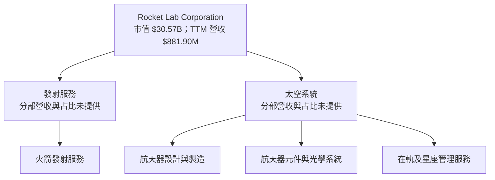
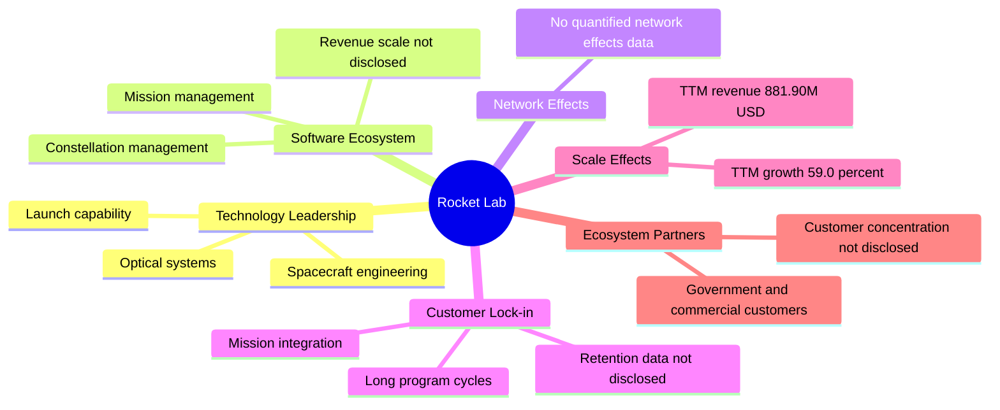
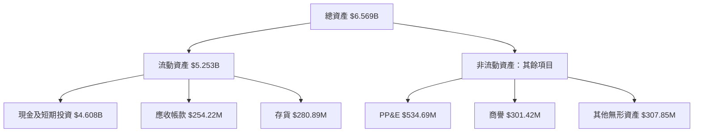
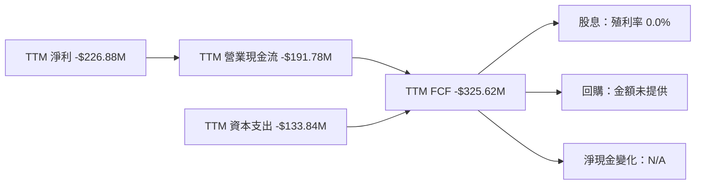
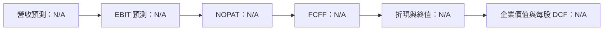
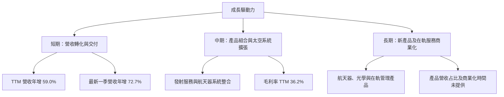
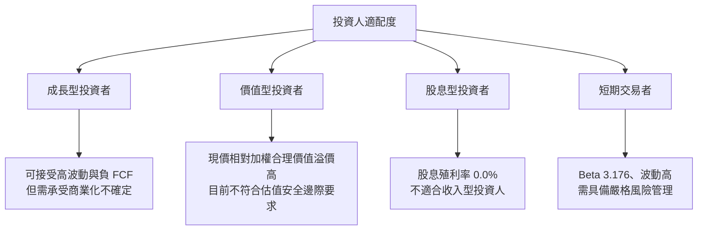

# RKLB 基本面深度分析報告
> **報告日期**：2026-11-21 ｜ **語言**：繁體中文 ｜ **數據來源**：SEC 申報資料 (XBRL)、Yahoo Finance、Finviz、StockAnalysis、Roic.ai ｜ **分析師**：CFA 級機構研究

## 目錄

| # | 章節 | 核心結論 |
|---|------|----------|
| 1 | 執行摘要 | 評級為賣出；加權合理價值 $16.59，MOS -173.8% |
| 2 | 公司概覽與商業模式 | 發射服務與太空系統雙業務；市場份額數據未提供 |
| 3 | 損益表深度分析 | TTM 營收 $881.90M、成長 59.0%；仍處深度虧損 |
| 4 | 資產負債表分析 | 現金及短期投資 $4.61B；流動性高，但債務來源數字不一致 |
| 5 | 現金流量深度分析 | TTM FCF -$325.62M，投資擴張仍需大量現金 |
| 6 | 獲利能力與資本效率 | ROIC -16.1% 對 WACC 14.00%，目前摧毀股東價值 |
| 7 | 相對估值分析 | 相對同業及自身歷史均屬高估；P/S 高於自身歷史中位數 |
| 8 | DCF 內在價值評估 | DCF 不適用：TTM 營業利益為負；以相對估值三角驗證 |
| 9 | 成長催化劑 | 新產品與太空系統拓展提供選擇權，但具體時間表未提供 |
| 10 | 風險矩陣 | 估值、執行／獲利化及現金消耗為主要風險 |
| 11 | 投資建議 | 依 MOS 評級為賣出；等待估值或基本面改善再重新評估 |

---

## 1. 執行摘要

RKLB 的 2026-11-20 收盤價為 **$45.42**。公司 TTM 營收成長 59.0%、最新一季營收年增 72.7%，但 TTM 營業利益率為 -27.6%、FCF 為 -$325.62M，ROIC -16.1% 低於 14.00% 的 WACC。程式計算的加權合理價值為 **$16.59**，MOS 為 **-173.8%**；依 MOS 門檻評級為 **🔴賣出**。分析師共識目標價 $93.15 是加權估值中的少數權重來源，不能抵銷當前現金流與估值倍數所反映的風險。

### 1.0 一頁式投資儀表板

| 項目 | 內容 |
|------|------|
| **投資論點（3 句）** | ① TTM 營收 $881.90M、年增 59.0%，顯示業務擴張；② TTM FCF -$325.62M，營收成長尚未轉為自我融資；③ 加權合理價值 $16.59，低於 $45.42 收盤價，估值折讓不足。 |
| **綜合評分** | **5.3/10**（引用 1.1 評分卡） |
| **財務健康** | 🟡 現金及短期投資 $4.61B、流動比率 8.554；但 TTM FCF 為負且 CCC 176 天。 |
| **ROIC vs WACC** | **-16.1% vs 14.00%**；資本回報低於資本成本，現階段摧毀價值。 |
| **FCF 趨勢** | TTM FCF -$325.62M；FCF Yield **-1.07%**。 |
| **估值** | Forward P/E 634.5347x ｜ EV/EBITDA -140.865x ｜ FCF Yield -1.07%。 |
| **DCF 內在價值（基準）** | **N/A**；TTM 營業利益為負，未計算 DCF，故 DCF 折溢價 N/A。 |
| **安全邊際（MOS）** | **-173.8%**＝($16.59 − $45.42) ÷ $16.59；🔴 無安全邊際。 |
| **預期報酬（基準情境 12M）** | N/A；DCF MODEL 未提供情境估值。 |
| **關鍵風險（前二）** | 高估值與獲利化不確定；FCF 消耗及長現金轉換週期。 |
| **評級 + 信心度** | 🔴 **賣出** ｜ 信心：中；估值訊號明確，但長期新業務價值難以用現有盈利資料量化。 |

### 1.1 綜合評分卡

| 維度 | 評分（1–10） | 主要依據（引用數字與其來源章節） |
|------|--------------|----------------------------------|
| 成長性 | 8.5 | TTM 營收成長 59.0%、最新一季年增 72.7%（第 3 章）；成長可見，但單季成長不等同已實現獲利。 |
| 獲利能力 | 2.5 | TTM 營業利益率 -27.6%、ROIC -16.1%、F-Score 5/9（第 3、6 章）。 |
| 財務健康 | 8.0 | 現金及短期投資 $4.61B、流動比率 8.554；但 FCF -$325.62M、CCC 176 天（第 4、5 章）。 |
| 估值 | 1.0 | MOS -173.8%；P/S 33.6x 高於自身 5 年中位數 19.4x（第 7、8 章）。 |
| 護城河 | 6.5 | 發射、太空系統與航太製造能力提供差異化，但缺少市場份額及分部營收資料（第 2 章）。 |
| 管理層與資本配置 | 5.5 | 2025 年 SBC $71.10M，稀釋股數測試未通過；未提供可判定回購成效的資料（第 3、6 章）。 |
| **綜合評分** | **5.3** | 六項算術平均：(8.5 + 2.5 + 8.0 + 1.0 + 6.5 + 5.5) ÷ 6 = 5.3。 |

### 1.2 五大投資論點 + 三大核心風險

| 類型 | 項目 | 具體依據 | 信心度 |
|------|------|----------|--------|
| 🟢 **投資論點①** | 營收擴張 | TTM 營收 $881.90M，TTM 年增 59.0%；最新一季營收年增 72.7%。若訂單轉化與交付持續，規模擴張可能改善固定成本吸收。 | 🟢 高 |
| 🟢 **投資論點②** | 現金儲備提供執行緩衝 | 現金及短期投資 $4.61B，為新產品研發與產能投入提供資金緩衝。 | 🟢 高 |
| 🟢 **投資論點③** | 毛利率較年度低點改善 | 毛利率由 2023 年 21.0% 升至 2025 年 34.4%；如能持續提高高毛利系統業務占比，長期營業槓桿可能改善。 | 🟡 中 |
| 🟢 **投資論點④** | 發射服務與太空系統組合 | 公司同時提供發射、航天器設計製造、元件與在軌管理服務，業務範圍較單一發射服務商廣。 | 🟡 中 |
| 🟢 **投資論點⑤** | 分析師預期仍偏正面 | 20 位分析師平均目標價 $93.15；但此為分析師預測，與現有負 FCF、負營業利潤並存。 | 🟡 中 |
| 🟡 **風險①** | 估值與基本面落差 | 收盤價 $45.42 對應 P/S 約 33.6x；加權合理價值 $16.59，MOS -173.8%。 | 🔴 高衝擊 |
| 🔴 **風險②** | 資本消耗持續 | TTM 營業現金流 -$191.78M、資本支出 $133.84M、FCF -$325.62M。若投入增加而營收毛利未同步改善，現金消耗可能擴大。 | 🔴 高衝擊 |
| 🟡 **風險③** | 營運資金效率惡化 | DIO 由 140 天升至 182 天、CCC 由 120 天升至 176 天；可能反映存貨與履約資金占用增加。 | 🟡 中高 |

### 1.3 快速統計卡片

| 指標 | 公司實際值（期間） | 同業中位數 | 狀態 |
|------|--------------------|------------|------|
| 營收成長（TTM） | **59.0%** | — | 🟢 |
| 營收成長（最新一季年增） | **72.7%** | 161.4% | 🟡 |
| 毛利率（TTM） | **36.2%** | 55.5% | 🟡 |
| 營業利益率（TTM） | **-27.6%** | — | 🔴 |
| ROIC（TTM） | **-16.1%** | — | 🔴 |
| Forward P/E | **634.5347x** | -49.7x* | 🔴 |
| FCF Yield（TTM） | **-1.07%** | — | 🔴 |
| Piotroski F-Score | **5 / 9** | — | 🟡 |

\*同業 Forward P/E 中位數受 LUNR、PL 的負值影響，並非有意義的盈利估值比較，不能據此判斷 RKLB 相對便宜。

### 1.4 投資結論

```text
╔══════════════════════════════════════════════════════════════════╗
║                    📊 投資結論摘要                               ║
╠══════════════════════════════════════════════════════════════════╣
║  評級：🔴 賣出（依規則 20；未作一級質化調整）                    ║
║  價格（2026-11-20 收盤）：$45.42                                 ║
║  DCF 內在價值（基準）：N/A（TTM 營業利益為負）                   ║
║  安全邊際 MOS：-173.8%（加權合理價值基準）                       ║
║  加權合理價值（8.8）：$16.59                                     ║
║  綜合評分：5.3/10（引用 1.1）                                    ║
║  適合投資人：能承受高波動、以長期產品商業化為核心假設者；          ║
║              不適合要求現金流或估值安全邊際的投資人。             ║
╚══════════════════════════════════════════════════════════════════╝
```

---

## 2. 公司概覽與商業模式

### 2.1 業務結構與收入來源

公司提供發射服務與太空系統解決方案，涵蓋航天器設計、元件、製造、光學系統、在軌管理及星座管理。分部營收及占比未提供，因此不將總營收自行拆分。



**營收結構限制**：SEC 財務數據未提供本報告可直接引用的分部營收金額、占比及軟體／服務收入拆分。因此，不能繪製有比例的分部圓餅圖，也不能據此判斷哪一分部主導毛利率。

### 2.2 市場份額

市場份額數據未提供。可觀察到 RKLB TTM 營收 $881.90M、TTM 成長 59.0%，最新一季年增 72.7%；同業樣本的最新一季年增中位數為 161.4%，顯示 RKLB 成長顯著但不是該樣本中最快。此比較不能替代市場份額，因同業業務組合、基期及營收規模不同。

### 2.3 競爭護城河分析



### 2.4 護城河強度

| 護城河項目 | 強度（強／中／弱） | 證據（引用數字或事實） | 會削弱它的情況 |
|------------|--------------------|------------------------|----------------|
| 技術與製造能力 | 中 | 涵蓋發射、航天器設計製造、元件及光學系統；員工 2,600 人。 | 發射可靠性、交付或新產品爬坡不及預期。 |
| 軟體與任務服務 | 弱至中 | 公司提供在軌與星座管理；未提供相關營收、續約率或客戶留存數字。 | 軟體服務收入未形成可衡量的重複性收入。 |
| 網路效應 | 弱 | 未提供由更多客戶或衛星帶來單位成本下降、資料增值等量化證據。 | 同業可複製服務，客戶多來源採購。 |
| 客戶鎖定 | 中 | 航太任務整合與客製化可能提高轉換成本；客戶集中度及續約率未提供。 | 客戶改用其他發射或系統供應商，或任務延後。 |
| 規模效應 | 中 | TTM 營收 $881.90M、最新一季營收 $267.83M；但營業利益率 TTM -27.6%。 | 營收成長未轉成毛利與營業槓桿。 |
| 生態夥伴 | 弱至中 | 公司服務美國、加拿大、日本及國際市場；合約與合作夥伴明細未提供。 | 供應鏈中斷、政府採購或合作關係改變。 |

**護城河評分理由**：1.1 評分卡的 6.5/10 反映公司具備跨發射與太空系統的技術範圍，但缺乏市場份額、留存率及分部盈利數據來證明護城河已轉化為持久定價權。

---

## 3. 損益表深度分析

### 3.1 年度收入成長趨勢（近 4 年）

```text
╔══════════════════════════════════════════════════════════════════╗
║             Rocket Lab 年度收入趨勢（FY2022-FY2025）             ║
╠══════════════════════════════════════════════════════════════════╣
║  FY2022  $211.00M  ███████░░░░░░░░░░░░░░░░  YoY：基期           ║
║  FY2023  $244.59M  ████████░░░░░░░░░░░░░░░  YoY：+15.9% 🟡      ║
║  FY2024  $436.21M  ███████████████░░░░░░░░  YoY：+78.3% 🟢      ║
║  FY2025  $601.80M  █████████████████████░░  YoY：+38.0% 🟢      ║
║                                                                  ║
║  2022–2025 營收 CAGR：(601.80 ÷ 211.00)^(1/3) − 1 = 約 41.9%    ║
╚══════════════════════════════════════════════════════════════════╝
```

2024 年營收年增 78.3%，2025 年增速降至 38.0%，但 2025 年仍新增約 $165.59M 營收。2026 TTM 營收達 $881.90M、年增 59.0%，表明近期增長重新加速；然而，高增長需與負營業利潤及負 FCF 一併解讀。

### 3.2 季度收入趨勢分析

| 季度 | 營收 | QoQ 成長 | YoY 成長 | 備註 |
|------|------|----------|----------|------|
| 2025 Q4 | $179.65M | 15.8%（對 2025 Q3） | 35.7% | 以 StockAnalysis 季度資料計算。 |
| 2026 Q1 | $200.35M | 11.5% | 63.46% | 營收續增，營業利益仍為 -$55.97M。 |
| 2026 Q2 | $234.07M | 16.8% | 61.99% | 營收擴大，營業利益 -$57.51M。 |
| 2026 Q3 | $267.83M | 14.4% | 72.7% | 單季營收年增率，不是 TTM 成長率；營業利益 -$79.19M。 |

QoQ 為本季營收除以前季營收再減一。2026 Q3 營收較 Q2 增加約 $33.76M，但營業虧損擴大至 -$79.19M；公司仍需證明新增營收的毛利足以吸收研發、製造與擴產成本。

### 3.3 利潤率演變分析

| 利潤率指標 | FY2022 | FY2023 | FY2024 | FY2025 | 趨勢 | 評估 |
|------------|--------|--------|--------|--------|------|------|
| **毛利率** | 9.0% | 21.0% | 26.6% | 34.4% | 連續改善 | 🟢 |
| **營業利益率** | -64.1% | -72.7% | -43.5% | -38.0% | 虧損率收窄 | 🟡 |
| **淨利率** | -64.4% | -74.6% | -43.6% | -32.9% | 虧損率收窄 | 🟡 |

以上年度利潤率由相同年度毛利、營業利益及淨利除以營收計算。2023 年營業利益率短暫惡化，隨後 2024–2025 年改善，可能與毛利率提升及營收規模擴大有關；但營業虧損金額由 2024 年 -$189.80M 擴至 2025 年 -$228.84M，說明利潤率改善不代表虧損已絕對收窄。TTM 營業利益率仍為 -27.6%，最新一季則為 -29.6%，季內獲利槓桿尚未確立。

### 3.4 費用結構分析

財務數據有研發費用歷史值，但未提供可完整分解至銷售、一般行政、研發及其他費用的同口徑 TTM 明細，故不繪製費用結構圓餅圖。FY2025 研發費用為 $270.72M，約占當年營收 $601.80M 的 45.0%；FY2024 為 $174.39M，占營收約 40.0%。研發投入增速高於收入時，短期會壓低利潤，但其價值需由產品交付、毛利與後續收入驗證，不能只以支出本身判定回報。

### 3.5 季度 EPS 趨勢與盈餘品質（Quality of Earnings）

| 季度 | EPS 實際值 | 預期／驚喜 | 分析 |
|------|------------|-----------|------|
| 2025 Q4 | -$0.09 | 預期及驚喜 N/A | 缺少可核對的分析師預期，不能判定超預期或不及預期。 |
| 2026 Q1 | -$0.07 | 預期及驚喜 N/A | EPS 虧損較 2025 Q4 減少，但無法歸因於特定一次性項目。 |
| 2026 Q2 | -$0.08 | 預期及驚喜 N/A | 虧損略擴大；分析師預期資料未提供。 |
| 2026 Q3 | -$0.12 | 預期及驚喜 N/A | 單季營業虧損 -$79.19M，EPS 虧損擴大。 |

Earnings History 中 EPS 預期資料為空值，且僅列出三個季度，因此不能虛構四季 surprise 表現。實際季度 EPS 來自 StockAnalysis 歷史資料；來源呈現的 Q3、Q1、Q4 期別順序不完整，故以季度損益資料與 EPS 序列作期間識別，未提供預期值均標 N/A。

| 盈餘品質項目 | 數值/佔比 | 評估 |
|--------------|-----------|------|
| 股權薪酬 SBC / 營收 | TTM SBC $84.20M ÷ $881.90M = **9.5%** | 🔴 SBC 規模相對營收不低；SBC 是非現金費用，但經濟成本會以股權稀釋呈現。 |
| SBC / 營業現金流 | $84.20M ÷ -$191.78M = **-43.9%**；以 OCF 絕對值衡量為 43.9% | 🔴 OCF 為負，比例不代表正向現金覆蓋；SBC 加回可能使 OCF 看起來較不差，但並未讓現金流轉正。 |
| FCF / 淨利（現金轉換率） | -$325.62M ÷ -$226.88M = **143.5%** | 🔴 兩者均為負值，正比率不應解讀為良好轉換；FCF 虧損金額高於淨損。 |
| 一次性／非經常性損益 | N/A | 未提供足以拆分一次性損益的資料，不能判定是否美化或壓低盈餘。 |
| 有效稅率異常 | N/A | 有效稅率資料未提供；公司處於虧損狀態，不能以預設稅率替代實際稅務分析。 |
| 資本化支出 vs 費用化 | TTM Capex $133.84M；資本化與費用化分項 N/A | 資本支出已納入 FCF 定義；資本化政策細節未提供，不能判定是否遞延成本。 |

**盈餘品質結論**：RKLB 目前沒有正 GAAP 淨利可供評估「盈餘含金量」。TTM SBC 約為營收的 9.5%，而稀釋股數測試未通過；因此，評估股東回報時不能把 SBC 僅視為非現金項目。TTM FCF -$325.62M 顯示現金消耗仍高，估值應優先參考收入倍數、現金續航與獲利化進程，而非依賴未實現的 EPS。

---

## 4. 資產負債表分析

### 4.1 資產結構分解

以下主要科目取 2026-09-30 季末 StockAnalysis 資產負債表；列示項目不是完整加總，避免將未列示資產誤作零。



### 4.2 流動性與營運資金分析

| 指標 | 最新 TTM | 一年前 TTM | 變化 | 解讀 |
|------|----------|------------|------|------|
| 流動比率 | 8.554 | N/A | N/A | 現有短期償債緩衝高；一年前同口徑比率未提供。 |
| 速動比率 | 7.954 | N/A | N/A | 數值顯示流動性充裕；需留意部分總流動資產為現金及短期投資。 |
| DSO 應收帳款天數 | 49 天 | 39 天 | +10 天 | 回款週期拉長，可能與營收擴張、收款時點或客戶組合有關，需觀察應收增幅是否持續高於營收。 |
| DIO 存貨天數 | 182 天 | 140 天 | +42 天 | 存貨占用資金增加；可能是為交付或產能備貨，也可能反映周轉變慢。 |
| DPO 應付帳款天數 | 55 天 | 59 天 | -4 天 | 付款天數縮短，供應商融資支持略減。 |
| CCC 現金轉換週期 | 176 天 | 120 天 | +56 天 | 現金由投入至回收所需時間延長，可能增加營運資金需求。 |

比率與營運資金天數均按 QUALITY FIGURES 原值列示，不重算。DSO、DIO 上升而 DPO 下降，合併使 CCC 延長 56 天。若成因是為新增合約預先備貨，應追蹤後續交付與回款；若存貨持續增加但營收或毛利沒有相應轉化，則可能構成減值或現金流風險。

### 4.3 債務結構分析

不同來源的總債務數字不一致：計算指標列示總債務 $1.72M；市場資料列示 $120.28M；FY2025 年報表列示 $253.96M。下圖依「VERIFIED FIGURES」列示的總債務及淨現金原值；由於來源及日期口徑不一致，不以不相容數字重算槓桿倍數。

```text
╔══════════════════════════════════════════════════════════════════╗
║                 Rocket Lab 債務健康診斷                          ║
╠══════════════════════════════════════════════════════════════════╣
║  總債務（計算指標）：$1.72M   ▏                         🟢*     ║
║  現金及短期投資：    $4.61B   ████████████████████      🟢      ║
║  淨現金（來源列值）：$4.61B   ████████████████████      🟢      ║
║  其他來源債務：      $120.28M（市場資料）／FY2025 $253.96M       ║
║  Debt/EBITDA：N/A（EBITDA 為負，倍數失去經濟意義）               ║
║  Interest Coverage：N/A（利息費用口徑與利息覆蓋資料未提供）       ║
╚══════════════════════════════════════════════════════════════════╝
```

\*總債務來源衝突，不能單獨據此判定負債極低。採用的現金與總債務指標所示淨現金為 $4.61B；市場資料另列淨現金 $4.49B。流動性判斷以大額現金及短期投資為正面因素，但在債務明細核對前不以單一淨現金值替代完整債務分析。

### 4.4 股東權益趨勢

```text
╔══════════════════════════════════════════════════════════════════╗
║                 歷年股東權益（年末）                             ║
╠══════════════════════════════════════════════════════════════════╣
║  FY2022  $673.21M  ████████░░░░░░░░░░░░░░                       ║
║  FY2023  $554.54M  ███████░░░░░░░░░░░░░░░                       ║
║  FY2024  $382.45M  █████░░░░░░░░░░░░░░░░                       ║
║  FY2025  $1.72B    ████████████████████                         ║
╚══════════════════════════════════════════════════════════════════╝
```

2025 年股東權益大幅增加，與融資及股本變動可能相關，但資料不足以完整分拆原因。同期流通股數測試未通過，表示每股價值可能因稀釋受影響；評估權益增長時應同步看股數變化，而不能只看帳面權益總額。

---

## 5. 現金流量深度分析

### 5.1 現金流量瀑布圖



此圖表示現金流數值關係，不代表淨利與營業現金流之間的調節項均已揭露。TTM FCF 依定義為 OCF 減 Capex：-$191.78M − $133.84M = -$325.62M。股息殖利率為 0.0%；回購及淨現金變化明細未提供。

### 5.2 FCF 轉換率趨勢

| 年度 | FCF | 淨利 | FCF / 淨利 | 解讀 |
|------|-----|------|------------|------|
| 2022 | -$148.95M | -$135.94M | 109.6% | 兩者均為負，不代表正向獲利轉現。 |
| 2023 | -$153.57M | -$182.57M | 84.1% | 現金流虧損金額低於會計淨損。 |
| 2024 | -$115.98M | -$190.18M | 61.0% | FCF 虧損相對收窄，但仍未轉正。 |
| 2025 | -$321.81M | -$198.21M | 162.3% | Capex 增加，使 FCF 虧損擴大。 |
| TTM | -$325.62M | 約 -$226.88M | 約 143.5% | TTM FCF 定義為 OCF − Capex；淨利採 StockAnalysis TTM。 |

負淨利作分母會令比率失去一般「現金轉換率越高越好」的意義。分析重點應是絕對現金消耗、Capex 回報以及未來營運現金流是否改善。

### 5.3 自由現金流趨勢

```text
╔══════════════════════════════════════════════════════════════════╗
║                 自由現金流：歷史實際                             ║
╠══════════════════════════════════════════════════════════════════╣
║  FY2022  -$148.95M  █████████░░░░░░░░░░░░  FCF Yield：N/A        ║
║  FY2023  -$153.57M  █████████░░░░░░░░░░░░  FCF Yield：N/A        ║
║  FY2024  -$115.98M  ███████░░░░░░░░░░░░░  FCF Yield：N/A        ║
║  FY2025  -$321.81M  ████████████████████  FCF Yield：N/A        ║
║  TTM     -$325.62M  ████████████████████  FCF Yield：-1.07%     ║
╚══════════════════════════════════════════════════════════════════╝
```

歷史年度 FCF Yield 缺少相同期間市值資料，故不補算。2025 年與 TTM FCF 虧損顯著高於 2024 年，Capex 及營運資金投入是後續需核對的關鍵；現有資料無法完整拆分各項對 FCF 的個別貢獻。

### 5.4 資本配置評估

| 項目 | 已知數據 | 評估 |
|------|----------|------|
| 資本支出 | TTM $133.84M；FY2025 $156.28M | 支持產能與產品投入，但回報周期須以新業務交付及毛利驗證。 |
| 研發 | FY2025 $270.72M | 研發投入具策略必要性；現有資料未列可直接歸屬的項目回報。 |
| 股息 | 殖利率 0.0% | 資本以營運與投資為主，沒有現金股息回報。 |
| 回購 | 金額未提供 | 不以缺少資料推定有無回購。 |
| 留存及融資 | 現金及短期投資 $4.61B | 提供資金緩衝；但 TTM FCF -$325.62M，若持續消耗仍需關注資金配置效率。 |

資本配置百分比缺少可完整對帳的分類，因此不繪製圓餅圖。

---

## 6. 獲利能力與資本效率

### 6.1 ROE / ROA / ROIC 趨勢

| 指標 | 歷史可用值 | 最新值 | 評估 |
|------|------------|--------|------|
| ROE | FY2025 淨利 -$198.21M、權益 $1.72B；QUALITY FIGURES 的 TTM ROE -3.9% | **-3.9%** | 虧損下 ROE 為負；不同來源另列 -6.4%，本報告品質指標採計算區塊原值。 |
| ROA | QUALITY FIGURES 的測試顯示 ROA 未大於 0；其他資料列示 TTM -3.5% | **未採用額外重算值** | 依品質測試，公司尚未達正資產報酬。 |
| ROIC | TTM | **-16.1%** | 低於 WACC 14.00%，目前資本投入未產生高於資本成本的回報。 |

行業均值數據未提供，故不列比較欄。不同資料來源的 ROE、債務與營運指標存在口徑差異，本文在要求照抄的品質指標採用原值，並明列衝突，不自行調整成另一套數字。

### 6.2 ROIC vs WACC 分析（核心價值創造判斷）

```text
╔══════════════════════════════════════════════════════════════════╗
║                  ROIC vs WACC 深度分析                           ║
╠══════════════════════════════════════════════════════════════════╣
║  資本成本（採用值及來源）：                                      ║
║  ├── 無風險利率（10Y 美債）：       4.91%                        ║
║  ├── 股權風險溢酬 ERP：             5.00%                        ║
║  ├── 原始 Beta：                    3.18                         ║
║  ├── 調整後 Beta：                  2.00（上限截斷）              ║
║  ├── 股權成本：                     14.91%                       ║
║  ├── 債務權重：                     0.0%                         ║
║  └── ✅ 採用 WACC：                 14.00%（上限截斷後）          ║
║                                                                  ║
║  ROIC（TTM）：                     -16.1%                        ║
║  ROIC − WACC：                     -16.1% − 14.00% = -30.1 pp    ║
║                                                                  ║
║  結論：ROIC 低於 WACC 30.1 個百分點；目前摧毀而非創造價值。       ║
╚══════════════════════════════════════════════════════════════════╝
```

Beta 調整方式為先按 \(⅔ × 3.18 + ⅓ × 1\) 得 2.45，再受 0.6–2.0 區間限制，故採用 adjusted Beta 2.00。無風險利率為資料列示的 10 年期美債利率 4.91%，該區塊未提供觀察日期；ERP 5.00% 為假設值。股權成本原值為 14.91%，程式計算 WACC 為 14.98%，但因 WACC 被限制在 7%–14% 區間，採用 **14.00%**。本節依要求使用這個採用值；與 8.2 一致。

ROIC -16.1% 與 WACC 14.00% 的差距表示，現階段每投入資本尚未產生足以支付資本成本的稅後營業回報。需等待營業虧損收窄及現金流改善，才有理由判斷價值創造能力出現轉折。

### 6.3 杜邦三因素分解

| 因素 | 數值（TTM） | 解讀 |
|------|-------------|------|
| 淨利率 | -25.7% | 負淨利率是 ROE 為負的主要來源。 |
| 資產週轉率 | 0.13 | 每單位資產對應營收偏低，擴大資產基礎可能暫時壓低回報。 |
| 權益乘數 | 1.13 | 財務槓桿不高；ROE 不是靠高槓桿支撐。 |
| **ROE** | **-3.9%** | **-25.7% × 0.13 × 1.13 = -3.9%**（依品質指標列示值）。 |

### 6.4 財務體質：Piotroski F-Score

**Piotroski F-Score：5 / 9**。各項結果依 QUALITY FIGURES 原值照列：

| 測試 | 結果 | 解讀 |
|------|------|------|
| ROA > 0 | ❌ 未通過 | 尚未實現正資產報酬。 |
| 營業現金流 > 0 | ❌ 未通過 | TTM 營業現金流 -$191.78M。 |
| ROA 高於一年前 | ✅ 通過 | 相對去年改善，但目前仍未轉正。 |
| 營業現金流 > 淨利（應計品質） | ✅ 通過 | 相對測試條件通過，不代表營業現金流為正。 |
| 長期負債 ÷ 總資產低於一年前 | ✅ 通過 | 槓桿指標改善；須注意債務資料來源存在差異。 |
| 流動比率高於一年前 | ✅ 通過 | 流動比率改善，短期流動性較充裕。 |
| 稀釋股數未增加 | ❌ 未通過 | 稀釋股數增加會攤薄每股經濟價值。 |
| 毛利率高於一年前 | ✅ 通過 | 毛利率改善有利於未來營業槓桿，但仍未扭轉營業虧損。 |
| 資產週轉率高於一年前 | ❌ 未通過 | 資產擴張尚未帶來相應周轉提升。 |

---

## 7. 相對估值分析

### 7.1 同業估值比較表格

RKLB 為公司實際值；競爭對手估值及成長、毛利數字採 Yahoo Finance peer multiples。N/A 保留為不可用，不以其他來源或記憶值替代。

| 估值指標 | **RKLB** | **SPCX** | **LUNR** | **PL** | RKLB 評估 |
|----------|----------|---------|---------|---------|-----------|
| **Trailing P/E** | N/A | 555.6x | N/A | N/A | 🔴 RKLB 虧損，無法使用 P/E；部分同業倍數亦因盈利狀態失真。 |
| **Forward P/E** | 634.5347x | 46.6x | -49.7x | -8424.0x | 🔴 RKLB 倍數極高；同業負值不可作正常盈利倍數對照。 |
| **P/S Ratio** | 33.6x* | 54.2x | 2.2x | 10.1x | 🔴 高於同業樣本中位數 10.1x；業務組合差異大，倍數不可直接視為精確價值。 |
| **EV/EBITDA** | -140.865x | 143.6x | -34.9x | -71.6x | 🔴 RKLB EBITDA 為負，負倍數不具一般估值解讀。 |
| **最新一季營收年增** | 72.7% | 161.4% | 413.7% | 58.1% | 🟡 RKLB 高於 PL、低於 SPCX 與 LUNR。 |
| **毛利率（TTM）** | 36.2% | 56.8% | 20.3% | 55.5% | 🟡 低於 SPCX 與 PL、高於 LUNR。 |

\*自身 5 年估值資料列示 P/S 現值 33.6x；另一市場估值資料列示 P/S 34.659702x，存在來源口徑差異。本報告歷史比較及相對估值方法採用指定的歷史 P/S 33.6x。peer P/S 三家公司中位數為 10.1x；程式估值方法使用 LUNR、PL 的 peer 中位數 6.2x，兩個中位數的樣本範圍不同。

### 7.2 歷史估值區間分析

```text
╔══════════════════════════════════════════════════════════════════╗
║               RKLB 自身歷史 P/S 區間（5 年）                    ║
╠══════════════════════════════════════════════════════════════════╣
║  低點 7.1x ├──────── 中位數 19.4x ────────● 現值 33.6x ──┤83.2x║
║                                                百分位：57%       ║
╚══════════════════════════════════════════════════════════════════╝
```

目前 P/S 33.6x 高於歷史中位數 19.4x，但仍低於歷史上緣 83.2x；所處百分位為 57%。因此可說估值高於自身中位數，不宜把歷史高點視為合理目標；歷史高估值亦不代表當前有足夠安全邊際。

### 7.3 情境價值（Bear / Base / Bull，照抄 DCF MODEL 的 Scenarios）

**N/A（DCF 無法計算：TTM 營業利益不為正，程式未建立 DCF 模型）。**依資料規則，不提供悲觀、基準、樂觀 DCF 情境目標價。

### 7.4 相對估值隱含價格區間

```text
╔══════════════════════════════════════════════════════════════════╗
║                 相對估值每股價值對照                             ║
╠══════════════════════════════════════════════════════════════════╣
║  $8.08（同業 P/S） ─────── $16.59（加權合理價值） ─── $45.42 現價║
║       -82.2%                         -63.5%                      ║
║  分析師共識 $93.15：較現價 +105.1%，屬另一項獨立參考             ║
╚══════════════════════════════════════════════════════════════════╝
```

- **同業 P/S：$8.08**。程式使用 LUNR、PL 的中位數倍數 6.2x，乘以 RKLB TTM 營收 $881.90M，並按指定估值程序換算每股價值。此方法顯著低於現價，反映 peer 估值基準與 RKLB 市場倍數差距。
- **分析師共識目標價：$93.15**。20 位分析師平均目標價；它反映市場預期，不是由現金流或同業中位數推導出的可確定價值。
- 同業 Forward P/E 不可計算的項目依程式規則不納入估值方法；具體加權比例依第 8.8 節原值列示。

---

## 8. DCF 內在價值評估（Discounted Cash Flow）

### 8.0 估值推理鏈（Thinking Logic）

**Step 1 — 價值由哪些變數決定？**  
RKLB 的價值概念上取決於既有發射服務、太空系統與未來新產品商業化；可引用的分部營收占比未提供，無法量化各部分對總價值的份額。營收成長、長期營業利潤率與再投資需求將是關鍵驅動因素，但公司 TTM 營業利益率為 -27.6%、TTM FCF -$325.62M。由於 TTM 營業利益為負，程式將 DCF 標示為 N/A，本報告不自建預測模型，也不輸出偽精確的每股 DCF 價值。

**Step 2 — 模型選擇**

| 決策點 | 本報告採用 | 理由（含數字） | 曾考慮但否決 | 否決理由 |
|--------|-----------|----------------|--------------|----------|
| 現金流定義 | 不計算 DCF | TTM 營業利益率 -27.6%、FCF -$325.62M | FCFF / FCFE | 缺乏正營業收益基礎，需大量主觀假設才能外推。 |
| 預測期 N | N/A | DCF MODEL 未建立 | 5–10 年 | 不自行填入預測期。 |
| 終值方法 | N/A | 無預測期末現金流可作終值基礎 | Gordon Growth、退出倍數 | 未提供可稽核模型輸入。 |
| EBIT 基礎 | N/A | 不建立 DCF 預測 | GAAP／非 GAAP EBIT | 避免自建模型。 |

**Step 3 — 關鍵假設推導鏈**  
營收 CAGR、期末營業利潤率、永續成長率、Capex／營收、折舊攤銷、營運資金變動、股數稀釋、終值方法及 SBC 處理均無可引用的 DCF MODEL 輸入值。依規則不得自行設定假設或推算，因此各項均不建模。

**Step 4 — 最脆弱環節**  
若僅以負 TTM 營業利益向前折現，所得結果不是可供投資決策的正向經營價值；此處改以程式提供的相對估值及加權合理價值為判斷依據，降低模型精確度假象。

**Step 5 — 計算路徑**



### 8.1 模型假設總表（Model Inputs）

**N/A（數據未提供／DCF MODEL 未建立：TTM 營業利益為負；依規則不自行建立 DCF）。**因此沒有預測期、逐年假設或可稽核的模型輸入值，也不宣稱任何 DCF 組合或 SBC 處理方案。

### 8.2 折現率推導（WACC）

本節列示資本成本資料供 ROIC 比較；由於 DCF 為 N/A，WACC 不用於本報告的 DCF 折現。

```text
╔══════════════════════════════════════════════════════════════════╗
║                    WACC 資料（程式採用值）                       ║
╠══════════════════════════════════════════════════════════════════╣
║  股權成本 Ke（CAPM）：                                           ║
║  ├── 無風險利率 Rf：                 4.91%                       ║
║  ├── ERP：                           5.00%                       ║
║  ├── 原始 Beta：                     3.18                        ║
║  ├── 調整後 Beta：                   2.00（調整值受上限限制）     ║
║  └── Ke：                            14.91%                      ║
║                                                                  ║
║  稅前債務成本：                    1543.65%（小額債務下失真）     ║
║  股權／債務權重：                   100.0% / 0.0%                ║
║  計算 WACC：                        14.98%                       ║
║  採用 WACC：                        14.00%（限制於 7%–14%）      ║
╚══════════════════════════════════════════════════════════════════╝
```

完整 CAPM 算式為 **4.91% + 2.00 × 5.00% = 14.91%**。原始 Beta 為 3.18；調整公式 \(⅔ × 3.18 + ⅓ × 1 = 2.45\)，再受 0.6–2.0 區間限制，採 2.00。資料列示稅前債務成本 1543.65%，在極小債務分母下不宜直接用作一般市場債務成本。資本權重原值為股權 100.0%、債務 0.0%。程式計算 WACC 14.98%，受 14% 上限限制後採用 **14.00%**，與第 6.2 節一致。缺乏足夠資料重建完整五步債務成本算式，故不自行重算或替換指定 WACC。

### 8.3 逐年自由現金流預測（基準情境）

**N/A（DCF MODEL 未提供逐年預測：TTM 營業利益不為正）。**未列 FY+1 至 FY+N 數字、FCFF、折現因子或預測期 PV，避免以未提供的財務假設建立模型。

### 8.4 終值計算（Terminal Value）

**N/A（無預測期最後一年 FCFF，亦無程式提供的永續成長率或退出倍數）。**因此不計算 Gordon Growth 或退出倍數終值，也不以假設終值代替資料缺漏。

### 8.5 企業價值 → 每股內在價值（Bridge）

**N/A（缺少 DCF 預測期現值與終值）。**DCF 基準內在價值及相對現價折溢價均為 N/A。本節不計算 MOS；MOS 僅以第 8.8 節加權合理價值為基準。

### 8.6 敏感性分析（WACC × 永續成長率）

**N/A（DCF MODEL 未提供敏感度矩陣、基準永續成長率或每股 DCF 值）。**不自行建立矩陣、三情境或機率加權估值；因此亦無法對利潤率、g 或 WACC 的估值彈性進行可複算量化。

### 8.7 反推 DCF（Reverse DCF：市場在預期什麼）

**N/A（DCF MODEL 未提供反推結果；無法以指定程序固定基準輸入並反解單一變數）。**不宣稱市場隱含營收 CAGR、利潤率、永續成長率或高成長年數。

### 8.8 估值三角驗證與安全邊際

| 估值方法 | 隱含每股價值 | 上行空間（÷現價） | 權重 | 說明 |
|----------|--------------|-------------------|------|------|
| 同業 P/S | $8.08 | -82.2% | 90% | LUNR、PL 同業中位數 6.2x × RKLB TTM 營收，依程式估值方法換算。 |
| 分析師共識目標價 | $93.15 | +105.1% | 10% | 20 位分析師平均目標價；作為參考，而非直接現金流估值。 |
| **加權合理價值** | **$16.59** | **-63.5%** | **100%** | 程式列示的加權估值。 |

逐步演算：  
**$8.08 × 90% + $93.15 × 10% = $7.272 + $9.315 = $16.587 ≈ $16.59**。權重合計 100%。本公司類型為未獲利公司；同業 Forward P/E 因不可計算而剔除，其權重依程式規則分配至可計算方法。加權合理價值依程式列值 $16.59 原樣採用。

```text
╔══════════════════════════════════════════════════════════════════╗
║                  估值區間與安全邊際                              ║
╠══════════════════════════════════════════════════════════════════╣
║  同業 P/S $8.08 ── 加權合理價值 $16.59 ── 現價 $45.42           ║
║  DCF 基準：N/A；悲觀／基準／樂觀 DCF：N/A                        ║
║                                                                  ║
║  MOS = ($16.59 − $45.42) ÷ $16.59 = -173.8%                     ║
║  上行空間 = ($16.59 − $45.42) ÷ $45.42 = -63.5%                 ║
║  MOS 評估：🔴 無（MOS < 10%）                                   ║
║                                                                  ║
║  買入／持有／減碼價格區間：不另行設定未由估值方法支持的目標價。  ║
╚══════════════════════════════════════════════════════════════════╝
```

算式中的未四捨五入加權值為 $16.587；MOS 與上行空間依程式提供的 $16.59 計算並採用已列示原值。依門檻 MOS < -25% 為賣出。

> 🔎 **程式複算（Python，依本節各項自動重算）**
>
> 加權合理價值 = $8.08 × 90% + $93.15 × 10% = **$16.59**（權重合計 100%）
>
> 以價格 $45.42 計：MOS = **-173.8%**，上行空間 = **-63.5%**
>
> ✅ 與本節所寫數值一致。

### 8.9 DCF 模型的局限與失效條件

- **終值依賴度**：N/A，DCF 未建立，無法計算終值占 EV 比例。
- **最脆弱的假設**：本報告不設定 DCF 假設。基本面層面的關鍵不確定性是營收成長能否轉化為利潤，以及存貨與應收周轉能否改善。
- **不適用情境說明**：TTM 營業利益率 -27.6%、TTM FCF -$325.62M，正是目前不以傳統 DCF 給出單一內在價值的原因。估值以同業 P/S 及分析師共識交叉參考，仍須承認其對高成長未獲利公司的預測誤差較大。
- **與第 10 章風險矩陣的連結**：發射及新產品執行延遲會打擊營收成長；毛利率無法提升會延長虧損化周期；營運資金天數惡化會增加現金需求。

### 8.10 複算檢核表（Audit Trail）

| # | 檢核項目 | 檢查方式 | 結果 |
|---|----------|----------|------|
| 1 | 所有高／中敏感度 DCF 輸入均有四段式推導 | DCF 未建立，無輸入假設可核對 | N/A |
| 2 | 每個 DCF 假設都有來歷 | 未建立 DCF 假設表 | N/A |
| 3 | WACC 五步算式與權重 | 採用程式 WACC；未自行重建五步債務算式 | N/A |
| 4 | Kd 分母與債務權重範圍一致 | 債務口徑在資料來源間不一致，未自行重算 | N/A |
| 5 | WACC 與第 6.2 節同值 | 兩處均為採用值 14.00% | ✅ |
| 6 | 逐年預測年度數等於 N | 無 DCF 預測表 | N/A |
| 7 | FY+1 代表年度算式可複算 | 無 FY+1 預測 | N/A |
| 8 | 預測期 PV 逐項加總 | 無預測期 PV | N/A |
| 9 | WACC > g | 未提供 g | N/A |
| 10 | 終值使用 FY+N 現金流並折現 N 期 | 無終值模型 | N/A |
| 11 | EV 至每股 DCF 橋接可複算 | 無 DCF 橋接 | N/A |
| 12 | SBC 處理與股數稀釋相容 | 不建立 DCF SBC 組合 | N/A |
| 13 | 敏感度矩陣基準格等於 DCF 每股值 | 無敏感度矩陣 | N/A |
| 14 | 矩陣只保留 WACC > g 有效格 | 無敏感度矩陣 | N/A |
| 15 | 三情境機率合計 100% | DCF 情境未提供 | N/A |
| 16 | 反推每列僅放開一變數並有軌跡 | DCF 反推未提供 | N/A |
| 17 | MOS 以 8.8 加權合理價值為分母 | MOS 使用 $16.59 加權合理價值；折溢價無 DCF 值 | ✅ |
| 18 | 報告完整至第 11 章 | 章節 1–11 均已列出 | ✅ |
| 19 | 加權合理價值等於方法加權之和 | $8.08×90% + $93.15×10% = $16.587 ≈ $16.59 | ✅ |
| 20 | 評級符合 MOS 門檻 | MOS -173.8% < -25%，評級賣出 | ✅ |

DCF 相關項目標為 N/A，原因是程式沒有建立 DCF 模型；未用自行估算的數字填補，因此 DCF 估值信心度不適用。整體評級仍依可用的加權相對估值及 MOS 判斷。

---

## 9. 成長催化劑

### 9.1 催化劑時間軸

新聞摘要提及火星燃燒節點，但沒有提供產品里程碑的正式日期或可核對時間表；其他成長催化劑也未列具體預定期間。為避免把推測日期畫成財務事實，不繪製 Gantt 時間軸。可追蹤的方向包括發射服務交付、太空系統訂單轉化與新產品研發進度。

### 9.2 TAM 市場規模分析

**N/A（TAM 數據未提供）。**現有可量化的公司規模為 TTM 營收 $881.90M、TTM 成長 59.0%，最新一季年增 72.7%。沒有可引用的市場規模與年份，故不計算市場滲透率，也不以外部推測補入 TAM。

### 9.3 成長驅動力結構圖



短期關鍵在於新增營收是否帶來毛利改善；目前最新一季營業利益率 -29.6%，表明成長尚未轉為獲利。中長期催化劑涉及產品組合及新服務的規模化，相關分部收入、訂單交付與產品時程資料未提供，投資人應以季報實際指標驗證，而非只依賴題材推演。

---

## 10. 風險矩陣

### 10.1 風險評分矩陣

沒有提供可引用的風險發生機率及衝擊百分比數據。quadrantChart 需要數值座標；若自行賦予座標，會把主觀估計呈現成可量化事實，因此不繪製數值象限圖。以下以定性風險排序呈現。

### 10.2 風險清單詳細分析

| # | 風險項目 | 發生機率 | 財務衝擊 | 風險評估 | 緩解措施 |
|---|----------|----------|----------|----------|----------|
| 1 | 🔴 **高估值與預期落差** | 無可量化機率 | P/S 33.6x；加權合理價值 $16.59，低於現價 $45.42 | 🔴 高 | 以分批投資及估值紀律控制風險；監控營收能否轉為更高毛利與現金流。 |
| 2 | 🔴 **負 FCF 與投資回報延後** | 無可量化機率 | TTM FCF -$325.62M；FCF Yield -1.07% | 🔴 高 | 每季追蹤 OCF、Capex、現金餘額及新投資的收入貢獻。 |
| 3 | 🟠 **執行、交付與新產品商業化** | 無可量化機率 | 營業利益率 TTM -27.6%；最新一季 -29.6% | 🟠 高 | 以實際交付、毛利率、營業虧損率及訂單轉化檢驗產品進度。 |
| 4 | 🟠 **營運資金與存貨周轉惡化** | 已觀察到天數上升 | DIO +42 天、CCC +56 天 | 🟠 中高 | 追蹤庫存、應收款及客戶驗收回款；要求營收成長伴隨 CCC 穩定或下降。 |
| 5 | 🟡 **股權稀釋與 SBC** | 已觀察到稀釋測試未通過 | FY2025 SBC $71.10M；TTM 約 $84.20M | 🟡 中高 | 監控季度稀釋股數及 SBC／營收，評估每股而非只看公司總營收成長。 |
| 6 | 🟡 **債務及資產資料來源口徑差異** | 已觀察到資料不一致 | 總債務來源數值為 $1.72M、$120.28M 及 FY2025 $253.96M | 🟡 中 | 以最新 SEC 申報核對借款、租賃與現金等價物明細後再更新槓桿分析。 |

---

## 11. 投資建議

### 11.1 最終評級與評分

依第 8.8 節 MOS -173.8%，規則 20 的評級為 **🔴賣出**；未作一級質化調整，因為加權合理價值 $16.59 顯著低於 $45.42 收盤價。綜合評分為 **5.3/10**，引用第 1.1 節六項評分：成長性 8.5、獲利能力 2.5、財務健康 8.0、估值 1.0、護城河 6.5、管理層與資本配置 5.5。

### 11.2 合理價值與隱含報酬率

| 方法／情境 | 每股價值 | 相對 2026-11-20 收盤價 $45.42 | 機率 |
|------------|----------|--------------------------------|------|
| 同業 P/S | $8.08 | -82.2% | 權重 90% |
| 分析師共識目標價 | $93.15 | +105.1% | 權重 10% |
| **加權合理價值** | **$16.59** | **-63.5% 上行空間** | **100%** |
| 悲觀／基準／樂觀 DCF 情境 | N/A | N/A | N/A |

DCF 情境無法提供，因 DCF MODEL 未建立。加權合理價值是兩種估值方法依固定權重加總的結果，不等同確定的未來股價。

### 11.3 買入時機與觸發因素

```text
╔══════════════════════════════════════════════════════════════════╗
║                  ✅ 投資監控 Checklist                           ║
╠══════════════════════════════════════════════════════════════════╣
║  重新評估買入條件（建議多數符合）：                              ║
║  ☐ 股價進入接近或低於加權合理價值 $16.59 的區域，並重新核對估值  ║
║  ☐ TTM FCF 由 -$325.62M 持續改善，並有明確的轉正路徑            ║
║  ☐ TTM 營業利益率由 -27.6% 持續收窄，且非單季波動                ║
║  ☐ DIO 由 182 天下降，CCC 由 176 天趨穩或回落                    ║
║                                                                  ║
║  加碼觸發條件（基本面確認後）：                                  ║
║  ☐ 新增營收帶動毛利率改善，且營業虧損率連續收窄                 ║
║  ☐ Capex 投入與後續交付、營收或毛利提升出現可驗證關聯           ║
║  ☐ 稀釋股數增幅及 SBC／營收比率下降                              ║
║                                                                  ║
║  減碼／重新檢視條件：                                            ║
║  ☐ 營收成長顯著放緩，且營業利益率持續惡化                        ║
║  ☐ FCF 消耗加速，或現金儲備下降而營運未接近自我融資              ║
║  ☐ DIO、DSO 持續上升，庫存及應收未能轉化為交付與回款             ║
╚══════════════════════════════════════════════════════════════════╝
```

上列價格基準 $16.59 是估值方法加權值，不是精準支撐位；任何買入決策仍需重新核對 SEC 財報、稀釋股數及債務口徑。

### 11.4 投資人適配度分析



### 11.5 每季財報監控清單（Quarterly Watch List）

| 指標 | 最新基準 | 觸發加碼／正面訊號 | 觸發減碼／負面訊號 |
|------|----------|--------------------|--------------------|
| 營收成長 | TTM +59.0%；最新一季年增 +72.7% | 季度年增維持正向，且新增收入伴隨毛利改善 | 連續兩季年增明顯低於目前增速，且無訂單或產品組合解釋 |
| 毛利率 | TTM 36.2% | 毛利率在收入擴張中持續提高 | 營收成長但毛利率連續下降 |
| 營業利益率 | TTM -27.6%；最新一季 -29.6% | 虧損率連續收窄 | 低於 -29.6% 並持續惡化 |
| 營業現金流 | TTM -$191.78M | 虧損持續收窄並逐步轉正 | 現金消耗擴大且營收增長未同步提升 |
| Capex／FCF | TTM Capex $133.84M；FCF -$325.62M | Capex 投入帶來可觀察的交付與毛利回報 | Capex 增加但 FCF 更負、產能利用未改善 |
| 存貨／現金週期 | DIO 182 天；CCC 176 天 | DIO、CCC 由高位回落 | DIO 或 CCC 再度上升且應收同步延長 |
| SBC／稀釋 | TTM SBC 約 $84.20M；稀釋股數測試未通過 | SBC／營收及股數增幅下降 | SBC／營收上升或稀釋加速 |
| 現金及短期投資 | $4.61B | 現金消耗與產品投資相稱，資金續航改善 | 現金下降加速且債務或融資需求上升 |
| 財測與交付 | 管理層財測細節未提供 | 實際交付及指引符合或超越公司自身承諾 | 多次下修指引或交付延誤 |

### 11.6 反面論證：什麼會證明論點錯誤（What Would Change My Mind）

```text
╔══════════════════════════════════════════════════════════════════╗
║              ⚠️ 論點失效條件（Disconfirming Evidence）           ║
╠══════════════════════════════════════════════════════════════════╣
║  本報告對 RKLB 的基本面判斷在下列情況應重新檢視：                ║
║  ☐ TTM 營收成長連續兩季低於 30%，且沒有已披露的交付時點因素      ║
║  ☐ 營業利益率連續兩季低於目前 -27.6%                             ║
║  ☐ TTM FCF 由 -$325.62M 繼續惡化，且資本投入未改善毛利或交付      ║
║  ☐ CCC 高於 176 天並持續攀升，或 DIO 高於 182 天                  ║
║  ☐ ROIC 長期低於 WACC 14.00%，沒有可驗證的盈利化改善              ║
║  ☐ SBC／營收高於目前約 9.5%，且稀釋股數增幅持續加快              ║
╚══════════════════════════════════════════════════════════════════╝
```

以上任一條件若持續出現，代表營收成長未能改善現金回報，或每股價值被稀釋；應下修對商業化速度與估值的判斷。反之，若營業虧損率、FCF、CCC 與稀釋同步改善，則應重新評估本報告的偏保守結論。

> **免責聲明**：本報告為 AI 自動生成，僅供研究參考，不構成投資建議。投資有風險，入市需謹慎。

---

## 資料與來源

| 項目 | 內容 |
|------|------|
| 價格 | 45.42 USD，2026-11-20 收盤（Yahoo Finance 日線） |
| 財務報表 | SEC 10-Q filed 2026-11-09，最新季度 2026-09-30（FY2026 Q3） |
| 有回應的資料來源 | SEC 申報資料 (XBRL)、Yahoo Finance、Finviz、StockAnalysis、Roic.ai |
| 由程式計算 | TTM 數字、WACC、DCF 模型、估值方法與權重、加權合理價值、MOS、評級門檻、F-Score、杜邦分解、營運資金天數、綜合評分 |
| 撰寫模型 | openai / gpt-6-luna |

> 本區塊由產生報告的程式依實際取得的資料填寫，非模型撰寫。「由程式計算」的數字不是模型的估計；其餘判斷（評分、情境、策略）是模型的分析。
