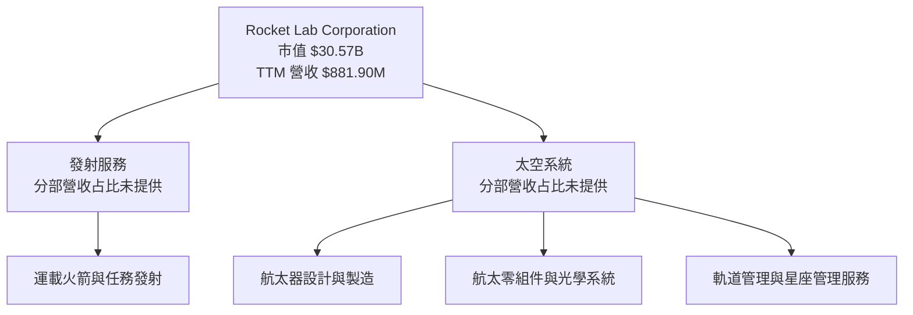
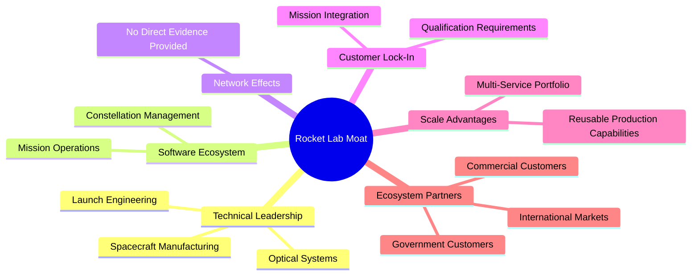
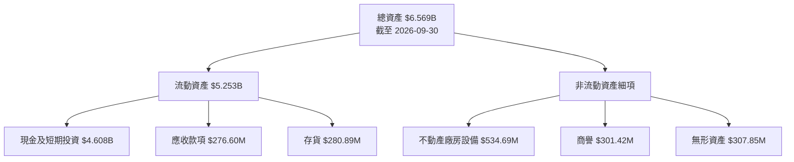
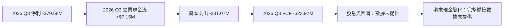
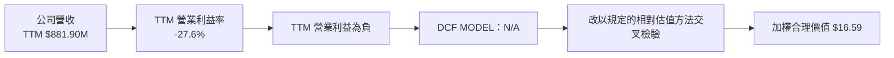
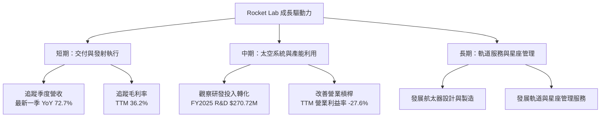
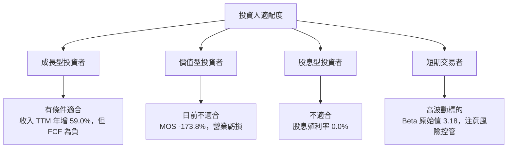

# RKLB 基本面深度分析報告
> **報告日期**：2026-11-21 ｜ **語言**：繁體中文 ｜ **數據來源**：SEC 申報資料 (XBRL)、Yahoo Finance、Finviz、StockAnalysis、Roic.ai ｜ **分析師**：CFA 級機構研究

## 目錄

| # | 章節 | 核心結論 |
|---|------|----------|
| 1 | 執行摘要 | 賣出；加權合理價值 $16.59；MOS -173.8% |
| 2 | 公司概覽與商業模式 | 發射服務與太空系統並行；分部營收占比未提供，護城河有技術與客戶關係基礎，但未轉化為獲利 |
| 3 | 損益表深度分析 | TTM 營收 $881.90M、TTM 成長 59.0%；TTM 營業利益率 -27.6% |
| 4 | 資產負債表分析 | 現金及短期投資 $4.61B；流動性高，但營運資金週期拉長 |
| 5 | 現金流量深度分析 | TTM FCF -$325.62M；營收成長仍伴隨大量現金消耗 |
| 6 | 獲利能力與資本效率 | ROIC -16.1% 對 WACC 14.00%，目前摧毀股東價值 |
| 7 | 相對估值分析 | 同業 P/S 法估值 $8.08；現價高於自身五年 P/S 中位數 |
| 8 | DCF 內在價值評估 | DCF N/A：TTM 營業利益為負，不建立虧損折現模型 |
| 9 | 成長催化劑 | 發射與太空系統需求帶來成長空間，但未提供可量化 TAM 或明確催化劑日期 |
| 10 | 風險矩陣 | 核心風險為持續虧損與現金消耗、估值回落及執行風險 |
| 11 | 投資建議 | 賣出；以獲利改善、現金流和估值回到合理區間作為重新評估條件 |

---

## 1. 執行摘要

RKLB 的 2026-11-20 收盤價為 **$45.42**。公司 TTM 營收 **$881.90M**、TTM 營收年增 **59.0%**，最新一季營收年增 **72.7%**，但 TTM 營業利益率為 **-27.6%**、ROIC 為 **-16.1%**，TTM FCF 為 **-$325.62M**。依固定估值方法計算的加權合理價值為 **$16.59**，因此 MOS 為 **-173.8%**，規則 20 評級為 **賣出**；現價相對加權合理價值的上行空間為 **-63.5%**。公司成長速度與現金資源提供長期選擇權，但當前尚未證明規模成長能帶來正營業利潤或正 FCF。

### 1.0 一頁式投資儀表板

| 項目 | 內容 |
|------|------|
| **投資論點（3 句）** | ① TTM 營收年增 **59.0%**，最新一季年增 **72.7%**，顯示需求及交付規模仍在擴張。② TTM 營業利益率 **-27.6%**、ROIC **-16.1%**，距離以資本成本衡量的價值創造尚有明顯差距。③ TTM FCF **-$325.62M**，現金及短期投資 **$4.61B** 提供融資緩衝，但若消耗速度不降，股東價值仍受稀釋與估值重估風險影響。 |
| **綜合評分** | **5.0/10**（引用 1.1 評分卡） |
| **財務健康** | 🟡 現金及短期投資 **$4.61B**、流動比率 **8.554**；但 TTM FCF **-$325.62M**，營運資金 CCC 從 **120 天**增至 **176 天**。 |
| **ROIC vs WACC** | **-16.1% vs 14.00%**；差距 **-30.1 個百分點**，目前摧毀經濟價值。 |
| **FCF 趨勢** | TTM FCF 為 **-$325.62M**，年度 FCF 仍為負；FCF Yield **-1.07%**。 |
| **估值** | Forward P/E **634.5347x** ｜ EV/EBITDA **-140.92x** ｜ FCF Yield **-1.07%**。 |
| **DCF 內在價值（基準）** | **N/A**；TTM 營業利益為負，依估值模型規則不建立 DCF。 |
| **安全邊際（MOS）** | **-173.8%**＝(**加權合理價值 $16.59 − 現價 $45.42**) ÷ 加權合理價值 $16.59；🔴 無安全邊際。 |
| **預期報酬（基準情境 12M）** | **N/A**；DCF MODEL 未提供可用情境。相對估值加權值對現價的上行空間為 **-63.5%**，不等同 12 個月報酬預測。 |
| **關鍵風險（前二）** | 營業虧損及負 FCF 延續；高估值在成長或執行低於預期時快速收縮。 |
| **評級 + 信心度** | 🔴 **賣出** ｜ 信心：中；MOS 由指定估值方法計算，但因 DCF 不適用且同業倍數差距大，合理價值仍有模型風險。 |

### 1.1 綜合評分卡

| 維度 | 評分（1–10） | 主要依據（引用數字與其來源章節） |
|------|--------------|----------------------------------|
| 成長性 | 8.0 | TTM 營收年增 **59.0%**、最新一季年增 **72.7%**；見第 3 章。 |
| 獲利能力 | 2.0 | TTM 營業利益率 **-27.6%**、ROIC **-16.1%**、F-Score **5/9**；見第 3、6 章。 |
| 財務健康 | 8.0 | 現金及短期投資 **$4.61B**、流動比率 **8.554**；惟 TTM FCF 為負且 CCC **176 天**；見第 4、5 章。 |
| 估值 | 1.0 | 加權合理價值 **$16.59**，MOS **-173.8%**；現價 P/S 高於自身五年中位數；見第 7、8 章。 |
| 護城河 | 7.0 | 發射服務、航太製造與系統能力構成技術和整合門檻，但未提供市場份額與分部獲利資料；見第 2 章。 |
| 管理層與資本配置 | 4.0 | 2025 年 SBC **$71.10M**，稀釋股數未通過 F-Score 測試；目前持續投資但尚未轉為正 FCF；見第 3、5、6 章。 |
| **綜合評分** | **5.0** | 六項算術平均：(**8.0 + 2.0 + 8.0 + 1.0 + 7.0 + 4.0**) ÷ 6 = **5.0**。 |

### 1.2 五大投資論點 + 三大核心風險

| 類型 | 項目 | 具體依據 | 信心度 |
|------|------|----------|--------|
| 🟢 **投資論點①** | 營收增速仍快 | TTM 營收 **$881.90M**、TTM 年增 **59.0%**，最新一季年增 **72.7%**；若增長延續，營收規模有機會攤薄固定成本。 | 🟢 高 |
| 🟢 **投資論點②** | 現金資源提供營運緩衝 | 現金及短期投資 **$4.61B**，相對 TTM FCF 流出 **$325.62M** 能支持多年的投資，但未來消耗取決於研發、產能與計畫執行。 | 🟢 中 |
| 🟢 **投資論點③** | 毛利率較早期明顯改善 | 年度毛利率由 2022 年約 **9.0%**升至 2025 年約 **34.4%**，表示產品組合、產能利用率或成本效率已有改善；是否能延續仍須驗證。 | 🟢 中 |
| 🟢 **投資論點④** | 發射與太空系統形成一體化供應能力 | 公司涵蓋發射服務、航太器設計製造、零組件與光學系統；若客戶採購多項服務，整合供應可提高專案黏著度。未提供分部營收數字。 | 🟡 中 |
| 🟢 **投資論點⑤** | 流動性充足 | 最新流動比率 **8.554**、速動比率 **7.954**；短期償付壓力較低，有時間把研發與產能投入轉化為營收。 | 🟢 高 |
| 🟡 **風險①** | 營業虧損及 FCF 消耗持續 | TTM 營業利益率 **-27.6%**、TTM FCF **-$325.62M**，若營收增長無法帶來成本槓桿，現金消耗及未來融資需求會上升。 | 🟡 中 |
| 🔴 **風險②** | 股價已反映高成長預期 | 2026-11-20 收盤 **$45.42**；估值方法加權價 **$16.59**，P/S 歷史比較為現值 **33.6x**、五年中位數 **19.4x**。 | 🔴 高 |
| 🔴 **風險③** | 營運資金佔用增加 | CCC 由一年前 **120 天**升至 **176 天**，其中 DIO 增加 **42 天**；若庫存轉化或專案驗收延遲，可能壓低現金轉換效率。 | 🔴 中 |

### 1.3 快速統計卡片

同業營收成長與毛利率中位數依 SPCX、LUNR、PL 三家提供的數據計算；Forward P/E 同業中位數包含負值，經濟意義有限，須審慎比較。

| 指標 | 公司實際值（期間） | 同業中位數 | 狀態 |
|------|--------------------|------------|------|
| 營收成長（TTM） | **59.0%** | — | 🟢 |
| 營收成長（最新一季年增） | **72.7%** | **161.4%** | 🟡 |
| 毛利率（TTM） | **36.2%** | **55.5%** | 🟡 |
| 營業利益率（TTM） | **-27.6%** | — | 🔴 |
| ROIC（TTM） | **-16.1%** | — | 🔴 |
| Forward P/E | **634.5347x** | **-49.7x** | 🔴 不具可比性：同業中位數為負值 |
| FCF Yield（TTM） | **-1.07%** | — | 🔴 |
| Piotroski F-Score | **5 / 9** | — | 🟡 |

### 1.4 投資結論

```text
╔══════════════════════════════════════════════════════════════════╗
║                    📊 投資結論摘要                               ║
╠══════════════════════════════════════════════════════════════════╣
║  評級：🔴 賣出（依規則 20；MOS -173.8%）                         ║
║  價格（2026-11-20 收盤）：$45.42                                 ║
║  DCF 內在價值（基準）：N/A（TTM 營業利益為負）                   ║
║  安全邊際 MOS：-173.8%（以加權合理價值 $16.59 為基準）          ║
║  加權合理價值（8.8）：$16.59                                     ║
║  綜合評分：5.0/10（引用 1.1）                                    ║
║  適合投資人：能承受高波動、長期追蹤商業化進展的成長型投資人；    ║
║              不適合作為低估值、當期獲利或股息型核心持倉。        ║
╚══════════════════════════════════════════════════════════════════╝
```

---

## 2. 公司概覽與商業模式

### 2.1 業務結構與收入來源

Rocket Lab 在美國、加拿大、日本及國際市場提供發射服務與太空系統解決方案。FY2025 營收 **$601.80M**；TTM 至 2026-09-30 營收 **$881.90M**。業務說明包含發射服務、航太器設計、零組件、製造、光學系統及軌道管理等，但沒有提供各分部營收、利潤或占比，因此不能將全公司營收拆分至各業務。



### 2.2 市場份額

市場份額數據未提供，亦未提供可按業務線對應的市場規模與公司收入，因此不繪製市場份額圖。以公司層級營收衡量，TTM 營收為 **$881.90M**、TTM 年增 **59.0%**；與同業比較時，RKLB 最新一季年增 **72.7%**，高於 PL 的 **58.1%**，但低於 SPCX 的 **161.4%** 與 LUNR 的 **413.7%**。各公司收入基礎與業務組合不同，這些數字不能直接解讀為市場份額或競爭力排名。

### 2.3 競爭護城河分析



上述類別反映公司業務特性，而非已有量化證明的競爭優勢。資料未提供客戶留存率、重複訂單率、訂單積壓、合約毛利率或市場份額，故需以後續季度披露檢驗護城河是否具有可量化經濟回報。

### 2.4 護城河強度

| 護城河項目 | 強度（強／中／弱） | 證據（引用數字或事實） | 會削弱它的情況 |
|------------|--------------------|------------------------|----------------|
| 技術與製造能力 | 中 | 公司同時提供發射、航太器設計製造、零組件及光學系統；TTM 營收 **$881.90M**。未提供各分部的技術性能或客戶轉換成本數字。 | 發射可靠性或交付延遲、競爭者降價、關鍵技術被替代。 |
| 軟體與任務管理 | 弱至中 | 公司描述包含軌道及星座管理服務，但未披露軟體收入占比、訂閱收入或續約率。 | 軟體服務未形成經常性收入或客戶轉換成本。 |
| 網路效應 | 弱 | 沒有提供隨客戶或使用者增加而提升服務價值的量化證據。 | 客戶與供應商網絡規模不形成正向回饋。 |
| 客戶鎖定與認證 | 中 | 航太任務通常涉及專案整合與驗證流程；但公司未提供客戶留存或重複訂單率。 | 政府或商業客戶改採競爭方案，或重新認證成本降低。 |
| 規模效應 | 中 | FY2025 營收 **$601.80M**，TTM 營收年增 **59.0%**；規模擴大可能提高產能利用率，但 TTM 營業利益率仍 **-27.6%**。 | 成長仍未帶來單位成本下降或營業槓桿。 |
| 生態夥伴 | 弱至中 | 公司服務多個國家與國際市場；未提供夥伴收入、聯合專案或集中度數據。 | 關鍵供應商受限、合作專案取消或供應鏈瓶頸。 |

1.1 的護城河評分為 **7.0/10**，主要反映多產品能力與航太工程門檻；由於缺乏市占率、重複訂單與分部利潤數據，該評價仍需以未來經營成果驗證。

---

## 3. 損益表深度分析

### 3.1 年度收入成長趨勢（近 4 年）

年度營收由 2022 年 **$211.00M** 增至 2025 年 **$601.80M**。2022–2025 三年 CAGR 約 **41.8%**，計算為 \((601.80 ÷ 211.00)^{1/3}-1\)。2024 年增速最高，2025 年增速回落至 **37.96%**，但營收絕對值仍增加 **$165.59M**。

```text
╔══════════════════════════════════════════════════════════════════╗
║             Rocket Lab 年度收入趨勢（FY2022–FY2025）             ║
╠══════════════════════════════════════════════════════════════════╣
║  FY2022  $211.00M  ███████░░░░░░░░░░░░░░░░░░  YoY：—            ║
║  FY2023  $244.59M  █████████░░░░░░░░░░░░░░░  YoY：+15.92% 🟡    ║
║  FY2024  $436.21M  ████████████████░░░░░░░  YoY：+78.34% 🟢    ║
║  FY2025  $601.80M  ██████████████████████░░  YoY：+37.96% 🟢    ║
╠══════════════════════════════════════════════════════════════════╣
║  2022–2025 營收 CAGR：約 +41.8%                                  ║
╚══════════════════════════════════════════════════════════════════╝
```

### 3.2 季度收入趨勢分析

QoQ 依相鄰季度營收計算；YoY 依同季度營收計算。最新一季年增 **72.7%** 是單季年增率，不是 TTM 成長率。

| 季度 | 營收 | QoQ 成長 | YoY 成長 | 備註 |
|------|------:|---------:|---------:|------|
| 2025 Q4 | $179.65M | — | 35.70% | 本表季度序列起點。 |
| 2026 Q1 | $200.35M | **+11.53%** | **+63.46%** | 同比增速高於 2025 Q1 的成長基礎。 |
| 2026 Q2 | $234.07M | **+16.83%** | **+61.99%** | 營收續增，季度交付擴大。 |
| 2026 Q3 | $267.83M | **+14.42%** | **+72.71%** | 最新季同比加速；單季營收創表內新高。 |

計算示例：2026 Q3 QoQ = \($267.83M ÷ $234.07M)-1 = **14.42%**；YoY = \($267.83M ÷ $155.08M)-1 = **72.71%**。季度數據顯示營收擴張，但由於同期營業虧損仍大，營收增長尚未等同於獲利改善。

### 3.3 利潤率演變分析

| 利潤率指標 | FY2022 | FY2023 | FY2024 | FY2025 | 趨勢 | 評估 |
|------------|-------:|-------:|-------:|-------:|------|------|
| **毛利率** | 9.0% | 21.0% | 26.6% | 34.4% | ↗️ 連續改善 | 🟢 成本與產品組合改善，但 TTM 毛利率為 **36.2%**，仍需觀察能否維持。 |
| **營業利益率** | -64.1% | -72.7% | -43.5% | -38.0% | ↗️ 近兩年收窄 | 🔴 仍深度虧損；TTM 為 **-27.6%**。 |
| **淨利率** | -64.4% | -74.6% | -43.6% | -32.9% | ↗️ 虧損率收窄 | 🔴 仍未達損益兩平；TTM 為 **-25.7%**。 |
| **EBITDA Margin** | -45.1% | -53.8% | -29.7% | -25.8% | ↗️ 近年改善 | 🔴 TTM 為 **-19.5%**，仍為負。 |

年度毛利率改善幅度大於營業利益率改善幅度，表示新增毛利仍被研發、銷售管理及其他營運支出吸收。FY2025 研發支出 **$270.72M**，較 FY2024 的 **$174.39M** 增加 **55.2%**；高研發投入可能支撐產品與產能發展，但也使毛利提升尚未直接轉化為營業獲利。產品組合、各分部成本和定價資料未提供，不能把毛利改善單一歸因於某個業務線。

最新季度營業利益為 **-$79.19M**，營業利益率 **-29.6%**；對比 TTM **-27.6%**，表示短期季度盈利表現弱於近一年平均。

### 3.4 費用結構分析

沒有完整且同一期間的銷管費、研發費、折舊與其他營運費用明細，無法建立可核對的費用結構圓餅圖。已知 FY2025 研發支出為 **$270.72M**，約為同期營收 **45.0%**；FY2024 研發支出為 **$174.39M**，約為同期營收 **40.0%**。比例上升代表公司持續增加研發投入，短期增加虧損壓力，是否合理取決於後續新產品商業化和營收轉換。

### 3.5 季度 EPS 趨勢與盈餘品質（Quality of Earnings）

最新四季 EPS 實際值如下；一致的分析師 EPS 預估與 surprise 數據未提供，因此無法判斷超預期或不及預期。已提供的 EPS beat/miss 歷史列只有三季且預估與實際值為 NaN，不能據此宣稱 beat 或 miss。

| 季度 | EPS 實際值 | EPS 預估／盈餘 surprise | 解讀 |
|------|-----------:|------------------------|------|
| 2025 Q4 | -$0.09 | N/A | 無可核對的預估值。 |
| 2026 Q1 | -$0.07 | N/A | 每股虧損較 Q4 收窄，但仍為負。 |
| 2026 Q2 | -$0.08 | N/A | 每股虧損較 Q1 擴大。 |
| 2026 Q3 | -$0.12 | N/A | 每股虧損進一步擴大；無法比較盈餘 surprise。 |

| 盈餘品質項目 | 數值/佔比 | 評估 |
|--------------|-----------|------|
| 股權薪酬 SBC / 營收 | FY2025 **$71.10M ÷ $601.80M = 11.8%**；最新季 **$18.32M ÷ $267.83M = 6.8%** | 🔴 SBC 對股東是經濟成本，會稀釋所有權；FY2025 占營收比重仍高。 |
| SBC / 營業現金流 | TTM 四個已列季度 SBC 合計 **$84.20M**；TTM OCF **-$191.78M** | 🔴 OCF 為負，不適合用一般正值比率解讀；SBC 為 OCF 缺口絕對值的 **43.9%**，此數字只表示尺度比較，不代表現金流覆蓋。 |
| FCF / 淨利（現金轉換率） | TTM FCF **-$325.62M**；TTM 淨利約 **-$226.88M**；比值約 **143.5%** | 🔴 負值除以負值雖為正比率，但表示現金流出幅度大於會計淨虧損，不能解讀為現金轉換良好。 |
| 一次性/非經常性損益 | N/A（未提供可核實明細） | 🟡 無法判斷是否有重大一次性項目影響期間盈虧。 |
| 有效稅率異常 | N/A（未提供所得稅費用與稅前損益的可核對明細） | 🟡 無法判斷稅務利益是否改變淨利。 |
| 資本化支出 vs 費用化 | TTM 資本支出 **$133.84M**；資本化政策及費用化調節明細未提供 | 🟡 不能判斷是否有成本遞延或資本化項目對當期利潤的影響。 |

**盈餘品質結論**：公司目前為虧損企業，盈利含金量應以現金消耗與稀釋來衡量，而非只看 EPS 變化。TTM FCF **-$325.62M**，且 SBC 對 FY2025 營收占比 **11.8%**，代表股東承擔現金消耗及股份稀釋雙重成本。一次性損益、稅率及資本化明細缺乏，估值不應依賴單一季度的淨利變化。

---

## 4. 資產負債表分析

### 4.1 資產結構分解

截至 2026-09-30，StockAnalysis 列示總資產約 **$6.569B**、流動資產 **$5.253B**、不動產廠房設備 **$534.69M**、商譽 **$301.42M**、無形資產 **$307.85M**。以下僅呈現已披露項目，未把未列出的其他資產倒算成差額。



### 4.2 流動性與營運資金分析

| 流動性指標 | 最新數值 | 歷史參考 | 評估 |
|------------|----------:|----------|------|
| 流動比率 | **8.554** | FY2025 約 **4.09**（流動資產 $1.37B ÷ 流動負債 $334.48M） | 🟢 流動資產覆蓋短期負債充足；最新數值受現金融資及流動資產擴張影響。 |
| 速動比率 | **7.954** | N/A（未提供同口徑歷史序列） | 🟢 顯示短期流動性高；仍需留意現金消耗。 |
| 現金及短期投資 | **$4.61B** | FY2025 為 **$1.017B** | 🟢 現金資源上升，為研發與產能提供緩衝。 |
| TTM FCF | **-$325.62M** | FY2025 FCF **-$321.81M** | 🔴 現金資源充足不等於自我融資，經營與資本投入仍消耗現金。 |

營運資金天數依品質指標原值列示，不另行重算：

| 指標 | 最新 TTM | 一年前 TTM | 變化 | 解讀 |
|------|----------|------------|------|------|
| DSO 應收帳款天數 | **49 天** | **39 天** | **+10 天** | 🟡 收款時間延長，可能反映收入確認、客戶付款條件或專案結算節奏改變。 |
| DIO 存貨天數 | **182 天** | **140 天** | **+42 天** | 🔴 存貨占用增加；需追蹤成品交付、專案排程與存貨是否轉為收入。 |
| DPO 應付帳款天數 | **55 天** | **59 天** | **-4 天** | 🟡 付款天數略降，供應商融資對現金的支持減少。 |
| CCC 現金轉換週期 | **176 天** | **120 天** | **+56 天** | 🔴 現金從投入到回收的時間拉長，與負 FCF 一起構成營運資金風險。 |

### 4.3 債務結構分析

主要標準化財務指標列示總債務 **$1.72M**、現金及短期投資 **$4.61B**、淨現金 **$4.61B**。補充市場資料另列總債務 **$120.28M**、淨現金 **$4.49B**，兩者口徑不一致；下方債務診斷採用主要標準化指標，並將差異視為需要核對的資料限制。不得據此推導利息保障倍數或 Debt/EBITDA，因相關口徑及利息支出資料不充分，且 EBITDA 為負。

```text
╔══════════════════════════════════════════════════════════════════╗
║                 Rocket Lab 債務健康診斷                         ║
╠══════════════════════════════════════════════════════════════════╣
║  總債務（標準化數據）： $1.72M       🟢                         ║
║  現金及短期投資：       $4.61B       🟢                         ║
║  淨現金：               $4.61B       🟢                         ║
║                                                                  ║
║  Debt/EBITDA：N/A（EBITDA 為負，倍數不具經濟解讀性）             ║
║  Interest Coverage：N/A（利息與債務口徑不一致，無法可靠計算）   ║
║  流動比率：8.554                                                   ║
║  風險提醒：補充市場資料列示債務 $120.28M，與標準化數字不一致。  ║
╚══════════════════════════════════════════════════════════════════╝
```

### 4.4 股東權益趨勢

年末股東權益在 2024 年下降後，2025 年大幅上升；年度值未必能直接反映期間融資與股份變動的完整經濟效果。

```text
╔══════════════════════════════════════════════════════════════════╗
║                股東權益趨勢（年度期末）                         ║
╠══════════════════════════════════════════════════════════════════╣
║  2022  $673.21M  ████████████████████                           ║
║  2023  $554.54M  ████████████████                               ║
║  2024  $382.45M  ███████████                                    ║
║  2025  $1.72B    █████████████████████████████████████████████  ║
╠══════════════════════════════════════════════════════════════════╣
║  FY2025 權益上升；稀釋股數未增加測試未通過，須追蹤每股價值變化。║
╚══════════════════════════════════════════════════════════════════╝
```

---

## 5. 現金流量深度分析

### 5.1 現金流量瀑布圖

2026 Q3 單季 OCF 為 **$7.15M**，但扣除資本支出 **$31.07M** 後，該季 FCF 為 **-$23.92M**。瀑布圖只連接同期間可核對的現金流項目；股息、回購與融資造成的淨現金變化沒有完整同期間數據，不予填入。



### 5.2 FCF 轉換率趨勢

| 年度 | FCF | 淨利 | FCF / 淨利 | 評估 |
|------|-----:|-----:|-----------:|------|
| 2022 | -$148.95M | -$135.94M | **109.6%** | 雙負值比率不代表轉換良好；現金流出高於淨虧損。 |
| 2023 | -$153.57M | -$182.57M | **84.1%** | 現金流出低於淨虧損，但仍為顯著負 FCF。 |
| 2024 | -$115.98M | -$190.18M | **61.0%** | 虧損大於 FCF 流出，可能包含非現金項目及營運資金影響。 |
| 2025 | -$321.81M | -$198.21M | **162.4%** | FCF 流出顯著高於淨虧損，資本支出與營運現金消耗提高。 |
| TTM 至 2026-09-30 | -$325.62M | 約 -$226.88M | **143.5%** | 仍為負值分子與負值分母；不可用正比率包裝為高品質現金流。 |

### 5.3 自由現金流趨勢

年度 FCF 由 2024 年改善至 **-$115.98M**，2025 年轉差至 **-$321.81M**；TTM FCF 為 **-$325.62M**。FCF Yield 使用標準化 TTM 數值為 **-1.07%**。年度表中的資本支出以現金流出列示，分析時按投資現金流支出理解。

```text
╔══════════════════════════════════════════════════════════════════╗
║              自由現金流趨勢（年度實際及 TTM）                    ║
╠══════════════════════════════════════════════════════════════════╣
║  FY2022  -$148.95M  ◀███████████████░░░░░░░░░░░░  FCF Yield N/A  ║
║  FY2023  -$153.57M  ◀████████████████░░░░░░░░░░░  FCF Yield N/A  ║
║  FY2024  -$115.98M  ◀████████████░░░░░░░░░░░░░░░  FCF Yield N/A  ║
║  FY2025  -$321.81M  ◀████████████████████████████ FCF Yield N/A  ║
║  TTM     -$325.62M  ◀████████████████████████████ FCF Yield -1.07%║
╚══════════════════════════════════════════════════════════════════╝
```

### 5.4 資本配置評估

公司未提供完整的資金用途百分比或同一期間股息、回購、併購及現金融資調節，不繪製資本配置圓餅圖。已知 FY2025 資本支出 **$156.28M**，研發費用 **$270.72M**，SBC **$71.10M**，且無股息（殖利率 **0.0%**）。投資方向偏向研發與產能建設；其資本配置成效應以新增營收、毛利及 FCF 改善檢驗，而不是只看營收規模。

---

## 6. 獲利能力與資本效率

### 6.1 ROE / ROA / ROIC 趨勢

歷史 ROIC 只有 TTM 標準化值可供引用；年別 ROIC 未提供，不以其他資料反推。ROE 與 ROA 的不同資料源口徑略有差異，因此表格採品質指標計算的 ROE，另將另一個合併資料欄位的 ROE 標註為來源差異。

| 指標 | FY2022 | FY2023 | FY2024 | FY2025 / TTM | 評估 |
|------|--------:|--------:|--------:|-------------:|------|
| ROIC | N/A | N/A | N/A | TTM **-16.1%** | 🔴 低於 WACC **14.00%**，資本投入尚未產生足以覆蓋資本成本的報酬。 |
| ROE | N/A | N/A | N/A | 品質數據 TTM **-3.9%** | 🔴 股東權益報酬為負。另有市場資料列示 **-6.4%**，可能為期間或計算口徑差異。 |
| ROA | N/A | N/A | N/A | 市場資料 TTM **-3.5%** | 🔴 資產未能轉化為正淨利。 |

沒有足以同口徑比較的行業平均 ROIC、ROE 或 ROA 數據，故不列行業均值。

### 6.2 ROIC vs WACC 分析（核心價值創造判斷）

```text
╔══════════════════════════════════════════════════════════════════╗
║                ROIC vs WACC 深度分析                            ║
╠══════════════════════════════════════════════════════════════════╣
║  資本成本輸入（標準化計算資料）：                                ║
║  ├── 無風險利率（10Y 美債）：             4.91%                 ║
║  ├── 市場風險溢酬 ERP：                    5.00%                 ║
║  ├── Beta 原始值：                          3.18                  ║
║  ├── Beta 採用值（調整後）：                2.00                  ║
║  ├── 股權成本 Ke：                          14.91%                ║
║  ├── 資本結構 E / D：                       100.0% / 0.0%         ║
║  ├── 程式計算 WACC：                        14.98%                ║
║  └── 採用 WACC（受 7%–14% 區間限制）：        14.00%                ║
║                                                                  ║
║  ROIC（TTM）：                              -16.1%                ║
║  EVA 利差 = ROIC − WACC：                   -30.1 個百分點        ║
║                                                                  ║
║  ROIC  -16.1%  ◀████████░░░░░░░░░░░░░░░░░░░░░░░░░░░░░░ 🔴      ║
║  WACC   14.0%    ▓▓▓▓▓▓▓▓▓▓▓▓▓▓▓▓▓▓▓▓▓▓▓▓▓▓▓▓                    ║
║                                                                  ║
║  結論：ROIC 低於 WACC；依目前 TTM 表現，RKLB 尚未創造股東價值。║
╚══════════════════════════════════════════════════════════════════╝
```

Beta 採用的調整值為 **2.00**；標準化資料列示調整公式 \(⅔ × 3.18 + ⅓ = 2.45\)，再依規定上限 **2.0** 截斷。以 CAPM 可核對的股權成本為 \(4.91\% + 2.00 × 5.00\% = 14.91\%\)。資本成本資料同時列示 WACC 計算值 **14.98%**、因區間限制而採用 **14.00%**；由於資本結構權重為 E 100%、D 0%，且提供的原始成本輸入無法完全重建 14.98%，本報告依指定採用值 **14.00%**，不另行改算替代 WACC。此 WACC 與第 8.2 節一致。

ROIC **-16.1%** 對比 WACC **14.00%**，差額 **-30.1 個百分點**，代表營運資產的稅後報酬尚不足以補償資本成本。若後續營收擴張帶動營業利潤率轉正，ROIC 才可能改善；目前沒有正營業利益作為該轉變已發生的證據。

### 6.3 杜邦三因素分解

依品質指標原值照錄：

| 因素 | 數值（TTM） | 解讀 |
|------|-------------|------|
| 淨利率 | **-25.7%** | 虧損是 ROE 為負的主要來源。 |
| 資產週轉率 | **0.13** | 每單位資產產生的營收有限；大額現金與擴產資產會壓低資產週轉率。 |
| 權益乘數 | **1.13** | 槓桿幅度不高，ROE 不是靠高槓桿支撐。 |
| **ROE** | **-3.9%** | **-25.7% × 0.13 × 1.13 ≈ -3.9%**；主因是負淨利率，而非財務槓桿。 |

### 6.4 財務體質：Piotroski F-Score

品質指標提供 Piotroski F-Score **5/9**；九項測試結果照錄如下。

| 測試 | 結果 | 解讀 |
|------|------|------|
| ROA > 0 | ❌ 未通過 | 資產報酬仍為負，尚未建立獲利能力。 |
| 營業現金流 > 0 | ❌ 未通過 | TTM OCF 為 **-$191.78M**。 |
| ROA 高於一年前 | ✅ 通過 | 資產報酬方向改善，但水準仍未轉正。 |
| 營業現金流 > 淨利（應計品質） | ✅ 通過 | 現金流相對淨利測試通過；但 OCF 絕對值仍為負，不能視為充足現金創造。 |
| 長期負債 ÷ 總資產低於一年前 | ✅ 通過 | 槓桿相對資產的方向改善。 |
| 流動比率高於一年前 | ✅ 通過 | 流動性指標改善，與現金資源增加一致。 |
| 稀釋股數未增加 | ❌ 未通過 | 股數有增加跡象，SBC 及融資可能稀釋股東持有比例。 |
| 毛利率高於一年前 | ✅ 通過 | 毛利率改善，與多年毛利率擴張趨勢一致。 |
| 資產週轉率高於一年前 | ❌ 未通過 | 資產擴張速度快於收入轉換效率。 |

5/9 呈現「流動性與毛利方向改善、獲利與資產效率仍弱」的混合訊號。尤其是營業現金流為負、ROA 未轉正及稀釋股數增加，抵銷部分資產負債表改善。

---

## 7. 相對估值分析

### 7.1 同業估值比較表格

比較對象與數字依 Yahoo Finance 同業倍數資料。RKLB 自身倍數取市場估值欄位；RKLB P/S 另有標準化五年歷史資料 **33.6x**，與 Yahoo／Finviz 當期欄位 **34.659702x** 口徑略異，歷史比較將依指定歷史資料使用 **33.6x**。

| 估值指標 | **RKLB** | **SPCX** | **LUNR** | **PL** | 本公司評估 |
|----------|---------:|--------:|--------:|------:|-----------|
| **Trailing P/E** | N/A | 555.6x | N/A | N/A | 🔴 RKLB 虧損，無法使用本益比衡量。 |
| **Forward P/E** | 634.5347x | 46.6x | -49.7x | -8424.0x | 🔴 RKLB 倍數極高；同業中兩者為負值，不能作簡單優劣比較。 |
| **P/S Ratio** | 34.659702x | 54.2x | 2.2x | 10.1x | 🔴 RKLB 高於 LUNR、PL，低於 SPCX；商業組合差異大。 |
| **EV/EBITDA** | -140.92x | 143.9x | -34.9x | -71.6x | 🔴 RKLB EBITDA 為負，負倍數不具標準估值意義。 |
| **最新一季營收 YoY** | 72.7% | 161.4% | 413.7% | 58.1% | 🟡 RKLB 成長高於 PL，但低於 SPCX 與 LUNR。 |
| **TTM 毛利率** | 36.2% | 56.8% | 20.3% | 55.5% | 🟡 RKLB 高於 LUNR，低於 SPCX 與 PL。 |

由於同業中有多家公司處於虧損，P/E 和 EV/EBITDA 的橫向比較失真；P/S 相對可用，但仍需考慮各公司收入的可重複性、毛利率與資本需求差異。

### 7.2 歷史估值區間分析

依自身五年 P/S 標準化資料，當前 **33.6x** 高於五年中位數 **19.4x**，但低於歷史區間上緣 **83.2x**；目前百分位 **57%**。這代表股價相對自身歷史並非處於區間極端高點，但估值仍高於中位數，且公司尚未產生正 FCF。

```text
╔══════════════════════════════════════════════════════════════════╗
║                 RKLB 五年 P/S 歷史區間                          ║
╠══════════════════════════════════════════════════════════════════╣
║  7.1x（低點） ───── 19.4x（中位數） ───── 33.6x（現值） ─ 83.2x ║
║                                            ↑                     ║
║                                      百分位：57%                 ║
╠══════════════════════════════════════════════════════════════════╣
║  現值高於中位數，但仍低於歷史高點；不能視為低估證據。            ║
╚══════════════════════════════════════════════════════════════════╝
```

### 7.3 情境價值（Bear / Base / Bull）

**N/A（DCF 無法計算：TTM 營業利益為負，因此沒有有效 DCF MODEL 情境數值。）**不自行設定悲觀、基準或樂觀 DCF 目標價。

### 7.4 相對估值隱含價格區間

```text
╔══════════════════════════════════════════════════════════════════╗
║                相對估值每股價值與現價位置                       ║
╠══════════════════════════════════════════════════════════════════╣
║  同業 P/S $8.08 ───────── 現價 $45.42 ───────── 分析師 $93.15   ║
║       -82.2%                 基準價                   +105.1%    ║
╚══════════════════════════════════════════════════════════════════╝
```

- **同業 P/S：$8.08**。依 LUNR、PL 的 P/S 中位數 **6.2x** 乘上 RKLB TTM 營收所回推；估值資料已列示方法價格，故不另以不同口徑重建。
- **分析師共識目標價：$93.15**。20 位分析師平均目標價；屬市場預期參考，並非可替代現金流模型的內在價值。
- **同業 Forward P/E** 無法計算，因此依方法規則不納入，權重由可計算方法分配。

---

## 8. DCF 內在價值評估（Discounted Cash Flow）

> **核心限制：DCF MODEL 為 N/A。**截至 2026-09-30 的 TTM 營業利益為負，不以負營業利益建立前瞻 DCF。本章依模型輸出規則保留各小節；不自行添加預測營收、利潤率、FCF、終值、敏感度矩陣或反推結果。

### 8.0 估值推理鏈（Thinking Logic：在算之前先想清楚）

RKLB 的長期價值可由發射服務、太空系統及相關任務服務構成，但各分部營收占比未提供，無法可靠拆出「既有現金流底盤」與「新業務選擇權價值」各自數值。可驗證的公司整體錨點是 TTM 營收 **$881.90M**、TTM 營業利益率 **-27.6%**、TTM FCF **-$325.62M**。

| 決策點 | 本報告採用 | 理由（含數字） | 曾考慮但否決 | 否決理由 |
|--------|-----------|----------------|--------------|----------|
| 現金流定義 | 不建立 DCF | TTM 營業利益為負；程式計算明確將 DCF 標示 N/A。 | FCFF 或 FCFE 預測 | 必須新增未經模型提供的未來營收、利潤率與資本支出假設，違反數字優先與不自建模型規則。 |
| 預測期 N | N/A | 模型未提供預測期。 | 任意設定 5–10 年 | 沒有模型輸出或公司財測支持。 |
| 終值方法 | N/A | 缺少有效 FCFF 預測基礎。 | Gordon Growth、退出倍數 | 不能由負營業利益直接推導可核對的終值。 |
| EBIT 基礎 | N/A | 沒有 DCF 模型年度 EBIT 假設。 | GAAP／非 GAAP 自建預測 | 會造成自建模型。 |

**關鍵假設推導鏈**：營收 CAGR、期末營業利潤率、永續成長率、Capex、D&A、營運資金、SBC、稀釋股數及 WACC 敏感度所需的模型欄位未提供；因此不能聲稱已選取或校準這些數值。**最脆弱的一環**是未來營業利潤率能否從目前 TTM **-27.6%**轉正，但沒有足夠輸入可量化其估值影響。



### 8.1 模型假設總表（Model Inputs）

**N/A（DCF MODEL 未提供預測期或模型假設；TTM 營業利益為負，依資料模型規則不建立 DCF。）**

### 8.2 折現率推導（WACC）

本節列示可用資本成本資料，但不將其用於自建 DCF。WACC 採用值必須與第 6.2 節一致。

```text
╔══════════════════════════════════════════════════════════════════╗
║                    WACC 資料與口徑                               ║
╠══════════════════════════════════════════════════════════════════╣
║  無風險利率 Rf（10Y 美債）：                  4.91%              ║
║  ERP：                                        5.00%              ║
║  原始 Beta（Yahoo）：                         3.18               ║
║  調整 Beta：                                  2.00               ║
║  Beta 調整列示：⅔ × 3.18 + ⅓ = 2.45，受 2.0 上限限制至 2.00    ║
║  股權成本：4.91% + 2.00 × 5.00% =             14.91%             ║
║  稅前債務成本（資料列示）：                    1543.65%           ║
║  稅率（預設）：                               21.0%              ║
║  E / D 權重：                                 100.0% / 0.0%      ║
║  程式列示 WACC：計算值 14.98%；採用值 14.00%（受 7%–14% 限制）║
╚══════════════════════════════════════════════════════════════════╝
```

- **步驟 1，股權成本**：CAPM = Rf + β × ERP = **4.91% + 2.00 × 5.00% = 14.91%**。
- **步驟 2–3，債務成本**：資料列示稅前債務成本 **1543.65%**、預設稅率 **21.0%**；但債務權重為 **0.0%**，且債務成本受到極小債務分母的影響，不宜解讀為可持續市場融資利率。
- **步驟 4，權重**：資本成本資料直接列示 E/D 權重 **100.0% / 0.0%**。另因市值與債務口徑存在數據源差異，不自行重算權重。
- **步驟 5，採用 WACC**：資料列示程式計算值 **14.98%**，因 7%–14% 區間限制而採用 **14.00%**。已給定的 Ke **14.91%**、E/D 權重和 WACC 計算值無法完全由同一組公開欄位重建，故不另造一個相乘結果替代程式採用值；後續如有 DCF 使用，必須沿用 **14.00%**。

### 8.3 逐年自由現金流預測（基準情境）

**N/A（DCF MODEL 未提供逐年營收、EBIT、NOPAT、Capex、折舊或 FCFF 預測；不得自行建立年度表格或逐步演算。）**

### 8.4 終值計算（Terminal Value）

**N/A（未提供可用的 FY+N FCFF 或 EBITDA，因此不能計算 Gordon Growth 終值或退出倍數終值。）**

### 8.5 企業價值 → 每股內在價值（Bridge）

**N/A（無法建立預測期現金流現值、終值或 DCF 企業價值橋接。）**本節不計算 DCF 折溢價；下文 8.8 的 MOS 只使用加權合理價值。

### 8.6 敏感性分析（WACC × 永續成長率）

**N/A（DCF MODEL 未提供 WACC × 永續成長率敏感度矩陣；不自行補算或估算矩陣。）**

### 8.7 反推 DCF（Reverse DCF：市場在預期什麼）

**N/A（沒有可用 DCF 模型，現價無法反推營收 CAGR、營業利潤率、永續成長率或預測期。）**

### 8.8 估值三角驗證與安全邊際

估值方法、每股價值與權重依標準化估值方法原值列示。相對估值方法對不盈利公司較易實施，但同業業務組合不同；分析師共識則屬市場預期，不應視為獨立的基本面現金流驗證。

| 估值方法 | 隱含每股價值 | 上行空間（÷現價） | 權重 | 說明 |
|----------|--------------:|-------------------:|-----:|------|
| 同業 P/S | **$8.08** | **-82.2%** | **90%** | LUNR、PL 的同業 P/S 中位數 **6.2x** 乘以 RKLB TTM 營收；估值方法所列每股值照錄。 |
| 分析師共識目標價 | **$93.15** | **+105.1%** | **10%** | 20 位分析師平均目標價；屬市場預期參考。 |
| **加權合理價值** | **$16.59** | **-63.5%** | **100%** | 不盈利公司固定權重；同業 Forward P/E 無法計算，因此未納入並依規則調整權重。 |

**逐步演算（權重外顯）**：

\[
\text{加權合理價值}
= \$8.08 \times 90\% + \$93.15 \times 10\%
= \$7.272 + \$9.315
= \$16.587
\approx \mathbf{\$16.59}
\]

上行空間以現價為分母：

\[
(\$16.59-\$45.42) \div \$45.42
= -\$28.83 \div \$45.42
= -63.46\%
\approx -63.5\%
\]

MOS 以加權合理價值為分母，並只在此處計算：

\[
(\$16.59-\$45.42) \div \$16.59
= -\$28.83 \div \$16.59
= -173.73\%
\approx \mathbf{-173.8\%}
\]

負 MOS 的幅度超過 -100%，是因現價遠高於估值分母，並非計算錯誤。依 MOS 門檻，評級為 **賣出**。由於公司處於虧損狀態，且沒有可用 DCF 情境，不以杜撰的 DCF 目標價建立區間圖；僅以加權合理價值作為可核對的相對估值錨點。

> 🔎 **程式複算（Python，依本節各項自動重算）**
>
> 加權合理價值 = $8.08 × 90% + $93.15 × 10% = **$16.59**（權重合計 100%）
>
> 以價格 $45.42 計：MOS = **-173.8%**，上行空間 = **-63.5%**
>
> ✅ 與本節所寫數值一致。

### 8.9 DCF 模型的局限與失效條件

- **終值依賴度**：N/A，DCF MODEL 未提供終值與企業價值，無法計算終值占比。
- **最脆弱的假設**：本報告沒有自建營收或利潤率假設；最需要驗證的是目前 **-27.6%** 的 TTM 營業利益率能否隨營收擴張而收斂，以及 **-$325.62M** TTM FCF 能否改善。
- **不適用情境說明**：公司 TTM 營業利益及 FCF 均為負，且處於高投資階段，以標準 DCF 推導精確單點價值的可靠度不足。較適合輔以 EV/Sales、毛利趨勢、訂單與交付、單位經濟性及分部估值；目前提供資料不足以做 SOTP。
- **與第 10 章風險矩陣的連結**：發射延遲或交付中斷會衝擊收入成長與毛利；成本超支會延後營業利潤率轉正；存貨週期拉長會增加營運資金需求及 FCF 流出；估值倍數收縮則直接影響相對估值。

### 8.10 複算檢核表（Audit Trail：輸出前自我驗算）

| # | 檢核項目 | 檢查方式 | 結果 |
|---|----------|----------|------|
| 1 | 所有高／中敏感度 DCF 輸入均有推導 | DCF MODEL 為 N/A，沒有假設輸入可逐項推導。 | **N/A（未建立 DCF）** |
| 2 | 每個 DCF 假設都有來歷 | 未新增任何 DCF 假設。 | **N/A** |
| 3 | WACC 五步算式與相乘相加一致 | 來源列示 Ke、權重及 WACC 計算值存在無法完全重建的口徑差異；報告照採 14.00%。 | **⚠️ 已揭露資料不一致** |
| 4 | Kd 分母與權重 D 同一範圍 | 債務成本極高且標準化債務與補充市場數據不一致；未據此建立 DCF。 | **N/A（限制與差異已揭露）** |
| 5 | WACC 與第 6.2 節同值 | 兩節均採 **14.00%**。 | ✅ |
| 6 | 逐年表年度數等於 N | DCF 未提供 N 或年度預測。 | **N/A** |
| 7 | FY+1 FCFF 可複算 | 無 FY+1 模型數值。 | **N/A** |
| 8 | 預測期 PV 加總正確 | 無預測期 PV。 | **N/A** |
| 9 | WACC > g | 無永續成長率 g。 | **N/A** |
| 10 | 終值以 FY+N FCFF 計算並折現 N 期 | 無終值或 FY+N 數值。 | **N/A** |
| 11 | DCF EV 至每股價值橋接可複算 | 無 DCF EV 橋接。 | **N/A** |
| 12 | SBC 組合 (A)/(B)/(C) 一致 | 未建立 DCF，沒有 EBIT、SBC 扣除及稀釋假設組合。 | **N/A** |
| 13 | 敏感度基準格與 DCF 每股價值一致 | 無敏感度矩陣。 | **N/A** |
| 14 | 敏感度矩陣排除 WACC ≤ g | 無敏感度矩陣。 | **N/A** |
| 15 | 三情境機率合計 100% | DCF Scenarios 未提供。 | **N/A** |
| 16 | 反推 DCF 僅放開一個變數且有試算軌跡 | 無 DCF 模型輸出。 | **N/A** |
| 17 | MOS 分母為 8.8 加權合理價值；折溢價採 DCF | MOS 以 **$16.59** 為分母；DCF 折溢價因 DCF N/A 不報。 | ✅ |
| 18 | 完整輸出至第 11 章 | 已保留 11 章架構。 | ✅ |
| 19 | 加權價值等於價值乘權重之和 | **$8.08×90% + $93.15×10% = $16.587 ≈ $16.59**。 | ✅ |
| 20 | 評級符合 MOS 門檻 | MOS **-173.8%**，低於 **-25%**，評級為賣出。 | ✅ |

本報告沒有自行建立 DCF；WACC 原始計算欄位存在資料口徑不能完全重建的差異，已採用並一致引用指定的 **14.00%**。這降低對 DCF 推導的適用性，但不改動按指定估值方法算出的 **$16.59** 加權合理價值。

---

## 9. 成長催化劑

### 9.1 催化劑時間軸

具體發射排程、新產品商業化日期、訂單時程及管理層財測未提供。為避免把未披露日期當成事實，不建立帶日期的 gantt 圖。依已知業務只能列出需追蹤的時間層次：近期觀察季度交付及營收；中期觀察產能利用率、毛利率與營運槓桿；長期觀察太空系統與軌道服務能否形成更高重複性收入。

### 9.2 TAM 市場規模分析

**N/A（TAM 數據未提供）**。目前可核對的公司規模為 TTM 營收 **$881.90M**，TTM 年增 **59.0%**，最新季度年增 **72.7%**。這些數字顯示公司收入仍在擴張，但缺少有來源與年份的市場規模及滲透率資料，不能推算 TAM 或市場份額。

### 9.3 成長驅動力結構圖



短期可觀察收入與毛利能否延續；中期關鍵是營收增速能否伴隨營業虧損率收斂；長期服務收入的占比、續約率與現金流貢獻未披露，暫不把它們計入估值。

---

## 10. 風險矩陣

### 10.1 風險評分矩陣

沒有歷史事件機率、公司指引或量化損失分布可用來可靠估計各項風險的發生機率與衝擊值。依資料條件，不填入自創的 quadrantChart 座標；以下以可量化指標列出風險方向。

### 10.2 風險清單詳細分析

| # | 風險項目 | 發生機率 | 財務衝擊 | 風險評分 | 緩解措施 |
|---|----------|----------|----------|----------|----------|
| 1 | 🔴 **營業虧損及現金消耗延續** | 無量化機率資料；屬已觀察到的現況風險 | TTM 營業利益率 **-27.6%**；TTM FCF **-$325.62M** | 不給數值評分，避免無依據估計 | 逐季追蹤收入增速與營業費用增幅；確認現金流改善不是短期營運資金波動。 |
| 2 | 🔴 **高估值下修** | 無量化機率資料 | 現價 **$45.42**，加權合理價值 **$16.59**；市場 P/S 約 **34.66x** | 不給數值評分，避免無依據估計 | 以估值及基本面共同檢視持倉；避免只依賴分析師共識目標價。 |
| 3 | 🟠 **存貨與回款週期拉長** | 指標已出現惡化 | CCC 由 **120 天**增至 **176 天**，DIO 增加 **42 天** | 不給數值評分，避免無依據估計 | 檢查在製品、交付及驗收進度；要求存貨成長與已簽約交付相匹配。 |
| 4 | 🟠 **研發與資本支出回報不確定** | 公司仍有高額研發與資本投入 | FY2025 研發支出 **$270.72M**；FY2025 Capex **$156.28M** | 不給數值評分，避免無依據估計 | 以新產品收入、毛利率、產能利用率和 FCF 回收衡量投入回報。 |
| 5 | 🟡 **股權稀釋** | 已有 F-Score 測試未通過 | FY2025 SBC **$71.10M**，約占營收 **11.8%** | 不給數值評分，避免無依據估計 | 追蹤完全稀釋股數、SBC/營收及每股營收成長。 |
| 6 | 🟡 **負債數據來源口徑差異** | 已觀察到資料不一致 | 標準化總債務 **$1.72M**；補充資料列示 **$120.28M** | 不給數值評分，避免無依據估計 | 以 SEC 10-Q 中債務、租賃及融資負債明細核對，避免依錯誤分母計算利息風險。 |

---

## 11. 投資建議

### 11.1 最終評級與評分

依 8.8 加權合理價值 **$16.59** 與 2026-11-20 收盤價 **$45.42** 計算，MOS 為 **-173.8%**，符合規則 20 的 **賣出**門檻；本報告沒有因質化因素調整評級。1.1 綜合評分為 **5.0/10**，六項分數為成長性 **8.0**、獲利能力 **2.0**、財務健康 **8.0**、估值 **1.0**、護城河 **7.0**、管理層與資本配置 **4.0**。

### 11.2 合理價值與隱含報酬率

| 價值基準 | 每股價值 | 相對 2026-11-20 收盤價 $45.42 | 機率／權重 | 備註 |
|----------|---------:|------------------------------:|------------:|------|
| 加權合理價值 | **$16.59** | **-63.5%** | 估值權重 100% | 同業 P/S 90% + 分析師共識 10%。 |
| DCF 悲觀情境 | N/A | N/A | N/A | DCF MODEL 未提供。 |
| DCF 基準情境 | N/A | N/A | N/A | DCF MODEL 未提供。 |
| DCF 樂觀情境 | N/A | N/A | N/A | DCF MODEL 未提供。 |

由於沒有 DCF Scenarios，不提供自行估計的情境目標價，也不把分析師目標價當成公司內在價值。

### 11.3 買入時機與觸發因素

```text
╔══════════════════════════════════════════════════════════════════╗
║                  ✅ 投資觸發條件 Checklist                       ║
╠══════════════════════════════════════════════════════════════════╣
║  重新評估買入（建議同時觀察多項）：                              ║
║  ☐ 營業利益率連續改善，且趨勢不只來自單季收入認列或費用遞延。    ║
║  ☐ TTM FCF 由 -$325.62M 持續收斂，並能解釋營運資金影響。         ║
║  ☐ DIO、DSO 與 CCC 停止惡化；目前 CCC 為 176 天。                ║
║  ☐ SBC/營收下降，完全稀釋股數增速低於每股營收增速。              ║
║  ☐ 估值回到可由營收、毛利及未來獲利路徑支撐的區間。              ║
║                                                                  ║
║  加碼觸發條件（須先確認基本面）：                                ║
║  ☐ 最新一季營收年增維持在 50% 以上，且毛利率沒有同步惡化。       ║
║  ☐ 營業虧損率逐季收窄，並出現可持續的 OCF 改善。                 ║
║                                                                  ║
║  減碼／退出觸發條件：                                            ║
║  ☐ 營收年增連續兩季低於 30%，且訂單或交付指引下修。               ║
║  ☐ TTM FCF 流出超過現有 -$325.62M 水準且現金資源快速下降。       ║
║  ☐ 存貨天數及 CCC 再度明顯拉長，無法以已確認交付解釋。            ║
║  ☐ 股數稀釋加速、營業利潤率惡化或關鍵發射／交付執行失誤。        ║
╚══════════════════════════════════════════════════════════════════╝
```

上述 50% 與 30% 為投資監控的分析門檻，不是公司財測或已發生結果；應結合季度收入基數、利潤率和現金流判斷，避免單季波動觸發不必要交易。

### 11.4 投資人適配度分析



成長型投資者可把 RKLB 列入觀察，但需要承受虧損與估值波動；價值型投資者面對的主要問題是現價相對加權價值溢價高；股息型投資者不適用；短線交易者需特別注意歷史波動和流動性變化。

### 11.5 每季財報監控清單（Quarterly Watch List）

| 指標 | 目前基準 | 觸發加碼／正向訊號 | 觸發減碼／負向訊號 |
|------|----------|--------------------|--------------------|
| 營收成長 | TTM 年增 **59.0%**；最新季年增 **72.7%** | 最新季年增維持 **≥50%** 且交付增長可持續 | 連續兩季低於 **30%**，或收入延遲且指引下修 |
| 毛利率 | TTM **36.2%** | 毛利率持續改善，且非由一次性因素帶動 | 連續兩季下降，尤其營收仍增而毛利率下滑 |
| 營業利益率 | TTM **-27.6%**；最新季 **-29.6%** | 虧損率逐季收窄且研發投入仍可維持 | 虧損率擴大，且營收增長未形成營業槓桿 |
| OCF / FCF | TTM OCF **-$191.78M**；TTM FCF **-$325.62M** | TTM 現金流持續收斂，逐步接近損益兩平 | FCF 流出擴大且無法由明確投資項目解釋 |
| Capex | TTM **$133.84M**；FY2025 **$156.28M** | 資本投入帶來產能、交付或毛利改善 | Capex 上升但產能利用率與收入未改善 |
| 存貨及營運資金 | DIO **182 天**；CCC **176 天** | DIO、CCC 下降，反映交付與回款加快 | DIO 或 CCC 繼續拉長，增加營運資金壓力 |
| SBC／稀釋 | FY2025 SBC **$71.10M**，為營收 **11.8%** | SBC/營收下降，稀釋股數增速放慢 | SBC/營收上升或稀釋持續快於每股營收增長 |
| 研發投入 | FY2025 **$270.72M** | 新產品與服務帶動營收、毛利或續約收入 | 研發支出上升但商業化與收入轉換延遲 |
| 現金與債務 | 現金及短期投資 **$4.61B** | 現金消耗下降，資金可支持有回報的投資 | 現金快速下降，且債務或股權融資需求上升 |
| 管理層指引 | 未提供可核對的正式財測 | 指引上修並獲實際交付驗證 | 指引下修、發射／製造／交付延遲 |

### 11.6 反面論證：什麼會證明論點錯誤（What Would Change My Mind）

```text
╔══════════════════════════════════════════════════════════════════╗
║              ⚠️ 論點失效條件（Disconfirming Evidence）           ║
╠══════════════════════════════════════════════════════════════════╣
║  本投資論點在下列情況成立時應重新檢視或退出：                    ║
║  ☐ 最新一季營收年增連續兩季低於 30%，且公司沒有可核實的交付補回。║
║  ☐ TTM 毛利率低於目前 36.2%，同時營業利益率未能由 -27.6% 收窄。 ║
║  ☐ TTM FCF 低於目前 -$325.62M，且沒有相應的可量化產能回報。    ║
║  ☐ DIO 及 CCC 持續惡化，無法由已簽約訂單或交付時程解釋。        ║
║  ☐ SBC/營收高於 FY2025 的 11.8%，且稀釋股數增長持續。           ║
║  ☐ ROIC 長期低於 WACC 14.00%，顯示資本投入無法創造經濟價值。    ║
║  ☐ 重要任務延遲或交付失誤令營收、毛利與客戶信任同步受損。      ║
╚══════════════════════════════════════════════════════════════════╝
```

> **免責聲明**：本報告為 AI 自動生成，僅供研究參考，不構成投資建議。投資有風險，入市需謹慎。

---

## 資料與來源

| 項目 | 內容 |
|------|------|
| 價格 | 45.42 USD，2026-11-20 收盤（Yahoo Finance 日線） |
| 財務報表 | SEC 10-Q filed 2026-11-09，最新季度 2026-09-30（FY2026 Q3） |
| 有回應的資料來源 | SEC 申報資料 (XBRL)、Yahoo Finance、Finviz、StockAnalysis、Roic.ai |
| 由程式計算 | TTM 數字、WACC、DCF 模型、估值方法與權重、加權合理價值、MOS、評級門檻、F-Score、杜邦分解、營運資金天數、綜合評分 |
| 撰寫模型 | openai / gpt-6-luna |

> 本區塊由產生報告的程式依實際取得的資料填寫，非模型撰寫。「由程式計算」的數字不是模型的估計；其餘判斷（評分、情境、策略）是模型的分析。
