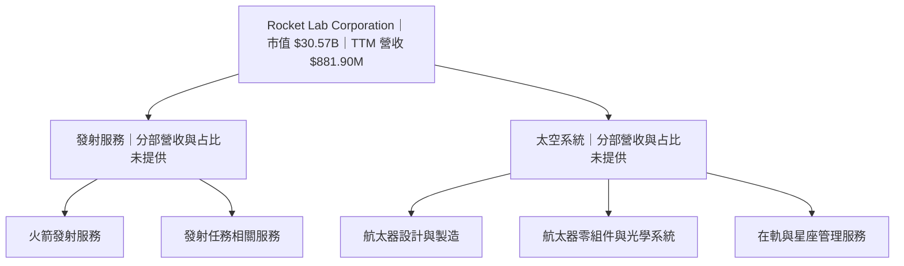
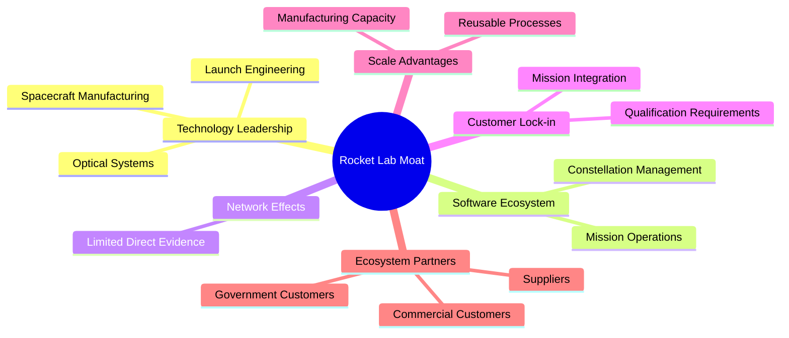
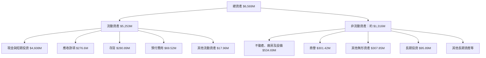
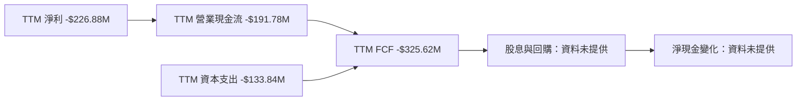
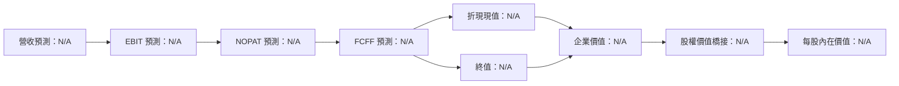
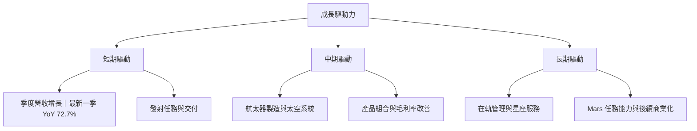
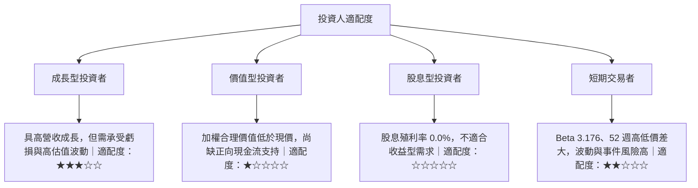

# RKLB 基本面深度分析報告
> **報告日期**：2026-11-22 ｜ **語言**：繁體中文 ｜ **數據來源**：SEC 申報資料 (XBRL)、Yahoo Finance、Finviz、StockAnalysis、Roic.ai ｜ **分析師**：CFA 級機構研究

---

## 目錄

| # | 章節 | 核心結論 |
|---|------|----------|
| 1 | 執行摘要 | 賣出；加權合理價值 $16.59，MOS -173.8% |
| 2 | 公司概覽與商業模式 | 發射服務與太空系統並行；收入分部數據不足，護城河有技術與客戶關係支撐但未充分量化 |
| 3 | 損益表深度分析 | TTM 營收 $881.90M、年增 59.0%；快速成長仍未抵銷營業虧損 |
| 4 | 資產負債表分析 | 現金與短期投資 $4.61B；流動性充足，但營運資金週期延長 |
| 5 | 現金流量深度分析 | TTM FCF -$325.62M，資本投入與營運現金流仍消耗資金 |
| 6 | 獲利能力與資本效率 | ROIC -16.1% 對 WACC 14.00%，目前摧毀股東價值 |
| 7 | 相對估值分析 | P/S 高於自身五年中位數，且遠高於可計算的同業中位倍數 |
| 8 | DCF 內在價值評估 | DCF N/A：TTM 營業利益為負，不建構前瞻現金流估值 |
| 9 | 成長催化劑 | 需求成長與新產品進展可能提供催化，但 TAM 與具體時程數字未提供 |
| 10 | 風險矩陣 | 主要風險為估值、執行與現金消耗；風險機率與財務衝擊無足夠量化資料 |
| 11 | 投資建議 | 依 MOS 評級為賣出；以營收、利潤率、FCF 與稀釋作為季度監控重點 |

---

## 1. 執行摘要

截至 2026-11-20，RKLB 收盤價為 **$45.42**。TTM 營收 **$881.90M**、TTM 營收成長 **59.0%**，最新一季營收年增 **72.7%**，顯示需求與交付規模仍在擴張；但 TTM 營業利益率 **-27.6%**、ROIC **-16.1%**、TTM FCF **-$325.62M**，代表營收成長尚未轉化為正向資本回報。以同業 P/S 與分析師共識加權後的合理價值 **$16.59** 計算，MOS 為 **-173.8%**、上行空間為 **-63.5%**，依規則 20 評級為 **🔴 賣出**。DCF 因 TTM 營業利益為負而不適用，故不提供 DCF 基準價或 DCF 情境價值。

### 1.0 一頁式投資儀表板（Portfolio Manager 30 秒速讀）

| 項目 | 內容 |
|------|------|
| **投資論點（3 句）** | ① TTM 營收年增 **59.0%**、最新一季年增 **72.7%**，業務擴張速度快。② TTM 營業利益率 **-27.6%**、ROIC **-16.1%**，規模成長尚未帶來價值創造。③ 加權合理價值 **$16.59**，相對 $45.42 現價的上行空間 **-63.5%**，估值風險高。 |
| **綜合評分** | **5.0/10**（引用 1.1 評分卡） |
| **財務健康** | 🟡 現金與短期投資 **$4.61B**、流動比率 **8.554**，但 TTM FCF 為 **-$325.62M**，且現金轉換週期增至 **176 天**。 |
| **ROIC vs WACC** | **-16.1% vs 14.00%**：目前摧毀股東價值。 |
| **FCF 趨勢** | TTM FCF **-$325.62M**；FCF Yield **-1.07%**。FY2025 年度 FCF 為 **-$321.81M**，目前仍處大額現金消耗階段。 |
| **估值** | Forward P/E **634.5347x** ｜ EV/EBITDA **-140.865x** ｜ FCF Yield **-1.07%** |
| **DCF 內在價值（基準）** | **N/A**；TTM 營業利益為負，不建立 DCF。現價相對 DCF 的折溢價亦為 N/A。 |
| **安全邊際（MOS）** | **-173.8%**＝($16.59 − $45.42) ÷ $16.59；🔴 加權合理價值低於現價。 |
| **預期報酬（基準情境 12M）** | DCF 基準情境 N/A；以加權合理價值作估值參照，上行空間 **-63.5%**，不等同 12 個月價格預測。 |
| **關鍵風險（前二）** | ① P/S **33.6x**，高於自身五年中位數 **19.4x**。② TTM FCF **-$325.62M**，若虧損與投資需求持續，現金消耗將延續。 |
| **評級 + 信心度** | 🔴 **賣出** ｜ 信心：中（加權估值訊號明確，但 DCF 不適用、同業倍數差異大） |

### 1.1 綜合評分卡（全報告唯一）

| 維度 | 評分（1–10） | 主要依據（引用數字與其來源章節） |
|------|--------------|----------------------------------|
| 成長性 | 8.5 | TTM 營收成長 **59.0%**、最新一季年增 **72.7%**（第 3 章）；成長佳但受未獲利與高估值折價。 |
| 獲利能力 | 2.0 | TTM 營業利益率 **-27.6%**、ROIC **-16.1%**、Piotroski **5/9**（第 3、6 章）。 |
| 財務健康 | 8.0 | 現金與短期投資 **$4.61B**、流動比率 **8.554**；扣分因素為 FCF **-$325.62M**及 CCC **176 天**（第 4、5 章）。 |
| 估值 | 1.0 | MOS **-173.8%**；P/S **33.6x** 對自身五年中位數 **19.4x**（第 7、8 章）。 |
| 護城河 | 6.0 | 發射、航太製造與太空系統能力具技術與客戶關係基礎，但市場份額、分部收入與客戶集中度數字未提供（第 2 章）。 |
| 管理層與資本配置 | 4.5 | 現金與短期投資增加至 **$4.61B**，但 FY2025 SBC **$71.10M**、最新四季稀釋股數測試未通過，且 FCF 持續為負（第 3、5、6 章）。 |
| **綜合評分** | **5.0** | 六項算術平均：(**8.5 + 2.0 + 8.0 + 1.0 + 6.0 + 4.5**) ÷ 6 = **5.0**。 |

### 1.2 五大投資論點 + 三大核心風險

| 類型 | 項目 | 具體依據 | 信心度 |
|------|------|----------|--------|
| 🟢 **投資論點①** | 高速營收成長 | TTM 營收 **$881.90M**、年增 **59.0%**；最新一季營收年增 **72.7%**，顯示近期業務需求與交付增加。 | 🟢 高 |
| 🟢 **投資論點②** | 現金儲備提供投資緩衝 | 現金與短期投資 **$4.61B**，可支援研發、產能與新產品投入；但仍需觀察燒錢速度。 | 🟢 高 |
| 🟢 **投資論點③** | 毛利率逐年改善 | FY2022 毛利率約 **9.0%**，FY2025 約 **34.4%**，與收入擴張及產品組合變化相容，為未來營業槓桿提供基礎。 | 🟡 中 |
| 🟢 **投資論點④** | 太空系統與發射服務的組合 | 公司同時經營發射服務、航太器設計、製造、零組件及軌道管理；多元產品可能降低單一服務依賴，分部營收占比未提供。 | 🟡 中 |
| 🟢 **投資論點⑤** | 資產負債表短期償付能力強 | 流動比率 **8.554**、快速比率 **7.954**，短期流動性充裕；但並不代表已達自我融資。 | 🟢 高 |
| 🟡 **風險①** | 估值與成長預期落差 | P/S **33.6x**，高於五年中位數 **19.4x**；加權合理價值 **$16.59** 低於現價 **$45.42**。 | 🔴 高衝擊 |
| 🔴 **風險②** | 長期虧損與現金消耗 | TTM 營業利益率 **-27.6%**、TTM FCF **-$325.62M**，若利潤率未改善，估值將持續依賴未來成長假設。 | 🔴 高衝擊 |
| 🟡 **風險③** | 庫存與營運資金效率 | DIO 由 **140 天**升至 **182 天**，CCC 由 **120 天**升至 **176 天**，更多資金被存貨與應收占用。 | 🟡 中度 |

### 1.3 快速統計卡片

| 指標 | 公司實際值（期間） | 同業中位數 | 狀態 |
|------|--------------------|------------|------|
| 營收成長（TTM） | **59.0%** | — | 🟢 |
| 營收成長（最新一季年增） | **72.7%** | **161.4%** | 🟡 |
| 毛利率（TTM） | **36.2%** | **55.5%** | 🟡 |
| 營業利益率（TTM） | **-27.6%** | — | 🔴 |
| ROIC（TTM） | **-16.1%** | — | 🔴 |
| Forward P/E | **634.5347x** | N/A（同業 Forward P/E 中位數含負值，無可比意義） | 🔴 |
| FCF Yield（TTM） | **-1.07%** | — | 🔴 |
| Piotroski F-Score | **5 / 9** | — | 🟡 |

### 1.4 投資結論

╔══════════════════════════════════════════════════════════════════╗  
║                    📊 投資結論摘要                               ║  
╠══════════════════════════════════════════════════════════════════╣  
║  評級：🔴 賣出（依加權合理價值 MOS 門檻）                         ║  
║  價格（2026-11-20 收盤）：$45.42                                 ║  
║  DCF 內在價值（基準）：N/A（TTM 營業利益為負）                  ║  
║  安全邊際 MOS：-173.8%（以加權合理價值 $16.59 為分母）          ║  
║  加權合理價值（8.8）：$16.59                                     ║  
║  DCF 情境價值：N/A（DCF MODEL 不適用）                           ║  
║  綜合評分：5.0/10（引用 1.1）                                    ║  
║  適合投資人：能承受高波動、且願意承擔長期執行風險的成長型投資人  ║  
╚══════════════════════════════════════════════════════════════════╝

---

## 2. 公司概覽與商業模式

### 2.1 業務結構與收入來源

公司提供發射服務及太空系統解決方案，涵蓋航太器設計、零組件、製造、光學系統與在軌管理。2025 年年度營收為 **$601.80M**；TTM 營收為 **$881.90M**。各業務分部營收與占比未提供，因此不以估算比例繪製收入占比。

### 2.2 市場份額

市場份額數據未提供，亦無法以公司營收直接推算整體市場占比。RKLB TTM 營收 **$881.90M**、TTM 年增 **59.0%**，規模低於具更大營收基礎的成熟航太與大型發射企業，但公司同業中最新一季營收年增 **72.7%** 高於 PL 的 **58.1%**、低於 LUNR 的 **413.7%** 與 SPCX 的 **161.4%**。

### 2.3 競爭護城河分析

以上 mindmap 使用英文節點，以符合圖表語法限制。客戶數量、重複訂單占比、任務成功率與單位成本數據未提供，故無法把技術資產直接量化為持續超額報酬。

### 2.4 護城河強度

| 護城河項目 | 強度（強／中／弱） | 證據（引用數字或事實） | 會削弱它的情況 |
|------------|--------------------|------------------------|----------------|
| 技術與任務整合 | 中 | 業務涵蓋發射、航太器設計製造、光學與在軌管理；最新一季營收年增 **72.7%**。 | 發射失敗、延誤、成本上升或客戶轉向替代供應商。 |
| 軟體與服務生態 | 弱至中 | 公司提供星座管理與在軌管理服務，但經常性服務收入占比未提供。 | 服務收入無法形成續約或高毛利收入。 |
| 網路效應 | 弱 | 未提供用戶、任務或平台規模帶動網路價值的量化證據。 | 客戶關係仍以單一任務、專案型合約為主。 |
| 客戶鎖定 | 中 | 航太器與任務整合通常涉及規格驗證，但客戶留存率與合約期限未提供。 | 客戶多來源採購或任務延後、取消。 |
| 規模效應 | 中 | TTM 營收 **$881.90M**，近年規模增加；但營業利益率仍為 **-27.6%**，規模效益尚未反映為正利潤。 | 固定成本與資本支出隨收入同步或更快增長。 |
| 生態夥伴 | 中 | 公司在美國、加拿大、日本及其他國際市場提供服務；合作夥伴收入或集中度資料未提供。 | 供應鏈、許可或政府採購條件變動。 |

1.1 的「護城河」評分為 **6.0/10**，理由是業務範圍與工程能力具差異化可能性，但量化的市場份額、客戶鎖定與服務收入證據有限。

---

## 3. 損益表深度分析

### 3.1 年度收入成長趨勢（近 4 年）

╔══════════════════════════════════════════════════════════════════╗  
║                 Rocket Lab 年度收入趨勢（FY2022–FY2025）         ║  
╠══════════════════════════════════════════════════════════════════╣  
║ FY2022  $211.00M  ███████░░░░░░░░░░░░░░░░░  YoY：基期             ║  
║ FY2023  $244.59M  ████████░░░░░░░░░░░░░░░░  YoY：+15.9% 🟢        ║  
║ FY2024  $436.21M  ███████████████░░░░░░░░░  YoY：+78.3% 🟢        ║  
║ FY2025  $601.80M  █████████████████████░░░  YoY：+38.0% 🟢        ║  
╠══════════════════════════════════════════════════════════════════╣  
║ FY2022–FY2025 三年收入 CAGR：((601.80 ÷ 211.00)^(1/3) − 1) = 41.9%║  
╚══════════════════════════════════════════════════════════════════╝

FY2024 營收成長 **78.3%**，FY2025 放緩至 **38.0%**，但 FY2026 最新一季再達 **72.7% YoY**。年度基期、產品交付時程及專案收入波動可能影響單年成長率；分部訂單與積壓合約資料未提供，不能判定短期高增速的可持續程度。

### 3.2 季度收入趨勢分析

| 季度 | 營收（$M） | QoQ 成長 | YoY 成長 | 備註 |
|------|------------:|---------:|---------:|------|
| 2025 Q4 | 179.65 | +15.8%* | N/A | QoQ 與 2025 Q3 $155.08M 比較；2024 Q4 數據未提供。 |
| 2026 Q1 | 200.35 | +11.5% | +63.5% | YoY 依 StockAnalysis 季度數據計算為 (200.35 ÷ 122.57) − 1。 |
| 2026 Q2 | 234.07 | +16.8% | +62.0% | YoY 為 (234.07 ÷ 144.50) − 1；與區塊數據一致。 |
| 2026 Q3 | 267.83 | +14.4% | **+72.7%** | 最新季度年增率引用 SEC／財務數據；逐季營收持續增加。 |

\* 2025 Q4 的 QoQ 以 2025 Q3 的 **$155.08M** 為比較基礎。各季 QoQ 約 **11.5%–16.8%**，而最新一季 YoY 加速至 **72.7%**；但四季年增率不能替代長期需求與訂單能見度。

### 3.3 利潤率演變分析

| 利潤率指標 | FY2022 | FY2023 | FY2024 | FY2025 | 趨勢 | 評估 |
|------------|-------:|-------:|-------:|-------:|------|------|
| **毛利率** | 9.0% | 21.0% | 26.6% | 34.4% | ↗️ 持續改善 | 🟢 毛利額提升快於營收，顯示組合或成本效率改善。 |
| **營業利益率** | -64.1% | -72.7% | -43.5% | -38.0% | ↗️ 虧損率收窄 | 🟡 仍有大額營業虧損。 |
| **淨利率** | -64.4% | -74.6% | -43.6% | -32.9% | ↗️ 虧損率收窄 | 🟡 尚未達損益兩平。 |

以上年度比率依年度營收、毛利、營業利益及淨利計算。FY2023 營業與淨利率較 FY2022 惡化，FY2024–FY2025 改善；可能反映收入規模增長及產品組合變化，但研發與營業費用仍高。FY2025 研發支出 **$270.72M**，約為當年營收 **45.0%**，反映公司仍在投入新產品與技術，而非已進入成熟收割期。最新一季營業利益 **-$79.19M**，除以營收 **$267.83M** 約為 **-29.6%**，與 TTM 營業利益率 **-27.6%** 相比，單季仍呈較深虧損。

### 3.4 費用結構分析

詳細年度營業費用分項、銷售與行政費用以及資本化研發支出未完整提供，因此不繪製費用結構圓餅圖，避免將未披露費用誤作比例。

| 可觀察項目 | 金額／比重 | 含義 |
|------------|------------|------|
| FY2025 研發支出 | **$270.72M**，約占 FY2025 營收 **45.0%** | 研發投入相對營收仍高；若新產品與產能投資成功，可能支撐未來增長，但短期壓抑獲利。 |
| FY2025 毛利 | **$207.18M** | 毛利仍不足以覆蓋公司整體營業費用，營業利益為 **-$228.84M**。 |
| FY2025 SBC | **$71.10M** | 為非現金會計費用，但會稀釋現有股東持股。 |

### 3.5 季度 EPS 趨勢與盈餘品質（Quality of Earnings）

| 季度 | EPS 實際 | EPS 預估 | 超預期／不及預期 | 原因判讀 |
|------|---------:|---------:|------------------|----------|
| 2025 Q4 | -$0.09 | N/A | N/A | EPS 預估值未提供，不能判斷超預期或不及預期。 |
| 2026 Q1 | -$0.07 | N/A | N/A | EPS 預估值未提供；淨利為 **-$45.02M**。 |
| 2026 Q2 | -$0.08 | N/A | N/A | EPS 預估值未提供；淨利為 **-$49.26M**。 |
| 2026 Q3 | -$0.12 | N/A | N/A | EPS 預估值未提供；淨利為 **-$79.68M**，虧損較前兩季擴大。 |

最近四季 EPS 依序為 **-$0.09、-$0.07、-$0.08、-$0.12**。提供的 EPS Beats/Misses 資料在部分季度預估及實際值均為 nan，因此無法核實市場預期差，也不能把缺失數據判作「未達預期」。

| 盈餘品質項目 | 數值／佔比 | 評估 |
|--------------|-----------|------|
| 股權薪酬 SBC / 營收 | TTM 最近四季 SBC 合計 **$84.20M** ÷ TTM 營收 **$881.90M** = **9.5%** | 🔴 比例偏高；SBC 雖非現金支出，仍透過稀釋降低每股經濟利益。FY2025 SBC **$71.10M**，占 FY2025 營收約 **11.8%**。 |
| SBC / 營業現金流 | **$84.20M ÷ -$191.78M**；以 OCF 絕對值計約 **43.9%** | 🔴 OCF 為負，比例僅表示 SBC 相當於負 OCF 絕對值的比重，不能解讀為現金流覆蓋率。 |
| FCF / 淨利（現金轉換率） | TTM FCF **-$325.62M**；TTM 淨利 **-$226.88M**；比值約 **143.5%** | 🔴 負數相除為正數不代表現金轉換良好；FCF 比淨虧損更深，顯示資本支出與營運資金消耗額外現金。 |
| 一次性／非經常性損益 | N/A（明細未提供） | 無法確認是否有一次性損益顯著影響盈餘。 |
| 有效稅率異常 | N/A（稅前損益及所得稅費用明細未提供） | 無法計算，亦無資料支持稅務利益推升盈餘的結論。 |
| 資本化支出 vs 費用化 | TTM 資本支出 **$133.84M**；資本化研發明細 N/A | 資本支出形成長期資產，不能視作當期費用；缺少資本化研發資料，無法判斷是否遞延成本。 |

**盈餘品質結論**：公司尚未產生正 GAAP 淨利，故目前重點不是盈餘被高估或低估，而是營運虧損與投資支出能否逐步下降。SBC 占 TTM 營收 **9.5%**，以及 TTM FCF **-$325.62M**，表示股東承受稀釋與現金消耗雙重成本，估值應更重視未來單位經濟與現金流轉正證據。

---

## 4. 資產負債表分析

### 4.1 資產結構分解

以下資產細項採 StockAnalysis 2026-09-30 資產負債表數據，單位為百萬美元。圖中只列有披露數值的項目；分項合計可能因四捨五入有細微差異。

### 4.2 流動性與營運資金分析

| 流動性指標 | 最新值 | 歷史參照 | 評估 |
|------------|-------:|----------|------|
| 現金與短期投資 | **$4.61B** | FY2025 **$1.017B** | 🟢 現金儲備顯著增加；增幅與融資或資本市場活動相關的具體拆分未提供。 |
| 總債務 | **$1.72M**（VERIFIED FIGURES） | 其他財務摘要顯示 **$120.28M**，資料口徑有差異 | 🟡 依嚴格原值引用採 **$1.72M**；債務口徑須以 SEC 最新申報核對。 |
| 流動比率 | **8.554** | — | 🟢 短期償付緩衝高。 |
| 快速比率 | **7.954** | — | 🟢 即使排除存貨，短期流動性仍高。 |

營運資金天數（依 QUALITY FIGURES，照抄）：

| 指標 | 最新 TTM | 一年前 TTM | 變化 | 解讀 |
|------|----------|------------|------|------|
| DSO 應收帳款天數 | **49 天** | **39 天** | **+10 天** | 收款天數延長，可能與收入組合或專案付款節點有關；應追蹤應收款是否快於營收增長。 |
| DIO 存貨天數 | **182 天** | **140 天** | **+42 天** | 庫存占用資金增加；若代表為未來交付備貨，需由後續營收與出貨驗證。 |
| DPO 應付帳款天數 | **55 天** | **59 天** | **-4 天** | 對供應商付款天數縮短，或表示供應商信用融資減少；不能單憑天數推斷議價能力。 |
| CCC 現金轉換週期 | **176 天** | **120 天** | **+56 天** | 現金被營運週期占用更久，若存貨與應收未轉為交付和收款，可能加重現金消耗。 |

### 4.3 債務結構分析

╔══════════════════════════════════════════════════════════════════╗  
║                   Rocket Lab 債務健康診斷                        ║  
╠══════════════════════════════════════════════════════════════════╣  
║  總債務：       $1.72M（VERIFIED FIGURES；口徑存在來源差異）      ║  
║  現金+短期投資：$4.61B  ████████████████████  🟢                 ║  
║  淨現金：       $4.61B（VERIFIED FIGURES）                      ║  
║  Debt/EBITDA：  N/A（EBITDA 為負，倍數無經濟意義）               ║  
║  利息保障倍數： N/A（利息費用與計算口徑未提供；營業利益為負）     ║  
║  流動比率：     8.554  🟢                                         ║  
╚══════════════════════════════════════════════════════════════════╝

資料內另有總債務 **$120.28M**、淨現金 **$4.49B** 的彙總口徑，與 VERIFIED FIGURES 的 **$1.72M** 總債務及 **$4.61B** 淨現金不一致。為遵守原值引用規則，本報告需使用前者的 VERIFIED FIGURES 數字，但投資決策前應以 SEC 10-Q 的負債明細核對，不能把不同口徑混合計算。

### 4.4 股東權益趨勢

╔══════════════════════════════════════════════════════════════════╗  
║                股東權益年度趨勢（帳面值）                        ║  
╠══════════════════════════════════════════════════════════════════╣  
║ 2022-12-31  $673.21M  ████████████████████                       ║  
║ 2023-12-31  $554.54M  ████████████████                           ║  
║ 2024-12-31  $382.45M  ███████████                                ║  
║ 2025-12-31  $1.72B    ████████████████████████████████████████   ║  
╚══════════════════════════════════════════════════════════════════╝

FY2025 股東權益明顯上升，但所提供資料未列出所有股本變動、發行所得與其他綜合損益拆分，因此不能把增加全數歸因於營運獲利；公司 FY2025 淨利仍為 **-$198.21M**。

---

## 5. 現金流量深度分析

### 5.1 現金流量瀑布圖

最新四季數據顯示，現金流由營業活動轉為資本支出後形成負 FCF。股息與回購金額、整體淨現金變化未提供，不予補填。

### 5.2 FCF 轉換率趨勢

| 年度 | FCF（$M） | 淨利（$M） | FCF / 淨利 | 解讀 |
|------|---------:|-----------:|-----------:|------|
| FY2022 | -148.95 | -135.94 | 約 109.6% | 分子、分母皆為負，比例不表示正向轉換。 |
| FY2023 | -153.57 | -182.57 | 約 84.1% | FCF 虧損小於淨虧損，但仍為現金流出。 |
| FY2024 | -115.98 | -190.18 | 約 61.0% | FCF 虧損收窄；仍需分辨營運改善與投資時點效應。 |
| FY2025 | -321.81 | -198.21 | 約 162.4% | FCF 虧損大於淨虧損，資本支出與營運資金增加可能是因素。 |
| TTM 至 2026-09-30 | -325.62 | -226.88 | 約 143.5% | 仍為負現金轉換；正的比值來自負數除以負數，不代表健康轉換。 |

### 5.3 自由現金流趨勢

╔══════════════════════════════════════════════════════════════════╗  
║                  自由現金流：年度實際值                          ║  
╠══════════════════════════════════════════════════════════════════╣  
║ FY2022  -$148.95M  ◀██████████████████░░  FCF Yield：N/A          ║  
║ FY2023  -$153.57M  ◀███████████████████░  FCF Yield：N/A          ║  
║ FY2024  -$115.98M  ◀██████████████░░░░░░  FCF Yield：N/A          ║  
║ FY2025  -$321.81M  ◀████████████████████  FCF Yield：N/A          ║  
║ TTM     -$325.62M  ◀████████████████████  FCF Yield：-1.07%       ║  
╚══════════════════════════════════════════════════════════════════╝

TTM FCF 由 **營業現金流 -$191.78M − 資本支出 $133.84M = -$325.62M**。年度 FCF 在 FY2024 收窄後，FY2025 再度擴大；這表示營收快速增長仍伴隨較高營運資金與產能投資需求。

### 5.4 資本配置評估

資本配置的精確占比資料未提供，故不繪製資本配置圓餅圖。

| 項目 | 可得數據 | 評估 |
|------|----------|------|
| 資本支出 | TTM **$133.84M**；FY2025 **$156.28M** | 產能與設備投資可支持擴張，但需檢視新增資產能否提升交付、毛利與 FCF。 |
| 研發投入 | FY2025 **$270.72M** | 研發支出高，有利於技術與產品布局，但短期營業虧損仍大。 |
| SBC | FY2025 **$71.10M**；TTM 四季合計 **$84.20M** | 股東需承受稀釋成本，後續應與每股營收及每股 FCF 一併監控。 |
| 股息／回購 | 股息殖利率 **0.0%**；回購金額 N/A | 目前沒有股息回報證據，資本主要用於業務投入。 |

---

## 6. 獲利能力與資本效率

### 6.1 ROE / ROA / ROIC 趨勢

| 指標 | FY2025／歷史資料 | TTM／最新值 | 評估 |
|------|------------------|-------------|------|
| ROIC | 年度歷史可比較序列 N/A | **-16.1%** | 🔴 遠低於 WACC **14.00%**，目前未創造資本回報。 |
| ROE | QUALITY FIGURES TTM **-3.9%**；其他彙總資料 **-6.4%** | 口徑有差異 | 🔴 負淨利造成股東報酬為負；採 DuPont 區塊 **-3.9%**。 |
| ROA | 其他彙總資料 **-3.5%** | QUALITY 測試 ROA 未通過正值 | 🔴 資產尚未轉化為正向淨利。 |

ROE 與 ROA 的資料源存在差異，未以未披露項目自行重算。ROIC 使用 VERIFIED FIGURES 的 TTM **-16.1%**。

### 6.2 ROIC vs WACC 分析（核心價值創造判斷）

WACC 一律使用資本成本區塊提供的 **14.00%**，與第 8 章一致。該區塊顯示原始計算值 **14.98%**，因限制在 **7%–14%** 範圍內而採用 **14.00%**。

╔══════════════════════════════════════════════════════════════════╗  
║                ROIC vs WACC 深度分析                              ║  
╠══════════════════════════════════════════════════════════════════╣  
║  資本成本輸入（來源：Cost of capital）：                          ║  
║  ├── 無風險利率 10Y 美債：                         4.91%          ║  
║  ├── 股權風險溢酬 ERP：                            5.00%          ║  
║  ├── 原始 Beta：                                   3.18           ║  
║  ├── 調整後 Beta：                                 2.00           ║  
║  ├── 股權成本：                          4.91% + 2.00×5.00%      ║  
║  │                                               = 14.91%          ║  
║  ├── WACC 程式計算值：                            14.98%          ║  
║  └── 區間限制後採用 WACC：                        14.00%          ║  
║                                                                  ║  
║  ROIC（TTM）：                                  -16.1%            ║  
║  EVA spread = ROIC − WACC = -16.1% − 14.00% = -30.1 個百分點     ║  
║                                                                  ║  
║  結論：ROIC 低於 WACC，現階段摧毀股東價值；須改善營業獲利並提高  ║  
║        投入資本產出，才可能轉為正 EVA。                          ║  
╚══════════════════════════════════════════════════════════════════╝

資本成本區塊的 Beta 註記為：調整後 Beta 2.00；公式 **⅔ × 3.18 + ⅓ = 2.45**，但原始調整結果 **2.45** 高於指定上限 **2.0**，故採用 **2.00**。資本成本區塊同時列示債務成本極高、股債權重 E/D 為 **100.0% / 0.0%**；因債務權重為零，WACC 的採用值以該區塊限制後結果為準。第 8.2 節補充數據限制。

### 6.3 杜邦三因素分解

以下數字照 QUALITY FIGURES 原值引用：

| 因素 | 數值（TTM） | 解讀 |
|------|-------------|------|
| 淨利率 | **-25.7%** | 虧損為負 ROE 的主要來源。 |
| 資產週轉率 | **0.13** | 資產轉化為收入的週轉仍低。 |
| 權益乘數 | **1.13** | 財務槓桿不高，負 ROE 不是主要由槓桿放大。 |
| **ROE** | **-3.9%** | QUALITY FIGURES 原值：**-25.7% × 0.13 × 1.13 = -3.9%**。 |

### 6.4 財務體質：Piotroski F-Score

F-Score 照 QUALITY FIGURES 原值引用：**5 / 9**。

| 測試 | 結果 | 解讀 |
|------|------|------|
| ROA > 0 | ❌ 未通過 | 尚未從資產中取得正向會計獲利。 |
| 營業現金流 > 0 | ❌ 未通過 | TTM 營業現金流為 **-$191.78M**。 |
| ROA 高於一年前 | ✅ 通過 | 相對一年前改善，但仍未轉正。 |
| 營業現金流 > 淨利（應計品質） | ✅ 通過 | 相對測試條件通過，但營業現金流仍為負。 |
| 長期負債 ÷ 總資產低於一年前 | ✅ 通過 | 負債比率方向改善；實際比例未由 QUALITY 區塊另列。 |
| 流動比率高於一年前 | ✅ 通過 | 流動性相對改善。 |
| 稀釋股數未增加 | ❌ 未通過 | 流通股稀釋可能壓低每股經濟價值。 |
| 毛利率高於一年前 | ✅ 通過 | 毛利改善與歷史毛利率上升方向一致。 |
| 資產週轉率高於一年前 | ❌ 未通過 | 資產擴張尚未帶來更快週轉。 |

F-Score **5/9** 表示資產負債表及部分營運指標有改善，但獲利、營業現金流與股數稀釋仍是弱項。

---

## 7. 相對估值分析

### 7.1 同業估值比較表格

下表同業數字取自 Peer multiples；本公司數字按市場估值區塊引用。SPCX、LUNR、PL 的商業模式與獲利階段不完全相同，倍數比較只作相對定位，不代表可直接套用。

| 估值指標 | **RKLB** | **SPCX** | **LUNR** | **PL** | 本公司評估 |
|----------|---------:|--------:|--------:|------:|-----------|
| **Trailing P/E** | N/A | 555.6x | N/A | N/A | 🔴 RKLB TTM 虧損，P/E 不適用。 |
| **Forward P/E** | 634.5347x | 46.6x | -49.7x | -8424.0x | 🔴 RKLB Forward P/E 高；另兩家負值倍數無一般估值意義。 |
| **P/S Ratio** | 34.659702x | 54.2x | 2.2x | 10.1x | 🔴 RKLB 顯著高於 LUNR、PL；低於 SPCX。 |
| **EV/EBITDA** | -140.865x | 143.6x | -34.9x | -71.6x | 🟡 多數同業 EBITDA 為負或倍數極端，直接比較限制大。 |
| **最新一季營收 YoY** | 72.7% | 161.4% | 413.7% | 58.1% | 🟡 RKLB 成長高於 PL，低於 SPCX、LUNR。 |
| **毛利率（TTM）** | 36.2% | 56.8% | 20.3% | 55.5% | 🟡 RKLB 高於 LUNR，但低於 SPCX、PL。 |

分析師共識目標價為 **$93.15**，低端 **$58.00**、高端 **$127.00**，共 **20 位分析師**；這是分析師預測，不是已實現現金流或保證價值。與市場共識的差距反映成長預期及估值模型分歧。

### 7.2 歷史估值區間分析

╔══════════════════════════════════════════════════════════════════╗  
║                  RKLB 自身歷史 P/S 區間                          ║  
╠══════════════════════════════════════════════════════════════════╣  
║ 五年區間：7.1x ├──────────────────────────────┤ 83.2x             ║  
║ 五年中位數：19.4x                                               ║  
║ 當前 P/S：33.6x       ▲ 當前百分位：57%                         ║  
╚══════════════════════════════════════════════════════════════════╝

當前 P/S **33.6x** 高於五年中位數 **19.4x**，當前百分位 **57%**，處於自身歷史區間的中上位置。公司仍快速增長，但估值已反映較高的成長預期；若收入增速放慢或利潤率改善延遲，倍數收縮可能放大股價波動。

### 7.3 情境價值（Bear / Base / Bull）

**N/A（DCF 無法計算：TTM 營業利益不為正；DCF MODEL 未提供悲觀、基準與樂觀情境數值）**。依規則不另行建立情境價值或設定情境目標價。

### 7.4 相對估值隱含價格區間

╔══════════════════════════════════════════════════════════════════╗  
║                   相對估值每股價值                               ║  
╠══════════════════════════════════════════════════════════════════╣  
║ 同業 P/S：$8.08       分析師共識：$93.15                         ║  
║       │                         │                                ║  
║       └────────── 現價 $45.42 ──┘                                ║  
║ 加權合理價值：$16.59                                              ║  
╚══════════════════════════════════════════════════════════════════╝

| 估值方法 | 每股價值 | 依據 |
|----------|---------:|------|
| 同業 P/S | **$8.08** | LUNR、PL 同業中位數 P/S **6.2x** × RKLB TTM 營收，再換算每股價值；方法與輸出照估值模型。 |
| 分析師共識目標價 | **$93.15** | 20 位分析師平均目標價。 |
| 同業 Forward P/E | 不可計算 | 因同業中位數 Forward P/E 方法不可計算，依估值模型剔除並將權重分配至其他方法。 |

同業 P/S 隱含價值 **$8.08** 顯著低於現價；分析師共識 **$93.15** 高於現價。兩種方法差距甚大，說明估值對盈利轉化與長期成長假設高度敏感。

---

## 8. DCF 內在價值評估（Discounted Cash Flow）

### 8.0 估值推理鏈（Thinking Logic）

本次估值模型標記為 **DCF MODEL: N/A**，理由為 RKLB TTM 營業利益為負；因此不得建立逐年 FCFF、終值、敏感度矩陣、情境估值或反推 DCF。依要求，不用負的當期營業利益向前外推，也不把缺漏的預測輸入以主觀數字補齊。

**價值驅動變數**：公司價值主要取決於發射服務與太空系統的營收擴張、負營業利潤率能否收斂，以及擴張所需的資本支出與營運資金。業務分部營收占比未提供，故不能為兩條業務線分配營收權重；目前可驗證的總體錨點為 TTM 營收 **$881.90M**、營業利益率 **-27.6%**、TTM FCF **-$325.62M**。

| 決策點 | 本報告處理 | 理由 | 曾考慮但否決 | 否決理由 |
|--------|-----------|------|--------------|----------|
| 現金流定義 | N/A | 未建構 DCF，無現金流預測表 | FCFF／FCFE | 未正向營業獲利，且預測輸入缺漏。 |
| 預測期 N | N/A | DCF MODEL 未提供預測期 | 5–10 年模型 | 不得自建模型或任意選取期間。 |
| 終值方法 | N/A | 未建立逐年 FCFF | Gordon Growth／退出倍數 | 沒有模型終值輸入可供計算。 |
| EBIT 基礎 | N/A | 未建立預測 EBIT | GAAP／非 GAAP | 不應對負獲利自行構造轉正路徑。 |

#### Step 3 — 關鍵假設推導鏈

DCF 模型未提供，故營收 CAGR、期末營業利潤率、永續成長率、預測期、Capex/營收、D&A/營收、營運資金假設、SBC 處理與年稀釋率均為 **N/A**。這些假設若自行填入會構成新的 DCF 模型，與只使用程式模型的規則不符。

#### Step 4 — 最脆弱的一環

本案最脆弱的一環不是某個單一 DCF 假設，而是公司能否將 **-27.6% 的 TTM 營業利益率**與 **-$325.62M 的 TTM FCF**改善至可持續的正現金流；沒有可稽核的盈利轉正路徑，不能量化其對內在價值的敏感度。

#### Step 5 — 計算路徑圖

以下僅說明一般 DCF 估值傳導關係，不代表 RKLB 本次已建立模型或輸出估值：

### 8.1 模型假設總表（Model Inputs）

| 假設項目 | 採用值 | 依據／來源 | 敏感度 |
|----------|--------|-------------|--------|
| 預測期長度 N | N/A | DCF MODEL 未提供 | N/A |
| 營收 CAGR（預測期） | N/A | 未提供模型預測 | N/A |
| 營業利潤率（期末） | N/A | TTM 營業利益率 **-27.6%**，但轉正時點未提供 | N/A |
| 有效稅率 | N/A | 公司當前虧損，模型稅率假設未提供 | N/A |
| Capex / 營收 | N/A | TTM Capex **$133.84M**可觀察，但模型預測比率未提供 | N/A |
| 折舊攤銷 D&A / 營收 | N/A | 未提供模型假設 | N/A |
| 營運資金變動 / 營收增額 | N/A | CCC **176 天**是營運指標，不等於模型 ΔWC 假設 | N/A |
| EBIT 基礎 | N/A | 未建立模型 | N/A |
| SBC 處理 | N/A | 未建立模型，不作重複或漏計假設 | N/A |
| 年稀釋率 | N/A | Piotroski 股數測試未通過，但 DCF 股數假設未提供 | N/A |
| 永續成長率 g | N/A | 未提供 DCF 模型 | N/A |
| 終值方法 | N/A | 未提供 DCF 模型 | N/A |
| WACC | **14.00%**（資本成本區塊採用值） | 區塊列計算值 **14.98%**，受 7%–14% 區間限制 | — |

**FCF 定義**：因 DCF 不適用，本報告不建構前瞻 FCFF 或 FCFE。公司已披露的 TTM FCF 仍採固定定義：營業現金流減資本支出。

### 8.2 折現率推導（WACC）

WACC 及組成直接引用 Cost of capital 數據，不另行替換或重算為新的 WACC。

╔══════════════════════════════════════════════════════════════════╗  
║                    WACC 推導（折現率）                           ║  
╠══════════════════════════════════════════════════════════════════╣  
║ 股權成本 Ke（CAPM，採用調整後 Beta）：                           ║  
║ ├── 無風險利率 Rf：                         4.91%                ║  
║ ├── ERP：                                   5.00%                ║  
║ ├── 原始 Beta（Yahoo）：                    3.18                 ║  
║ ├── 調整 Beta：原始公式 ⅔×3.18+⅓=2.45；上限採 2.00             ║  
║ ├── 額外規模／國別溢酬：                     N/A                  ║  
║ └── Ke = 4.91% + 2.00 × 5.00% =             14.91%               ║  
║                                                                  ║  
║ 債務成本及資本結構（引用資本成本區塊）：                         ║  
║ ├── 稅前債務成本：                           1543.65%             ║  
║ ├── 稅率：                                   21.0%                ║  
║ ├── E／D 權重：                              100.0%／0.0%         ║  
║ ├── 區塊計算 WACC：                          14.98%               ║  
║ └── 區間限制後採用 WACC：                    14.00%               ║  
╚══════════════════════════════════════════════════════════════════╝

**逐步演算與限制說明：**

1. **Ke（CAPM）**：  
   `4.91% + 2.00 × 5.00% = 14.91%`。原始 Beta 為 **3.18**；依區塊提供的調整方式，`⅔ × 3.18 + ⅓ = 2.4533…`，調整結果高於 **2.0** 上限，採用調整後 Beta **2.00**。

2. **稅前 Kd**：  
   區塊直接列示 **1543.65%**。因其利息費用與平均計息負債底層明細未提供，無法以獨立算式核驗；此外，資本結構債務權重為 **0.0%**。

3. **稅後 Kd**：  
   以區塊稅率代入：`1543.65% × (1 − 21.0%) = 1219.4835%`。此數值只作原始輸入的算術檢核；債務權重為零，並非 WACC 的實際加權貢獻。

4. **資本權重**：  
   Cost of capital 區塊提供 E/D 權重 **100.0% / 0.0%**。市值與債務口徑存在資料差異，故本報告不另以市場數字重新推導權重。

5. **WACC**：  
   資本成本區塊列示未限制計算值 **14.98%**，並按 7%–14% 範圍上限採用 **14.00%**。此報告以採用值 **14.00%** 作為第 6.2 節資本成本比較的同一數值。由於區塊未提供計算 WACC 的完整精度與中間權重，本報告不以已四捨五入的 CAPM 輸入自行重建另一個 WACC。

### 8.3 逐年自由現金流預測（基準情境）

**N/A（DCF MODEL 未提供逐年模型：TTM 營業利益不為正，資料系統未產生 FCFF 預測）**。因此不列逐年預測表、現值合計、代表年度算式或預測 FCF 圖表，避免自行建立 DCF。

### 8.4 終值計算（Terminal Value）

**N/A（DCF MODEL 未提供終值、永續成長率 g 或預測期 N）**。無法執行 `WACC > g` 適用性檢查，也不能計算 Gordon Growth 或退出倍數法。

### 8.5 企業價值 → 每股內在價值（Bridge）

**N/A（DCF MODEL 未提供企業價值、預測期 FCF 現值、終值現值或每股 DCF 內在價值）**。現價相對 DCF 內在價值的折溢價為 N/A。本節不計算 MOS；全報告 MOS 僅以 8.8 加權合理價值為基準。

### 8.6 敏感性分析（WACC × 永續成長率）

**N/A（DCF MODEL 未提供敏感度矩陣）**。不自建 5×5 矩陣、情境 DCF 或敏感度演算，亦不將非模型數字填入矩陣。

### 8.7 反推 DCF（Reverse DCF：市場在預期什麼）

**N/A（DCF MODEL 未提供反推 DCF 結果）**。現價只能形成一條估值方程式；本報告未有可固定的基準營收 CAGR、營業利潤率、永續成長率、預測期與股數等完整模型輸入，因此不反推市場隱含假設。

### 8.8 估值三角驗證與安全邊際

估值方法與權重依公司類型「unprofitable」照列，未新增或刪除可計算方法。

| 估值方法 | 隱含每股價值 | 上行空間（÷現價） | 權重 | 說明 |
|----------|--------------|-------------------|------|------|
| 同業 P/S | **$8.08** | **-82.2%** | **90%** | LUNR、PL 同業 P/S 中位數 **6.2x** × RKLB TTM 營收。 |
| 分析師共識目標價 | **$93.15** | **+105.1%** | **10%** | 20 位分析師平均目標價，作輔助參考。 |
| **加權合理價值** | **$16.59** | **-63.5%** | **100%** | 方法加權後合理價值。 |

逐步演算：

- 權重合計：`90% + 10% = 100%`。
- 加權合理價值：`$8.08 × 90% + $93.15 × 10%`  
  `= $7.272 + $9.315 = $16.587`，報表顯示 **$16.59**。
- **MOS**：`($16.59 − $45.42) ÷ $16.59 = -$28.83 ÷ $16.59 = -173.8%`。
- **上行空間**：`($16.59 − $45.42) ÷ $45.42 = -$28.83 ÷ $45.42 = -63.5%`。
- **折溢價**：以 DCF 基準內在價值為分母，但 DCF 為 N/A，故此處 N/A。
- 未能計算並排除的估值方法為 **同業 Forward P/E**；區塊固定將可計算方法權重配置為同業 P/S **90%**、分析師共識 **10%**。

╔══════════════════════════════════════════════════════════════════╗  
║                  估值區間與安全邊際                              ║  
╠══════════════════════════════════════════════════════════════════╣  
║ 同業 P/S $8.08 ── 現價 $45.42 ── 加權合理價值 $16.59            ║  
║ DCF 基準價值：N/A；悲觀／基準／樂觀 DCF 情境：N/A               ║  
║                                                                  ║  
║ MOS = (加權合理價值 − 現價) ÷ 加權合理價值 = -173.8%            ║  
║ 上行空間 = (合理價值 − 現價) ÷ 現價 = -63.5%                    ║  
║                                                                  ║  
║ 估值方法計算所得價值低於現價；規則 20 評級：🔴 賣出             ║  
╚══════════════════════════════════════════════════════════════════╝

依加權合理價值計算，MOS 達 **10%** 的價格上限為：`$16.59 × (1 − 10%) = $14.931`，即約 **$14.93**。這是按既定 MOS 定義反推的估值觀察線，不是 DCF 價格目標。

> 🔎 **程式複算（Python，依本節各項自動重算）**
>
> 加權合理價值 = $8.08 × 90% + $93.15 × 10% = **$16.59**（權重合計 100%）
>
> 以價格 $45.42 計：MOS = **-173.8%**，上行空間 = **-63.5%**
>
> ✅ 與本節所寫數值一致。

### 8.9 DCF 模型的局限與失效條件

- **終值依賴度**：N/A；DCF 未建立，無法計算終值占 EV 比重。
- **最脆弱的假設**：公司何時轉正營業獲利，以及轉正後所需資本支出。現有錨點為 TTM 營業利益率 **-27.6%**、TTM FCF **-$325.62M**，但轉正年度與利潤率假設未提供。
- **不適用情境說明**：當前 TTM 營業利益為負，且仍處高研發與高投資階段，DCF 對轉正時間與遠期利潤率高度敏感。可同步觀察 P/S、單位經濟、已簽合約與分部毛利；本報告不以這些替代指標反推 DCF 數字。
- **與第 10 章風險矩陣的連結**：發射任務失敗、交付延後、需求放緩與庫存無法轉化為收入，均可能使收入與利潤率改善速度低於市場預期，並維持負 FCF。

### 8.10 複算檢核表（Audit Trail）

| # | 檢核項目 | 檢查方式 | 結果 |
|---|----------|----------|------|
| 1 | 所有高／中敏感度 DCF 輸入均有推導 | DCF MODEL 為 N/A，無可核對的模型輸入 | N/A |
| 2 | 每個 DCF 假設都有來歷 | 模型未提供；本報告未自行填入假設 | ✅ |
| 3 | WACC 五步算式與權重 | 原始輸入、調整後 Beta 與區間限制已披露；底層計算精度未提供 | ⚠️ 已披露限制，採用 WACC 14.00% |
| 4 | Kd 分母與債務權重範圍一致 | 底層利息與平均計息負債資料不足；D 權重引用區塊 0.0% | ⚠️ 需以 SEC 申報明細核對 |
| 5 | WACC 與第 6.2 節相同 | 兩處均採 **14.00%** | ✅ |
| 6 | 逐年預測年度數等於 N | N/A，未建構逐年預測 | N/A |
| 7 | FY+1 FCFF 與 PV 可複算 | N/A，無 FY+1 模型數據 | N/A |
| 8 | 預測期 PV 合計可複算 | N/A | N/A |
| 9 | WACC > g | N/A，g 未提供 | N/A |
| 10 | 終值使用 FY+N FCFF、折現 N 期 | N/A | N/A |
| 11 | EV 至每股 DCF 價值橋接 | N/A | N/A |
| 12 | SBC 組合與股數假設相容 | N/A，未建立 DCF 股數及 SBC 模型 | N/A |
| 13 | 敏感度矩陣基準格等於 DCF 基準值 | N/A | N/A |
| 14 | 矩陣只在 WACC > g 的格子計算 | N/A | N/A |
| 15 | 三情境機率與加權值正確 | N/A，無 DCF 情境 | N/A |
| 16 | 反推 DCF 每列只放開一變數 | N/A，無反推模型 | N/A |
| 17 | MOS 使用 8.8 加權合理價值；折溢價以 DCF 為基準 | MOS **-173.8%**；DCF 折溢價 N/A | ✅ |
| 18 | 報告完整至第 11 章 | 已完整呈現 | ✅ |
| 19 | 加權合理價值等於各方法加權總和 | `$8.08×90%+$93.15×10%=$16.587`，顯示 **$16.59** | ✅ |
| 20 | 評級符合 MOS 門檻 | MOS **-173.8% < -25%**，評級 **賣出** | ✅ |

---

## 9. 成長催化劑

### 9.1 催化劑時間軸

財務與新聞資訊未提供可核實的具體完成日期或產品上市時程，因此不以任意日期繪製 Gantt 圖。已知近期資訊包括公司達成 Mars burn milestone 的相關新聞，但完成日期、後續任務時程及收入貢獻未提供。

| 時間範圍 | 可觀察催化劑 | 可量化追蹤項目 |
|----------|--------------|----------------|
| 短期 | 季度營收增長、發射交付與任務執行 | 最新一季營收 **$267.83M**，YoY **72.7%**；追蹤下一季收入與發射節奏。 |
| 中期 | 新產品、航太系統與客戶合約轉化 | 追蹤分部收入、毛利率、交付與客戶合約；相關指標數字目前未提供。 |
| 長期 | 星座與在軌管理服務、太空任務能力擴張 | 追蹤經常性服務收入與續約；目前收入占比及 TAM 數字未提供。 |

### 9.2 TAM 市場規模分析

**N/A（TAM 數據未提供）**。RKLB 的 TTM 營收為 **$881.90M**、TTM 成長 **59.0%**，足以說明公司仍在擴張，但沒有具來源與年份的 TAM 數字，不能計算市場滲透率或預估市場空間。

### 9.3 成長驅動力結構圖

下圖是業務關係圖，不附未提供的營收比例或市場規模。

---

## 10. 風險矩陣

### 10.1 風險評分矩陣

風險發生機率與財務衝擊的量化概率未提供；依規則不將主觀估計數字繪製成象限圖。以下以定性風險級別呈現，不代表已計算的統計機率。

| 風險 | 定性發生可能性 | 定性衝擊 | 主要觀察依據 |
|------|----------------|----------|--------------|
| 高估值與倍數收縮 | 中高 | 高 | P/S **33.6x**，高於五年中位數 **19.4x**；加權合理價值 **$16.59**。 |
| 營運執行與利潤率 | 中 | 高 | TTM 營業利益率 **-27.6%**；最新一季營業利益率 **-29.6%**。 |
| FCF 與營運資金 | 中高 | 高 | TTM FCF **-$325.62M**；CCC **176 天**，較一年前增加 **56 天**。 |
| 股權稀釋 | 中 | 中 | Piotroski 股數未增加測試未通過；最新股份數資料不同口徑，須持續核實。 |
| 同業競爭及價格壓力 | 中 | 高 | 同業最新一季營收增長高；發射市場與太空系統競爭可能影響定價及交付。 |

### 10.2 風險清單詳細分析

| # | 風險項目 | 發生機率 | 財務衝擊 | 風險評估 | 緩解措施 |
|---|----------|----------|----------|----------|----------|
| 1 | 🔴 **估值倍數收縮** | 中高（定性） | P/S 回落可能造成顯著股價下行；歷史中位數 **19.4x**，現值 **33.6x** | 🔴 高 | 以估值與營運里程碑分批持倉，避免僅依新聞或高成長率加碼。 |
| 2 | 🔴 **發射與產品交付延誤** | 中（定性） | 延誤可能使季度營收、客戶收款與資本利用率低於預期 | 🔴 高 | 追蹤任務成功、延期與取消、季度收入及應收天數。 |
| 3 | 🔴 **虧損與現金消耗持續** | 中高（定性） | TTM FCF **-$325.62M**，若維持將消耗現有現金儲備 | 🔴 高 | 追蹤季度 OCF、Capex、研發占營收比及現金變化。 |
| 4 | 🟡 **庫存與應收款占用上升** | 中（定性） | DIO **182 天**、DSO **49 天**，CCC **176 天** | 🟡 中高 | 追蹤庫存轉收入、交付後收款及 CCC 是否回落。 |
| 5 | 🟡 **SBC 與股數稀釋** | 中（定性） | TTM SBC 約為營收 **9.5%**；稀釋股數測試未通過 | 🟡 中 | 同步追蹤股數、每股營收及每股 FCF，而非只看總營收成長。 |

---

## 11. 投資建議

### 11.1 最終評級與評分

按 8.8 加權合理價值 **$16.59** 與 2026-11-20 收盤價 **$45.42** 計算，MOS 為 **-173.8%**，依規則 20 評級為 **賣出**，沒有作一級質化調整。1.1 綜合評分為 **5.0/10**；其成長與財務緩衝優於獲利能力與估值，DCF 因 TTM 營業利益為負而不適用。

### 11.2 合理價值與隱含報酬率

| 估值參照 | 每股價值 | 相對現價上行空間 | 機率 |
|----------|---------:|----------------:|------|
| 加權合理價值（8.8） | **$16.59** | **-63.5%** | 不適用 |
| 悲觀 DCF 情境 | N/A | N/A | N/A |
| 基準 DCF 情境 | N/A | N/A | N/A |
| 樂觀 DCF 情境 | N/A | N/A | N/A |

### 11.3 買入時機與觸發因素

╔══════════════════════════════════════════════════════════════════╗  
║                  ✅ 買入觸發因素 Checklist                      ║  
╠══════════════════════════════════════════════════════════════════╣  
║  立即買入觸發條件（須重新評估，而非自動買進）：                  ║  
║  ☐ 營收年增持續，但營業利益率與 FCF 同步改善                    ║  
║  ☐ CCC 從目前 176 天下降，且 DIO 182 天開始回落                  ║  
║  ☐ SBC 占營收下降，稀釋股數增長明顯放慢                          ║  
║                                                                  ║  
║  加碼觸發條件：                                                  ║  
║  ☐ 股價降至約 $14.93 或以下，對應加權合理價值 MOS 至少 10%       ║  
║  ☐ TTM FCF 虧損收窄，且非單季營運資金回沖造成                    ║  
║                                                                  ║  
║  減碼／避免加碼觸發條件：                                        ║  
║  ☐ 最新一季營收年增跌破 30%，且連續兩季未改善                    ║  
║  ☐ 營業利益率較 TTM -27.6% 再惡化至少 5 個百分點                ║  
║  ☐ TTM FCF 虧損高於目前 -$325.62M，且現金儲備持續下降            ║  
║  ☐ 股數增長持續快於營收增長                                      ║  
╚══════════════════════════════════════════════════════════════════╝

**價格區間說明**：約 **$14.93** 是按加權合理價值 **$16.59** 與最低 **10% MOS** 反推的估值觀察上限；並非 DCF 目標價，也不構成保證買進訊號。

### 11.4 投資人適配度分析

下列 Mermaid 星等為投資人適配度描述，不是本報告的第二套公司評分。

### 11.5 每季財報監控清單（Quarterly Watch List）

| 指標 | 最新基準 | 加碼觀察條件 | 減碼／重新評估條件 |
|------|---------|--------------|--------------------|
| 營收年增率 | 最新一季 **72.7%** | 維持 **≥50%** 且營收按季增加 | 連續兩季 **<30%** |
| 毛利率 | TTM **36.2%** | 持續提升，並反映在營業虧損收窄 | 連續兩季下滑，且交付增長未帶來毛利額改善 |
| 營業利益率 | TTM **-27.6%**；最新一季 **-29.6%** | 虧損率逐季收窄 | 較 TTM 水準再惡化 **5 個百分點**以上 |
| 營業現金流 | TTM **-$191.78M** | TTM 趨向零並有持續性 | TTM 虧損擴大且現金下降 |
| FCF | TTM **-$325.62M** | 虧損逐季收窄，並由營運改善而非單次付款時點帶動 | FCF 虧損超過現有 TTM 基準且連續惡化 |
| Capex | TTM **$133.84M** | 投資轉化為收入、毛利或產能利用率提升 | Capex 上升但收入與毛利無改善 |
| 庫存與 CCC | DIO **182 天**；CCC **176 天** | DIO、CCC 連續下降 | DIO 再升或 CCC 高於 **176 天**且持續 |
| SBC 與股數 | TTM SBC 約營收 **9.5%**；股數測試未通過 | SBC 占比下降、稀釋放緩 | 稀釋快於營收增長 |
| 現金與短期投資 | **$4.61B** | 現金下降速度放緩且 FCF 改善 | 現金快速下降而 FCF 無改善 |
| 指引與合約進度 | 管理層財測與訂單數據未提供 | 公布可核實的收入、交付與合約里程碑 | 延期、取消或指引下修 |

### 11.6 反面論證：什麼會證明論點錯誤（What Would Change My Mind）

╔══════════════════════════════════════════════════════════════════╗  
║              ⚠️ 論點失效條件（Disconfirming Evidence）           ║  
╠══════════════════════════════════════════════════════════════════╣  
║  若出現以下情況，應重新檢視成長論點與持倉：                      ║  
║  ☐ 最新一季營收年增率連續兩季低於 30%                           ║  
║  ☐ TTM 營業利益率較 -27.6% 再收縮至少 5 個百分點                ║  
║  ☐ TTM FCF 虧損超過 -$325.62M 並連續兩季惡化                    ║  
║  ☐ DIO 高於 182 天且 CCC 高於 176 天，並伴隨收入減速             ║  
║  ☐ 股數稀釋持續快於營收增長，導致每股營收無法同步提升            ║  
║  ☐ 重大任務失敗或延期，造成可量化的收入／毛利指引下修            ║  
║  ☐ ROIC 長期低於 WACC 14.00%，且缺乏清晰的改善趨勢               ║  
╚══════════════════════════════════════════════════════════════════╝

> **免責聲明**：本報告為 AI 自動生成，僅供研究參考，不構成投資建議。投資有風險，入市需謹慎。

---

## 資料與來源

| 項目 | 內容 |
|------|------|
| 價格 | 45.42 USD，2026-11-20 收盤（Yahoo Finance 日線） |
| 財務報表 | SEC 10-Q filed 2026-11-09，最新季度 2026-09-30（FY2026 Q3） |
| 有回應的資料來源 | SEC 申報資料 (XBRL)、Yahoo Finance、Finviz、StockAnalysis、Roic.ai |
| 由程式計算 | TTM 數字、WACC、DCF 模型、估值方法與權重、加權合理價值、MOS、評級門檻、F-Score、杜邦分解、營運資金天數、綜合評分 |
| 撰寫模型 | openai / gpt-6-luna |

> 本區塊由產生報告的程式依實際取得的資料填寫，非模型撰寫。「由程式計算」的數字不是模型的估計；其餘判斷（評分、情境、策略）是模型的分析。
