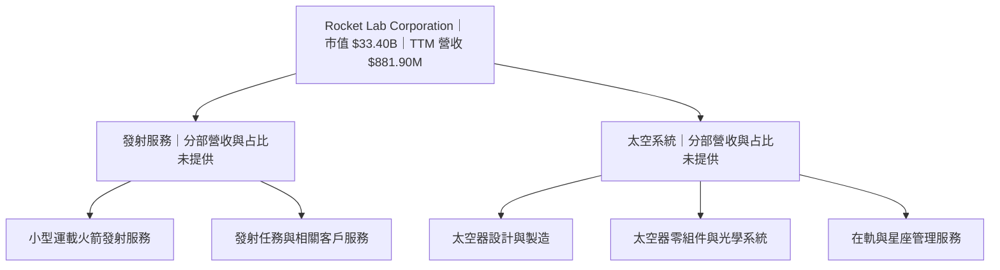
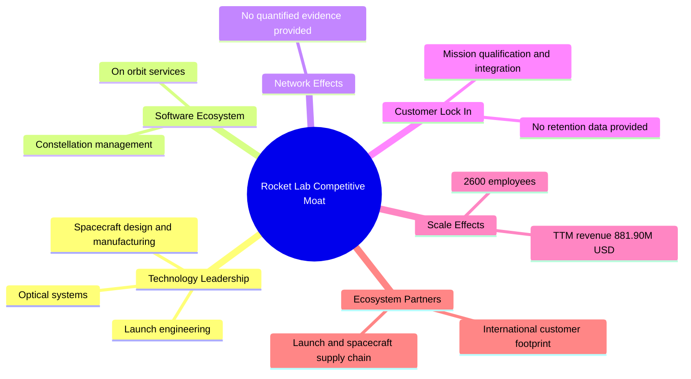
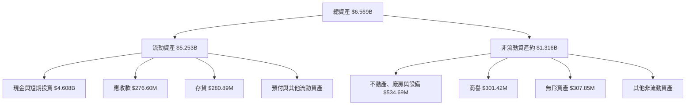
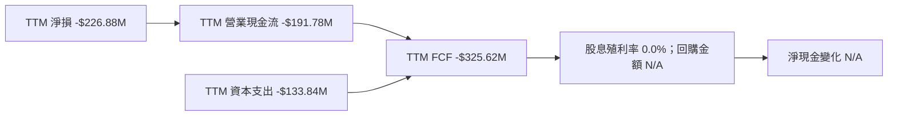
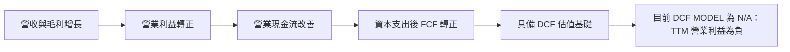
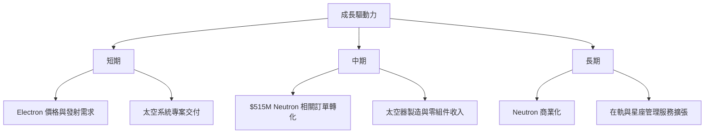
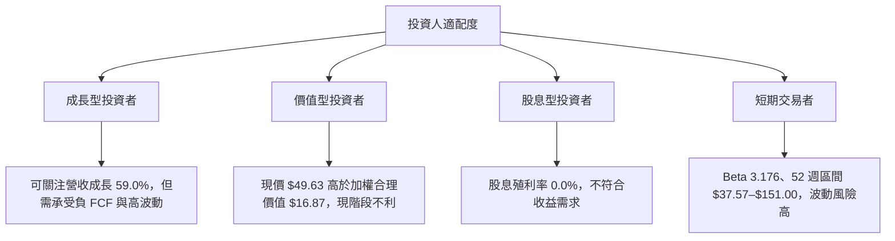

# RKLB 基本面深度分析報告
> **報告日期**：2026-11-24 ｜ **語言**：繁體中文 ｜ **數據來源**：SEC 申報資料 (XBRL)、Yahoo Finance、Finviz、StockAnalysis、Roic.ai ｜ **分析師**：CFA 級機構研究

## 目錄

| # | 章節 | 核心結論 |
|---|------|----------|
| 1 | 執行摘要 | 賣出；加權合理價值 $16.87，MOS -194.2% |
| 2 | 公司概覽與商業模式 | 發射服務與太空系統雙業務；護城河有技術與交付門檻，但收入分部資料不足 |
| 3 | 損益表深度分析 | TTM 營收 $881.90M、年增 59.0%；營業利益率仍為 -27.6% |
| 4 | 資產負債表分析 | 現金與短期投資 $4.61B；來源對債務及淨現金數據有差異 |
| 5 | 現金流量深度分析 | TTM FCF -$325.62M，現金消耗尚未被營收成長抵銷 |
| 6 | 獲利能力與資本效率 | ROIC -16.1% 對 WACC 14.0%，目前摧毀股東價值 |
| 7 | 相對估值分析 | P/S 高於同業及自身五年中位數；同業 P/S 法估值 $8.67 |
| 8 | DCF 內在價值評估 | DCF 不適用：TTM 營業利益為負；以固定權重相對估值交叉驗證 |
| 9 | 成長催化劑 | $515M Neutron 相關訂單是潛在催化，但交付與獲利轉換仍待驗證 |
| 10 | 風險矩陣 | 主要風險是執行、資本消耗與估值收縮 |
| 11 | 投資建議 | 賣出；若以加權合理價值為錨，MOS 達 10% 的價格約不高於 $15.18 |

---

## 1. 執行摘要

截至 **2026-11-23 收盤價 $49.63**，Rocket Lab TTM 營收為 $881.90M、TTM 成長 59.0%，但 TTM 營業利益率 -27.6%、ROIC -16.1%，TTM FCF -$325.62M。相對估值方法加權後合理價值為 **$16.87**，故 MOS 為 **-194.2%**，依規則 20 評級為 **🔴 賣出**。此結論反映估值與現金消耗的落差；公司營收成長及 $4.61B 現金與短期投資則是重要反向證據，但尚未轉化為正向 ROIC 或自由現金流。

### 1.0 一頁式投資儀表板（Portfolio Manager 30 秒速讀）

| 項目 | 內容 |
|------|------|
| **投資論點（3 句）** | ① TTM 營收 $881.90M、年增 59.0%，顯示商業規模擴大。② TTM 營業利益率 -27.6%、ROIC -16.1%，代表目前尚未創造經濟利潤。③ TTM FCF -$325.62M、FCF Yield -0.97%，而 2026-11-23 收盤價 $49.63 對照加權合理價值 $16.87，估值折讓不足。 |
| **綜合評分** | **5.3/10**（引用 1.1 評分卡） |
| **財務健康** | 🟡 現金與短期投資 $4.61B，流動性高；但 TTM FCF 為 -$325.62M，且債務數據存在來源差異。 |
| **ROIC vs WACC** | -16.1% vs 14.0%；價差 -30.1 個百分點，摧毀價值。 |
| **FCF 趨勢** | TTM FCF 為 -$325.62M；FCF Yield -0.97%。FY2025 FCF -$321.81M，現金消耗仍高。 |
| **估值** | Forward P/E 693.3501x ｜ EV/EBITDA -156.267x ｜ FCF Yield -0.97% |
| **DCF 內在價值（基準）** | N/A（TTM 營業利益為負，DCF MODEL 未提供可用模型）；現價相對 DCF 折溢價 N/A。 |
| **安全邊際（MOS）** | **-194.2%**＝($16.87 − $49.63) ÷ $16.87；🔴 <10% 無。基準為第 8.8 節加權合理價值。 |
| **預期報酬（基準情境 12M）** | N/A（DCF 情境未提供）；分析師共識目標價 $90.62，非本報告基準情境。 |
| **關鍵風險（前二）** | ① FCF 持續為負且資本支出上升；② 市場以高成長預期定價，但估值倍數收縮可能放大股價波動。 |
| **評級 + 信心度** | 🔴 賣出 ｜ 信心：中（估值與現金流數據方向清楚，但債務及部分財務來源有差異） |

### 1.1 綜合評分卡（全報告唯一）

| 維度 | 評分（1–10） | 主要依據（引用數字與其來源章節） |
|------|--------------|----------------------------------|
| 成長性 | 8.0 | TTM 營收成長 59.0%，最新一季年增 72.7%（第 3 章）。 |
| 獲利能力 | 2.0 | TTM 營業利益率 -27.6%、ROIC -16.1%、F-Score 5/9（第 3、6 章）。 |
| 財務健康 | 8.5 | 現金與短期投資 $4.61B、流動比率 8.554；但 TTM FCF -$325.62M（第 4、5 章）。 |
| 估值 | 1.0 | MOS -194.2%；P/S 36.7x，高於自身五年中位數 19.4x（第 7、8 章）。 |
| 護城河 | 7.0 | 業務涵蓋發射服務、太空器製造及太空系統；但未提供分部收入、留存率或市占率量化資料（第 2 章）。 |
| 管理層與資本配置 | 5.5 | FY2025 SBC $71.10M、稀釋股數測試未通過；現金儲備充裕，但 FCF 尚為負（第 3、5、6 章）。 |
| **綜合評分** | **5.3** | 六項算術平均：(8.0 + 2.0 + 8.5 + 1.0 + 7.0 + 5.5) ÷ 6 = 5.333…，四捨五入至一位小數為 5.3。 |

### 1.2 五大投資論點 + 三大核心風險

| 類型 | 項目 | 具體依據 | 信心度 |
|------|------|----------|--------|
| 🟢 **投資論點①** | 營收快速增長 | TTM 營收 $881.90M，TTM 年增 59.0%；最新一季營收 $267.83M，單季年增 72.7%。 | 🟢 高 |
| 🟢 **投資論點②** | 現金緩衝充足 | 現金與短期投資 $4.61B，顯著高於該公司 TTM FCF 消耗 $325.62M；但不能假設現金消耗速度維持不變。 | 🟢 高 |
| 🟢 **投資論點③** | 毛利率改善 | FY2022 毛利率約 9.0%，FY2025 約 34.4%；規模與業務組合變化可能改善毛利，但營業費用仍使營業利潤為負。 | 🟡 中 |
| 🟢 **投資論點④** | 新型運載火箭商業機會 | 新聞報導提及 $515M Neutron 相關訂單；訂單轉成收入仍取決於研發、試飛及交付進度。 | 🟡 中 |
| 🟢 **投資論點⑤** | 太空系統業務多元化 | 公司同時提供發射、太空器設計、零組件、製造及在軌管理服務；未提供各業務營收占比，故無法判斷收入集中度。 | 🟡 中 |
| 🟡 **風險①** | 現金流消耗 | TTM 營業現金流 -$191.78M、資本支出 $133.84M、FCF -$325.62M；若訂單交付和毛利改善延遲，資金消耗可能維持。 | 🔴 高衝擊 |
| 🔴 **風險②** | 高估值回檔 | P/S（歷史估值區塊）36.7x，高於五年中位數 19.4x；加權合理價值 $16.87，低於現價 $49.63。 | 🔴 高衝擊 |
| 🟡 **風險③** | 執行與稀釋 | F-Score 的稀釋股數測試未通過；FY2025 SBC $71.10M，對股東報酬構成稀釋成本。 | 🟡 中度 |

### 1.3 快速統計卡片

| 指標 | 公司實際值（期間） | 同業中位數 | 狀態 |
|------|--------------------|------------|------|
| 營收成長（TTM） | **59.0%** | — | 🟢 |
| 營收成長（最新一季年增） | **72.7%** | 161.4%（SPCX、LUNR、PL 三家中位數） | 🟡 |
| 毛利率（TTM） | **36.2%** | 55.5%（三家中位數） | 🟡 |
| 營業利益率（TTM） | **-27.6%** | — | 🔴 |
| ROIC（TTM） | **-16.1%** | — | 🔴 |
| Forward P/E | **693.3501x** | -55.2x（SPCX、LUNR、PL 可用數值中位數；含負值，解讀有限） | 🔴 |
| FCF Yield（TTM） | **-0.97%** | — | 🔴 |
| Piotroski F-Score | **5 / 9** | — | 🟡 |

### 1.4 投資結論

╔══════════════════════════════════════════════════════════════════╗  
║                    📊 投資結論摘要                               ║  
╠══════════════════════════════════════════════════════════════════╣  
║  評級：🔴 賣出（MOS -194.2%，符合 MOS < -25% 門檻）             ║  
║  價格（2026-11-23 收盤）：$49.63                                ║  
║  DCF 內在價值（基準）：N/A（TTM 營業利益為負）                  ║  
║  安全邊際 MOS：-194.2%（以加權合理價值 $16.87 為分母）          ║  
║  加權合理價值（8.8）：$16.87                                    ║  
║  綜合評分：5.3/10（引用 1.1）                                   ║  
║  適合投資人：能承受高波動與長期執行風險、並以小部位追蹤成長者  ║  
╚══════════════════════════════════════════════════════════════════╝

---

## 2. 公司概覽與商業模式

Rocket Lab Corporation 是美國太空產業公司，服務範圍涵蓋美國、加拿大、日本及其他國際市場。公司提供發射服務及太空系統解決方案，員工 2,600 人；TTM 營收 $881.90M。收入分部金額與占比未提供，不能將兩大業務板塊拆成虛構比例。

### 2.1 業務結構與收入來源

### 2.2 市場份額

市場份額數據未提供，因此不繪製市占率圖。以營收規模衡量，RKLB TTM 營收為 $881.90M，TTM 年增 59.0%；Peer multiples 中的 LUNR、PL、SPCX 最新一季年增率分別為 413.7%、58.1%、161.4%。各公司業務結構和收入基期不同，僅能作為增長速度的參考，不能直接推導市場份額。

### 2.3 競爭護城河分析

### 2.4 護城河強度

| 護城河項目 | 強度（強／中／弱） | 證據（引用數字或事實） | 會削弱它的情況 |
|------------|--------------------|------------------------|----------------|
| 技術與工程能力 | 中 | 業務涵蓋發射服務、太空器設計、零組件、製造及光學系統；員工 2,600 人。 | 發射可靠性、成本或交付速度落後競爭者。 |
| 軟體與服務延伸 | 弱至中 | 提供在軌與星座管理服務，但未披露該項收入、合約續約率或毛利。 | 服務收入無法形成持續合約，或客戶自行整合。 |
| 網路效應 | 弱 | 未提供平台使用者數、互通性或網路規模效應數據。 | 同業提供更具成本效率的整合服務。 |
| 客戶鎖定 | 中 | 太空任務及系統整合通常涉及認證與專案流程；公司未提供客戶留存率。 | 客戶多來源採購、任務延後或轉向其他發射供應商。 |
| 規模效應 | 中 | TTM 營收 $881.90M、年增 59.0%，已有多項發射與太空系統活動。 | 擴產快於訂單成長，導致成本與閒置產能上升。 |
| 生態夥伴 | 中 | 公司有國際市場營運範圍；未提供夥伴營收占比或合作訂單明細。 | 供應鏈瓶頸、關鍵零件短缺或合作關係改變。 |

**1.1「護城河」評分 7.0/10 的理由**：業務跨越發射與太空系統，並具工程及任務整合門檻；但市占、續約、服務收入占比等可驗證的護城河指標未披露，評分不代表已證明定價權。

---

## 3. 損益表深度分析

### 3.1 年度收入成長趨勢（近 4 年）

年度營收及毛利數據來自公司財務資料；收入 CAGR 以 FY2022 至 FY2025 三個年度間隔計算。

╔══════════════════════════════════════════════════════════════════╗  
║              Rocket Lab 年度收入趨勢（FY2022–FY2025）           ║  
╠══════════════════════════════════════════════════════════════════╣  
║ FY2022  $211.00M  ███████░░░░░░░░░░░░░░░░░░  YoY：—             ║  
║ FY2023  $244.59M  ████████░░░░░░░░░░░░░░░░░  YoY：+15.9%        ║  
║ FY2024  $436.21M  ███████████████░░░░░░░░░░  YoY：+78.3%        ║  
║ FY2025  $601.80M  █████████████████████░░░░░  YoY：+38.0%        ║  
╠══════════════════════════════════════════════════════════════════╣  
║ FY2022–FY2025 營收 CAGR：約 +41.8%                               ║  
╚══════════════════════════════════════════════════════════════════╝

FY2024 營收增長 78.3%，FY2025 放緩至 38.0%，但 FY2025 營收仍增加至 $601.80M。TTM 營收 $881.90M、年增 59.0%，表示最近 TTM 增長重新加速；此趨勢能否持續取決於發射交付、太空系統專案認列與 Neutron 推進情形。

### 3.2 季度收入趨勢分析

| 季度 | 營收 | QoQ 成長 | YoY 成長 | 備註 |
|------|------:|---------:|---------:|------|
| 2025 Q4 | $179.65M | 15.8% | 35.7% | QoQ 比較基期為 2025 Q3 的 $155.08M。 |
| 2026 Q1 | $200.35M | 11.5% | 63.5% | 年增較 FY2025 Q1 的 $122.57M 明顯加速。 |
| 2026 Q2 | $234.07M | 16.8% | 62.0% | 單季營收繼續擴大。 |
| 2026 Q3 | $267.83M | 14.4% | 72.7% | 最新單季年增率為 72.7%，不是 TTM 成長率。 |

QoQ 計算採相鄰季度營收相除減一；例如 2026 Q3 QoQ = ($267.83M ÷ $234.07M) − 1 = 14.4%。數字顯示營收連續增加，但單季營收成長本身不能證明營業槓桿已實現。

### 3.3 利潤率演變分析

| 利潤率指標 | FY2022 | FY2023 | FY2024 | FY2025 | 趨勢 | 評估 |
|------------|-------:|-------:|-------:|-------:|------|------|
| **毛利率** | 9.0% | 21.0% | 26.6% | 34.4% | ↗️ 連續改善 | 🟢 |
| **營業利益率** | -64.1% | -72.7% | -43.5% | -38.0% | FY2023 惡化後改善 | 🔴 |
| **淨利率** | -64.4% | -74.6% | -43.6% | -32.9% | 虧損率收窄 | 🔴 |

年度毛利率以年度毛利除年度營收計算；營業利益率與淨利率使用年度財報數據計算。毛利率由 FY2022 約 9.0% 升至 FY2025 約 34.4%，表示收入規模與業務組合變化可能提升直接成本吸收能力。FY2025 營業利益仍為 -$228.84M，主要問題是毛利改善尚未覆蓋研發及其他營業費用；FY2025 研發支出 $270.72M，約為營收的 45.0%，反映研發投入仍重。

TTM 營業利益率為 -27.6%，最新一季營業利益率為 -29.6%。單季虧損率仍大，故年度毛利率改善尚不能推論營業獲利已進入拐點。

### 3.4 費用結構分析

公司提供研發支出及營業損益資料，但缺少完整 TTM 銷售管理費、研發費、一次性項目及其他營業費用拆分，因此不能製作可稽核的費用結構圓餅圖。已知 FY2025 研發支出為 $270.72M，營收 $601.80M，研發費用約占營收 45.0%；此投入支撐新產品與技術開發，但短期壓低營業利潤。

### 3.5 季度 EPS 趨勢與盈餘品質（Quality of Earnings）

| 季度 | EPS 實際值 | 超預期／不及預期 | 說明 |
|------|-----------:|-------------------|------|
| 2025 Q4 | -$0.09 | N/A | EPS 預期值缺漏，無法判定 beat/miss。 |
| 2026 Q1 | -$0.07 | N/A | EPS 預期值缺漏；單季淨損 -$45.02M。 |
| 2026 Q2 | -$0.08 | N/A | EPS 預期值缺漏；單季淨損 -$49.26M。 |
| 2026 Q3 | -$0.12 | N/A | EPS 預期值缺漏；單季淨損 -$79.68M，較前季擴大。 |

可取得的 earnings history 未提供有效的 EPS estimate 與 surprise 數字；因此不能把未提供的預期值當成超預期或不及預期。

| 盈餘品質項目 | 數值／佔比 | 評估 |
|--------------|-----------|------|
| 股權薪酬 SBC / 營收 | TTM SBC 約 $84.20M ÷ TTM 營收 $881.90M = **9.5%** | 🔴 SBC 佔營收接近一成，具有實質稀釋成本。TTM SBC 以最近四季披露數字加總。 |
| SBC / 營業現金流 | $84.20M ÷ \|-$191.78M\| = **43.9%** | 🔴 營業現金流為負，比例以現金流絕對值表達；SBC 不會消除現金消耗。 |
| FCF / 淨利（現金轉換率） | -$325.62M ÷ -$226.88M = **143.5%** | 🔴 兩者皆為負值，正比率不代表良好轉換；FCF 現金消耗幅度約為會計淨損的 1.44 倍。 |
| 一次性／非經常性損益 | N/A | 未提供足以識別一次性項目的明細，不能判斷是否美化盈餘。 |
| 有效稅率異常 | N/A | 未提供可用有效稅率明細。 |
| 資本化支出 vs 費用化 | TTM 資本支出 $133.84M；費用化／資本化明細 N/A | 資本支出不等同費用化研發；缺少資本化支出分類，無法判斷是否有成本遞延。 |

**盈餘品質結論**：公司仍處於淨損及負 FCF 狀態，不能以單一淨利數據評估獲利含金量。TTM FCF 低於 TTM 淨利（兩者皆為負），且 SBC 約占營收 9.5%；股東實際回報須同時考慮營運現金消耗及股數稀釋，而不是只看營收增長。

---

## 4. 資產負債表分析

### 4.1 資產結構分解

最新資產負債表彙總資料顯示總資產 $6.569B、流動資產 $5.253B；細項來自 StockAnalysis，單位換算為美元。

非流動資產約 $1.316B 為總資產減流動資產的推導值；其餘細項不應被視為完整加總，因為資料欄位存在四捨五入與分類差異。

### 4.2 流動性與營運資金分析

| 流動性指標 | 數值 | 評估 |
|------------|------|------|
| 流動比率 | 8.554 | 🟢 高；但不同資料來源的資產負債表口徑可能不完全一致。 |
| 速動比率 | 7.954 | 🟢 高；短期償付能力較強。 |
| 現金與短期投資 | $4.61B | 🟢 提供資金緩衝；仍須觀察資本支出與營運現金流。 |
| 現金轉換週期 | 最新 TTM 176 天 | 🟡 較一年前增加，資金占用時間延長。 |

**營運資金天數（照錄品質指標）**

| 指標 | 最新 TTM | 一年前 TTM | 變化 | 解讀 |
|------|----------|------------|------|------|
| DSO 應收帳款天數 | 49 天 | 39 天 | +10 天 | 🟡 應收帳款回收時間拉長；可能與合約及收入認列時點相關，但原因需財報補充。 |
| DIO 存貨天數 | 182 天 | 140 天 | +42 天 | 🔴 存貨占用增加；若未能轉成交付與收入，將加大營運資金壓力。 |
| DPO 應付帳款天數 | 55 天 | 59 天 | -4 天 | 🟡 付款時間縮短，對現金週轉的緩衝略減。 |
| CCC 現金轉換週期 | 176 天 | 120 天 | +56 天 | 🔴 營運資金回收週期延長，與 FCF 為負的情況一致。 |

### 4.3 債務結構分析

資料來源對債務金額有明顯差異：VERIFIED FIGURES 列總債務 $1.72M、淨現金 $4.61B；其他合併財務資料列總債務 $120.28M、淨現金／債務 $4.49B；FY2025 年報數據列總債務 $253.96M。本文保留各來源原值，不將其混為同一口徑。利息保障倍數及 Debt/EBITDA 的經濟解讀，因 EBITDA 為負且計息負債資料不一致，列為 N/A。

╔══════════════════════════════════════════════════════════════════╗  
║                   Rocket Lab 債務健康診斷                        ║  
╠══════════════════════════════════════════════════════════════════╣  
║  現金與短期投資：$4.61B  ████████████████████  高                ║  
║  總債務：        $1.72M  ░                     VERIFIED FIGURES值 ║  
║  其他來源總債務：$120.28M  ░░                  口徑不一致         ║  
║  淨現金：        $4.61B  ████████████████████  VERIFIED FIGURES值 ║  
║  Debt/EBITDA：N/A（EBITDA 為負，且債務口徑有差異）               ║  
║  Interest Coverage：N/A（利息費用與平均計息負債資料不完整）      ║  
╚══════════════════════════════════════════════════════════════════╝

### 4.4 股東權益趨勢

╔══════════════════════════════════════════════════════════════════╗  
║                Rocket Lab 股東權益趨勢（年度）                   ║  
╠══════════════════════════════════════════════════════════════════╣  
║ FY2022  $673.21M  ████████████░░░░░░░░                     ║  
║ FY2023  $554.54M  ██████████░░░░░░░░░░                     ║  
║ FY2024  $382.45M  ███████░░░░░░░░░░░░░                     ║  
║ FY2025  $1.72B    ████████████████████                     ║  
╚══════════════════════════════════════════════════════════════════╝

FY2024 權益降至 $382.45M，FY2025 升至 $1.72B。資料顯示股東權益變化明顯，但不能只據此推斷變動由何種融資或交易造成；需以股東權益變動表及發行股數明細驗證。

---

## 5. 現金流量深度分析

### 5.1 現金流量瀑布圖

FCF 按固定定義為營業現金流減資本支出：-$191.78M − $133.84M = -$325.62M。股息殖利率為 0.0%；回購及淨現金變化金額未提供，故不繪製假設數值。

### 5.2 FCF 轉換率趨勢

| 年度 | FCF | 淨利 | FCF / 淨利 | 解讀 |
|------|----:|-----:|-----------:|------|
| FY2022 | -$148.95M | -$135.94M | 109.6% | 現金消耗高於淨損。 |
| FY2023 | -$153.57M | -$182.57M | 84.1% | 現金消耗低於淨損，但仍為負值。 |
| FY2024 | -$115.98M | -$190.18M | 61.0% | 現金流相對淨損改善，不能視為已獲利。 |
| FY2025 | -$321.81M | -$198.21M | 162.4% | 現金消耗加大，與資本投入增加相符。 |
| TTM | -$325.62M | -$226.88M | 143.5% | 現金消耗約為淨損 1.44 倍。 |

FCF 與淨利皆為負值時，比率不能套用一般「越高越好」的解釋；此處主要用來比較現金消耗相對會計虧損的大小。

### 5.3 自由現金流趨勢

╔══════════════════════════════════════════════════════════════════╗  
║            Rocket Lab 自由現金流（美元，負值為現金消耗）        ║  
╠══════════════════════════════════════════════════════════════════╣  
║ FY2022  -$148.95M  █████████░░░░░░░░░░░░  FCF Yield：N/A        ║  
║ FY2023  -$153.57M  █████████░░░░░░░░░░░░  FCF Yield：N/A        ║  
║ FY2024  -$115.98M  ███████░░░░░░░░░░░░░  FCF Yield：N/A        ║  
║ FY2025  -$321.81M  ████████████████████  FCF Yield：N/A        ║  
║ TTM     -$325.62M  ████████████████████  FCF Yield：-0.97%      ║  
╚══════════════════════════════════════════════════════════════════╝

年度 FCF Yield 未提供，故不反推；TTM FCF Yield 直接採用 -0.97%。FY2025 與 TTM 的負 FCF 顯示即使營收高增，現金流仍未轉正，需追蹤資本支出、存貨和應收帳款是否隨營收擴大而有效回收。

### 5.4 資本配置評估

完整資本配置比例資料未提供，不製作比例圓餅圖。已知 FY2025 資本支出 $156.28M、SBC $71.10M；公司股息殖利率為 0.0%，回購金額未提供。現金優先用於營運、研發與資本投入的判斷，應以正式資金用途及現金流量表明細作後續確認。

| 項目 | 可用資料 | 評估 |
|------|----------|------|
| 資本支出 | FY2025 $156.28M；TTM $133.84M | 🟡 支持產能與產品開發，惟短期壓低 FCF。 |
| 股權薪酬 | FY2025 $71.10M | 🔴 對股東造成稀釋成本。 |
| 股息 | 殖利率 0.0% | 無現金股息回報。 |
| 回購 | N/A | 回購金額資料未提供。 |
| 留存現金 | 現金與短期投資 $4.61B | 🟢 提供資金緩衝，但不等於已具自我融資能力。 |

---

## 6. 獲利能力與資本效率

### 6.1 ROE / ROA / ROIC 趨勢

| 指標 | 可用期間數值 | 趨勢與評估 |
|------|--------------|------------|
| ROE | TTM -3.9%（QUALITY FIGURES） | 🔴 負值；與杜邦分解的負淨利率一致。合併市場資料另列 -6.4%，來源口徑有差異，依品質指標採 -3.9%。 |
| ROA | TTM -3.5%（市場資料）；F-Score 測試為 ROA 未大於 0 | 🔴 仍未轉正。 |
| ROIC | TTM -16.1% | 🔴 明顯低於 WACC 14.0%。 |

可比較的歷年 ROIC 序列及可靠行業均值未提供，故不填補不存在的年度數值或同業均值。

### 6.2 ROIC vs WACC 分析（核心價值創造判斷）

╔══════════════════════════════════════════════════════════════════╗  
║                ROIC vs WACC 深度分析                            ║  
╠══════════════════════════════════════════════════════════════════╣  
║  WACC（採用值）：14.00%                                         ║  
║  ├── 無風險利率（10Y 美債）：4.92%                              ║  
║  ├── 市場風險溢酬 ERP：5.00%                                    ║  
║  ├── 原始 Beta：3.18；調整後 Beta：2.00                         ║  
║  ├── 股權成本（資料列示）：14.92%                               ║  
║  ├── 資本權重：股權 100.0%，債務 0.0%                           ║  
║  └── WACC：計算值 14.98%，受 7%–14% 區間限制後採用 14.00%      ║  
║                                                                  ║  
║  ROIC（TTM）：-16.1%                                             ║  
║  ROIC − WACC = -16.1% − 14.0% = -30.1 個百分點                  ║  
║                                                                  ║  
║  ROIC  -16.1%  ◀ 負值                                           ║  
║  WACC   14.0%  資本成本門檻                                      ║  
║  EVA 差額 -30.1pp  🔴 摧毀股東價值                              ║  
╚══════════════════════════════════════════════════════════════════╝

Beta 調整方式依成本資本資料：原始 Beta 3.18；採用 Beta 2.00，並列示未封頂調整值為 ⅔ × 3.18 + ⅓ = 2.45，依 0.6–2.0 區間上限封頂。股權成本資料列示 14.92%；但成本資本區塊另列 WACC 計算值 14.98%，並說明受 7%–14% 區間限制後採用 14.00%。依規定採用 14.00% 作為一致折現率，不自行重算替換。債務成本欄列 1543.65%，但債務權重為 0.0%，故不對 WACC 產生權重貢獻；異常高比率亦不應解讀為一般市場借款成本。

ROIC 比 WACC 低 30.1 個百分點，代表依目前 TTM 數據，公司尚未產生高於資本成本的營業報酬。由於公司虧損且投資期較長，這是當前經濟表現的判斷，不等於預測未來必然無法改善。

### 6.3 杜邦三因素分解

| 因素 | 數值（TTM） | 解讀 |
|------|-------------|------|
| 淨利率 | -25.7% | 虧損是 ROE 負值的主要來源。 |
| 資產週轉率 | 0.13 | 每單位資產產生的營收仍有限，資產擴張須轉成收入。 |
| 權益乘數 | 1.13 | 槓桿幅度不高，負 ROE 並非主要由高財務槓桿造成。 |
| **ROE** | **-3.9%** | QUALITY FIGURES 原值：-25.7% × 0.13 × 1.13 = -3.9%（採資料區塊列示值；中間值四捨五入有尾差）。 |

### 6.4 財務體質：Piotroski F-Score

F-Score **5 / 9**。測試結果依 QUALITY FIGURES 原值照錄：

| 測試 | 結果 | 解讀 |
|------|------|------|
| ROA > 0 | ❌ 未通過 | 資產尚未產生正淨利回報。 |
| 營業現金流 > 0 | ❌ 未通過 | TTM 營業現金流為 -$191.78M。 |
| ROA 高於一年前 | ✅ 通過 | 相對一年前改善，但仍不代表已轉正。 |
| 營業現金流 > 淨利（應計品質） | ✅ 通過 | 相對應計品質測試通過，但營業現金流本身仍為負。 |
| 長期負債 ÷ 總資產低於一年前 | ✅ 通過 | 槓桿相關測試改善。 |
| 流動比率高於一年前 | ✅ 通過 | 短期流動性相對改善。 |
| 稀釋股數未增加 | ❌ 未通過 | 股數稀釋降低既有股東的每股經濟權益。 |
| 毛利率高於一年前 | ✅ 通過 | 與年度毛利率改善方向一致。 |
| 資產週轉率高於一年前 | ❌ 未通過 | 資產投入尚未帶來更高週轉效率。 |

---

## 7. 相對估值分析

### 7.1 同業估值比較表格

公司估值欄採市場資料所列倍數；同業採 Yahoo Finance Peer multiples。負盈餘公司的 P/E 倍數通常不具可比性，負值倍數也不代表低估。

| 估值指標 | **RKLB** | **SPCX** | **LUNR** | **PL** | RKLB 評估 |
|----------|---------:|---------:|---------:|------:|-----------|
| **Trailing P/E** | N/A | 579.8x | N/A | N/A | 🟡 多數公司無正盈餘或不可比。 |
| **Forward P/E** | 693.3501x | 48.6x | -55.2x | -8968.0x | 🔴 RKLB 倍數極高；同業中含負值，整體中位數解讀有限。 |
| **P/S Ratio** | 37.87233x | 56.5x | 2.4x | 10.8x | 🔴 高於 LUNR、PL；低於 SPCX。 |
| **EV/EBITDA** | -156.267x | 150.0x | -37.3x | -76.7x | 🟡 EBITDA 為負或倍數異常，不能以倍數高低直接排序。 |
| **最新一季營收年增** | 72.7% | 161.4% | 413.7% | 58.1% | 🟡 RKLB 高於 PL，低於 SPCX 與 LUNR。 |
| **毛利率（TTM）** | 36.2% | 56.8% | 20.3% | 55.5% | 🟡 高於 LUNR，低於 SPCX 與 PL。 |

### 7.2 歷史估值區間分析

╔══════════════════════════════════════════════════════════════════╗  
║                 RKLB 五年歷史 P/S 估值區間                      ║  
╠══════════════════════════════════════════════════════════════════╣  
║ 五年低點 7.1x ───── 中位數 19.4x ─── 現值 36.7x ───── 高點 83.2x ║  
║ 當前百分位：62%                                                  ║  
╚══════════════════════════════════════════════════════════════════╝

現值 36.7x 高於五年中位數 19.4x，且位於歷史區間第 62 百分位。這不是五年區間極端高點，但仍代表市場對持續高成長及未來利潤改善已給予顯著估值溢價。

### 7.3 情境價值（Bear / Base / Bull）

N/A（DCF 無法計算：TTM 營業利益為負，程式計算的 DCF MODEL 未提供情境估值。依規則不自行設定 DCF 情境目標價。）

### 7.4 相對估值隱含價格區間

╔══════════════════════════════════════════════════════════════════╗  
║             相對估值方法回推每股價值與現價位置                  ║  
╠══════════════════════════════════════════════════════════════════╣  
║ 同業 P/S 方法：$8.67   ── 現價 $49.63 ── 分析師共識：$90.62      ║  
║ 同業 P/S 相對現價：-82.5%                                        ║  
║ 分析師共識相對現價：+82.6%                                       ║  
╚══════════════════════════════════════════════════════════════════╝

同業 P/S 方法採 LUNR、PL 同業中位數倍數 6.6x 乘以 RKLB TTM 營收後推得每股 $8.67；此結果依估值方法區塊原值照錄。分析師共識目標價為 21 位分析師平均 $90.62，屬市場預期參考，並非獨立經營模型。相對估值兩種方法差距大，顯示估值對採用的參照方法高度敏感。

---

## 8. DCF 內在價值評估（Discounted Cash Flow）

### 8.0 估值推理鏈（Thinking Logic）

**Step 1 — 價值由哪些變數決定？**  
Rocket Lab 的長期價值取決於發射服務、太空系統及新型運載火箭能否轉化為可持續收入與正現金流；但財務資料未提供各業務收入占比，因此無法量化「現有業務底盤」與新業務的比例。估值主導變數理應是營收轉為正營業利潤與 FCF 的速度；目前 TTM 營業利益率 -27.6%、FCF -$325.62M，缺少正向現金流基礎。

**Step 2 — 模型選擇**

| 決策點 | 本報告採用 | 理由（含數字） | 曾考慮但否決 | 否決理由 |
|--------|-----------|----------------|--------------|----------|
| 現金流定義 | 不建模；DCF N/A | TTM 營業利益為負，程式計算未提供有效 DCF 模型。 | FCFF / FCFE 自建模型 | 規定禁止另建 DCF；亦缺少模型所需的逐年營運假設。 |
| 預測期 N | N/A | DCF MODEL 未提供可用年數。 | 自行設 5–10 年 | 會引入未驗證的模型假設。 |
| 終值方法 | N/A | 無 DCF 模型輸出。 | Gordon Growth／退出倍數 | 不能以缺漏的現金流及退出假設自行計算。 |
| EBIT 基礎 | N/A | 無 DCF 模型輸出。 | GAAP／非 GAAP | 不得自行建立替代模型。 |

**Step 3 — 假設推導鏈**  
DCF MODEL 明確為 N/A，原因是 TTM 營業利益不為正。因此營收 CAGR、期末營業利潤率、永續成長率、預測期、Capex 比率、D&A 比率、營運資金變化、SBC 處理與稀釋股數等模型輸入均不適用；不提供沒有來源的替代假設。

**Step 4 — 最脆弱環節**  
最脆弱的估值環節是從營收高增長跨越至正營業利潤與正 FCF 的時間；若此轉換延遲，估值將更依賴相對估值與市場風險偏好，而不是可折現的營運現金流。

**Step 5 — 計算路徑圖**

### 8.1 模型假設總表（Model Inputs）

N/A（數據未提供：可用 DCF 模型輸出、預測期及逐年假設；原因為 TTM 營業利益不為正，依規定不得自建 DCF。）

### 8.2 折現率推導（WACC）

雖 DCF 本身不可用，成本資本區塊仍提供 ROIC 比較與折現參考所需 WACC。依其明示值採用 WACC 14.00%，不另建 DCF。

╔══════════════════════════════════════════════════════════════════╗  
║                    WACC 推導（折現率）                           ║  
╠══════════════════════════════════════════════════════════════════╣  
║ 無風險利率 Rf（10Y 美債）：4.92%                                ║  
║ ERP（假設值，成本資本資料列示）：5.00%                          ║  
║ 原始 Beta（Yahoo）：3.18；採用調整後 Beta：2.00                 ║  
║ 調整計算：⅔ × 3.18 + ⅓ = 2.45；依 0.6–2.0 區間封頂為 2.00     ║  
║ 股權成本資料列示：14.92%                                         ║  
║ 債務權重：0.0%；股權權重：100.0%                                 ║  
║ 債務成本原始資料列示：1543.65%；D 權重為零，故無 WACC 權重貢獻  ║  
║ 計算值 14.98%；受 7%–14% 區間限制，採用 WACC 14.00%             ║  
╚══════════════════════════════════════════════════════════════════╝

逐步檢核：  
1. Beta 調整未封頂值 = ⅔ × 3.18 + ⅓ = 2.453…，資料區塊列示 2.45，採用值為區間上限 2.00。  
2. 股權成本 CAPM 資料列示為 14.92%；依原始數值相乘可得到接近此值，但利率與風險溢酬精度可能存在未顯示小數。  
3. 資本權重 = 股權 100.0% + 債務 0.0% = 100.0%。  
4. 成本資本資料區塊給出的未限制計算值為 14.98%；該數字與股權成本欄位 14.92% 不完全一致，且明示 WACC 受 7%–14% 區間限制。  
5. 採用值 = min(14.98%, 14.00% 上限) = **14.00%**。此值與第 6.2 節一致；由於資料來源中間值不完全吻合，本文不自行替換程式給定 WACC。

### 8.3 逐年自由現金流預測（基準情境）

N/A（DCF MODEL 未提供逐年預測；原因為 TTM 營業利益不為正。依規則不自建營收、利潤率、FCFF 或折現表。）

### 8.4 終值計算（Terminal Value）

N/A（無可用 DCF 預測期、終年 FCFF、永續成長率或退出倍數；不能計算終值。）

### 8.5 企業價值 → 每股內在價值（Bridge）

N/A（無 DCF 企業價值及橋接項目，因此沒有 DCF 基準每股內在價值，也不計算 DCF 折溢價。現金、債務及股數不得替代缺失的 DCF 企業價值。）

### 8.6 敏感性分析（WACC × 永續成長率）

N/A（DCF MODEL 未提供敏感度矩陣；不能自行建立 WACC／永續成長率情境。）

### 8.7 反推 DCF（Reverse DCF：市場在預期什麼）

N/A（無可用 DCF 函數及模型輸入，不能由單一現價反推營收 CAGR、利潤率、永續成長率或預測期。）

### 8.8 估值三角驗證與安全邊際

| 估值方法 | 隱含每股價值 | 上行空間（÷現價） | 權重 | 說明 |
|----------|--------------|-------------------|------|------|
| 同業 P/S | $8.67 | -82.5% | 90% | LUNR、PL 同業中位數 P/S 6.6x × RKLB TTM 營收；依估值方法區塊照錄。 |
| 分析師共識目標價 | $90.62 | +82.6% | 10% | 21 位分析師平均目標價；參考值，非本報告自建現金流模型。 |
| **加權合理價值** | **$16.87** | **-66.0%** | **100%** | 公司類型為未獲利公司；Forward P/E 方法因不可計算而排除，其權重分配至可用方法。 |

逐步演算：  
**加權合理價值** = $8.67 × 90% + $90.62 × 10%  
= $7.803 + $9.062  
= $16.865  
= **$16.87**（金額取至美分）。

安全邊際與上行空間採不同分母，按固定定義計算：

- **MOS** = (加權合理價值 − 現價) ÷ 加權合理價值  
  = ($16.87 − $49.63) ÷ $16.87  
  = -$32.76 ÷ $16.87  
  = **-194.2%**
- **上行空間** = (加權合理價值 − 現價) ÷ 現價  
  = ($16.87 − $49.63) ÷ $49.63  
  = -$32.76 ÷ $49.63  
  = **-66.0%**

╔══════════════════════════════════════════════════════════════════╗  
║                  估值區間與安全邊際                              ║  
╠══════════════════════════════════════════════════════════════════╣  
║ 同業 P/S $8.67 ── 加權合理價值 $16.87 ── 現價 $49.63 ── 共識 $90.62 ║  
║                                                                  ║  
║ 安全邊際 MOS = ($16.87 − $49.63) ÷ $16.87 = -194.2%             ║  
║ MOS 評估：🔴 <10% 無                                            ║  
║ 上行空間 = ($16.87 − $49.63) ÷ $49.63 = -66.0%                  ║  
║                                                                  ║  
║ MOS ≥ 10% 價格上限：$16.87 × (1 − 10%) = $15.183 ≈ $15.18      ║  
╚══════════════════════════════════════════════════════════════════╝

以加權合理價值為參考，MOS 達 10% 的價格門檻為約 $15.18。由於評級為賣出，本報告不將該價格門檻稱為建議買入區間，而視為重新評估估值的價格參考。

> 🔎 **程式複算（Python，依本節各項自動重算）**
>
> 加權合理價值 = $8.67 × 90% + $90.62 × 10% = **$16.87**（權重合計 100%）
>
> 以價格 $49.63 計：MOS = **-194.2%**，上行空間 = **-66.0%**
>
> ✅ 與本節所寫數值一致。

### 8.9 DCF 模型的局限與失效條件

- **終值依賴度**：N/A；沒有可用 DCF 終值及 EV，不能計算終值占比。
- **最脆弱的假設**：無法量化模型假設敏感度；業務層面最重要的不確定性為營收增長能否轉化為營業利潤與正 FCF。
- **不適用情境說明**：TTM 營業利益率 -27.6%、TTM FCF -$325.62M，現階段 DCF 可靠度低。估值應以同業 P/S、營收品質、毛利率、訂單交付與現金消耗速度為主，並隨盈利狀態改變更新估值方法。
- **與第 10 章風險矩陣的連結**：發射或新產品延誤可能壓低營收增長；毛利下滑會延後營業利益轉正；存貨與應收天數增加可能使營運現金流更差；市場風險偏好下降則可能壓縮 P/S。

### 8.10 複算檢核表（Audit Trail）

| # | 檢核項目 | 檢查方式 | 結果 |
|---|----------|----------|------|
| 1 | 高／中敏感度輸入完整四段式推導 | DCF MODEL 為 N/A，無模型輸入可推導 | N/A |
| 2 | 每個模型假設都有來歷 | 未建立替代假設 | ✅ |
| 3 | WACC 五步算式與相乘相加 | 使用成本資本區塊原值；計算值與採用值差異已揭露 | ⚠️ 原始資料精度有差異，採用值依區塊固定為 14.00% |
| 4 | Kd 分母與債務權重範圍一致 | 債務權重 0%，但債務成本資料異常且負債口徑不一致 | ⚠️ 不以異常 Kd 推導替代 WACC |
| 5 | WACC 與第 6.2 節同值 | 兩處均採 14.00% | ✅ |
| 6 | 逐年表格年度數與 N 相符 | DCF MODEL 未提供 N | N/A |
| 7 | FY+1 FCFF 與 PV 算式 | 無逐年現金流模型 | N/A |
| 8 | 預測期 PV 加總 | 無預測期 PV | N/A |
| 9 | WACC > g | 未提供 g | N/A |
| 10 | 終值以 FY+N 現金流為基礎 | 無終值模型 | N/A |
| 11 | EV 至每股價值橋接 | 無 DCF EV | N/A |
| 12 | SBC 基礎、扣除與稀釋一致 | DCF 未建立；SBC 分析另見第 3.5 節 | N/A |
| 13 | 敏感性矩陣基準格與 DCF 價值一致 | 無矩陣 | N/A |
| 14 | 矩陣有效格與 WACC > g | 無矩陣及 g | N/A |
| 15 | 三情境機率加總 | DCF 情境未提供 | N/A |
| 16 | Reverse DCF 每列只放開一變數 | 沒有可用模型 | N/A |
| 17 | MOS 分母為 8.8 合理價值、折溢價分母為 DCF | MOS 以 $16.87 計算；DCF 折溢價 N/A | ✅ |
| 18 | 完整輸出至第 11 章 | 章節 1–11 全部列出 | ✅ |
| 19 | 加權合理價值等於各方法加權總和 | $8.67×90% + $90.62×10% = $16.865 ≈ $16.87 | ✅ |
| 20 | 評級符合 MOS 門檻 | MOS -194.2%，低於 -25%，評級賣出 | ✅ |

---

## 9. 成長催化劑

### 9.1 催化劑時間軸

目前可用資料提供近期新聞與訂單金額，但未提供可核實的產品里程碑日期，故不以未驗證日期製作 Gantt 時間軸。可追蹤的催化因素如下：

| 時間範圍 | 催化劑 | 可驗證指標 |
|----------|--------|------------|
| 短期 | Electron 價格調整與發射服務需求 | 新增訂單、每次任務收入、發射頻率及毛利率。 |
| 短至中期 | $515M Neutron 相關訂單 | 訂單取消條款、預收款、交付時程及收入認列。 |
| 中期 | 太空系統與在軌服務擴張 | 分部收入、訂單轉收入速度及分部毛利。 |
| 長期 | Neutron 商業化與更大規模運載服務 | 試飛進度、首飛時間、可靠性及實際客戶交付。 |

### 9.2 TAM 市場規模分析

N/A（TAM 數據未提供）。可觀察到的公司規模為 TTM 營收 $881.90M、TTM 成長 59.0%、最新一季年增 72.7%；顯示仍處於擴張階段，但不能以公司增長率代替可查證的市場總規模或市場滲透率。

### 9.3 成長驅動力結構圖

---

## 10. 風險矩陣

### 10.1 風險評分矩陣

財務資料未提供各風險事件的統計機率或精確損失分布，因此不以非財務資料自行填入 quadrantChart 數值座標。下表的機率與衝擊為研究判斷，不是 SEC 或價格資料庫的客觀統計。

| 風險項目 | 發生可能性 | 潛在衝擊 | 優先級 |
|----------|------------|----------|--------|
| FCF 持續為負、資本需求增加 | 中至高 | 高 | 🔴 高 |
| 新產品／發射任務延誤 | 中 | 高 | 🔴 高 |
| 高估值倍數收縮 | 中至高 | 高 | 🔴 高 |
| 存貨與應收帳款占用延長 | 中 | 中至高 | 🟡 中高 |
| 股權薪酬與稀釋 | 中 | 中 | 🟡 中 |

### 10.2 風險清單詳細分析

下表中的機率百分比與風險分數屬分析師估計，非公司指引或統計頻率；財務衝擊以既有營運與估值數字說明，不將估計值冒充財報事實。

| # | 風險項目 | 發生機率 | 財務衝擊 | 風險評分 | 緩解措施 |
|---|----------|----------|----------|----------|----------|
| 1 | 🔴 **自由現金流消耗延續** | 中高（估計 50–70%） | TTM FCF 已為 -$325.62M；若延續，現金餘額及未來融資選擇將受壓。 | 🔴 高 | 每季檢查營業現金流、資本支出、現金與短期投資，確認訂單交付是否帶來現金回收。 |
| 2 | 🔴 **新產品與發射任務執行延誤** | 中（估計 30–50%） | 若延誤，可能使 $515M Neutron 相關訂單無法按期轉成收入，並增加研發與測試支出。 | 🔴 高 | 追蹤里程碑、任務成功率、客戶交付及訂單取消條款。 |
| 3 | 🔴 **估值倍數收縮** | 中高（估計 50–70%） | P/S 歷史值 36.7x，遠高於自身五年中位數 19.4x；倍數收縮可能令股價下跌，即使營收仍增長。 | 🔴 高 | 以營收、毛利率、FCF 及同業 P/S 更新合理價值，不只依賴市場情緒。 |
| 4 | 🟡 **營運資金占用上升** | 中（估計 30–50%） | CCC 由 120 天升至 176 天；DIO 增加 42 天、DSO 增加 10 天。 | 🟡 中高 | 檢查存貨完工、交付、應收帳齡及客戶預付款。 |
| 5 | 🟡 **SBC 與股數稀釋** | 中（估計 30–50%） | FY2025 SBC $71.10M；F-Score 稀釋股數測試未通過。 | 🟡 中 | 比較每季稀釋股數、SBC/營收與每股營收增長。 |

---

## 11. 投資建議

### 11.1 最終評級與評分

評級為 **🔴 賣出**：加權合理價值 $16.87、現價 $49.63，MOS -194.2%，符合 MOS 低於 -25% 的賣出門檻，無質化上調或下調。1.1 綜合評分為 **5.3/10**，六項分數依序為成長性 8.0、獲利能力 2.0、財務健康 8.5、估值 1.0、護城河 7.0、管理層與資本配置 5.5。

### 11.2 合理價值與隱含報酬率

| 方法／情境 | 每股價值 | 相對 2026-11-23 收盤 $49.63 | 說明 |
|------------|---------:|---------------------------:|------|
| 同業 P/S | $8.67 | -82.5% | 同業 P/S 估值法，權重 90%。 |
| 分析師共識目標價 | $90.62 | +82.6% | 21 位分析師平均目標價，權重 10%；非本報告基準情境。 |
| **加權合理價值** | **$16.87** | **-66.0% 上行空間** | 加權價值；MOS -194.2%。 |
| 悲觀／基準／樂觀 DCF 情境 | N/A | N/A | DCF MODEL 未提供可用情境估值。 |

### 11.3 買入時機與觸發因素

╔══════════════════════════════════════════════════════════════════╗  
║                  ✅ 估值與追蹤觸發因素 Checklist                  ║  
╠══════════════════════════════════════════════════════════════════╣  
║  重新評估持有論點的條件：                                        ║  
║  ☐ 單季營收年增保持正值，且訂單如期轉成實際交付與收款          ║  
║  ☐ 毛利率延續改善，營業利益率逐季收斂至損益兩平                ║  
║  ☐ TTM FCF 不再惡化，並呈現連續改善                            ║  
║                                                                  ║  
║  估值重估／考慮增持的價格參考：                                  ║  
║  ☐ 價格低於約 $15.18：以加權合理價值 $16.87 計，MOS 約達 10%  ║  
║  ☐ 上述價格條件須與營收交付及現金消耗改善同時檢驗              ║  
║                                                                  ║  
║  減碼／退出觸發條件：                                            ║  
║  ☐ 連續兩季營收年增低於 30%（研究監控門檻）                    ║  
║  ☐ 營業利益率較 -27.6% 的 TTM 水準再惡化超過 5 個百分點       ║  
║  ☐ TTM FCF 低於 -$325.62M 且現金與短期投資快速下降             ║  
║  ☐ Neutron 或主要交付里程碑延誤，訂單取消或收入認列後移        ║  
╚══════════════════════════════════════════════════════════════════╝

上述 30% 成長與 5 個百分點惡化門檻是研究監控條件，不是公司財測。約 $15.18 僅代表在加權合理價值不變時對應 MOS 10% 的價格，不構成無條件買入訊號。

### 11.4 投資人適配度分析

### 11.5 每季財報監控清單（Quarterly Watch List）

| 追蹤指標 | 最新基準 | 觸發加碼／重估條件 | 觸發減碼／退出條件 |
|----------|---------|--------------------|--------------------|
| 營收與單季年增 | TTM $881.90M、年增 59.0%；最新一季年增 72.7% | 營收增長保持且已訂單轉實際交付。 | 連續兩季年增低於 30%（研究門檻）。 |
| 毛利率 | TTM 36.2% | 毛利率持續高於前期並伴隨費用率下降。 | 毛利率連續兩季下滑且營業虧損擴大。 |
| 營業利益率 | TTM -27.6%；最新一季 -29.6% | 虧損率連續收斂，後續指引支持接近損益兩平。 | 相對 TTM 基準再惡化超過 5 個百分點。 |
| 營業現金流 | TTM -$191.78M | 營業現金流轉正且不是單季應收款波動造成。 | TTM 現金流進一步惡化。 |
| 資本支出與 FCF | TTM Capex $133.84M；FCF -$325.62M | 資本支出轉化為產能交付，FCF 持續改善。 | FCF 低於 -$325.62M 且現金快速下降。 |
| 存貨與 CCC | DIO 182 天；CCC 176 天 | DIO、CCC 連續下降，存貨轉交付加速。 | DIO 持續上升且收入或訂單未同步增加。 |
| SBC 與股數 | FY2025 SBC $71.10M；稀釋股數測試未通過 | SBC/營收下降，稀釋股數增速低於每股營收增速。 | 股數增長快於營收或 SBC/營收持續提高。 |
| 現金與短期投資 | $4.61B | 現金充足且消耗速度下降。 | 現金下降加速、同時融資或發行新股增加。 |
| 訂單／Neutron 進度 | 新聞報導提及 $515M 相關訂單 | 里程碑按期完成，訂單轉收入與現金。 | 延誤、取消或成本超支且未披露可補救措施。 |

### 11.6 反面論證：什麼會證明論點錯誤（What Would Change My Mind）

╔══════════════════════════════════════════════════════════════════╗  
║              ⚠️ 論點失效條件（Disconfirming Evidence）           ║  
╠══════════════════════════════════════════════════════════════════╣  
║ ☐ 核心營收年增連續兩季低於 30%，且在手訂單沒有改善             ║  
║ ☐ TTM 營業利益率較 -27.6% 再收縮超過 5 個百分點                ║  
║ ☐ TTM FCF 低於 -$325.62M 且現金與短期投資持續快速下降           ║  
║ ☐ CCC 超過 176 天並持續上升，顯示存貨與應收款回收惡化           ║  
║ ☐ ROIC 長期維持負值，無法向 14.0% WACC 收斂                    ║  
║ ☐ $515M Neutron 相關訂單未能轉為可交付收入，或重要里程碑延誤   ║  
║ ☐ SBC/營收高於目前約 9.5%，稀釋股數增長持續快於每股營收        ║  
╚══════════════════════════════════════════════════════════════════╝

> **免責聲明**：本報告為 AI 自動生成，僅供研究參考，不構成投資建議。投資有風險，入市需謹慎。

---

## 資料與來源

| 項目 | 內容 |
|------|------|
| 價格 | 49.63 USD，2026-11-23 收盤（Yahoo Finance 日線） |
| 財務報表 | SEC 10-Q filed 2026-11-09，最新季度 2026-09-30（FY2026 Q3） |
| 有回應的資料來源 | SEC 申報資料 (XBRL)、Yahoo Finance、Finviz、StockAnalysis、Roic.ai |
| 由程式計算 | TTM 數字、WACC、DCF 模型、估值方法與權重、加權合理價值、MOS、評級門檻、F-Score、杜邦分解、營運資金天數、綜合評分 |
| 撰寫模型 | openai / gpt-6-luna |

> 本區塊由產生報告的程式依實際取得的資料填寫，非模型撰寫。「由程式計算」的數字不是模型的估計；其餘判斷（評分、情境、策略）是模型的分析。
