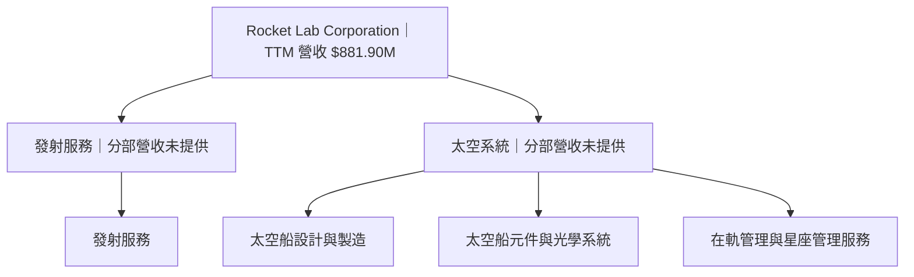
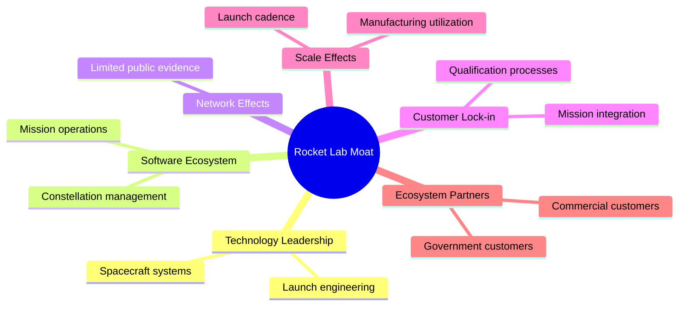
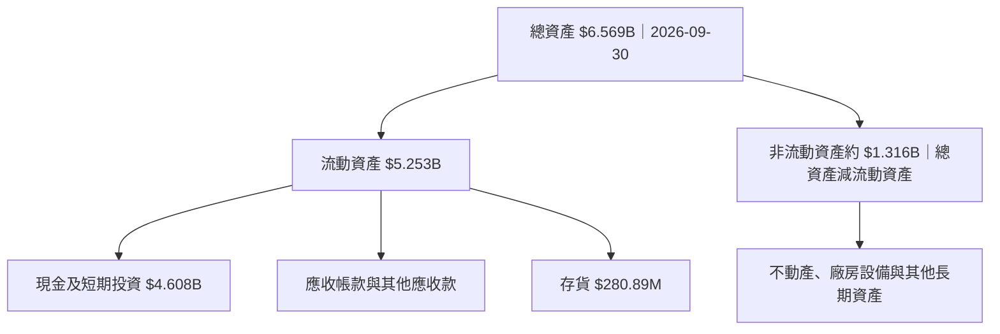
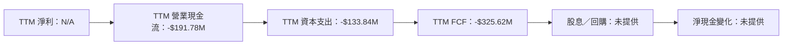
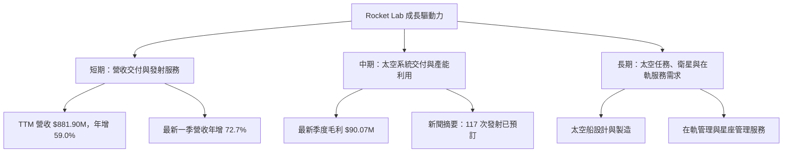
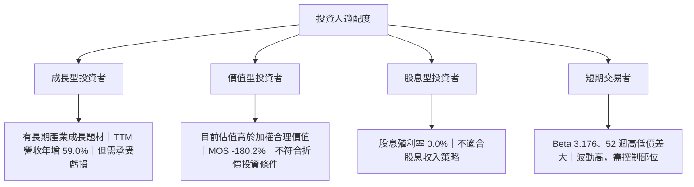

# RKLB 基本面深度分析報告
> **報告日期**：2026-11-25 ｜ **語言**：繁體中文 ｜ **數據來源**：SEC 申報資料 (XBRL)、Yahoo Finance、Finviz、StockAnalysis、Roic.ai 

## 目錄

| # | 章節 | 核心結論 |
|---|------|----------|
| 1 | 執行摘要 | 評級賣出；加權合理價值 $16.41；MOS -180.2% |
| 2 | 公司概覽與商業模式 | 發射服務與太空系統具技術與交付門檻，惟市場份額數據未提供 |
| 3 | 損益表深度分析 | TTM 營收 $881.90M、年增 59.0%；營業利益率仍為 -27.6% |
| 4 | 資產負債表分析 | 現金及短期投資 $4.61B；流動性充足，營運資金天數惡化 |
| 5 | 現金流量深度分析 | TTM FCF -$325.62M，擴產與投資令現金消耗仍高 |
| 6 | 獲利能力與資本效率 | ROIC -16.1% 對 WACC 14.0%，目前摧毀股東價值 |
| 7 | 相對估值分析 | 同業 P/S 估值支持價值遠低於現價；高於自身五年 P/S 中位數 |
| 8 | DCF 內在價值評估 | DCF 不適用：TTM 營業利益為負；以固定相對估值方法三角驗證 |
| 9 | 成長催化劑 | 營收高增、已公布的訂單消息提供動能；轉化為獲利仍待驗證 |
| 10 | 風險矩陣 | 估值、執行與現金消耗為主要風險 |
| 11 | 投資建議 | 依規則 20 評級為賣出；以估值方法與營運指標設定監控條件 |

---

## 1. 執行摘要

Rocket Lab 的營收正快速擴大：TTM 營收 $881.90M，TTM 年增 59.0%，最新一季營收年增 72.7%。但 TTM 營業利益率仍為 -27.6%、ROIC 為 -16.1%，TTM FCF 為 -$325.62M；以同業 P/S 計算的估值方法及分析師共識加權後，合理價值為 $16.41，低於 2026-11-24 收盤價 $45.98，MOS 為 -180.2%。因此依 MOS 門檻評為**賣出**；成長動能與現金儲備是正面因素，但尚未抵銷目前估值及虧損風險。

### 1.0 一頁式投資儀表板

| 項目 | 內容 |
|------|------|
| **投資論點（3 句）** | ① TTM 營收年增 59.0%、最新一季年增 72.7%，顯示商業需求與交付擴張。② TTM 營業利益率 -27.6%、FCF -$325.62M，成長尚未帶來自我融資能力。③ 同業 P/S 法價值 $8.17、加權合理價值 $16.41，均低於現價 $45.98。 |
| **綜合評分** | **5.0/10**（引用 1.1 評分卡） |
| **財務健康** | 🟡 現金及短期投資 $4.61B、流動比率 8.554；但 FCF 持續為負且現金轉換週期 176 天。 |
| **ROIC vs WACC** | -16.1% vs 14.0%；目前摧毀股東價值。 |
| **FCF 趨勢** | TTM FCF -$325.62M；FCF Yield -1.05%。 |
| **估值** | Forward P/E 642.3582x ｜ EV/EBITDA -142.923x ｜ FCF Yield -1.05%。 |
| **DCF 內在價值（基準）** | N/A；TTM 營業利益為負，資料計算模型不提供 DCF。 |
| **安全邊際（MOS）** | **-180.2%**＝($16.41 − $45.98) ÷ $16.41；以 8.8 加權合理價值為基準，🔴 無安全邊際。 |
| **預期報酬（基準情境 12M）** | DCF 情境 N/A；以加權合理價值作參考，上行空間 -64.3%，並非 DCF 預測。 |
| **關鍵風險（前二）** | 高估值對執行失誤敏感；FCF 持續為負、擴產與資本支出令現金消耗增加。 |
| **評級 + 信心度** | 🔴 **賣出** ｜ 信心：中低；估值落差明顯，但高成長公司估值波動大，且 DCF 不適用。 |

### 1.1 綜合評分卡（全報告唯一）

| 維度 | 評分（1–10） | 主要依據（引用數字與其來源章節） |
|------|--------------|----------------------------------|
| 成長性 | 8.0 | TTM 營收年增 59.0%、最新一季年增 72.7%（第 3 章）；高增長尚未確認可持續獲利。 |
| 獲利能力 | 3.0 | TTM 營業利益率 -27.6%、ROIC -16.1%、F-Score 5/9（第 3、6 章）。 |
| 財務健康 | 8.0 | 現金及短期投資 $4.61B、流動比率 8.554；CCC 由 120 天升至 176 天（第 4 章）。 |
| 估值 | 1.0 | MOS -180.2%；P/S 34.0x，高於五年中位數 19.4x（第 7、8 章）。 |
| 護城河 | 7.0 | 業務包含發射、衛星製造及太空系統服務，具工程與認證門檻；但客戶集中度、分部收入及市場份額數據不足（第 2 章）。 |
| 管理層與資本配置 | 3.0 | SBC、資本支出及現金消耗顯著；TTM 稀釋股數未通過 F-Score 測試（第 3、5、6 章）。 |
| **綜合評分** | **5.0** | 六項算術平均：(8+3+8+1+7+3) ÷ 6 = 5.0。 |

### 1.2 五大投資論點 + 三大核心風險

| 類型 | 項目 | 具體依據 | 信心度 |
|------|------|----------|--------|
| 🟢 **投資論點①** | 營收增長迅速 | TTM 營收 $881.90M，年增 59.0%；最新一季年增 72.7%。 | 🟢 高 |
| 🟢 **投資論點②** | 多元化太空業務 | 公司同時提供發射服務、太空船設計製造、零組件與在軌管理服務。 | 🟡 中 |
| 🟢 **投資論點③** | 現金緩衝充足 | 現金與短期投資 $4.61B，提供研發與產能投資資源。 | 🟢 高 |
| 🟢 **投資論點④** | 最新季度毛利額增加 | 2026 Q3 毛利 $90.07M，高於 2026 Q2 的 $84.58M；仍需觀察毛利率與營業費用能否同步改善。 | 🟡 中 |
| 🟢 **投資論點⑤** | 訂單消息提供需求線索 | 新聞摘要提及 117 次發射已預訂及 $515M 發射訂單消息；未提供合約交付期與收入確認細節。 | 🟡 中 |
| 🟡 **風險①** | 高估值與預期落差 | 收盤價 $45.98，相對加權合理價值 $16.41 的上行空間為 -64.3%。 | 🔴 高衝擊 |
| 🔴 **風險②** | 虧損與現金消耗 | TTM FCF -$325.62M、營業利益率 -27.6%；若擴張未轉化為利潤，現金使用速度可能上升。 | 🔴 高衝擊 |
| 🟡 **風險③** | 庫存與回款週期拉長 | DIO 182 天、DSO 49 天，CCC 176 天，較一年前增加 56 天。 | 🟡 中度 |

### 1.3 快速統計卡片

| 指標 | 公司實際值（期間） | 同業中位數 | 狀態 |
|------|--------------------|------------|------|
| 營收成長（TTM） | **59.0%** | — | 🟢 |
| 營收成長（最新一季年增） | **72.7%** | 161.4%（SPCX、LUNR、PL） | 🟡 |
| 毛利率（TTM） | **36.2%** | 55.5% | 🟡 |
| 營業利益率（TTM） | **-27.6%** | — | 🔴 |
| ROIC（TTM） | **-16.1%** | — | 🔴 |
| Forward P/E | **642.3582x** | -50.5x（LUNR）、-8512.0x（PL）；中位數不具經濟意義 | 🔴 |
| FCF Yield（TTM） | **-1.05%** | — | 🔴 |
| Piotroski F-Score | **5 / 9** | — | 🟡 |

> 同業毛利率中位數為 SPCX 56.8%、LUNR 20.3%、PL 55.5% 的中位數。不同公司的業務組合差異大，需避免將單一倍數比較視為完全可比。

### 1.4 投資結論

```text
╔══════════════════════════════════════════════════════════════════╗
║                    📊 投資結論摘要                               ║
╠══════════════════════════════════════════════════════════════════╣
║  評級：賣出（MOS -180.2%，依規則 20）                            ║
║  價格（2026-11-24 收盤）：$45.98                                  ║
║  DCF 內在價值（基準）：N/A（TTM 營業利益為負，DCF 不適用）       ║
║  安全邊際 MOS：-180.2%（＝($16.41−$45.98)÷$16.41）              ║
║  加權合理價值（8.8）：$16.41                                      ║
║  DCF 情境價值：N/A（資料計算模型未提供）                         ║
║  綜合評分：5.0/10（引用 1.1）                                    ║
║  適合投資人：可承受高波動、以長期太空產業成長為主題的投資者；     ║
║              不適合以現金流或估值折價為主要條件的投資者。       ║
╚══════════════════════════════════════════════════════════════════╝
```

---

## 2. 公司概覽與商業模式

### 2.1 業務結構與收入來源

公司提供發射服務及太空系統解決方案，包含衛星設計、製造、元件、光學系統與在軌管理。資料未提供最新 TTM 各分部收入及佔比，因此不以公司總營收拆分推估部門規模。



### 2.2 市場份額

市場份額數據未提供，故不繪製份額圖或填入估算比例。Rocket Lab TTM 營收為 $881.90M、年增 59.0%，在列示同業中，最新季度年增率低於 SPCX 的 161.4% 及 LUNR 的 413.7%，高於 PL 的 58.1%；但各家公司收入基數與業務組合不同，成長率不等於市場份額。

### 2.3 競爭護城河分析



### 2.4 護城河強度

| 護城河項目 | 強度（強／中／弱） | 證據（引用數字或事實） | 會削弱它的情況 |
|------------|--------------------|------------------------|----------------|
| 技術與工程能力 | 中 | 業務涵蓋發射、太空船設計製造、元件及光學系統；最新一季收入年增 72.7%。 | 發射可靠性下降、產品交付延誤，或競爭者提供更低成本方案。 |
| 軟體與任務整合 | 中 | 公司提供在軌管理及星座管理服務；訂閱收入與客戶留存數據未提供。 | 服務未能形成經常性收入或客戶可低成本轉換。 |
| 客戶鎖定與認證 | 中 | 太空任務通常涉及較長的設計及驗證流程；客戶集中度與續約資料未提供。 | 大客戶延後或取消合約，或採購轉向替代供應商。 |
| 網路效應 | 弱 | 未提供使用者規模、網路效應或資料累積可量化證據。 | 無法證明服務使用者增加會提升其他客戶價值。 |
| 規模效應 | 中 | 2026 Q3 營收 $267.83M，高於 2025 Q3 的 $155.08M；但 TTM 營業利益率仍為 -27.6%。 | 新增產能利用率不足，或成本增速持續高於營收。 |
| 生態夥伴 | 中 | 公司服務美國、加拿大、日本及國際客戶；合作夥伴收入與依賴度未提供。 | 供應鏈瓶頸、關鍵零件短缺或客戶採購集中。 |

護城河評分引用 1.1 的 **7.0/10**：工程、系統整合與交付流程提供進入門檻，但缺少市場份額、客戶留存與分部利潤資料，無法證明已形成穩定的經濟租。

---

## 3. 損益表深度分析

### 3.1 年度收入成長趨勢（近 4 年）

年度營收由 2022 年 $211.00M 增至 2025 年 $601.80M，三年 CAGR 約 41.8%。CAGR 算式為 \((601.80 ÷ 211.00)^{1/3}-1\)，反映快速擴張；但營業虧損同步擴大，營收成長尚未轉化為營業槓桿。

```text
╔══════════════════════════════════════════════════════════════════╗
║              Rocket Lab 年度收入趨勢（FY2022-FY2025）            ║
╠══════════════════════════════════════════════════════════════════╣
║  FY2022  $211.00M  ███████░░░░░░░░░░░░░░░  YoY：基期             ║
║  FY2023  $244.59M  ████████░░░░░░░░░░░░░░  YoY：+15.9%           ║
║  FY2024  $436.21M  ███████████████░░░░░░░  YoY：+78.3%           ║
║  FY2025  $601.80M  █████████████████████░  YoY：+38.0%           ║
╠══════════════════════════════════════════════════════════════════╣
║  FY2022-FY2025 三年收入 CAGR：約 +41.8%                           ║
╚══════════════════════════════════════════════════════════════════╝
```

### 3.2 季度收入趨勢分析

| 季度 | 營收 | QoQ 成長 | YoY 成長 | 備註 |
|------|-----:|---------:|---------:|------|
| 2025 Q4 | $179.65M | N/A | N/A | 前一季資料可用；相較 2025 Q3 增 15.8%。 |
| 2026 Q1 | $200.35M | +11.5% | +63.5% | 同比 2025 Q1 $122.57M。 |
| 2026 Q2 | $234.07M | +16.8% | +62.0% | 同比 2025 Q2 $144.50M。 |
| 2026 Q3 | $267.83M | +14.4% | +72.7% | 同比 2025 Q3 $155.08M；最新季度動能加速。 |

QoQ 及 YoY 按季度收入除以前期收入再減 1 計算。2026 Q3 連續擴增收入，代表交付量或產品組合可能改善；但季度收入增加本身不足以證明毛利率與營業費用率同步改善。

### 3.3 利潤率演變分析

| 利潤率指標 | FY2022 | FY2023 | FY2024 | FY2025 | 趨勢 | 評估 |
|------------|-------:|-------:|-------:|-------:|------|------|
| 毛利率 | 9.0% | 21.0% | 26.6% | 34.4% | ↗️ 持續提升 | 🟢 產品組合、收入規模或成本吸收改善，但 TTM 為 36.2%。 |
| 營業利益率 | -64.1% | -72.7% | -43.5% | -38.0% | ↗️ 虧損率收窄 | 🟡 仍遠未損益兩平。 |
| 淨利率 | -64.4% | -74.6% | -43.6% | -32.9% | ↗️ 虧損率收窄 | 🟡 淨虧損持續。 |

> 年度毛利率、營業利益率及淨利率依年度毛利、營業利益、淨利除以年度營收計算；與 TTM 指標期間不同。毛利率改善可能與產品組合及規模利用率提升有關，但 R&D 由 2022 年 $65.17M 升至 2025 年 $270.72M，投入增加抵銷了部分毛利改善。

2026 Q3 單季營業利益率為 -29.6%（SEC 申報資料計算）；另有彙整資料列為 -27.6%。本報告依指定優先數據採用 **-29.6%** 作為最新季度值，TTM 營業利益率採 **-27.6%**。

### 3.4 費用結構分析

費用明細不足以將營業成本、研發、銷售管理等項目完整拆分成互斥組成，故不繪製比例圖。可確認 FY2025 R&D 費用為 $270.72M，約為當年營收 $601.80M 的 45.0%；研發有助技術與產品擴張，但若收入增長放慢，固定研發支出會加重營業虧損。

### 3.5 季度 EPS 趨勢與盈餘品質（Quality of Earnings）

| 季度 | EPS 實際值 | 預估值／驚喜 | 觀察 |
|------|-----------:|-------------|------|
| 2025 Q4 | -$0.09 | N/A | 預估與 surprise 資料缺漏，不能判定超預期或不及預期。 |
| 2026 Q1 | -$0.07 | N/A | 虧損較 2025 Q1 的 -$0.12 收窄；EPS 預估未提供。 |
| 2026 Q2 | -$0.08 | N/A | 較前季虧損略擴大；預估值未提供。 |
| 2026 Q3 | -$0.12 | N/A | 季度虧損擴大；預估值未提供，不能確認是否不及預期。 |

過去四季 EPS surprise 的估計值與實際值資料不完整，故無法可靠判斷「超預期／不及預期」。季度淨利分別為 -$52.92M、-$45.02M、-$49.26M、-$79.68M，2026 Q3 虧損加深，與單季營收成長並存，顯示費用與交付成本仍須觀察。

| 盈餘品質項目 | 數值／佔比 | 評估 |
|--------------|-----------|------|
| 股權薪酬 SBC / 營收 | 最新四季 SBC 合計 $84.20M；約為 TTM 營收 9.5% | 🔴 SBC 具有實質稀釋成本；四季 SBC 為 18.32+19.56+28.12+18.20 = $84.20M。 |
| SBC / 營業現金流 | $84.20M ÷ -$191.78M = -43.9% | 🔴 分母為負，比例不宜解讀為一般覆蓋率；SBC 不會消除實際現金消耗，且會稀釋股東。 |
| FCF / 淨利（現金轉換率） | N/A（TTM 淨利數值未獨立列示） | TTM 淨利率為 -25.7%，但缺少可直接引用的 TTM 淨利絕對額，故不反推比率。 |
| 一次性／非經常性損益 | N/A | 未提供足以辨識一次性損益的完整明細。 |
| 有效稅率異常 | N/A | 未提供可驗證的 TTM 有效稅率。 |
| 資本化支出 vs 費用化 | TTM 資本支出 $133.84M；資本化政策明細 N/A | 資本支出代表現金投資，不等同當期費用；缺少資本化政策與資產明細，不能判斷是否遞延成本。 |

**盈餘品質結論**：公司仍處於虧損階段，故 GAAP 淨利不是正向盈餘的可靠代表。SBC 佔 TTM 營收約 9.5%，加上 TTM FCF 為 -$325.62M，股東實際回報同時承受股權稀釋與現金消耗；對估值應採取較高風險折價。

---

## 4. 資產負債表分析

### 4.1 資產結構分解

截至 2026-09-30，StockAnalysis 列示總資產 $6.569B、流動資產 $5.253B；兩者差額代表非流動資產約 $1.316B。財務數據未提供足夠完整的最新細項來繪製所有資產組成。



### 4.2 流動性與營運資金分析

| 指標 | 最新值 | 歷史比較 | 評估 |
|------|-------:|---------|------|
| 流動比率 | 8.554 | 年度 2025 流動資產 $1.37B、流動負債 $334.48M；但與最新季度並非同一期間 | 🟢 短期流動性充足。 |
| Quick Ratio | 7.954 | 最新財務彙整值 | 🟢 扣除存貨後仍具流動性緩衝。 |
| 現金及短期投資 | $4.61B | 2025 年末 $1.017B；2026-09-30 StockAnalysis 列示 $4.608B | 🟢 現金水位大幅增加，支持研發與產能投資。 |

**營運資金天數**（依 QUALITY FIGURES 原值列示）：

| 指標 | 最新 TTM | 一年前 TTM | 變化 | 解讀 |
|------|----------:|------------:|------:|------|
| DSO 應收帳款天數 | 49 天 | 39 天 | +10 天 | 收款週期拉長，可能反映交付與開票時點或應收帳款上升，應追蹤逾期應收及客戶付款條件。 |
| DIO 存貨天數 | 182 天 | 140 天 | +42 天 | 存貨占用資金增加，可能為備料或在製品增加；若需求及交付延遲，存貨跌價風險上升。 |
| DPO 應付帳款天數 | 55 天 | 59 天 | -4 天 | 對供應商付款略快，降低以延長付款期限支持現金流的程度。 |
| CCC 現金轉換週期 | 176 天 | 120 天 | +56 天 | 營運資金回收變慢，營收成長可能需要額外資金投入。 |

### 4.3 債務結構分析

最新 VERIFIED figures 列示總債務 $1.72M、現金及短期投資 $4.61B、淨現金 $4.61B。其他彙整資料列示的債務數值不同；為避免混用口徑，本節以指定優先數據列示，不將不同來源的債務數字拼接推算。

```text
╔══════════════════════════════════════════════════════════════════╗
║                   Rocket Lab 債務健康診斷                       ║
╠══════════════════════════════════════════════════════════════════╣
║  總債務：        $1.72M       ▏                     債務低        ║
║  現金+短期投資： $4.61B       ████████████████████  流動性高      ║
║  淨現金：        $4.61B       ████████████████████  🟢 緩衝充足   ║
║  Debt/EBITDA：   N/A（EBITDA 為負，倍數無經濟意義）               ║
║  利息保障倍數：  N/A（營業利益為負，且利息費用口徑不適合解讀）    ║
║  主要風險：      FCF 為 -$325.62M，現金仍需支持營運與擴產。       ║
╚══════════════════════════════════════════════════════════════════╝
```

### 4.4 股東權益趨勢

| 財政年度 | 股東權益 |
|---------|---------:|
| 2022 | $673.21M |
| 2023 | $554.54M |
| 2024 | $382.45M |
| 2025 | $1.72B |

2025 年股東權益高於 2024 年，與融資及資本結構變動可能有關；僅憑年度資產負債表不足以拆解發行、轉換及其他權益變動來源。股數變化亦需一併考量：F-Score 的「稀釋股數未增加」測試未通過。

---

## 5. 現金流量深度分析

### 5.1 現金流量瀑布圖

TTM 營業現金流為 -$191.78M，資本支出 $133.84M，指定 FCF 定義下 TTM FCF 為 -$325.62M。其後的股息、回購及淨現金變化明細未提供，故不填數值。



### 5.2 FCF 轉換率趨勢

| 年度 | FCF | 淨利 | FCF／淨利 | 解讀 |
|------|----:|-----:|----------:|------|
| 2022 | -$148.95M | -$135.94M | 109.6% | 兩者皆為負，比例不是正向現金轉換的指標。 |
| 2023 | -$153.57M | -$182.57M | 84.1% | 現金流與會計虧損方向一致，仍未達自我融資。 |
| 2024 | -$115.98M | -$190.18M | 61.0% | FCF 虧損收窄，但仍為負。 |
| 2025 | -$321.81M | -$198.21M | 162.4% | 現金消耗明顯高於淨虧損，反映資本支出與營運現金消耗。 |

### 5.3 自由現金流趨勢

歷史年度 FCF 顯示 2024 年虧損收窄，2025 年則擴大至 -$321.81M。TTM FCF 依指定定義為 -$325.62M；不可將年度 FCF 和 TTM 數值混為同一期間。

```text
╔══════════════════════════════════════════════════════════════════╗
║               Rocket Lab 自由現金流趨勢                          ║
╠══════════════════════════════════════════════════════════════════╣
║  FY2022  -$148.95M  ░░░░░░░░░░░░░░░░░░░░  FCF Yield：N/A         ║
║  FY2023  -$153.57M  ░░░░░░░░░░░░░░░░░░░░  FCF Yield：N/A         ║
║  FY2024  -$115.98M  ░░░░░░░░░░░░░░░░░░░░  FCF Yield：N/A         ║
║  FY2025  -$321.81M  ░░░░░░░░░░░░░░░░░░░░  FCF Yield：N/A         ║
║  TTM     -$325.62M  ░░░░░░░░░░░░░░░░░░░░  FCF Yield：-1.05%      ║
╚══════════════════════════════════════════════════════════════════╝
```

### 5.4 資本配置評估

| 項目 | 可引用數據 | 分析 |
|------|------------|------|
| 資本支出 | FY2025 $156.28M；TTM $133.84M | 產能、研發與產品交付需要資本投入；須看投入後的毛利與利用率。 |
| 研發 | FY2025 $270.72M | 支持技術開發，但佔 FY2025 營收約 45.0%，短期壓低營業獲利。 |
| SBC | FY2025 $71.10M；最新四季合計 $84.20M | 提供人才報酬彈性，但會稀釋持股價值。 |
| 股息／回購 | 股息殖利率 0.0%；回購金額未提供 | 公司未以股息回饋股東，資本主要留在營運與投資。 |

---

## 6. 獲利能力與資本效率

### 6.1 ROE / ROA / ROIC 趨勢

| 指標 | 最新 TTM | 可用歷史觀察 | 評估 |
|------|---------:|--------------|------|
| ROE | -3.9%（QUALITY FIGURES） | 其他彙整欄位列 -6.4%，期間或口徑不同 | 🔴 虧損令股東權益報酬為負；本報告採品質指標的 -3.9%。 |
| ROA | -3.5%（彙整資料） | 歷年完整一致口徑未提供 | 🔴 資產尚未產生正淨利。 |
| ROIC | -16.1% | TTM after-tax operating income ÷ (equity + debt − cash) | 🔴 低於資本成本，投資尚未創造經濟價值。 |

沒有可核對的同業 ROE／ROA／ROIC 數據，不列行業均值。

### 6.2 ROIC vs WACC 分析（核心價值創造判斷）

```text
╔══════════════════════════════════════════════════════════════════╗
║                ROIC vs WACC 深度分析                            ║
╠══════════════════════════════════════════════════════════════════╣
║  資本成本輸入（Cost of capital）：                                ║
║  ├── 無風險利率（10Y 美債）：       4.90%                        ║
║  ├── 市場風險溢酬 ERP：             5.00%                        ║
║  ├── Beta（調整後）：                2.00                         ║
║  ├── 股權成本 Ke：                  14.90%                       ║
║  ├── 股債權重：                     100.0% / 0.0%                ║
║  └── WACC：                         14.00%（計算 14.97% 後封頂） ║
║                                                                  ║
║  ROIC（TTM）：                    -16.1%                         ║
║  EVA Spread：ROIC − WACC =       -30.1 個百分點                  ║
║                                                                  ║
║  ROIC -16.1%  ░░░░░░░░░░░░░░░░░░░░░░░░░░░░  🔴                  ║
║  WACC  14.0%  ▓▓▓▓▓▓▓▓▓▓▓▓▓▓▓▓▓░░░░░░░░░░  ──                   ║
║                                                                  ║
║  結論：以目前 TTM 回報衡量，投入資本報酬低於資本成本，            ║
║        公司目前摧毀股東價值；若毛利與營業槓桿改善，結論才可能改變。║
╚══════════════════════════════════════════════════════════════════╝
```

ROIC 與 WACC 均採指定來源值，不另行改算。WACC 計算值為 14.97%，依提供的 7%–14% 區間限制，採用值為 14.00%；6.2 與第 8 章一致使用 14.00%。Beta 原始值 3.18，調整方式為 \(⅔×3.18+⅓=2.45\)，但因限定於 0.6–2.0 區間，採用調整後 Beta 2.00。指定 CAPM 股權成本為 14.90%；由於資本結構權重已列為股權 100.0%、債務 0.0%，模型 WACC 採用資料計算後封頂值，而非另行推導。

### 6.3 杜邦三因素分解

| 因素 | 數值（TTM） | 解讀 |
|------|-------------|------|
| 淨利率 | -25.7% | 營運仍處虧損，為 ROE 負值的主要來源。 |
| 資產週轉率 | 0.13 | 每單位資產帶來的收入有限，資產規模擴張需提升利用率。 |
| 權益乘數 | 1.13 | 槓桿程度不高，負 ROE 不是由高財務槓桿造成。 |
| **ROE** | **-3.9%** | QUALITY FIGURES 原值：-25.7% × 0.13 × 1.13 = -3.9%（經四捨五入）。 |

### 6.4 財務體質：Piotroski F-Score

Piotroski F-Score 為 **5/9**。九項測試逐項照列：

| 測試 | 結果 | 解讀 |
|------|------|------|
| ROA > 0 | ❌ 未通過 | 公司仍未取得正資產報酬。 |
| 營業現金流 > 0 | ❌ 未通過 | TTM 營業現金流為 -$191.78M。 |
| ROA 高於一年前 | ✅ 通過 | 指標較一年前改善，但仍為負值。 |
| 營業現金流 > 淨利（應計品質） | ✅ 通過 | 代表相對應計測試改善；但營業現金流仍為負。 |
| 長期負債 ÷ 總資產低於一年前 | ✅ 通過 | 槓桿相關測試改善。 |
| 流動比率高於一年前 | ✅ 通過 | 短期流動性指標改善。 |
| 稀釋股數未增加 | ❌ 未通過 | 股數稀釋會降低原股東持有比例。 |
| 毛利率高於一年前 | ✅ 通過 | 與近年毛利率上升方向一致。 |
| 資產週轉率高於一年前 | ❌ 未通過 | 資產擴張尚未帶來更高周轉效率。 |

---

## 7. 相對估值分析

### 7.1 同業估值比較

同業數據使用 Peer multiples。部分 P/E、EV/EBITDA 在虧損公司中為負數或極高數值，經濟解讀有限。

| 估值指標 | **RKLB** | **SPCX** | **LUNR** | **PL** | RKLB 評估 |
|----------|---------:|---------:|---------:|-------:|-----------|
| **Trailing P/E** | N/A | 547.0x | N/A | N/A | 🔴 RKLB 尚無正 TTM EPS；SPCX 極高倍數也難作為可靠錨點。 |
| **Forward P/E** | 642.3582x | 45.9x | -50.5x | -8512.0x | 🔴 同業中兩家為負，整體中位數不具可比性；RKLB 遠期獲利預期須高度兌現。 |
| **P/S Ratio** | 34.0x（自身歷史估值口徑） | 53.3x | 2.2x | 10.2x | 🔴 RKLB 高於 LUNR、PL，低於 SPCX；同業分散度大。 |
| **EV/EBITDA** | -142.923x | 141.3x | -35.3x | -72.4x | 🔴 分母為負或極低時不適合直接比較。 |
| **最新一季營收年增** | 72.7% | 161.4% | 413.7% | 58.1% | 🟡 RKLB 高於 PL，但低於 SPCX、LUNR。 |
| **TTM 毛利率** | 36.2% | 56.8% | 20.3% | 55.5% | 🟡 高於 LUNR、低於 SPCX 與 PL。 |

### 7.2 歷史估值區間分析

估值歷史資料為 TTM P/S，而非 P/E，故依可用指標列示：RKLB 目前 P/S 34.0x，五年中位數 19.4x，歷史區間 7.1x–83.2x，當前百分位 57%。

```text
╔══════════════════════════════════════════════════════════════════╗
║                 RKLB 五年 TTM P/S 歷史區間                       ║
╠══════════════════════════════════════════════════════════════════╣
║  7.1x（低點） ───── 19.4x（中位數） ─── ●34.0x ───── 83.2x      ║
║                                      當前：第 57 百分位           ║
╚══════════════════════════════════════════════════════════════════╝
```

當前 P/S 高於自身五年中位數約 75.3%（以 \((34.0÷19.4)-1\) 計），儘管仍未達五年高點；成長預期已反映於估值中，若營收增速或毛利改善不及預期，估值可能收縮。

### 7.3 情境價值（Bear / Base / Bull）

N/A（DCF 無法計算：TTM 營業利益為負，資料計算模型未提供 DCF Scenarios）。依規則不另行設定悲觀、基準或樂觀 DCF 目標價。

### 7.4 相對估值隱含價格區間

```text
╔══════════════════════════════════════════════════════════════════╗
║                 相對估值每股價格參考                             ║
╠══════════════════════════════════════════════════════════════════╣
║  $8.17（同業 P/S）────────現價 $45.98────────$90.62（分析師共識）║
╚══════════════════════════════════════════════════════════════════╝
```

| 方法 | 每股價值 | 對現價的相對變化 | 計算依據 |
|------|---------:|----------------:|----------|
| 同業 P/S | $8.17 | -82.2% | LUNR、PL 的 P/S 中位數 6.2x × RKLB TTM 營收，再依估值模型回推每股價值。 |
| 分析師共識目標價 | $90.62 | +97.1% | 21 位分析師平均目標價；屬市場預期參考，不是相對估值倍數。 |
| 同業 Forward P/E | 未計算 | N/A | 資料未能計算；權重依固定規則分配至可用方法。 |

分析師平均目標價與同業 P/S 估值差距很大，反映市場對未來業務放量及盈利能力的看法分歧。分析師共識不應取代現金流與營運表現驗證。

---

## 8. DCF 內在價值評估（Discounted Cash Flow）

### 8.0 估值推理鏈（Thinking Logic）

**Step 1 — 價值來源與主導變數**

RKLB 價值主要由發射服務與太空系統兩項業務的收入成長、毛利結構與未來營業利潤率決定；資料未提供分部收入，因此兩者目前各佔營收比例為 N/A。短期估值主導變數是收入成長能否轉化為正營業利益與正 FCF，而非單純營收增速。

**Step 2 — 模型選擇**

| 決策點 | 本報告採用 | 理由（含數字） | 曾考慮但否決 | 否決理由 |
|--------|-----------|----------------|--------------|----------|
| 現金流定義 | FCFF | 若適用，應配合 WACC 評估企業價值；但本次不建立模型。 | FCFE | 負營業利益且資金需求大，股東現金流尚不穩定。 |
| 預測期 N | N/A | DCF MODEL 未提供年度預測；TTM 營業利益率 -27.6%。 | 任意設定 5–10 年 | 缺少可驗證的管理層財測與模型假設，不能自建。 |
| 終值方法 | N/A | 無可用 DCF 模型與終值。 | Gordon Growth／退出倍數 | 沒有可計算的基準現金流。 |
| EBIT 基礎 | N/A | 模型不存在，無法選定預測 EBIT 基礎。 | GAAP／非 GAAP | 不得另建模型替代指定模型。 |

**Step 3 — 假設推導鏈**

DCF MODEL 明確為 N/A，因此預測期營收 CAGR、營業利潤率、永續成長率、資本支出、折舊、營運資金、SBC 及稀釋股數等假設均無可引用採用值。自行填入任一項會形成未經來源支持的估值，因此不提供替代假設。

**Step 4 — 最脆弱一環**

公司由高營收成長轉向正營業利潤及正 FCF 的時間與幅度尚不確定；若虧損收窄慢於預期，相對估值亦可能低於目前同業 P/S 法的 $8.17。

**Step 5 — 計算路徑**

資料計算未提供 DCF 路徑，故不以示意數字繪製推導流程。

### 8.1 模型假設總表（Model Inputs）

DCF MODEL：N/A，原因是 TTM 營業利益不為正；負營業利益折現前推不構成有效估值。因此依規則不自建 DCF，亦不填入模型假設表。

### 8.2 折現率推導（WACC）

DCF 不適用，但資本成本可用於第 6.2 節的 ROIC 對照。資本成本輸入照列如下，採用 WACC 14.00%；原始 Beta 3.18，調整後 Beta 2.00，計算值 14.97% 依指定 7%–14% 區間封頂。

```text
╔══════════════════════════════════════════════════════════════════╗
║                    WACC 資料與採用值                             ║
╠══════════════════════════════════════════════════════════════════╣
║  無風險利率 Rf：            4.90%                                 ║
║  市場風險溢酬 ERP：          5.00%                                 ║
║  Beta 原始值：               3.18                                  ║
║  Beta 調整值：               2.00                                  ║
║  股權成本 Ke：               14.90%                                ║
║  債務成本資料：              稅前 1543.65%（分母極小，不作經濟解讀）║
║  股權／債務權重：            100.0%／0.0%                          ║
║  WACC 計算值：               14.97%                                ║
║  WACC 採用值：               14.00%（區間上限限制）                ║
╚══════════════════════════════════════════════════════════════════╝
```

指定 CAPM 關係為 4.90% + 2.00 × 5.00% = 14.90%。成本資本資料另列計算 WACC 為 14.97%，並明確說明封頂後採 14.00%；因資料中債務權重為 0.0%，且債務成本異常高，本報告不重新推導或修正該資本成本數值。

### 8.3 逐年自由現金流預測（基準情境）

N/A（DCF MODEL 未提供：TTM 營業利益不為正，資料計算程序未建立預測期 FCFF）。因此沒有可引用 FY+1 至 FY+N 表格、折現因子或預測期 PV，也不以自行假設的年度預測填補。

### 8.4 終值計算（Terminal Value）

N/A（沒有 DCF 預測期 FCFF、永續成長率或終值假設）。Gordon Growth 與退出倍數法均不適用於本次資料計算結果。

### 8.5 企業價值 → 每股內在價值（Bridge）

N/A（DCF MODEL 未提供企業價值、現金流現值合計、終值現值及股權價值橋接）。因此 DCF 基準內在價值及其相對現價折溢價均為 N/A；本節不計算 MOS。

### 8.6 敏感性分析（WACC × 永續成長率）

N/A（沒有 DCF 基準 FCFF、終值或敏感度矩陣）。不自行編製敏感性格子或情境價值。

### 8.7 反推 DCF（Reverse DCF）

N/A（DCF MODEL 未提供反推變數及求解結果）。單一現價無法在沒有基準模型輸入時推出唯一的營收 CAGR、利潤率或高成長持續年數。

### 8.8 估值三角驗證與安全邊際

| 估值方法 | 隱含每股價值 | 上行空間（÷現價） | 權重 | 說明 |
|----------|--------------:|------------------:|------:|------|
| 同業 P/S | $8.17 | -82.2% | 90% | 同業中位數 P/S 6.2x（LUNR、PL）乘以 RKLB TTM 營收，再由估值方法回推每股價值。 |
| 分析師共識目標價 | $90.62 | +97.1% | 10% | 21 位分析師平均目標價，作為小權重參考。 |
| **加權合理價值** | **$16.41** | **-64.3%** | **100%** | 不盈利公司類型的固定權重；同業 Forward P/E 未計算，依規則不列為方法。 |

依提供估值方法的列示，加權值為 $16.41。逐項代入：  
**$8.17 × 90% + $90.62 × 10% = $7.353 + $9.062 = $16.415**。  
指定估值輸出列示 $16.41；原始乘加結果為 $16.415，兩者存在 $0.005 的四捨五入尾差。本報告依指定來源保留 **$16.41**，後續 MOS 及評級依該原值計算，並在 8.10 註明此尾差。

**安全邊際與報酬率指標：**

- MOS 定義：\((加權合理價值−現價)÷加權合理價值\)
- MOS 代入：\((16.41−45.98)÷16.41 = -29.57÷16.41 = -180.2\%\)
- 上行空間：\((16.41−45.98)÷45.98 = -29.57÷45.98 = -64.3\%\)
- 評級：MOS 低於 -25%，按規則 20 為 **賣出**。

```text
╔══════════════════════════════════════════════════════════════════╗
║                  估值區間與安全邊際                              ║
╠══════════════════════════════════════════════════════════════════╣
║  $8.17（同業 P/S） ── $16.41（加權合理值） ── 現價 $45.98       ║
║                                                                  ║
║  安全邊際 MOS = (16.41 − 45.98) ÷ 16.41 = -180.2%              ║
║  上行空間 = (16.41 − 45.98) ÷ 45.98 = -64.3%                   ║
║  MOS 評估：🔴 低於 -25%，依規則 20 評級為賣出                   ║
║  DCF 基準值：N/A（模型不適用）                                   ║
║                                                                  ║
║  建議買入區間：不設定；依規則評級為賣出                           ║
║  合理持有區間：以 $16.41 加權合理價值作估值參考，非價格預測       ║
║  減碼考慮：現價 $45.98 已高於加權合理價值                         ║
╚══════════════════════════════════════════════════════════════════╝
```

> 🔎 **程式複算（Python，依本節各項自動重算）**
>
> 加權合理價值 = $8.17 × 90% + $90.62 × 10% = **$16.41**（權重合計 100%）
>
> 以價格 $45.98 計：MOS = **-180.2%**，上行空間 = **-64.3%**
>
> ✅ 與本節所寫數值一致。

### 8.9 DCF 模型的局限與失效條件

- **終值依賴度**：N/A，沒有 DCF 終值與企業價值，不能計算終值佔比。
- **最脆弱的估值假設**：本報告不建立 DCF 假設；相對估值最敏感因素是同業 P/S 中位數及 RKLB 能否維持高成長。若倍數向同業 P/S 法的 6.2x 靠攏，現有股價面臨估值收縮風險。
- **不適用情境說明**：TTM 營業利益率 -27.6%、TTM FCF -$325.62M，獲利與現金流仍為負，DCF 結果不可靠。現階段較適合參照 EV/Sales、同業 P/S、單位經濟性及訂單轉收入能力；但這些方法也須納入業務組合差異。
- **與第 10 章風險矩陣連結**：交付延遲會影響營收增長；成本超支會惡化營業利潤率；應收與存貨增加會使營運資金需求提高，並壓低 FCF。

### 8.10 複算檢核表（Audit Trail）

| # | 檢核項目 | 檢查方式 | 結果 |
|---|----------|----------|------|
| 1 | 高／中敏感度 DCF 輸入均有四段式推導 | DCF 不適用，無模型輸入 | N/A |
| 2 | 每個 DCF 假設有來歷 | 未建立 DCF 假設 | N/A |
| 3 | WACC 五步算式完整 | 依指定資本成本值列示；不另建 DCF WACC | N/A |
| 4 | Kd 分母與債務權重同一計息債務範圍 | 指定權重 D 為 0.0%；債務成本極端值不作推導 | N/A |
| 5 | WACC 與第 6.2 節一致 | 兩處均採 14.00% | ✅ |
| 6 | 預測年度數等於 N | 無預測期 | N/A |
| 7 | FY+1 FCFF 與 PV 可複算 | 無 FY+1 輸入 | N/A |
| 8 | 預測期 PV 合計 | 無預測期 PV | N/A |
| 9 | WACC 與 g 關係 | 未提供 g | N/A |
| 10 | 終值以 FY+N 現金流折現 | 未提供終值 | N/A |
| 11 | EV 至每股價值橋接 | 未提供 DCF 橋接 | N/A |
| 12 | SBC 組合與股數假設一致 | DCF 不適用，不存在模型 SBC／股數組合 | N/A |
| 13 | 敏感性矩陣基準格與 DCF 每股價值一致 | 未提供矩陣 | N/A |
| 14 | 矩陣只納入 WACC > g 格 | 未提供矩陣 | N/A |
| 15 | 三情境機率合計 100% | 未提供 DCF 情境 | N/A |
| 16 | 反推 DCF 每列只放開一個變數 | 未提供反推 DCF | N/A |
| 17 | MOS 使用 8.8 加權合理價值；折溢價依 DCF 基準 | MOS 使用 $16.41；DCF 折溢價 N/A | ✅ |
| 18 | 報告完整至第 11 章 | 已列出第 1 至第 11 章 | ✅ |
| 19 | 加權合理價值與估值方法加總 | 原始算式 $16.415；指定價值 $16.41，差 $0.005 | ⚠️ 來源數值尾差，保留指定值並揭露 |
| 20 | 評級符合 MOS 門檻 | MOS -180.2%，評級賣出 | ✅ |

---

## 9. 成長催化劑

### 9.1 催化劑時間軸

N/A（已提供資料沒有可核實的催化劑日期或交付時間表，故不以推測日期繪製甘特圖）。短期可追蹤發射排程及已簽訂訂單轉收入的速度；中期需追蹤太空系統交付、產能利用及毛利率改善。

### 9.2 TAM 市場規模分析

N/A（TAM 數據未提供）。Rocket Lab TTM 營收 $881.90M、年增 59.0%，顯示目前收入基礎仍在擴張；但沒有可引用的市場規模、滲透率與可服務市場數據，不對長期市場份額做數字推估。

### 9.3 成長驅動力結構圖



---

## 10. 風險矩陣

### 10.1 風險評分矩陣

資料未提供可驗證的風險發生機率與財務衝擊百分比，因此不以主觀機率繪製象限圖。以下風險排序依目前財務暴露與經營指標作定性判斷，數值化機率不作假裝精確的估計。

### 10.2 風險清單詳細分析

| # | 風險項目 | 發生機率 | 財務衝擊 | 風險評估 | 緩解措施 |
|---|----------|----------|----------|----------|----------|
| 1 | 🔴 **估值收縮** | 高度受市場預期影響；無法可靠量化 | 若估值向同業 P/S 法 $8.17 靠攏，將低於現價 $45.98 | 高 | 分批投資、要求營收成長與毛利改善同時兌現；避免只因股價下跌而忽略估值。 |
| 2 | 🔴 **營運虧損與現金消耗延續** | 已發生：TTM FCF -$325.62M | 若現金流改善慢於預期，可能需融資或縮減投資 | 高 | 每季追蹤營業現金流、資本支出、現金與短期投資變化。 |
| 3 | 🟡 **庫存與營運資金占用增加** | 已出現：DIO 182 天、CCC 176 天 | CCC 一年增加 56 天，可能延長現金回收 | 中高 | 觀察 DIO、DSO、在製品及訂單交付進度是否同步改善。 |
| 4 | 🟡 **發射或產品交付延誤** | 產業執行風險；發生機率未提供 | 可能推遲收入確認、增加成本並影響客戶信任 | 中高 | 追蹤發射成功率、任務排程、延期及合約履約進度。 |
| 5 | 🟡 **股權稀釋** | F-Score 測試未通過 | SBC 最新四季 $84.20M，約佔 TTM 營收 9.5% | 中 | 追蹤稀釋股數、SBC 佔營收比及員工股權費用趨勢。 |
| 6 | 🟡 **競爭與定價壓力** | 同業營收增速及倍數分化 | 可能限制提價、壓低毛利或降低訂單轉換 | 中 | 比較毛利率、單位成本與訂單價格變化；公司 TTM 毛利率 36.2%。 |

---

## 11. 投資建議

### 11.1 最終評級與評分

以加權合理價值 $16.41 與 2026-11-24 收盤價 $45.98 計，MOS 為 -180.2%，依規則 20 評級為**賣出**，不作一級調整。公司品質綜合評分為 **5.0/10**；成長性 8.0、獲利能力 3.0、財務健康 8.0、估值 1.0、護城河 7.0、管理層與資本配置 3.0，皆引用第 1.1 節評分卡。

### 11.2 合理價值與隱含報酬率

| 估值參考 | 每股價值 | 相對現價 $45.98 | 權重／機率 | 解讀 |
|---------|---------:|----------------:|------------|------|
| 同業 P/S | $8.17 | -82.2% | 90% 權重 | 以 LUNR、PL 的中位數 P/S 法回推。 |
| 分析師共識 | $90.62 | +97.1% | 10% 權重 | 21 位分析師平均目標價。 |
| **加權合理價值** | **$16.41** | **-64.3%** | **100% 權重** | 固定估值權重結果，與 MOS 評級一致。 |
| DCF 悲觀／基準／樂觀情境 | N/A | N/A | N/A | DCF MODEL 未提供，TTM 營業利益為負。 |

### 11.3 買入時機與觸發因素

```text
╔══════════════════════════════════════════════════════════════════╗
║                  ✅ 買入觸發因素 Checklist                       ║
╠══════════════════════════════════════════════════════════════════╣
║  重新評估買入條件（多數符合）：                                  ║
║  ☐ 營收仍保持成長，且毛利率連續改善                             ║
║  ☐ TTM 營業利益率較目前 -27.6% 明顯收窄                          ║
║  ☐ TTM FCF 不再維持 -$325.62M 的負值，且改善來源可持續           ║
║  ☐ DIO 由 182 天及 CCC 176 天的高位轉向下降                      ║
║                                                                  ║
║  加碼觸發條件（需同時檢查估值）：                                ║
║  ☐ 訂單轉化為收入，並帶動毛利額與營業費用率改善                 ║
║  ☐ SBC 佔營收比率下降，稀釋股數增幅放緩                          ║
║  ☐ 股價與合理價值差距收窄，且估值仍有可接受的下檔保護           ║
║                                                                  ║
║  減碼／退出觸發條件：                                            ║
║  ☐ 營收增速連續兩季明顯低於最新一季年增 72.7%                    ║
║  ☐ TTM FCF 持續惡化，或現金下降速度快於營運改善                  ║
║  ☐ 存貨天數與現金轉換週期進一步上升，未見交付回收改善            ║
║  ☐ 發射延誤或取消導致訂單轉收入能力受損                          ║
╚══════════════════════════════════════════════════════════════════╝
```

### 11.4 投資人適配度分析



### 11.5 每季財報監控清單（Quarterly Watch List）

| 監控項目 | 最新基準 | 觸發改善／加碼觀察 | 觸發減碼／重新檢視 |
|----------|----------|--------------------|--------------------|
| 營收與成長率 | TTM $881.90M、年增 59.0%；最新季度年增 72.7% | 營收持續增長，且毛利與現金流同步改善 | 連續兩季增速顯著低於最新季度，並伴隨訂單延遲 |
| 毛利率 | TTM 36.2%；2026 Q3 毛利 $90.07M | 毛利率上升且營業虧損率同步收窄 | 毛利率下滑或毛利額增長落後收入 |
| 營業利益率 | TTM -27.6%；最新季度 -29.6% | 季度營業虧損率連續收窄 | 虧損率持續惡化，且沒有明確擴產效益 |
| 營業現金流與 FCF | TTM OCF -$191.78M；FCF -$325.62M | FCF 連續改善、資本支出帶來更高收入與毛利 | FCF 虧損加深或現金儲備下降速度上升 |
| 資本支出 | TTM $133.84M | Capex 與產能利用、交付收入相匹配 | Capex 增加但營收、毛利及交付未跟上 |
| 存貨與營運資金 | DIO 182 天；CCC 176 天 | DIO、DSO 與 CCC 逐季下降 | DIO 或 CCC 繼續升高、應收帳款回收變慢 |
| SBC 與稀釋 | 最新四季 SBC $84.20M；F-Score 稀釋測試未通過 | SBC 佔營收比下降、股數增幅減緩 | SBC 持續增加或每股經濟價值被稀釋 |
| 訂單及任務執行 | 新聞摘要提及 117 次發射已預訂；合約時程未提供 | 訂單如期轉化為已執行任務與確認收入 | 延期、取消或重大交付問題增加 |

### 11.6 反面論證：什麼會證明論點錯誤（What Would Change My Mind）

```text
╔══════════════════════════════════════════════════════════════════╗
║              ⚠️ 論點失效條件（Disconfirming Evidence）            ║
╠══════════════════════════════════════════════════════════════════╣
║  多頭論點需在下列情況成立時重新檢視或退出：                      ║
║  ☐ 營收成長連續兩季低於最新一季年增率 72.7%，且無訂單補位        ║
║  ☐ TTM 毛利率自 36.2% 明顯下滑，營業利益率仍停留在 -27.6% 附近  ║
║  ☐ TTM FCF 持續低於 -$325.62M，或現金消耗加速而營收未改善       ║
║  ☐ DIO 高於 182 天、CCC 高於 176 天且沒有交付或回款改善           ║
║  ☐ ROIC 長期低於 WACC 14.00%，未見可信的回報率收斂路徑           ║
║  ☐ SBC 佔營收約 9.5% 的水準不降，且稀釋股數繼續增加             ║
║  ☐ 關鍵發射任務或產品交付延誤，導致訂單轉收入能力受損            ║
╚══════════════════════════════════════════════════════════════════╝
```

> **免責聲明**：本報告為 AI 自動生成，僅供研究參考，不構成投資建議。投資有風險，入市需謹慎。

---

## 資料與來源

| 項目 | 內容 |
|------|------|
| 價格 | 45.98 USD，2026-11-24 收盤（Yahoo Finance 日線） |
| 財務報表 | SEC 10-Q filed 2026-11-09，最新季度 2026-09-30（FY2026 Q3） |
| 有回應的資料來源 | SEC 申報資料 (XBRL)、Yahoo Finance、Finviz、StockAnalysis、Roic.ai |
| 由程式計算 | TTM 數字、WACC、DCF 模型、估值方法與權重、加權合理價值、MOS、評級門檻、F-Score、杜邦分解、營運資金天數、綜合評分 |
| 撰寫模型 | openai / gpt-6-luna |

> 本區塊由產生報告的程式依實際取得的資料填寫，非模型撰寫。「由程式計算」的數字不是模型的估計；其餘判斷（評分、情境、策略）是模型的分析。
