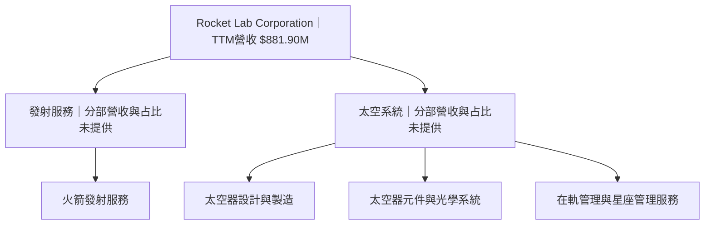
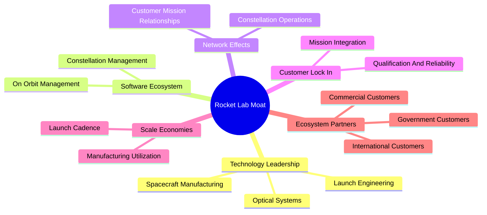
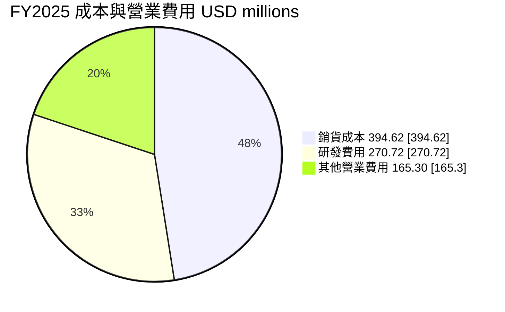
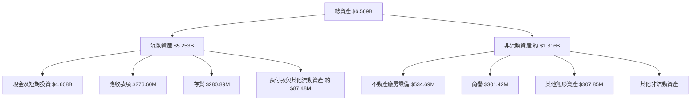
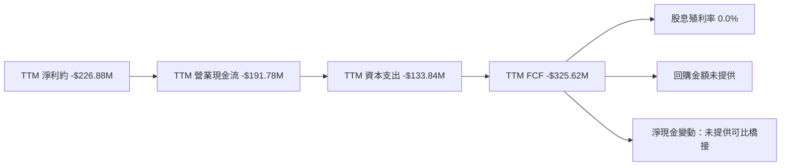
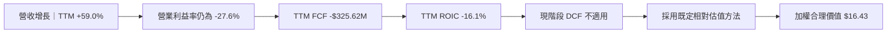
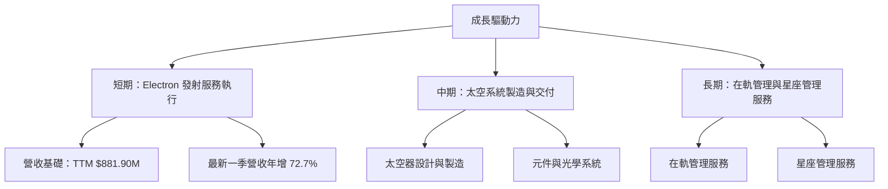
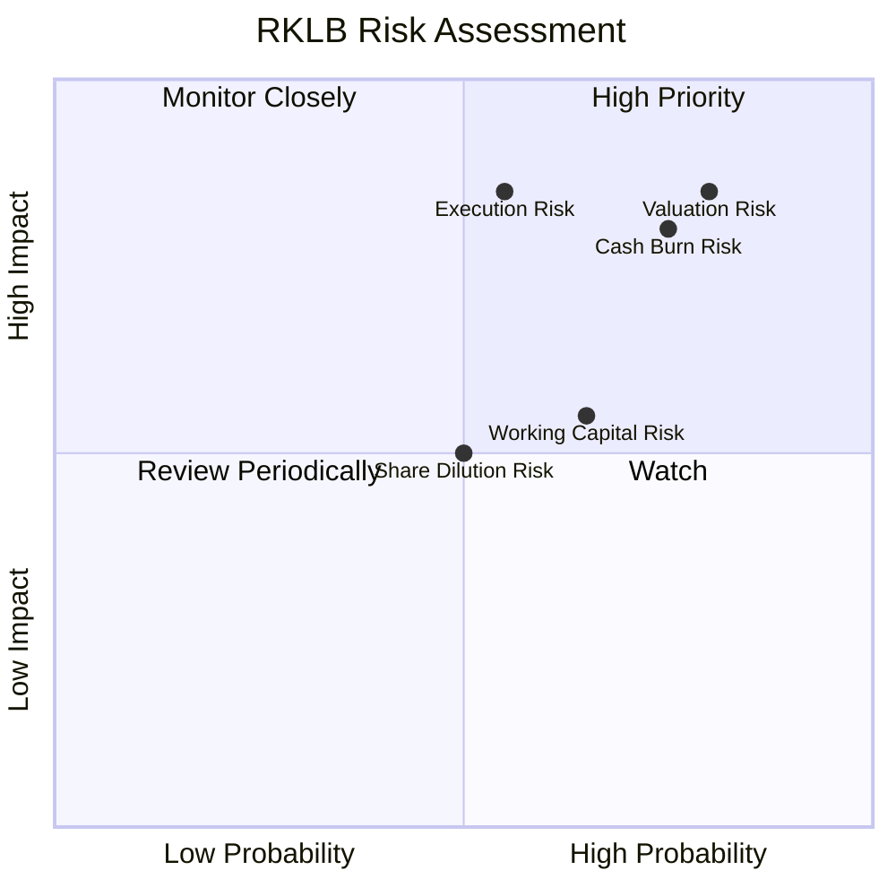
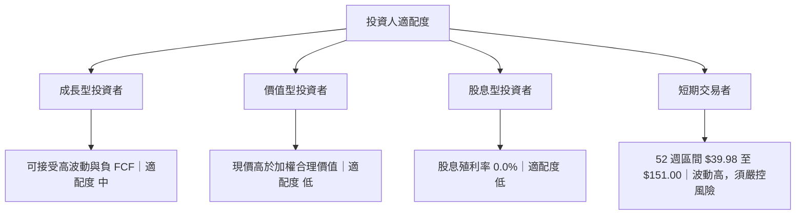

# RKLB 基本面深度分析報告
> **報告日期**：2026-11-26 ｜ **語言**：繁體中文 ｜ **數據來源**：SEC 申報資料 (XBRL)、Yahoo Finance、Finviz、StockAnalysis、Roic.ai ｜ **分析師**：CFA 級機構研究

---

## 目錄

| # | 章節 | 核心結論 |
|---|------|----------|
| 1 | 執行摘要 | 評級：賣出；加權合理價值 $16.43；MOS -186.2% |
| 2 | 公司概覽與商業模式 | 涵蓋發射服務與太空系統；分部營收拆分未提供，護城河證據仍有限 |
| 3 | 損益表深度分析 | TTM 營收 $881.90M、成長 59.0%；營業利益率仍為負 |
| 4 | 資產負債表分析 | 現金及短期投資 $4.61B；流動性高，但營運資金週期拉長 |
| 5 | 現金流量深度分析 | TTM FCF -$325.62M，現金消耗仍顯著 |
| 6 | 獲利能力與資本效率 | ROIC -16.1% 對 WACC 14.00%，目前仍在摧毀經濟價值 |
| 7 | 相對估值分析 | 本益比極高、P/S 高於同業中位數及自身歷史中位數 |
| 8 | DCF 內在價值評估 | DCF 不適用：TTM 營業利益為負；依指定估值方法加權為 $16.43 |
| 9 | 成長催化劑 | 營收成長與新產品執行是關鍵；具體 TAM 與發射時程未提供 |
| 10 | 風險矩陣 | 估值、執行與持續現金消耗為主要風險 |
| 11 | 投資建議 | 現價 $47.02 高於加權合理價值；等待估值回落或獲利與現金流改善 |

---

## 1. 執行摘要

RKLB 最近十二個月營收為 **$881.90M**，TTM 年增 **59.0%**，最新一季營收年增 **72.7%**；但 TTM 營業利益率為 **-27.6%**、ROIC 為 **-16.1%**，TTM FCF 為 **-$325.62M**。以同業 P/S 與分析師共識目標價依既定權重計算，加權合理價值為 **$16.43**；相對 **2026-11-25 收盤價 $47.02**，安全邊際（MOS）為 **-186.2%**。依 MOS 門檻評級為 **🔴 賣出**，未作質化調整。快速成長的營收與 $4.61B 現金及短期投資提供發展空間，但現價估值、負 ROIC 與負 FCF 顯示風險報酬不對稱。

### 1.0 一頁式投資儀表板（Portfolio Manager 30 秒速讀）

| 項目 | 內容 |
|------|------|
| **投資論點（3 句）** | ① TTM 營收年增 **59.0%**，最新一季年增 **72.7%**，營運規模擴張。② TTM 營業利益率 **-27.6%**、ROIC **-16.1%**，成長尚未轉化為正經濟報酬。③ TTM FCF **-$325.62M**，但現金及短期投資 **$4.61B** 提供資金緩衝。 |
| **綜合評分** | **5.0/10**（引用 1.1 評分卡；六項算術平均） |
| **財務健康** | 🟢 現金及短期投資 $4.61B、流動比率 8.554；但 CCC 由 120 天增至 176 天 |
| **ROIC vs WACC** | **-16.1% vs 14.00%**：目前摧毀股東價值 |
| **FCF 趨勢** | 仍為負；TTM FCF Yield **-1.03%** |
| **估值** | Forward P/E **656.8874x** ｜ EV/EBITDA **-146.746x** ｜ FCF Yield **-1.03%** |
| **DCF 內在價值（基準）** | **N/A**：TTM 營業利益為負，指定模型不計算 DCF |
| **安全邊際（MOS）** | **-186.2%**＝（加權合理價值 **$16.43** − 現價 **$47.02**）÷ 加權合理價值；🔴 <10% 無 |
| **預期報酬（基準情境 12M）** | **-65.1%**：以加權合理價值 $16.43 相對現價計算；非 DCF 情境 |
| **關鍵風險（前二）** | 高估值與盈利兌現落差；大額資本支出及負 FCF 延續 |
| **評級 + 信心度** | 🔴 **賣出** ｜ 信心：中（高估值訊號明確，但太空產業執行與長期選擇權難以用現有數據量化） |

### 1.1 綜合評分卡（全報告唯一）

| 維度 | 評分（1–10） | 主要依據（引用數字與其來源章節） |
|------|--------------|----------------------------------|
| 成長性 | 8 | TTM 營收年增 59.0%、最新一季年增 72.7%（第 3 章） |
| 獲利能力 | 2 | TTM 營業利益率 -27.6%、ROIC -16.1%、F-Score 5/9（第 3、6 章） |
| 財務健康 | 8 | 現金及短期投資 $4.61B、流動比率 8.554，但 CCC 176 天（第 4 章） |
| 估值 | 1 | MOS -186.2%；P/S 34.8x，高於自身五年中位數 19.4x（第 7、8 章） |
| 護城河 | 7 | 發射服務及太空系統涵蓋多個環節，營收擴張；但分部、市占及客戶集中數據不足（第 2 章） |
| 管理層與資本配置 | 4 | FY2025 SBC $71.10M；稀釋股數測試未通過，股息殖利率 0%（第 3、5、6 章） |
| **綜合評分** | **5.0** | 六項算術平均： (8 + 2 + 8 + 1 + 7 + 4) ÷ 6 = **5.0** |

### 1.2 五大投資論點 + 三大核心風險

| 類型 | 項目 | 具體依據 | 信心度 |
|------|------|----------|--------|
| 🟢 **投資論點①** | 營收增速加快 | TTM 成長 59.0%；最新一季營收 $267.83M，年增 72.7% | 🟢 高 |
| 🟢 **投資論點②** | 現金緩衝充足 | 現金及短期投資 $4.61B，TTM FCF 為 -$325.62M；現金可支持持續投入，但並非獲利替代品 | 🟢 高 |
| 🟢 **投資論點③** | 產品與服務範圍完整 | 公司涵蓋發射服務、太空器設計與製造、元件、光學及在軌管理；產品廣度有助交叉銷售 | 🟡 中 |
| 🟢 **投資論點④** | 最新一季毛利規模擴大 | FY2026 Q3 毛利 $90.07M，較 FY2025 Q3 的 $57.31M 增長；毛利率約由 36.9% 升至 33.6%？須注意期間口徑：按季度數字計算，最新季為約 33.6%，去年同期約 36.9%，因此毛利額增加但毛利率下降 | 🟡 中 |
| 🟢 **投資論點⑤** | 產業擴張選擇權 | 財務資料顯示公司處於快速成長階段，但具體 TAM、合約積壓及新業務營收拆分未提供，選擇權價值尚難定量 | 🟡 中 |
| 🟡 **風險①** | 估值與獲利脫節 | Forward P/E 656.8874x、EV/Revenue 28.609x；當前仍有 -27.6% TTM 營業利益率 | 🔴 高衝擊 |
| 🔴 **風險②** | 現金消耗與投資回收 | TTM FCF -$325.62M、Capex $133.84M；若新產能或產品延後，現金消耗可能持續 | 🔴 高衝擊 |
| 🟡 **風險③** | 營運資金效率惡化 | CCC 由 120 天增至 176 天，主要來自 DIO 由 140 天升至 182 天及 DSO 由 39 天升至 49 天 | 🟡 中高 |

### 1.3 快速統計卡片

| 指標 | 公司實際值（期間） | 同業中位數 | 狀態 |
|------|--------------------|------------|------|
| 營收成長（TTM） | **59.0%** | — | 🟢 |
| 營收成長（最新一季年增） | **72.7%** | **161.4%**（SPCX、LUNR、PL 中位數） | 🟡 |
| 毛利率（TTM） | **36.2%** | **55.5%**（三家同業中位數） | 🟡 |
| 營業利益率（TTM） | **-27.6%** | — | 🔴 |
| ROIC（TTM） | **-16.1%** | — | 🔴 |
| Forward P/E | **656.8874x** | **-51.7x**（可用同業數值中位數；LUNR、PL 為負值） | 🔴 |
| FCF Yield（TTM） | **-1.03%** | — | 🔴 |
| Piotroski F-Score | **5 / 9** | — | 🟡 |

> Forward P/E 同業數值包含負值，因公司預期虧損，與正值本益比不具直接可比性；RKLB 的高倍數也受低預期 EPS 分母放大。

### 1.4 投資結論

```text
╔══════════════════════════════════════════════════════════════════╗
║                    📊 投資結論摘要                               ║
╠══════════════════════════════════════════════════════════════════╣
║  評級：賣出（依 MOS 門檻；未作質化調整）                         ║
║  價格（2026-11-25 收盤）：$47.02                                 ║
║  DCF 內在價值（基準）：N/A（TTM 營業利益為負）                   ║
║  安全邊際 MOS：-186.2%（以加權合理價值 $16.43 為分母）           ║
║  加權合理價值（8.8）：$16.43                                     ║
║  綜合評分：5.0/10（引用 1.1）                                    ║
║  適合投資人：能承受高波動、以長期太空產業成長為主題的投資人；     ║
║              不適合以現金流、低估值或股息收益為核心者            ║
╚══════════════════════════════════════════════════════════════════╝
```

---

## 2. 公司概覽與商業模式

Rocket Lab Corporation 為美國工業類航太與國防公司，員工數 **2,600 人**，業務包括發射服務與太空系統解決方案。財務資料顯示 TTM 營收 **$881.90M**，但未提供兩個部門的營收金額與占比；因此不能將總營收任意拆分至各產品，也不應推算分部市場份額。

### 2.1 業務結構與收入來源

分部營收占比未提供，以下僅呈現已揭露業務關係，不對板塊金額作虛構拆分。



收入可能由一次性發射、太空系統硬體與相關服務共同構成；但具體經常性服務收入與合約組合未提供，無法判定訂閱或維護收入占比。

### 2.2 市場份額

市場份額數據未提供，因此不製作市占表或圓餅圖。RKLB TTM 營收為 **$881.90M**、年增 **59.0%**；同業中 SPCX 最新一季營收年增 **161.4%**、LUNR **413.7%**、PL **58.1%**，但這些公司規模與業務組合不同，成長率不能直接等同市占變化。

### 2.3 競爭護城河分析



上述護城河樹狀圖為業務類別映射，不代表已量化的市占或競爭優勢。公司提供端到端產品與服務，有助於提高單一客戶採購範圍；但目前沒有客戶留存、訂單積壓、發射成功率或分部毛利資料，無法量化轉換成本與網路效應。

### 2.4 護城河強度

| 護城河項目 | 強度（強／中／弱） | 證據（引用數字或事實） | 會削弱它的情況 |
|------------|--------------------|------------------------|----------------|
| 技術與工程能力 | 中 | 業務覆蓋發射、太空器、元件、光學及在軌管理；TTM 營收 $881.90M | 發射失敗、研發迭代落後或競爭者提供更低成本方案 |
| 軟體與服務延伸 | 中偏弱 | 公司提供在軌及星座管理服務，但相關營收占比、續約率未提供 | 軟體收入無法形成高續約、服務被硬體銷售綁定 |
| 網路效應 | 弱至中 | 多任務與星座管理可能累積營運資料；但客戶數及資料網路效應未量化 | 客戶可在多家供應商間切換，資料不形成排他優勢 |
| 客戶鎖定 | 中 | 太空任務需要整合與資格認證；合約週期、客戶留存數據未提供 | 政府或商業客戶重新招標、轉向替代供應商 |
| 規模效應 | 中 | TTM 營收成長 59.0%，毛利額擴大；但營業利益率 -27.6% | 產能利用率不足、低發射頻率或新增產能未帶來單位成本下降 |
| 生態夥伴 | 弱至中 | 公司在美國、加拿大、日本及國際市場營運 | 供應鏈瓶頸、合作方轉向其他平台或監管限制 |

**1.1 護城河評分為 7/10**，理由是業務涵蓋發射、硬體與在軌服務，具備產品整合的可能性；但缺少市占、客戶留存、分部毛利與訂單積壓數據，不能視為已充分驗證的寬護城河。

---

## 3. 損益表深度分析

### 3.1 年度收入成長趨勢（近 4 年）

年度營收依 SEC 申報相關財務資料列示。2022–2025 年營收由 **$211.00M** 增至 **$601.80M**；三年 CAGR 為：

\[
(601.80 \div 211.00)^{1/3}-1 = 41.8\%
\]

```text
╔══════════════════════════════════════════════════════════════════╗
║           Rocket Lab 年度收入趨勢（FY2022-FY2025）               ║
╠══════════════════════════════════════════════════════════════════╣
║  FY2022  $211.00M  ████████░░░░░░░░░░░░░░░░  基期               ║
║  FY2023  $244.59M  ██████████░░░░░░░░░░░░░░  YoY: +15.9% 🟡    ║
║  FY2024  $436.21M  █████████████████░░░░░░░  YoY: +78.3% 🟢    ║
║  FY2025  $601.80M  ████████████████████████  YoY: +38.0% 🟢    ║
║                                                                  ║
║  2022-2025 三年營收 CAGR：+41.8%                                 ║
╚══════════════════════════════════════════════════════════════════╝
```

FY2024 高增長後，FY2025 年增率回落至 38.0%，但 FY2026 前三季又呈加速。這表示歷年收入擴張並非線性；後續估值能否合理，取決於新增業務是否持續放量，以及規模是否能改善營業費用槓桿。

### 3.2 季度收入趨勢分析

QoQ 依連續季度營收計算；YoY 為同季年增率。最新一季年增率是**單季**數據，不是 TTM 成長率。

| 季度 | 營收 | QoQ 成長 | YoY 成長 | 備註 |
|------|------:|---------:|---------:|------|
| 2025 Q4 | $179.65M | 15.8% | 35.7% | 較 2025 Q3 的 $155.08M 增長 |
| 2026 Q1 | $200.35M | 11.5% | 63.5% | 較 2025 Q1 的 $122.57M 增長 |
| 2026 Q2 | $234.07M | 16.8% | 62.0% | 營收規模續增 |
| 2026 Q3 | $267.83M | 14.4% | 72.7% | 最新季；YoY 加速至 72.7% |

四季收入均呈 QoQ 增長，並且 2026 Q3 YoY 升至 72.7%。若增長來自較高附加價值的太空系統與服務，利潤槓桿可能改善；但單靠營收成長不足以證明盈利能力提升，仍須觀察毛利率、營業費用及 FCF。

### 3.3 利潤率演變分析

下表年度毛利率、營業利益率及淨利率由年度毛利、營業利益、淨利除以營收計算；TTM 指標則依指定財務指標原值引用。

| 利潤率指標 | FY2022 | FY2023 | FY2024 | FY2025 | 趨勢 | 評估 |
|------------|-------:|-------:|-------:|-------:|------|------|
| **毛利率** | 9.0% | 21.0% | 26.6% | 34.4% | ↗️ 毛利率連續改善 | 🟢 |
| **營業利益率** | -64.1% | -72.7% | -43.5% | -38.0% | ↗️ 虧損率收窄，但仍深度為負 | 🔴 |
| **淨利率** | -64.4% | -74.6% | -43.6% | -32.9% | ↗️ 虧損率收窄 | 🔴 |

TTM 毛利率為 **36.2%**，TTM 營業利益率為 **-27.6%**；最新季度營業利益率為 **-29.6%**。FY2022 至 FY2025 的毛利率提升，顯示毛利規模與產品組合有所改善；但營業費用仍高於毛利，FY2025 研發費用達 **$270.72M**，約為營收的 **45.0%**。研發投入可支撐產品擴張，但若新增收入無法吸收研發及管理費用，毛利改善不會自動轉化為營業獲利。

### 3.4 費用結構分析

以下為 FY2025 成本及營業費用拆分。營業費用合計以毛利減營業利益計算；「其他營業費用」為營業費用扣除研發費用後的差額，不等同單一財報科目。



FY2025 營收 **$601.80M** 減毛利 **$207.18M**，得到銷貨成本 **$394.62M**；營業費用約為 $207.18M − (-$228.84M) = **$436.02M**，其中研發 **$270.72M**，其餘約 **$165.30M**。因此，改善營業槓桿需要毛利增長快於營業費用增長。

```text
╔══════════════════════════════════════════════════════════════════╗
║             FY2025 營收至營業損益簡化橋接（$M）                  ║
╠══════════════════════════════════════════════════════════════════╣
║  營收                         601.80                             ║
║  減：銷貨成本                (394.62)                            ║
║  毛利                         207.18                             ║
║  減：營業費用                (436.02)                            ║
║  營業損失                    (228.84)                            ║
╚══════════════════════════════════════════════════════════════════╝
```

### 3.5 季度 EPS 趨勢與盈餘品質（Quality of Earnings）

最近四季 EPS 實際值可由季度財務資料讀取，但分析師 EPS 預估值缺漏，不能判斷超預期或不及預期。最近四季實際 EPS 依序為 Q4 2025 **-$0.09**、Q1 2026 **-$0.07**、Q2 2026 **-$0.08**、Q3 2026 **-$0.12**；Q3 虧損幅度擴大。資料庫的 EPS Est 欄為空值，因此不能把任何一季標記為 beat 或 miss。

| 盈餘品質項目 | 數值／佔比 | 評估 |
|--------------|-----------|------|
| 股權薪酬 SBC / 營收 | 最近四季 SBC 約 $84.20M ÷ TTM 營收 $881.90M = **9.5%** | 🔴 SBC 相對營收偏高，代表員工薪酬有相當比例由股權承擔，若股數增加會稀釋每股價值 |
| SBC / 營業現金流 | $84.20M ÷ \|-$191.78M\| = **43.9%** | 🔴 OCF 為負，該比率僅表示 SBC 金額約為 OCF 虧損絕對值的 43.9%，不代表現金轉換改善 |
| FCF / 淨利（現金轉換率） | -$325.62M ÷ -$226.88M = **143.5%** | 🔴 分子、分母皆負；FCF 虧損比淨損大，不能解讀為良好正向現金轉換 |
| 一次性／非經常性損益 | N/A（未提供足以拆分的明細） | 無法確認有無一次性項目美化或拖累盈餘 |
| 有效稅率異常 | N/A（TTM 虧損，未提供可直接採用的有效稅率） | 不應將法定稅率直接當作實際有效稅率 |
| 資本化支出 vs 費用化 | TTM Capex $133.84M；資本化政策細節 N/A | Capex 顯示有實質資本投入；缺少資本化明細，無法判斷成本遞延程度 |

**盈餘品質結論：** GAAP TTM 淨損 **-$226.88M**、TTM FCF **-$325.62M**，現金流比損益表虧損更差，並非由正向現金轉換支持的帳面獲利。SBC 約占 TTM 營收 9.5%，且 Piotroski 稀釋股數測試未通過，股東應同時追蹤 SBC 支出與稀釋股數，而非只看收入增長。

---

## 4. 資產負債表分析

### 4.1 資產結構分解

最新 TTM 資料顯示總資產約 **$6.569B**、流動資產約 **$5.253B**；非流動資產差額約 **$1.316B**。細項金額依 StockAnalysis 的 2026-09-30 資產資料列示。



流動資產中現金與短期投資占比高，有利於支應研發、產能與營運；但存貨 **$280.89M**、應收款項 **$276.60M** 也增加營運資金占用。非流動項目所列部分明細加總與總額會有四捨五入及分類差異，不應以局部細項反推未揭露項目。

### 4.2 流動性與營運資金分析

| 流動性指標 | 最新值 | 評估 |
|------------|------:|------|
| 現金及短期投資 | $4.61B | 🟢 對短期資金需求形成緩衝 |
| 流動比率 | 8.554 | 🟢 高；但流動比率高不等於營運現金流為正 |
| 速動比率 | 7.954 | 🟢 現金與應收項目提供短期償付能力 |
| Piotroski F-Score | 5/9 | 🟡 財務體質有改善項目，但獲利及現金流仍弱 |

**營運資金天數：** 以下數值照錄品質指標資料，計算口徑為期末餘額除以 TTM 流量再乘 365。

| 指標 | 最新 TTM | 一年前 TTM | 變化 | 解讀 |
|------|----------|------------|------|------|
| DSO 應收帳款天數 | 49 天 | 39 天 | +10 天 | 🟡 收款週期拉長，可能反映應收款增速高於營收或客戶付款條件變化 |
| DIO 存貨天數 | 182 天 | 140 天 | +42 天 | 🔴 庫存占用增加；可能與產能備料、產品組合或交付時點有關，須觀察庫存是否轉為收入 |
| DPO 應付帳款天數 | 55 天 | 59 天 | -4 天 | 🟡 付款天數縮短，對現金週轉的支撐略降 |
| CCC 現金轉換週期 | 176 天 | 120 天 | +56 天 | 🔴 現金被營運資金占用的時間變長 |

CCC 延長的主要可見來源是 DIO 增加 42 天，其次為 DSO 增加 10 天與 DPO 減少 4 天。若存貨是為已簽約任務備料，未必等同需求惡化；但缺乏訂單積壓與存貨類別資料，後續應以存貨轉銷貨、應收款回收及營運現金流驗證。

### 4.3 債務結構分析

財務指標存在口徑差異：VERIFIED FIGURES 列示總債務 **$1.72M**、現金及短期投資 **$4.61B**、淨現金 **$4.61B**；其他市場資料列示總債務 **$120.28M**、淨現金／債務 **$4.49B**。本報告在引用經核驗的總債務與淨現金時，優先採用 VERIFIED FIGURES 原值；此差異需要以 SEC 10-Q 債務及租賃負債附註進一步核對。未提供可一致驗算的利息費用與平均計息負債，故不計算利息保障倍數。

```text
╔══════════════════════════════════════════════════════════════════╗
║                 Rocket Lab 債務健康診斷                         ║
╠══════════════════════════════════════════════════════════════════╣
║  總債務（核驗值）：  $1.72M        ▏                             ║
║  現金及短期投資：    $4.61B        ████████████████████          ║
║  淨現金（核驗值）：  $4.61B        ████████████████████  🟢      ║
║  流動比率：          8.554         🟢                            ║
║  速動比率：          7.954         🟢                            ║
║  Debt/EBITDA：       N/A（EBITDA 為負，倍數不具經濟意義）        ║
║  Interest Coverage：N/A（利息及口徑資料不足）                   ║
╚══════════════════════════════════════════════════════════════════╝
```

### 4.4 股東權益趨勢

FY2024 股東權益較 FY2023 下降，FY2025 則升至 **$1.72B**。FY2025 權益大幅增加，財務資料未提供足以將變動完整拆分為增資、股份薪酬及其他項目的橋接，故不推測原因。

```text
╔══════════════════════════════════════════════════════════════════╗
║               股東權益變化（年度，USD）                         ║
╠══════════════════════════════════════════════════════════════════╣
║  FY2022  $673.21M  ██████████░░░░░░░░░░░░░░                     ║
║  FY2023  $554.54M  ████████░░░░░░░░░░░░░░░░                     ║
║  FY2024  $382.45M  ██████░░░░░░░░░░░░░░░░░░                     ║
║  FY2025  $1.72B    █████████████████████████                    ║
╚══════════════════════════════════════════════════════════════════╝
```

---

## 5. 現金流量深度分析

### 5.1 現金流量瀑布圖

TTM 淨利以最近四季季度淨利加總；FCF 直接使用 TTM 營業現金流減資本支出的核驗值。股息殖利率為 0.0%，回購金額及淨現金變動拆分未提供。



淨利到 OCF 的差額來自非現金費用與營運資金變化等項目；現有摘要資料不足以完整拆解。負 FCF 表明公司仍在投入且尚未自我融資，現金儲備降低了近期融資壓力，但不能消除長期資本回報風險。

### 5.2 FCF 轉換率趨勢

| 年度／期間 | FCF | 淨利 | FCF／淨利 | 解讀 |
|------------|----:|----:|----------:|------|
| FY2022 | -$148.95M | -$135.94M | 109.6% | 兩者皆負，不能視為正向轉換 |
| FY2023 | -$153.57M | -$182.57M | 84.1% | 現金虧損低於會計淨損，但仍未轉正 |
| FY2024 | -$115.98M | -$190.18M | 61.0% | FCF 虧損收窄，仍依賴外部現金 |
| FY2025 | -$321.81M | -$198.21M | 162.4% | 現金流虧損大於淨損，資本投入與營運資金拖累顯著 |
| TTM 至 2026-09-30 | -$325.62M | 約 -$226.88M | 143.5% | 負值比率不能當作一般正向現金轉換率 |

FY2025 及最新 TTM 的 FCF 虧損均擴大。需注意，現金流受資本支出時點及營運資金影響，單年比率不宜外推；但在連續負值的背景下，投資者應要求營業現金流與 FCF 至少呈持續改善，而不是只看收入增速。

### 5.3 自由現金流趨勢

FY2022 至 FY2025 FCF 依年度現金流資料列示；TTM FCF 引用核驗值。僅有最新 TTM FCF Yield，因此歷年 FCF Yield 不作推算。

```text
╔══════════════════════════════════════════════════════════════════╗
║                自由現金流趨勢（USD）                             ║
╠══════════════════════════════════════════════════════════════════╣
║  FY2022  -$148.95M  ◀██████████░░░░░░░░░░░░░░                   ║
║  FY2023  -$153.57M  ◀██████████░░░░░░░░░░░░░░                   ║
║  FY2024  -$115.98M  ◀████████░░░░░░░░░░░░░░░░                   ║
║  FY2025  -$321.81M  ◀████████████████████████                   ║
║  TTM     -$325.62M  ◀█████████████████████████  Yield: -1.03%   ║
╚══════════════════════════════════════════════════════════════════╝
```

### 5.4 資本配置評估

股息殖利率為 **0.0%**，公司目前沒有以現金股息回報股東。FY2025 Capex 為 **$156.28M**，FY2025 SBC 為 **$71.10M**；研發費用 **$270.72M**。財務資料沒有提供回購金額或各項融資用途的完整現金流橋接，因此不以圖表虛構資本配置比例。

| 項目 | 已知數據 | 評估 |
|------|----------|------|
| 研發 | FY2025 $270.72M | 佔營收約 45.0%，支撐技術與新產品，但須看其能否轉成毛利與現金流 |
| 資本支出 | FY2025 $156.28M；TTM $133.84M | 代表產能及設備投入，短期壓低 FCF |
| 股權薪酬 | FY2025 $71.10M；最近四季約 $84.20M | 對員工留任有用，但提高股東稀釋成本 |
| 股息 | 殖利率 0.0% | 現階段以留存資金支應成長 |
| 股票回購 | 金額未提供 | 無法評估回購是否抵銷 SBC 稀釋 |

---

## 6. 獲利能力與資本效率

### 6.1 ROE／ROA／ROIC 趨勢

多年度 ROIC、ROE 與 ROA 同口徑歷史序列未完整提供；依要求不補算未核驗值。可確認的近期數值如下。

| 指標 | 最新 TTM | 歷史可比值 | 評估 |
|------|---------:|--------------|------|
| ROE | -3.9%（品質指標 DuPont 口徑） | N/A（未提供相同口徑完整序列） | 🔴 虧損公司，股東權益報酬為負 |
| ROA | N/A（品質指標僅提供 F-Score 測試通過與否） | N/A | 🔴 F-Score「ROA > 0」未通過 |
| ROIC | -16.1% | N/A（未提供完整同口徑序列） | 🔴 遠低於資本成本 |
| WACC | 14.00% | — | 依成本資本區塊採用，且受上限限制 |

### 6.2 ROIC vs WACC 分析（核心價值創造判斷）

ROIC **-16.1%**，採用 WACC **14.00%**，差距為 **-30.1 個百分點**（-16.1% − 14.00%）。這表示在目前的 TTM 營運狀態下，公司尚未以投入資本產生足以支付資本成本的報酬。因營業利益為負，ROIC 的分母亦受到現金與資本結構影響，應視為當前價值創造方向的訊號，而不是成熟期盈利能力的穩定估計。

成本資本資料顯示原始 Beta 為 **3.18**，採用調整後 Beta **2.00**；成本資本計算值 **14.91%**，按指定 **7%–14%** 區間上限採用 WACC **14.00%**。債務成本資料列為 **1543.65%**，但債務權重為 **0.0%**，且債務口徑存在資料差異，因此不以該稅前成本推導一個看似精確的加權負債成本。

```text
╔══════════════════════════════════════════════════════════════════╗
║                ROIC vs WACC 深度分析                            ║
╠══════════════════════════════════════════════════════════════════╣
║  資本成本（依成本資本資料）：                                    ║
║  ├── 無風險利率（10Y 美債）：       4.85%                        ║
║  ├── 股權風險溢酬 ERP：             5.00%                        ║
║  ├── 原始 Beta：                    3.18                         ║
║  ├── 採用調整後 Beta：              2.00（上限截斷）             ║
║  ├── 股權成本 Ke：                  14.85%                       ║
║  ├── 債務權重：                     0.0%                         ║
║  ├── 計算 WACC：                    14.91%                       ║
║  └── 採用 WACC：                    14.00%（受 14% 上限限制）    ║
║                                                                  ║
║  ROIC 與價值差距：                                                ║
║  ├── ROIC（TTM）：                  -16.1%                       ║
║  ├── WACC：                         14.00%                       ║
║  └── ROIC − WACC：                  -30.1 個百分點               ║
║                                                                  ║
║  結論：目前 ROIC 低於 WACC，仍在摧毀經濟價值                     ║
╚══════════════════════════════════════════════════════════════════╝
```

成本資本公式欄提供的 Ke **14.85%** 是指定輸入；用調整後 Beta 重新展開為 4.85% + 2.00 × 5.00% = **14.85%**。整體 WACC **14.00%** 是成本資本程序在計算值 14.91% 後套用上限的採用值，與本章及第 8 章保持一致。

### 6.3 杜邦三因素分解

以下照錄 QUALITY FIGURES 的 DuPont 結果。需注意，不同資料區段的 ROE 數值存在口徑差異；本表遵循指定的品質指標組合，不以其他 ROE 數據替換。

| 因素 | 數值（TTM） | 解讀 |
|------|-------------|------|
| 淨利率 | -25.7% | 虧損是 ROE 為負的主要原因 |
| 資產週轉率 | 0.13 | 每單位資產產生的營收偏低，反映資產密集與成長期特徵 |
| 權益乘數 | 1.13 | 槓桿不高，負 ROE 不是主要由高財務槓桿造成 |
| **ROE** | **-3.9%** | 品質指標原值：-25.7% × 0.13 × 1.13 = 約 -3.9% |

ROE 主要受淨利率為負拖累，資產週轉率也低；權益乘數僅 1.13，未見靠高槓桿支撐 ROE 的特徵。

### 6.4 財務體質：Piotroski F-Score

F-Score 為 **5/9**。九項測試結果依 QUALITY FIGURES 原值列示：

| 測試 | 結果 | 解讀 |
|------|------|------|
| ROA > 0 | ❌ 未通過 | 公司仍未達正向資產報酬 |
| 營業現金流 > 0 | ❌ 未通過 | TTM OCF 為 -$191.78M |
| ROA 高於一年前 | ✅ 通過 | 相較一年前改善，但仍未轉正 |
| 營業現金流 > 淨利（應計品質） | ✅ 通過 | 相對虧損型公司的會計應計方向較有利，仍非正現金流 |
| 長期負債 ÷ 總資產低於一年前 | ✅ 通過 | 相對改善 |
| 流動比率高於一年前 | ✅ 通過 | 短期流動性改善 |
| 稀釋股數未增加 | ❌ 未通過 | 股數增加可能稀釋每股價值 |
| 毛利率高於一年前 | ✅ 通過 | 毛利率指標改善 |
| 資產週轉率高於一年前 | ❌ 未通過 | 資產擴張尚未帶來更高週轉效率 |

整體分數反映資產負債表及毛利率有改善，但盈利、營業現金流及股數稀釋仍是弱項。F-Score 不應單獨作為成長期公司估值判斷，而應與現金消耗及資本回報率合併閱讀。

---

## 7. 相對估值分析

### 7.1 同業估值比較表格

Peer multiples 依 Yahoo Finance 的同業資料。公司自有估值使用財務資料列示的 RKLB 倍數；P/S 歷史比較使用核驗值 **34.8x**。

| 估值指標 | **RKLB** | **SPCX** | **LUNR** | **PL** | 本公司評估 |
|----------|---------:|---------:|---------:|------:|-----------|
| **Trailing P/E** | N/A | 554.1x | N/A | N/A | 🔴 公司仍虧損，無法用 TTM P/E 定價 |
| **Forward P/E** | 656.8874x | 46.5x | -51.7x | -8488.0x | 🔴 RKLB 正向倍數極高，並受低預期 EPS 分母放大 |
| **P/S Ratio** | 34.8x | 54.0x | 2.3x | 10.2x | 🔴 高於 LUNR、PL 中位數 6.2x；低於 SPCX |
| **EV/EBITDA** | -146.746x | 143.2x | -35.8x | -72.2x | 🔴 RKLB EBITDA 為負，倍數不具一般估值解讀性 |
| **最新季度營收年增** | 72.7% | 161.4% | 413.7% | 58.1% | 🟡 成長高於 PL，低於 SPCX、LUNR |
| **TTM 毛利率** | 36.2% | 56.8% | 20.3% | 55.5% | 🟡 高於 LUNR，低於 SPCX、PL |

負 Forward P/E 不是「便宜」的正向估值訊號，而是預期仍虧損。RKLB 的 P/S 遠高於 LUNR 與 PL；若市場願意支付高倍數，必須由長期營收增長、利潤率擴張及資本回報改善來證明。

### 7.2 歷史估值區間分析

歷史資料提供的是 TTM P/S，而非 P/E，因此以下呈現 P/S 區間。

```text
╔══════════════════════════════════════════════════════════════════╗
║                 RKLB 五年歷史 P/S 區間                           ║
╠══════════════════════════════════════════════════════════════════╣
║  最低 7.1x  ├──────── 中位數 19.4x ───────────● 現在 34.8x       ║
║  最高 83.2x                                                     ║
║                                                                  ║
║  當前百分位：57%                                                  ║
║  現值較中位數溢價：34.8 ÷ 19.4 − 1 = 79.4%                      ║
╚══════════════════════════════════════════════════════════════════╝
```

現值位於自身歷史分布的第 57 百分位，並高於五年中位數 79.4%。這不代表股價必然回到中位數，但表示當前營收倍數並非歷史低檔；在公司仍虧損且 FCF 為負時，估值對未來執行結果敏感。

### 7.3 情境價值（Bear / Base / Bull）

**N/A（DCF 無法計算：TTM 營業利益不為正，現有 DCF MODEL 不提供悲觀、基準、樂觀情境數值。）**依規定不自行建立情境價格或目標價。

### 7.4 相對估值隱含價格區間

```text
╔══════════════════════════════════════════════════════════════════╗
║                相對估值價格參考（每股 USD）                      ║
╠══════════════════════════════════════════════════════════════════╣
║  $8.19 同業 P/S ─────── $16.43 加權合理價值 ─────── $47.02 現價  ║
║                                                                  ║
║  同業 P/S：$8.19／股                                             ║
║  分析師共識：$90.62／股（參考，不代表相對估值下檔）               ║
╚══════════════════════════════════════════════════════════════════╝
```

- **同業 P/S $8.19／股**：使用 LUNR、PL 的同業中位數 P/S **6.2x** 乘上 RKLB TTM 營收，再按估值方法程式結果換算為每股價值；此項權重 **90%**。
- **分析師共識 $90.62／股**：21 位分析師平均目標價，權重 **10%**。分析師目標價分布低端 $40、高端 $127，區間寬，應視為市場預期參考而非獨立估值底部。

---

## 8. DCF 內在價值評估（Discounted Cash Flow）

### 8.0 估值推理鏈（Thinking Logic）

TTM 營業利益率為 **-27.6%**、TTM 營業利益為負，且 TTM FCF 為 **-$325.62M**。在當期營業利益仍為負的情況下，將損失直接折現並外推成正向終值會造成不可靠的估值結果；本報告依指定 DCF MODEL 狀態，**不建立自訂 DCF**。

本公司估值理論上由發射服務、太空系統製造與在軌服務共同決定，但兩個主要分部的營收比重未提供，因此無法把營收及現金流拆分成可驗證的業務模型。相對估值亦受高成長預期影響，故本報告以核驗的同業 P/S 估值及分析師共識按既定權重交叉參照，不將其誤稱為 DCF 內在價值。

| 決策點 | 本報告採用 | 理由（含數字） | 曾考慮但否決 | 否決理由 |
|--------|-----------|----------------|--------------|----------|
| 現金流定義 | N/A | DCF MODEL 未計算 | FCFF／FCFE | TTM 營業利益為負，指定模型明確禁止自建 |
| 預測期 N | N/A | 無有效 DCF 預測期輸入 | 自行選 5–10 年 | 缺少可核驗逐年假設，不能自訂 |
| 終值方法 | N/A | 沒有 DCF 終值輸出 | Gordon Growth／退出倍數 | 不應對負營業利益自行外推 |
| EBIT 基礎 | N/A | 無 DCF 模型 | GAAP／非 GAAP | 不建立自訂 EBIT 預測 |
| 估值主導變數 | 營收成長與成熟營業利潤率 | TTM 成長 59.0%，但營業利益率 -27.6% | 單看收入倍數 | 不足以反映轉盈時間與現金消耗 |

**最脆弱的一環**是未來能否將高營收增長轉成正營業利潤及正 FCF。若收入繼續增長但利潤率未改善，單以營收倍數支持現價的論點會更難成立。



### 8.1 模型假設總表（Model Inputs）

**N/A（DCF MODEL 未提供模型輸入：TTM 營業利益不為正；不自行填入預測期、營收 CAGR、營業利潤率、稅率、Capex、D&A、營運資金、SBC、稀釋率、永續成長率或 WACC 模型假設。）**

### 8.2 折現率推導（WACC）

成本資本區塊提供的 WACC 為 **14.00%**，計算值 **14.91%**，並因指定上限而採用 14.00%。此為 ROIC 比較基準；由於 DCF 為 N/A，並未用來折現自建現金流。

```text
╔══════════════════════════════════════════════════════════════════╗
║                    WACC 推導（折現率）                           ║
╠══════════════════════════════════════════════════════════════════╣
║  無風險利率 Rf（10Y 美債）：             4.85%                   ║
║  股權風險溢酬 ERP：                      5.00%                   ║
║  原始 Beta（Yahoo）：                    3.18                    ║
║  Beta used（adjusted）：                 2.00                    ║
║  股權成本 Ke：                           14.85%                  ║
║  債務成本輸入：                          1543.65%                ║
║  股權／債務權重：                        100.0%／0.0%            ║
║  WACC 計算值：                           14.91%                  ║
║  採用 WACC：                             14.00%                  ║
║  說明：計算值被限制在 7%–14% 區間，採用上限 14.00%               ║
╚══════════════════════════════════════════════════════════════════╝
```

調整後 Beta 的指定原始資料寫明為 **2.00**，並記錄 Beta 調整上限為 2.00；原始 Beta 3.18 經縮減與區間限制後不採用原值。Rf 日期未在成本資本資料中列明，故不補造日期。債務權重為 0.0%，但總債務資料在其他財務欄位存在口徑差異，故不另推導或替換 WACC。

### 8.3 逐年自由現金流預測（基準情境）

**N/A（DCF MODEL 未計算：TTM 營業利益不為正，因此沒有逐年收入、EBIT、FCFF、折現因子及現值預測。）**不自建逐年現金流表，也不以年度歷史 FCF 外推。

### 8.4 終值計算（Terminal Value）

**N/A（沒有 DCF 預測期 FCFF、永續成長率或終值輸出。）**不計算 Gordon Growth 或退出倍數終值。

### 8.5 企業價值 → 每股內在價值（Bridge）

**N/A（DCF MODEL 未提供企業價值、終值現值、淨現金橋接或 DCF 每股內在價值。）**因此不計算 DCF 折溢價；折溢價定義只適用於有第 8.5 節 DCF 基準值時。MOS 則依規定只在第 8.8 節按加權合理價值計算一次。

### 8.6 敏感性分析（WACC × 永續成長率）

**N/A（DCF MODEL 未提供敏感性矩陣，且不得自行建立。）**

### 8.7 反推 DCF（Reverse DCF：市場在預期什麼）

**N/A（沒有可用 DCF 基準模型，無法從現價反推單一模型變數。）**現價 $47.02 顯著高於相對估值加權價值 $16.43，但這不能直接解讀為 DCF 隱含營收成長率或利潤率。

### 8.8 估值三角驗證與安全邊際

估值方法與權重依公司類型「未獲利」的指定權重照錄；DCF 及同業 Forward P/E 未納入方法清單，不自行添加。Forward P/E 因相關估值方法不可計算而不參與權重；其權重依程式規則分配給可計算方法。

| 估值方法 | 隱含每股價值 | 上行空間（÷現價） | 權重 | 說明 |
|----------|--------------:|------------------:|------|------|
| 同業 P/S | $8.19 | -82.6% | 90% | LUNR、PL 同業中位數 P/S 6.2x × RKLB TTM 營收，程式換算結果 |
| 分析師共識目標價 | $90.62 | +92.7% | 10% | 21 位分析師平均目標價 |
| **加權合理價值** | **$16.43** | **-65.1%** | **100%** | 未獲利公司類型之指定估值方法及權重 |

逐步演算：

\[
\$8.19 \times 90\% + \$90.62 \times 10\%
= \$7.371 + \$9.062
= \$16.433
\approx \$16.43
\]

\[
MOS = (\$16.43-\$47.02)\div \$16.43
= -\$30.59\div \$16.43
= -186.2\%
\]

\[
上行空間 = (\$16.43-\$47.02)\div \$47.02
= -\$30.59\div \$47.02
= -65.1\%
\]

MOS 與上行空間使用不同分母：MOS 以加權合理價值為分母；上行空間以現價為分母。本報告全篇 MOS 僅採上述同一數值 **-186.2%**。

```text
╔══════════════════════════════════════════════════════════════════╗
║                  估值區間與安全邊際                              ║
╠══════════════════════════════════════════════════════════════════╣
║  $8.19 ─────── $16.43 ────────────────────────── $47.02         ║
║  同業 P/S       加權合理價值                       現價          ║
║                                                                  ║
║  安全邊際 MOS = ($16.43 − $47.02) ÷ $16.43 = -186.2%            ║
║  MOS 評估：🔴 <10% 無                                             ║
║  上行空間 = ($16.43 − $47.02) ÷ $47.02 = -65.1%                 ║
║                                                                  ║
║  參考價格區間：                                                   ║
║  MOS ≥ 10% 對應價格上限：$16.43 × 90% = $14.79                  ║
║  ±10% 合理價值參考範圍：約 $14.79–$18.07                        ║
║  MOS < -25% 對應價格：高於 $16.43 × 125% = $20.54               ║
╚══════════════════════════════════════════════════════════════════╝
```

上述價格門檻是由加權合理價值及 MOS 定義推導的估值界線，不是 DCF 目標價。依 MOS 評級門檻，MOS **-186.2%** 對應賣出，且未作一級質化調整。

> 🔎 **程式複算（Python，依本節各項自動重算）**
>
> 加權合理價值 = $8.19 × 90% + $90.62 × 10% = **$16.43**（權重合計 100%）
>
> 以價格 $47.02 計：MOS = **-186.2%**，上行空間 = **-65.1%**
>
> ✅ 與本節所寫數值一致。

### 8.9 DCF 模型的局限與失效條件

- **終值依賴度：** N/A；DCF 未計算，沒有終值占 EV 比重。
- **最脆弱的假設：** DCF 未建立，無法量化單一假設變動對 DCF 價值的影響。業務上最關鍵的不確定因素是收入增長能否帶來營業利潤率改善，以及資本支出能否回收。
- **不適用情境說明：** TTM 營業利益為負，TTM FCF 為 -$325.62M，傳統 DCF 可靠度低。現階段應以 EV/Sales、分部收入／毛利、訂單執行與單位經濟性作交叉檢驗；資料不足時不應宣稱有精確 DCF 內在價值。
- **與第 10 章風險矩陣的連結：** 發射延遲或失敗可能削弱營收增長；庫存轉換及收款變慢可能拖累營運資金；Capex 延續而收入轉化不足則直接擴大 FCF 虧損。

### 8.10 複算檢核表（Audit Trail）

| # | 檢核項目 | 檢查方式 | 結果 |
|---|----------|----------|------|
| 1 | 所有高／中敏感度輸入都有完整推導 | DCF MODEL 為 N/A，無模型輸入可展開 | N/A |
| 2 | 每個假設都有來歷 | 未自行建立 DCF 假設 | N/A |
| 3 | WACC 五步算式與權重覆核 | 採用成本資本原值 14.00%，未另造 WACC | ✅ |
| 4 | Kd 分母與債務權重範圍一致 | 債務權重及成本直接引用指定資本成本區塊；另註資料口徑差異 | ✅ |
| 5 | WACC 與第 6.2 節相同 | 兩處採用 14.00% | ✅ |
| 6 | 逐年表格年度數等於 N | 無 DCF 年度表 | N/A |
| 7 | FY+1 FCFF 與 PV 可複算 | 無模型現金流 | N/A |
| 8 | 預測期 PV 加總覆核 | 無預測期現值 | N/A |
| 9 | WACC 大於 g | 無 DCF 永續成長率 | N/A |
| 10 | 終值基於 FY+N 並折現 N 期 | 無 DCF 終值 | N/A |
| 11 | EV 至每股 DCF 價值橋接 | 無 DCF 橋接 | N/A |
| 12 | SBC 組合符合 A／B／C | 不建立模型，未重複扣 SBC 或另估稀釋 | N/A |
| 13 | 敏感性矩陣基準格與 DCF 值一致 | 無敏感性矩陣 | N/A |
| 14 | 矩陣只在 WACC > g 時填值 | 無敏感性矩陣 | N/A |
| 15 | 三情境機率加總 | DCF 情境未提供，不自行設定 | N/A |
| 16 | 反推 DCF 一次只解一個變數且有試算 | 無可用 DCF 模型 | N/A |
| 17 | MOS 分母為 8.8 加權價值，折溢價基準為 DCF | MOS 使用 $16.43；DCF 價值標 N/A | ✅ |
| 18 | 報告完整輸出至第 11 章 | 依章節順序完成 | ✅ |
| 19 | 加權合理價值等於各項價值乘權重之和 | $8.19×90% + $90.62×10% = $16.433，四捨五入 $16.43 | ✅ |
| 20 | 評級符合 MOS 門檻 | MOS -186.2% < -25%，評級賣出 | ✅ |

---

## 9. 成長催化劑

### 9.1 催化劑時間軸

**N/A（可引用資料未提供已確認的新產品發射日期、合約里程碑或正式管理層財測，無法製作有根據的 Gantt 時程圖。）**最近新聞提及 Electron launch，但未附具體可核對日期或財務指引，因此不推定其為特定季度的收入催化劑。

### 9.2 TAM 市場規模分析

**N/A（TAM 數據未提供）。**公司目前 TTM 營收 **$881.90M**、TTM 年增 **59.0%**，最新一季年增 **72.7%**，顯示業務仍在擴張；但缺少發射、太空系統與在軌服務各自的市場規模及收入拆分，不能計算市場滲透率。

### 9.3 成長驅動力結構圖

以下為公司已披露業務範圍與可觀察營收指標的質性關係，不代表管理層財測或特定時程。



成長能否提升股東價值，取決於新業務收入是否有足夠毛利，並逐步覆蓋研發、資本支出及營運費用。現階段未提供分部毛利率、訂單積壓或管理層年度財測，應以財報實際交付及現金流驗證。

---

## 10. 風險矩陣

### 10.1 風險評分矩陣

下圖座標為分析師對風險相對機率與衝擊的**主觀定位**，不是公司公布機率或統計預測；由於缺乏可核驗機率資料，不將座標解讀為精確概率。



### 10.2 風險清單詳細分析

| # | 風險項目 | 發生機率 | 財務衝擊 | 風險評分 | 緩解措施 |
|---|----------|----------|----------|----------|----------|
| 1 | 🔴 **估值壓縮** | 高（定性） | 高；若 P/S 向同業中位數 6.2x 收斂，估值可能大幅低於現價所隱含預期 | 🔴 高 | 分批持倉、避免以單一高成長預期定價；逐季追蹤 P/S 與利潤率 |
| 2 | 🔴 **現金消耗與投資回收** | 高（定性） | TTM FCF -$325.62M；若消耗率不降，現金儲備將逐步減少 | 🔴 高 | 追蹤 OCF、Capex、FCF 與現金餘額；要求新投資有交付或收入驗證 |
| 3 | 🔴 **產品與發射執行** | 中高（定性） | 發射延誤或任務失敗可能延後收入、增加重做及保險成本 | 🔴 高 | 追蹤任務成功率、準時交付、客戶合約及管理層更新 |
| 4 | 🟡 **營運資金壓力** | 中高（定性） | CCC 176 天，較一年前多 56 天；DIO 182 天 | 🟡 中高 | 監控存貨轉收入、DSO 與現金回收，辨別備料與滯銷 |
| 5 | 🟡 **股權稀釋** | 中（定性） | 最近四季 SBC 約 $84.20M，占 TTM 營收 9.5%；F-Score 稀釋股數測試未通過 | 🟡 中高 | 同步追蹤 SBC／營收、稀釋股數變化及回購抵銷情況 |

---

## 11. 投資建議

### 11.1 最終評級與評分

以加權合理價值 **$16.43** 與 2026-11-25 收盤價 **$47.02** 計算，MOS 為 **-186.2%**，依規則 20 評級為 **🔴 賣出**；不作一級質化調整。1.1 的綜合評分為 **5.0/10**，六項分數為成長性 8、獲利能力 2、財務健康 8、估值 1、護城河 7、管理層與資本配置 4。

### 11.2 合理價值與隱含報酬率

DCF MODEL 為 N/A，故本表只列既定估值方法的加權合理價值，不列 DCF 悲觀、基準或樂觀情境。

| 方法／情境 | 每股價值 | 相對現價 $47.02 | 權重／機率 |
|------------|---------:|-----------------:|------------|
| 同業 P/S | $8.19 | -82.6% | 90% |
| 分析師共識目標價 | $90.62 | +92.7% | 10% |
| **加權合理價值** | **$16.43** | **-65.1%** | **100%** |
| DCF 悲觀／基準／樂觀 | N/A | N/A | DCF MODEL 未計算 |

### 11.3 買入時機與觸發因素

```text
╔══════════════════════════════════════════════════════════════════╗
║                  ✅ 買入觸發因素 Checklist                      ║
╠══════════════════════════════════════════════════════════════════╣
║  目前判斷：現價 $47.02 高於加權合理價值 $16.43；不宜追價         ║
║                                                                  ║
║  重新考慮建倉的條件（多數符合）：                                 ║
║  ☐ 股價回到 $14.79 以下，對應相對加權價值至少 10% MOS             ║
║  ☐ TTM 營業利益率持續改善，且虧損率收窄不只來自單季波動          ║
║  ☐ TTM FCF 虧損連續收窄，Capex 投入逐步轉化為收入與毛利           ║
║  ☐ CCC 不再上升，DIO 下降或存貨明確轉為交付                        ║
║                                                                  ║
║  加碼觸發條件（符合任一後仍需檢視估值）：                         ║
║  ☐ TTM 營業現金流轉正，且連續兩季未由一次性項目驅動               ║
║  ☐ 營收年增維持正成長並同步帶動營業利潤率改善                     ║
║                                                                  ║
║  減碼／退出觸發條件：                                             ║
║  ☐ 營收增長明顯減速且營業利益率沒有改善                           ║
║  ☐ FCF 虧損擴大、現金儲備下降且新增資本支出未帶來交付             ║
║  ☐ 稀釋股數持續增加，SBC 占營收維持高檔                           ║
╚══════════════════════════════════════════════════════════════════╝
```

以加權合理價值計算，MOS 至少 10% 的價格上限為 **$14.79**（$16.43 × 90%）。這是估值門檻，不是對短期股價走勢的預測；若基本面改善，應更新合理價值，而非機械式等待固定價格。

### 11.4 投資人適配度分析



| 投資人類型 | 適配度 | 原因 |
|------------|--------|------|
| 成長型 | 中 | TTM 營收年增 59.0%，但仍須承受 -$325.62M TTM FCF 與高估值 |
| 價值型 | 低 | P/S 34.8x、MOS -186.2%，目前缺乏估值安全邊際 |
| 股息型 | 低 | 股息殖利率 0.0% |
| 短期交易者 | 中低 | 52 週高低為 $151.00 與 $39.98，波動幅度大；資料不構成短線買賣訊號 |

### 11.5 每季財報監控清單（Quarterly Watch List）

以下門檻是研究監控框架，不是公司財測。涉及年增率的基準以目前可核驗數據為錨點。

| 監控指標 | 最近可核驗值 | 觸發加碼／改善訊號 | 觸發減碼／警訊 |
|----------|--------------|---------------------|----------------|
| 營收成長 | TTM +59.0%；最新一季 YoY +72.7% | 單季 YoY 維持 50% 以上，且交付與毛利同步改善 | 單季 YoY 連續兩季低於 30% |
| 毛利率 | TTM 36.2% | 維持或提高 36.2%，收入增長不靠低毛利組合 | 連續兩季低於 30% |
| 營業利益率 | TTM -27.6%；最新季 -29.6% | 虧損率逐季收窄，TTM 趨勢改善 | TTM 虧損率惡化至低於 -35% |
| 營業現金流 | TTM -$191.78M | 連續兩季改善，並朝正值靠攏 | TTM OCF 虧損擴大 |
| FCF | TTM -$325.62M；Yield -1.03% | FCF 虧損持續收窄且 Capex 投資產生收入 | FCF 虧損擴大或現金儲備快速下降 |
| Capex | TTM $133.84M | Capex 與新增產能交付、收入成長對應 | Capex 上升但收入、毛利沒有跟進 |
| 存貨與 CCC | DIO 182 天；CCC 176 天 | DIO 回落、CCC 趨勢下降 | DIO 持續高於 182 天且庫存增加快於收入 |
| 股權薪酬與股數 | 最近四季 SBC 約 $84.20M；稀釋測試未通過 | SBC／營收下降，稀釋股數增速放緩 | SBC／營收高於目前 9.5%，且股數持續擴大 |
| 現金及短期投資 | $4.61B | 現金充足且現金消耗下降 | 現金大幅下降、同時負 FCF 未改善 |
| 管理層財測與交付 | 可引用財測未提供 | 指引達成、交付與實際收入轉換一致 | 連續下修指引或任務延遲造成財務影響 |

### 11.6 反面論證：什麼會證明論點錯誤（What Would Change My Mind）

```text
╔══════════════════════════════════════════════════════════════════╗
║              ⚠️ 論點失效條件（Disconfirming Evidence）           ║
╠══════════════════════════════════════════════════════════════════╣
║  以下情況若持續發生，應重新檢視估值與投資論點：                  ║
║                                                                  ║
║  ☐ 單季營收年增連續兩季低於 30%，顯著低於最新一季 72.7%           ║
║  ☐ TTM 營業利益率惡化至 -35% 以下，而非由 -27.6% 持續收窄         ║
║  ☐ TTM FCF 虧損超過目前 -$325.62M，且現金及短期投資同步下降       ║
║  ☐ CCC 高於 176 天且 DIO 高於 182 天，未見庫存轉為交付             ║
║  ☐ SBC／營收高於目前約 9.5%，稀釋股數持續增加                    ║
║  ☐ ROIC 長期停留在負值，未朝 14.00% WACC 收斂                    ║
║  ☐ 發射或太空系統交付延誤，導致收入、毛利及現金流同時下修         ║
╚══════════════════════════════════════════════════════════════════╝
```

若營收成長無法維持、虧損率不收窄，或負 FCF 擴大，則成長論點不能抵銷現價相對加權合理價值的溢價。反之，若收入持續擴張、營業利潤率逐季改善、FCF 虧損收窄且稀釋減速，應更新估值與評級，而不是沿用本報告的靜態結論。

> **免責聲明**：本報告為 AI 自動生成，僅供研究參考，不構成投資建議。投資有風險，入市需謹慎。

---

## 資料與來源

| 項目 | 內容 |
|------|------|
| 價格 | 47.02 USD，2026-11-25 收盤（Yahoo Finance 即時報價（該交易日已收盤）） |
| 財務報表 | SEC 10-Q filed 2026-11-09，最新季度 2026-09-30（FY2026 Q3） |
| 有回應的資料來源 | SEC 申報資料 (XBRL)、Yahoo Finance、Finviz、StockAnalysis、Roic.ai |
| 由程式計算 | TTM 數字、WACC、DCF 模型、估值方法與權重、加權合理價值、MOS、評級門檻、F-Score、杜邦分解、營運資金天數、綜合評分 |
| 撰寫模型 | openai / gpt-6-luna |

> 本區塊由產生報告的程式依實際取得的資料填寫，非模型撰寫。「由程式計算」的數字不是模型的估計；其餘判斷（評分、情境、策略）是模型的分析。
