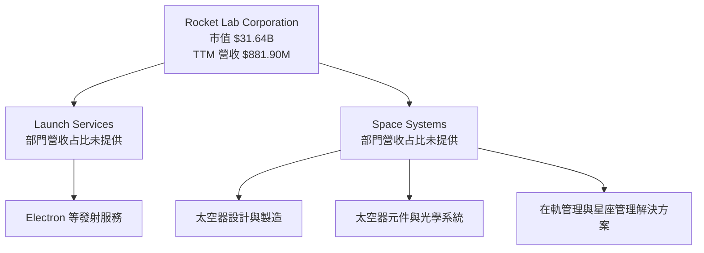
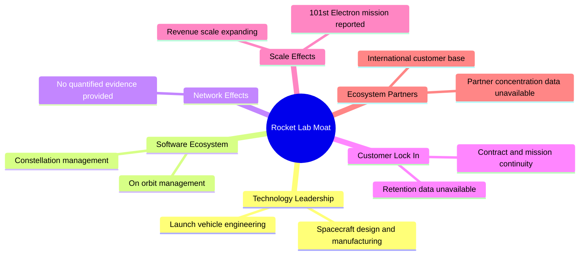
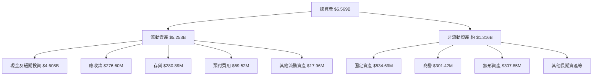
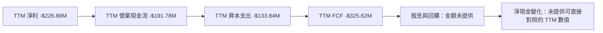
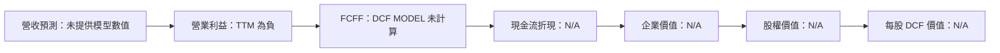
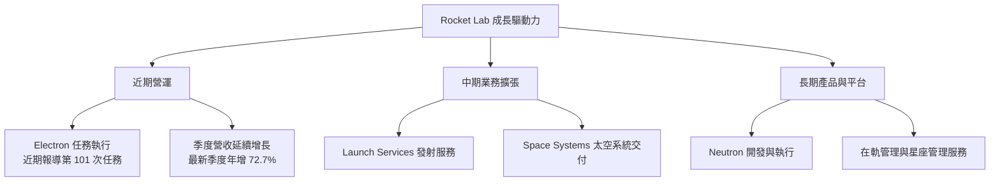
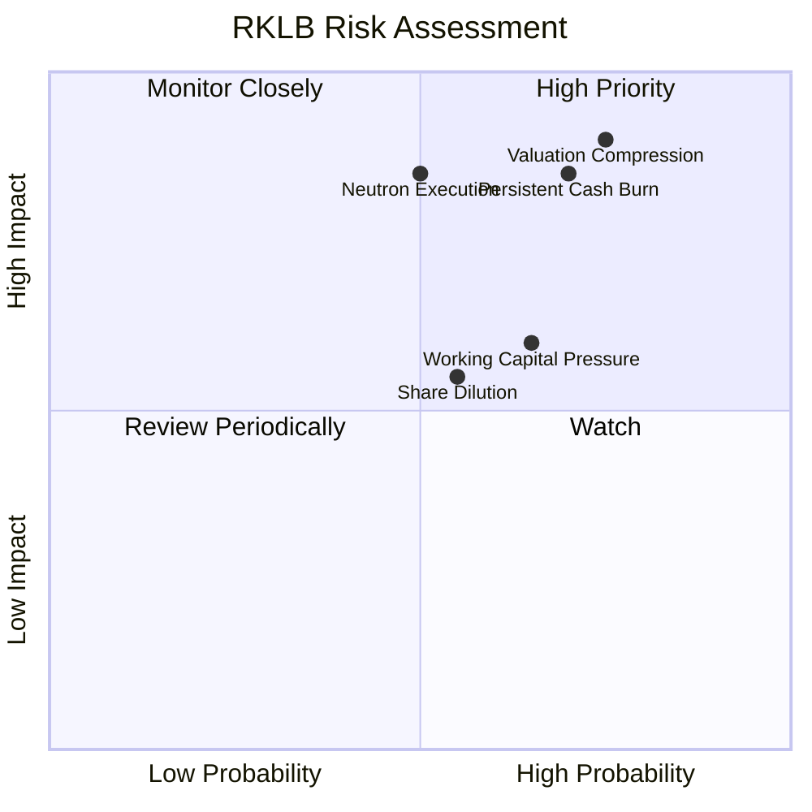
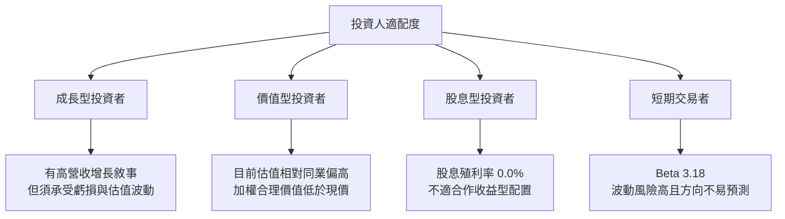

# RKLB 基本面深度分析報告
> **報告日期**：2026-11-27 ｜ **語言**：繁體中文 ｜ **數據來源**：SEC 申報資料 (XBRL)、Yahoo Finance、Finviz、StockAnalysis、Roic.ai ｜ **分析師**：CFA 級機構研究

## 目錄

| # | 章節 | 核心結論 |
|---|------|----------|
| 1 | 執行摘要 | 賣出；加權合理價值 $16.43；MOS -186.2% |
| 2 | 公司概覽與商業模式 | 發射服務與太空系統並行；護城河有技術及執行基礎，但市場份額數據未提供 |
| 3 | 損益表深度分析 | TTM 營收 $881.90M、年增 59.0%；營業利益率仍為負 |
| 4 | 資產負債表分析 | 現金及短期投資 $4.61B；短期流動性充足，營運資金週期拉長 |
| 5 | 現金流量深度分析 | TTM FCF -$325.62M；擴張投資與營運現金流不足並存 |
| 6 | 獲利能力與資本效率 | ROIC -16.1% 對 WACC 14.0%，目前摧毀股東價值 |
| 7 | 相對估值分析 | P/S 高於同業中位數；較自身歷史中位數昂貴 |
| 8 | DCF 內在價值評估 | DCF 為 N/A；TTM 營業利益為負，不建立自行估算的 DCF |
| 9 | 成長催化劑 | Electron 發射活動及太空系統需求是觀察重點；量化 TAM 未提供 |
| 10 | 風險矩陣 | 高估值、虧損與負 FCF、Neutron 執行風險是主要風險 |
| 11 | 投資建議 | 依 MOS 評級為賣出；建議等待估值與現金流改善 |

---

## 1. 執行摘要

截至 **2026-11-25 收盤價 $47.02**，RKLB 的 TTM 營收為 **$881.90M，TTM 年增 59.0%**，最新季度營收年增 **72.7%**；成長快速，但 TTM 營業利益率為 **-27.6%**、ROIC 為 **-16.1%**，TTM FCF 為 **-$325.62M**。依程式計算的同業 P/S 與分析師共識加權合理價值為 **$16.43**，MOS 為 **-186.2%**，且 ROIC 低於 WACC 14.0%。因此，依評級門檻為 **🔴 賣出**；未作質化調整。

### 1.0 一頁式投資儀表板（Portfolio Manager 30 秒速讀）

| 項目 | 內容 |
|------|------|
| **投資論點（3 句）** | ① TTM 營收年增 **59.0%**，最新季度年增 **72.7%**，擴張速度快。② TTM 營業利益率 **-27.6%**、ROIC **-16.1%**，尚未證明規模擴大能轉成正經濟報酬。③ TTM FCF **-$325.62M**，而現價 $47.02 高於加權合理價值 $16.43。 |
| **綜合評分** | **5.2/10**（引用 1.1；六項算術平均） |
| **財務健康** | 🟡 現金及短期投資 $4.61B、流動比率 8.554；但 FCF 為負且現金轉換週期 176 天。 |
| **ROIC vs WACC** | **-16.1% vs 14.0%**；資本報酬低於資金成本，正在摧毀股東價值。 |
| **FCF 趨勢** | TTM FCF **-$325.62M**；FCF Yield **-1.03%**。 |
| **估值** | Forward P/E **656.8874x** ｜ EV/EBITDA **-146.746x** ｜ FCF Yield **-1.03%** |
| **DCF 內在價值（基準）** | **N/A**；TTM 營業利益為負，未建立 DCF，因此 DCF 折溢價 N/A。 |
| **安全邊際（MOS）** | **-186.2%＝($16.43 − $47.02) ÷ $16.43**；基準為 8.8 加權合理價值。🔴 |
| **預期報酬（基準情境 12M）** | DCF 基準情境 N/A；以加權合理價值對現價計算的隱含上行空間為 **-65.1%**，並非 12 個月預測。 |
| **關鍵風險（前二）** | ① 高估值與持續虧損可能造成倍數收縮。② 負 FCF 與營運資金週期延長，若成長投資回報延遲將增加資金需求。 |
| **評級 + 信心度** | 🔴 **賣出** ｜ 信心：中（評級依程式 MOS；經營成長具吸引力，但估值模型以同業 P/S 為主且 DCF 不適用）。 |

### 1.1 綜合評分卡（全報告唯一）

| 維度 | 評分（1–10） | 主要依據（引用數字與其來源章節） |
|------|--------------|----------------------------------|
| 成長性 | 8.0 | TTM 營收年增 59.0%、最新季度年增 72.7%（第 3 章）；增速高但不同季度成長率仍有波動。 |
| 獲利能力 | 2.0 | TTM 營業利益率 -27.6%、ROIC -16.1%，低於 14.0% WACC；F-Score 5/9（第 3、6 章）。 |
| 財務健康 | 9.0 | 現金及短期投資 $4.61B、流動比率 8.554；但 CCC 176 天及負 FCF 需持續監控（第 4、5 章）。 |
| 估值 | 1.0 | MOS -186.2%；P/S 34.8x，高於同業中位數 6.2x（第 7、8 章）。 |
| 護城河 | 6.0 | 公司具發射與太空系統的垂直業務範圍，且已完成第 101 次 Electron 任務；市場份額與客戶留存數據未提供（第 2 章）。 |
| 管理層與資本配置 | 5.0 | FY2025 SBC $71.10M，稀釋股數測試未通過；現金儲備高，但回購與股息資料顯示無股息、未提供回購量化資料（第 3、5 章）。 |
| **綜合評分** | **5.2** | 六項算術平均：$(8.0+2.0+9.0+1.0+6.0+5.0)÷6=5.1667$，四捨五入至一位小數。 |

### 1.2 五大投資論點 + 三大核心風險

| 類型 | 項目 | 具體依據 | 信心度 |
|------|------|----------|--------|
| 🟢 **投資論點①** | 營收快速擴張 | TTM 營收 $881.90M、年增 59.0%；最新季度營收 $267.83M、年增 72.7%。 | 🟢 高 |
| 🟢 **投資論點②** | 具備發射服務與太空系統兩條業務線 | 公司提供發射、衛星設計、製造及太空系統解決方案；有助分散單一發射服務收入風險，但各部門營收占比未提供。 | 🟡 中 |
| 🟢 **投資論點③** | 現金緩衝充足 | 現金及短期投資 $4.61B，可支持研發、產能與產品開發；但現金消耗速度仍須追蹤。 | 🟢 高 |
| 🟢 **投資論點④** | 毛利率近年改善 | 年度毛利率由 2022 年約 9.0% 升至 2025 年約 34.4%，反映毛利規模擴大；營業費用仍高於毛利。 | 🟡 中 |
| 🟢 **投資論點⑤** | 發射活動持續推進 | 近期新聞報導完成第 101 次 Electron 任務，提供發射服務營運持續性的佐證；不等同於獲利能力證明。 | 🟡 中 |
| 🟡 **風險①** | 估值與基本面脫節 | P/S 34.8x，與同業中位數 6.2x 相比偏高；加權合理價值 $16.43，現價 $47.02。 | 🔴 高衝擊 |
| 🔴 **風險②** | 虧損與現金消耗延續 | TTM 營業利益率 -27.6%、TTM FCF -$325.62M；若投資與營運規模擴大未帶來利潤改善，估值與融資風險升高。 | 🔴 高衝擊 |
| 🟡 **風險③** | 新產品與營運執行 | Neutron 執行風險在近期新聞中被提及；資料未提供時程、成本或里程碑數字，故無法量化延遲對收入的影響。 | 🟡 中 |

### 1.3 快速統計卡片

| 指標 | 公司實際值（期間） | 同業中位數 | 狀態 |
|------|--------------------|------------|------|
| 營收成長（TTM） | **59.0%** | — | 🟢 |
| 營收成長（最新一季年增） | **72.7%** | **161.4%**（SPCX、LUNR、PL 最新季度年增的中位數） | 🟡 |
| 毛利率（TTM） | **36.2%** | **55.5%**（SPCX、LUNR、PL 中位數） | 🟡 |
| 營業利益率（TTM） | **-27.6%** | — | 🔴 |
| ROIC（TTM） | **-16.1%** | — | 🔴 |
| Forward P/E | **656.8874x** | **-51.7x**（Peer multiples 中可計算的中位數，含負值，解讀有限） | 🔴 |
| FCF Yield（TTM） | **-1.03%** | — | 🔴 |
| Piotroski F-Score | **5 / 9** | — | 🟡 |

### 1.4 投資結論

╔══════════════════════════════════════════════════════════════════╗  
║                    📊 投資結論摘要                               ║  
╠══════════════════════════════════════════════════════════════════╣  
║  評級：🔴 賣出（依 8.8 MOS 門檻；未作質化調整）                  ║  
║  價格（2026-11-25 收盤）：$47.02                                 ║  
║  DCF 內在價值（基準）：N/A（TTM 營業利益為負）                   ║  
║  安全邊際 MOS：-186.2%（＝($16.43−$47.02)÷$16.43）               ║  
║  加權合理價值（8.8）：$16.43                                     ║  
║  綜合評分：5.2/10（引用 1.1）                                    ║  
║  適合投資人：能承受高波動、重視長期太空產業成長的投資人；不適合以║  
║  當期獲利、股息或低估值為主要標準的投資人。                      ║  
╚══════════════════════════════════════════════════════════════════╝

---

## 2. 公司概覽與商業模式

### 2.1 業務結構與收入來源

公司資料確認 RKLB 分為 **Launch Services** 與 **Space Systems**。缺少各部門營收及占比，因此圖中不繪製未提供的比例或金額。

### 2.2 市場份額

市場份額數據未提供，近期新聞也沒有可引用的市場份額與年份，因此不推算或繪製市場占比。RKLB TTM 營收為 $881.90M、年增 59.0%；同業數據顯示其最新季度年增 72.7%，低於所列同業最新季度成長率中位數 161.4%，但不同公司的收入基數與業務組合差異很大，不能直接視為份額排名。

### 2.3 競爭護城河分析

### 2.4 護城河強度

| 護城河項目 | 強度（強／中／弱） | 證據（引用數字或事實） | 會削弱它的情況 |
|------------|--------------------|------------------------|----------------|
| 技術與任務執行 | 中 | 近期新聞報導完成第 101 次 Electron 任務；營收 TTM 年增 59.0%。 | 發射失敗、可靠性下降或競爭者以更低成本提供替代服務。 |
| 軟體與服務整合 | 中 | 公司提供太空器設計、元件、製造、在軌管理及星座管理解決方案；收入占比與續約率未提供。 | 軟體服務無法提高客戶留存、毛利或交叉銷售。 |
| 網路效應 | 弱 | 沒有可量化的用戶、網絡節點或平台參與者資料。 | 服務缺少累積資料或客戶間網路價值。 |
| 客戶鎖定 | 中 | 發射與太空系統具專案交付特性；合約期限與客戶留存數據未提供。 | 客戶集中、合約流失或競爭方案替代。 |
| 規模效應 | 中 | FY2025 營收 $601.80M；TTM 營收 $881.90M。惟 TTM 營業利益率仍為 -27.6%。 | 擴張未帶來固定成本吸收與毛利改善。 |
| 生態夥伴 | 弱至中 | 公司服務美國、加拿大、日本及其他國際市場；夥伴及渠道收入占比未提供。 | 供應鏈瓶頸或合作夥伴轉向競爭者。 |

1.1 的「護城河」評分為 **6.0/10**，依據是公司具有發射與太空系統的技術及業務整合，但尚缺市場份額、客戶留存與網路效應等可驗證量化證據。

---

## 3. 損益表深度分析

### 3.1 年度收入成長趨勢（近4年）

FY2022 至 FY2025 營收 CAGR 約 **41.9%**：$(601.80÷211.00)^{1/3}-1=41.9\%$。此增長反映發射服務及太空系統業務擴大，但收入快速增長尚未轉化為營業獲利。

╔══════════════════════════════════════════════════════════════════╗  
║              Rocket Lab 年度收入趨勢（FY2022-FY2025）            ║  
╠══════════════════════════════════════════════════════════════════╣  
║ FY2022  $211.00M  ███████░░░░░░░░░░░░░░░░  YoY：基期            ║  
║ FY2023  $244.59M  █████████░░░░░░░░░░░░░  YoY：+15.9% 🟡       ║  
║ FY2024  $436.21M  ████████████████░░░░░░  YoY：+78.3% 🟢       ║  
║ FY2025  $601.80M  ██████████████████████  YoY：+38.0% 🟢       ║  
╠══════════════════════════════════════════════════════════════════╣  
║ FY2022-FY2025 營收 CAGR：約 +41.9%                               ║  
╚══════════════════════════════════════════════════════════════════╝

### 3.2 季度收入趨勢分析

QoQ 與 YoY 以同一季度收入數據計算；2025Q4 同比基期未提供，因此不計算該季 YoY。

| 季度 | 營收 | QoQ | YoY | 備註 |
|------|------:|----:|----:|------|
| 2025Q4 | $179.65M | +15.9% | N/A | QoQ 以 2025Q3 $155.08M 計算；2024Q4 資料未提供。 |
| 2026Q1 | $200.35M | +11.5% | +63.5% | 同比基期為 2025Q1 $122.57M。 |
| 2026Q2 | $234.07M | +16.8% | +62.0% | 同比基期為 2025Q2 $144.50M。 |
| 2026Q3 | $267.83M | +14.4% | +72.7% | 同比基期為 2025Q3 $155.08M；單季數字，不是 TTM 成長率。 |

收入連續增加，且最新季度年增率高於前兩季；不過單季成長不能直接推論全年增長維持同一速度，需追蹤訂單交付節奏與業務組合。

### 3.3 利潤率演變分析

年度毛利率與營業利益率由財報年度收入、毛利及營業利益計算；TTM 與最新季度營業利益率則採用程式計算的原值。

| 利潤率指標 | FY2022 | FY2023 | FY2024 | FY2025 | 趨勢 | 評估 |
|------------|--------:|--------:|--------:|--------:|------|------|
| **毛利率** | 9.0% | 21.0% | 26.6% | 34.4% | 逐年改善，毛利增速高於收入增速 | 🟢 |
| **營業利益率** | -64.1% | -72.7% | -43.5% | -38.0% | FY2023 惡化後改善，但仍大幅虧損 | 🔴 |
| **淨利率（TTM）** | — | — | — | — | TTM -25.7% | 🔴 |
| **營業利益率（TTM）** | — | — | — | — | TTM -27.6% | 🔴 |

年度毛利率由 FY2022 約 9.0% 升至 FY2025 約 34.4%，與收入增長、產品與合約組合變化及規模擴張一致；但資料未提供分部毛利及定價變化，不能把改善歸因於單一因素。FY2025 營業利益仍為 **-$228.84M**，顯示研發及營運費用規模仍超過毛利基礎，毛利提升尚未帶來營業槓桿轉正。

### 3.4 費用結構分析

費用細項及完整費用占比資料不足，不能以圓餅圖表示總體費用結構。可確認 FY2025 研發費用為 **$270.72M**，約為 FY2025 營收 $601.80M 的 **45.0%**；研發投入可支持新產品與技術開發，但短期會延長虧損期。年度 SG&A、折舊及其他費用的完整拆分未提供，故不補畫費用占比圖。

### 3.5 季度 EPS 趨勢與盈餘品質（Quality of Earnings）

最近四季可取得的 EPS 實際值為負；EPS 預期值與 surprise 數據缺失，故無法可靠判斷超預期或不及預期。Earnings History 中部分季度估值為空值，不把缺失值當成零。

| 季度 | EPS 實際值 | 超預期／不及預期 | 主要觀察 |
|------|-----------:|------------------|----------|
| 2025Q4 | -$0.09 | N/A | 實際盈餘預期與 surprise 未提供。 |
| 2026Q1 | -$0.07 | N/A | 營收 QoQ 增長，但仍為每股虧損。 |
| 2026Q2 | -$0.08 | N/A | 每股虧損較 Q1 擴大；預期比較資料未提供。 |
| 2026Q3 | -$0.12 | N/A | 最新季度淨損 $79.68M；預期比較資料未提供。 |

| 盈餘品質項目 | 數值/佔比 | 評估 |
|--------------|-----------|------|
| 股權薪酬 SBC / 營收 | 估算 TTM SBC $84.20M ÷ TTM 營收 $881.90M = **9.5%** | 🔴 SBC 相對收入顯著；以現金流量表四季數字加總，為估計的 TTM 比率。股權薪酬造成股東稀釋，稀釋股數測試未通過。 |
| SBC / 營業現金流 | **43.9%**（按絕對值比較：$84.20M ÷ $191.78M） | 🔴 OCF 為負，通常的正向覆蓋率解讀不適用；SBC 金額相當於負 OCF 絕對值的 43.9%。 |
| FCF / 淨利（現金轉換率） | 估算 TTM 淨利 -$226.88M；-$325.62M ÷ -$226.88M = **143.5%** | 🔴 兩者皆為負值，此比率表示現金消耗大於會計淨損絕對值約 43.5%，不是正向盈餘轉現金。 |
| 一次性／非經常性損益 | N/A（未提供可識別的 TTM 項目拆分） | 無法判斷一次性項目是否影響盈餘。 |
| 有效稅率異常 | N/A（未提供可用 TTM 稅前所得與稅項拆分） | 無法評估稅務利益是否改變淨利。 |
| 資本化支出 vs 費用化 | TTM Capex $133.84M；TTM 研發及資本化項目的完整調節未提供 | Capex 已在 FCF 定義中扣除；無法判斷是否有成本資本化造成當期利潤高估。 |

盈餘品質目前偏弱：公司仍虧損、FCF 為負，且 SBC 相對營收占比接近一成。GAAP 淨損不能單獨代表現金消耗，但目前營業現金流、資本支出與 FCF 均顯示企業尚未自我融資。

---

## 4. 資產負債表分析

### 4.1 資產結構分解

依 StockAnalysis 的 2026-09-30 資產負債表數據繪製；各流動資產項目加總約等於流動資產總額，採四捨五入後可能有尾差。

### 4.2 流動性與營運資金分析

| 指標 | 最新值 | 歷史參考 | 評估 |
|------|-------:|---------|------|
| 現金及短期投資 | $4.61B（Verified Figures） | 2025 年底 $1.017B（StockAnalysis） | 🟢 具流動性緩衝；數據來源對現金口徑與時間點不同，應以最新季報核對。 |
| 流動比率 | 8.554 | N/A（同口徑歷史趨勢未提供） | 🟢 短期資產相對流動負債充足。 |
| 速動比率 | 7.954 | N/A | 🟢 高於 1，短期清償能力充足。 |

| 指標 | 最新 TTM | 一年前 TTM | 變化 | 解讀 |
|------|----------:|----------:|------:|------|
| DSO 應收帳款天數 | 49 天 | 39 天 | +10 天 | 收款天數增加，可能反映交付與收款時點變化；需觀察應收帳款是否持續快於收入增長。 |
| DIO 存貨天數 | 182 天 | 140 天 | +42 天 | 存貨週轉放慢；可能與生產備料或在製品增加有關，但具體組成未提供。 |
| DPO 應付帳款天數 | 55 天 | 59 天 | -4 天 | 付款天數縮短，供應商融資緩衝略減。 |
| CCC 現金轉換週期 | 176 天 | 120 天 | +56 天 | 現金占用週期拉長，主要由 DIO 增加及 DSO 上升推動，可能壓低經營現金流。 |

營運資金數據採品質指標計算結果，不另重算。現金儲備充足並不等於營運效率改善；CCC 上升 56 天與負 FCF 同時存在，值得持續追蹤。

### 4.3 債務結構分析

資料來源對債務口徑不一致：Verified Figures 列總債務 **$1.72M**、淨現金 **$4.61B**；其他市場／估值數據則列總債務 **$120.28M**、淨現金／債務 **$4.49B**。以下按 Verified Figures 原值呈現，並將差異列為需核對事項；不以一組數據反推另一組。

╔══════════════════════════════════════════════════════════════════╗  
║                    Rocket Lab 債務健康診斷                      ║  
╠══════════════════════════════════════════════════════════════════╣  
║ 總債務（Verified Figures）：$1.72M                              ║  
║ 現金及短期投資：             $4.61B                              ║  
║ 淨現金（Verified Figures）： $4.61B                              ║  
║                                                                  ║  
║ 市場資料另一口徑：總債務 $120.28M、淨現金 $4.49B；                ║  
║ 差異須回查最新 SEC 10-Q 的債務及租賃負債分類。                   ║  
║ Debt/EBITDA：N/A（EBITDA 為負，倍數缺乏經濟意義）                 ║  
║ Interest Coverage：N/A（未提供可核實利息與利息保障倍數）         ║  
╚══════════════════════════════════════════════════════════════════╝

### 4.4 股東權益趨勢

╔══════════════════════════════════════════════════════════════════╗  
║               Rocket Lab 年度股東權益變化                        ║  
╠══════════════════════════════════════════════════════════════════╣  
║ 2022-12-31  $673.21M  ████████████████████                      ║  
║ 2023-12-31  $554.54M  ████████████████                          ║  
║ 2024-12-31  $382.45M  ███████████                               ║  
║ 2025-12-31  $1.72B    ████████████████████████████████████████  ║  
╚══════════════════════════════════════════════════════════════════╝

2025 年股東權益明顯增加；在沒有完整權益變動表的情況下，不將變動全部歸因於單一融資或損益項目。股東權益增加不會自動改善 ROIC，仍需以未來營業獲利與投入資本效率驗證。

---

## 5. 現金流量深度分析

### 5.1 現金流量瀑布圖

TTM 淨利以最近四季淨利合計 **-$226.88M** 表示；FCF 按規定採 **營業現金流減資本支出**。股息與回購的 TTM 金額未提供，故不加總或估算。

### 5.2 FCF 轉換率趨勢

以下按年度現金流量表 FCF 除以同期淨利計算；因淨利與 FCF 均為負，比率的正負及大小不應被解讀為正向轉現金能力。

| 年度 | FCF | 淨利 | FCF / 淨利 | 解讀 |
|------|----:|----:|-----------:|------|
| 2022 | -$148.95M | -$135.94M | 109.6% | 現金消耗略高於會計淨損絕對值。 |
| 2023 | -$153.57M | -$182.57M | 84.1% | 現金消耗低於淨損絕對值，但仍為負 FCF。 |
| 2024 | -$115.98M | -$190.18M | 61.0% | 現金消耗相對淨損縮小；仍未轉正。 |
| 2025 | -$321.81M | -$198.21M | 162.4% | 現金消耗明顯擴大。 |
| TTM 至 2026-09-30 | -$325.62M | -$226.88M | 143.5% | 以 TTM 淨利估計值計算；現金消耗為淨損絕對值的約 1.44 倍。 |

### 5.3 自由現金流趨勢

年度資料依現金流量表；TTM FCF 原值為 **-$325.62M**。FCF Yield 使用 Verified Figures 原值 **-1.03%**。

╔══════════════════════════════════════════════════════════════════╗  
║              自由現金流趨勢（歷史實際）                          ║  
╠══════════════════════════════════════════════════════════════════╣  
║ FY2022  -$148.95M  ◀██████████                                  ║  
║ FY2023  -$153.57M  ◀██████████                                  ║  
║ FY2024  -$115.98M  ◀████████                                    ║  
║ FY2025  -$321.81M  ◀████████████████████                        ║  
║ TTM     -$325.62M  ◀████████████████████                        ║  
╠══════════════════════════════════════════════════════════════════╣  
║ TTM FCF Yield：-1.03% ｜ TTM FCF＝OCF - Capex                    ║  
╚══════════════════════════════════════════════════════════════════╝

FY2025 FCF 惡化，主要的直接數據表現是營業現金流 **-$165.52M**、資本支出 **$156.28M**。TTM FCF 仍為負，表示公司成長仍需要外部資金或既有現金支持。

### 5.4 資本配置評估

股息收益率為 **0.0%**；資料未提供可核實的回購金額、收購支出及留存現金流分配，因此不畫比例圓餅圖。

| 配置項目 | 可取得數據 | 評估 |
|----------|------------|------|
| 研發 | FY2025 $270.72M | 投資規模大，需追蹤其轉化為產品交付與毛利的效率。 |
| 資本支出 | TTM $133.84M | 支持設備與產能，但當期與負 OCF 組合使 FCF 更負。 |
| 股息 | 殖利率 0.0% | 未以股息回饋股東。 |
| 回購 | N/A（資料未提供金額） | 無法量化。 |
| 留存／現金儲備 | 現金及短期投資 $4.61B | 提供資金緩衝；投資人仍須檢視現金消耗速度。 |

---

## 6. 獲利能力與資本效率

### 6.1 ROE / ROA / ROIC 趨勢

歷年可比較的 ROIC 序列未完整提供，不以缺值自行補算。歷史 ROE、ROA 依資料來源列示；TTM ROIC 採 Verified Figures 的原值。

| 指標 | 歷史／最新數值 | 評估 |
|------|----------------|------|
| ROE | TTM **-3.9%**（QUALITY FIGURES）；其他市場合併資料列 -6.4%，口徑不同 | 🔴 負值，股東權益尚未帶來正淨利。 |
| ROA | TTM **-3.5%**（市場合併資料） | 🔴 資產尚未產生正報酬。 |
| ROIC | TTM **-16.1%**（Verified Figures） | 🔴 大幅低於資本成本。 |
| 年度營業利益 | FY2022 -$135.20M；FY2023 -$177.92M；FY2024 -$189.80M；FY2025 -$228.84M | 🔴 營業虧損絕對值逐年擴大。 |

行業均值未提供，故不列行業均值欄。營收與毛利率擴張是正面訊號，但營業虧損仍增加，說明規模成長尚未抵銷研發及營運成本。

### 6.2 ROIC vs WACC 分析（核心價值創造判斷）

╔══════════════════════════════════════════════════════════════════╗  
║                ROIC vs WACC 深度分析                            ║  
╠══════════════════════════════════════════════════════════════════╣  
║ WACC（依資本成本資料，採用上限值）：14.00%                      ║  
║ ├── 無風險利率（10Y 美債）：4.85%                               ║  
║ ├── 市場風險溢酬 ERP：5.00%                                     ║  
║ ├── 原始 Beta：3.18；採用調整後 Beta：2.00                     ║  
║ ├── 調整方式：2/3 × 3.18 + 1/3 = 2.45；因上限 2.00 而截頂       ║  
║ ├── 股權成本 Ke：4.85% + 2.00 × 5.00% = 14.85%                 ║  
║ ├── 資本成本資料計算 WACC 14.91%，依 7%–14% 區間採用 14.00%     ║  
║ └── 權重：股權 100.0%／債務 0.0%（依資本成本資料）              ║  
║                                                                  ║  
║ TTM ROIC：-16.1%                                                 ║  
║ ROIC - WACC = -16.1% - 14.0% = -30.1 個百分點                   ║  
║                                                                  ║  
║ 結論：ROIC 低於 WACC，現階段摧毀股東價值；需先改善營業報酬率，    ║  
║ 再以新增投資帶來高於資金成本的回報。                            ║  
╚══════════════════════════════════════════════════════════════════╝

### 6.3 杜邦三因素分解

| 因素 | 數值（TTM） | 解讀 |
|------|-------------|------|
| 淨利率 | -25.7% | 虧損主要來源；營業費用及其他損益使淨利率為負。 |
| 資產週轉率 | 0.13 | 資產規模相對營收大，資產周轉偏低。 |
| 權益乘數 | 1.13 | 槓桿幅度有限，ROE 並非主要靠高槓桿推動。 |
| **ROE** | **-3.9%** | QUALITY FIGURES 列示的杜邦結果：-25.7% × 0.13 × 1.13 = -3.9%。 |

### 6.4 財務體質：Piotroski F-Score

**Piotroski F-Score：5 / 9**。以下逐項照錄品質指標結果；未通過項目不代表單一季度必然惡化，而是比較期間的相對表現。

| 測試 | 結果 | 解讀 |
|------|------|------|
| ROA > 0 | ❌ 未通過 | 公司仍未達正資產報酬。 |
| 營業現金流 > 0 | ❌ 未通過 | TTM OCF 為 -$191.78M。 |
| ROA 高於一年前 | ✅ 通過 | 相較一年前改善，但仍未轉正。 |
| 營業現金流 > 淨利（應計品質） | ✅ 通過 | 指標比較通過，但 OCF 本身仍為負，不能解讀為現金流已健康。 |
| 長期負債 ÷ 總資產低於一年前 | ✅ 通過 | 相對負債比改善。 |
| 流動比率高於一年前 | ✅ 通過 | 短期流動性相對改善。 |
| 稀釋股數未增加 | ❌ 未通過 | 股數增加會稀釋既有股東每股權益。 |
| 毛利率高於一年前 | ✅ 通過 | 與多年毛利率上升方向一致。 |
| 資產週轉率高於一年前 | ❌ 未通過 | 資產擴張未同步提升周轉效率。 |

---

## 7. 相對估值分析

### 7.1 同業估值比較表格

同業倍數依 Peer multiples 原值；公司數值依市場估值數據。負 P/E 或負 EV/EBITDA 的比較意義有限，Forward P/E 對仍未穩定獲利的公司也容易受低基期影響。

| 估值指標 | **RKLB** | **SPCX** | **LUNR** | **PL** | RKLB 評估 |
|----------|---------:|---------:|---------:|------:|-----------|
| **Trailing P/E** | N/A | 554.1x | N/A | N/A | 🔴 RKLB 尚無正 TTM 盈利可供 P/E 評估。 |
| **Forward P/E** | 656.8874x | 46.5x | -51.7x | -8488.0x | 🔴 RKLB 前瞻倍數高；同業多為負值，橫向比較有限。 |
| **P/S Ratio** | 34.8x（歷史估值資料） | 54.0x | 2.3x | 10.2x | 🔴 RKLB 高於 LUNR、PL；同業中位數 6.2x。 |
| **EV/EBITDA** | -146.746x | 143.2x | -35.8x | -72.2x | 🟡 RKLB EBITDA 為負，倍數不具一般估值解讀。 |
| **最新季度營收年增** | 72.7% | 161.4% | 413.7% | 58.1% | 🟡 RKLB 成長高於 PL，低於 SPCX 與 LUNR。 |
| **毛利率（TTM）** | 36.2% | 56.8% | 20.3% | 55.5% | 🟡 高於 LUNR，低於 SPCX 與 PL。 |

SPCX 的公司型態及上市／追蹤口徑可能與 RKLB 不同，估值比較應視為市場報價參照，不視為完全同質的營運可比公司。

### 7.2 歷史估值區間分析

歷史區間資料提供的是 **P/S**，不是 P/E；因此以 P/S 呈現，不自行推算歷史 P/E 百分位。

╔══════════════════════════════════════════════════════════════════╗  
║              RKLB 自身 P/S 歷史估值位置                         ║  
╠══════════════════════════════════════════════════════════════════╣  
║ 五年區間：7.1x ───────── 中位數 19.4x ───────── 83.2x           ║  
║ 目前 P/S：34.8x ｜ 歷史百分位：57%                              ║  
║ 判讀：高於自身五年中位數，但仍低於區間上限。                    ║  
╚══════════════════════════════════════════════════════════════════╝

目前 P/S 34.8x 約為自身五年中位數 19.4x 的 1.79 倍，表示市場已為預期增長支付明顯溢價；百分位 57% 則說明目前估值不是歷史區間極端高點，但仍高於中位數。

### 7.3 情境價值（Bear / Base / Bull）

N/A（DCF 無法計算：TTM 營業利益不為正，DCF MODEL 未提供情境價值與假設；不自行設定營收 CAGR、利潤率、WACC 或目標價。）

### 7.4 相對估值隱含價格區間

╔══════════════════════════════════════════════════════════════════╗  
║              相對估值方法與現價位置                             ║  
╠══════════════════════════════════════════════════════════════════╣  
║ 同業 P/S 價值：$8.19 ─────── 現價：$47.02 ─────── 分析師：$90.62║  
║ 同業 P/S 區間端點僅有一個方法值；不代表完整低高區間。           ║  
╚══════════════════════════════════════════════════════════════════╝

| 方法 | 每股價值 | 相對現價 | 依據 |
|------|---------:|---------:|------|
| 同業 P/S | $8.19 | -82.6% | LUNR、PL 同業 P/S 中位數 6.2x × RKLB TTM 營收，再按估值程式換算每股價值。 |
| 分析師共識目標價 | $90.62 | +92.7% | 21 位分析師平均目標價；此為分析師預期，不是已實現價值。 |

---

## 8. DCF 內在價值評估（Discounted Cash Flow）

> DCF MODEL 為 N/A：TTM 營業利益不為正。依規則不將虧損營業利益外推建立 DCF，也不自行填入營收成長、利潤率、WACC、終值、敏感度或情境價值。故本章 8.1–8.7 的模型數字、逐年現金流及情境計算均不適用；可計算的相對估值與加權合理價值列於 8.8。

### 8.0 估值推理鏈（Thinking Logic）

**Step 1 — 企業價值由哪些變數決定？**  
RKLB 的價值主要取決於發射服務與太空系統兩類業務的收入增長、兩類業務最終能否形成正營業利潤，以及高資本投入能否帶來正 FCF。公司僅提供合併 TTM 營收 $881.90M，未提供兩部門營收占比，因此不能將其中任何一項假設成特定收入比例。當前最重要的變數是**由負營業利潤率轉為可持續正利潤率的時間與幅度**，但現有資料不足以可靠預測。

**Step 2 — 模型選擇**

| 決策點 | 本報告採用 | 理由 | 曾考慮但否決 | 否決理由 |
|--------|-----------|------|--------------|----------|
| 現金流定義 | 不建立 DCF | TTM 營業利益為負，無程式提供的 DCF 模型 | FCFF／FCFE 自建預測 | 缺少可驗證的利潤率路徑與 DCF MODEL；自行輸入會形成未授權假設。 |
| 預測期 N | N/A | DCF MODEL 未提供年數 | 自選 5–10 年 | 無法由資料推導可靠預測期。 |
| 終值方法 | N/A | DCF MODEL 未提供 | Gordon Growth、退出倍數 | 無可供延伸的正向正常化現金流。 |
| EBIT 基礎 | N/A | 不建立 DCF | GAAP 或非 GAAP | 不能在模型缺失時自行設定。 |

**Step 3 — 關鍵假設推導**  
營收 CAGR、期末營業利潤率、g、預測期 N、Capex／營收、D&A／營收、營運資金變動、SBC 處理及股數稀釋均無 DCF MODEL 的採用值。因而無法提供「錨點→調整→採用值→否決替代值」的可稽核推導；不以自行假設數字替代缺項。

**Step 4 — 最脆弱環節**  
若無法建立可信的正向營業利潤率路徑，DCF 終值與內在價值都無法可靠估算；估值應以程式指定的同業 P/S 與分析師共識權重為準，並承認其對高增長預期及同業選擇敏感。

**Step 5 — 計算路徑圖**  
因 DCF MODEL 為 N/A，以下只表示一般估值關係，不代入 RKLB 模型數值，也不形成每股價值。

### 8.1 模型假設總表（Model Inputs）

N/A（數據未提供：DCF MODEL 明確為 N/A；沒有程式提供的逐年假設、現金流、終值或敏感度數值，因此不自行建模。）

### 8.2 折現率推導（WACC）

本節列示資本成本資料供公司資本效率分析及一般參考；**不是 DCF 計算輸入**，因本公司 DCF MODEL 為 N/A。

╔══════════════════════════════════════════════════════════════════╗  
║                  資本成本資料（非 DCF 模型輸入）                ║  
╠══════════════════════════════════════════════════════════════════╣  
║ 無風險利率 Rf：4.85%                                            ║  
║ 股權風險溢酬 ERP：5.00%（假設值，資本成本資料採用值）           ║  
║ 原始 Beta：3.18；調整後採用 Beta：2.00                          ║  
║ Beta 調整：2/3 × 3.18 + 1/3 = 2.4533；截頂後採用 2.00           ║  
║ Ke = 4.85% + 2.00 × 5.00% = 14.85%                              ║  
║ 資本成本資料計算 WACC：14.91%；按 7%–14% 區間採用 14.00%        ║  
║ 資本結構權重：E 100.0%／D 0.0%                                 ║  
╚══════════════════════════════════════════════════════════════════╝

資本成本資料未提供 10Y 美債殖利率的觀察日期、獨立規模溢酬或債務利息支出的可核驗完整細項；不自行補充。該資料對 WACC 的 14.91% 計算結果施加 7%–14% 區間限制，因此採用值為 14.00%；第 6.2 節同樣使用 14.00%。

### 8.3 逐年自由現金流預測（基準情境）

N/A（DCF MODEL 未提供：TTM 營業利益不為正。沒有 FY+1 至 FY+N 營收、EBIT、稅、D&A、Capex、營運資金變動、FCFF 及折現因子，故無逐年預測表及逐步演算。）

### 8.4 終值計算（Terminal Value）

N/A（DCF MODEL 未提供：無預測期最後一年 FCFF、永續成長率、退出倍數或終值現值。無法判斷 WACC 與 g 的適用性。）

### 8.5 企業價值 → 每股內在價值（Bridge）

N/A（DCF MODEL 未提供：預測期現金流現值、終值現值及 DCF 股權價值橋接數值。因此 DCF 每股內在價值與相對 DCF 的折溢價均為 N/A。**本報告不計算 DCF MOS**；MOS 只依 8.8 加權合理價值計算。）

### 8.6 敏感性分析（WACC × 永續成長率）

N/A（DCF MODEL 未提供敏感度矩陣；未自行建立 WACC × g 的估值表，也不提供虛構三情境。）

### 8.7 反推 DCF（Reverse DCF：市場在預期什麼）

N/A（沒有基準 DCF 模型，無法固定其餘輸入並逐一反解營收 CAGR、利潤率、g 或預測期。現價無法用缺失模型反推單一經營變數。）

### 8.8 估值三角驗證與安全邊際

| 估值方法 | 隱含每股價值 | 上行空間（÷現價） | 權重 | 說明 |
|----------|--------------:|-------------------:|-----:|------|
| 同業 P/S | $8.19 | -82.6% | 90% | LUNR、PL 同業 P/S 中位數 6.2x × RKLB TTM 營收；由估值方法程式計算。 |
| 分析師共識目標價 | $90.62 | +92.7% | 10% | 21 位分析師平均目標價。 |
| **加權合理價值** | **$16.43** | **-65.1%** | **100%** | 未能計算的同業 Forward P/E 方法不納入，權重由程式分配至可計算方法。 |

逐步演算：  
同業 P/S 貢獻 = $8.19 × 90% = $7.371；分析師共識貢獻 = $90.62 × 10% = $9.062。  
**加權合理價值 = $8.19 × 90% + $90.62 × 10% = $7.371 + $9.062 = $16.433 ≈ $16.43**。  
權重合計：90% + 10% = **100%**。估值方法對應公司類型為「未獲利公司」；同業 Forward P/E 因不可計算而不納入。

╔══════════════════════════════════════════════════════════════════╗  
║                  估值區間與安全邊際                              ║  
╠══════════════════════════════════════════════════════════════════╣  
║ 同業 P/S $8.19 ───── 現價 $47.02 ───── 共識目標價 $90.62         ║  
║                                                                  ║  
║ 安全邊際 MOS = ($16.43 - $47.02) ÷ $16.43 = -186.2%             ║  
║ MOS 評估：🔴 <10% 無；目前為深度負安全邊際                       ║  
║ 上行空間 = ($16.43 - $47.02) ÷ $47.02 = -65.1%                  ║  
║                                                                  ║  
║ DCF 基準價：N/A；DCF 情境價值：N/A                              ║  
║ 依 MOS 門檻為賣出；不提供與「買入」評級矛盾的現價買入區間。      ║  
╚══════════════════════════════════════════════════════════════════╝

計算採用程式提供的 MOS 與上行空間原值；由四捨五入後的 $16.43 重算可能存在小幅尾差。買入參考價若以 MOS 至少 10% 作純數學界線，價格上限約為 **$14.79**（$16.43 × 90%）；此為估值門檻，不是 DCF 目標價。

> 🔎 **程式複算（Python，依本節各項自動重算）**
>
> 加權合理價值 = $8.19 × 90% + $90.62 × 10% = **$16.43**（權重合計 100%）
>
> 以價格 $47.02 計：MOS = **-186.2%**，上行空間 = **-65.1%**
>
> ✅ 與本節所寫數值一致。

### 8.9 DCF 模型的局限與失效條件

- **終值依賴度**：N/A，因 DCF MODEL 未建立，無終值或企業價值占比。
- **最脆弱假設**：無法由缺失 DCF 輸入量化。營業利潤率轉正時間與營收持續性是核心觀察變數。
- **不適用情境**：TTM 營業利益率 -27.6%、TTM FCF -$325.62M，且公司處於高投入及虧損階段，DCF 可靠度下降。應優先結合同業 EV/Sales、P/S、毛利趨勢、營運資金及單位經濟性追蹤；目前程式估值採同業 P/S 為主。
- **與第 10 章風險矩陣的連結**：營收成長減速會削弱銷售倍數支撐；成本與產品執行延誤會使營業利潤率更晚改善；CCC 拉長會增加現金消耗。

### 8.10 複算檢核表（Audit Trail）

| # | 檢核項目 | 檢查方式 | 結果 |
|---|----------|----------|------|
| 1 | 高／中敏感度 DCF 輸入有完整推導 | DCF 假設未提供 | N/A（DCF MODEL 為 N/A） |
| 2 | 每個 DCF 假設有來歷 | 未建立模型 | N/A |
| 3 | WACC 五步算式可重算 | 僅引用資本成本資料的 WACC | N/A（不作 DCF 推導） |
| 4 | Kd 分母與 D 權重範圍一致 | 資料列 E/D 權重為 100%/0%，未提供完整計息負債核對表 | N/A |
| 5 | WACC 與第 6.2 節一致 | 兩節均引用 14.00% | ✅ |
| 6 | 預測年度欄位與 N 一致 | 沒有 DCF 預測期 | N/A |
| 7 | FY+1 算式可複算 | 無 FY+1 模型數字 | N/A |
| 8 | 預測期 PV 合計 | 無逐年現值 | N/A |
| 9 | WACC > g | 無 g | N/A |
| 10 | 終值以 FY+N FCFF 為基礎 | 無終值 | N/A |
| 11 | EV 至每股價值橋接 | DCF bridge 未提供 | N/A |
| 12 | SBC 組合與股數處理相容 | 未建立 DCF SBC／股數假設 | N/A |
| 13 | 敏感度基準格等於 DCF 基準值 | 無矩陣、無基準 DCF | N/A |
| 14 | 矩陣無效格處理 | 無矩陣 | N/A |
| 15 | 三情境機率加總 | 無 DCF 情境 | N/A |
| 16 | 反推每列只放開一個變數 | 無 Reverse DCF | N/A |
| 17 | MOS 基準為 8.8 加權合理價值 | MOS -186.2% 依加權合理價值；折溢價因 DCF N/A | ✅（DCF 折溢價 N/A） |
| 18 | 報告完整輸出至第 11 章 | 章節已完整列出 | ✅ |
| 19 | 加權價值等於價值乘權重之和 | $8.19×90% + $90.62×10% = $16.433 ≈ $16.43 | ✅ |
| 20 | 評級符合 MOS 門檻 | MOS -186.2% < -25%，評級賣出 | ✅ |

---

## 9. 成長催化劑

### 9.1 催化劑時間軸

具體催化劑日期及公司財測時點未提供，不能以假定日期繪製 gantt 時間軸。依現有資料可辨識的觀察順序如下：

| 觀察期間 | 催化劑／指標 | 已知依據 | 可驗證結果 |
|----------|--------------|----------|------------|
| 近期 | Electron 任務執行 | 近期新聞報導完成第 101 次任務 | 追蹤後續任務成功率、發射頻率及相關收入。 |
| 近期至中期 | 營收增長延續 | TTM 成長 59.0%；最新季度年增 72.7% | 觀察季度收入是否延續成長，並與毛利率同步比較。 |
| 中期 | 太空系統交付擴張 | 公司業務包含衛星設計、製造、元件與在軌管理 | 分部營收、訂單與毛利資料未提供，需待財報核對。 |
| 中長期 | Neutron 執行進度 | 新聞標題指出市場關注 Neutron 風險 | 量化時程、成本與里程碑未提供；任何延誤可能影響未來成長預期。 |

### 9.2 TAM 市場規模分析

N/A（TAM 數據未提供）。以現有財務資料觀察，RKLB TTM 營收 $881.90M、年增 59.0%，且最新季度年增 72.7%，反映業務仍在擴張。沒有可靠 TAM 金額、年份及市場滲透率資料，故不推算市場規模或公司滲透率。

### 9.3 成長驅動力結構圖

---

## 10. 風險矩陣

### 10.1 風險評分矩陣

以下機率與衝擊位置是質化風險排序，不是財務數據或統計機率；不提供未有依據的百分比。

### 10.2 風險清單詳細分析

| # | 風險項目 | 發生機率 | 財務衝擊 | 風險評分 | 緩解措施 |
|---|----------|----------|----------|----------|----------|
| 1 | 🔴 **估值倍數收縮** | 高（質化） | 高；P/S 34.8x 對同業中位數 6.2x 有顯著溢價 | 🔴 高 | 以季度收入、毛利率及交付進度檢驗估值；避免只依分析師高目標價決策。 |
| 2 | 🔴 **虧損及 FCF 消耗延續** | 高（現況已發生） | 高；TTM 營業利益率 -27.6%、FCF -$325.62M | 🔴 高 | 追蹤 OCF、Capex、FCF 與現金餘額；若營收成長未帶動利潤率改善，重新評估持倉。 |
| 3 | 🔴 **Neutron 等產品執行風險** | 中（質化） | 高；可能延後新產品收入與提高投入需求，金額未提供 | 🔴 高 | 按財報及公司公告追蹤明確里程碑、預算與時程；未有資料前不預設成功。 |
| 4 | 🟡 **營運資金占用擴大** | 中高（質化） | 中高；CCC 由 120 天增至 176 天，DIO 增加 42 天 | 🟡 中高 | 監控庫存、應收款與現金轉換週期，要求營收增長與庫存周轉相匹配。 |
| 5 | 🟡 **股權稀釋** | 中（質化） | 中；TTM SBC 估算約佔營收 9.5%，F-Score 稀釋股數測試未通過 | 🟡 中高 | 每季檢查稀釋後股數、SBC／營收及 SBC 對每股營收與每股價值的影響。 |

---

## 11. 投資建議

### 11.1 最終評級與評分

依 8.8 的 MOS **-186.2%**，規則 20 對應 **🔴 賣出**；評級未作質化調整。1.1 綜合評分為 **5.2/10**，分項為成長性 8.0、獲利能力 2.0、財務健康 9.0、估值 1.0、護城河 6.0、管理層與資本配置 5.0。成長和現金儲備是優勢，但目前估值、虧損與資本報酬尚未支持現價。

### 11.2 合理價值與隱含報酬率

| 估值項目 | 每股價值 | 相對 2026-11-25 收盤價 $47.02 | 備註 |
|----------|---------:|------------------------------:|------|
| 加權合理價值 | **$16.43** | **-65.1%** | 同業 P/S 權重 90%、分析師共識權重 10%。 |
| DCF 悲觀情境 | N/A | N/A | DCF MODEL 未提供。 |
| DCF 基準情境 | N/A | N/A | TTM 營業利益為負，DCF MODEL 為 N/A。 |
| DCF 樂觀情境 | N/A | N/A | DCF MODEL 未提供。 |

### 11.3 買入時機與觸發因素

╔══════════════════════════════════════════════════════════════════╗  
║                  ✅ 買入觸發因素 Checklist                      ║  
╠══════════════════════════════════════════════════════════════════╣  
║  現階段策略：不因近期股價回落單獨建立多頭部位。                  ║  
║                                                                  ║  
║  重新評估持有條件：                                              ║  
║  ☐ 營收增長延續，且毛利率改善未以過度增加資本支出換取。          ║  
║  ☐ 營業利益率連續改善，虧損幅度下降並可由財報數據核驗。          ║  
║  ☐ OCF、Capex 與 FCF 的方向改善，現金消耗沒有加速。              ║  
║                                                                  ║  
║  估值觀察：                                                      ║  
║  ☐ 若以 MOS ≥10% 作估值門檻，參考價格上限約 $14.79；             ║  
║     該值由 $16.43 × 90% 計算，不是 DCF 目標價。                   ║  
║                                                                  ║  
║  減碼／退出觸發條件：                                            ║  
║  ☐ 收入增長減速而營業利益率沒有改善。                            ║  
║  ☐ FCF 消耗加速、CCC 繼續拉長或現金緩衝明顯下降。                ║  
║  ☐ 發射或新產品里程碑延誤，且公司未能提供可量化修正計畫。        ║  
╚══════════════════════════════════════════════════════════════════╝

### 11.4 投資人適配度分析

| 投資人類型 | 適配度 | 原因 |
|------------|--------|------|
| 成長型 | 🟡 有條件適合 | TTM 營收年增 59.0%，但仍有 -27.6% TTM 營業利益率及負 FCF。 |
| 價值型 | 🔴 不適合現價追入 | P/S 34.8x、MOS -186.2%，估值缺乏下檔保護。 |
| 股息型 | 🔴 不適合 | 股息殖利率 0.0%。 |
| 短期交易者 | 🟡 高風險 | Beta 3.176，52 週高低價 $151.00／$39.98，價格波動大。 |

### 11.5 每季財報監控清單（Quarterly Watch List）

| 指標 | 最新基準 | 加碼／正面觸發 | 減碼／負面觸發 |
|------|----------|----------------|----------------|
| 營收成長 | TTM +59.0%；最新季度 YoY +72.7% | 年增保持正向且季度交付持續增加 | 連續兩季年增低於 30%（分析師監控門檻，非公司指引） |
| 毛利率 | TTM 36.2% | 毛利率提高且不伴隨存貨天數持續惡化 | 連續兩季毛利率下滑，或毛利額增速落後收入增速 |
| 營業利益率 | TTM -27.6%；最新季度 -29.6% | 虧損率連續改善 | 連續兩季較 TTM 基準惡化或虧損額大幅擴大 |
| 營業現金流 | TTM -$191.78M | TTM 趨近零並轉正 | TTM OCF 消耗加速 |
| Capex | TTM $133.84M | 投入後有可驗證交付與收入回報 | Capex 增加而營收、毛利及營運現金流沒有改善 |
| FCF | TTM -$325.62M；Yield -1.03% | FCF 連續改善並接近損益兩平 | FCF 明顯低於目前基準且現金儲備同步下滑 |
| 庫存／CCC | DIO 182 天；CCC 176 天 | CCC 回落、存貨周轉改善 | DIO 或 CCC 再度顯著上升 |
| SBC／稀釋股數 | 估算 TTM SBC 約佔營收 9.5%；F-Score 稀釋股數測試未通過 | SBC 占比下降、稀釋速度放慢 | SBC 占比上升或流通股數持續快速增加 |
| 新產品與財測 | Neutron 具執行風險；公司財測數字未提供 | 公司公告明確可驗證里程碑並按期完成 | 時程延誤、成本上修或指引下修 |

### 11.6 反面論證：什麼會證明論點錯誤（What Would Change My Mind）

╔══════════════════════════════════════════════════════════════════╗  
║              ⚠️ 論點失效條件（Disconfirming Evidence）           ║  
╠══════════════════════════════════════════════════════════════════╣  
║  ☐ 營收最新季度年增連續兩季低於 30%，顯示增長預期顯著降速。      ║  
║  ☐ TTM 毛利率由 36.2% 下滑且營業利益率持續低於 -27.6%。          ║  
║  ☐ TTM FCF 低於 -$325.62M，且現金及短期投資由 $4.61B 持續下降。  ║  
║  ☐ DIO 高於 182 天或 CCC 高於 176 天並持續惡化。                 ║  
║  ☐ ROIC 持續低於 WACC 14.0%，且公司沒有可驗證的改善趨勢。        ║  
║  ☐ SBC／營收高於目前估算 9.5%，或稀釋股數繼續增加。              ║  
║  ☐ Neutron 或其他關鍵產品反覆延誤，且未能改善營收、毛利或 FCF。  ║  
╚══════════════════════════════════════════════════════════════════╝

> **免責聲明**：本報告為 AI 自動生成，僅供研究參考，不構成投資建議。投資有風險，入市需謹慎。

---

## 資料與來源

| 項目 | 內容 |
|------|------|
| 價格 | 47.02 USD，2026-11-25 收盤（Yahoo Finance 日線） |
| 財務報表 | SEC 10-Q filed 2026-11-09，最新季度 2026-09-30（FY2026 Q3） |
| 有回應的資料來源 | SEC 申報資料 (XBRL)、Yahoo Finance、Finviz、StockAnalysis、Roic.ai |
| 由程式計算 | TTM 數字、WACC、DCF 模型、估值方法與權重、加權合理價值、MOS、評級門檻、F-Score、杜邦分解、營運資金天數、綜合評分 |
| 撰寫模型 | openai / gpt-6-luna |

> 本區塊由產生報告的程式依實際取得的資料填寫，非模型撰寫。「由程式計算」的數字不是模型的估計；其餘判斷（評分、情境、策略）是模型的分析。
