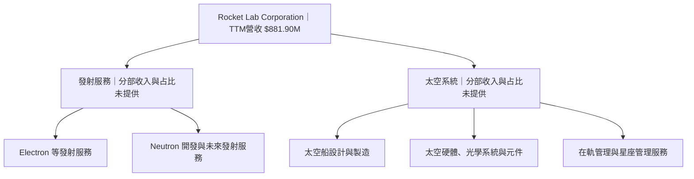
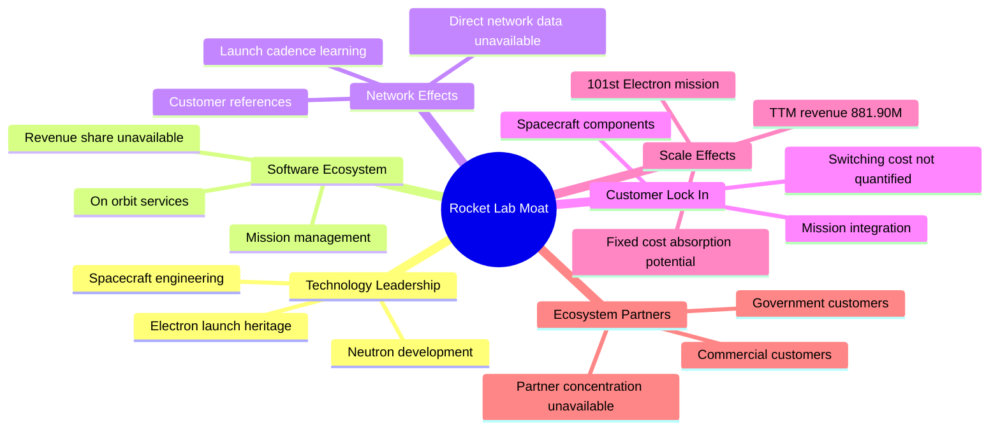
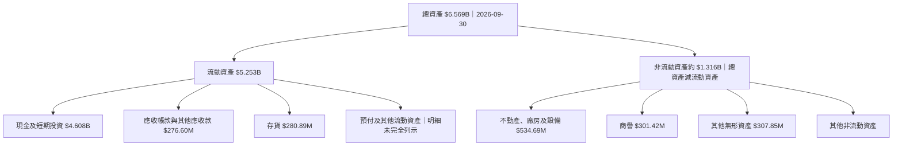
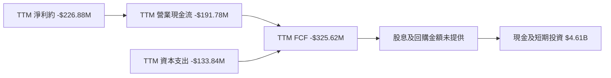
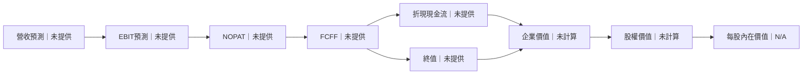
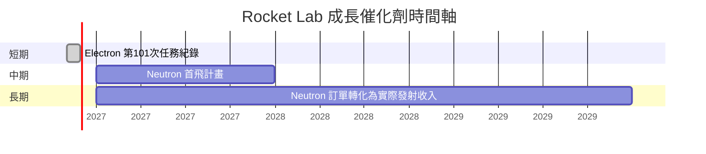
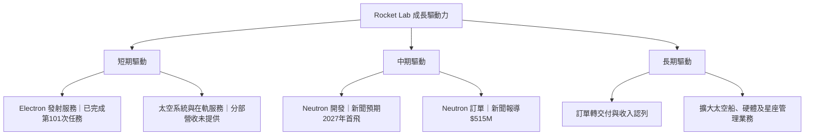
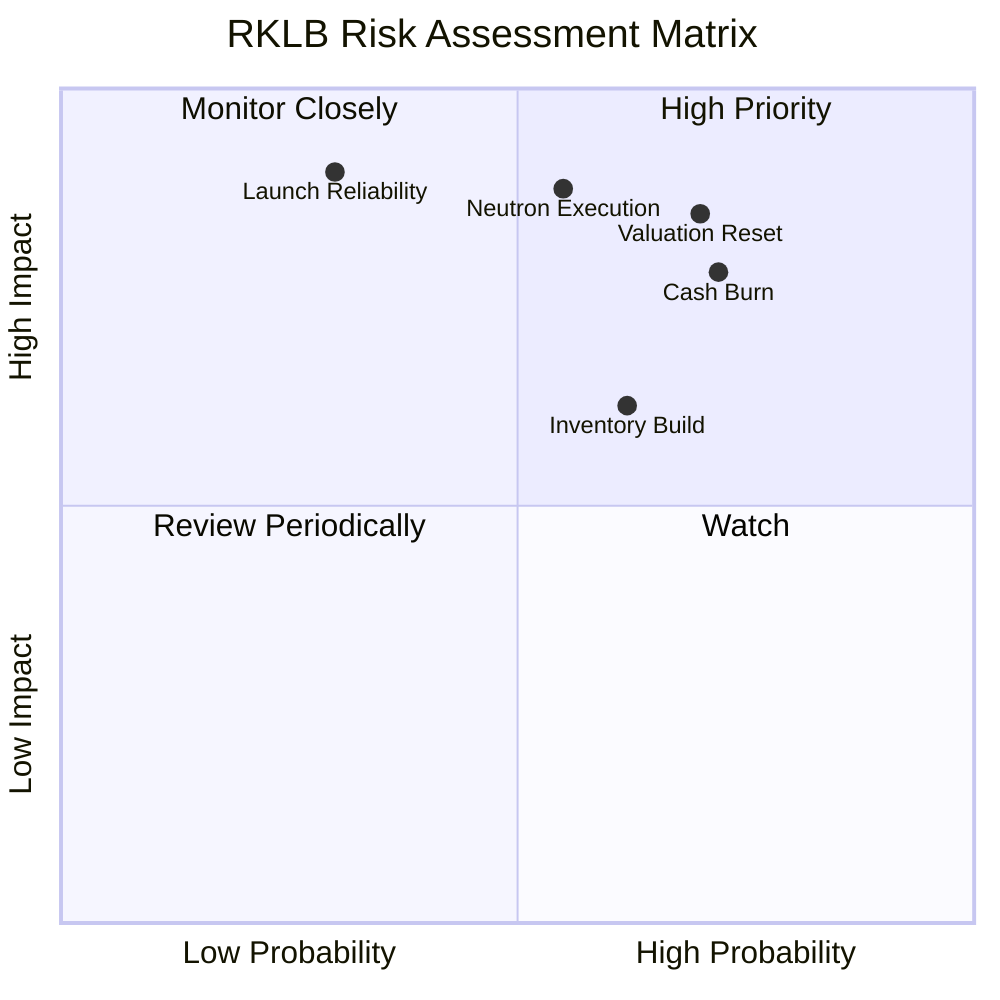
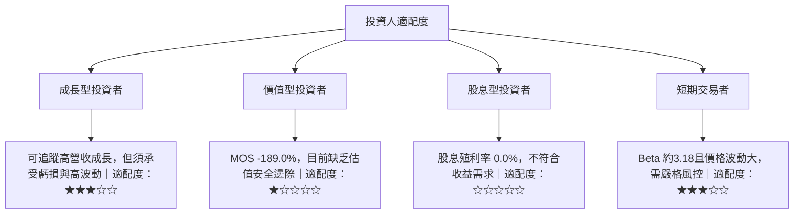

# RKLB 基本面深度分析報告
> **報告日期**：2026-11-28 ｜ **語言**：繁體中文 ｜ **數據來源**：SEC 申報資料 (XBRL)、Yahoo Finance、Finviz、StockAnalysis、Roic.ai ｜ **分析師**：CFA 級機構研究

---

## 目錄

| # | 章節 | 核心結論 |
|---|------|----------|
| 1 | 執行摘要 | 賣出；加權合理價值 $16.27，MOS −189.0% |
| 2 | 公司概覽與商業模式 | 業務涵蓋發射服務與太空系統；市場份額及分部營收占比未提供 |
| 3 | 損益表深度分析 | TTM 營收 $881.90M、TTM 成長 59.0%；營業利潤率仍為負 |
| 4 | 資產負債表分析 | 現金及短期投資 $4.61B，流動性充裕；債務來源數字有差異 |
| 5 | 現金流量深度分析 | TTM FCF −$325.62M，資本投入與營運消耗仍高 |
| 6 | 獲利能力與資本效率 | ROIC −16.1% 低於 WACC 14.0%，目前摧毀股東價值 |
| 7 | 相對估值分析 | 公司 P/S 34.8x，高於自身歷史中位數 19.4x；同業 P/S 差異大 |
| 8 | DCF 內在價值評估 | TTM 營業利益為負，DCF 模型不適用；以固定相對估值方法交叉檢驗 |
| 9 | 成長催化劑 | Neutron 預定 2027 年首飛；已有 $515M Neutron 訂單 |
| 10 | 風險矩陣 | 新型火箭執行、持續現金消耗及估值收縮為主要風險 |
| 11 | 投資建議 | 依規則 20 評級為賣出；等待估值回落及現金流改善 |

---

## 1. 執行摘要

截至 2026-11-25 收盤，RKLB 股價為 **$47.02**。公司 TTM 營收達 **$881.90M**、TTM 營收年增 **59.0%**，最新一季營收年增 **72.7%**；但 TTM 營業利益率為 **−27.6%**、ROIC 為 **−16.1%**，TTM FCF 為 **−$325.62M**。程式計算的加權合理價值為 **$16.27**，按固定定義計算的 MOS 為 **−189.0%**，因此依 MOS 門檻評為 **賣出**。高成長、較低淨債務與 Neutron 訂單構成多頭因素，但目前營運虧損、現金消耗與估值折價要求都尚未反映在股價。

### 1.0 一頁式投資儀表板（Portfolio Manager 30 秒速讀）

| 項目 | 內容 |
|------|------|
| **投資論點（3 句）** | ① TTM 營收年增 **59.0%**，最新一季年增 **72.7%**，營收擴張提供長期成長基礎。② 現金及短期投資 **$4.61B**，具資金支持發射與太空系統投資。③ TTM FCF **−$325.62M**、ROIC **−16.1%**，而加權合理價值 **$16.27** 明顯低於股價 **$47.02**。 |
| **綜合評分** | **4.8/10**（引用 1.1 評分卡；六項算術平均） |
| **財務健康** | 🟡 現金及短期投資 $4.61B、流動比率 8.554；但 TTM FCF 為 −$325.62M，且營運資金 CCC 延長至 176 天。 |
| **ROIC vs WACC** | **−16.1% vs 14.0%**：負利差約 30.1 個百分點，目前摧毀股東價值。 |
| **FCF 趨勢** | 持續為負；TTM FCF Yield **−0.95%**。 |
| **估值** | Forward P/E **710.8x** ｜ EV/EBITDA **−161.0x** ｜ FCF Yield **−0.95%**。負 EBITDA 使 EV/EBITDA 不具正常獲利倍數解讀價值。 |
| **DCF 內在價值（基準）** | **N/A**；TTM 營業利益為負，DCF MODEL 未提供。折溢價不適用。 |
| **安全邊際（MOS）** | **−189.0%＝($16.27 − $47.02) ÷ $16.27**；以 8.8 加權合理價值為基準，🔴 無下檔保護。 |
| **預期報酬（基準情境 12M）** | DCF 基準情境 **N/A**；以加權合理價值衡量的隱含上行空間為 **−65.4%**。 |
| **關鍵風險（前二）** | Neutron 開發／首飛未能按計畫推進；現金消耗及高估值遭市場重新定價。 |
| **評級 + 信心度** | 🔴 **賣出** ｜ 信心：中；估值訊號明確，但未來新業務商業化仍有不確定性。 |

### 1.1 綜合評分卡（全報告唯一）

| 維度 | 評分（1–10） | 主要依據（引用數字與其來源章節） |
|------|--------------|----------------------------------|
| 成長性 | 8.0 | TTM 營收年增 59.0%、最新一季年增 72.7%（第 3 章）；新發射與太空系統擴張帶來成長機會。 |
| 獲利能力 | 2.0 | TTM 營業利益率 −27.6%、ROIC −16.1%、Piotroski F-Score 5/9（第 3、6 章）。 |
| 財務健康 | 8.0 | 現金及短期投資 $4.61B、流動比率 8.554；但 TTM FCF −$325.62M、CCC 176 天（第 4、5 章）。 |
| 估值 | 1.0 | MOS −189.0%；P/S 34.8x 高於自身歷史中位數 19.4x（第 7、8 章）。 |
| 護城河 | 6.0 | 電子火箭已完成第 101 次任務，且具整合式太空系統業務；不過市場份額、客戶集中度與各業務分部營收未提供（第 2 章）。 |
| 管理層與資本配置 | 4.0 | 研發支出由 2022 年 $65.17M 增至 2025 年 $270.72M，支撐技術投資；FY2025 SBC $71.10M，且稀釋股數測試未通過（第 3、5、6 章）。 |
| **綜合評分** | **4.8** | 六項算術平均：$(8+2+8+1+6+4) ÷ 6 = 4.833…$，四捨五入至小數一位。 |

### 1.2 五大投資論點 + 三大核心風險

| 類型 | 項目 | 具體依據 | 信心度 |
|------|------|----------|--------|
| 🟢 **投資論點①** | 營收成長快 | TTM 營收 $881.90M、年增 59.0%；最新一季營收年增 72.7%。規模擴張有機會提高固定成本吸收能力。 | 🟢 高 |
| 🟢 **投資論點②** | 電子火箭營運經驗 | 新聞資料稱公司完成第 101 次 Electron 發射任務；持續任務紀錄有助累積執行經驗與客戶信任。 | 🟢 中 |
| 🟢 **投資論點③** | 新型運載火箭訂單儲備 | 新聞資料指出 Neutron 已取得 **$515M** 發射訂單，提供新產品商業需求的早期佐證。 | 🟡 中 |
| 🟢 **投資論點④** | 資金緩衝充足 | 現金及短期投資為 **$4.61B**，高於 TTM FCF 消耗；可支應研發、產能與發射準備，但不能取代現金流轉正。 | 🟢 高 |
| 🟢 **投資論點⑤** | 毛利率逐年改善 | 年度毛利率由 2022 年約 9.0% 升至 2025 年約 34.4%，反映營收組合與規模改善；營業層級仍未盈利。 | 🟡 中 |
| 🟡 **風險①** | FCF 長期為負 | TTM FCF **−$325.62M**；若產能與研發投資持續超過毛利貢獻，融資需求或稀釋風險上升。 | 🔴 高衝擊 |
| 🔴 **風險②** | 估值遠高於可驗證盈利能力 | P/S 34.8x、TTM 營業利益率 −27.6%、MOS −189.0%；成長稍有放緩就可能帶來倍數收縮。 | 🔴 高 |
| 🟡 **風險③** | 新型火箭執行風險 | Neutron 預定 2027 年首飛；發射延期、技術驗證或成本超支可能延後收入與現金流回收。 | 🔴 高衝擊 |

### 1.3 快速統計卡片

| 指標 | 公司實際值（期間） | 同業中位數 | 狀態 |
|------|--------------------|------------|------|
| 營收成長（TTM） | **59.0%** | — | 🟢 |
| 營收成長（最新一季年增） | **72.7%** | 161.4% | 🟡 |
| 毛利率（TTM） | **36.2%** | 55.5% | 🟡 |
| 營業利益率（TTM） | **−27.6%** | — | 🔴 |
| ROIC（TTM） | **−16.1%** | — | 🔴 |
| Forward P/E | **710.8x** | −56.6x* | 🔴 |
| FCF Yield（TTM） | **−0.95%** | — | 🔴 |
| Piotroski F-Score | **5 / 9** | — | 🟡 |

\*同業 Forward P/E 中位數由 SPCX 48.7x、LUNR −56.6x、PL −8,960.0x 計算；因樣本包含負值及極端值，該中位數不宜當作可直接套用的盈利倍數。

### 1.4 投資結論

```
╔══════════════════════════════════════════════════════════════════╗
║                    📊 投資結論摘要                               ║
╠══════════════════════════════════════════════════════════════════╣
║  評級：🔴 賣出（依 8.8 MOS 門檻）                                ║
║  價格（2026-11-25 收盤）：$47.02                                 ║
║  DCF 內在價值（基準）：N/A（TTM 營業利益為負，模型未提供）       ║
║  安全邊際 MOS：-189.0%（以加權合理價值 $16.27 為分母）           ║
║  加權合理價值（8.8）：$16.27                                     ║
║  綜合評分：4.8/10（引用 1.1）                                    ║
║  適合投資人：能承受高波動、願意追蹤新型火箭商業化進度者；          ║
║              不適合以估值安全邊際或現金收益為主的投資人。          ║
╚══════════════════════════════════════════════════════════════════╝
```

---

## 2. 公司概覽與商業模式

### 2.1 業務結構與收入來源

Rocket Lab 提供發射服務及太空系統解決方案，涵蓋運載火箭發射、太空船設計與製造、太空硬體、光學系統及在軌管理等。公司 TTM 營收為 **$881.90M**，但未提供各分部收入或占比，因此不以推算比例畫收入占比圖。



主要經濟模式是透過發射能力、太空系統製造與任務服務取得收入。發射服務可能受任務時程與成功率影響；太空系統則可透過硬體、設計與在軌服務擴大每一客戶的價值。分部營收、訂閱型或軟體收入占比未提供，故無法量化經常性收入比例。

### 2.2 市場份額

市場份額數據未提供。以營收規模來看，RKLB TTM 營收為 **$881.90M**，較小型太空公司具一定營運規模；但與 SpaceX 等大型私營發射業者的規模比較，現有資料不足以量化其份額。RKLB 最新一季營收年增 72.7%，高於 PL 的 58.1%，低於 SPCX 與 LUNR 報列的成長率；不同公司業務組合差異大，不能直接等同市占變化。

### 2.3 競爭護城河分析



### 2.4 護城河強度

| 護城河項目 | 強度（強／中／弱） | 證據（引用數字或事實） | 會削弱它的情況 |
|------------|--------------------|------------------------|----------------|
| 技術與發射經驗 | 中 | Electron 已完成第 101 次任務；公司涵蓋發射、太空船設計及製造。 | 發射事故、可靠度下降，或競爭者以更低價格提供相近服務。 |
| 太空系統整合 | 中 | 服務涵蓋太空船、元件、光學系統及在軌管理；分部收入占比未提供。 | 硬體商品化、專案毛利下降、客戶轉向垂直整合競爭者。 |
| 軟體與服務 | 弱至中 | 公司提供星座管理與在軌管理方案，但軟體收入、續約率與毛利率未提供。 | 無法形成持續服務收入，或服務內容難以與硬體分離銷售。 |
| 規模效應 | 中 | TTM 營收 $881.90M，研發投入增加；規模擴大可能改善固定成本吸收。 | 產能利用不足、研發與資本支出長期快於收入成長。 |
| 客戶鎖定與網路效應 | 未證實 | 未提供客戶留存率、合約期限、市占率或轉換成本資料。 | 客戶可多源採購，或任務服務競標導致議價能力下降。 |

**1.1「護城河」評分 6.0/10**：發射履歷及整合式太空系統具備實質門檻，但缺少分部占比、客戶留存與份額數據，難以將技術優勢直接視為可量化的定價權。

---

## 3. 損益表深度分析

### 3.1 年度收入成長趨勢（近4年）

2022–2025 年收入依序為 $211.00M、$244.59M、$436.21M、$601.80M。2022 至 2025 年收入 CAGR 約為 **41.8%**，計算為 $(601.80 ÷ 211.00)^{1/3} - 1$。2024 年的成長主要體現在收入由 2023 年低基期快速擴張；2025 年仍維持近 38% 年增，但收入增長尚未轉化為營業獲利。

```
╔══════════════════════════════════════════════════════════════════╗
║              Rocket Lab 年度收入趨勢（FY2022-FY2025）            ║
╠══════════════════════════════════════════════════════════════════╣
║  FY2022  $211.00M  ███████░░░░░░░░░░░░░░░░░░  基期              ║
║  FY2023  $244.59M  █████████░░░░░░░░░░░░░░░  YoY: +15.9% 🟡   ║
║  FY2024  $436.21M  ████████████████░░░░░░░░  YoY: +78.3% 🟢   ║
║  FY2025  $601.80M  ██████████████████████░░  YoY: +38.0% 🟢   ║
║                                                                  ║
║  📊 FY2022–FY2025 收入 CAGR：約 +41.8%                           ║
╚══════════════════════════════════════════════════════════════════╝
```

### 3.2 季度收入趨勢分析

| 季度 | 營收 | QoQ 成長 | YoY 成長 | 備註 |
|------|------:|---------:|---------:|------|
| 2025 Q4 | $179.65M | +15.8% | +35.7% | 相對 2025 Q3 的 $155.08M 計算。 |
| 2026 Q1 | $200.35M | +11.5% | +63.5% | 年增加速，單季營收較 2025 Q1 的 $122.57M 增加。 |
| 2026 Q2 | $234.07M | +16.8% | +62.0% | 季增回升，代表營收交付節奏仍在擴張。 |
| 2026 Q3 | $267.83M | +14.4% | +72.7% | 單季營收創本表期內新高；營業利益仍為負。 |

QoQ 由相鄰季度營收計算；YoY 採同季度年增資料。Q3 2026 營收成長並未同步帶來獲利：該季營業利益為 **−$79.19M**，按營收計算的營業利益率約 **−29.6%**。

### 3.3 利潤率演變分析

年度毛利率與營業利益率依年度損益表數字計算；TTM 及最新季度營業利益率則依優先數據列示。

| 利潤率指標 | FY2022 | FY2023 | FY2024 | FY2025 | 趨勢 | 評估 |
|------------|--------:|--------:|--------:|--------:|------|------|
| **毛利率** | 9.0% | 21.0% | 26.6% | 34.4% | 持續上升；毛利額由 $18.99M 增至 $207.18M。 | 🟢 |
| **營業利益率** | −64.1% | −72.7% | −43.5% | −38.0% | 2023 年惡化後改善，但仍顯著為負。 | 🔴 |
| **淨利率** | −64.4% | −74.6% | −43.6% | −32.9% | 2025 年虧損率收窄，仍未達獲利。 | 🔴 |

毛利率改善代表收入擴大後毛利吸收能力提升，且可能反映產品組合及交付規模改善；但研發費用同步由 2022 年 **$65.17M** 增至 2025 年 **$270.72M**，營業費用增加使營業利益持續為負。TTM 營業利益率為 **−27.6%**；最新季度數據可由 Q3 營業虧損 $79.19M 除以營收 $267.83M 得到約 **−29.6%**，與另一合併資料列示的 −27.6% 存在口徑差異，本報告採用 VERIFIED FIGURES 對最新季度的 −29.6%。

### 3.4 費用結構分析

年度資料顯示 FY2025 研發費用 **$270.72M**，約為年度營收 $601.80M 的 **45.0%**。這反映公司仍處於密集研發與產品擴張期；但其他營業費用明細未提供，不能將研發以外費用反推或畫成完整費用占比圓餅圖。

```
╔══════════════════════════════════════════════════════════════════╗
║                  FY2025 可量化費用項目                           ║
╠══════════════════════════════════════════════════════════════════╣
║  研發費用 $270.72M ÷ 營收 $601.80M = 45.0%                       ║
║  研發投入已高於 FY2024 的 $174.39M；其餘營業費用明細未提供。     ║
║  因此不將缺漏項目填入比例圖，也不把研發費用視為全部營業費用。    ║
╚══════════════════════════════════════════════════════════════════╝
```

### 3.5 季度 EPS 趨勢與盈餘品質（Quality of Earnings）

提供的 EPS 實際值可回溯四季，但估值預期與實際 EPS 資料為 nan，故沒有可核對的市場預期，不能判定「超預期」或「不及預期」。

| 季度 | EPS 實際值 | EPS 預期／驚喜 | 觀察 |
|------|-----------:|----------------|------|
| 2025 Q4 | −$0.09 | N/A | 預期值未提供，不能判斷是否超預期。 |
| 2026 Q1 | −$0.07 | N/A | 虧損較前季收窄。 |
| 2026 Q2 | −$0.08 | N/A | 虧損略擴大。 |
| 2026 Q3 | −$0.12 | N/A | 虧損擴大；季度淨損為 $79.68M。 |

| 盈餘品質項目 | 數值／佔比 | 評估 |
|--------------|-----------|------|
| 股權薪酬 SBC / 營收 | FY2025：$71.10M ÷ $601.80M = **11.8%**；最新四季 SBC 合計約 $84.20M ÷ TTM 營收 $881.90M = **9.5%** | 🔴 SBC 占比不低；若以股權薪酬招募與留才，會稀釋既有股東。 |
| SBC / 營業現金流 | 最新四季約 $84.20M ÷ OCF −$191.78M = **−43.9%**；以現金消耗絕對值計，SBC 約占其 43.9% | 🔴 OCF 為負，負比率不代表 SBC 抵銷現金流；反映非現金薪酬規模相對現金消耗很大。 |
| FCF / 淨利（現金轉換率） | −$325.62M ÷ TTM 淨利約 −$226.88M = **143.5%** | 🔴 因分子、分母皆為負，正值不可解讀為良好轉換；FCF 消耗幅度大於會計淨損。 |
| 一次性／非經常性損益 | 明細未提供 | 🟡 無法判斷非經常項目對盈餘的影響。 |
| 有效稅率異常 | N/A | 🟡 TTM 有營業虧損；有效稅率明細未提供，不推算稅務利益。 |
| 資本化支出 vs 費用化 | TTM Capex $133.84M；資本化政策明細未提供 | 🟡 資本支出是現金流出，不能僅憑 Capex 判斷是否有成本遞延或盈餘美化。 |

**盈餘品質結論**：公司尚未盈利，因此目前更適合評估收入、毛利率、現金消耗與稀釋，而非把會計淨利當作可持續獲利能力。TTM FCF 比淨損更負，加上 SBC 占營收約 9.5%，目前股東經濟成本不應只看 GAAP 淨損。

---

## 4. 資產負債表分析

### 4.1 資產結構分解

截至 2026-09-30，StockAnalysis 顯示總資產約 **$6.569B**、流動資產 **$5.253B**；兩者差額非流動資產約 **$1.316B**。細項作為描述性列示，因資料來源與總額口徑可能不同，不以細項強行加總調平。



現金及短期投資在流動資產中占主要位置，能提供投資緩衝；另一方面，存貨由 FY2025 年末 $158.41M 增至 2026-09-30 的 $280.89M，需觀察後續交付能否將庫存轉為收入與現金。

### 4.2 流動性與營運資金分析

| 指標 | 最新 TTM | 一年前 TTM | 變化 | 解讀 |
|------|----------|------------|------|------|
| DSO 應收帳款天數 | 49 天 | 39 天 | +10 天 | 收款時間變長，需追蹤應收款是否因交付及合約時點增加。 |
| DIO 存貨天數 | 182 天 | 140 天 | +42 天 | 庫存天數增加，可能反映在製品、備貨或交付週期拉長；須觀察是否轉成營收。 |
| DPO 應付帳款天數 | 55 天 | 59 天 | −4 天 | 付款速度略快，對現金轉換週期的抵銷效果減弱。 |
| CCC 現金轉換週期 | 176 天 | 120 天 | +56 天 | 營運資金占用加重，與 TTM FCF 為負的狀況一致。 |

流動比率 **8.554**、速動比率 **7.954**，顯示帳面短期償債緩衝充裕；但 CCC 上升 56 天代表現金在營運環節停留更久，流動比率不能取代營運資金品質分析。

### 4.3 債務結構分析

多個資料列對總債務數字不一致：VERIFIED FIGURES 列示總債務 **$1.72M**、淨現金 **$4.61B**；合併市場數據列示總債務 **$120.28M**、淨現金 **$4.49B**；Roic.ai 另列長期借款與融資租賃。以下按優先原則使用 VERIFIED FIGURES，並將差異列為需核對事項。

```
╔══════════════════════════════════════════════════════════════════╗
║                   Rocket Lab 債務健康診斷                        ║
╠══════════════════════════════════════════════════════════════════╣
║  總債務：          $1.72M       🟢（VERIFIED FIGURES）             ║
║  現金及短期投資：  $4.61B       🟢                                  ║
║  淨現金：          $4.61B       🟢（VERIFIED FIGURES 原值）         ║
║                                                                  ║
║  Debt / EBITDA：   N/A；EBITDA 為負，倍數無正常解讀意義           ║
║  利息保障倍數：    N/A；利息費用與一致口徑債務明細未提供          ║
║  流動比率：        8.554        🟢                                  ║
║  需核對事項：      合併市場資料債務 $120.28M，與上述值不同。       ║
╚══════════════════════════════════════════════════════════════════╝
```

### 4.4 股東權益趨勢

| 年度 | 股東權益 | 年度變化 | 解讀 |
|------|---------:|---------:|------|
| 2022 | $673.21M | — | 年末權益基期。 |
| 2023 | $554.54M | −17.6% | 權益下降，與持續虧損相符。 |
| 2024 | $382.45M | −31.0% | 虧損延續，股東權益進一步減少。 |
| 2025 | $1.72B | +349.7% | 權益大幅上升；僅憑提供資料不能分拆融資、股權交易與其他變動來源。 |

權益增加未代表內生獲利改善：2025 年淨損仍為 **$198.21M**，因此需將股權融資、資本交易與營運績效分開觀察。

---

## 5. 現金流量深度分析

### 5.1 現金流量瀑布圖

下圖列示已知 TTM 數字；股息與回購數據未提供，因此不把未提供項目畫成金額。



現金流由營運活動提供（或消耗）的現金再扣除資本支出。依統一定義，TTM FCF 為營業現金流減資本支出，等於 **−$325.62M**；現金餘額充裕，但若現金消耗延續，需留意新產品投入、資本支出與融資安排的平衡。

### 5.2 FCF 轉換率趨勢

| 年度 | FCF | 淨利 | FCF／淨利 | 解讀 |
|------|-----:|-----:|----------:|------|
| 2022 | −$148.95M | −$135.94M | 109.6% | 負淨利下，FCF 消耗略高於會計淨損。 |
| 2023 | −$153.57M | −$182.57M | 84.1% | 現金消耗低於淨損，但仍為負。 |
| 2024 | −$115.98M | −$190.18M | 61.0% | FCF 消耗收窄；負分母下比率不代表盈利質量。 |
| 2025 | −$321.81M | −$198.21M | 162.3% | 現金消耗明顯高於淨損，Capex 升至 $156.28M。 |
| TTM 至 2026-09-30 | −$325.62M | 約 −$226.88M | 143.5% | 現金消耗仍高；此比率因兩者皆負而不可當作正向轉換率。 |

### 5.3 自由現金流趨勢

```
╔══════════════════════════════════════════════════════════════════╗
║                 自由現金流趨勢（營業現金流－Capex）               ║
╠══════════════════════════════════════════════════════════════════╣
║  FY2022  -$148.95M  ████████████░░░░░░░░░░  FCF 為負             ║
║  FY2023  -$153.57M  █████████████░░░░░░░░░  FCF 為負             ║
║  FY2024  -$115.98M  ██████████░░░░░░░░░░░░  消耗收窄             ║
║  FY2025  -$321.81M  ██████████████████████  消耗擴大             ║
║  TTM     -$325.62M  ███████████████████████ FCF Yield -0.95%     ║
╠══════════════════════════════════════════════════════════════════╣
║  近年變化：2025 年 Capex $156.28M，較 2024 年 $67.09M 明顯增加。  ║
║  代表公司擴大投入，但投入尚未轉化為正自由現金流。                 ║
╚══════════════════════════════════════════════════════════════════╝
```

### 5.4 資本配置評估

提供的現金流資料顯示資本支出由 FY2024 的 **$67.09M** 升至 FY2025 的 **$156.28M**；FY2025 SBC 為 **$71.10M**。股息殖利率為 **0.0%**。回購金額與其他資本配置金額未提供，故不畫比例圓餅圖。

| 項目 | 可用數據 | 評估 |
|------|----------|------|
| 資本支出 | FY2025 $156.28M；TTM $133.84M | 投資強度高，應以未來收入增長、毛利率及現金回收驗證回報。 |
| 股權薪酬 | FY2025 $71.10M | 具有稀釋成本；需同步看流通股數及每股營收，而非只看總營收。 |
| 股息 | 殖利率 0.0% | 現金留在公司投入營運，符合成長期公司特徵。 |
| 回購 | N/A | 資料未提供，無法判斷是否有抵銷稀釋。 |

---

## 6. 獲利能力與資本效率

### 6.1 ROE / ROA / ROIC 趨勢

完整歷史 ROIC、ROA 與 ROE 同口徑序列未提供；年度淨利率可由已列年度數字計算。下表僅列有資料支持的項目，不填行業均值。

| 指標 | 可用數據 | 評估 |
|------|----------|------|
| ROIC（TTM） | **−16.1%** | 低於 WACC 14.0%，資本使用尚未產生正回報。 |
| ROE（TTM，品質指標） | **−3.9%** | 依程式計算的 DuPont 口徑；另一合併資料列示 −6.4%，口徑有差異，採品質指標數值。 |
| ROA（TTM） | **−3.5%** | 資產尚未產生正淨利回報。 |
| FY2025 淨利率 | **−32.9%** | 年度虧損仍高；TTM 淨利率為 −25.7%。 |
| 行業均值比較 | N/A | 未提供可比且同口徑行業均值。 |

### 6.2 ROIC vs WACC 分析（核心價值創造判斷）

```text
╔══════════════════════════════════════════════════════════════════╗
║                ROIC vs WACC 深度分析                            ║
╠══════════════════════════════════════════════════════════════════╣
║  資本成本（採用程式計算值）：WACC = 14.00%                       ║
║  ├── 無風險利率（10Y美債）：4.94%                                 ║
║  ├── ERP：5.00%                                                   ║
║  ├── Beta：原始 3.18；採用調整後 2.00                            ║
║  ├── 股權成本：4.94% + 2.00 × 5.00% = 14.94%                    ║
║  ├── 稅前債務成本：1543.65%（極小債務分母造成，不作經濟性解讀）  ║
║  ├── 資本權重：股權 100.0%，債務 0.0%                            ║
║  └── 程式計算 WACC 15.00%，受 7%–14% 區間限制後採用 14.00%       ║
║                                                                  ║
║  ROIC（TTM）：−16.1%                                             ║
║  WACC：       +14.0%                                             ║
║  ROIC − WACC：−30.1 個百分點                                     ║
║                                                                  ║
║  結論：ROIC 顯著低於資本成本；目前未能覆蓋資金機會成本，          ║
║        每增加投入資本，若回報結構不改善，將繼續摧毀股東價值。    ║
╚══════════════════════════════════════════════════════════════════╝
```

程式的 WACC 原始計算值為 **15.00%**，受規定的 7%–14% 區間限制後採用 **14.00%**。由於債務權重為 0%，資本成本主要由股權成本決定；稅前債務成本 1543.65% 是債務金額極小時的比率結果，不應視為正常企業融資利率。第 8 章 DCF 為 N/A，沒有另行建立折現模型。

### 6.3 杜邦三因素分解

| 因素 | 數值（TTM） | 解讀 |
|------|-------------|------|
| 淨利率 | −25.7% | 虧損是 ROE 為負的主要來源。 |
| 資產週轉率 | 0.13 | 每單位資產產生的營收仍有限，資產擴張尚未充分轉化為營收效率。 |
| 權益乘數 | 1.13 | 槓桿不高，ROE 不是由高度財務槓桿支撐。 |
| **ROE** | **−3.9%** | 程式列示：−25.7% × 0.13 × 1.13 = −3.9%（四捨五入）。 |

### 6.4 財務體質：Piotroski F-Score

**Piotroski F-Score：5 / 9**。分數為程式依 TTM 至 2026-09-30 與 TTM 至 2025-09-30 計算；下表照列九項結果。

| 測試 | 結果 | 解讀 |
|------|------|------|
| ROA > 0 | ❌ 未通過 | 公司仍為虧損，資產回報為負。 |
| 營業現金流 > 0 | ❌ 未通過 | TTM OCF −$191.78M。 |
| ROA 高於一年前 | ✅ 通過 | 相對去年改善，但仍未轉正。 |
| 營業現金流 > 淨利（應計品質） | ✅ 通過 | 表示相對應計項目測試通過，不代表現金流為正。 |
| 長期負債 ÷ 總資產低於一年前 | ✅ 通過 | 槓桿指標相對改善。 |
| 流動比率高於一年前 | ✅ 通過 | 短期流動性指標改善。 |
| 稀釋股數未增加 | ❌ 未通過 | 股數增加會稀釋既有股東每股經濟權益。 |
| 毛利率高於一年前 | ✅ 通過 | 毛利率改善，與歷年毛利率上升相符。 |
| 資產週轉率高於一年前 | ❌ 未通過 | 資產擴張未同步轉化為較高周轉效率。 |

---

## 7. 相對估值分析

### 7.1 同業估值比較表格

同業倍數按 Peer multiples 數值照列；RKLB 使用提供的估值資料。RKLB P/S 以歷史估值區塊的 **34.8x** 為優先參照；其他合併來源另列 38.8x，反映資料口徑差異。

| 估值指標 | **RKLB** | **SPCX** | **LUNR** | **PL** | RKLB 評估 |
|----------|---------:|---------:|---------:|---------:|-----------|
| **Trailing P/E** | N/A | 580.8x | N/A | N/A | 🔴 RKLB TTM 虧損，P/E 不適用；SPCX 倍數亦極高。 |
| **Forward P/E** | 710.8x | 48.7x | −56.6x | −8,960.0x | 🔴 RKLB Forward P/E 極高；同業含負值與極端值，中位數不宜直接套用。 |
| **P/S Ratio** | 34.8x | 56.6x | 2.5x | 10.8x | 🔴 高於 LUNR、PL；低於 SPCX。 |
| **EV/EBITDA（TTM）** | −161.0x | 150.3x | −38.0x | −76.6x | 🔴 RKLB EBITDA 為負，倍數無正常盈利估值意義。 |
| **最新一季營收年增** | 72.7% | 161.4% | 413.7% | 58.1% | 🟡 RKLB 成長高於 PL，低於 SPCX、LUNR。 |
| **毛利率（TTM）** | 36.2% | 56.8% | 20.3% | 55.5% | 🟡 RKLB 高於 LUNR，低於 SPCX、PL。 |

這些公司業務組合、收入規模及盈利階段不同，不能只以單一倍數排序。RKLB 的主要估值弱點是收入倍數高，而營業利益與 FCF 尚未轉正；相對較快的營收成長需持續兌現才可能支持現有倍數。

### 7.2 歷史估值區間分析

可用歷史區間是 **P/S**，非 P/E；P/E 歷史區間未提供，故不自行推算百分位。

```
╔══════════════════════════════════════════════════════════════════╗
║                  RKLB 歷史 P/S 估值位置                          ║
╠══════════════════════════════════════════════════════════════════╣
║  5年區間：7.1x ├──────────────────────────────┤ 83.2x             ║
║  5年中位數：19.4x               ▲                             ║
║  目前：34.8x；自身歷史百分位：57%                               ║
║                                                                  ║
║  解讀：目前 P/S 高於自身歷史中位數，但位於歷史區間中段偏上；      ║
║        股價波動大，歷史高倍數不能當作內在價值。                   ║
╚══════════════════════════════════════════════════════════════════╝
```

### 7.3 情境價值（Bear / Base / Bull）

**N/A（DCF 無法計算：TTM 營業利益不為正，DCF MODEL 未提供情境表；依規則不另建模型或自行設定目標價。）**

### 7.4 相對估值隱含價格區間

```
╔══════════════════════════════════════════════════════════════════╗
║              相對估值方法與股價位置                              ║
╠══════════════════════════════════════════════════════════════════╣
║  同業 P/S：       $8.04  ───────┐                                ║
║  加權合理價值：  $16.27  ───────┼── 低於現價 $47.02              ║
║  分析師共識：    $90.32  ───────┘                                ║
║                                                                  ║
║  現價：$47.02｜同業 P/S 估值：$8.04｜分析師平均目標：$90.32       ║
╚══════════════════════════════════════════════════════════════════╝
```

| 方法 | 每股價值 | 依據 |
|------|---------:|------|
| 同業 P/S | $8.04 | LUNR、PL 的同業 P/S 中位數 **6.6x** × RKLB TTM 營收，再換算至每股；程式列示價值照用。 |
| 分析師共識目標價 | $90.32 | 22 位分析師平均目標價；屬市場預期參考，不是本報告自行推導的內在價值。 |

---

## 8. DCF 內在價值評估（Discounted Cash Flow）

### 8.0 估值推理鏈（Thinking Logic）

**Step 1 — 價值由哪些變數決定？**  
RKLB 的長期價值主要取決於發射服務、太空系統兩個業務能否把收入擴張轉成正營業利益與自由現金流；但分部收入占比未提供，無法建立可稽核的分部現金流模型。眼前最關鍵的可驗證數字是 TTM 營收 **$881.90M**、營業利益率 **−27.6%** 及 FCF **−$325.62M**。

**Step 2 — 採用哪種模型、為什麼？**

| 決策點 | 本報告採用 | 理由（含數字） | 曾考慮但否決 | 否決理由 |
|--------|-----------|----------------|--------------|----------|
| 現金流定義 | 不建 DCF | TTM 營業利益為負，DCF 模型標示 N/A。 | 自行建立 FCFF 預測 | 缺乏 DCF MODEL 給定的逐年假設；規定不得另建模型。 |
| 預測期 N | N/A | 模型未提供預測期。 | 自訂 5–10 年 | 缺乏可引用依據，會形成未經驗證的假設。 |
| 終值方法 | N/A | 無有效預測現金流與終值輸入。 | Gordon Growth／退出倍數 | TTM 營業利益為負，模型明確不計。 |
| EBIT 基礎 | N/A | 未提供 DCF 模型。 | GAAP／非 GAAP 預測 | 不得自行建立。 |

**Step 3 — 關鍵假設推導鏈**  
營收 CAGR、期末營業利潤率、永續成長率、Capex、D&A、營運資金、稀釋股數與 WACC 的 DCF 預測輸入均未提供；因此沒有可供推導的採用值或替代值，也不以假設值補造每股 DCF 價值。可用的資本成本資料為 WACC 14.00%，但不能單獨形成 DCF。

**Step 4 — 最脆弱環節**  
最脆弱的環節是營業虧損如何轉成正 FCFF；若虧損率不能收窄，任何終值估值都會高度依賴未經驗證的遠期假設。

**Step 5 — 計算路徑圖**

以下僅展示計算邏輯，不代表已建立 RKLB DCF 或填入未提供數字。



### 8.1 模型假設總表（Model Inputs）

**N/A（DCF MODEL 未提供：TTM 營業利益不為正；依規則不另建模型。）**  
因此預測期、營收 CAGR、利潤率、稅率、Capex／營收、D&A／營收、ΔWC、SBC 組合、稀釋率、永續成長率及終值方法均不填估計值。

### 8.2 折現率推導（WACC）

雖然 DCF 不適用，ROIC 對照使用及其他資本成本分析採用同一程式 WACC **14.00%**。

```
╔══════════════════════════════════════════════════════════════════╗
║                    WACC 資料列示                                  ║
╠══════════════════════════════════════════════════════════════════╣
║  無風險利率 Rf：4.94%                                            ║
║  ERP：5.00%                                                       ║
║  原始 Beta：3.18                                                 ║
║  調整方式：⅔ × 3.18 + ⅓ × 1 = 2.45；因上限限制，採用 Beta 2.00  ║
║  股權成本：4.94% + 2.00 × 5.00% = 14.94%                        ║
║  債務成本：稅前 1543.65%；程式列示債務權重 0.0%                  ║
║  資本權重：股權 100.0%／債務 0.0%                                ║
║  程式原始 WACC：15.00%；受 7%–14% 上限限制後採用 14.00%          ║
╚══════════════════════════════════════════════════════════════════╝
```

Beta 調整後數值按資料列示使用，沒有另行改算；無風險利率的觀察日期未提供，故不補寫日期。ERP 為程式假設值 5.00%。由於程式已提供 WACC 與資本權重，本報告不以不一致的市場市值、帳面債務或租賃負債口徑另算 WACC。第 6.2 節與本節一致採 **14.00%**。

### 8.3 逐年自由現金流預測（基準情境）

**N/A（DCF MODEL 未提供：TTM 營業利益不為正；不得自行建立逐年 FCFF 預測。）**

### 8.4 終值計算（Terminal Value）

**N/A（無 DCF 預測現金流、永續成長率或退出倍數；不計算 Gordon Growth 或退出倍數終值。）**

### 8.5 企業價值 → 每股內在價值（Bridge）

**N/A（DCF 企業價值、現金流現值、終值與模型稀釋股數未提供；DCF 每股內在價值及 DCF 折溢價均不適用。）**  
本節不計算 MOS；全報告 MOS 僅採 8.8 加權合理價值為分母。

### 8.6 敏感性分析（WACC × 永續成長率）

**N/A（DCF MODEL 未提供敏感度矩陣；不自行推算每股價值或情境。）**

### 8.7 反推 DCF（Reverse DCF）

**N/A（DCF MODEL 未提供反推結果；現價只有一條方程式，且沒有基準預測輸入，不能反解營收成長、利潤率、永續成長或預測期。）**

### 8.8 估值三角驗證與安全邊際

估值方法與權重採固定輸入：公司類型為未盈利公司，因此同業 P/S 權重 90%、分析師共識 10%；同業 Forward P/E 因不可計算而剔除，其權重按方法設定由可用方法分配。

| 估值方法 | 隱含每股價值 | 上行空間（÷現價） | 權重 | 說明 |
|----------|--------------:|-------------------:|------|------|
| 同業 P/S | $8.04 | −82.9% | 90% | LUNR、PL 同業 P/S 中位數 6.6x × RKLB TTM 營收之程式估值。 |
| 分析師共識目標價 | $90.32 | +92.1% | 10% | 22 位分析師平均目標價。 |
| **加權合理價值** | **$16.27** | **−65.4%** | **100%** | 僅作機械式加權，不表示價值確定性。 |

加權計算：

\[
\$8.04 \times 90\% + \$90.32 \times 10\%
= \$7.236 + \$9.032
= \$16.268
\approx \$16.27
\]

權重為 **90% + 10% = 100%**。同業 Forward P/E 不可計算，因此沒有列入；估值方法權重依未盈利公司類型固定，不是分析師任意調整。

安全邊際依固定定義，以加權合理價值作分母：

\[
\text{MOS} = \frac{\$16.27-\$47.02}{\$16.27}
= \frac{-\$30.75}{\$16.27}
= -189.0\%
\]

上行空間則以現價作分母：

\[
\text{上行空間} = \frac{\$16.27-\$47.02}{\$47.02}
= \frac{-\$30.75}{\$47.02}
= -65.4\%
\]

折溢價若相對 DCF 基準價衡量，因 DCF 內在價值 N/A，故不適用。

```
╔══════════════════════════════════════════════════════════════════╗
║                  估值區間與安全邊際                              ║
╠══════════════════════════════════════════════════════════════════╣
║  同業P/S $8.04 ── 加權合理值 $16.27 ── 現價 $47.02 ── 共識 $90.32║
║                                                                  ║
║  安全邊際 MOS = ($16.27 − $47.02) ÷ $16.27 = -189.0%             ║
║  上行空間 = ($16.27 − $47.02) ÷ $47.02 = -65.4%                 ║
║  DCF 基準折溢價：N/A（DCF 內在價值未計算）                       ║
║                                                                  ║
║  依 MOS ≥ 10% 的價格上限：$16.27 × (1 − 10%) = $14.64             ║
║  這是估值門檻參考，不代表目前評級為買入。                         ║
╚══════════════════════════════════════════════════════════════════╝
```

**評級**：MOS 為 −189.0%，低於 −25% 門檻，依規則 20 為 **賣出**；未作質化調整。

> 🔎 **程式複算（Python，依本節各項自動重算）**
>
> 加權合理價值 = $8.04 × 90% + $90.32 × 10% = **$16.27**（權重合計 100%）
>
> 以價格 $47.02 計：MOS = **-189.0%**，上行空間 = **-65.4%**
>
> ✅ 與本節所寫數值一致。

### 8.9 DCF 模型的局限與失效條件

- **終值依賴度**：N/A，沒有 DCF 終值及企業價值。
- **最脆弱的假設**：由於未建立 DCF，無法提供可稽核的終值敏感度；實際投資判斷最敏感的是營業利潤率、Neutron 商業化進度及資本支出回收。
- **不適用情境說明**：TTM 營業利益率 −27.6%、FCF −$325.62M，傳統 DCF 的短期現金流基礎不穩。現階段可參照 EV/Sales、同業 P/S、營收與毛利率趨勢；待正 FCFF 和更完整分部資料出現後再建立 DCF。
- **與第 10 章風險矩陣的連結**：Neutron 延期會壓低收入轉化及營業利潤率；現金消耗擴大會提高資本需求；估值倍數收縮則直接影響相對估值。

### 8.10 複算檢核表（Audit Trail）

因 DCF MODEL 為 N/A，第 1–17、19 項涉及 DCF 的數值檢查標為 N/A；第 18 與 20 項照實核對報告完整性及 MOS 評級。

| # | 檢核項目 | 檢查方式 | 結果 |
|---|----------|----------|------|
| 1 | 高／中敏感度 DCF 輸入四段式推導 | DCF 輸入未提供，不建模 | N/A |
| 2 | DCF 假設來源完整 | DCF MODEL 未提供 | N/A |
| 3 | WACC 五步算式及重算 | 採用程式 WACC 14.00%；無另行建立 DCF WACC 算式 | N/A |
| 4 | Kd 分母與債務權重口徑一致 | 不另算 WACC；來源債務口徑差異已揭露 | N/A |
| 5 | WACC 與第 6.2 節相同 | 兩處均採 14.00% | ✅ |
| 6 | 逐年預測欄數等於 N | 無 DCF 預測期 | N/A |
| 7 | FY+1 FCFF 與 PV 算式 | 無 DCF 預測 | N/A |
| 8 | 預測期 PV 加總 | 無 DCF 預測 | N/A |
| 9 | WACC > g | 未提供 g | N/A |
| 10 | 終值基期與折現期數 | 未提供終值 | N/A |
| 11 | EV 至每股價值橋接 | 無 DCF 估值橋接 | N/A |
| 12 | SBC 組合與股數一致性 | 未建 DCF，未套用組合 A/B/C | N/A |
| 13 | 矩陣基準格等於 DCF 每股價值 | 無敏感性矩陣 | N/A |
| 14 | 矩陣只含有效 WACC > g 格 | 無敏感性矩陣 | N/A |
| 15 | 三情境機率合計 100% | DCF 情境未提供 | N/A |
| 16 | 反推 DCF 一次只放開一個變數 | 無反推 DCF 模型 | N/A |
| 17 | MOS 與折溢價基準一致 | MOS 使用 8.8 加權合理價值；DCF 折溢價列 N/A | ✅ |
| 18 | 報告完整至第 11 章 | 章節 1–11 均列示 | ✅ |
| 19 | 加權合理價值等於加權總和 | $8.04×90% + $90.32×10% = $16.268，列示 $16.27 | ✅ |
| 20 | 評級符合 MOS 門檻 | MOS −189.0% < −25%，評級賣出 | ✅ |

---

## 9. 成長催化劑

### 9.1 催化劑時間軸

下列日期與事件依提供新聞資料；Neutron 首飛日期為新聞所稱 2027 年計畫，並非本報告自行確認的保證時程。



Electron 第 101 次任務可作為既有發射服務執行紀錄；Neutron 的 **$515M 訂單**提供潛在需求線索，但訂單金額不等於已認列收入，更不代表已實現現金流。

### 9.2 TAM 市場規模分析

**N/A（TAM 數據未提供）**。RKLB TTM 營收 $881.90M、年增 59.0%，最新一季年增 72.7%，顯示營運規模仍在擴大；但缺少可引用的市場規模與年份資料，不能估算 TAM 或市場滲透率。

### 9.3 成長驅動力結構圖



---

## 10. 風險矩陣

### 10.1 風險評分矩陣

下列 quadrantChart 的座標為**分析師主觀風險排序**，不是財務數據或公司提供的事件機率。



### 10.2 風險清單詳細分析

機率與風險評分屬分析師定性估計，不是管理層財測；收入衝擊幅度因缺少分部收入及客戶集中度資料而不作虛構估算。

| # | 風險項目 | 發生機率 | 財務衝擊 | 風險評分 | 緩解措施 |
|---|----------|----------|----------|----------|----------|
| 1 | 🔴 **Neutron 延期或開發成本超支** | 中高；非統計機率 | 高；延期會推遲新產品收入及現金回收 | 🔴 高 | 追蹤里程碑、首飛進度、資本支出及訂單轉化，不把訂單金額當已認列收入。 |
| 2 | 🔴 **持續現金消耗** | 高；TTM FCF 為負 | 高；TTM FCF −$325.62M，若延續會消耗現金緩衝 | 🔴 高 | 每季監控 OCF、Capex、現金餘額及融資／稀釋變化。 |
| 3 | 🔴 **估值倍數收縮** | 高；相對估值偏高 | 高；P/S 34.8x、MOS −189.0% | 🔴 高 | 以營收與毛利率驗證成長，不以分析師目標價取代估值紀律。 |
| 4 | 🟡 **庫存與營運資金占用** | 中高 | 中高；DIO 182 天、CCC 176 天 | 🟡 中高 | 追蹤庫存轉收入、DSO、交付進度及現金轉換週期。 |
| 5 | 🟡 **發射可靠度或任務延遲** | 中 | 高；發射失敗可能影響客戶信任與任務排程 | 🟡 中高 | 追蹤任務成功率、發射間隔與異常調查結果。 |

---

## 11. 投資建議

### 11.1 最終評級與評分

按加權合理價值 $16.27 與 2026-11-25 收盤價 $47.02 計算，MOS 為 **−189.0%**，因此依規則 20 評級為 **賣出**，沒有作一級質化調整。1.1 綜合評分為 **4.8/10**；六項分數依序為成長性 8.0、獲利能力 2.0、財務健康 8.0、估值 1.0、護城河 6.0、管理層與資本配置 4.0。

### 11.2 合理價值與隱含報酬率

| 估值參照 | 每股價值 | 相對現價 $47.02 | 機率／權重 | 說明 |
|----------|---------:|----------------:|------------|------|
| 加權合理價值 | **$16.27** | **−65.4%** | 方法權重合計 100% | 同業 P/S 90%、分析師共識 10%。 |
| DCF 悲觀情境 | N/A | N/A | N/A | DCF MODEL 未提供。 |
| DCF 基準情境 | N/A | N/A | N/A | DCF MODEL 未提供。 |
| DCF 樂觀情境 | N/A | N/A | N/A | DCF MODEL 未提供。 |

DCF 情境價值與機率未提供，因此不另設定目標價。分析師平均目標價 **$90.32** 是 22 位分析師共識資料，已按固定權重 10% 納入加權合理價值，不能視為本報告的基準情境目標價。

### 11.3 買入時機與觸發因素

```
╔══════════════════════════════════════════════════════════════════╗
║                  ✅ 買入觸發因素 Checklist                      ║
╠══════════════════════════════════════════════════════════════════╣
║  目前狀態：現價 $47.02，高於加權合理價值 $16.27；評級為賣出。    ║
║                                                                  ║
║  重新評估前的必要條件：                                          ║
║  ☐ 價格接近或低於 $14.64，對應加權合理價值下至少 10% MOS。       ║
║  ☐ TTM FCF 消耗明顯收窄，並公布可核對的現金流改善證據。          ║
║  ☐ 營業利益率連續季度改善，且營收成長沒有同步大幅放緩。          ║
║  ☐ Neutron 里程碑與訂單逐步轉成交付及收入，而非只停留在預訂。    ║
║                                                                  ║
║  加碼觸發條件（需搭配估值審查）：                                ║
║  ☐ DIO 與 CCC 下降，存貨轉化為交付和收款。                       ║
║  ☐ 現金流改善未依賴大幅增加股數或外部融資。                      ║
║                                                                  ║
║  減碼／退出觸發條件：                                            ║
║  ☐ Neutron 重大延期、成本超支或訂單取消。                        ║
║  ☐ TTM FCF 消耗進一步惡化，且現金餘額快速下降。                  ║
║  ☐ 營收增速連續放緩，毛利率轉弱，估值仍維持高 P/S。              ║
╚══════════════════════════════════════════════════════════════════╝
```

**估值區間推導**：依 MOS 10% 的買入門檻，價格上限為 $16.27 × (1−10%) = **$14.64**；MOS −10% 對應價格約 **$17.90**。這些是依加權合理價值換算的估值監控門檻，不是 DCF 目標價。由於現價遠高於此範圍，現階段不宜把市場波動中的短期回落直接視為買入訊號。

### 11.4 投資人適配度分析



### 11.5 每季財報監控清單（Quarterly Watch List）

| 監控項目 | 最新基準 | 加碼／改善觀察門檻 | 減碼／惡化警訊 |
|----------|----------|--------------------|----------------|
| 營收成長 | TTM +59.0%；最新一季 YoY +72.7% | 成長持續、收入交付與訂單同步增加 | 連續兩季 YoY 低於 30% |
| 毛利率 | TTM 36.2% | 持續改善並帶動營業虧損收窄 | 毛利率連續兩季下降 |
| 營業利益率 | TTM −27.6%；最新季度 −29.6% | 虧損率逐季收窄 | 虧損率連續兩季擴大 |
| OCF／FCF | TTM OCF −$191.78M；FCF −$325.62M | TTM FCF 消耗連續下降，且非一次性營運資金改善 | FCF 消耗增加或現金下降過快 |
| Capex | TTM $133.84M | Capex 增加可由訂單、產能及收入轉化佐證 | Capex 擴大但收入與毛利未改善 |
| 存貨／DIO | DIO 182 天 | DIO、CCC 回落，庫存順利交付 | DIO 持續上升、存貨增速高於營收 |
| 現金及短期投資 | $4.61B | 維持充分流動性並降低現金消耗 | 現金下降速度加快且伴隨新增融資 |
| 股數與 SBC | FY2025 SBC $71.10M；Piotroski 股數測試未通過 | SBC 占營收下降、股數增幅放緩 | 股數增加快於收入／每股營收成長 |
| Neutron 進度 | 新聞預期 2027 年首飛；訂單 $515M | 里程碑按期完成、訂單轉交付 | 首飛延期、成本超支或取消訂單 |
| 管理層財測 | 未提供 | 追蹤新財測與實際交付差異 | 實際營收、交付或現金流連續低於公司指引 |

### 11.6 反面論證：什麼會證明論點錯誤（What Would Change My Mind）

```
╔══════════════════════════════════════════════════════════════════╗
║              ⚠️ 論點失效條件（Disconfirming Evidence）           ║
╠══════════════════════════════════════════════════════════════════╣
║  以下情況若持續發生，應推翻對長期成長與價值創造的正面假設：      ║
║                                                                  ║
║  ☐ 最新一季營收年增連續兩季低於 30%。                            ║
║  ☐ TTM 毛利率由 36.2% 連續兩季下降，且營業虧損率擴大。           ║
║  ☐ TTM FCF 消耗高於目前 -$325.62M，或現金餘額快速下降。         ║
║  ☐ DIO 高於 182 天且 CCC 高於 176 天，顯示營運資金效率惡化。     ║
║  ☐ Neutron 相較 2027 年首飛計畫出現重大延期、訂單取消或成本失控。║
║  ☐ 稀釋股數持續上升，而每股營收與每股經濟價值未同步改善。       ║
║  ☐ ROIC 長期低於 WACC 14.0%，且營業利益率無法持續收窄。          ║
╚══════════════════════════════════════════════════════════════════╝
```

> **免責聲明**：本報告為 AI 自動生成，僅供研究參考，不構成投資建議。投資有風險，入市需謹慎。

---

## 資料與來源

| 項目 | 內容 |
|------|------|
| 價格 | 47.02 USD，2026-11-25 收盤（Yahoo Finance 日線） |
| 財務報表 | SEC 10-Q filed 2026-11-09，最新季度 2026-09-30（FY2026 Q3） |
| 有回應的資料來源 | SEC 申報資料 (XBRL)、Yahoo Finance、Finviz、StockAnalysis、Roic.ai |
| 由程式計算 | TTM 數字、WACC、DCF 模型、估值方法與權重、加權合理價值、MOS、評級門檻、F-Score、杜邦分解、營運資金天數、綜合評分 |
| 撰寫模型 | openai / gpt-6-luna |

> 本區塊由產生報告的程式依實際取得的資料填寫，非模型撰寫。「由程式計算」的數字不是模型的估計；其餘判斷（評分、情境、策略）是模型的分析。
