# ROBO 基本面深度分析報告
> **報告日期**：2026-11-13 ｜ **語言**：繁體中文 ｜ **數據來源**：Yahoo Finance、Finviz ｜ **分析師**：CFA 級機構研究

> **標的性質說明**：ROBO 是 Robo Global Robotics and Automation Index ETF，不是有營收、營業利益、資產負債表與企業自由現金流的營運公司。故本報告依基金分析框架，聚焦指數投資範圍、費用、持股、追蹤、分配與市場價格；資料包未提供的基金持股、費用率、AUM、追蹤誤差及淨值等，均標示 **N/A**。公司個股用的 EPS、ROIC、WACC 與 DCF 不適用，不以虛構數字填補。

---

## 目錄

| # | 章節 | 核心結論 |
|---|------|----------|
| 1 | 執行摘要 | 2026-11-12 收盤價 $72.93；基金公平價值與 MOS 因關鍵基金資料缺漏而為 N/A，採觀望 |
| 2 | 公司概覽與商業模式 | ROBO 為機器人與自動化主題 ETF；實際持股及權重未提供，基金本身不具營運公司護城河 |
| 3 | 損益表深度分析 | ETF 無企業損益表；營收、利潤率及 EPS 超預期資料均為 N/A |
| 4 | 資產負債表分析 | 基金現金、借款、流動性及淨值資料未提供，無法判定基金層級財務狀況 |
| 5 | 現金流量深度分析 | OCF、Capex、FCF 不適用於基金公司分析；分配收益率資料雖列 39.0%，可靠性待核實 |
| 6 | 獲利能力與資本效率 | ROIC、WACC、杜邦指標均不適用；投資報酬主要取決於持股表現、費用及追蹤 |
| 7 | 相對估值分析 | 報價資料列 P/E 28.56084、P/B 240.69307，但無持股計算口徑及同業倍數，解讀有限 |
| 8 | DCF 內在價值評估 | ETF 不具可直接折現的基金營運 FCFF；公平價值、加權價值與 MOS 均為 N/A |
| 9 | 成長催化劑 | 機器人、自動化及 AI 採用可能支持主題需求；但 ROBO 的實際受益程度取決於持股與權重 |
| 10 | 風險矩陣 | 主要風險為主題估值波動、集中度／持股透明度不足、分配收益資料失真或不具可持續性 |
| 11 | 投資建議 | 觀望；待取得費用率、持股明細、NAV／追蹤誤差與可信分配紀錄後再評估 |

---

## 1. 執行摘要

### 1.0 一頁式投資儀表板

| 項目 | 內容 |
|------|------|
| **投資論點（3 句）** | ① ROBO 以機器人及自動化相關證券為投資主題，基金通常至少將總資產 80% 投資於指數證券或其存託憑證。② 2026-11-12 收盤價為 **$72.93**，較資料中的 52 週高點 $90.51 低約 **19.4%**，但價格回落本身不代表估值便宜。③ 費用率、AUM、持股權重、追蹤誤差與 NAV 均為 N/A，無法可靠推導基金公平價值或預期總報酬。 |
| **護城河評分** | N/A；ETF 不以營運公司護城河評估，基金品牌與指數授權資料不足 |
| **管理層／資本配置評分** | N/A；基金管理與資本配置紀錄未提供 |
| **財務健康** | 🟡 無法判定；基金層級現金、負債及資產資料均為 N/A |
| **ROIC vs WACC** | N/A；非營運公司，兩者不適用 |
| **FCF 趨勢** | N/A；基金沒有可供本分析採用的公司營業現金流與資本支出 |
| **估值** | 資料包所列 Trailing P/E **28.56084x**；Forward P/E、EV/EBITDA、FCF Yield 均 N/A。ETF 聚合 P/E 的持股口徑未提供，僅作資料欄位引用 |
| **DCF 內在價值（基準）** | N/A；基金層級 FCFF、持股估值及 NAV 資料不足，不能合理進行企業 DCF |
| **現價相對 DCF 折溢價** | N/A；無 DCF 基準價值 |
| **安全邊際（MOS）** | N/A＝(加權合理價值 − $72.93) ÷ 加權合理價值；加權合理價值無法建立 |
| **預期報酬（基準情境 12M）** | N/A；缺乏可稽核的價格目標與總報酬假設 |
| **關鍵風險（前二）** | 主題型 ETF 的估值與波動風險；實際持股、集中度與分配資料缺漏 |
| **評級 + 信心度** | 🟡 **觀望／中性**；信心：低。此為資料不足下的研究狀態，不是由 MOS 門檻推導的買賣評級 |

**價格區間的量化背景**：52 週高低點分別為 $90.51、$62.53；以價格位置計算，現價位於區間自低點起約 **37.2%** 處。這反映價格低於區間中點，但不能替代 NAV 折溢價或持股估值分析。

### 1.1 核心評分儀表板

以下評分反映的是**可分析性與證據充足度**，不是對基金未揭露的投資品質作虛假量化。

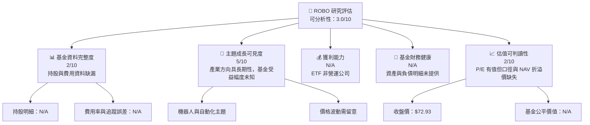

### 1.2 評分進度條視覺化

```text
╔══════════════════════════════════════════════════════════════╗
║              ROBO 研究可分析性儀表板（1-10分）               ║
╠══════════════════════════════════════════════════════════════╣
║ 基金資料完整度  2.0 ▓▓▓▓░░░░░░░░░░░░░░░░  ★☆☆☆☆          ║
║ 主題成長可見度  5.0 ▓▓▓▓▓▓▓▓▓▓░░░░░░░░░░  ★★★☆☆          ║
║ 獲利品質        N/A 不適用於 ETF                             ║
║ 基金財務健康    N/A 基金資產負債資料未提供                   ║
║ 估值可判讀性    2.0 ▓▓▓▓░░░░░░░░░░░░░░░░  ★☆☆☆☆          ║
║ 護城河深度      N/A 不適用於營運公司分析                     ║
║ 管理層執行      N/A 基金管理與追蹤資料未提供                 ║
║ 技術創新力      N/A 由持股公司決定，持股資料未提供           ║
╠══════════════════════════════════════════════════════════════╣
║ 研究可分析性    3.0 ▓▓▓▓▓▓░░░░░░░░░░░░░░  🟡 證據不足       ║
╚══════════════════════════════════════════════════════════════╝
```

### 1.3 五大投資論點與三大核心風險

| 類型 | 項目 | 具體依據 | 信心度 |
|------|------|----------|--------|
| 🟢 **論點①** | 機器人與自動化主題曝險 | 基金指數定位為投資機器人及／或自動化相關公司；指數持股證券配置通常至少占總資產 80% | 🟡 中 |
| 🟢 **論點②** | 多公司主題曝險 | ETF 結構可提供一籃子相關證券曝險，但目前持股數量及權重未提供，分散程度不能量化 | 🟡 中 |
| 🟢 **論點③** | 價格回落可能改善進場風險報酬 | $72.93 較資料中的 52 週高點 $90.51 低約 19.4%；但是否折價仍須比較 NAV 及持股價值 | 🟡 低 |
| 🟡 **論點④** | 產業應用有多元方向 | 自動化可延伸至工業、物流、醫療與服務等場景；ROBO 實際業務曝險無法由未提供的持股資料確認 | 🟡 低 |
| 🟡 **論點⑤** | 可用於主題配置而非個股選擇 | ETF 形式可降低單一公司的特定風險，但未提供的集中度、費用與追蹤資料限制比較 | 🟡 低 |
| 🔴 **風險①** | 估值與主題交易波動 | 月度價格從 2026-05 的 $88.64 到 2026-11 的 $72.93，跌約 17.7%；主題 ETF 仍可能大幅波動 | 🟡 中 |
| 🔴 **風險②** | 成分股與集中度不透明 | 前十大持股、國家及產業配置均為 N/A，無法量化單一持股或科技股因子風險 | 🔴 高 |
| 🟡 **風險③** | 分配收益欄位異常 | 資料包列 Dividend Yield **39.0%**，但未提供分配歷史、分配來源或計算口徑；不能視為可持續現金收益 | 🔴 高 |

### 1.4 快速統計卡片

| 指標 | ROBO 資料 | 同類 ETF／產業均值 | S&P 500 均值 | 狀態 |
|------|------------|--------------------|--------------|------|
| 收入 YoY 成長 | N/A；ETF 無公司營收 | N/A | N/A | ⚪ 不適用 |
| 毛利率 | N/A | N/A | N/A | ⚪ 不適用 |
| 淨利率 | N/A | N/A | N/A | ⚪ 不適用 |
| ROE | N/A | N/A | N/A | ⚪ 不適用 |
| Forward P/E | N/A | N/A | N/A | ⚪ 缺資料 |
| Trailing P/E | 28.56084x（來源口徑未提供） | N/A | N/A | 🟡 僅供參考 |
| 費用率 | N/A | N/A | N/A | 🔴 重要缺項 |
| 追蹤誤差 | N/A | N/A | N/A | 🔴 重要缺項 |
| 股息／分配殖利率 | 39.0%（資料包原值；需查核） | N/A | N/A | 🔴 不宜直接採信 |
| 2026-11-12 收盤價 | $72.93 | — | — | — |

### 1.5 投資結論

```text
╔══════════════════════════════════════════════════════════════════╗
║                    📊 投資結論摘要                               ║
╠══════════════════════════════════════════════════════════════════╣
║  評級：🟡 觀望／中性（資料不足；非 MOS 門檻模型評級）            ║
║  價格（2026-11-12 收盤）：$72.93                                 ║
║  DCF 內在價值（基準）：N/A（ETF 無公司 FCFF，持股與 NAV 未提供） ║
║  安全邊際 MOS：N/A（加權合理價值不可計算）                       ║
║  目標價區間：N/A；不以缺乏依據的假設值替代                         ║
║    悲觀情境：N/A                                                  ║
║    基準情境：N/A                                                  ║
║    樂觀情境：N/A                                                  ║
║  投資評分：研究可分析性 3.0/10                                   ║
║  適合投資人：能承受主題型波動、並願意先核實基金持股與費用者      ║
╚══════════════════════════════════════════════════════════════════╝
```

---

## 2. 公司概覽與商業模式

### 2.1 業務結構與投資範圍

ROBO 的投資標的是指數相關證券，而不是基金自身的營運收入。資料包只說明：基金通常至少將總資產 80% 投資於指數證券或代表該等證券的存託憑證；最多可將 20% 投資於未納入指數、但管理方認為有助追蹤指數的投資。實際持股、各產業權重及費用收入資料均為 N/A。

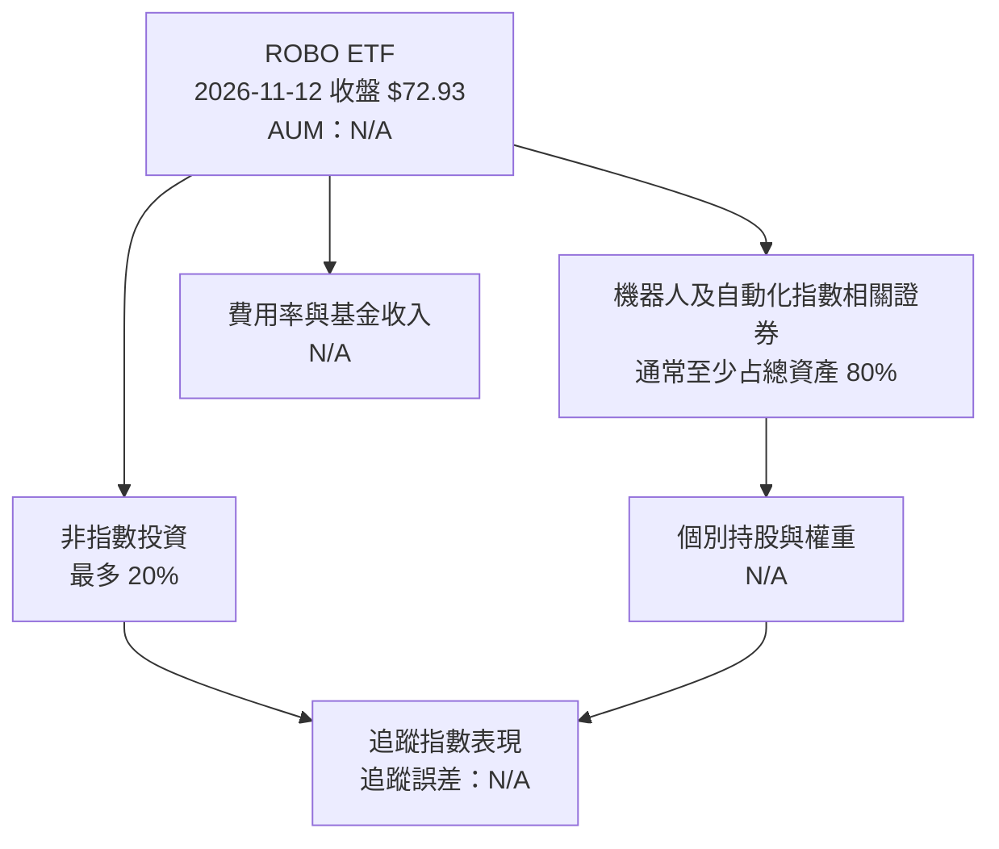

**重要限制**：無法把基金資產拆成工業機器人、醫療機器人、感測器、軟體或服務等金額；若此時給出百分比或美元金額會是虛構數據。

### 2.2 投資配置範圍示意

下圖是依投資政策上限與下限呈現的**配置邊界示意**，不是當期實際持股比例。

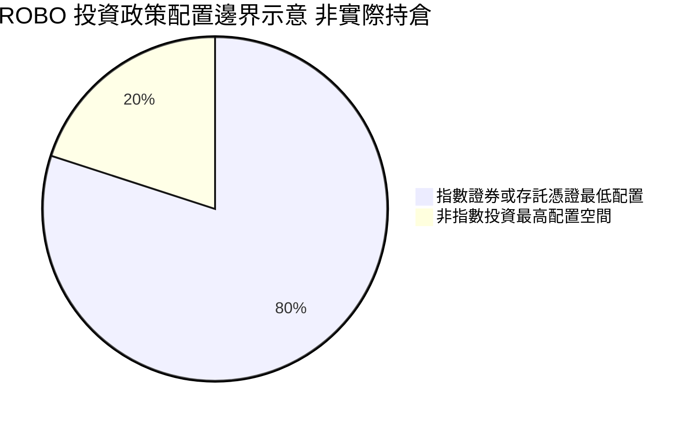

| 配置項目 | 政策描述 | 實際配置 |
|----------|----------|----------|
| 指數證券或代表性存託憑證 | 通常至少占總資產 80% | N/A |
| 非指數投資 | 最多可占總資產 20% | N/A |
| 現金與其他資產 | 未提供 | N/A |

### 2.3 競爭護城河分析

ETF 本身不是透過產品、專利或客戶鎖定賺取營業利潤的公司。基金層面的競爭力應檢查費用率、指數方法、流動性、AUM、追蹤品質與品牌，但資料包不足以量化。

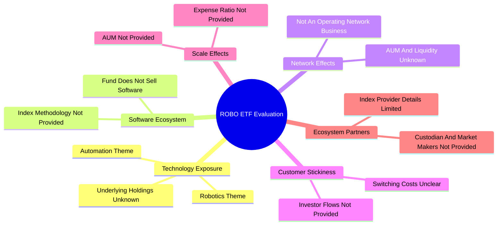

### 2.4 護城河／基金競爭力評估

```text
╔══════════════════════════════════════════════════════════════╗
║               ROBO 基金競爭力資料評估                       ║
╠══════════════════════════════════════════════════════════════╣
║ 主題曝險清晰度     6/10  ▓▓▓▓▓▓▓▓▓▓▓▓░░░░░░░░  🟡 定位明確 ║
║ 指數方法透明度     2/10  ▓▓▓▓░░░░░░░░░░░░░░░░  🔴 未提供   ║
║ 費用競爭力         N/A   費用率未提供                         ║
║ 規模與流動性       N/A   AUM 與成交資料未提供                 ║
║ 追蹤品質           N/A   追蹤誤差未提供                       ║
╠══════════════════════════════════════════════════════════════╣
║ 綜合競爭力評估     N/A   缺少比較基金與基金營運資料           ║
╚══════════════════════════════════════════════════════════════╝
```

---

## 3. 損益表深度分析

### 3.1 年度收入趨勢

ROBO 是 ETF，沒有可按公司財報理解的年度產品營收。基金管理費收入也未提供，故不能製作營收 CAGR。

```text
╔══════════════════════════════════════════════════════════════════╗
║              ROBO 年度公司營收趨勢                              ║
╠══════════════════════════════════════════════════════════════════╣
║  FY-3：N/A；ETF 不適用公司營收分析                               ║
║  FY-2：N/A；無年度基金管理收入資料                               ║
║  FY-1：N/A；無年度基金管理收入資料                               ║
║  FY0 ：N/A；資料包無收入報表                                     ║
╠══════════════════════════════════════════════════════════════════╣
║  年度營收 CAGR：N/A；不能以持股公司營收替代基金營收             ║
╚══════════════════════════════════════════════════════════════════╝
```

### 3.2 季度收入趨勢

| 期間 | 基金營收 | QoQ 成長率 | YoY 成長率 | 備註 |
|------|----------|------------|------------|------|
| 最近一季 | N/A | N/A | N/A | ETF 無公司季度營收報表 |
| 前一季 | N/A | N/A | N/A | 無基金管理收入或財報資料 |
| 前二季 | N/A | N/A | N/A | 無法計算 |
| 前三季 | N/A | N/A | N/A | 無法計算 |

**成長判讀**：基金價格的漲跌不是收入成長率。ROBO 的經濟報酬應以總報酬、NAV、分配與費用等資料評估，而非套用營運公司的營收成長分析。

### 3.3 利潤率演變分析

| 利潤率指標 | FY-3 | FY-2 | FY-1 | FY0 | 趨勢 | 評估 |
|------------|------|------|------|-----|------|------|
| 毛利率 | N/A | N/A | N/A | N/A | 不適用 | ETF 無產品毛利 |
| 營業利益率 | N/A | N/A | N/A | N/A | 不適用 | 無基金管理公司損益表 |
| EBITDA 利潤率 | N/A | N/A | N/A | N/A | 不適用 | 無法計算 |
| 淨利率 | N/A | N/A | N/A | N/A | 不適用 | ETF 投資損益不等同營運公司淨利 |

**利潤率演變深度解析**：基金投資人需比較總費用率與追蹤差異；兩者均未提供，因此不對成本控制或獲利趨勢作推論。

### 3.4 費用結構分析

實際費用率與持股交易成本未提供，不適合製作「費用占比」圓餅圖。可稽核的現況如下：

```text
╔══════════════════════════════════════════════════════════════╗
║                 ROBO 費用結構資料狀態                         ║
╠══════════════════════════════════════════════════════════════╣
║ 管理費／總費用率：N/A                                         ║
║ 指數授權與行政費：N/A                                         ║
║ 交易成本與買賣價差：N/A                                       ║
║ 稅務與其他支出：N/A                                           ║
╚══════════════════════════════════════════════════════════════╝
```

### 3.5 季度盈餘趨勢與盈餘品質

ETF 沒有可供比較的企業 EPS 驚喜紀錄；資料包亦未提供過去四季 EPS beat/miss。以下欄位對基金公司分析不適用，或缺乏資料。

| 盈餘品質項目 | 數值／佔比 | 評估 |
|--------------|------------|------|
| SBC／營收 | N/A | ETF 非營運公司，未提供基金管理公司的薪酬報表 |
| SBC／營業現金流 | N/A | 營業現金流資料缺漏 |
| FCF／淨利 | N/A | 企業淨利與 FCF 不適用 |
| 一次性／非經常性損益 | N/A | 無損益表 |
| 有效稅率 | N/A | 無企業所得稅資料 |
| 資本化支出 vs 費用化 | N/A | 無企業資本支出資料 |
| 最近四季 EPS 超預期／不及預期 | N/A | 資料包無 earnings history |

**盈餘品質結論**：不應把持股公司的盈餘品質視作 ROBO 本身的淨利品質；需先取得指數持股清單及權重，才能進一步評估組合企業的獲利品質。

---

## 4. 資產負債表分析

### 4.1 資產結構分解

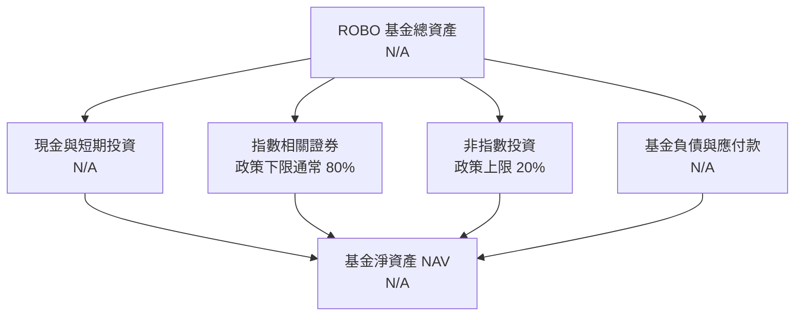

### 4.2 流動性指標分析

| 指標 | ROBO | 歷史趨勢 | 同類 ETF 均值 | 評估 |
|------|------|----------|---------------|------|
| 現金／總資產 | N/A | N/A | N/A | 無法判定 |
| Current Ratio | N/A | N/A | N/A | 不適合用企業流動比率直接評價 ETF |
| NAV | N/A | N/A | N/A | 關鍵資料缺項 |
| AUM | N/A | N/A | N/A | 無法比較規模與清算風險 |
| 買賣價差／市場流動性 | N/A | N/A | N/A | 缺交易資料 |

### 4.3 債務結構分析

```text
╔══════════════════════════════════════════════════════════════════╗
║                   ROBO 基金債務健康診斷                          ║
╠══════════════════════════════════════════════════════════════════╣
║  基金總負債：      N/A                                            ║
║  基金現金：        N/A                                            ║
║  基金淨現金／負債：N/A；資料包呈現 $0.00 為通用欄位，非可驗證估值 ║
║  Debt/Equity：     N/A                                            ║
║  Interest Coverage：N/A                                           ║
║  解讀：未取得資產負債表，不把 $0.00 解讀成已核實淨現金            ║
╚══════════════════════════════════════════════════════════════════╝
```

### 4.4 股東權益趨勢

ETF 的相關指標是基金淨資產及每股 NAV；基金總資產、基金負債及 NAV 均未提供，無法展示歷年淨資產變化。

```text
╔══════════════════════════════════════════════════════════════╗
║                   ROBO 淨資產趨勢                              ║
╠══════════════════════════════════════════════════════════════╣
║ FY-3：N/A  ░░░░░░░░░░░░░░░░░░░░                               ║
║ FY-2：N/A  ░░░░░░░░░░░░░░░░░░░░                               ║
║ FY-1：N/A  ░░░░░░░░░░░░░░░░░░░░                               ║
║ FY0 ：N/A  ░░░░░░░░░░░░░░░░░░░░                               ║
╚══════════════════════════════════════════════════════════════╝
```

---

## 5. 現金流量深度分析

### 5.1 現金流量瀑布圖

企業現金流瀑布圖不適用於 ETF；投資人實際經濟報酬由持股價格變化、現金分配、基金費用及追蹤差異構成。

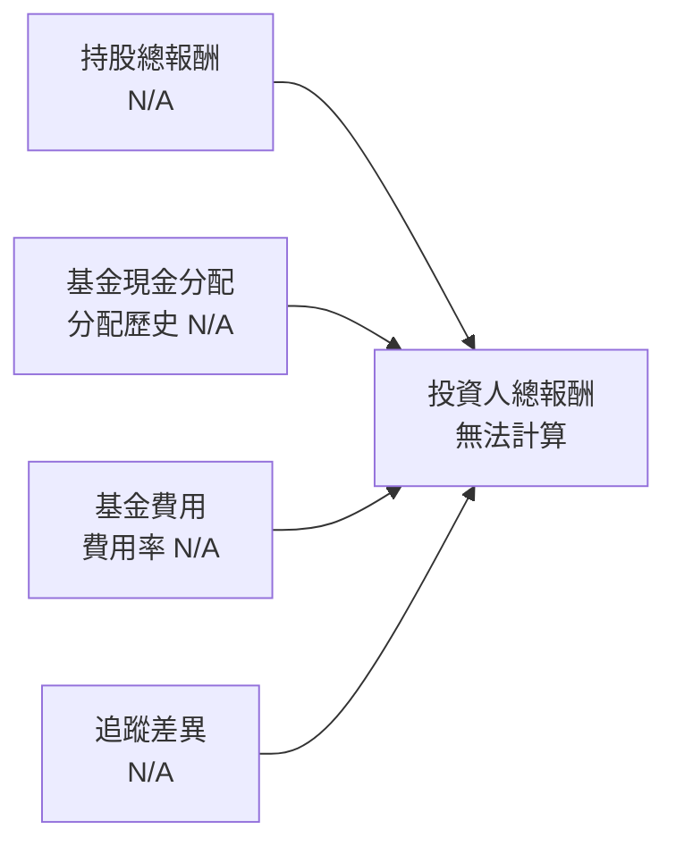

### 5.2 FCF 轉換率趨勢

| 年度 | FCF／Net Income | 趨勢 | 評估 |
|------|------------------|------|------|
| FY-3 | N/A | N/A | ETF 無企業 FCF／淨利轉換率 |
| FY-2 | N/A | N/A | 不適用 |
| FY-1 | N/A | N/A | 不適用 |
| FY0 | N/A | N/A | 不適用 |

### 5.3 自由現金流與殖利率

資料包對 Free Cash Flow（OCF − Capex）列為 N/A，符合基金不是營運公司的分析框架。不得以分配額或資產流入反推 FCF。

```text
╔══════════════════════════════════════════════════════════════╗
║              ROBO 現金流／分配資料狀態                        ║
╠══════════════════════════════════════════════════════════════╣
║ OCF（TTM）：N/A                                                ║
║ Capex（TTM）：N/A                                              ║
║ FCF（TTM，OCF − Capex）：N/A                                  ║
║ FCF Yield：N/A                                                 ║
║ 資料包 Dividend Yield：39.0%（需核對分配口徑與資料品質）       ║
╚══════════════════════════════════════════════════════════════╝
```

**分配收益率解讀**：39.0% 是資料包原始欄位，未提供每次分配金額、除息日、資本利得分配或 ROC（資本返還）資訊。它與一般對穩定現金殖利率的解讀存在重大落差；在查核前，不應據此預估年度現金收入或將其視為可持續收益。

### 5.4 資本配置評估

| 配置方向 | 數值 | 評估 |
|----------|------|------|
| 持股投資 | 實際權重 N/A；政策上通常至少 80% 投向指數證券或存託憑證 | 需取得季末持股核實 |
| 非指數投資 | 上限 20%；實際比例 N/A | 不代表固定配置 20% |
| Capex | N/A | ETF 投資人不以基金 Capex 評估 |
| 股息／分配 | 資料包殖利率 39.0%，口徑待查 | 不可直接判定可持續性 |
| 回購 | N/A | ETF 份額與基金資產流動不等同公司回購 |

---

## 6. 獲利能力與資本效率

### 6.1 ROE／ROA／ROIC 趨勢

| 指標 | 歷史值 | 行業均值 | 評估 |
|------|--------|----------|------|
| ROE | N/A | N/A | 不適用基金組合的企業獲利率評估 |
| ROA | N/A | N/A | 基金投資報酬不是營運資產報酬 |
| ROIC | N/A | N/A | ETF 沒有可一致計算的營運投入資本 |
| WACC | N/A | N/A | 基金不是營運公司的資本結構折現模型 |
| 投資人報酬 | 價格報酬可按歷史行情計算，總報酬因分配資料不足而 N/A | — | 不應將價格報酬與總報酬混為一談 |

### 6.2 ROIC vs WACC 分析

```text
╔══════════════════════════════════════════════════════════════════╗
║                ROIC vs WACC：不適用於 ROBO ETF                   ║
╠══════════════════════════════════════════════════════════════════╣
║  無風險利率 Rf：N/A（本資料包未提供基金估值用資本成本輸入）       ║
║  ERP：N/A                                                        ║
║  Beta：N/A                                                       ║
║  股權成本 Ke：N/A                                                ║
║  債務成本 Kd：N/A；基金計息債務資料未提供                        ║
║  WACC：N/A                                                       ║
║  ROIC：N/A                                                       ║
║  EVA（ROIC − WACC）：N/A                                         ║
║                                                                  ║
║  結論：不能據此判斷 ROBO 是否創造或摧毀營運股東價值；             ║
║        投資人應分析持股報酬、費用率、追蹤誤差與市場價格/NAV。     ║
╚══════════════════════════════════════════════════════════════════╝
```

### 6.3 杜邦三因素分解

杜邦分解是企業 ROE 分析，不適用基金本身。若要評估底層持股，可待取得完整持股及權重後，對持股企業逐一計算：

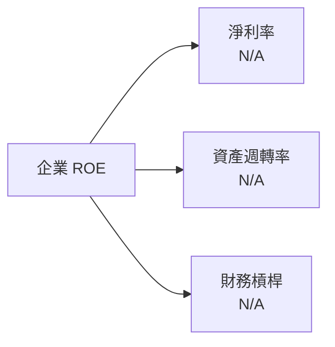

### 6.4 獲利能力儀表板

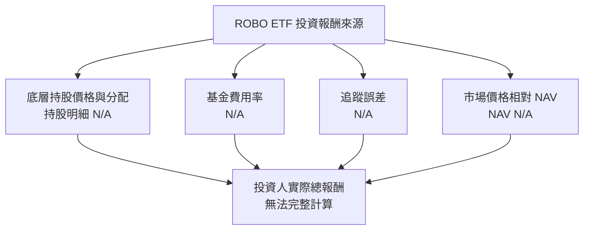

---

## 7. 相對估值分析

### 7.1 同業估值比較

同類型主題 ETF 可參考 BOTZ、IRBO、ARKQ，但資料包沒有 Peer multiples；以下比較只列基金名稱與可用性，不虛構倍數。依要求，未提供的同業數字標示「估計值」會造成誤導，因此採 N/A。

| 估值指標 | **ROBO** | **BOTZ** | **IRBO** | **ARKQ** | ROBO 評估 |
|----------|----------|----------|----------|----------|-----------|
| Trailing P/E | 28.56084x | N/A | N/A | N/A | 🟡 數值口徑未提供；不宜單獨判定便宜或昂貴 |
| Forward P/E | N/A | N/A | N/A | N/A | ⚪ 無法比較 |
| P/S | N/A | N/A | N/A | N/A | ⚪ 無法比較 |
| P/B | 240.69307x | N/A | N/A | N/A | 🔴 對 ETF 的帳面值解讀不明，參考價值有限 |
| EV/EBITDA | N/A | N/A | N/A | N/A | ⚪ 不適用／未提供 |
| 費用率 | N/A | N/A | N/A | N/A | 🔴 缺少重要比較維度 |
| 追蹤誤差 | N/A | N/A | N/A | N/A | 🔴 缺少重要比較維度 |
| AUM | N/A | N/A | N/A | N/A | 🟡 規模及流動性比較不可做 |

### 7.2 歷史估值區間分析

資料包沒有提供 ROBO 的歷史 P/E 區間或自有歷史估值百分位。因此不以價格走勢代替估值分位。

```text
╔══════════════════════════════════════════════════════════════╗
║                 ROBO 歷史估值位置                             ║
╠══════════════════════════════════════════════════════════════╣
║ 歷史 P/E 區間：N/A                                            ║
║ 當前 P/E 百分位：N/A                                          ║
║ NAV 折價／溢價：N/A                                           ║
║ 當前價格：$72.93（2026-11-12 收盤）                           ║
║ 判讀：缺乏歷史估值與 NAV，不能判斷目前處於自身估值區間何處      ║
╚══════════════════════════════════════════════════════════════╝
```

### 7.3 情境目標價

目前沒有足夠資料建立具可回溯假設的基金目標價：未提供持股清單、NAV、前瞻盈餘、指數成分與歷史總報酬。基金本身也沒有可採用的營收 CAGR 或營業利潤率。故不以任意退出倍數產生目標價。

| 情境 | 持股營收 CAGR | 期末營業利潤率 | 退出倍數 | 隱含目標價 | 相對現價 |
|------|---------------|----------------|----------|------------|----------|
| 🔴 悲觀 | N/A | N/A | N/A | N/A | N/A |
| 🟡 基準 | N/A | N/A | N/A | N/A | N/A |
| 🟢 樂觀 | N/A | N/A | N/A | N/A | N/A |

### 7.4 相對估值隱含價格區間

```text
╔══════════════════════════════════════════════════════════════╗
║               ROBO 相對估值隱含價格區間                       ║
╠══════════════════════════════════════════════════════════════╣
║ Forward P/E 回推：N/A（Forward P/E 及持股預測盈餘缺漏）        ║
║ EV/EBITDA 回推：N/A（ETF 無企業 EV/EBITDA）                   ║
║ EV/Sales 回推：N/A（ETF 無企業銷售額）                        ║
║ FCF Yield 回推：N/A（基金 FCF Yield 未提供）                  ║
║ 當前價格：$72.93（2026-11-12 收盤）                           ║
╚══════════════════════════════════════════════════════════════╝
```

---

## 8. DCF 內在價值評估（Discounted Cash Flow）

> **適用性結論**：ROBO 是 ETF，不是由單一營運企業產生 FCFF 的公司。資料包沒有基金持股明細、NAV、基金費用率或底層企業預測；直接套用企業 DCF，將把不存在的基金營收、EBIT、股數及現金流編造出來。故本章逐項說明不適用處，**不產生黑箱內在價值**。

### 8.0 估值推理鏈

**Step 1 — 價值來源**

ROBO 的投資價值可拆為：① 底層機器人與自動化持股的價格與分配報酬；② 基金費用與追蹤差異；③ 市場交易價格相對 NAV 的溢折價。三者目前皆無完整權重或金額資料，因此無法識別哪一項對公平價值的貢獻最大。主導估值的變數應是**底層持股估值及其權重**，但持股未提供，故不能量化。

**Step 2 — 模型選擇**

| 決策點 | 本報告採用 | 理由 | 曾考慮但否決 | 否決理由 |
|--------|-----------|------|--------------|----------|
| 現金流定義 | 不採 FCFF／FCFE | ETF 不是單一營運公司的現金流主體 | FCFF | 缺公司營運現金流、負債與資本結構 |
| 預測期 N | N/A | 無基金現金流預測資料 | 5 年 DCF | 任意指定年數會製造假精確 |
| 終值方法 | 不適用 | 無企業 FCFF 或 EBITDA | Gordon Growth | 缺少可折現現金流 |
| EBIT 基礎 | N/A | 基金無資料包所列企業 EBIT | GAAP／非 GAAP EBIT | 不得以底層未揭露數字代替 |

**Step 3 — 假設推導鏈**

關鍵輸入包括持股營收 CAGR、期末營業利潤率、永續成長率、預測期、Capex、D&A、營運資金、SBC、稀釋股數與 WACC。對這些輸入均沒有基金或持股層級的可核實錨點，故採用值全部為 **N/A**；不以產業印象代替實際資料。

**Step 4 — 最脆弱環節**

最脆弱的一環是基金實際持股與權重缺失；若持股集中於高估值或低獲利公司，基金合理價值可能低於單看機器人產業長期成長敘事所得的判斷。

**Step 5 — 計算路徑**

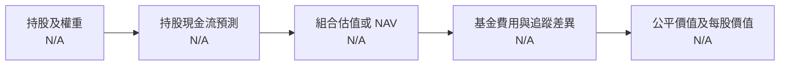

### 8.1 模型假設總表

| 假設項目 | 採用值 | 依據／來源 | 敏感度 |
|----------|--------|-------------|--------|
| 預測期長度 N | N/A | 無基金 FCFF 可預測 | N/A |
| 營收 CAGR | N/A | ROBO 無公司營收；持股營收未提供 | N/A |
| 營業利潤率 | N/A | 基金無公司營業利益；持股數據未提供 | N/A |
| 有效稅率 | N/A | 基金企業稅率資料缺漏 | N/A |
| Capex／營收 | N/A | 無可用營運報表 | N/A |
| D&A／營收 | N/A | 無可用營運報表 | N/A |
| ΔWC／營收增額 | N/A | 無可用營運報表 | N/A |
| EBIT 基礎 | N/A | 不適用基金 | N/A |
| SBC 處理 | N/A | 基金無可用企業薪酬現金流資料 | N/A |
| 年稀釋率 | N/A | ETF 份額變化與企業股權稀釋不同，份額資料未提供 | N/A |
| 永續成長率 g | N/A | 無 FCFF 終值基礎 | N/A |
| 終值方法 | 不適用 | 不計算企業終值 | N/A |
| WACC | N/A | 無基金企業資本成本輸入 | N/A |

**FCF 定義**：資料包的 FCF 定義為 OCF − Capex，ROBO 的 OCF、Capex 與 FCF 均為 N/A；因此沒有可採用的 FCFF 或 FCFE 預測。

### 8.2 折現率推導（WACC）

```text
╔══════════════════════════════════════════════════════════════╗
║                 WACC 推導：不適用於 ROBO ETF                  ║
╠══════════════════════════════════════════════════════════════╣
║ 無風險利率 Rf：N/A（VERIFIED FIGURES 未提供）                  ║
║ ERP：N/A（未提供）                                             ║
║ Beta：N/A（市場資料欄位為 N/A）                                ║
║ 股權成本 Ke：N/A                                               ║
║ 債務成本 Kd：N/A（基金計息負債與利息費用未提供）               ║
║ 股權／債務權重：N/A（基金市值、份額與計息負債資料不足）        ║
║ WACC：N/A                                                      ║
╚══════════════════════════════════════════════════════════════╝
```

**五步核算**：Ke、稅前 Kd、稅後 Kd、資本權重與 WACC 均缺少必要輸入，無法進行可複算推導；不將資料包中的 N/A 或 $0.00 通用欄位當作經核實的零值。

### 8.3 逐年自由現金流預測

由於不存在可用基金 FCFF，無法合理宣告預測期 N 或逐年編造現金流。下表以 N/A 說明不可計算；不是一組企業財務預測。

| 項目 | FY+1 | FY+2 | FY+3 | FY+4 | FY+5 |
|------|------|------|------|------|------|
| 營收 | N/A | N/A | N/A | N/A | N/A |
| 營收 YoY | N/A | N/A | N/A | N/A | N/A |
| EBIT | N/A | N/A | N/A | N/A | N/A |
| 稅與 NOPAT | N/A | N/A | N/A | N/A | N/A |
| D&A | N/A | N/A | N/A | N/A | N/A |
| Capex | N/A | N/A | N/A | N/A | N/A |
| ΔWC | N/A | N/A | N/A | N/A | N/A |
| FCFF | N/A | N/A | N/A | N/A | N/A |
| 折現因子 | N/A | N/A | N/A | N/A | N/A |
| FCFF 現值 | N/A | N/A | N/A | N/A | N/A |

逐步演算與 FCFF CAGR、終年 FCF 利潤率比較均為 **N/A**，因起始營收、現金流及 WACC 不存在可用輸入。

### 8.4 終值計算

**適用性檢查**：WACC N/A、g N/A → `WACC > g？N/A`，無法檢驗。Gordon Growth 與退出倍數法均不適用：沒有 FY+N FCFF、EBITDA 或可用的終值基礎。

### 8.5 企業價值 → 每股內在價值橋接

```text
╔══════════════════════════════════════════════════════════════╗
║            ROBO ETF 價值橋接：無法計算                        ║
╠══════════════════════════════════════════════════════════════╣
║ 預測期 FCF 現值合計：N/A                                      ║
║ 終值現值 PV(TV)：N/A                                          ║
║ 企業價值 EV：N/A                                              ║
║ 現金及短期投資：N/A                                           ║
║ 總債務：N/A                                                   ║
║ 少數股東權益／其他：N/A                                       ║
║ 股權價值：N/A                                                 ║
║ 稀釋後流通股數：N/A                                           ║
║ DCF 每股內在價值：N/A                                         ║
║ 當前價格：$72.93（2026-11-12 收盤）                           ║
║ 折溢價：N/A                                                   ║
║ 安全邊際 MOS：不在此節計算；8.8 加權合理價值亦為 N/A          ║
╚══════════════════════════════════════════════════════════════╝
```

### 8.6 敏感性分析

沒有基準 FCFF、WACC、終值或股數，WACC × g 的每股價值矩陣無法建立。以任意假設產生矩陣會造成不可複核的假精確。

| 情境輸入 | 基準值 | 估值敏感性 |
|----------|--------|------------|
| WACC | N/A | N/A |
| 永續成長率 g | N/A | N/A |
| 終值現值 | N/A | N/A |
| 每股價值對 g 的彈性 | N/A | N/A |
| 每股價值對 WACC 的彈性 | N/A | N/A |
| 每股價值對持股利潤率的彈性 | N/A | N/A |

**三情境 DCF**：悲觀、基準與樂觀每股價值及機率均為 N/A；無可用持股營收與現金流模型推導情境價值。

### 8.7 反推 DCF

現價為 $72.93，但缺少組合 NAV、持股預測與估值框架，不能由一個價格反解多個或單一經營變數。

| 求解變數 | 固定基準輸入 | 市場隱含值 | 歷史實際 | 判斷 |
|----------|--------------|------------|----------|------|
| 持股營收 CAGR | 缺持股及模型輸入 | N/A | N/A | 無法判斷 |
| 期末營業利潤率 | 缺持股及模型輸入 | N/A | N/A | 無法判斷 |
| 永續成長率 g | 缺 FCFF 與 WACC | N/A | — | 無法判斷 |
| 高成長持續年數 N | 缺預測現金流 | N/A | — | 無法判斷 |

### 8.8 估值三角驗證與安全邊際

| 估值方法 | 隱含每股價值 | 上行空間（÷現價） | 權重 | 說明 |
|----------|--------------|-------------------|------|------|
| DCF | N/A | N/A | 未配置 | ETF 無可用 FCFF |
| 同業 Forward P/E | N/A | N/A | 未配置 | ROBO 與同業 Forward P/E 均未提供 |
| EV/EBITDA | N/A | N/A | 未配置 | 不適用 ETF 公司估值 |
| FCF Yield 回推 | N/A | N/A | 未配置 | FCF Yield N/A |
| 分析師共識目標價 | N/A | N/A | 未配置 | 共識目標價 N/A |
| **加權合理價值** | **N/A** | **N/A** | **無法合計** | 缺少可用估值項目與權重 |

因此，**加權合理價值 = N/A**，不能計算 MOS、上行空間或買入區間。MOS 的分母應為加權合理價值；由於該值不存在，不得用單一 DCF、歷史高點或現價取代。

```text
╔══════════════════════════════════════════════════════════════╗
║                  估值區間與安全邊際                          ║
╠══════════════════════════════════════════════════════════════╣
║ 52 週低點 $62.53 ── 現價 $72.93 ── 52 週高點 $90.51          ║
║ 此為歷史價格區間，不是悲觀／基準／樂觀內在價值                ║
║ 加權合理價值：N/A                                             ║
║ 安全邊際 MOS：N/A                                             ║
║ 上行空間：N/A                                                 ║
║ 建議買入區間：N/A；需先取得 NAV、費用與持股估值               ║
╚══════════════════════════════════════════════════════════════╝
```

### 8.9 DCF 模型的局限與失效條件

- **終值依賴度**：N/A；未建立 DCF，不能報告終值占 EV 比重。
- **最脆弱的假設**：不是某個可量化的 FCFF 假設，而是缺少實際持股與權重；這會使任何組合估值結論失去基礎。
- **不適用情境**：基金不是單一公司；應改用 NAV、持股穿透估值、費用率、追蹤差異及市場流動性分析。
- **與第 10 章風險矩陣連結**：成分股估值回落會降低 NAV；持股集中會放大單一產業或公司衝擊；費用及追蹤偏差會侵蝕基金相對指數的回報。

### 8.10 複算檢核表

| # | 檢核項目 | 檢查方式 | 結果 |
|---|----------|----------|------|
| 1 | 高／中敏感度輸入均有推導 | 基金 DCF 不適用，輸入皆列 N/A 並說明原因 | ✅ |
| 2 | 假設均有來歷 | 未把無資料項目靜默填成數字 | ✅ |
| 3 | WACC 五步算式 | Rf、ERP、Beta、Kd、權重缺漏，未假算 | ✅ |
| 4 | Kd 與 D 範圍一致 | 計息負債資料未提供，不計算 | ✅ |
| 5 | WACC 與第 6.2 節一致 | 兩處均為 N/A | ✅ |
| 6 | 預測期與年度欄位 | N 未宣告；表格只用於標示 N/A，不作數值預測 | ✅ |
| 7 | FY+1 九步計算 | FCFF 不存在，不能演算 | ✅ |
| 8 | 預測期 PV 加總 | N/A | ✅ |
| 9 | WACC > g | 兩者均 N/A，未錯用 Gordon Growth | ✅ |
| 10 | 終值基期及折現期 | 未計算終值 | ✅ |
| 11 | EV 至每股價值橋接 | 所有必要輸入缺漏，明列 N/A | ✅ |
| 12 | SBC 三要素相容 | 不適用 ETF；未做 SBC 調整或稀釋假設 | ✅ |
| 13 | 敏感性基準格 | 沒有基準 DCF，不製作虛假矩陣 | ✅ |
| 14 | 矩陣有效性 | 無矩陣，沒有不合法 WACC ≤ g 數字 | ✅ |
| 15 | 三情境機率 | 不適用；不配置無依據機率 | ✅ |
| 16 | 反推 DCF 單一變數 | 缺模型，未作不可複現的反推 | ✅ |
| 17 | MOS／折溢價定義 | 加權公平價值 N/A，故兩者均未冒算 | ✅ |
| 18 | 報告完整性 | 已涵蓋至第 11 章 | ✅ |
| 19 | 加權合理價值合計 | 無可用估值項目，未假造權重 | ✅ |
| 20 | 評級門檻一致性 | MOS N/A；觀望屬資料不足下的研究狀態，不宣稱為 MOS 評級 | ✅ |

---

## 9. 成長催化劑

### 9.1 催化劑時間軸

以下是可能影響主題產業的方向，不是 ROBO 或其持股已確認的營收催化劑；持股曝險未提供。

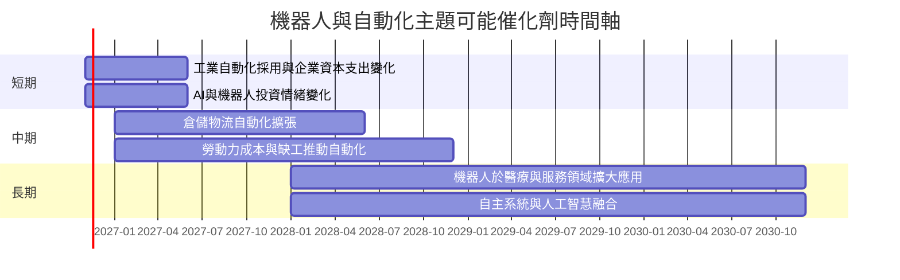

### 9.2 TAM 市場規模分析

資料包沒有提供機器人／自動化 TAM、滲透率或 ROBO 持股公司的相關營收，故不引用未經驗證的市場規模數字。

```text
╔══════════════════════════════════════════════════════════════╗
║             TAM 與 ROBO 可歸屬收入：資料狀態                 ║
╠══════════════════════════════════════════════════════════════╣
║ 工業自動化 TAM：N/A；市場規模與年度口徑未提供               ║
║ 物流／倉儲機器人 TAM：N/A                                    ║
║ 醫療與服務機器人 TAM：N/A                                    ║
║ ROBO 持股公司相關營收：N/A                                   ║
║ ROBO 對各市場的持股權重：N/A                                 ║
╚══════════════════════════════════════════════════════════════╝
```

### 9.3 成長驅動力結構圖

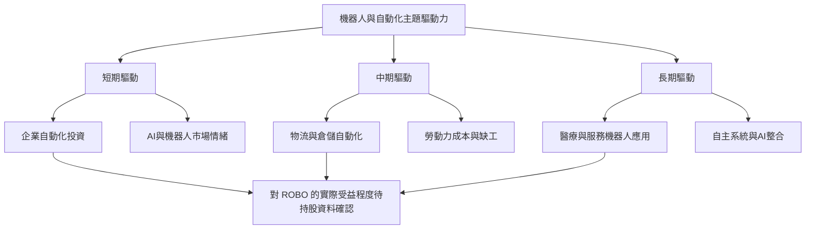

---

## 10. 風險矩陣

### 10.1 風險評分矩陣

以下風險評分是定性研究評估，不是歷史統計機率。所有象限節點依要求使用英文。

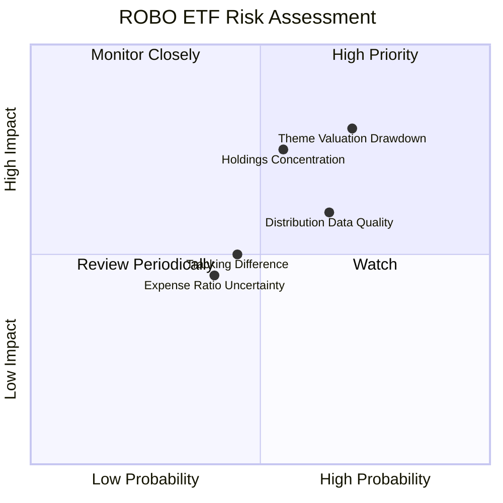

### 10.2 風險清單詳細分析

| # | 風險項目 | 發生機率 | 財務衝擊 | 風險評分 | 緩解措施 |
|---|----------|----------|----------|----------|----------|
| 1 | 🔴 **主題估值回落** | 中高；定性估計 | 價格可能進一步低於 $72.93；幅度無法精確估計 | 🔴 7.5/10 | 以組合曝險與估值分散控制部位；不因產業敘事追高 |
| 2 | 🔴 **持股集中度與因子風險未知** | 中；集中度資料缺漏 | 前十大持股或科技成長因子若集中，可能放大回撤 | 🔴 7.0/10 | 取得持股清單、前十大權重、產業及國家配置後再建倉 |
| 3 | 🟡 **分配收益率欄位失真** | 中高；39.0% 數據需核實 | 若將一次性分配誤認為固定收益，可能高估預期現金回報 | 🔴 6.5/10 | 核對基金正式分配公告、每股分配、收益來源與歷史紀錄 |
| 4 | 🟡 **費用率及追蹤差異缺失** | 中 | 長期費用與追蹤偏差會降低相對指數總報酬 | 🟡 5.5/10 | 查閱基金公開說明書、年報及指數追蹤資料 |
| 5 | 🟡 **市場流動性與買賣價差** | 未知 | 大額交易可能增加交易成本 | 🟡 4.5/10 | 核實 AUM、平均成交量、買賣價差及限價單執行品質 |

---

## 11. 投資建議

### 11.1 最終綜合評級雷達圖

```text
╔══════════════════════════════════════════════════════════════╗
║                   ROBO 綜合評估雷達                           ║
╠══════════════════════════════════════════════════════════════╣
║ 主題定位       6/10  ▓▓▓▓▓▓▓▓▓▓▓▓░░░░░░░░  🟡 清晰         ║
║ 基金資料完整度 2/10  ▓▓▓▓░░░░░░░░░░░░░░░░  🔴 欠缺         ║
║ 估值可判讀性   2/10  ▓▓▓▓░░░░░░░░░░░░░░░░  🔴 欠缺         ║
║ 費用競爭力     N/A   費用率未提供                             ║
║ 追蹤品質       N/A   追蹤誤差未提供                           ║
║ 基金財務健康   N/A   基金資產負債資料未提供                   ║
╠══════════════════════════════════════════════════════════════╣
║ 最終立場：🟡 觀望；先補足持股、NAV、費用、追蹤及分配資料       ║
╚══════════════════════════════════════════════════════════════╝
```

### 11.2 目標價與隱含報酬率

| 情境／參考價格 | 價格 | 相對 2026-11-12 收盤 $72.93 | 權重 | 說明 |
|----------------|------|-----------------------------|------|------|
| 悲觀內在價值 | N/A | N/A | N/A | 無可稽核的持股估值與情境假設 |
| 基準內在價值 | N/A | N/A | N/A | 無 NAV、費用與底層盈餘預測 |
| 樂觀內在價值 | N/A | N/A | N/A | 無法建立可複算目標價 |
| 52 週低點參考 | $62.53 | 約 -14.3% | 不適用 | 歷史市場價格，不是目標價 |
| 52 週高點參考 | $90.51 | 約 +24.1% | 不適用 | 歷史市場價格，不是目標價 |

以上兩個歷史價格的相對變化是價格比較，不包含分配，也不代表未來報酬或基本面估值。

### 11.3 買入時機與觸發因素

```text
╔══════════════════════════════════════════════════════════════════╗
║                  ✅ 研究與交易觸發因素 Checklist                 ║
╠══════════════════════════════════════════════════════════════════╣
║  在考慮新增部位前，先完成以下查核：                              ║
║  ☐ 取得最新持股明細、前十大持股權重與產業配置                    ║
║  ☐ 核實基金費用率、AUM、平均成交量及買賣價差                    ║
║  ☐ 核對 NAV、折溢價與實際追蹤誤差                               ║
║  ☐ 查核 39.0% 分配殖利率的計算口徑及分配來源                    ║
║                                                                  ║
║  加碼觸發條件：                                                  ║
║  ☐ 持股透明、費用與追蹤品質相較可比 ETF 有足夠競爭力            ║
║  ☐ 持股估值回落但產業基本面與基金組合曝險仍符合投資論點          ║
║                                                                  ║
║  減碼／停止新增條件：                                            ║
║  ☐ 持股集中度或高估值成長股曝險高於投資人風險承受能力            ║
║  ☐ NAV 折價、追蹤偏差或買賣價差持續惡化                          ║
║  ☐ 分配數據無法核實，或主要來自一次性資本利得／本金返還          ║
╚══════════════════════════════════════════════════════════════════╝
```

### 11.4 投資人適配度分析

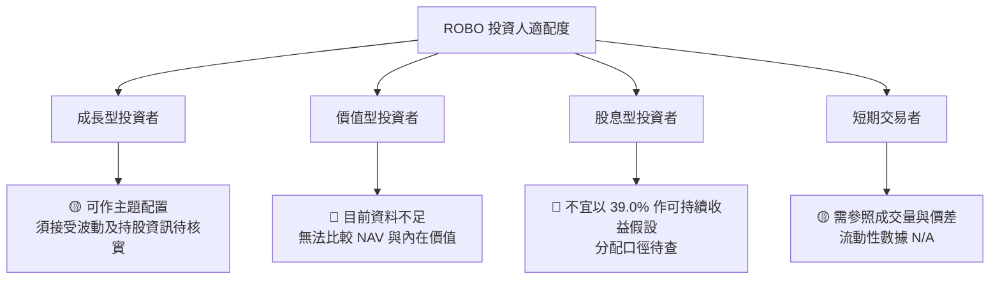

### 11.5 每季監控清單（Quarterly Watch List）

| 監控項目 | 目前資料 | 加碼／改善訊號 | 減碼／警示訊號 |
|----------|----------|----------------|----------------|
| 前十大持股與權重 | N/A | 組合分散且持股符合投資主題 | 持股集中度高於個人風險預算 |
| 產業與國家曝險 | N/A | 符合原定投資配置 | 單一產業、國家或因子曝險快速上升 |
| 費用率 | N/A | 費用透明且具可比競爭力 | 費用高於可比基金且無策略差異補償 |
| NAV 折溢價 | N/A | 價格接近 NAV | 折溢價擴大或流動性惡化 |
| 追蹤誤差 | N/A | 長期追蹤品質穩定 | 追蹤偏差擴大 |
| AUM、成交量與價差 | N/A | 規模及流動性足以支援預定交易 | AUM 下滑或價差擴大 |
| 分配紀錄及來源 | 資料包殖利率 39.0%，待核實 | 分配規律且來源清楚 | 分配主要由非經常性收益或本金返還構成 |
| 指數方法與成分調整 | N/A | 規則透明、與主題一致 | 成分指標或篩選邏輯不透明 |

### 11.6 反面論證：什麼會證明論點錯誤

```text
╔══════════════════════════════════════════════════════════════════╗
║              ⚠️ 論點失效條件（Disconfirming Evidence）            ║
╠══════════════════════════════════════════════════════════════════╣
║  下列任一狀況出現時，應重新檢視 ROBO 的投資適配性：              ║
║  ☐ 實際持股與機器人／自動化主題關聯弱於基金名稱所暗示的曝險      ║
║  ☐ 前十大持股或單一產業集中度超過投資人的風險承受範圍            ║
║  ☐ 長期追蹤差異在扣除費用後持續落後其指數                       ║
║  ☐ 費用率與交易成本合計高於可比 ETF，且無相應績效或策略優勢      ║
║  ☐ 39.0% 分配殖利率被證實不是可持續的現金分配                    ║
║  ☐ 基金 NAV、AUM 或流動性條件惡化至不利於預定交易                ║
║  ☐ 底層持股盈利與現金流惡化，且市場估值仍未充分反映下修風險      ║
╚══════════════════════════════════════════════════════════════════╝
```

**最終評級**：🟡 **觀望／中性**。ROBO 提供機器人與自動化主題曝險，但現有資料不足以驗證費用競爭力、持股品質、NAV 折溢價、追蹤能力及分配可持續性。由於公平價值與加權合理價值均為 N/A，本評級不是根據 MOS 門檻得出；在取得基金官方持股、費用、NAV、追蹤與分配資料前，不提供缺乏依據的買入區間或目標價。

> **免責聲明**：本報告為 AI 自動生成，僅供研究參考，不構成投資建議。投資有風險，入市需謹慎。