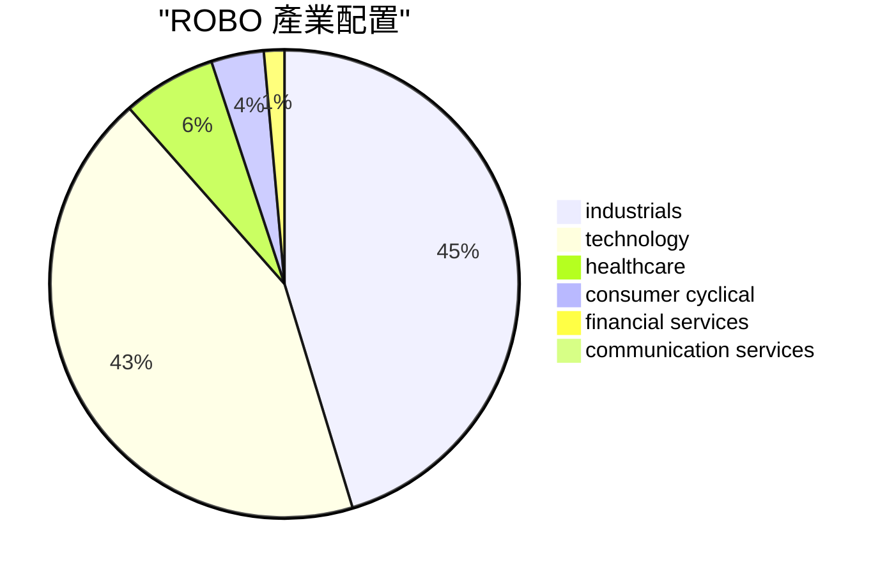

# ROBO ETF 分析報告

> **報告日期**：2026-11-14 ｜ **語言**：繁體中文 ｜ **數據來源**：Yahoo Finance、Finviz ｜ **類型**：ETF／指數基金

## 目錄

| # | 章節 | 核心結論 |
|---|------|----------|
| 1 | 執行摘要 | 以機器人與自動化為主題，較適合作為衛星配置。 |
| 2 | 基金概況 | 投資目標聚焦機器人與自動化相關企業。 |
| 3 | 成本與規模 | 費用率高於類別平均，資產規模為 1.89B USD。 |
| 4 | 持股與集中度 | 前十大合計權重不高，單一持股權重有限，但基金仍有主題集中風險。 |
| 5 | 產業配置 | 工業與科技為主要產業曝險。 |
| 6 | 績效與風險 | 各主要期間均落後 VTI，且歷史波動與回撤幅度較大。 |
| 7 | 估值與配息 | 提供投資組合 P/E、P/B 與殖利率作參考，不代表基金合理價值。 |
| 8 | 適合對象、風險與觀察重點 | 適合能承受主題波動、並以其他資產分散配置的投資人。 |

---

## 1. 執行摘要

ROBO 是聚焦機器人與自動化相關企業的 ETF，基金通常至少將總資產的 80% 投資於指數成分證券或其存託憑證。  
基金淨費用率為 0.95%，高於類別平均 0.90%；前十大持股合計 17.4%，最大單一持股權重為 2.20%。  
截至 2026-11-13，ROBO 收盤價為 72.11 USD；相對 VTI，1 年、3 年與 5 年超額報酬分別為 -6.1%、-22.5% 與 -52.4%。  
年化波動率為 28.9%，歷史最大回撤為 -43.8%；綜合主題集中、相對績效與風險特徵，定位為「衛星配置」。

### 1.1 一頁式摘要

| 項目 | 內容 |
|------|------|
| 追蹤標的／類別 | 機器人與自動化相關企業；Robo Global／Technology |
| 費用率（同類平均） | 0.95%（0.90%） |
| 資產規模 | 1.89B USD |
| 前十大合計權重／最大持股 | 17.4%／2.20% |
| 1 年／3 年／5 年價格報酬 | +4.4%／+49.2%／+0.8% |
| 相對基準的超額報酬（1 年／3 年／5 年） | -6.1%／-22.5%／-52.4% |
| 年化波動率／最大回撤 | 28.9%／-43.8% |
| 折溢價 | +0.10% |
| 定位 | **衛星配置** |

### 1.2 五項評分

| 評分項目 | 分數（0–10） | 依據（引用數字） |
|----------|-------------:|------------------|
| 成本 | 3 | 費用率 0.95%，高於同類平均 0.90%；相較同類平均並無成本優勢。 |
| 規模與流動性 | 8 | 資產規模為 1.89B USD，規模具一定基礎；成交量與買賣價差資料未提供，評分不代表對盤中流動性的完整判斷。 |
| 分散度 | 8 | 前十大合計 17.4%，最大單一持股為 2.20%；持股權重分散，但主題仍集中於機器人與自動化相關產業。 |
| 相對績效 | 2 | 相對 VTI 的 1 年、3 年、5 年超額報酬分別為 -6.1%、-22.5%、-52.4%，各期間均落後基準。 |
| 風險 | 3 | 年化波動率為 28.9%，歷史最大回撤為 -43.8%；反映較大的價格波動與下跌幅度。 |

---

## 2. 基金概況

| 項目 | 資料 |
|------|------|
| 基金名稱 | Robo Global Robotics and Automation Index ETF |
| 代號 | ROBO |
| 基金家族／類別 | Robo Global／Technology |
| 投資主題 | 機器人與自動化相關企業 |
| 產業／國家 | N/A（資料未提供） |
| 基金型態 | ETF／指數基金 |
| 分散型態 | 基金資料標示為 non-diversified |

ROBO 的投資主題是機器人與自動化。基金說明指出，相關指數旨在衡量機器人相關及／或自動化相關公司的表現；基金通常至少將總資產的 80% 投資於指數證券或代表指數證券的存託憑證。

基金亦可將最高 20% 的資產投資於不在指數中的投資標的，若顧問認為該等投資有助於追蹤指數。這是基金說明所提供的投資範圍，不代表實際配置一定達到該比例。

| 基金特性 | 對投資人的意義 |
|----------|----------------|
| 主題式投資 | 報酬受機器人、自動化相關企業與產業發展影響，不等同於廣泛持有整體股市。 |
| 指數導向 | 基金以相關指數為投資依據；指數編製規則細節為 N/A（資料未提供）。 |
| Non-diversified | 基金資料標示為非分散型；但前十大持股權重仍可用來觀察個別持股集中程度。 |
| 配置角色 | 可作為投資組合中的主題曝險或衛星配置；是否適合仍取決於投資人整體資產配置與風險承受度。 |

| 未提供的資料 | 狀態 |
|--------------|------|
| 指數編製與成分篩選規則 | N/A（資料未提供） |
| 指數成分股數量 | N/A（資料未提供） |
| 追蹤誤差 | N/A（資料未提供） |
| 基金是否進行匯率避險 | N/A（資料未提供） |

---

## 3. 成本與規模

### 3.1 費用與基金規模

| 指標 | ROBO |
|------|------|
| 淨費用率 | 0.95% |
| Technology 類別平均費用率 | 0.90% |
| 淨資產 | 1.89B USD |
| 年持股週轉率 | 35.0% |

ROBO 的費用率高於所列類別平均。費用率是持有基金的持續性成本之一；實際投資結果還會受市場報酬、交易成本、稅務與持有期間影響。

基金資產規模為 1.89B USD，可作為觀察基金規模的參考。不過，資產規模本身不能代表投資人一定能以低價差成交；交易量與買賣價差資料為 N/A（資料未提供）。

年持股週轉率為 35.0%，表示基金持股有一定程度的更替。此數值不能單獨判斷基金的實際交易成本或追蹤品質。

### 3.2 費用試算

| 試算項目 | 金額 | 說明 |
|----------|------:|------|
| 以 1,000,000 USD 試算 10 年費用 | 95,000 USD | 依目前費用率、不假設投資報酬的簡化試算；並非對未來實際費用的保證。 |

### 3.3 折溢價

| 指標 | 數值 |
|------|------:|
| 基金價格（2026-11-13 收盤） | 72.11 USD |
| NAV | 72.04 USD |
| 價格相對 NAV 的折溢價 | +0.10% |

截至資料日期，價格相對 NAV 為小幅溢價。折溢價會隨市場價格與基金淨值變化；單一時點的數值不代表其他交易日的成交狀況。

---

## 4. 持股與集中度

### 4.1 前十大持股

| 排名 | 代號 | 名稱 | 權重 |
|-----:|------|------|-----:|
| 1 | ISRG | Intuitive Surgical Inc | 2.20% |
| 2 | PTC | PTC Inc | 1.85% |
| 3 | ROK | Rockwell Automation Inc | 1.79% |
| 4 | 6954.T | Fanuc Corp | 1.78% |
| 5 | NOVT | Novanta Inc | 1.76% |
| 6 | EMR | Emerson Electric Co | 1.67% |
| 7 | 2317.TW | Hon Hai Precision Industry Co Ltd | 1.61% |
| 8 | ILMN | Illumina Inc | 1.60% |
| 9 | HEXA-B.ST | Hexagon AB Class B | 1.59% |
| 10 | IPGP | IPG Photonics Corp | 1.58% |

### 4.2 集中度解讀

| 集中度指標 | 數值 | 解讀 |
|------------|------:|------|
| 前十大持股合計 | 17.4% | 前十大合計權重未達基金資產的一半，投資結果不只由少數幾檔最大持股決定。 |
| 最大單一持股 | 2.20% | 單一最大持股對基金整體的直接權重有限，但仍可能受該公司個別股價波動影響。 |
| 持股分布說明 | 前十大低於基金資產的一半 | 持股權重相對分散；然而，持股集中在相似主題，並不等於整體投資風險已充分分散。 |

基金資料將 ROBO 標示為 non-diversified；同時，所列前十大持股合計為 17.4%。兩者描述的是不同層面的資訊：前者是基金的分散型態標示，後者則是目前前十大持股權重的分布。

本節僅列出資料中提供的前十大持股；前十大以外持股為 N/A（資料未提供），不推測或補列其他持股。

---

## 5. 產業配置

### 5.1 產業權重

| 產業 | 權重 |
|------|-----:|
| industrials | 44.9% |
| technology | 42.8% |
| healthcare | 6.4% |
| consumer cyclical | 3.6% |
| financial services | 1.4% |
| communication services | 0.9% |

### 5.2 配置解讀

| 觀察面向 | 說明 |
|----------|------|
| 最大產業曝險 | industrials，權重為 44.9%。 |
| 次大產業曝險 | technology，權重為 42.8%。 |
| 主要投資押注 | 投資人主要承擔工業與科技相關企業的產業風險，並以機器人與自動化主題作為選股方向。 |
| 其他產業 | healthcare、consumer cyclical、financial services 與 communication services 均有配置，但各自權重低於前兩大產業。 |

產業權重顯示，ROBO 並非只押注單一產業分類，但主要風險仍集中於工業與科技相關曝險。產業分類不等同於個別公司的營收來源，也不能據此推算基金對特定終端市場的營收比例。

---

## 6. 績效與風險

### 6.1 各期間價格報酬

下表為價格報酬，**不含配息**；基準為 VTI（美國整體市場）。超額報酬依資料區塊原值列示。

| 期間 | ROBO 價格報酬 | VTI 基準報酬 | 超額報酬 |
|------|--------------:|-------------:|---------:|
| 1 個月 | -6.7% | -1.9% | -4.8% |
| 3 個月 | -15.0% | -2.9% | -12.1% |
| 6 個月 | -15.2% | +2.3% | -17.5% |
| 1 年 | +4.4% | +10.5% | -6.1% |
| 3 年 | +49.2% | +71.7% | -22.5% |
| 5 年 | +0.8% | +53.1% | -52.4% |

ROBO 在表列的各期間均落後 VTI。較長期間的相對落後幅度較大，表示投資人若以美國整體市場作比較基準，需留意主題投資與廣泛市場的表現差異。

### 6.2 波動、回撤與歷史報酬

| 指標 | 數值 | 說明 |
|------|------:|------|
| 年化波動率（1 年） | 28.9% | 衡量價格報酬波動程度；數值較高代表期間內價格變動較大。 |
| 歷史最大回撤 | -43.8% | 依資料庫所存歷史計算；谷底日期為 2022-10-14。 |
| 最大回撤統計期間 | 10.0 years | 資料區塊所存歷史期間。 |
| 所存歷史期間 CAGR | 9.9% | 為所存歷史資料期間的年化複合報酬，不代表未來報酬。 |

最大回撤表示歷史高點至其後低點的跌幅紀錄，不代表未來最大損失上限。年化波動率與最大回撤亦是不同的風險指標，不能互相替代。

### 6.3 最大回撤情境試算

| 情境 | 金額 | 說明 |
|------|------:|------|
| 1,000,000 USD 對應最大回撤的帳面減少金額 | 437,500 USD | 依區塊提供的 Worked example；為套用歷史最大回撤的帳面情境，不代表實際未來損失。 |

### 6.4 月收盤價紀錄

以下列出價格資料庫提供的月收盤價；此表只呈現歷史數值，不表示未來走勢或預測。

| 月份 | 收盤價（USD） |
|------|--------------:|
| 2024-11 | 57.05 |
| 2024-12 | 56.02 |
| 2025-01 | 58.87 |
| 2025-02 | 56.29 |
| 2025-03 | 51.28 |
| 2025-04 | 50.66 |
| 2025-05 | 55.71 |
| 2025-06 | 59.53 |
| 2025-07 | 62.07 |
| 2025-08 | 63.48 |
| 2025-09 | 65.29 |
| 2025-10 | 69.33 |
| 2025-11 | 68.04 |
| 2025-12 | 69.31 |
| 2026-01 | 72.38 |
| 2026-02 | 78.41 |
| 2026-03 | 68.43 |
| 2026-04 | 81.65 |
| 2026-05 | 88.64 |
| 2026-06 | 85.66 |
| 2026-07 | 79.25 |
| 2026-08 | 80.44 |
| 2026-09 | 80.46 |
| 2026-10 | 74.62 |
| 2026-11 | 72.11 |

---

## 7. 估值與配息

| 指標 | 數值 | 解讀 |
|------|------:|------|
| 投資組合 P/E | 29.2x | Yahoo Finance 報告的加權投資組合本益比。 |
| 投資組合 P/B | 3.2x | Yahoo Finance 報告的加權投資組合股價淨值比。 |
| 配息殖利率 | 0.39% | Yahoo Finance 提供的基金配息殖利率。 |
| 配息紀錄 | N/A（資料未提供） | 無法據此說明配息頻率、歷次金額或未來配息。 |

P/E 與 P/B 反映基金成分股的整體評價指標，不是 ROBO 這檔基金本身的「合理價值」。本報告不依這些倍數推算合理價值，也不提供目標價。

配息殖利率不能單獨代表總報酬；本報告所列各期間價格報酬不含配息，亦不包含稅負與交易成本。

---

## 8. 適合對象、風險與觀察重點

### 8.1 適合與不適合的投資人

| 投資人類型 | 適合度 | 原因（引用數字） |
|------------|--------|------------------|
| 希望增加機器人與自動化主題曝險的投資人 | 較適合 | 基金以機器人與自動化相關企業為主題，industrial 與 technology 權重分別為 44.9% 與 42.8%。 |
| 已持有廣泛市場基金、希望增加主題配置的投資人 | 可考慮作衛星配置 | 相對 VTI 的 1 年、3 年、5 年超額報酬為 -6.1%、-22.5%、-52.4%，不宜將過去相對落後忽略。 |
| 重視低成本的投資人 | 較不適合 | 費用率為 0.95%，高於類別平均 0.90%。 |
| 無法承受較大價格波動的投資人 | 較不適合 | 年化波動率為 28.9%，歷史最大回撤為 -43.8%。 |
| 需要穩定配息作為主要現金流的投資人 | 較不適合 | 配息殖利率為 0.39%；配息紀錄與配息頻率為 N/A（資料未提供）。 |
| 希望基金單獨代表廣泛股市配置的投資人 | 較不適合 | 基金聚焦機器人與自動化主題；相對 VTI 的各表列期間超額報酬均為負。 |

### 8.2 主要風險

| 風險 | 數據依據 | 對投資人的可能影響 |
|------|----------|--------------------|
| 主題與產業風險 | industrials 權重為 44.9%，technology 權重為 42.8%。 | 若機器人與自動化相關企業所處產業或市場環境轉弱，基金主要曝險可能同時受影響。 |
| 個股風險 | 最大單一持股為 2.20%，前十大合計為 17.4%。 | 單一最大持股權重有限，但個別成分股仍可能因公司自身狀況而波動。 |
| 市場波動與回撤風險 | 年化波動率為 28.9%，歷史最大回撤為 -43.8%。 | 投資期間可能經歷較大價格起伏與帳面下跌；歷史回撤不代表未來損失上限。 |
| 相對基準落後風險 | 相對 VTI 的 1 年、3 年、5 年超額報酬分別為 -6.1%、-22.5%、-52.4%。 | 主題基金可能在部分市場環境下明顯落後廣泛市場。 |
| 海外市場與匯率風險 | 前十大包含 6954.T、2317.TW、HEXA-B.ST；基金匯率避險資訊為 N/A（資料未提供）。 | 投資人需留意海外市場與匯率可能造成的影響；實際幣別曝險與避險安排無法由現有資料確認。 |
| 評價風險 | 投資組合 P/E 為 29.2x、P/B 為 3.2x。 | 成分股評價變動可能影響基金價格；上述倍數不等同基金合理價值。 |

### 8.3 什麼情況下要重新評估

| 可查核條件 | 重新評估的理由 |
|------------|----------------|
| 最大單一持股權重相較目前 2.20% 明顯提高 | 檢視個股曝險是否增加，以及基金分散程度是否改變。 |
| 前十大合計權重相較目前 17.4% 明顯提高 | 評估基金是否由較分散的持股權重轉為更依賴少數大型持股。 |
| 淨費用率由目前 0.95% 調整 | 重新比較費用與可替代基金的成本；同類平均目前為 0.90%。 |
| 相對 VTI 的表現持續落後，或落後期間延伸 | 參照本報告的 1 年、3 年、5 年超額報酬，並檢視後續同期間的相對表現。 |
| 淨資產相較目前 1.89B USD 明顯縮減 | 重新檢視基金規模變化；成交量與買賣價差亦需另行查核。 |
| 產業配置與投資人原先設定的主題曝險不符 | 以基金最新產業配置與持股資料確認投資主題是否仍符合原定配置。 |

### 8.4 結論

**定位：衛星配置。** ROBO 的投資主題集中於機器人與自動化相關企業，industrial 與 technology 權重分別為 44.9% 與 42.8%；費用率為 0.95%，高於類別平均 0.90%。相對 VTI 的 1 年、3 年與 5 年超額報酬分別為 -6.1%、-22.5%、-52.4%，而年化波動率與歷史最大回撤分別為 28.9% 與 -43.8%。這些數據支持將其視為主題曝險，而非僅憑現有資訊將其視為核心市場配置。

---

> **免責聲明**：本報告為 AI 自動生成，僅供研究與教育參考，不構成投資建議。報酬為價格報酬，未計入配息、稅負與交易成本；投資有風險。

---

## 資料與來源

| 項目 | 內容 |
|------|------|
| 價格 | 72.11 USD，2026-11-13 收盤（Yahoo Finance 日線） |
| 基金資料 | Yahoo Finance（持股、費用率、規模）；績效與回撤由價格資料庫計算 |
| 有回應的資料來源 | Yahoo Finance、Finviz |
| 未回應的資料來源 | SEC 申報資料 (XBRL)、StockAnalysis、Roic.ai |
| 由程式計算 | 基金的集中度、績效、費用與回撤試算 |
| 撰寫模型 | openai / gpt-6-luna |

> 本區塊由產生報告的程式依實際取得的資料填寫，非模型撰寫。「由程式計算」的數字不是模型的估計；其餘判斷（評分、情境、策略）是模型的分析。
