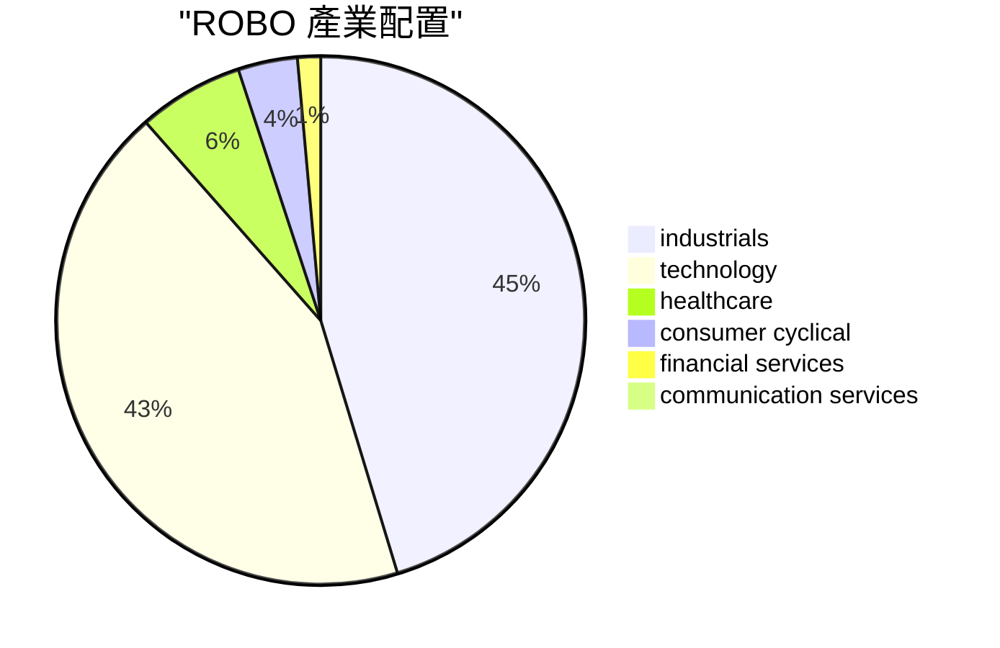

# ROBO ETF 分析報告

> **報告日期**：2026-11-18 ｜ **語言**：繁體中文 ｜ **數據來源**：Yahoo Finance、Finviz ｜ **類型**：ETF／指數基金

## 目錄

| # | 章節 | 核心結論 |
|---|------|----------|
| 1 | 執行摘要 | 聚焦機器人與自動化主題，適合作為衛星配置評估 |
| 2 | 基金概況 | 投資目標為機器人與自動化相關企業 |
| 3 | 成本與規模 | 費用率高於同類平均，資產規模為 1.89B USD |
| 4 | 持股與集中度 | 前十大合計 17.4%，最大單一持股為 2.20% |
| 5 | 產業配置 | 工業與科技是主要產業曝險 |
| 6 | 績效與風險 | 1 年、3 年、5 年均落後 VTI，波動與回撤幅度明顯 |
| 7 | 估值與配息 | 提供成分股加權估值與殖利率，不代表基金合理價值 |
| 8 | 適合對象、風險與觀察重點 | 評估持有者能否承受主題曝險與較大波動 |

---

## 1. 執行摘要

ROBO 是 Robo Global 旗下的機器人與自動化主題 ETF；基金通常至少將 80% 總資產投資於指數證券或代表指數證券的存託憑證，並可將最多 20% 資產配置於基金顧問認為有助追蹤指數的非指數投資。

基金淨費用率為 0.95%，高於同類平均 0.90%；前十大持股合計 17.4%，最大單一持股權重為 2.20%，顯示所列持股並未高度集中於單一公司。

截至 2026-11-17，ROBO 收盤價為 68.44 USD；其 1 年、3 年、5 年價格報酬分別為 +2.6%、+41.1%、-4.1%，相對 VTI 的超額報酬分別為 -6.6%、-24.6%、-52.9%。

1 年年化波動率為 29.0%，歷史最大回撤為 -43.8%；結合主題型曝險與相對基準表現，定位為「衛星配置」。

### 1.1 一頁式摘要

| 項目 | 內容 |
|------|------|
| 追蹤標的／類別 | 機器人與自動化相關企業；Robo Global／Technology |
| 費用率（同類平均） | 0.95%（0.90%） |
| 資產規模 | 1.89B USD |
| 前十大合計權重／最大持股 | 17.4%／2.20% |
| 1 年／3 年／5 年價格報酬 | +2.6%／+41.1%／-4.1% |
| 相對基準的超額報酬（1 年／3 年／5 年） | -6.6%／-24.6%／-52.9% |
| 年化波動率／最大回撤 | 29.0%／-43.8% |
| 折溢價 | -0.15% |
| 定位 | 衛星配置 |

### 1.2 五項評分

| 評分項目 | 分數（0–10） | 依據（引用數字） |
|----------|-------------:|------------------|
| 成本 | 4 | 費用率 0.95%，高於同類平均 0.90%；同類比較下成本評分偏低。 |
| 規模與流動性 | 8 | 資產規模為 1.89B USD，依基金規模評分；成交量、買賣價差等流動性資料為 N/A（資料未提供）。 |
| 分散度 | 8 | 前十大合計 17.4%，最大持股為 2.20%；前十大持股權重低於基金資產的一半。 |
| 相對績效 | 2 | 相對 VTI 的 1 年、3 年、5 年超額報酬分別為 -6.6%、-24.6%、-52.9%。 |
| 風險 | 3 | 1 年年化波動率為 29.0%，最大回撤為 -43.8%；兩項指標均顯示較大的價格波動風險。 |

> 本節評分為各項獨立判斷，不加總、不計算平均，亦非買賣建議。

## 2. 基金概況

| 項目 | 說明 |
|------|------|
| 基金名稱 | Robo Global Robotics and Automation Index ETF |
| 代號 | ROBO |
| 基金家族 | Robo Global |
| 類別 | Technology |
| 投資主題 | 機器人與自動化相關企業 |
| 是否為非多元化基金 | 是 |
| 成分股數量 | N/A（資料未提供） |
| 指數編製規則細節 | N/A（資料未提供） |
| 追蹤誤差 | N/A（資料未提供） |

基金簡介指出，ROBO 的指數旨在衡量機器人相關及／或自動化相關公司的表現。

基金通常至少將 80% 總資產投資於指數證券，或代表指數證券的存託憑證。

基金亦可將最多 20% 資產投資於不在指數內的標的；基金顧問與副顧問認為，這些投資有助於追蹤指數。

基金被標示為「非多元化」。此分類不等同於前十大持股必然占比很高；本報告會同時參考基金分類與實際揭露的持股權重。

| 投資組合用途 | 說明 |
|------------|------|
| 主題曝險 | 提供機器人與自動化相關企業的集中主題曝險。 |
| 配置角色 | 可作為廣泛市場型投資之外的主題型配置；不宜將其與涵蓋範圍更廣的整體市場基金視為相同用途。 |
| 投資人需留意 | 主題相關企業的股價、產業配置與海外持股都可能影響基金表現。 |

## 3. 成本與規模

### 3.1 費用與基金規模

| 指標 | ROBO |
|------|------|
| 淨費用率 | 0.95% |
| 同類平均費用率 | 0.90% |
| 淨資產 | 1.89B USD |
| 年持股週轉率 | 35.0% |

ROBO 的淨費用率為 0.95%，同類平均為 0.90%，基金費用高於所列同類平均。

基金費用是持有期間的持續成本；長期持有時，投資人應留意費用率是否調整，以及基金的主題曝險是否符合配置目的。

以 1,000,000 USD 為例，依目前費用率、假設持有 10 年且不計報酬，費用試算為 **95,000 USD**。

這是簡化試算，不計投資報酬，並非對未來實際費用或基金報酬的預測。

資產規模為 1.89B USD，可用來觀察基金規模；但規模本身不代表每日成交量、買賣價差或交易流動性。

年持股週轉率為 35.0%，代表基金持股有一定程度的調整；此數值不等同於交易成本，實際交易成本資料為 N/A（資料未提供）。

### 3.2 折溢價

| 指標 | 數值 |
|------|------|
| 淨值（NAV） | 68.54 USD |
| 收盤價對淨值折溢價 | -0.15% |
| 折溢價資料日期 | 2026-11-17 收盤價資料 |

目前價格相對淨值為折價，折溢價幅度為 -0.15%。

折溢價是市場價格與基金淨值之間的差異指標，不等同於基金成分股的估值，也不能單獨用來判斷投資價值。

## 4. 持股與集中度

### 4.1 前十大持股

| 代號 | 名稱 | 權重 |
|------|------|-----:|
| ISRG | Intuitive Surgical Inc | 2.20% |
| PTC | PTC Inc | 1.85% |
| ROK | Rockwell Automation Inc | 1.79% |
| 6954.T | Fanuc Corp | 1.78% |
| NOVT | Novanta Inc | 1.76% |
| EMR | Emerson Electric Co | 1.67% |
| 2317.TW | Hon Hai Precision Industry Co Ltd | 1.61% |
| ILMN | Illumina Inc | 1.60% |
| HEXA-B.ST | Hexagon AB Class B | 1.59% |
| IPGP | IPG Photonics Corp | 1.58% |

### 4.2 集中度解讀

| 指標 | 數值 |
|------|------|
| 前十大持股合計 | 17.4% |
| 最大單一持股 | ISRG，2.20% |

前十大持股合計為 17.4%，最大單一持股 ISRG 權重為 2.20%；以已揭露的前十大權重來看，基金資產並非主要集中在少數幾檔股票。

但這不代表基金沒有集中風險：基金的投資主題仍集中於機器人與自動化相關企業，且基金被標示為非多元化。

持有者的報酬不只受單一公司影響，也會受到整體主題、產業曝險與海外持股表現牽動。

前十大以外的持股未列於資料中，本報告不推測或列示其他持股。

## 5. 產業配置

### 5.1 產業權重

| 產業 | 權重 |
|------|-----:|
| 工業（industrials） | 44.9% |
| 科技（technology） | 42.8% |
| 醫療保健（healthcare） | 6.4% |
| 非必需消費（consumer cyclical） | 3.6% |
| 金融服務（financial services） | 1.4% |
| 通訊服務（communication services） | 0.9% |

### 5.2 配置重點

工業是最大產業曝險，權重為 44.9%；科技權重為 42.8%。

投資人持有 ROBO，實際上是在承擔以工業與科技為主的機器人及自動化主題曝險。

雖然基金持股涵蓋醫療保健、非必需消費、金融服務與通訊服務等產業，但這些產業的個別權重均低於工業與科技。

產業配置反映的是基金目前揭露的分類權重，不代表各產業未來報酬或風險的預測。

## 6. 績效與風險

### 6.1 各期間價格報酬

| 期間 | ROBO 價格報酬 | VTI 基準報酬 | 超額報酬 |
|------|--------------:|-------------:|---------:|
| 1 個月 | -9.9% | -4.1% | -5.8% |
| 3 個月 | -16.3% | -5.2% | -11.0% |
| 6 個月 | -17.1% | +0.0% | -17.1% |
| 1 年 | +2.6% | +9.2% | -6.6% |
| 3 年 | +41.1% | +65.6% | -24.6% |
| 5 年 | -4.1% | +48.8% | -52.9% |

以上為截至 2026-11-17 的價格報酬，不含配息；基準為 VTI（美國整體市場）。

在 1 年、3 年與 5 年期間，ROBO 的價格報酬均低於 VTI，超額報酬依序為 -6.6%、-24.6%、-52.9%。

較短期間亦呈現落後：1 個月、3 個月與 6 個月的超額報酬分別為 -5.8%、-11.0%、-17.1%。

基金歷史區間 CAGR 為 9.2%；該數值屬於已儲存歷史期間的表現資料，不代表未來報酬。

### 6.2 波動與回撤

| 風險指標 | 數值 |
|----------|------|
| 年化波動率（1 年） | 29.0% |
| 最大回撤（已儲存歷史，10.0 年） | -43.8% |
| 最大回撤低點日期 | 2022-10-14 |

1 年年化波動率為 29.0%，反映期間內價格變動程度；波動率不是未來損失幅度的上限。

已儲存歷史中的最大回撤為 -43.8%，低點日期為 2022-10-14。最大回撤表示歷史價格曾出現的高點至低點跌幅，不保證未來不會出現更大跌幅。

以 1,000,000 USD 為例，按最大回撤計算的帳面減少金額為 **437,500 USD**。這是回撤情境下的帳面金額示例，不是對未來損失的預測。

### 6.3 近期月末價格紀錄

以下列出資料提供的月末收盤價；本表不計算月報酬，也不代表完整日內價格走勢。

| 月份 | 收盤價 |
|------|-------:|
| 2024-11 | 57.05 |
| 2024-12 | 56.02 |
| 2025-01 | 58.87 |
| 2025-02 | 56.29 |
| 2025-03 | 51.28 |
| 2025-04 | 50.66 |
| 2025-05 | 55.71 |
| 2025-06 | 59.53 |
| 2025-07 | 62.07 |
| 2025-08 | 63.48 |
| 2025-09 | 65.29 |
| 2025-10 | 69.33 |
| 2025-11 | 68.04 |
| 2025-12 | 69.31 |
| 2026-01 | 72.38 |
| 2026-02 | 78.41 |
| 2026-03 | 68.43 |
| 2026-04 | 81.65 |
| 2026-05 | 88.64 |
| 2026-06 | 85.66 |
| 2026-07 | 79.25 |
| 2026-08 | 80.44 |
| 2026-09 | 80.46 |
| 2026-10 | 74.62 |
| 2026-11 | 68.44 |

## 7. 估值與配息

| 指標 | 數值 |
|------|------:|
| 投資組合本益比（P/E） | 29.2x |
| 投資組合股價淨值比（P/B） | 3.2x |
| 配息殖利率 | 0.39% |
| 配息紀錄 | N/A（資料未提供） |

P/E 與 P/B 為 Yahoo Finance 報告的投資組合加權指標，反映成分股整體評價，不是 ROBO 基金本身的企業估值。

配息殖利率為 0.39%；實際配息金額、頻率與歷史紀錄為 N/A（資料未提供）。

上述倍數與殖利率不構成合理價值、目標價或未來報酬估算，也不能單獨用來判斷基金是否便宜或昂貴。

## 8. 適合對象、風險與觀察重點

### 8.1 適合與不適合的投資人

| 投資人類型 | 適合度 | 原因（引用數字） |
|------------|--------|------------------|
| 希望增加機器人與自動化主題曝險者 | 適合評估 | 基金投資目標聚焦機器人與自動化相關企業，工業與科技權重分別為 44.9% 與 42.8%。 |
| 已有廣泛市場配置、希望增加主題部位者 | 可評估作為衛星配置 | 1 年、3 年、5 年相對 VTI 的超額報酬分別為 -6.6%、-24.6%、-52.9%，需接受主題表現可能落後整體市場。 |
| 重視低費用的投資人 | 較不適合 | ROBO 費用率為 0.95%，高於同類平均 0.90%。 |
| 無法承受較大帳面波動的投資人 | 較不適合 | 1 年年化波動率為 29.0%，最大回撤為 -43.8%。 |
| 需要穩定配息作為主要投資目的者 | 較不適合 | 配息殖利率為 0.39%，配息紀錄為 N/A（資料未提供）。 |

### 8.2 主要風險

| 風險 | 對應資料 | 說明 |
|------|----------|------|
| 主題曝險風險 | 工業權重 44.9%；科技權重 42.8% | 投資組合主要曝險於工業與科技，主題或相關產業表現不佳時，基金可能受到影響。 |
| 市場波動與回撤風險 | 年化波動率 29.0%；最大回撤 -43.8% | 歷史資料顯示基金曾經歷較大價格波動與回撤；歷史最大回撤不構成未來跌幅上限。 |
| 相對績效風險 | 1 年、3 年、5 年超額報酬為 -6.6%、-24.6%、-52.9% | 所列中長期區間均落後 VTI；主題曝險不保證持續優於整體市場。 |
| 海外持股與匯率風險 | 持股包括 6954.T、2317.TW、HEXA-B.ST | 海外證券可能涉及外幣與當地市場變動；各幣別曝險及匯率影響數值為 N/A（資料未提供）。 |
| 成分股評價風險 | 投資組合 P/E 為 29.2x，P/B 為 3.2x | 成分股估值變動可能影響基金價格；這些加權倍數並非基金合理價值。 |

### 8.3 什麼情況下要重新評估

| 可查核條件 | 重新評估方式 |
|------------|--------------|
| 最大單一持股權重高於目前的 2.20% | 檢視持股集中度是否上升，以及基金曝險是否仍符合原本的配置目的。 |
| 前十大合計權重高於目前的 17.4% | 檢視組合是否更依賴少數持股，並重新確認分散度判斷。 |
| 費用率不再是 0.95%，或同類平均不再是 0.90% | 重新比較基金成本與同類產品，確認費用是否仍可接受。 |
| 更新後的 1 年、3 年或 5 年相對 VTI 表現持續為負 | 檢視相對基準表現與持有主題曝險的理由是否改變。 |
| 淨資產低於目前的 1.89B USD | 追蹤資產規模變化；另應查看成交量及買賣價差，因相關流動性資料目前為 N/A（資料未提供）。 |
| 產業權重相較目前的工業 44.9%、科技 42.8% 出現明顯改變 | 確認基金實際曝險是否仍符合原先預期的機器人與自動化主題配置。 |

> **免責聲明**：本報告為 AI 自動生成，僅供研究與教育參考，不構成投資建議。報酬為價格報酬，未計入配息、稅負與交易成本；投資有風險。

---

## 資料與來源

| 項目 | 內容 |
|------|------|
| 價格 | 68.44 USD，2026-11-17 收盤（Yahoo Finance 日線） |
| 基金資料 | Yahoo Finance（持股、費用率、規模）；績效與回撤由價格資料庫計算 |
| 有回應的資料來源 | Yahoo Finance、Finviz |
| 未回應的資料來源 | SEC 申報資料 (XBRL)、StockAnalysis、Roic.ai |
| 由程式計算 | 基金的集中度、績效、費用與回撤試算 |
| 撰寫模型 | openai / gpt-6-luna |

> 本區塊由產生報告的程式依實際取得的資料填寫，非模型撰寫。「由程式計算」的數字不是模型的估計；其餘判斷（評分、情境、策略）是模型的分析。
