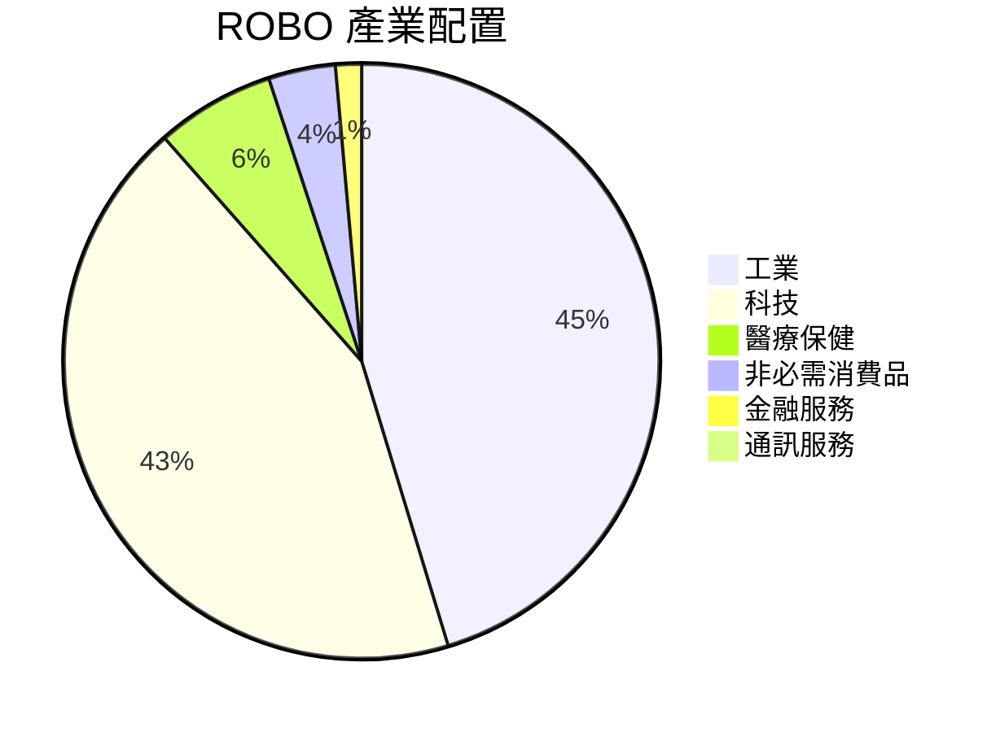

# ROBO ETF 分析報告

> **報告日期**：2026-11-23 ｜ **語言**：繁體中文 ｜ **數據來源**：Yahoo Finance、Finviz ｜ **類型**：ETF／指數基金

## 目錄

| # | 章節 | 核心結論 |
|---|------|----------|
| 1 | 執行摘要 | ROBO 是機器人與自動化主題 ETF；費用率高於同類平均，近期各觀察期間均落後 VTI，較適合作為衛星配置。 |
| 2 | 基金概況 | 投資主題涵蓋機器人與自動化相關公司，投資組合以工業與科技產業為主。 |
| 3 | 成本與規模 | 資產規模為 1.89B USD；費用率為 0.95%，高於同類平均 0.90%。 |
| 4 | 持股與集中度 | 前十大持股合計 17.4%，最大單一持股為 2.20%。 |
| 5 | 產業配置 | 工業占 44.9%，科技占 42.8%，兩者是主要產業曝險。 |
| 6 | 績效與風險 | 1 年、3 年與 5 年均落後 VTI；年化波動率為 29.7%，最大回撤為 -43.8%。 |
| 7 | 估值與配息 | 投資組合 P/E 為 29.2x、P/B 為 3.2x，配息殖利率為 0.39%。 |
| 8 | 適合對象、風險與觀察重點 | 可作為主題型衛星配置；需留意產業、匯率、評價與相對績效風險。 |

---

## 1. 執行摘要

ROBO 投資於機器人與自動化相關公司，基金通常至少將總資產的 80% 投資於指數證券或其存託憑證，另可將最多 20% 投資於指數外、管理方認為有助追蹤指數的投資。  
基金費用率為 0.95%，高於同類平均 0.90%；前十大持股合計 17.4%，最大單一持股為 Intuitive Surgical Inc（ISRG），權重為 2.20%。  
截至 2026-11-20，ROBO 的 1 年、3 年與 5 年價格報酬分別為 -2.8%、+23.2% 與 -11.8%，相對 VTI 的超額報酬分別為 -7.3%、-29.5% 與 -52.4%。  
截至 2026-11-20，收盤價為 62.56 USD；年化波動率為 29.7%，歷史最大回撤為 -43.8%，因此本報告將 ROBO 定位為「衛星配置」。

### 1.1 一頁式摘要

| 項目 | 內容 |
|------|------|
| 追蹤標的／類別 | 機器人與自動化相關公司；基金類別為 Technology |
| 費用率（同類平均） | 0.95%（0.90%） |
| 資產規模 | 1.89B USD |
| 前十大合計權重／最大持股 | 17.4%／2.20%（ISRG） |
| 1 年／3 年／5 年價格報酬 | -2.8%／+23.2%／-11.8% |
| 相對基準的超額報酬（1 年／3 年／5 年） | -7.3%／-29.5%／-52.4%（基準：VTI） |
| 年化波動率／最大回撤 | 29.7%／-43.8% |
| 折溢價 | -7.44%（折價） |
| 定位 | 衛星配置 |

### 1.2 五項評分

| 評分項目 | 分數（0–10） | 依據（引用數字） |
|----------|-------------:|------------------|
| 成本 | 4 | 費用率為 0.95%，高於同類平均 0.90%；依相對同類成本判斷，分數偏低。 |
| 規模與流動性 | 8 | 資產規模為 1.89B USD，依資產規模給予較高評分；成交量與買賣價差資料為 N/A（資料未提供），因此評分不代表對交易流動性的直接衡量。 |
| 分散度 | 8 | 前十大合計權重為 17.4%，最大持股為 2.20%；單一持股與前十大權重相對分散，但基金簡介仍標示為 non-diversified。 |
| 相對績效 | 1 | 1 年、3 年、5 年相對 VTI 的超額報酬分別為 -7.3%、-29.5%、-52.4%；三個觀察期間均落後基準。 |
| 風險 | 3 | 年化波動率為 29.7%，歷史最大回撤為 -43.8%；波動與回撤幅度均顯示較高的價格風險。 |

## 2. 基金概況

| 項目 | 資料 |
|------|------|
| 代號 | ROBO |
| 名稱 | Robo Global Robotics and Automation Index ETF |
| 基金家族 | Robo Global |
| 基金類別 | Technology |
| 產業／國家／員工資料 | N/A（資料未提供） |
| 投資主題 | 機器人相關及／或自動化相關公司 |
| 指數編製規則細節 | N/A（資料未提供） |
| 成分股數量 | N/A（資料未提供） |

### 投資方式與基金定位

- 基金通常至少將總資產的 80% 投資於指數證券，或代表指數證券的存託憑證。
- 基金可將最多 20% 的資產投資於不在指數內、但管理方認為有助於追蹤指數的投資。
- 基金簡介標示為 non-diversified；這是基金的分類描述，與前十大持股權重較分散的觀察並不相同。
- 依其機器人與自動化主題定位，ROBO 通常較適合用來補充廣泛市場配置，而非直接取代整體市場型基金。
- 這項定位屬於投資組合角色的說明，不代表基金必然與其他資產呈現特定相關性。
- 基金追蹤的指數名稱、成分股篩選方式與調整規則為 N/A（資料未提供）。
- 追蹤誤差為 N/A（資料未提供）。
- 基金的實際持股數量為 N/A（資料未提供）。

## 3. 成本與規模

### 費用與資產規模

| 指標 | ROBO | 說明 |
|------|------|------|
| 淨費用率 | 0.95% | Yahoo Finance 所列數值。 |
| 同類平均費用率 | 0.90% | Yahoo Finance 所列類別平均。 |
| 資產規模 | 1.89B USD | Yahoo Finance 所列淨資產。 |
| 年度持股週轉率 | 35.0% | 反映基金持股調整與交易的頻率。 |
| 成交量／買賣價差 | N/A（資料未提供） | 不據此推論實際交易流動性。 |

費用率 0.95% 高於同類平均 0.90%，代表持有成本相對同類平均偏高；投資人評估時，應一併考量主題曝險是否符合其投資目的。  
在其他條件相同時，費用會減少基金可保留的投資報酬；實際結果仍取決於基金績效與持有期間。

### 費用試算

| 試算條件 | 金額 |
|----------|------|
| 投資金額 | 1,000,000 USD |
| 試算期間 | 10 年 |
| 以目前費用率估算的費用 | 95,000 USD |

此為來源所列的簡化試算，假設不計投資報酬，並非對未來實際費用或報酬的保證。

### 折溢價

| 指標 | 數值 |
|------|------|
| 收盤價（2026-11-20） | 62.56 USD |
| NAV | 67.59 USD |
| 價格相對 NAV | -7.44%（折價） |

折溢價反映該觀察時點市場價格相對基金淨值的位置；單一時點的折價不等於基金本身的合理價值判斷。折溢價的歷史變化與日內資料為 N/A（資料未提供）。

## 4. 持股與集中度

### 前十大持股

| 排名 | 代號 | 名稱 | 權重 |
|-----:|------|------|-----:|
| 1 | ISRG | Intuitive Surgical Inc | 2.20% |
| 2 | PTC | PTC Inc | 1.85% |
| 3 | ROK | Rockwell Automation Inc | 1.79% |
| 4 | 6954.T | Fanuc Corp | 1.78% |
| 5 | NOVT | Novanta Inc | 1.76% |
| 6 | EMR | Emerson Electric Co | 1.67% |
| 7 | 2317.TW | Hon Hai Precision Industry Co Ltd | 1.61% |
| 8 | ILMN | Illumina Inc | 1.60% |
| 9 | HEXA-B.ST | Hexagon AB Class B | 1.59% |
| 10 | IPGP | IPG Photonics Corp | 1.58% |

前十大持股合計占資產 17.4%，最大單一持股 ISRG 占 2.20%。這表示以列出的持股權重來看，基金資產並非主要集中在少數幾家公司；但前十大之外的完整持股與持股數量為 N/A（資料未提供），本報告不列出或推測其他持股。  
基金簡介標示為 non-diversified，因此投資人仍應留意基金分類所代表的風險特徵；前十大權重僅描述列出的十檔持股，不能取代對完整投資組合的評估。

### 集中度解讀

- 前十大持股合計權重可用來觀察最大持股群對基金的影響程度，但不能單獨代表整體風險。
- 最大單一持股權重可用來衡量單一公司對基金淨值變化的直接影響；該權重較低，不代表該公司股價變動對基金完全沒有影響。
- 基金同時持有多個產業與不同市場的股票，但完整持股分布資料未提供。
- 基金是否使用匯率避險，以及各幣別曝險的比例，均為 N/A（資料未提供）。

## 5. 產業配置

| 產業 | 權重 |
|------|-----:|
| 工業 | 44.9% |
| 科技 | 42.8% |
| 醫療保健 | 6.4% |
| 非必需消費品 | 3.6% |
| 金融服務 | 1.4% |
| 通訊服務 | 0.9% |

- 工業是最大產業曝險，權重為 44.9%；科技權重為 42.8%。
- 因此，持有 ROBO 不只是押注單一的「機器人」概念，也包含對工業與科技相關公司的曝險。
- 醫療保健權重為 6.4%；基金持有的上市公司可能跨越不同應用領域，但未提供各公司的營收來源拆分。
- 產業分類權重呈現基金的產業配置，不等同於基金對單一終端市場或技術的精確曝險。
- 產業配置資料未提供更細的次產業分類，相關細節為 N/A（資料未提供）。

## 6. 績效與風險

### 各期間價格報酬

| 期間 | ROBO | 基準 VTI | 超額報酬 |
|------|-----:|---------:|---------:|
| 1 個月 | -16.4% | -9.3% | -7.1% |
| 3 個月 | -21.8% | -9.8% | -11.9% |
| 6 個月 | -28.3% | -7.3% | -21.0% |
| 1 年 | -2.8% | +4.5% | -7.3% |
| 3 年 | +23.2% | +52.7% | -29.5% |
| 5 年 | -11.8% | +40.6% | -52.4% |

以上均為價格報酬，不含配息；超額報酬採來源所列數值，不另行計算。基準為 VTI（美國整體市場）。  
在 1 個月、3 個月、6 個月、1 年、3 年與 5 年期間，來源所列超額報酬均為負值；其中 1 年、3 年與 5 年表現亦均落後 VTI。過往績效不代表未來表現。

### 波動與回撤

| 風險指標 | 數值 | 說明 |
|----------|-----:|------|
| 年化波動率（1 年） | 29.7% | 反映所列期間價格波動程度。 |
| 最大回撤 | -43.8% | 依來源所列歷史資料。 |
| 最大回撤發生日期 | 2022-10-14 | 來源所列低點日期。 |
| 已儲存歷史期間的 CAGR | 8.2% | 來源所列數值；不代表未來報酬。 |

最大回撤可用來理解歷史高點到低點期間的下跌風險，但不代表未來最大損失的上限。

| 最大回撤情境試算 | 金額 |
|------------------|------|
| 試算金額 | 1,000,000 USD |
| 對應最大回撤的帳面減少金額 | 437,500 USD |

此為來源所列的最大回撤情境試算，不是對未來損失的預測，也未納入投資人實際買進時點、配息或交易成本。

### 近期月收盤價紀錄

以下列示價格資料庫所提供的月收盤價，不據此另行計算期間報酬。

| 月份 | 收盤價（USD） |
|------|--------------:|
| 2024-11 | 57.05 |
| 2024-12 | 56.02 |
| 2025-01 | 58.87 |
| 2025-02 | 56.29 |
| 2025-03 | 51.28 |
| 2025-04 | 50.66 |
| 2025-05 | 55.71 |
| 2025-06 | 59.53 |
| 2025-07 | 62.07 |
| 2025-08 | 63.48 |
| 2025-09 | 65.29 |
| 2025-10 | 69.33 |
| 2025-11 | 68.04 |
| 2025-12 | 69.31 |
| 2026-01 | 72.38 |
| 2026-02 | 78.41 |
| 2026-03 | 68.43 |
| 2026-04 | 81.65 |
| 2026-05 | 88.64 |
| 2026-06 | 85.66 |
| 2026-07 | 79.25 |
| 2026-08 | 80.44 |
| 2026-09 | 80.46 |
| 2026-10 | 74.62 |
| 2026-11 | 62.56 |

## 7. 估值與配息

| 指標 | 數值 |
|------|-----:|
| 投資組合 P/E | 29.2x |
| 投資組合 P/B | 3.2x |
| 配息殖利率 | 0.39% |

- P/E 與 P/B 是 Yahoo Finance 所列的投資組合加權指標，反映成分股整體評價，不是對 ETF 本身計算出的合理價值。
- 基金配息殖利率為 0.39%；該數值不保證未來配息金額或殖利率。
- 配息紀錄、配息頻率與未來配息政策為 N/A（資料未提供）。
- 本報告不依 P/E、P/B、配息殖利率或市價推導合理價值或目標價。

## 8. 適合對象、風險與觀察重點

### 8.1 適合與不適合的投資人

| 投資人類型 | 適合度 | 原因（引用數字） |
|------------|--------|------------------|
| 想增加機器人與自動化主題曝險的投資人 | 較適合 | 基金投資主題為機器人與自動化相關公司，工業與科技權重分別為 44.9% 與 42.8%。 |
| 已有廣泛市場配置、希望增加主題型部位的投資人 | 可作為衛星配置 | 1 年、3 年與 5 年相對 VTI 的超額報酬分別為 -7.3%、-29.5% 與 -52.4%，且年化波動率為 29.7%。 |
| 重視低費用的投資人 | 較不適合 | 費用率為 0.95%，高於同類平均 0.90%。 |
| 需要穩定配息作為主要現金流的投資人 | 較不適合 | 配息殖利率為 0.39%；配息紀錄與頻率為 N/A（資料未提供）。 |
| 無法承受明顯價格波動的投資人 | 較不適合 | 年化波動率為 29.7%，歷史最大回撤為 -43.8%。 |
| 希望持有單一市場廣泛分散型核心基金的投資人 | 不宜單獨取代核心配置 | ROBO 聚焦機器人與自動化主題，產業配置主要為工業與科技；基金簡介並標示為 non-diversified。 |

### 8.2 主要風險

| 風險類型 | 數字依據 | 對投資人的可能影響 |
|----------|----------|--------------------|
| 主題與產業集中風險 | 工業占 44.9%，科技占 42.8%。 | 若相關產業或主題投資情緒走弱，基金可能承受較明顯的產業共同波動。 |
| 價格波動與回撤風險 | 年化波動率為 29.7%，最大回撤為 -43.8%。 | 投資期間可能出現大幅價格波動；歷史回撤不是未來損失上限。 |
| 相對績效風險 | 1 年、3 年與 5 年相對 VTI 的超額報酬為 -7.3%、-29.5%、-52.4%。 | 主題基金可能在部分市場期間落後廣泛市場基準，持有者需能接受相對落後。 |
| 成分股評價風險 | 投資組合 P/E 為 29.2x，P/B 為 3.2x。 | 成分股評價變動可能影響基金價格；上述倍數不是基金合理價值或未來報酬保證。 |
| 匯率與海外市場風險 | 前十大持股包括 6954.T、2317.TW 與 HEXA-B.ST；基金持有外國公司股票。 | 非美元市場價格與匯率變動可能影響美元計價基金表現；幣別曝險比例與避險狀況為 N/A（資料未提供）。 |
| 折溢價與交易風險 | 價格相對 NAV 為 -7.44%；成交量與買賣價差為 N/A（資料未提供）。 | 市場交易價格可能與淨值不同；現有資料不足以評估實際買賣流動性。 |
| 基金分類風險 | 基金簡介標示為 non-diversified。 | 分散程度不宜只依前十大持股判斷，應留意基金本身的分類特徵與完整持股資料。 |

### 8.3 什麼情況下要重新評估

| 可查核條件 | 觀察方式 | 重新評估的理由 |
|------------|----------|----------------|
| 最大持股權重高於目前水準 | 定期查核 ISRG 權重是否超過目前的 2.20%。 | 評估單一公司曝險是否增加。 |
| 前十大持股合計權重高於目前水準 | 定期查核前十大合計是否高於目前的 17.4%。 | 評估持股集中度是否改變。 |
| 費用率調整 | 查核淨費用率是否偏離目前的 0.95%，並與同類平均比較。 | 基金持有成本可能改變；同類平均目前為 0.90%。 |
| 相對基準表現持續落後 | 以後續更新的 1 年、3 年與 5 年價格報酬及超額報酬，和 VTI 比較。 | 目前三個期間的超額報酬均為負值，應觀察落後是否持續或擴大。 |
| 資產規模明顯縮減 | 追蹤基金淨資產相對目前 1.89B USD 的變化。 | 資產規模變化可能影響投資人對基金規模與持續追蹤的評估；本報告不設定未提供的縮減門檻。 |
| 折溢價變化 | 定期查看市場價格與 NAV 的差距，相較目前 -7.44% 的折價觀察其變化。 | 折溢價擴大或縮小可能影響實際交易價格與淨值的差異。 |
| 產業配置變化 | 查核工業與科技權重是否偏離目前的 44.9% 與 42.8%。 | 產業配置變化可能使基金的實際曝險與投資人原先預期不同。 |
| 追蹤與持股資料補充 | 若日後提供追蹤誤差、完整持股與成分股數量，再納入評估。 | 目前追蹤誤差、完整持股與成分股數量均為 N/A（資料未提供）。 |

---

> **免責聲明**：本報告為 AI 自動生成，僅供研究與教育參考，不構成投資建議。報酬為價格報酬，未計入配息、稅負與交易成本；投資有風險。

---

## 資料與來源

| 項目 | 內容 |
|------|------|
| 價格 | 62.56 USD，2026-11-20 收盤（Yahoo Finance 日線） |
| 基金資料 | Yahoo Finance（持股、費用率、規模）；績效與回撤由價格資料庫計算 |
| 有回應的資料來源 | Yahoo Finance、Finviz |
| 未回應的資料來源 | SEC 申報資料 (XBRL)、StockAnalysis、Roic.ai |
| 由程式計算 | 基金的集中度、績效、費用與回撤試算 |
| 撰寫模型 | openai / gpt-6-luna |

> 本區塊由產生報告的程式依實際取得的資料填寫，非模型撰寫。「由程式計算」的數字不是模型的估計；其餘判斷（評分、情境、策略）是模型的分析。
