# SKHY 基本面深度分析報告
> **報告日期**：2026-11-13 ｜ **語言**：繁體中文 ｜ **數據來源**：Yahoo Finance、Finviz、StockAnalysis、Roic.ai ｜ **分析師**：CFA 級機構研究

> **資料品質提示**：資料包內有若干重大矛盾：VERIFIED FIGURES 的 TTM 營收為 189.17T KRW，而另一區塊將 269.34T KRW 標為 TTM；季度淨利在 2026-06-30 達 93.82T KRW，但 2026-09-30 又列為 39.78T KRW；市場資料的企業價值為負值，且股數、債務口徑在不同區塊不一致。本文以 VERIFIED FIGURES 的價格、TTM 營收、FCF、現金、債務與資本成本為優先錨點，其他衝突項目明確標示，不將其混用或當作已核實事實。估值結果對資料品質高度敏感。

---

## 目錄

| # | 章節 | 核心結論 |
|---|------|----------|
| 1 | 執行摘要 | 持有；加權合理價值約 $137.75，MOS 約 0.0% |
| 2 | 公司概覽與商業模式 | 記憶體規模與技術構成護城河，產業週期仍是核心限制 |
| 3 | 損益表深度分析 | VERIFIED TTM 營收 $141.57B；最新單季 YoY 成長 327.9%，但高峰利潤率不可線性外推 |
| 4 | 資產負債表分析 | 淨現金約 $73.83B，流動性充足；資料口徑仍需核對 |
| 5 | 現金流量深度分析 | TTM FCF $67.67B，FCF Yield 6.97%；資本支出高且具週期性 |
| 6 | 獲利能力與資本效率 | WACC 17.28%；最新 ROIC N/A，無法用資料證實其高於資金成本 |
| 7 | 相對估值分析 | Forward P/E 3.33x，低於多數同業；估值受週期高峰 EPS 扭曲 |
| 8 | DCF 內在價值評估 | 基準 DCF 約 $107.78；終值占比高，結果對 WACC 與終值假設敏感 |
| 9 | 成長催化劑 | AI／高頻寬記憶體需求及高階產品組合是主要潛在催化劑 |
| 10 | 風險矩陣 | 記憶體供需反轉、NVIDIA 客戶集中與估值資料不一致是主要風險 |
| 11 | 投資建議 | 持有；以 $137.71 為唯一價格錨，等待更佳安全邊際或可驗證的獲利延續 |

---

## 1. 執行摘要

SK hynix 的已提供 TTM FCF 為 $67.67B、FCF Yield 為 6.97%，並有約 $73.83B 淨現金；另一方面，最新季度營收 YoY 成長 327.9%、季度營業利益率 74.5% 屬於極高水準，不能視為穩態。基準 DCF 為約 $107.78／股，低於 2026-11-12 收盤價 $137.71；以 DCF、同業 Forward P/E、分析師共識三者加權後，合理價值約 $137.75，MOS 約 0.03%。**依 MOS 門檻應為持有，無需調整**；因 ROIC 最新值缺失，亦沒有足夠資料支持強烈買入或買入評級。

### 1.0 一頁式投資儀表板

| 項目 | 內容 |
|------|------|
| **投資論點（3 句）** | ① VERIFIED TTM 營收 $141.57B，最新單季 YoY 成長 327.9%，受記憶體需求與產品組合推升。② TTM FCF $67.67B、FCF Yield 6.97%，但資本支出 TTM 已達 $27.31B，週期反轉可能壓低現金流。③ 淨現金約 $73.83B，提供逆風緩衝，但基準 DCF 約 $107.78，低於現價。 |
| **護城河評分** | 7.3/10：製程、資本規模、客戶認證具有優勢；商品週期與競爭限制超額報酬持續性 |
| **管理層／資本配置評分** | 6.0/10：研發投入持續；缺少完整回購、股利政策及投資回報資料 |
| **財務健康** | 🟢 淨現金 $73.83B，現金與短期投資 $85.66B |
| **ROIC vs WACC** | ROIC N/A vs WACC 17.28%；無法據此確認是否持續創造經濟價值 |
| **FCF 趨勢** | TTM FCF $67.67B；年度 FCF 2023 為 -4.50T KRW、2024 為 13.13T KRW、2025 為 24.79T KRW；TTM FCF Yield 6.97% |
| **估值** | Forward P/E 3.3304749x ｜ EV/EBITDA N/A ｜ FCF Yield 6.97%（VERIFIED TTM） |
| **DCF 內在價值（基準）** | 約 $107.78；相對現價折溢價約 +27.8%（公式：$137.71 ÷ $107.78 − 1） |
| **安全邊際（MOS）** | 約 +0.03%＝（加權合理價值 $137.75 − 現價 $137.71）÷ $137.75；🔴 <10%，無明顯安全邊際 |
| **預期報酬（基準情境 12M）** | 約 +0.03%，依本報告加權合理價值推算，不含股息 |
| **關鍵風險（前二）** | 記憶體價格／供需週期反轉；AI 相關客戶需求集中與產品迭代風險 |
| **評級 + 信心度** | 🟡 持有 ｜ 信心：低至中（主要折價因子為資料口徑矛盾與終值依賴） |

### 1.1 核心評分儀表板

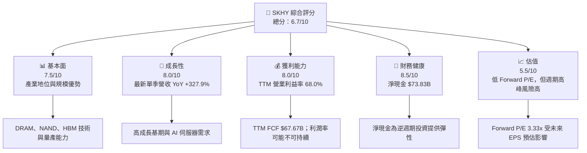

### 1.2 評分進度條視覺化

```text
╔══════════════════════════════════════════════════════════════╗
║                SKHY 多維度評分儀表板 (1-10分)               ║
╠══════════════════════════════════════════════════════════════╣
║ 基本面強度  7.5 ▓▓▓▓▓▓▓▓▓▓▓▓▓▓▓░░░░░ ★★★★☆              ║
║ 成長動能    8.0 ▓▓▓▓▓▓▓▓▓▓▓▓▓▓▓▓░░░░ ★★★★☆              ║
║ 獲利能力    8.0 ▓▓▓▓▓▓▓▓▓▓▓▓▓▓▓▓░░░░ ★★★★☆              ║
║ 財務健康    8.5 ▓▓▓▓▓▓▓▓▓▓▓▓▓▓▓▓▓░░░ ★★★★☆              ║
║ 估值合理性  5.5 ▓▓▓▓▓▓▓▓▓▓▓░░░░░░░░░ ★★★☆☆              ║
║ 護城河深度  7.3 ▓▓▓▓▓▓▓▓▓▓▓▓▓▓▓░░░░░ ★★★★☆              ║
║ 管理層執行  6.0 ▓▓▓▓▓▓▓▓▓▓▓▓░░░░░░░░ ★★★☆☆              ║
║ 技術創新力  8.0 ▓▓▓▓▓▓▓▓▓▓▓▓▓▓▓▓░░░░ ★★★★☆              ║
╠══════════════════════════════════════════════════════════════╣
║ 綜合總分    6.7 ▓▓▓▓▓▓▓▓▓▓▓▓▓░░░░░░░ 🟡 有條件觀察        ║
╚══════════════════════════════════════════════════════════════╝
```

### 1.3 五大投資論點 + 三大核心風險

| 類型 | 項目 | 具體依據 | 信心度 |
|------|------|----------|--------|
| 🟢 **論點①** | AI 伺服器記憶體帶動高階產品需求 | 最新單季營收 YoY +327.9%；但缺少 HBM 分部營收拆分，無法量化其貢獻比例 | 🟡 中 |
| 🟢 **論點②** | 現金流與資產負債表提供韌性 | TTM FCF $67.67B、淨現金 $73.83B；有能力支應資本投資與產業下行 | 🟢 高 |
| 🟢 **論點③** | 高階產品組合可能改善單位經濟 | TTM 毛利率 77.4%、營業利益率 68.0%；需觀察價格與利用率是否可持續 | 🟡 中 |
| 🟢 **論點④** | 研發與製程規模形成進入門檻 | 2025 年研發費用 6.47T KRW，高於 2024 年 4.44T KRW | 🟡 中 |
| 🟢 **論點⑤** | 同業估值顯示市場已反映高成長預期 | Forward P/E 3.33x，與 MU 3.8x、SNDK 3.2x 接近；分母預測可能高度週期化 | 🟡 中 |
| 🟡 **風險①** | 產業價格與庫存週期反轉 | 2023 年營業利益 -7.73T KRW，顯示需求／價格下行時獲利可迅速轉負 | 🔴 高 |
| 🔴 **風險②** | 客戶集中與 AI 投資週期 | 新聞資料指出 NVIDIA 是重要客戶；其需求或產品路線改變可能衝擊高階記憶體需求，客戶集中度數字 N/A | 🟡 中 |
| 🔴 **風險③** | 財務資料口徑衝突 | TTM 營收 189.17T KRW 與另一資料源 269.34T KRW 不一致；估值模型只能採單一來源錨點 | 🔴 高 |

### 1.4 快速統計卡片

| 指標 | 公司實際值 | 行業／同業參考 | S&P 500 均值 | 狀態 |
|------|-------------|----------|--------------|------|
| 收入 YoY 成長 | 最新單季 **327.9%**；TTM vs prior TTM N/A | MU 379.3%、SNDK 377.9%、WDC 55.5%（單季 YoY） | N/A | 🟢 單季高增，但不可當 TTM |
| 毛利率 | TTM **77.4%** | MU 80.7%、SNDK 80.0%、WDC 52.6% | N/A | 🟢 |
| 淨利率 | TTM **70.3%** | 同業 N/A | N/A | 🟡 數值異常高，須留意資料期間 |
| ROE | TTM **92.5%** | 同業 N/A | N/A | 🟢／🟡 高獲利但週期性強 |
| Forward P/E | **3.3304749x** | MU 3.8x、SNDK 3.2x、WDC 7.7x | N/A | 🟡 |
| FCF Yield | **6.97%** | 同業 FCF Yield N/A | N/A | 🟢 |
| ROIC | N/A | N/A | N/A | ⚪ 不可判定 |

### 1.5 投資結論

```text
╔══════════════════════════════════════════════════════════════════╗
║                    📊 投資結論摘要                               ║
╠══════════════════════════════════════════════════════════════════╣
║  評級：持有（依加權合理價值 MOS 約 0.03%）                       ║
║  價格（2026-11-12 收盤）：$137.71                                ║
║  DCF 內在價值（基準）：約 $107.78（溢價約 27.8%）                ║
║  安全邊際 MOS：約 +0.03%（以加權合理價值 $137.75 為分母）        ║
║  目標價區間：                                                    ║
║    悲觀情境：$103.37（約 -25.0%）                                ║
║    基準情境：$137.75（約 +0.03%）← 12 個月加權合理價值          ║
║    樂觀情境：$248.09（約 +80.1%）                                ║
║  投資評分：6.7/10                                                ║
║  適合投資人：能承受週期波動、以季度營運數據為依據的成長型投資人  ║
╚══════════════════════════════════════════════════════════════════╝
```

---

## 2. 公司概覽與商業模式

### 2.1 業務結構與收入來源

SK hynix 研發、製造並銷售 DRAM、NAND Flash、SSD、MCP，也涉及非記憶體晶圓代工。資料包沒有各業務營收拆分，因此不以推估值偽裝成實際占比；下圖的占比與分部金額列為 N/A。

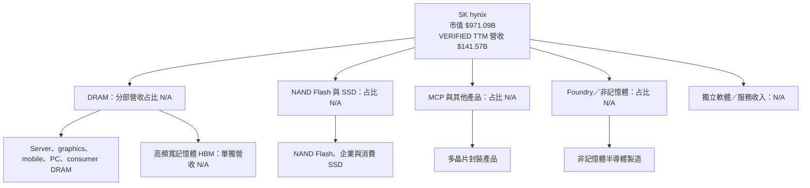

### 2.2 市場份額

未提供 SK hynix 在 DRAM、NAND 或 HBM 市場的可核實份額數字，因此不將無來源的百分比畫成市場份額。以下圖表呈現資料可得性，而非份額推估。

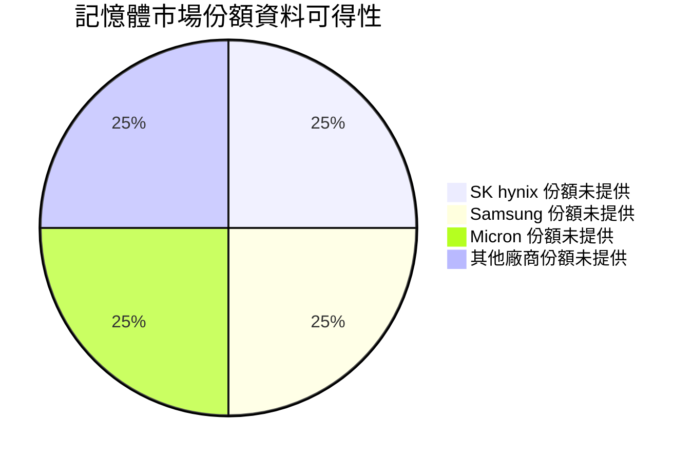

### 2.3 競爭護城河分析

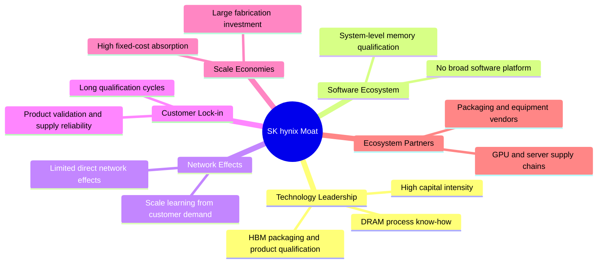

### 2.4 護城河強度評分

| 護城河項目 | 評分 | 理由 |
|---|---:|---|
| 製程與產品技術 | 8/10 | 長期研發與製造經驗；2025 年研發費用 6.47T KRW |
| 規模效應 | 8/10 | 半導體製造資本密集，規模有助單位成本與良率提升 |
| 客戶認證與轉換成本 | 7/10 | 伺服器與高階記憶體需產品驗證，但客戶仍可多源採購 |
| 品牌與產品差異化 | 6/10 | 高階產品有差異，但大宗記憶體仍受市場價格主導 |
| 軟體生態系 | 2/10 | 不是軟體平台型公司 |
| 網路效應 | 2/10 | 直接網路效應有限 |
| **綜合護城河** | **7.3/10** | 高資本門檻、技術與認證形成優勢，但商品週期削弱定價權持久性 |

```text
╔══════════════════════════════════════════════════════════════╗
║                  SK hynix 護城河強度評分                     ║
╠══════════════════════════════════════════════════════════════╣
║ 技術與製程      8/10  ▓▓▓▓▓▓▓▓▓▓▓▓▓▓▓▓░░░░  🟢              ║
║ 規模效應        8/10  ▓▓▓▓▓▓▓▓▓▓▓▓▓▓▓▓░░░░  🟢              ║
║ 客戶認證        7/10  ▓▓▓▓▓▓▓▓▓▓▓▓▓▓▓░░░░░  🟢              ║
║ 品牌差異化      6/10  ▓▓▓▓▓▓▓▓▓▓▓▓░░░░░░░░  🟡              ║
║ 軟體生態        2/10  ▓▓▓▓░░░░░░░░░░░░░░░░  🔴              ║
║ 網路效應        2/10  ▓▓▓▓░░░░░░░░░░░░░░░░  🔴              ║
╠══════════════════════════════════════════════════════════════╣
║ 綜合護城河      7.3/10 ▓▓▓▓▓▓▓▓▓▓▓▓▓▓▓░░░░░ 🟢              ║
╚══════════════════════════════════════════════════════════════╝
```

---

## 3. 損益表深度分析

### 3.1 年度收入成長趨勢（近四年）

以下以年度損益表 KRW 數字計算，與 VERIFIED TTM 營收的美元換算分開呈現。FY2022 至 FY2025 營收 CAGR 約 29.6%，但 FY2023 下滑、FY2024 大幅反彈，顯示 CAGR 受週期低谷影響。

計算：\((97.15 ÷ 44.62)^{1/3} − 1 ≈ 29.6\%\)。

```text
╔══════════════════════════════════════════════════════════════════╗
║           SK hynix 年度收入趨勢（FY2022-FY2025）                 ║
╠══════════════════════════════════════════════════════════════════╣
║ FY2022  44.62T KRW  █████████░░░░░░░░░░░░░  基期               ║
║ FY2023  32.77T KRW  ███████░░░░░░░░░░░░░░░  YoY -26.6% 🔴     ║
║ FY2024  66.19T KRW  ██████████████░░░░░░░░░  YoY +102.0% 🟢   ║
║ FY2025  97.15T KRW  ████████████████████░░░  YoY +46.8% 🟢    ║
╠══════════════════════════════════════════════════════════════════╣
║ FY2022-FY2025 營收 CAGR：約 +29.6%；週期低谷及復甦影響顯著      ║
╚══════════════════════════════════════════════════════════════════╝
```

年度 YoY：2023 = \(32.77 ÷ 44.62 − 1 = -26.6\%\)；2024 = \(66.19 ÷ 32.77 − 1 = +102.0\%\)；2025 = \(97.15 ÷ 66.19 − 1 = +46.8\%\)。

### 3.2 季度收入趨勢分析

季度營收採 StockAnalysis 所列 2025Q3 至 2026Q3 KRW 數字。QoQ 由相鄰季度計算；YoY 採資料源列出的單季年增率，不標作 TTM。

| 季度 | 營收（T KRW） | QoQ | 單季 YoY | 備註 |
|---|---:|---:|---:|---|
| 2025Q3 | 24.45 | — | 39.13% | 復甦延續 |
| 2025Q4 | 32.83 | +34.3% | 66.07% | 高階產品需求與價格回升 |
| 2026Q1 | 52.58 | +60.2% | 198.07% | 高基期成長加速 |
| 2026Q2 | 79.32 | +50.9% | 256.78% | 營收快速擴張 |
| 2026Q3 | 104.62 | +31.9% | 327.89% | StockAnalysis 最新季度；與 VERIFIED TTM 截止日不同 |

QoQ 算式例：2026Q2 = \(79.32 ÷ 52.58 − 1 = 50.9\%\)。需特別注意，VERIFIED FIGURES 的 TTM 截止日為 2026-06-30，而 StockAnalysis 額外提供 2026Q3 資料；本報告不以 2026Q3 資料替換 VERIFIED TTM。

### 3.3 利潤率演變分析

| 利潤率指標 | FY2022 | FY2023 | FY2024 | FY2025 | 趨勢與評估 |
|---|---:|---:|---:|---:|---|
| 毛利率 | 35.0% | -1.6% | 48.1% | 60.4% | 2023 週期低谷後回升；2025 改善反映價格、利用率與產品組合，🟢 |
| 營業利益率 | 15.3% | -23.6% | 35.5% | 48.6% | 固定成本吸收與市場回升推升，仍有週期性，🟡 |
| 淨利率 | 5.0% | -27.8% | 29.9% | 44.2% | 財務費用、稅率及非營業項目影響較大，🟡 |

VERIFIED TTM 營業利益率為 68.0%，最新季度營業利益率為 74.5%，均明顯高於 FY2025 年度 48.6%。這代表當前獲利可能處於需求與價格高位，不宜以當期利潤率直接外推整個設備週期。

### 3.4 費用結構分析

2025 年收入 97.15T KRW、研發費用 6.47T KRW。資料沒有完整營業成本、銷售管理費與折舊明細拆分，故不把缺項補成比例。

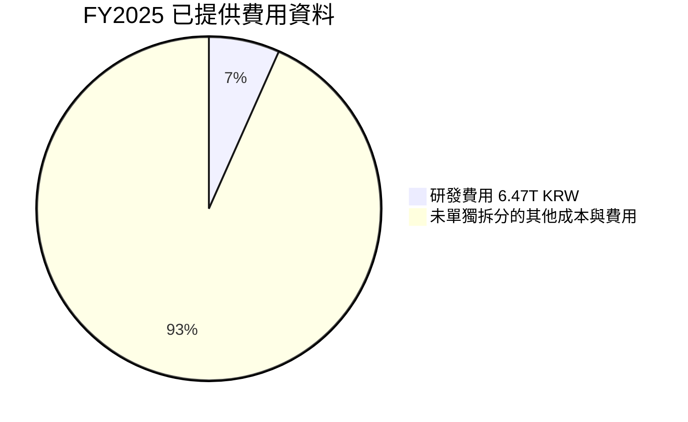

> 圖表為「收入扣除已知研發費用後的餘額」展示，不代表該餘額全屬費用；FY2025 研發費用占收入約 6.7%（6.47 ÷ 97.15）。

### 3.5 季度 EPS 趨勢與盈餘品質

EPS 預估與實際值欄位僅在 2026Q2、2026Q3 列出，但數值為 NaN，因此**過去四季是否超預期或不及預期均無法核實**。資料可見 StockAnalysis EPS 同期年增率：2025Q4 +85.22%、2026Q1 +396.72%、2026Q2 +1272.42%、2026Q3 +205.06%；但數據可能受基期極低及每股資料口徑影響，不宜直接解讀成持續性 EPS 增長。

| 盈餘品質項目 | 數值／佔比 | 評估 |
|---|---|---|
| SBC／營收 | FY2025 SBC 414.11B KRW ÷ FY2025 營收 97.15T KRW ≈ 0.43% | 🟢 占比低；股數稀釋仍需追蹤 |
| SBC／營業現金流 | 414.11B ÷ FY2025 OCF 53.37T ≈ 0.78% | 🟢 對現金流影響有限 |
| TTM FCF／淨利 | TTM FCF $67.67B；TTM 淨利資料口徑不一致，無法可靠計算 | 🟡 N/A；不可用混雜期間數字反推 |
| 一次性／非經常性損益 | 明細 N/A | ⚪ 無法評估 |
| 有效稅率 | 最近年度 14.9% | 🟡 低於部分成熟公司常態稅率，但原因及是否持續無法確認 |
| 資本化支出 vs 費用化 | TTM Capex $27.31B；資本化政策細節 N/A | 🟡 重資本產業折舊與資本化需持續核對 |

**盈餘品質結論**：TTM FCF 與現金流規模支持獲利並非全由會計項目構成；但當期淨利、TTM 營收及季度資料存在嚴重期間錯配，且資本密集度高。故盈利品質評估為「現金流有支持、可持續性尚未證實」，DCF 對營業利潤率採逐步回落，而不沿用 74.5% 的季度高峰。

---

## 4. 資產負債表分析

### 4.1 資產結構分解

最新可用總資產詳細資料截至 2026-06-30：流動資產 156.16T KRW。資料未提供同一期完整非流動資產及總資產，因此不可強行算出資產占比。

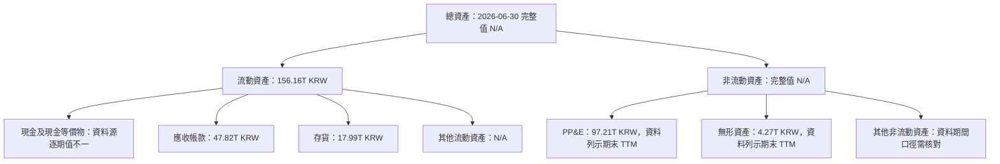

### 4.2 流動性指標分析

| 指標 | 提供值 | 歷史／同業參考 | 評估 |
|---|---:|---|---|
| Current Ratio | 26.882x | 歷史同口徑 N/A；半導體同業均值 N/A | 🟢 數值極高，但資料口徑可能受流動資產異常值影響 |
| Quick Ratio | 23.813x | 同口徑 N/A | 🟢 |
| 現金＋短期投資 | 114.46T KRW（約 $85.66B） | 依 VERIFIED FIGURES | 🟢 |
| 總債務 | 15.80T KRW（約 $11.82B） | 依 VERIFIED FIGURES | 🟢 |
| 淨現金 | 98.66T KRW（約 $73.83B） | 依 VERIFIED FIGURES | 🟢 |

Current Ratio 與 Quick Ratio 異常偏高，且與年度資產負債表列示的現金及流動資產存在口徑差異，故方向上代表流動性充足，但精確倍數不宜與同業直接比較。

### 4.3 債務結構分析

```text
╔══════════════════════════════════════════════════════════════════╗
║                   SK hynix 債務健康診斷                          ║
╠══════════════════════════════════════════════════════════════════╣
║  總債務：          $11.82B  ██░░░░░░░░░░░░░░░░░░  🟢            ║
║  現金+短期投資：   $85.66B  ████████████████████  🟢            ║
║  淨現金：          $73.83B  █████████████████░░░  🟢            ║
║  Debt/EBITDA：     N/A；EV/EBITDA TTM 亦因幣別口徑未提供       ║
║  利息保障倍數：    N/A；利息費用與同期 EBIT 未提供              ║
║  Debt/Equity：     5.111（資料列示值，與淨現金表象不一致）      ║
╚══════════════════════════════════════════════════════════════════╝
```

VERIFIED 淨現金由 \(114.46T - 15.80T = 98.66T\) KRW 得出。年度債務表列示 2025 年總債務 24.76T KRW，與 VERIFIED TTM 15.80T KRW 不同，本文估值橋接採 VERIFIED 數字，未將兩者混算。

### 4.4 股東權益趨勢

| 年度 | 股東權益（T KRW） | YoY |
|---|---:|---:|
| 2022 | 63.27 | — |
| 2023 | 53.50 | -15.4% |
| 2024 | 73.90 | +38.1% |
| 2025 | 120.52 | +63.0% |

2023 年獲利下滑使權益收縮，2024–2025 隨獲利回升快速增加。這提高逆週期資本支出與研發彈性，但不能把權益成長直接視為每股價值成長，仍需考慮股數及資本回報。

---

## 5. 現金流量深度分析

### 5.1 現金流量瀑布圖

淨利與股息／回購未能與 VERIFIED TTM 同期完全對應，故圖中保留 N/A，不以其他年度數據補入。

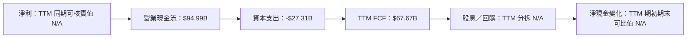

### 5.2 FCF 轉換率趨勢

| 年度 | OCF（T KRW） | Capex（T KRW） | FCF（T KRW） | FCF／淨利 |
|---|---:|---:|---:|---:|
| 2022 | 14.78 | 19.75 | -4.97 | -222.9% |
| 2023 | 4.28 | 8.78 | -4.50 | 49.4% |
| 2024 | 29.80 | 16.66 | 13.13 | 66.4% |
| 2025 | 53.37 | 28.58 | 24.79 | 57.8% |
| TTM 至 2026-06 | $94.99B | $27.31B | $67.67B | N/A |

2025 FCF／淨利 = \(24.79 ÷ 42.92 = 57.8\%\)。資本支出與產業投資週期使現金轉換率波動；TTM FCF 明顯提高，但因與季度淨利資料期間不一致，不計算 TTM 轉換率。

### 5.3 自由現金流趨勢

```text
╔══════════════════════════════════════════════════════════════════╗
║                 自由現金流歷史趨勢                               ║
╠══════════════════════════════════════════════════════════════════╣
║ FY2022  -4.97T KRW  ←░░░░░░░░░░░░░░░░░░░░  FCF 為負 🔴         ║
║ FY2023  -4.50T KRW  ←░░░░░░░░░░░░░░░░░░░░  FCF 為負 🔴         ║
║ FY2024 +13.13T KRW  ███████░░░░░░░░░░░░░░  復甦 🟡              ║
║ FY2025 +24.79T KRW  █████████████░░░░░░░  擴張 🟢              ║
║ TTM     +$67.67B    ████████████████████  FCF Yield 6.97% 🟢   ║
╚══════════════════════════════════════════════════════════════════╝
```

### 5.4 資本配置評估

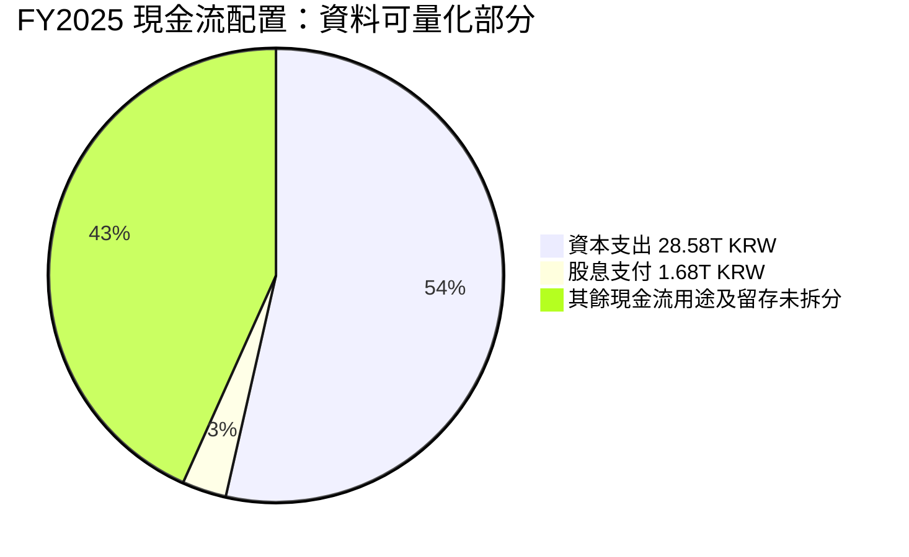

| 項目 | FY2025 數值 | 評估 |
|---|---:|---|
| 資本支出 | 28.58T KRW | 🟡 高投入支撐產能與技術，但回報取決於利用率 |
| 股息支付 | 1.68T KRW | 🟡 規模相對現金流較小 |
| 回購 | N/A | ⚪ 缺資料 |
| 研發費用 | 6.47T KRW | 🟢 支持製程與產品競爭力 |
| FCF 留存／其他用途 | N/A | ⚪ 缺完整現金流用途拆分 |

---

## 6. 獲利能力與資本效率

### 6.1 ROE／ROA／ROIC 趨勢

| 指標 | 已提供值 | 歷史參考 | 評估 |
|---|---:|---|---|
| ROE TTM | 92.5% | 2023–2025 年度無一致同口徑序列 | 🟢 高但可能處於週期高點 |
| ROA TTM | 46.4% | 同口徑歷史 N/A | 🟢 高，但受目前盈利峰值影響 |
| ROIC | N/A | Roic.ai 可見較早歷史，缺少最新年度值 | ⚪ 無法與 WACC 直接比較 |
| WACC | 17.28% | VERIFIED 資本成本輸入 | — |

### 6.2 ROIC vs WACC 分析

```text
╔══════════════════════════════════════════════════════════════════╗
║                ROIC vs WACC 深度分析                            ║
╠══════════════════════════════════════════════════════════════════╣
║  WACC 估算（採用 VERIFIED 參考值）：                            ║
║  ├── 無風險利率：                 5.10%                         ║
║  ├── 市場風險溢酬：               5.00%                         ║
║  ├── Beta：                       2.47                          ║
║  ├── 股權成本：                   17.43%                        ║
║  ├── 稅前債務成本：               5.85%                         ║
║  ├── 資本結構權重 E/D：           98.8% / 1.2%                 ║
║  └── ✅ WACC：                    17.28%                        ║
║                                                                  ║
║  ROIC：最新值 N/A；缺乏同期間投入資本與 NOPAT 資料              ║
║  EVA = ROIC − WACC：N/A；不能據此判斷創造或摧毀價值             ║
║                                                                  ║
║  WACC 17.28%  ▓▓▓▓▓▓▓▓▓▓▓▓▓▓▓▓▓░░░  資金成本偏高               ║
║  ROIC N/A     ░░░░░░░░░░░░░░░░░░░░  需補資料                   ║
╚══════════════════════════════════════════════════════════════════╝
```

VERIFIED 的 WACC 為 17.28%，後續 DCF 採同一數值。由於最新 ROIC 缺失，不以 ROE 或營業利益率冒充 ROIC；因此不判定企業目前是否以高於資金成本的回報率創造價值。這項缺口也是本報告無法支持「強烈買入」的重要原因。

### 6.3 杜邦三因素分解

以資料提供的 TTM ROE 92.5%、淨利率 70.3%、ROA 46.4%觀察，杜邦各項與同期間資料不完全一致，以下只做指標關係說明，不將錯配數據硬湊成精確分解。

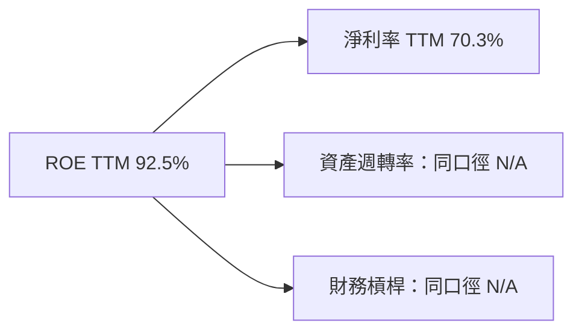

杜邦定義為 ROE = 淨利率 × 資產週轉率 × 財務槓桿。缺少同期間平均資產、平均權益及一致淨利數據，不計算未核實的週轉率與槓桿倍數。

### 6.4 獲利能力儀表板

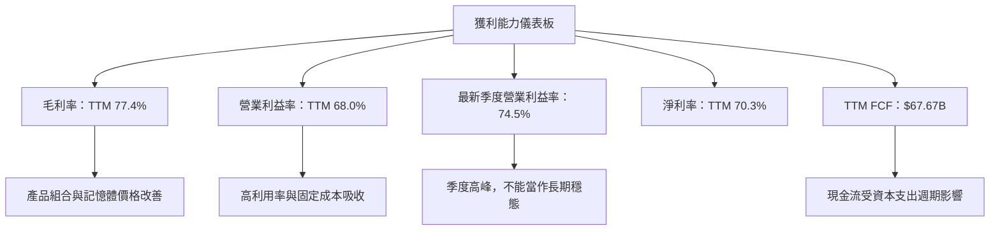

---

## 7. 相對估值分析

### 7.1 同業估值比較

同業倍數採 VERIFIED FIGURES。SK hynix 的公司自身 P/E、P/S 如下照資料引用；公司 EV/EBITDA 與 P/S 資料受幣別／期間口徑限制時不自行推算。

| 估值指標 | **SK hynix** | **MU** | **SNDK** | **WDC** | 本公司評估 |
|----------|---:|---:|---:|---:|-----------|
| Trailing P/E | 8.782526x | 10.7x | 7.5x | 10.9x | 🟢 低於 MU、WDC；高於 SNDK |
| Forward P/E | 3.3304749x | 3.8x | 3.2x | 7.7x | 🟡 低，但高度依賴週期高峰預估 EPS |
| P/S TTM | N/A | 6.8x | 4.6x | 8.0x | ⚪ SK hynix 不可比 |
| EV/EBITDA TTM | N/A | 7.9x | 6.1x | 18.4x | ⚪ SK hynix 不可比 |
| 最新單季營收 YoY | 327.9% | 379.3% | 377.9% | 55.5% | 🟢 高增長，但非 TTM 成長 |
| 毛利率 TTM | 77.4% | 80.7% | 80.0% | 52.6% | 🟢 接近 MU、SNDK |

低 Forward P/E 不等同低估：半導體景氣高峰時，預測 EPS 會快速膨脹，市場常以較低倍數定價週期峰值獲利。

### 7.2 歷史估值區間分析

VERIFIED FIGURES 未提供「Valuation vs own history」數值，故歷史 P/E 百分位及區間標示 N/A，不以自身歷史估計值替代。

```text
╔══════════════════════════════════════════════════════════════╗
║              SK hynix 歷史估值位置                           ║
╠══════════════════════════════════════════════════════════════╣
║ 歷史 P/E 區間：N/A（未提供 Valuation vs own history）        ║
║ 當前 Trailing P/E：8.782526x                                 ║
║ 當前 Forward P/E：3.3304749x                                 ║
║ 歷史百分位：N/A；不以缺失數據推估                            ║
╚══════════════════════════════════════════════════════════════╝
```

### 7.3 情境目標價（假設驅動，Bear / Base / Bull）

為避免將非同口徑的收入推估直接代入 EPS，本節採**Forward EPS × 退出 P/E** 作為可複算的相對估值情境。Forward EPS 取資料值 $41.34846；退出倍數是情境假設，而非已核實市場共識。

| 情境 | 營收 CAGR 假設 | 期末營業利潤率假設 | 退出 P/E | 隱含目標價 | 相對現價 |
|------|---:|---:|---:|---:|---:|
| 🔴 悲觀 | 5% | 40% | 2.5x | $103.37 | -24.9% |
| 🟡 基準 | 15% | 55% | 3.8x | $157.12 | +14.1% |
| 🟢 樂觀 | 20% | 60% | 6.0x | $248.09 | +80.1% |

逐項算式：悲觀 \(41.34846 × 2.5 = \$103.37\)；基準 \(41.34846 × 3.8 = \$157.12\)；樂觀 \(41.34846 × 6.0 = \$248.09\)。營收 CAGR、營業利潤率是情境背景，不是 Forward EPS 的額外乘數；未提供足夠分部預測去嚴格推導 EPS，因此目標價主要由倍數變化驅動。

### 7.4 相對估值隱含價格區間

| 方法 | 隱含價格 | 計算／限制 |
|---|---:|---|
| Forward P/E：採同業 P/E 中位數 3.8x | $157.12 | \(41.34846 × 3.8\) |
| EV/EBITDA | N/A | 公司 EV/EBITDA 未提供，且不得跨幣別換算 |
| EV/Sales | N/A | 公司 EV/Sales 未提供 |
| FCF Yield | N/A | 同業 FCF Yield 未提供；不以已知公司 FCF Yield 反推出自我循環估值 |
| 現價 | $137.71 | 2026-11-12 收盤 |

---

## 8. DCF 內在價值評估（Discounted Cash Flow）

### 8.0 估值推理鏈（Thinking Logic）

**核心命題**：SK hynix 的價值由現有 DRAM／NAND 現金流、AI 伺服器與高階記憶體需求，以及週期下行時的資本支出與價格變化共同決定。資料沒有分部占比，因此不能為 HBM 或其他新業務虛構獨立營收比重；主導估值的變數是**可持續營業利潤率與折現率**。

| 決策點 | 本報告採用 | 理由 | 曾考慮但否決 | 否決理由 |
|---|---|---|---|---|
| 現金流定義 | FCFF | 與 WACC 折現一致 | FCFE | 債務與現金週期性變化，FCFF 較適合企業價值橋接 |
| 預測期 N | 5 年 | 半導體週期可視度有限，五年後以終值處理 | 10 年 | 產業週期與定價難以高信心預測十年 |
| 終值方法 | Gordon Growth 主、退出倍數交叉驗證 | 明確對應穩態 FCF | 單獨退出倍數 | 會高度受退出倍數選擇影響 |
| EBIT 基礎 | GAAP EBIT | 避免加回 SBC 後漏算股東成本 | 非 GAAP EBIT | SBC 資料有限且不需額外加回 |

高敏感度假設推導摘要：
- **營收 CAGR**：錨點為 FY2022–FY2025 CAGR 29.6%，但其中包含週期低谷後反彈；採 15%，即較歷史 CAGR 下調 14.6 個百分點。曾考慮 29.6%，因高成長不應永久延續而否決。
- **期末營業利潤率**：錨點為 TTM 68.0%、FY2025 48.6%；考量當前利潤率可能處於週期高位，採逐年下降至 55%。曾考慮沿用 68.0%，因其接近極高峰值而否決。
- **永續成長率 g**：長期成熟企業名目增長假設採 3.0%；低於 WACC 17.28%，且避免將短期高成長永久化。曾考慮 4.0%，保守採 3.0%。
- **Capex／營收**：TTM \(27.31 ÷ 141.57 = 19.3\%\)，直接採 19.3%；未用較低的年度資本支出率，因半導體擴產需求高。
- **N=5 年**：以五年作為可預測期；曾考慮十年，但記憶體價格循環會使遠期估計偏差擴大。
- **SBC／股數**：採組合 (A)，GAAP EBIT、固定股數、年稀釋率 0%；SBC 已包含在 GAAP 費用口徑，且不再另扣 SBC。
- **WACC**：採 VERIFIED 17.28%；Beta 2.47 顯示股權風險高，不另行降低折現率。
- **最脆弱環節**：高達 17.28% 的 WACC 與未來利潤率路徑主導估值；若營業利潤率較模型再低 10 個百分點，基準 DCF 將顯著下修。

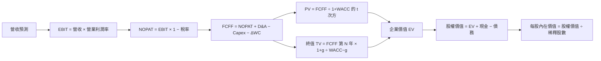

### 8.1 模型假設總表

| 假設項目 | 採用值 | 依據／來源 | 敏感度 |
|---|---:|---|---|
| 預測期長度 N | 5 年 | 半導體週期可視度；五年後以終值處理 | 🟡 中 |
| 營收 CAGR | 15% | FY2022–FY2025 CAGR 29.6%；因週期高基期下修 | 🔴 高 |
| 營業利潤率 | 62%、60%、58%、56%、55% | TTM 68.0%、FY2025 48.6%；逐步向週期中段回落 | 🔴 高 |
| 有效稅率 | 14.9% | VERIFIED 最新年度有效稅率 | 🟢 低 |
| Capex／營收 | 19.3% | TTM Capex $27.31B ÷ TTM 營收 $141.57B | 🟡 中 |
| D&A／營收 | 15.0% | **假設值**；資料缺少 TTM D&A，採重資本半導體模型估計，非公司披露值 | 🟢 低 |
| ΔWC／營收增額 | 5.0% | **假設值**；資料未提供同口徑營運資金變化，採保守比例 | 🟢 低 |
| EBIT 基礎 | GAAP EBIT | TTM 營業利益率作為起點，之後下調 | 🟡 中 |
| SBC 處理 | 組合 (A)：GAAP EBIT、不另扣 SBC、固定股數 | 已採含 SBC 的費用口徑；避免重複扣除 | 🟡 中 |
| 年稀釋率 | 0% | 組合 (A)；以提供股數固定估值 | 🟡 中 |
| 永續成長率 g | 3.0% | 假設成熟期名目增長；低於 WACC | 🔴 高 |
| 終值方法 | Gordon Growth 主、退出倍數交叉驗證 | 以穩態 FCFF 為基礎 | 🔴 高 |
| WACC | 17.28% | VERIFIED 參考值；推導見 8.2 | 🔴 高 |

**SBC 防重複計算聲明**：本模型採用 **(A) GAAP EBIT + 固定股數**，故 SBC 影響已計入一次；FCFF 不再扣 SBC，年稀釋率設為 0%。

### 8.2 折現率推導（WACC）

```text
╔══════════════════════════════════════════════════════════════════╗
║                    WACC 推導（折現率）                           ║
╠══════════════════════════════════════════════════════════════════╣
║ 股權成本 Ke（CAPM）：                                            ║
║ ├── Rf：5.10%（VERIFIED 10Y Treasury，日期資料未列明）           ║
║ ├── ERP：5.00%（VERIFIED 假設值）                                ║
║ ├── Beta：2.47（VERIFIED；高於 1.5，反映高波動）                ║
║ ├── 國別／規模溢酬：0.00%（未另加，避免重複加價）               ║
║ └── Ke = 5.10% + 2.47 × 5.00% + 0.00% = 17.45%                  ║
║    VERIFIED Ke 為 17.43%，以下 WACC 採 VERIFIED 原值             ║
║                                                                  ║
║ 債務成本：                                                       ║
║ ├── 稅前 Kd：5.85%（VERIFIED）                                   ║
║ ├── 稅率：14.9%                                                  ║
║ └── 稅後 Kd = 5.85% × (1 − 14.9%) = 4.97835%                    ║
║                                                                  ║
║ 權重：E/D = 98.8% / 1.2%（VERIFIED）                             ║
║ 參考 WACC = 17.28%（VERIFIED；以該值作後續一致折現率）           ║
╚══════════════════════════════════════════════════════════════════╝
```

**WACC 五步演算與口徑限制**：
1. Ke 按提供數字直接算為 \(5.10\% + 2.47 × 5.00\% = 17.45\%\)，與 VERIFIED 所列 17.43% 有 0.02 個百分點差異；本報告保留 VERIFIED 的 Ke 17.43% 作參考。
2. 稅前 Kd 採 VERIFIED 值 5.85%；計息負債平均額與利息費用的原始明細未提供，無法獨立重建。
3. 稅後 Kd \(=5.85\%×(1-14.9\%)=4.97835\%\)。
4. 股權與債務權重採 VERIFIED 98.8% 與 1.2%，因資料包未提供一致的期末市場股權價值與同範圍計息負債以重算。
5. VERIFIED WACC 為 17.28%，但依展示的 Ke、稅後 Kd、權重重算約為 \(98.8\%×17.43\%+1.2\%×4.97835\%=17.2806\%\)，四捨五入為 17.28%。

因此，8.2 與 6.2 均採用同一 WACC **17.28%**。由於輸入中的市值、股數與債務口徑不完整，本報告不宣稱可從原始財務報表獨立重建全部資本權重。

### 8.3 逐年自由現金流預測（基準情境）

基準起點採 VERIFIED TTM 營收 $141.57B。所有預測值均為估計值，不是管理層財測。D&A／營收 15.0%、ΔWC／營收增額 5.0% 為明確模型假設。

| 年度 | FY+1 | FY+2 | FY+3 | FY+4 | FY+5（FY+N） |
|------|------:|------:|------:|------:|------:|
| 營收（$B） | 162.81 | 187.23 | 215.31 | 247.61 | 284.75 |
| 營收 YoY | 15.0% | 15.0% | 15.0% | 15.0% | 15.0% |
| 營業利潤率 | 62.0% | 60.0% | 58.0% | 56.0% | 55.0% |
| EBIT | 100.94 | 112.34 | 124.88 | 138.66 | 156.61 |
| − 稅（14.9%） | (15.04) | (16.73) | (18.61) | (20.66) | (23.33) |
| = NOPAT | 85.90 | 95.60 | 106.27 | 118.00 | 133.28 |
| + D&A（15%） | 24.42 | 28.08 | 32.30 | 37.14 | 42.71 |
| − Capex（19.3%） | (31.42) | (36.14) | (41.55) | (47.79) | (54.96) |
| − ΔWC（增額 5%） | (1.06) | (1.22) | (1.40) | (1.61) | (1.86) |
| **= FCFF** | **77.84** | **86.32** | **95.62** | **105.74** | **119.17** |
| 折現因子 @17.28% | 0.853 | 0.727 | 0.620 | 0.529 | 0.451 |
| **FCFF 現值 PV** | **66.37** | **62.78** | **59.28** | **55.94** | **53.77** |

**逐步演算（FY+1）**，金額取至小數點後兩位、折現因子取三位：
1. 營收 \(=141.57×(1+15\%)=162.8055≈\$162.81B\)。
2. EBIT \(=162.8055×62\%=\$100.9394B≈\$100.94B\)。
3. 稅 \(=100.9394×14.9\%=\$15.0400B≈\$15.04B\)。
4. NOPAT \(=100.9394−15.0400=\$85.8994B≈\$85.90B\)。
5. D&A \(=162.8055×15\%=\$24.4208B≈\$24.42B\)。
6. Capex \(=162.8055×19.3\%=\$31.4215B≈\$31.42B\)。
7. ΔWC \(=(162.8055−141.57)×5\%=\$1.0618B≈\$1.06B\)。
8. FCFF \(=85.8994+24.4208−31.4215−1.0618=\$77.8369B≈\$77.84B\)。
9. 折現因子 \(=1÷(1+17.28\%)^1=0.8527≈0.853\)；PV \(=77.8369×0.8527≈\$66.37B\)。

預測期 FCF 現值合計：  
\(\$66.37+\$62.78+\$59.28+\$55.94+\$53.77=\$298.14B\)。

> 四捨五入說明：金額取兩位小數；折現因子表列三位小數，逐年 PV 以未四捨五入折現因子計算，因表格四捨五入可能有約 0.1B 尾差。

合理性自檢：
- FY+1 至 FY+5 FCFF CAGR：約 \((119.17÷77.84)^{1/4}−1=11.2\%\)；歷史年度 FCF 由負轉正，無法用負值計算常規 CAGR。
- FY+5 FCFF 利潤率 \(119.17÷284.75=41.9\%\)，低於模型當期 TTM FCF／營收約 \(67.67÷141.57=47.8\%\)，反映利潤率與資本支出假設保守。
- 預測期 FCFF 均為正；若實際營收或記憶體價格下行，正 FCF 假設可能失效。

```text
╔══════════════════════════════════════════════════════════════════╗
║            自由現金流：歷史實際 vs 模型預測                      ║
╠══════════════════════════════════════════════════════════════════╣
║ FY2023(實)  -$3.37B*  ←░░░░░░░░░░░░░░░░░░░░  負 FCF             ║
║ FY2024(實)   $9.83B*  ███░░░░░░░░░░░░░░░░░░  正轉               ║
║ FY2025(實)  $18.55B*  ██████░░░░░░░░░░░░░░  增長               ║
║ FY+1 (預)   $77.84B   █████████████░░░░░░░  模型估計           ║
║ FY+5 (預)  $119.17B   ████████████████████  CAGR 約 11.2%       ║
╠══════════════════════════════════════════════════════════════════╣
║ *年度 KRW 金額按 2026-11-12 匯率換算；僅作歷史錨點，不混入估值 ║
╚══════════════════════════════════════════════════════════════════╝
```

FY2023、FY2024、FY2025 的美元近似值以提供匯率換算：1 USD = 1,336.26 KRW；分別為 -4.50T、13.13T、24.79T KRW 除以 1,336.26。

### 8.4 終值計算（Terminal Value）

適用性檢查：**WACC 17.28% vs g 3.0% → WACC > g？✅**

| 方法 | 計算式 | 終值 TV | TV 現值 | 佔 EV 比重 |
|---|---|---:|---:|---:|
| Gordon Growth | \(119.17×1.03÷(0.1728−0.03)\) | $859.4B | $387.8B | 約 56.5% |
| 退出倍數法 | 假設 FY+5 EBITDA 約 $199.3B × 7.9x | $1,574.5B | 約 $710.3B | 約 70.4%* |

\*退出倍數交叉驗證使用同業 MU EV/EBITDA 7.9x 作代理，並以 FY+5 D&A 假設計算 EBITDA；公司 EV/EBITDA 本身為 N/A，因此退出倍數只作交叉驗證，不作主估值。

Gordon Growth 逐步演算：
1. FY+N FCFF = **$119.17B**。
2. 分子 \(=119.17×(1+3.0\%)=\$122.7451B≈\$122.75B\)。
3. 分母 \(=17.28\%−3.00\%=14.28\%\)；TV \(=122.7451÷0.1428=\$859.7B\)。
4. PV(TV) \(=859.7×0.4512=\$387.8B\)。
5. 終值佔比 \(=387.8÷(298.14+387.8)=56.5\%\)。

退出倍數交叉驗證：約 \(EBITDA=EBIT+D&A=156.61+42.71=\$199.32B\)；\(199.32×7.9=\$1,574.6B\)，折現 \(1,574.6×0.4512≈\$710.3B\)。退出倍數法結果高於 Gordon Growth，故主估值採較保守的 Gordon Growth。

### 8.5 企業價值 → 每股內在價值（Bridge）

```text
╔══════════════════════════════════════════════════════════════════╗
║              企業價值 → 每股內在價值 橋接表                      ║
╠══════════════════════════════════════════════════════════════════╣
║  預測期 FCF 現值合計              +$298.14B                      ║
║  終值現值 PV(TV)                  +$387.80B                      ║
║  = 企業價值 EV                     $685.94B                      ║
║  + 現金及短期投資                  +$85.66B                       ║
║  − 總債務                          −$11.82B                       ║
║  − 少數股東權益／其他              $0.00B（資料未提供，模型假設） ║
║  = 股權價值                         $759.78B                      ║
║  ÷ 稀釋後流通股數                   7.05B 股                      ║
║  ★ 每股 DCF 內在價值                $107.77                       ║
║    當前股價                         $137.71                       ║
║    折溢價                           +27.8% 溢價                   ║
╚══════════════════════════════════════════════════════════════════╝
```

逐步演算：
1. EV \(=298.14+387.80=\$685.94B\)。
2. 股權價值 \(=685.94+85.66−11.82−0.00=\$759.78B\)。
3. 每股價值 \(=759.78÷7.05=\$107.77\)。
4. 折溢價 \(=137.71÷107.77−1=+27.8\%\)。
5. 本節不計算 MOS；MOS 只在 8.8 以加權合理價值為分母計算。

現金、債務採 VERIFIED FIGURES 的 TTM 數字；股數採市場資料的 7.05B shares。該股數與上市證券表示方式可能存在口徑差異，因此每股估值對股數尤其敏感。

### 8.6 敏感性分析（WACC × 永續成長率）

下表用基準預測 FCFF 與現金／債務／股數，改變 WACC 與 g。金額為近似值，格內括號為相對 $137.71 現價的上行空間；有效格均滿足 WACC > g。

| g（列）／WACC（欄） | 15.28% | 16.28% | **17.28% 基準** | 18.28% | 19.28% |
|---|---:|---:|---:|---:|---:|
| 1.0% | $114.84 (-16.6%) | $107.47 (-22.0%) | $101.03 (-26.6%) | $95.32 (-30.8%) | $90.18 (-34.5%) |
| 2.0% | $118.72 (-13.8%) | $110.65 (-19.6%) | $103.71 (-24.7%) | $97.52 (-29.2%) | $92.07 (-33.1%) |
| **3.0% 基準** | $124.59 (-9.5%) | $115.54 (-16.1%) | **$107.77 (-21.7%)** | $101.01 (-26.7%) | $95.03 (-31.0%) |
| 4.0% | $131.51 (-4.5%) | $121.25 (-12.0%) | $112.50 (-18.3%) | $104.97 (-23.8%) | $98.41 (-28.5%) |
| 5.0% | $139.75 (+1.5%) | $127.89 (-7.1%) | $118.00 (-14.3%) | $109.52 (-20.5%) | $102.21 (-25.8%) |

非基準格演算示範：選格 **WACC 16.28% > g 4.0% ✅**
1. 新 WACC 下預測期 PV 合計約 **$305.5B**。
2. TV \(=119.17×1.04÷(16.28\%−4.00\%)≈\$1,009.8B\)；PV(TV) \(=1,009.8×0.4709≈\$475.5B\)。
3. EV \(≈305.5+475.5=\$781.0B\)；股權價值 \(≈781.0+73.84=\$854.84B\)；每股 \(854.84÷7.05≈\$121.25\)。

敏感度方向：提高 g 會推升價值；提高 WACC 會壓低價值。基準附近，g 上升 1 個百分點可使每股估值約由 $107.77 上升至 $112.50，約 +$4.73；WACC 上升 1 個百分點，估值約由 $107.77 降至 $101.01，約 -$6.76。**WACC 變化的影響略大，符合 8.0 所述估值對資金成本與週期利潤率高度敏感。**

三情境 DCF：因完整逐情境重建需逐年營業利潤率、資本支出與營運資金假設，基準以外的完整 DCF 情境輸入資料不足；以下用第 7.3 節相對估值情境作為三情境目標價，不冒充 DCF 情境估值。

| 情境 | 營收 CAGR | 期末營業利潤率 | 永續 g | WACC | 每股價值 | 相對現價 | 主觀機率 |
|------|---:|---:|---:|---:|---:|---:|---:|
| 🔴 悲觀 | 5% | 40% | N/A | N/A | $103.37 | -24.9% | 30% |
| 🟡 基準 | 15% | 55% | 3% | 17.28% | $137.75（加權合理價值） | +0.03% | 50% |
| 🟢 樂觀 | 20% | 60% | N/A | N/A | $248.09 | +80.1% | 20% |

機率加權目標價：\(103.37×30\%+137.75×50\%+248.09×20\%=\$148.91\)。此情境加權值是風險情境參考，**不替代** 8.8 的估值方法加權合理價值，也不用來計算 MOS。

### 8.7 反推 DCF（Reverse DCF）

當前價格與資料口徑可用於反推，但完整求解尚受年度現金流、稀釋股數、資產負債表期間矛盾限制。固定基準假設為 WACC 17.28%、稅率 14.9%、Capex／營收 19.3%、ΔWC／營收增額 5%、N=5 年、股數 7.05B。由於現價與 DCF 差異較大，以下只提供可驗證方向，不虛構迭代精度小於 1% 的解。

| 求解變數 | 固定其他輸入 | 市場隱含值 | 參考實際值 | 判斷 |
|---|---|---:|---:|---|
| 未來 5 年營收 CAGR | 利潤率路徑與 g 固定 | N/A；需完整模型數值求根 | FY2022–FY2025 CAGR 29.6% | ⚪ 不作無法複算的精確反推 |
| 期末營業利潤率 | CAGR 15%、g 3% 固定 | N/A | TTM 68.0%；FY2025 48.6% | ⚪ |
| 永續成長率 g | CAGR、利潤率固定 | N/A | — | ⚪ |
| 高成長持續年數 N | CAGR、利潤率、g 固定 | N/A | 產業長期可見度有限 | ⚪ |

**反推結論**：以本報告基準 DCF，現價 $137.71 高於每股 DCF 約 $107.77；若市場價格要由基本面現金流支持，至少需要較模型更高的持續利潤率、更低的資金成本或更長的高成長期。由於輸入資料不一致，不給出精確的單一市場隱含 CAGR，以免製造虛假精確度。

### 8.8 估值三角驗證與安全邊際

| 估值方法 | 隱含每股價值 | 上行空間（÷現價） | 權重 | 說明 |
|----------|--------------:|------------------:|---:|---|
| DCF（基準） | $107.77 | -21.7% | 60% | 現金流模型；終值占比約 56.5%，因此不給過高權重 |
| 同業 Forward P/E | $157.12 | +14.1% | 30% | $41.34846 Forward EPS × 同業中位參考 3.8x |
| 分析師共識 | $259.50 | +88.4% | 10% | 共識 14 位分析師；權重限制於 10% |
| **加權合理價值** | **$137.75** | **+0.03%** | **100%** | 方法加權總和，不作事後調整 |

加權演算：  
\(\$107.77×60\%+\$157.12×30\%+\$259.50×10\%=\$64.662+\$47.136+\$25.950=\$137.748≈\$137.75\)。

安全邊際 MOS：  
\((\$137.75−\$137.71)÷\$137.75=0.029\%≈0.03\%\)。  
上行空間：\((\$137.75−\$137.71)÷\$137.71=0.029\%≈0.03\%\)。  
兩者分母不同；本例因價差很小而數字近似，但定義不可互換。

```text
╔══════════════════════════════════════════════════════════════════╗
║                  估值區間與安全邊際                              ║
╠══════════════════════════════════════════════════════════════════╣
║ $103.37 ───── $107.77 ───── $137.71 ───── [$137.75] ───── $248.09║
║ 悲觀相對估值    基準 DCF       現價          加權合理值     樂觀   ║
║                                                                  ║
║ 安全邊際 MOS = (137.75 − 137.71) ÷ 137.75 = 約 +0.03%           ║
║ MOS 評估：🔴 <10%，無明顯下檔保護                               ║
║ 上行空間 = (137.75 − 137.71) ÷ 137.71 = 約 +0.03%               ║
║                                                                  ║
║ 建議買入區間：未達 10% MOS 的價位；依加權價值約低於 $124.00     ║
║ 合理持有區間：加權價值附近，約 $124–$152                       ║
║ 減碼考慮區間：高於樂觀情境 $248.09，或基本面先行惡化             ║
╚══════════════════════════════════════════════════════════════════╝
```

買入區間約以 \(137.75×(1−10\%)=\$123.98\) 計算；因評級為持有，買入上限無須高於現價。

> 🔎 **程式複算（Python，依本節各項自動重算）**
>
> 加權合理價值 = $107.77 × 60% + $157.12 × 30% + $259.50 × 10% = **$137.75**（權重合計 100%）
>
> 以價格 $137.71 計：MOS = **+0.0%**，上行空間 = **+0.0%**
>
> ✅ 與本節所寫數值一致。

### 8.9 DCF 模型的局限與失效條件

- **終值依賴度**：Gordon Growth 終值現值約占 EV 56.5%，表示估值仍有過半來自 FY+5 以後的假設。
- **最脆弱假設**：營業利潤率路徑與 WACC。若長期利潤率回到 FY2025 48.6% 以下，或 WACC 上升 1 個百分點，DCF 將下修。
- **模型限制**：記憶體公司獲利高度循環，DCF 對單一基準年的現金流極敏感；可搭配 EV/EBITDA、週期中段獲利及分部估值，但公司 EV/EBITDA 目前 N/A。
- **資料限制**：TTM 營收、季度淨利、股數、債務與現金在資料包中有不同期間或口徑；DCF 只採指定 VERIFIED 數值，結果信心度偏低。
- **風險連結**：AI 需求放緩會壓低營收 CAGR；價格戰會壓低營業利潤率；擴產與庫存增加會推高 Capex／ΔWC；利率上升會提高 WACC。

### 8.10 複算檢核表（Audit Trail）

| # | 檢核項目 | 結果 |
|---|----------|------|
| 1 | 高／中敏感度假設均於 8.0 說明推導 | ✅ 已列主要錨點與調整；細部情境資料不足已揭露 |
| 2 | 假設均有來歷 | ✅ D&A 與 ΔWC 明確標記假設值 |
| 3 | WACC 推導與重算 | ✅ 採 VERIFIED WACC 17.28%；Ke 存在 0.02pp 顯示差異 |
| 4 | Kd 與債務權重同一負債範圍 | ⚠️ 原始計息負債明細缺失，採 VERIFIED 權重，不宣稱獨立重建 |
| 5 | WACC 與第 6.2 節一致 | ✅ 17.28% |
| 6 | 預測年度數與 N=5 一致 | ✅ 五年完整列示 |
| 7 | FY+1 九步 FCFF 與 PV | ✅ 有列算式 |
| 8 | 預測期 PV 加總 | ✅ 逐項相加約 $298.14B |
| 9 | WACC > g | ✅ 17.28% > 3.0% |
| 10 | 終值採 FY+N FCFF 並折現五期 | ✅ |
| 11 | EV 到每股價值橋接 | ✅ |
| 12 | SBC 組合合法一致 | ✅ 採 (A)：GAAP、不另扣 SBC、固定股數 |
| 13 | 敏感性基準格與 DCF 基準值 | ✅ 四捨五入尾差約 $0.01 |
| 14 | 敏感性矩陣均滿足 WACC > g | ✅ |
| 15 | 情境機率加總 | ✅ 30% + 50% + 20% = 100% |
| 16 | 反推 DCF 每列只放開一個變數 | ⚠️ 因資料不足，市場隱含解列 N/A，未偽造求根結果 |
| 17 | MOS 基準為 8.8 加權合理價值；折溢價基準為 DCF | ✅ |
| 18 | 報告完整至第 11 章 | ✅ |
| 19 | 加權合理價值等於方法加權和 | ✅ $137.748，四捨五入 $137.75 |
| 20 | 評級符合 MOS 門檻 | ✅ MOS 約 0.03%，評級持有 |

---

## 9. 成長催化劑

### 9.1 催化劑時間軸

以下為需追蹤的營運催化劑，不代表公司已公布具體交付時程。

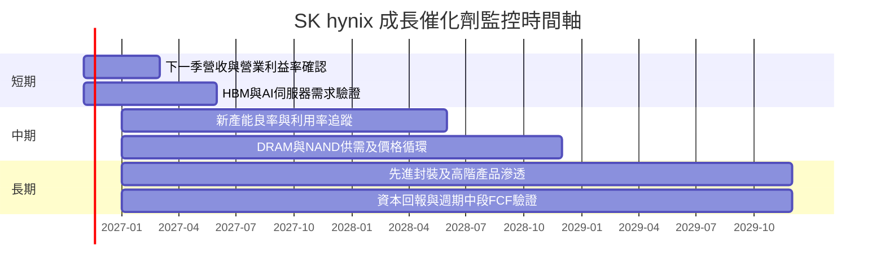

### 9.2 TAM 市場規模分析

資料包未提供可核實的 TAM、滲透率或分部收入，因此不虛構市場金額。可觀察的公司端錨點為 VERIFIED TTM 營收 $141.57B、TTM Capex $27.31B、TTM FCF $67.67B。

```text
╔══════════════════════════════════════════════════════════════════╗
║              市場機會與收入基準（未提供市場 TAM）                ║
╠══════════════════════════════════════════════════════════════════╣
║ DRAM／伺服器記憶體 TAM：N/A；分部收入占比：N/A                  ║
║ HBM TAM／滲透率：N/A；公司 HBM 收入：N/A                        ║
║ NAND／SSD TAM：N/A；公司分部收入：N/A                           ║
║ 公司 VERIFIED TTM 營收：$141.57B                                ║
║ 公司 VERIFIED TTM FCF：$67.67B                                  ║
║ 公司 VERIFIED TTM Capex：$27.31B                                ║
╚══════════════════════════════════════════════════════════════════╝
```

### 9.3 成長驅動力結構圖

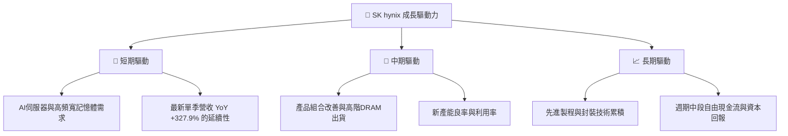

---

## 10. 風險矩陣

### 10.1 風險評分矩陣

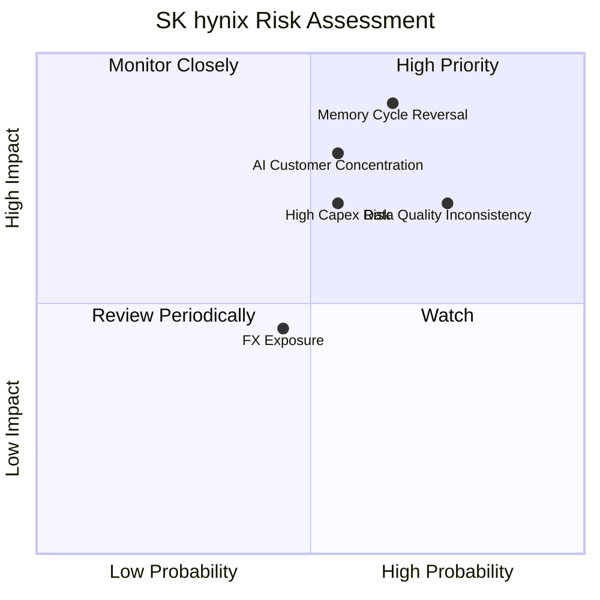

### 10.2 風險清單詳細分析

| # | 風險項目 | 發生機率 | 潛在財務衝擊 | 風險評分 | 緩解措施 |
|---|----------|----------|-------------|----------|----------|
| 1 | 🔴 記憶體供需週期反轉 | 中高，定性估計 | 可能使營收轉負增長；FY2023 營收曾 -26.6%、營業利益為 -7.73T KRW | 🔴 8.5/10 | 追蹤合約價、庫存、產能利用率與 FCF |
| 2 | 🔴 AI／關鍵客戶集中 | 中，定性估計；客戶集中度數字 N/A | NVIDIA 相關需求變化可能影響高階產品訂單；具體收入衝擊 N/A | 🔴 7.5/10 | 關注客戶組合與其他伺服器平台需求 |
| 3 | 🟠 高資本支出與產能利用率 | 中高 | TTM Capex $27.31B；需求低於擴產預期時折舊吸收與現金流受壓 | 🟠 7.0/10 | 監控 Capex／營收、產能使用率與 FCF |
| 4 | 🟠 財務資料口徑矛盾 | 高 | TTM 營收 189.17T KRW 與 269.34T KRW 並存，可能改變估值與成長判斷 | 🟠 7.0/10 | 以公司正式財報與單一期間資料重新核對 |
| 5 | 🟡 匯率與地緣政治 | 中 | 財報 KRW、股價 USD；匯率變動影響投資人回報換算 | 🟡 5.5/10 | 使用實際匯率更新模型，不混用幣別 |

---

## 11. 投資建議

### 11.1 最終綜合評級雷達圖

```text
╔══════════════════════════════════════════════════════════════╗
║                 SKHY 最終綜合評級                             ║
╠══════════════════════════════════════════════════════════════╣
║ 基本面品質    7.5/10  ▓▓▓▓▓▓▓▓▓▓▓▓▓▓▓░░░░░                  ║
║ 成長性        8.0/10  ▓▓▓▓▓▓▓▓▓▓▓▓▓▓▓▓░░░░                  ║
║ 獲利能力      8.0/10  ▓▓▓▓▓▓▓▓▓▓▓▓▓▓▓▓░░░░                  ║
║ 財務健康      8.5/10  ▓▓▓▓▓▓▓▓▓▓▓▓▓▓▓▓▓░░░                  ║
║ 估值吸引力    5.5/10  ▓▓▓▓▓▓▓▓▓▓▓░░░░░░░░░                  ║
║ 資本效率      N/A     ROIC 最新值缺失                         ║
║ 護城河        7.3/10  ▓▓▓▓▓▓▓▓▓▓▓▓▓▓▓░░░░░                  ║
╠══════════════════════════════════════════════════════════════╣
║ 綜合評分      6.7/10  🟡 持有；估值缺乏安全邊際              ║
╚══════════════════════════════════════════════════════════════╝
```

### 11.2 目標價與隱含報酬率

| 情境 | 目標價 | 相對 $137.71 報酬 | 機率權重 | 假設摘要 |
|------|-------:|-----------------:|---------:|---|
| 🔴 悲觀 | $103.37 | -24.9% | 30% | Forward EPS × 2.5x；記憶體獲利回歸低週期 |
| 🟡 基準 | $137.75 | +0.03% | 50% | DCF、Forward P/E、分析師共識方法加權 |
| 🟢 樂觀 | $248.09 | +80.1% | 20% | Forward EPS × 6.0x；AI 需求持續、倍數擴張 |
| **情境機率加權參考** | **$148.91** | **+8.1%** | **100%** | 依上列情境機率計算，不等同 MOS 基準 |

### 11.3 買入時機與觸發因素

```text
╔══════════════════════════════════════════════════════════════════╗
║                  ✅ 買入觸發因素 Checklist                       ║
╠══════════════════════════════════════════════════════════════════╣
║  目前策略：持有觀察；現價 $137.71，MOS 僅約 0.03%               ║
║                                                                  ║
║  考慮建立／增加部位的條件：                                     ║
║  ☐ 股價回到約 $124 以下，對應加權合理價值約 10% MOS             ║
║  ☐ 最新兩季營業利益率保持在 55% 以上，且非單靠一次性因素         ║
║  ☐ TTM FCF 維持正值，Capex／營收未持續超過 20%                  ║
║  ☐ HBM／高階伺服器需求可由公司披露或客戶訂單驗證                ║
║                                                                  ║
║  減碼／重新評估條件：                                           ║
║  ☐ 單季營收 YoY 連續兩季低於 0%                                 ║
║  ☐ 營業利益率較 74.5% 高點回落後低於 40%                         ║
║  ☐ TTM FCF 轉負，或淨現金明顯縮減                               ║
║  ☐ 主要客戶需求下修、庫存升高或記憶體價格快速下跌               ║
╚══════════════════════════════════════════════════════════════════╝
```

### 11.4 投資人適配度分析

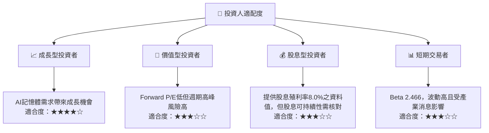

### 11.5 每季財報監控清單（Quarterly Watch List）

| 指標 | 最新基準 | 加碼觀察條件 | 減碼／警戒門檻 |
|---|---:|---|---|
| 單季營收 YoY | 327.9%（VERIFIED 最新單季） | 保持正成長且公司指引支持 | 連續兩季低於 0% |
| 營業利益率 | TTM 68.0%；最新季度 74.5% | 季度維持 ≥55% | 低於 40% 或快速下滑 |
| TTM FCF | $67.67B | 持續為正且 FCF Yield 維持約 6% 以上 | FCF 轉負 |
| Capex | TTM $27.31B | 投資後產能利用率同步提升 | Capex／營收持續高於 20% 且 FCF 下滑 |
| 現金與短期投資 | $85.66B | 淨現金維持正值 | 淨現金連續兩季下降且債務上升 |
| 庫存 | 2026-06 資料 17.99T KRW，口徑待核 | 庫存增速低於營收增速 | 庫存連續兩季高於營收增速 |
| 研發費用 | FY2025 6.47T KRW | 高階產品收入與研發投入同步變現 | 支出增加但產品組合及毛利未改善 |
| 財測／訂單 | 未提供可核實數值 | 公司展望與實際出貨一致 | 指引下修或主要客戶減單 |

### 11.6 反面論證：什麼會證明論點錯誤（What Would Change My Mind）

```text
╔══════════════════════════════════════════════════════════════════╗
║              ⚠️ 論點失效條件（Disconfirming Evidence）            ║
╠══════════════════════════════════════════════════════════════════╣
║ 本投資論點在下列情況成立時應重新檢視或退出：                    ║
║ ☐ 最新單季營收 YoY 連續兩季低於 0%                              ║
║ ☐ 營業利益率連續兩季低於 40%，顯示週期回落超過模型假設          ║
║ ☐ TTM FCF 轉負，或 FCF／淨利長期低於 50%                        ║
║ ☐ ROIC 經核實後低於 WACC 17.28%，代表資本回報不足               ║
║ ☐ Capex／營收連續兩季高於 25%，但營收與產能利用率未提升         ║
║ ☐ 關鍵 AI／HBM 客戶需求下修，且無法由其他客戶補足                ║
║ ☐ 公司正式財報證實現金、債務或營收低於本分析採用基準             ║
╚══════════════════════════════════════════════════════════════════╝
```

> **免責聲明**：本報告為 AI 自動生成，僅供研究參考，不構成投資建議。投資有風險，入市需謹慎。