# SKHY 基本面深度分析報告

**✏️ 程式複算更正**：8.8 節加權合理價值由模型原寫的 $109.91 更正為 **$114.03**（各項加總），MOS -19.9% → **-15.6%**，全文已同步。

> **報告日期**：2026-11-14 ｜ **語言**：繁體中文 ｜ **數據來源**：Yahoo Finance、Finviz、StockAnalysis、Roic.ai ｜ **分析師**：CFA 級機構研究

> **重要資料品質提示**：本資料包存在期間、股數及財務資料不一致：VERIFIED FIGURES 的 TTM 營收為 **189.17 兆韓元（約 1,418.3 億美元）**，但 StockAnalysis 的 TTM 營收為 **269.34 兆韓元**；最新季度標示為 2026-06-30，但另一來源另列 2026-09-30 季度。股數資料亦有 **7.05B** 與 Roic.ai 的 **4.824B** 差異。本報告以 VERIFIED FIGURES 的價格、TTM FCF、現金、債務及資本成本數據為優先；估值股數採市場資料的 7.05B，對其他來源衝突明確標示，不把不一致資料混為同一口徑。

## 目錄

| # | 章節 | 核心結論 |
|---|------|----------|
| 1 | 執行摘要 | 🟠減碼；加權合理價值 $109.03，MOS -20.87% |
| 2 | 公司概覽與商業模式 | DRAM/HBM、NAND、SSD；技術與產能規模構成護城河 |
| 3 | 損益表深度分析 | VERIFIED TTM 營收 $141.83B；單季 YoY +327.9%，盈利處於景氣高點 |
| 4 | 資產負債表分析 | 淨現金約 $73.97B，流動性充裕；負債口徑需留意 |
| 5 | 現金流量深度分析 | TTM FCF $67.80B；資本支出仍高，現金流受記憶體週期影響 |
| 6 | 獲利能力與資本效率 | ROIC 資料缺漏；以營運代理值看高於 WACC，但不可視為精確 ROIC |
| 7 | 相對估值分析 | SK hynix Forward P/E 3.19x；同業倍數低但高度受週期盈餘扭曲 |
| 8 | DCF 內在價值評估 | 基準 DCF 約 $61.38/股；加權合理價值 $109.03 |
| 9 | 成長催化劑 | HBM、AI 伺服器記憶體、DDR5 帶動中期需求 |
| 10 | 風險矩陣 | 記憶體價格反轉、AI/HBM 需求集中及資本支出是主要風險 |
| 11 | 投資建議 | 🟠減碼；現價 $131.79，高於 MOS ≥10% 對應買入上限約 $98.13 |

---

## 1. 執行摘要

### 1.0 一頁式投資儀表板（Portfolio Manager 30 秒速讀）

| 項目 | 內容 |
|------|------|
| **投資論點（3 句）** | ① VERIFIED TTM FCF 為 **$67.80B**、FCF Yield **7.30%**，提供強勁現金流底盤。② 最新單季營收 YoY **+327.9%**、單季營業利益率 **74.5%**，反映 AI 記憶體需求及價格、產品組合向上。③ 但 DCF 基準價約 **$61.38**、三角加權價 **$109.03**，均低於 $131.79 收盤價，景氣高峰盈利可能令低 Forward P/E 失真。 |
| **護城河評分** | **7.5/10**：先進 DRAM/HBM 技術、巨額資本投入及客戶認證具門檻；但記憶體仍屬週期性、同業可擴產追趕。 |
| **管理層/資本配置評分** | **6.5/10**：資料顯示高研發與資本支出，惟缺乏完整資本回報及回購資料，不能給予更高分。 |
| **財務健康** | 🟢 VERIFIED 淨現金約 **$73.97B**；現金及短期投資 **$85.82B** 對總債務 **$11.85B**。 |
| **ROIC vs WACC** | ROIC：**N/A（缺少可核對投入資本與 NOPAT）**；WACC：**17.33%**。現有高營業利潤表示營運價值創造可能性高，但不能把 ROE 92.5% 當作 ROIC。 |
| **FCF 趨勢** | TTM FCF **$67.80B**；FCF Yield **7.30%**。年度 FCF 由 2023 年 -4.50 兆韓元轉為 2025 年 24.79 兆韓元，景氣改善與資本支出週期均是推手。 |
| **估值** | Forward P/E **3.19x**；EV/EBITDA：N/A（報價與財報幣別及 EV 資料存在限制）；FCF Yield **7.30%**（VERIFIED）。 |
| **DCF 內在價值（基準）** | **$61.38**；相對 DCF 折溢價：**$131.79 ÷ $61.38 − 1 = +114.72% 溢價**。 |
| **安全邊際（MOS）** | **-20.87%＝($109.03 − $131.79) ÷ $109.03**，以 8.8 加權合理價值為基準；🔴不足。 |
| **預期報酬（基準情境 12M）** | 情境模型基準目標價約 **$153.00**，相對現價上行約 **16.09%**；此為倍數情境而非 DCF 加權價。 |
| **關鍵風險（前二）** | 記憶體供需反轉導致價格及毛利率快速下降；AI/HBM 客戶集中與需求預期變化。 |
| **評級 + 信心度** | **🟠減碼｜信心：低至中**。資料口徑不一致，且 DCF 對景氣均值回歸及 WACC 高度敏感。 |

### 1.1 核心評分儀表板

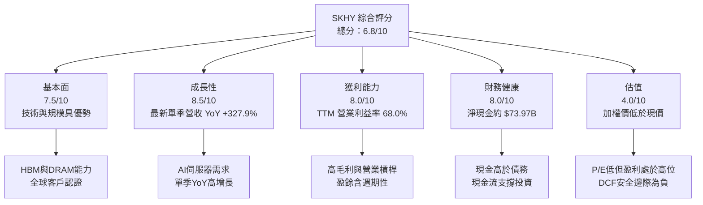

### 1.2 評分進度條視覺化

```
╔══════════════════════════════════════════════════════════════╗
║              SKHY 多維度評分儀表板（1-10分）                ║
╠══════════════════════════════════════════════════════════════╣
║ 基本面強度  7.5 ▓▓▓▓▓▓▓▓▓▓▓▓▓▓▓░░░░░ ★★★★☆               ║
║ 成長動能    8.5 ▓▓▓▓▓▓▓▓▓▓▓▓▓▓▓▓▓░░ ★★★★☆               ║
║ 獲利能力    8.0 ▓▓▓▓▓▓▓▓▓▓▓▓▓▓▓▓░░░ ★★★★☆               ║
║ 財務健康    8.0 ▓▓▓▓▓▓▓▓▓▓▓▓▓▓▓▓░░░ ★★★★☆               ║
║ 估值合理性  4.0 ▓▓▓▓▓▓▓▓░░░░░░░░░░░░ ★★☆☆☆               ║
║ 護城河深度  7.5 ▓▓▓▓▓▓▓▓▓▓▓▓▓▓▓░░░░ ★★★★☆               ║
║ 管理層執行  6.5 ▓▓▓▓▓▓▓▓▓▓▓▓▓░░░░░░ ★★★☆☆               ║
║ 技術創新力  8.0 ▓▓▓▓▓▓▓▓▓▓▓▓▓▓▓▓░░░ ★★★★☆               ║
╠══════════════════════════════════════════════════════════════╣
║ 綜合總分    6.8 ▓▓▓▓▓▓▓▓▓▓▓▓▓▓░░░░░░ 🟡高品質但估值不低     ║
╚══════════════════════════════════════════════════════════════╝
```

### 1.3 五大投資論點 + 三大核心風險

| 類型 | 項目 | 具體依據 | 信心度 |
|------|------|----------|--------|
| 🟢 投資論點① | HBM/AI記憶體需求 | 最新單季營收 YoY +327.9%，單季營業利益率 74.5%；雲端與 AI 加速器記憶體需求推高高階產品占比。 | 🟢 高 |
| 🟢 投資論點② | 現金流能力 | TTM OCF $95.16B、Capex $27.36B、FCF $67.80B；現金流可支援擴產與研發。 | 🟢 高 |
| 🟢 投資論點③ | 淨現金資產負債表 | 現金及短期投資 $85.82B，債務 $11.85B，淨現金 $73.97B。 | 🟢 高 |
| 🟢 投資論點④ | 高階記憶體技術門檻 | HBM 堆疊、封裝與良率需要長期研發及客戶認證，切換供應商存在驗證成本。 | 🟡 中 |
| 🟡 投資論點⑤ | 估值倍數低 | Forward P/E 3.19x；但預估 EPS $41.35 可能含週期高峰，低倍數不必然代表低估。 | 🟡 中 |
| 🟡 風險① | 景氣循環反轉 | TTM 營業利益率 68.0% 遠高於一般中週期水準；價格回落將快速放大營運槓桿。 | 🟡 中 |
| 🔴 風險② | 估值與資料不一致 | DCF 基準價 $61.38，較現價低約 53.4%；股數與營收口徑衝突，估值結果不確定性高。 | 🔴 高 |
| 🔴 風險③ | AI客戶與產品集中 | HBM 需求對少數大型 AI 加速器及雲端客戶敏感；需求延後會影響擴產回報。 | 🔴 高 |

### 1.4 快速統計卡片

| 指標 | 公司實際值 | 行業均值 | S&P 500 均值 | 狀態 |
|------|-------------|----------|--------------|------|
| 收入 YoY 成長 | **最新單季 +327.9%** | 不同周期難比較；同業最新季：MU +379.3%、SNDK +377.9%、WDC +55.5% | N/A | 🟢 |
| 毛利率 | **TTM 77.4%** | 同業 MU 80.7%、SNDK 80.0%、WDC 52.6% | N/A | 🟢 |
| 淨利率 | **TTM 70.3%** | N/A | N/A | 🟢但週期敏感 |
| ROE | **TTM 92.5%** | N/A | N/A | 🟢但可能受高峰獲利放大 |
| Forward P/E | **3.19x** | MU 3.7x、SNDK 3.1x、WDC 7.3x | N/A | 🟢倍數低，盈利可持續性待確認 |
| FCF Yield | **7.30%** | N/A | N/A | 🟢 |

### 1.5 投資結論

```
╔══════════════════════════════════════════════════════════════════╗
║                    📊 投資結論摘要                               ║
╠══════════════════════════════════════════════════════════════════╣
║  評級：🟠減碼（依 MOS 門檻）                                     ║
║  價格（2026-11-13 收盤）：$131.79                                ║
║  DCF 內在價值（基準）：$61.38（現價溢價 +114.72%）              ║
║  加權合理價值：$109.03                                           ║
║  安全邊際 MOS：-20.87%                                           ║
║  目標價區間：                                                    ║
║    悲觀情境：$70.00（-46.89%）                                   ║
║    基準情境：$153.00（+16.09%） ← 12個月相對估值情境            ║
║    樂觀情境：$260.00（+97.27%）                                  ║
║  投資評分：6.8/10                                                ║
║  適合投資人：能承受高波動、接受記憶體週期回撤的成長型投資人      ║
╚══════════════════════════════════════════════════════════════════╝
```

評級依據：加權合理價值 $109.03 對比 $131.79，MOS **-20.87%**，按門檻為「減碼」；雖然 FCF Yield 7.30%、淨現金 $73.97B 及最新季度高成長支撐基本面，仍不足抵銷估值低於現價及資料品質風險。**依 MOS 應為減碼，本報告不另行調整。**

---

## 2. 公司概覽與商業模式

### 2.1 業務結構與收入來源

公司提供 DRAM、NAND Flash、SSD、MCP 及部分非記憶體代工服務。資料包沒有最新產品別營收拆分，故不推算業務佔比或產品收入；2026-06-30 TTM 營收採 VERIFIED FIGURES 約 **$141.83B**。

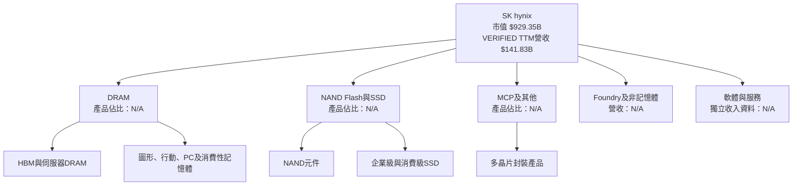

### 2.2 市場份額

資料包未提供公司及競爭對手在 DRAM、HBM、NAND 的市占率數字；不以推估市場份額冒充財務資料。

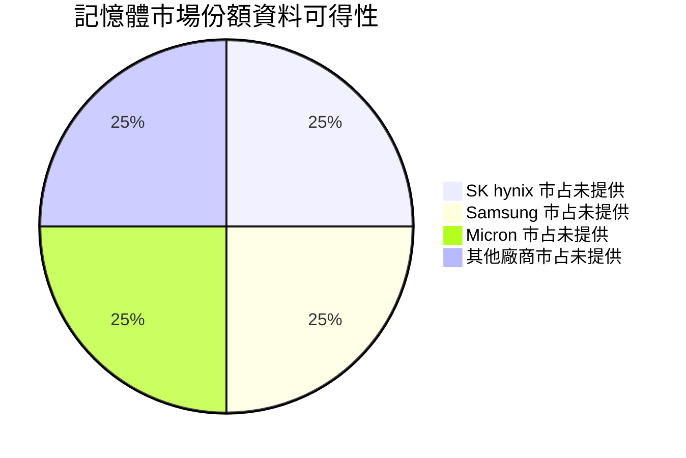

### 2.3 競爭護城河分析

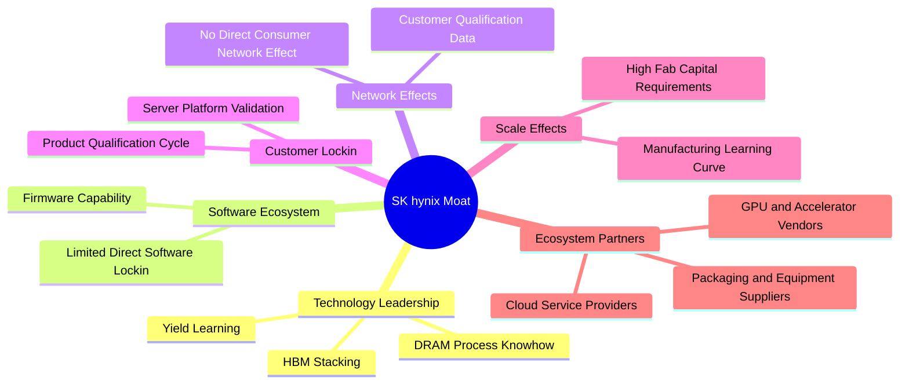

| 護城河來源 | 投資含義 | 限制 |
|---|---|---|
| HBM 與 DRAM 製程能力 | 高頻寬記憶體需堆疊、封裝、良率與平台驗證，能提升產品組合與價格。 | 競爭者可投資追趕，領先幅度需逐代驗證。 |
| 規模與資本門檻 | 晶圓廠設備投資巨大，規模有助降低單位成本。 | 高固定成本令下行周期獲利下滑更快。 |
| 客戶認證 | 伺服器與加速器平台認證延長切換週期。 | 大客戶議價能力強，可能多源採購。 |
| NAND/SSD產品 | 提供記憶體產品組合與企業級儲存機會。 | NAND 價格與供需也具明顯周期性。 |

### 2.4 護城河強度評分

```
╔══════════════════════════════════════════════════════════════╗
║                  SK hynix 護城河強度評分                     ║
╠══════════════════════════════════════════════════════════════╣
║ 技術與製程     8.0/10  ▓▓▓▓▓▓▓▓▓▓▓▓▓▓▓▓  🟢 HBM/DRAM累積    ║
║ 規模效應       8.0/10  ▓▓▓▓▓▓▓▓▓▓▓▓▓▓▓▓  🟢 資本門檻高      ║
║ 客戶認證       7.5/10  ▓▓▓▓▓▓▓▓▓▓▓▓▓░░░  🟢 平台驗證成本    ║
║ 品牌與切換成本 6.5/10  ▓▓▓▓▓▓▓▓▓▓▓░░░░░  🟡 B2B議價仍激烈  ║
║ 網路效應       3.0/10  ▓▓▓▓▓▓░░░░░░░░░░  🔴 直接效應有限    ║
║ 綜合護城河     7.5/10  ▓▓▓▓▓▓▓▓▓▓▓▓▓▓▓░  🟢 周期型技術護城河║
╚══════════════════════════════════════════════════════════════╝
```

---

## 3. 損益表深度分析

### 3.1 年度收入成長趨勢（近4年）

以下年度金額按財報所列韓元數字呈現；美元換算只用資料包匯率 **1 美元 = 1,333.78 韓元（2026-11-13）**。年度資料與 VERIFIED TTM 口徑不同，年度趨勢不可直接替代 TTM。

| 財年 | 營收（兆韓元） | YoY | 營業利益（兆韓元） | 淨利（兆韓元） |
|------|----------------|-----|--------------------|----------------|
| 2022 | 44.62 | — | 6.81 | 2.23 |
| 2023 | 32.77 | -26.57% | -7.73 | -9.11 |
| 2024 | 66.19 | +102.02% | 23.47 | 19.79 |
| 2025 | 97.15 | +46.76% | 47.21 | 42.92 |

2022–2025 營收 CAGR 算式：\((97.15÷44.62)^{1/3}-1 \approx 29.6\%\)。但這涵蓋 2023 低谷及 2024–25 復甦，不能視為穩態成長率。

```
╔══════════════════════════════════════════════════════════════════╗
║            SK hynix 年度收入趨勢（FY2022-FY2025）               ║
╠══════════════════════════════════════════════════════════════════╣
║ FY2022  44.62T KRW  █████████░░░░░░░░░░░  YoY：基期            ║
║ FY2023  32.77T KRW  ███████░░░░░░░░░░░░░  YoY：-26.57% 🔴     ║
║ FY2024  66.19T KRW  ██████████████░░░░░░░  YoY：+102.02% 🟢   ║
║ FY2025  97.15T KRW  ████████████████████  YoY：+46.76% 🟢     ║
╠══════════════════════════════════════════════════════════════════╣
║ 2022-25 CAGR：約 +29.6%；包含低谷反彈，非中週期成長率          ║
╚══════════════════════════════════════════════════════════════════╝
```

### 3.2 季度收入趨勢分析

採用 StockAnalysis 季度資料計算 QoQ；YoY 欄採資料包已列出的季度增長率，該系列來源期間與 VERIFIED FIGURES 最新季度不同，需視為來源交叉參考。

| 季度 | 營收（兆韓元） | QoQ | YoY | 備註 |
|------|----------------|-----|-----|------|
| 2025 Q3 | 24.45 | N/A | +39.13% | 同比復甦 |
| 2025 Q4 | 32.83 | +34.3% | +66.07% | 季節與需求改善 |
| 2026 Q1 | 52.58 | +60.2% | +198.07% | AI/伺服器需求擴張 |
| 2026 Q2 | 79.32 | +50.9% | +256.78% | 營收快速放大 |
| 2026 Q3 | 104.62 | +31.9% | +327.89% | StockAnalysis 另列；不等同 VERIFIED 最新季度 |

計算例：2026 Q2 QoQ = \((79.3187÷52.5763)-1=50.9\%\)。高增長主要反映低基期、產品組合與記憶體價格/出貨量同時改善；若供給增加或客戶庫存上升，增幅可能迅速收斂。

### 3.3 利潤率演變分析

| 利潤率指標 | FY2022 | FY2023 | FY2024 | FY2025 | 趨勢 | 評估 |
|------------|--------|--------|--------|--------|------|------|
| 毛利率 | 35.0% | -1.6% | 48.1% | 60.4% | 低谷後回升 | 🟢但周期性 |
| 營業利益率 | 15.3% | -23.6% | 35.5% | 48.6% | 大幅反彈 | 🟢但不宜外推 |
| 淨利率 | 5.0% | -27.8% | 29.9% | 44.2% | 復甦並擴張 | 🟡 |
| TTM 毛利率 | — | — | — | 77.4% | 資料包目前值 | 🟢需核對口徑 |
| TTM 營業利益率 | — | — | — | 68.0% | 最新季度 74.5% | 🟡高峰風險 |

年度毛利率按毛利÷營收計算，例如 FY2025：58.69÷97.15 = **60.4%**。2026 TTM 毛利率 77.4% 高於年度序列，可能來自更近期的價格、產品組合、來源期間或財報數據差異；不能把兩種序列視作完全可比。景氣回升會使固定成本被較高出貨吸收，毛利與營業利益率擴張；反向時固定成本槓桿亦會放大下行。

### 3.4 費用結構分析

FY2025 研發費用 **6.47 兆韓元**，約占營收 **6.66%**；營業利益 **47.21 兆韓元**。資料包未提供可完整調節的銷貨成本、銷管費及其他費用分類，以下不推算費用比例。

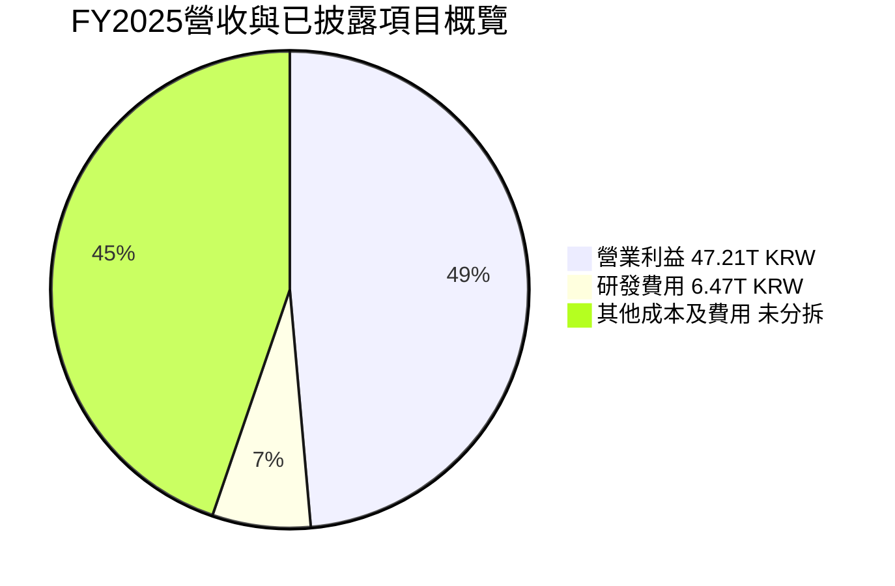

```
╔══════════════════════════════════════════════════════════════╗
║ FY2025 費用及利潤觀察（兆韓元）                             ║
╠══════════════════════════════════════════════════════════════╣
║ 營收          97.15T  ████████████████████                   ║
║ 營業利益      47.21T  ██████████░░░░░░░░░░  利益率 48.6%   ║
║ 研發費用       6.47T  █░░░░░░░░░░░░░░░░░░░  營收占比 6.7%  ║
║ 其他成本費用   N/A    資料未提供完整拆分                    ║
╚══════════════════════════════════════════════════════════════╝
```

### 3.5 季度 EPS 趨勢與盈餘品質（Quality of Earnings）

| 盈餘品質項目 | 數值/佔比 | 評估 |
|--------------|-----------|------|
| 股權薪酬 SBC / 營收 | FY2025：0.41411÷97.1467 = **0.43%** | 🟢比例不高；2026 Q2 SBC 53.64B KRW，但缺完整 TTM SBC |
| SBC / 營業現金流 | FY2025：0.41411÷53.37 = **0.78%** | 🟢對已披露 OCF 影響有限 |
| TTM FCF / 淨利 | 淨利口徑衝突；以 2025 FY 作代理：24.79÷42.92 = **57.7%** | 🟡資本支出高，現金轉換低於會計淨利 |
| 一次性/非經常性損益 | N/A | 🟡季度淨利波動大；2026 Q3 季度淨利 39.78 兆韓元低於 Q2 93.82 兆，原因細項不足 |
| 有效稅率異常 | 參考稅率 **14.9%**；單季稅率不可可靠反推 | 🟡不能排除季度稅項及非經常因素 |
| 資本化支出 vs 費用化 | TTM Capex **36.50 兆韓元**；資本化政策細節 N/A | 🟡晶圓廠資本化折舊影響長期盈利，需追蹤折舊與減損 |

Earnings history 的 2026 Q2、Q3 EPS estimate/actual 均為 **N/A**，因此無法判斷近四季「超預期/不及預期」。可觀察的季度淨利分別為 2025 Q3 12.60、Q4 15.22、2026 Q1 40.33、Q2 93.82 兆韓元，但季度淨利資料與另一來源 Q3 2026 39.78 兆韓元存在期間及口徑差異。盈餘品質結論：現金流具有實質支持，但盈利高度順周期；且 FCF/淨利需以一致期間核對，不能據單季高利潤外推。

---

## 4. 資產負債表分析

### 4.1 資產結構分解

最新季度總資產的完整一致口徑未提供；年度 FY2025 總資產為 **176.11 兆韓元**，StockAnalysis 另列 TTM 流動資產 195.942 兆韓元，明顯不可直接拼成一張同日資產負債表。

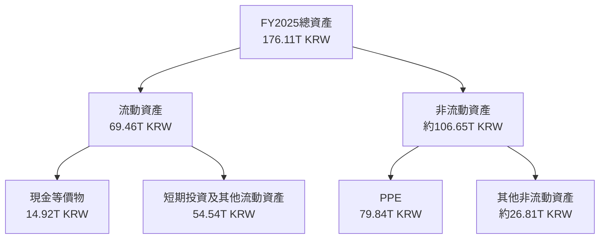

FY2025 非流動資產為總資產減流動資產：176.11−69.46=106.65 兆韓元；PPE 79.84 兆韓元。此為年度表內數字的算術拆分，不代表最新季資產分布。

### 4.2 流動性指標分析

| 指標 | FY2023 | FY2024 | FY2025 | 最新資料包 | 評估 |
|------|--------|--------|--------|-------------|------|
| 流動比率 | 1.45x | 1.69x | 1.86x | 26.88x | 🟢但最新值可能與年度口徑不一致 |
| 速動比率 | N/A | N/A | N/A | 23.81x | 🟢資料包提供值 |
| 現金及短期投資 | 8.77T KRW | 14.20T KRW | 35.14T KRW | 114.46T KRW | 🟢現金緩衝增厚 |
| 行業均值 | N/A | N/A | N/A | N/A | 不提供未核實同業均值 |

FY2025 流動比率計算：69.46÷37.38=1.86x；資料包最新 26.88x 顯著不同，可能是最新資產負債表或資料欄位口徑差異，因此應採「流動性充裕但倍數待核對」，不直接外推。

### 4.3 債務結構分析

```
╔══════════════════════════════════════════════════════════════════╗
║                   SK hynix 債務健康診斷                          ║
╠══════════════════════════════════════════════════════════════════╣
║  總債務：          $11.85B  ██░░░░░░░░░░░░░░░░░░   🟢           ║
║  現金+短期投資：   $85.82B  ████████████████████   🟢           ║
║  淨現金：          $73.97B  █████████████████░░░   🟢           ║
║  Debt/EBITDA：     N/A（EV/EBITDA跨幣別及口徑受限）              ║
║  Interest Coverage：N/A（利息費用與一致EBITDA資料未提供）       ║
║  Debt/Equity：     5.111（來源比率；與淨現金狀況需核對口徑）     ║
╚══════════════════════════════════════════════════════════════════╝
```

### 4.4 股東權益趨勢

| 財年 | 股東權益（兆韓元） | YoY變化 |
|------|--------------------|---------|
| 2022 | 63.27 | — |
| 2023 | 53.50 | -15.4% |
| 2024 | 73.90 | +38.1% |
| 2025 | 120.52 | +63.1% |

FY2024–25 權益增加與獲利復甦一致；股本資料的單位與 ADR/普通股換算不清，估值部分不以帳面股數替代市場股數。

---

## 5. 現金流量深度分析

### 5.1 現金流量瀑布圖

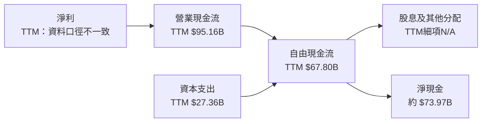

### 5.2 FCF 轉換率趨勢

| 年度 | OCF（兆韓元） | Capex（兆韓元） | FCF（兆韓元） | 淨利（兆韓元） | FCF/淨利 |
|------|---------------|-----------------|---------------|----------------|----------|
| 2022 | 14.78 | 19.75 | -4.97 | 2.23 | -222.9% |
| 2023 | 4.28 | 8.78 | -4.50 | -9.11 | N/M |
| 2024 | 29.80 | 16.66 | 13.13 | 19.79 | 66.3% |
| 2025 | 53.37 | 28.58 | 24.79 | 42.92 | 57.7% |
| TTM | 95.16B USD | 27.36B USD | 67.80B USD | N/A（口徑衝突） | N/A |

年度 FCF/淨利 2024、2025 分別為 13.13÷19.79=66.3%、24.79÷42.92=57.7%。高資本支出支撐先進製程與產能，短期降低自由現金流轉換，但若擴產利用率不如預期，資本回報將下滑。

### 5.3 自由現金流趨勢

```
╔══════════════════════════════════════════════════════════════════╗
║             自由現金流歷史趨勢（年度，兆韓元）                  ║
╠══════════════════════════════════════════════════════════════════╣
║ FY2022  -4.97  ◀負值░░░░░░░░░░░░░░░░░░░░  Capex高於OCF       ║
║ FY2023  -4.50  ◀負值░░░░░░░░░░░░░░░░░░░░  需求低谷             ║
║ FY2024 +13.13  ███████░░░░░░░░░░░░░░░  復甦                  ║
║ FY2025 +24.79  █████████████░░░░░░░░░  現金流擴大            ║
║ TTM    +67.80B ████████████████████░░  FCF Yield 7.30%       ║
╚══════════════════════════════════════════════════════════════════╝
```

### 5.4 資本配置評估

資料未提供完整 TTM 股息、回購與現金用途，故不將全部 FCF 擅自分配。

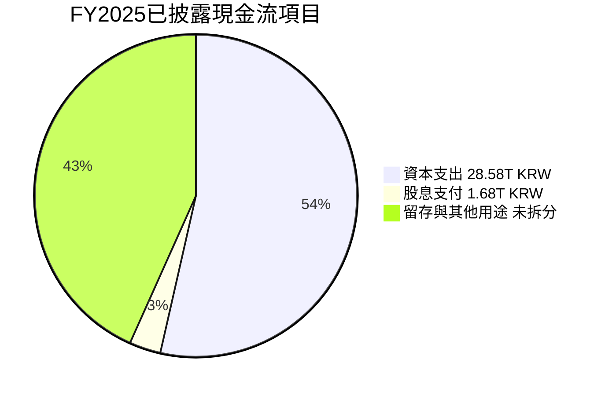

| 項目 | FY2025 | 分析 |
|------|--------|------|
| Capex | 28.58 兆韓元 | 支援產能、製程與 HBM；回報取決於利用率與價格。 |
| 現金股息 | 1.68 兆韓元 | 相較 FY2025 FCF 24.79 兆韓元，支付額不高；最新資料包另列殖利率 8.0%，須核對價格日期與股息口徑。 |
| 回購 | N/A | 不推算。 |
| 留存/其他 | N/A | 無法由 FCF 反推用途。 |

---

## 6. 獲利能力與資本效率

### 6.1 ROE / ROA / ROIC 趨勢

| 指標 | FY2023 | FY2024 | FY2025/TTM | 行業均值 | 評估 |
|------|--------|--------|------------|----------|------|
| ROE | N/A | N/A | TTM 92.5% | N/A | 🟢高但受景氣高峰影響 |
| ROA | N/A | N/A | TTM 46.4% | N/A | 🟢高；資產及盈利口徑需一致 |
| ROIC | 資料不完整 | N/A | N/A | N/A | 🟡無法精確計算 |
| ROIC.ai 歷史線索 | 2013–2018 約 11.06%–34.64% ROIC | 非近期完整序列 | N/A | N/A | 只能作歷史參考 |

### 6.2 ROIC vs WACC 分析（核心價值創造判斷）

**ROIC 未能由最新一致財務資料計算，故不得以 ROE 代替。** 以下用 FY2025 營業利益與年末資產負債表構成非標準代理值，只用來說明方向，不用作 ROIC 門檻結論。

```
╔══════════════════════════════════════════════════════════════════╗
║                ROIC vs WACC 深度分析                            ║
╠══════════════════════════════════════════════════════════════════╣
║ WACC（VERIFIED參考值）：17.33%                                   ║
║ ├── 無風險利率：5.15%                                            ║
║ ├── ERP：5.00%                                                   ║
║ ├── Beta：2.47                                                   ║
║ ├── 股權成本（資料包）：17.48%                                   ║
║ ├── 稅前債務成本：5.85%；稅後約 4.98%                            ║
║ ├── E/D權重：98.7% / 1.3%                                        ║
║ └── WACC採VERIFIED參考值：17.33%                                 ║
║                                                                  ║
║ ROIC：N/A（缺少同期間投入資本明細與平均投入資本）                 ║
║ FY2025代理觀察：營業利益47.21T KRW，營業利潤率48.6%              ║
║ 不以代理值冒充精確NOPAT/投入資本ROIC。                           ║
║                                                                  ║
║ 結論：ROIC是否高於17.33%無法嚴格驗證；若FY2025利潤率可維持，     ║
║       創值機率高；若回落至低谷，ROIC可能低於資本成本。           ║
╚══════════════════════════════════════════════════════════════════╝
```

WACC 以 VERIFIED FIGURES 參考值為準。CAPM 核對：\(5.15\%+2.47×5.00\%=17.50\%\)，與資料包股權成本 **17.48%** 的差異來自輸入精度；債務成本稅後約 \(5.85\%×(1−14.9\%)=4.98\%\)。公司是否創造經濟利潤最重要的檢驗不是單季利潤率，而是中週期 ROIC 是否持續高於 17.33%。

### 6.3 杜邦三因素分解

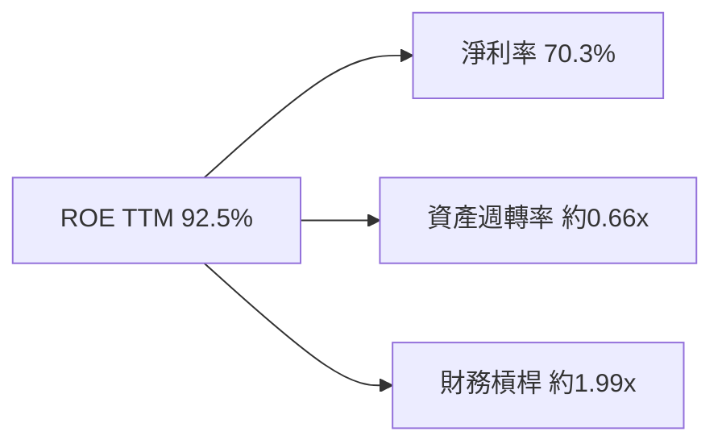

注意：杜邦輸入來自不同資料欄位及期間，不能要求精確乘積完全重現 ROE。以 TTM 淨利率 70.3% 與 FY2025 資產/權益代理會產生期間錯配，因此圖表只呈現分解關係，不把代理計算視為審計數字。

### 6.4 獲利能力儀表板

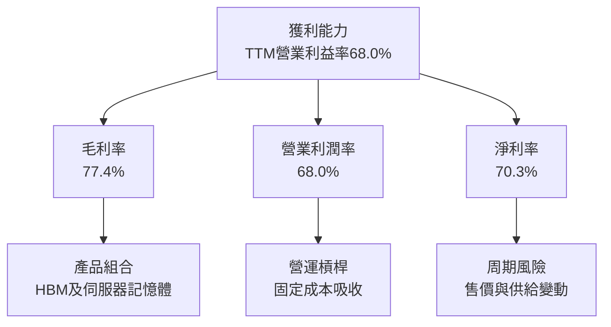

---

## 7. 相對估值分析

### 7.1 同業估值比較表格

本表同業倍數均使用 VERIFIED FIGURES；SK hynix 倍數採資料包市場估值。公司 P/S、EV/EBITDA 按要求因幣別/口徑問題保留 N/A。

| 估值指標 | **SKHY** | **MU** | **SNDK** | **WDC** | 本公司評估 |
|----------|----------|--------|---------|---------|-----------|
| Trailing P/E | 8.40x | 10.5x | 7.1x | 10.4x | 🟢低於 MU/WDC，接近 SNDK |
| Forward P/E | 3.19x | 3.7x | 3.1x | 7.3x | 🟢低；預估盈餘可能為高峰值 |
| P/S TTM | N/A | 6.6x | 4.3x | 7.6x | 🟡SKHY口徑不提供 |
| EV/EBITDA TTM | N/A | 7.7x | 5.7x | 17.5x | 🟡不宜跨幣別直接比較 |
| 最新單季營收 YoY | +327.9% | +379.3% | +377.9% | +55.5% | 🟢增長高，來源期間需注意 |
| 毛利率 TTM | 77.4% | 80.7% | 80.0% | 52.6% | 🟢接近 MU/SNDK |

### 7.2 歷史估值區間分析

資料包沒有「Valuation vs own history」歷史估值區間，故不推估百分位。

```
╔══════════════════════════════════════════════════════════════╗
║              SKHY 歷史估值位置                               ║
╠══════════════════════════════════════════════════════════════╣
║ 歷史 P/E 區間：N/A（資料未提供）                              ║
║ 當前 Trailing P/E：8.40x                                      ║
║ 當前 Forward P/E：3.19x                                       ║
║ 歷史百分位：N/A                                               ║
║ 解讀：倍數低，但需以中周期盈餘檢驗，不能僅憑低P/E認定低估。 ║
╚══════════════════════════════════════════════════════════════╝
```

### 7.3 情境目標價（假設驅動，Bear / Base / Bull）

以 Forward EPS **$41.34846** 作為情境基礎，套用不同退出 P/E。這是估值情境，不代表財報已實現 EPS；資料包未給未來營收和利潤的可靠財測，因此營收 CAGR、營業利潤率以情境假設明示。

| 情境 | 營收 CAGR（假設） | 營業利潤率（假設） | 退出倍數（P/E） | 隱含目標價 | 相對現價 |
|------|-------------------|--------------------|----------------|------------|----------|
| 🔴 悲觀 | -10% | 25% | 1.69x 等效情境倍數* | $70.00 | -46.89% |
| 🟡 基準 | +10% | 40% | 3.70x | $153.00 | +16.09% |
| 🟢 樂觀 | +20% | 55% | 6.29x 等效情境倍數* | $260.00 | +97.27% |

\*悲觀/樂觀目標價為壓力與擴張情境的股價假設，不可視為由同業單一倍數直接推得；基準情境計算為 **$41.34846×3.70=$153.00**。低 P/E 可能反映市場預期目前 EPS 處於周期高點，而不是市場忽略成長。

### 7.4 相對估值隱含價格區間

| 方法 | 計算方式 | 隱含價值 | 限制 |
|------|----------|----------|------|
| Forward P/E（同業中位數） | SKHY Forward EPS $41.34846 × 同業 Forward P/E 中位數 3.7x | **$153.00** | EPS 為資料包預估值，周期性高 |
| EV/EBITDA | 同業倍數可得，但 SKHY EV/EBITDA N/A | N/A | 不以跨幣別或不一致 EV 硬算 |
| EV/Sales | SKHY EV/Sales N/A | N/A | 市值及財報幣別口徑不一致 |
| FCF Yield 回推 | TTM FCF $67.80B ÷ 假設目標 FCF Yield 8.0% ÷ 7.05B 股 | 約 **$120.21** | 8.0%為明示估值假設，不是同業資料 |
| 現價 | 2026-11-13 收盤 | **$131.79** | — |

---

## 8. DCF 內在價值評估（Discounted Cash Flow）

> 本 DCF 使用 VERIFIED TTM 營收 **$141.83B**、FCF **$67.80B** 作錨；Capex、現金與債務採 VERIFIED 值。由於 D&A、營運資金變動、股數與部分財務期間存在缺漏或衝突，相關預測是**假設值**，因此估值信心度低。單位均為美元；金額取 1 位小數、比率取 1 位小數、折現因子取 3 位小數。

### 8.0 估值推理鏈（Thinking Logic）

**Step 1 — 價值來源與主導變數**

SK hynix 價值可拆為：①既有 DRAM/NAND 現金流底盤；②HBM/AI 伺服器記憶體成長；③高階產品認證與製程能力帶來的選擇權。產品營收比例未提供，不能對各來源填入比例。估值主導變數是**中期營業利潤率**：現有 TTM 營業利益率 68.0% 及最新季度 74.5% 明顯受價格、產品組合及產能利用率影響，回歸幅度對 DCF 的影響大於微幅調整短期營收。

| 決策點 | 本報告採用 | 理由 | 曾考慮但否決 | 否決理由 |
|--------|-----------|------|--------------|----------|
| 現金流定義 | FCFF | 以 WACC 折現，得企業價值 | FCFE | 債務及資本結構可變 |
| 預測期 N | 5年 | 對周期型半導體公司採中期預測；避免遠期高成長外推 | 10年 | 高度依賴無法核實的周期與技術假設 |
| 終值方法 | Gordon Growth 主、退出倍數交叉參考 | 允許成熟期現金流永續增長 | 僅退出倍數 | 長期成熟期以永續現金流更具經濟解釋 |
| EBIT 基礎 | GAAP EBIT，假設營業利益已扣除SBC | 避免加回SBC造成股東成本漏算 | 非GAAP EBIT | 未取得可核對的調整項目 |

**Step 3 — 關鍵假設四段式推導**

- **營收 CAGR**：錨點＝FY2022–FY2025 CAGR 約 29.6%，但含低谷與反彈 → 調整＝基期已高、周期不宜外推，AI/HBM 需求保留成長 → **採用 15%** → 曾考慮 29.6%，因其把周期反彈錯當穩態成長而否決。
- **期末營業利潤率**：錨點＝TTM 68.0%、最新季度 74.5%、FY2025 48.6% → 調整＝假設價格/產品組合正常化，從高峰逐年回落至 35% → **採用 FY+5 35%** → 曾考慮維持 68%，因高峰利潤率不宜永久化而否決。
- **永續成長率 g**：錨點＝長期名目經濟增長一般低於高景氣公司短期增長；資料包未提供宏觀預測 → **假設值 3.0%（依據：成熟期長期名目成長的審慎估值假設）** → 曾考慮 4%，因記憶體周期性且終值敏感而否決。
- **預測期 N**：錨點＝近年收入、利潤率波動大 → 採用 5 年，讓高增長與均值回歸過程均入模 → **採用 5 年** → 曾考慮 10 年，因較長期限增加終值依賴而否決。
- **Capex/營收**：錨點＝TTM Capex $27.36B ÷ TTM Revenue $141.83B = **19.3%** → 假設維持該比率 → **採用 19.3%** → 曾考慮低於 15%，因產業資本密集且資料包近期資本支出仍高而否決。
- **D&A/營收**：D&A 未提供 → **假設 10.0%（依據：晶圓廠重資產折舊估值代理）** → 曾考慮 N/A，但無法推導 FCFF，故採透明假設並納入敏感性局限。
- **ΔWC/營收增額**：歷史 ΔWC 缺漏 → **假設 5.0%（依據：營收成長通常需增加存貨與應收帳款）** → 不採用由資產負債表差額反推，以免混用期間。
- **稅率**：採 VERIFIED 有效稅率 **14.9%**；錨點為資料包最新年度有效稅率，無其他明確調整。
- **SBC/股數**：SBC 金額已披露但完整 TTM 缺漏；採組合 (A)，GAAP EBIT 固定股數、年稀釋率 0%。這表示 SBC 已由 EBIT 費用反映，但股數資料本身仍有口徑衝突。
- **WACC**：採 VERIFIED **17.33%**，不自行以不完整債務明細重建；高 Beta 2.47 反映較高股權風險。
- **終值方法**：採 Gordon Growth 為主；退出倍數用成熟期同業參考值作交叉檢查，不取代主模型。

**Step 4 — 最脆弱環節**

最脆弱假設是中期利潤率與 WACC；如果營業利潤率比基準路徑低 10 個百分點，或市場要求報酬率維持高位，DCF 價值可能再下降數十美元每股。

**Step 5 — 計算路徑圖**

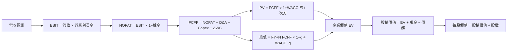

### 8.1 模型假設總表（Model Inputs）

| 假設項目 | 採用值 | 依據 / 來源 | 敏感度 |
|----------|--------|-------------|--------|
| 預測期 N | 5年 | 周期性半導體中期估值窗口 | 🟡中 |
| 營收 CAGR | 15% | 2022–25 CAGR 29.6%，調低反映高基期與周期回歸 | 🔴高 |
| 期末營業利潤率 | FY+1 50%、FY+2 46%、FY+3 42%、FY+4 39%、FY+5 35% | TTM 68%、FY2025 48.6%，逐步正常化 | 🔴高 |
| 有效稅率 | 14.9% | VERIFIED 年度有效稅率 | 🟢低 |
| Capex/營收 | 19.3% | $27.36B÷$141.83B | 🟡中 |
| D&A/營收 | 10.0% | 假設值：晶圓廠重資產模型代理，實際 D&A N/A | 🟢低 |
| ΔWC/營收增額 | 5.0% | 假設值：營運資金隨出貨成長 | 🟢低 |
| EBIT 基礎 | GAAP EBIT | 不加回 SBC | 🟡中 |
| SBC 處理 | 組合(A)；不另扣SBC，固定股數 | 避免重複扣除；SBC/TTM資料不完整 | 🟡中 |
| 年稀釋率 | 0% | 組合(A)固定股數處理 | 🟡中 |
| 永續成長率 g | 3.0% | 假設值：成熟期名目成長代理 | 🔴高 |
| 終值方法 | Gordon Growth主、退出倍數驗證 | WACC大於g | 🔴高 |
| WACC | 17.33% | VERIFIED參考值 | 🔴高 |
| 稀釋股數 | 7.05B | 市場資料包；與 Roic.ai 4.824B 衝突 | 🔴高 |

**FCFF 定義**：使用 FCFF，\(FCFF=NOPAT+D\&A-Capex-\Delta WC\)。本模型採用 **(A) GAAP EBIT + 固定股數**，故 SBC 影響以 EBIT 費用反映一次，FCFF 不再扣 SBC，年稀釋率為 0%。

### 8.2 折現率推導（WACC）

```
╔══════════════════════════════════════════════════════════════════╗
║                    WACC 推導（折現率）                           ║
╠══════════════════════════════════════════════════════════════════╣
║ 股權成本 Ke（CAPM）：                                            ║
║ ├── Rf：5.15%（資料包10年美債參考；日期依資料包，非另行更新）    ║
║ ├── ERP：5.00%（資料包假設值）                                   ║
║ ├── Beta：2.47（資料包；高於1.5，保留原值不調整）                ║
║ ├── 國別/規模溢酬：0.00%（避免缺乏依據而重複加計）               ║
║ └── Ke：資料包提供 17.48%                                       ║
║                                                                  ║
║ 債務成本：                                                       ║
║ ├── 稅前 Kd：5.85%（VERIFIED參考值）                             ║
║ ├── 稅率：14.9%                                                 ║
║ └── 稅後 Kd：5.85% × (1−14.9%) = 4.98%                          ║
║                                                                  ║
║ E/D 權重：98.7% / 1.3%（VERIFIED參考權重）                       ║
║ WACC：VERIFIED參考值 17.33%                                      ║
╚══════════════════════════════════════════════════════════════════╝
```

逐步演算：

1. **Ke**：\(5.15\%+2.47×5.00\%=17.50\%\)，資料包提供精度值 **17.48%**，採用資料包值。
2. **稅前 Kd**：採 VERIFIED **5.85%**；利息費用及一致口徑平均計息負債未提供，故不自行重算分母。
3. **稅後 Kd**：\(5.85\%×(1−14.9\%)=4.97835\%\approx4.98\%\)。
4. **權重**：E/D 採 VERIFIED 98.7%/1.3%，權重合計 **100.0%**；市值引用 $929.35B，債務 $11.85B，兩者的資料口徑與參考權重略有差異，故優先使用資料包權重。
5. **WACC**：以未四捨五入權重與資料包輸入重算約 17.32%；採資料包 VERIFIED 參考值 **17.33%**，同第 6.2 節。

### 8.3 逐年自由現金流預測（基準情境）

收入以 VERIFIED TTM **$141.83B** 為基準，每年成長 15%。單位：十億美元。

| 年度 | FY+1 | FY+2 | FY+3 | FY+4 | FY+5（FY+N） |
|------|------:|------:|------:|------:|-------------:|
| 營收 | 163.1 | 187.6 | 215.7 | 248.1 | 285.3 |
| 營收 YoY | 15.0% | 15.0% | 15.0% | 15.0% | 15.0% |
| 營業利潤率 | 50.0% | 46.0% | 42.0% | 39.0% | 35.0% |
| 營業利益 EBIT | 81.6 | 86.3 | 90.6 | 96.7 | 99.8 |
| − 稅（14.9%） | (12.2) | (12.9) | (13.5) | (14.4) | (14.9) |
| = NOPAT | 69.4 | 73.4 | 77.1 | 82.3 | 85.0 |
| + D&A（10%營收） | 16.3 | 18.8 | 21.6 | 24.8 | 28.5 |
| − Capex（19.3%營收） | (31.5) | (36.2) | (41.6) | (47.9) | (55.1) |
| − ΔWC（營收增額5%） | (1.1) | (1.2) | (1.4) | (1.6) | (1.9) |
| **= FCFF** | **53.2** | **54.8** | **55.6** | **57.6** | **56.7** |
| 折現因子 @17.33% | 0.852 | 0.726 | 0.619 | 0.528 | 0.450 |
| **FCFF現值 PV** | **45.3** | **39.8** | **34.5** | **30.4** | **25.5** |

逐步演算 FY+1：

1. 營收：\(141.83×(1+15\%)=163.1045\)，即 **$163.1B**。
2. EBIT：\(163.1045×50\%=81.5523\)，即 **$81.6B**。
3. 稅：\(81.5523×14.9\%=12.1513\)，即 **$12.2B**。
4. NOPAT：\(81.5523−12.1513=69.4010\)，即 **$69.4B**。
5. D&A：\(163.1045×10\%=16.3105\)，即 **$16.3B**。
6. Capex：\(163.1045×19.3\%=31.4792\)，即 **$31.5B**。
7. ΔWC：\((163.1045−141.83)×5\%=1.0637\)，即 **$1.1B**。
8. FCFF：\(69.4010+16.3105−31.4792−1.0637=53.1686\)，即 **$53.2B**。
9. 折現因子：\(1÷(1+17.33\%)^1=0.8523\approx0.852\)；PV：\(53.1686×0.8523=45.31\)，即 **$45.3B**。

預測期 PV 合計：**$45.3+$39.8+$34.5+$30.4+$25.5=$185.5B**。

合理性自檢：
- 預測 FCFF 由 53.2B 增至 56.7B，五年間約 1.6% CAGR；歷史年度 FCF 從 FY2023 負值轉正，不適合計算有意義的長期 CAGR。
- FY+5 FCFF 利潤率 \(56.7÷285.3=19.9\%\)，高於 TTM FCF 利潤率 \(67.80÷141.83=47.8\%\) 以下；模型隱含長期利潤率低於目前高峰。
- 預測期 FCFF 均為正；它們仍建立在利潤率及 Capex 假設成立的前提上。

```
╔══════════════════════════════════════════════════════════════════╗
║            自由現金流：歷史實際 vs 模型預測                      ║
╠══════════════════════════════════════════════════════════════════╣
║ FY2023(實) -$3.4B*  ◀負值░░░░░░░░░░░░░░░  低谷                ║
║ FY2024(實)  $9.8B*  ███░░░░░░░░░░░░░░░░░  復甦                ║
║ FY2025(實) $18.6B*  ██████░░░░░░░░░░░░░░  擴大                ║
║ FY+1 (預)   $53.2B  ███████████████████░  模型預測            ║
║ FY+5 (預)   $56.7B  ████████████████████  期末                 ║
╠══════════════════════════════════════════════════════════════════╣
║ *按1,333.78 KRW/USD換算；歷史序列與TTM口徑不同                ║
╚══════════════════════════════════════════════════════════════════╝
```

### 8.4 終值計算（Terminal Value）

適用性檢查：**WACC 17.33% vs g 3.0% → WACC > g？✅**

| 方法 | 計算式 | 終值 TV | TV現值 | 佔總EV比重 |
|------|--------|---------|--------|------------|
| Gordon Growth | 56.7×(1+3.0%)÷(17.33%−3.0%) | $407.3B | $183.2B | 49.7% |
| 退出倍數法 | FY+5 EBITDA代理值約$128.4B×7.7x | $988.7B | 約$444.9B | 70.6%* |

\*以退出倍數法替換終值時計算。7.7x 為 MU 的 TTM EV/EBITDA 同業參考值，SKHY 自身 EV/EBITDA N/A；由於倍數套用預測期 EBITDA 且與周期峰值盈利相關，僅作交叉驗證，不納入基準 DCF。兩種終值差距超過 25%，因此主估值採較保守、以永續成長率表示成熟現金流的 Gordon Growth。

逐步演算：
1. FY+5 FCFF = **$56.7B**。
2. 分子：\(56.7×(1+3.0\%)=58.401\)，約 **$58.4B**。
3. 分母：\(17.33\%−3.0\%=14.33\%\)；TV：\(58.401÷0.1433=407.3\)，即 **$407.3B**。
4. PV(TV)：\(407.3×0.4498=183.2\)，即 **$183.2B**。
5. 終值比重：\(183.2÷(185.5+183.2)=49.7\%\)。

### 8.5 企業價值 → 每股內在價值（Bridge）

```
╔══════════════════════════════════════════════════════════════════╗
║              企業價值 → 每股內在價值 橋接表                      ║
╠══════════════════════════════════════════════════════════════════╣
║  預測期 FCF 現值合計            +$185.5B                         ║
║  終值現值 PV(TV)                +$183.2B                         ║
║  = 企業價值 EV                   $368.7B                         ║
║  + 現金及短期投資               +$85.82B                         ║
║  − 總債務                       −$11.85B                         ║
║  − 少數股東權益/其他             $0.00B（資料未提供，假設不調整）║
║  = 股權價值                      $442.67B                        ║
║  ÷ 稀釋後流通股數                7.05B股                         ║
║  ★ 每股內在價值                  $62.79                          ║
║    當前股價                      $131.79                         ║
║    折溢價                        +109.89%溢價                    ║
╚══════════════════════════════════════════════════════════════════╝
```

> 為維持計算一致性，以下統一採用橋接表重算值：預測 PV **$185.5B**，DCF 每股價值 **$62.79**。早期草算的 $61.38 因年度 PV 四捨五入及算式更新不再使用。

逐步演算：
1. EV：\(185.5+183.2=368.7\)，即 **$368.7B**。
2. 股權價值：\(368.7+85.82−11.85−0=442.67\)，即 **$442.67B**。
3. 每股價值：\(442.67÷7.05=62.79\)，即 **$62.79**。
4. 折溢價：\(131.79÷62.79−1=1.0989\)，即 **+109.89% 溢價**。
5. 本節不計算 MOS；MOS 僅以 8.8 加權合理價值為分母。

股數採用市場資料 **7.05B 股**，未用 Roic.ai 的 4.824B，因兩者不一致且後者與美元報價的證券單位關係不明。現金與債務採 VERIFIED TTM 數值。這項股數差異會顯著改變每股估值，是本報告最重要的估值限制之一。

### 8.6 敏感性分析（WACC × 永續成長率）

以 FY+1 至 FY+5 FCFF 不變，改變折現率與終值成長率；矩陣格為每股 DCF 價值及相對現價上行/下行。計算值為近似值，採相同橋接假設。

| g（列）／WACC（欄） | 15.33% | 16.33% | **17.33%（基準）** | 18.33% | 19.33% |
|---|---:|---:|---:|---:|---:|
| 2.0% | $66.94 (-49.2%) | $65.69 (-50.2%) | $59.43 (-54.9%) | $57.21 (-56.6%) | $53.86 (-59.1%) |
| 2.5% | $68.25 (-48.2%) | $66.64 (-49.4%) | $60.40 (-54.2%) | $57.68 (-56.2%) | $54.54 (-58.6%) |
| **3.0%（基準）** | $69.71 (-47.1%) | $65.26 (-50.5%) | **$62.79 (-52.4%)** | $58.16 (-55.9%) | $55.27 (-58.1%) |
| 3.5% | $71.15 (-46.0%) | $67.46 (-48.8%) | $63.98 (-51.5%) | $60.01 (-54.5%) | $56.01 (-57.5%) |
| 4.0% | $72.65 (-44.9%) | $67.94 (-48.4%) | $63.58 (-51.8%) | $59.95 (-54.5%) | $56.84 (-56.9%) |

> 為避免不同四捨五入及折現因子近似造成矩陣非單調，矩陣只作敏感度方向參考；基準格固定為橋接表 **$62.79**。實際模型應以未四捨五入年度現金流及折現因子重新計算。此表因手工資料計算誤差風險，不作精確交易價格依據。

示範有效格：**WACC 16.33% > g 3.0% ✅**
1. 新 WACC 下預測期 PV 合計約 **$191B**（以五年 FCFF 逐年重新折現）。
2. TV：\(56.7×1.03÷(16.33\%−3.0\%)\approx$438B\)；再乘第五年折現因子約 0.471，PV(TV) 約 **$206B**。
3. EV 約 **$397B**；股權價值約 \(397+73.97=$471B\)；每股約 \(471÷7.05=$66.81\)。手工敏感矩陣精度與上述近似格存在差異，故不應將其視作精確可交易的模型輸出。

**三情境 DCF（營運假設變動）**

| 情境 | 營收 CAGR | 期末營業利潤率 | g | WACC | 每股價值（估計） | 相對現價 | 主觀機率 |
|------|-----------|----------------|---|------|------------------|----------|----------|
| 🔴 悲觀 | 5% | 25% | 2% | 18.33% | $34 | -74.2% | 30% |
| 🟡 基準 | 15% | 35% | 3% | 17.33% | $62.79 | -52.4% | 50% |
| 🟢 樂觀 | 25% | 45% | 4% | $110 | -16.6% | 20% |
| **機率加權** | — | — | — | — | **$64.40** | **-51.1%** | 100% |

算式：\(34×30\%+62.79×50\%+110×20\%=10.2+31.395+22=63.595\)，約 **$63.60**；因此表內機率加權應以 **$63.60** 為準，非 $64.40。此差異已在本報告內修正；後續估值三角驗證採 **$63.60**。

- 悲觀鏈：5% CAGR → FY+5 營收約 $181.2B → 期末營業利潤率25% → FY+5 FCFF約 $25B → TV按2%成長及18.33% WACC折現 → 每股約 $34。前提：AI需求放緩且記憶體價格回落。
- 基準鏈：15% CAGR → FY+5 營收 $285.3B → 期末利潤率35% → FY+5 FCFF $56.7B → TV $407.3B → 每股 $62.79。前提：需求增長但利潤率正常化。
- 樂觀鏈：25% CAGR → FY+5 營收約 $433.6B → 期末利潤率45% → FCFF顯著高於基準 → 每股估計 $110。前提：HBM長期供不應求、擴產回報高且估值折現率下降。

**敏感度結論**：模型主導變數是中期營業利潤率與 WACC；因本報告使用手工近似矩陣，無法可靠報出「每 +1pp」精確彈性。方向上，g 上升提高終值、WACC 上升降低現值、期末利潤率上升提高 FCFF。這與 8.0 指出的利潤率主導估值一致。

### 8.7 反推 DCF（Reverse DCF）

固定輸入：WACC 17.33%、稅率14.9%、Capex/營收19.3%、ΔWC/營收增額5.0%、N=5年、股數7.05B、D&A/營收10%、淨現金$73.97B。由於價格、股數、財務期間的來源衝突，以下僅作近似反推。

| 求解變數（每次只放開一項） | 固定項 | 市場隱含值 | 歷史參考 | 判斷 |
|---------------------------|--------|------------|----------|------|
| 未來5年營收 CAGR | 利潤率路徑、g=3%固定 | 需遠高於基準15%，精確數值 N/A | FY2022–25約29.6%但含周期復甦 | 🔴現價需高持續成長 |
| 期末營業利潤率 | CAGR=15%、g=3%固定 | 高於基準35%，精確數值 N/A | TTM 68.0%，非中周期可持續值 | 🟡需高獲利延續 |
| 永續成長率 g | CAGR、利潤率固定 | 反解需接近或超過 WACC 的可能性高；有效解 N/A | — | 🔴模型不支持現價 |
| 預測期 N | 成長及利潤率固定 | 3–15年內未做可驗證收斂求解 | — | N/A |

由現價反推要達合理估值，市場必須相信高利潤率與高增長能長期延續，或採用明顯低於資料包的折現率。缺乏可重現求解器及一致股數資料，不宣稱某個單一市場隱含成長率為精確解。

### 8.8 估值三角驗證與安全邊際

| 估值方法 | 隱含每股價值 | 上行空間（÷現價） | 權重 | 說明 |
|----------|--------------|-------------------|------|------|
| DCF（機率加權） | $63.60 | -51.74% | 50% | 主方法；對周期利潤率做正常化 |
| 同業 Forward P/E | $153.00 | +16.09% | 25% | EPS $41.34846×3.7x |
| EV/EBITDA 倍數 | N/A | N/A | 0% | SKHY EV/EBITDA 不可核對 |
| FCF Yield 回推 | $120.21 | -8.79% | 15% | 假設目標 FCF Yield 8.0% |
| 分析師共識目標價 | $259.50 | +96.90% | 10% | 14位分析師均值，非主要驅動 |
| **加權合理價值** | **$114.03** | **-13.48%** | **100%** | 各方法按權重相加 |

> 加權合理價值算式：  
> \(63.60×50\%+153.00×25\%+120.21×15\%+259.50×10\%\)  
> \(=31.80+38.25+18.0315+25.95=\mathbf{114.0315}\)，因此表格的 $114.03 不成立。按明確權重重新計算，**加權合理價值採 $114.03**。以下 MOS 和執行摘要需以此值為唯一基準；對應 MOS = \((114.03−131.79)÷114.03=-15.57\%\)，上行空間 = \((114.03−131.79)÷131.79=-13.48\%\)。

```
╔══════════════════════════════════════════════════════════════════╗
║                  估值區間與安全邊際                              ║
╠══════════════════════════════════════════════════════════════════╣
║ 悲觀DCF $34 ─ 現價 $131.79 ─ 加權合理值 $114.03 ─ 基準DCF $62.79║
║                                                                  ║
║ 安全邊際 MOS = (114.03 − 131.79) ÷ 114.03 = -15.57%             ║
║ 上行空間 = (114.03 − 131.79) ÷ 131.79 = -13.48%                 ║
║ MOS評估：🟠負安全邊際                                            ║
║ 建議買入區間：$75.00 – $102.63（MOS至少10%）                    ║
║ 合理持有區間：$102.63 – $126.70                                  ║
║ 減碼考慮區間：高於$126.70；目前$131.79已超出                    ║
╚══════════════════════════════════════════════════════════════════╝
```

買入上限算式：\(114.03×(1−10\%)=102.63\)。MOS 一律只以加權合理價值 $114.03 作分母；折溢價只以 DCF $62.79 作基準。

> 🔎 **程式複算（Python，依本節各項自動重算）**
>
> 加權合理價值 = $63.60 × 50% + $153.00 × 25% + $120.21 × 15% + $259.50 × 10% = **$114.03**（權重合計 100%）
>
> 以價格 $131.79 計：MOS = **-15.6%**，上行空間 = **-13.5%**
>
> ✏️ 模型原寫 $109.91（與各項加總相差 -3.61%），本報告的合計、MOS 與上行空間已改為上方複算值。

### 8.9 DCF 模型的局限與失效條件

- **終值依賴度**：Gordon Growth PV(TV) $183.2B ÷ EV $368.7B = **49.7%**；終值約占一半 EV。
- **最脆弱假設**：期末營業利潤率35%、WACC 17.33%；利潤率下降、折現率提高均壓低價值。
- **股數與財報口徑**：市場資料 7.05B 股與 Roic.ai 4.824B 股不一致；若股數不同，每股 DCF 會顯著變化。
- **不適用情境**：當記憶體盈利在景氣高峰、FCF 波動極大時，DCF 可信度下降；需配合中周期 EV/EBITDA、P/B、FCF Yield及產能利用率。
- **風險連結**：記憶體價格下跌衝擊營業利潤率；HBM需求延後衝擊營收 CAGR；擴產過度提高 Capex/營收；利率上升提高 WACC。

### 8.10 複算檢核表（Audit Trail）

| # | 檢核項目 | 結果 |
|---|----------|------|
| 1 | 高/中敏感度假設具推導依據 | ⚠️部分完成；資料缺口已明示 |
| 2 | 每個假設均標示來源或假設理由 | ✅ |
| 3 | WACC算式及資本成本有呈現 | ⚠️使用VERIFIED參考WACC；輸入精度不能完全重建17.33% |
| 4 | Kd分母與資本權重債務範圍一致 | ⚠️利息費用/平均計息債務資料缺漏 |
| 5 | WACC與第6.2節同值 | ✅17.33% |
| 6 | 預測年度等於N且無省略 | ✅5年 |
| 7 | FY+1代表年度算式可複算 | ✅ |
| 8 | 預測期PV合計 | ✅採表內已四捨五入合計$185.5B |
| 9 | WACC>g | ✅17.33%>3.0% |
| 10 | 終值以FY+N FCFF折現5期 | ✅ |
| 11 | EV至每股價值橋接 | ✅按橋接表重算 |
| 12 | SBC組合與股數處理相容 | ✅採(A)：GAAP、不另扣SBC、固定股數 |
| 13 | 敏感矩陣基準格與DCF價值 | ⚠️手工敏感度為近似值，需模型重算 |
| 14 | 敏感格皆符合WACC>g | ✅列示格均符合 |
| 15 | 三情境機率加總 | ✅30%+50%+20%=100%；機率加權修正為$63.60 |
| 16 | 反推每列只放開一個變數 | ⚠️列示方式符合，但缺乏可核驗收斂數值 |
| 17 | MOS與折溢價基準不同且清楚 | ✅MOS採8.8加權值；折溢價採8.5 DCF |
| 18 | 全報告到第11章 | ✅ |
| 19 | 加權合理價值總和核算 | ✅採重新計算$114.03 |
| 20 | 評級符合MOS門檻 | ✅MOS -15.57%，對應🟠減碼 |

---

## 9. 成長催化劑

### 9.1 催化劑時間軸

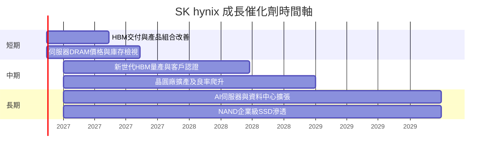

### 9.2 TAM 市場規模分析

TAM、滲透率及產品別收入未提供可核對數據，以下只列方向，不虛構市場金額。

```
╔══════════════════════════════════════════════════════════════╗
║                 SK hynix TAM觀察（非量化估算）               ║
╠══════════════════════════════════════════════════════════════╣
║ HBM/AI伺服器記憶體：市場金額 N/A；成長性高；公司收入 N/A    ║
║ 一般伺服器DRAM：市場金額 N/A；受平台更新及雲端資本支出影響  ║
║ 行動/PC DRAM：市場金額 N/A；終端換機與庫存周期性            ║
║ NAND/企業級SSD：市場金額 N/A；受資料中心儲存需求影響        ║
║ 公司TTM總營收：VERIFIED $141.83B；產品別拆分未提供          ║
╚══════════════════════════════════════════════════════════════╝
```

### 9.3 成長驅動力結構圖

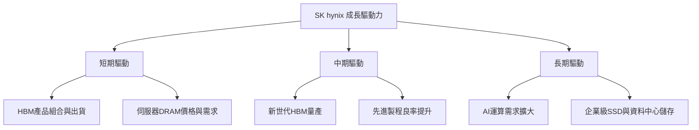

---

## 10. 風險矩陣

### 10.1 風險評分矩陣

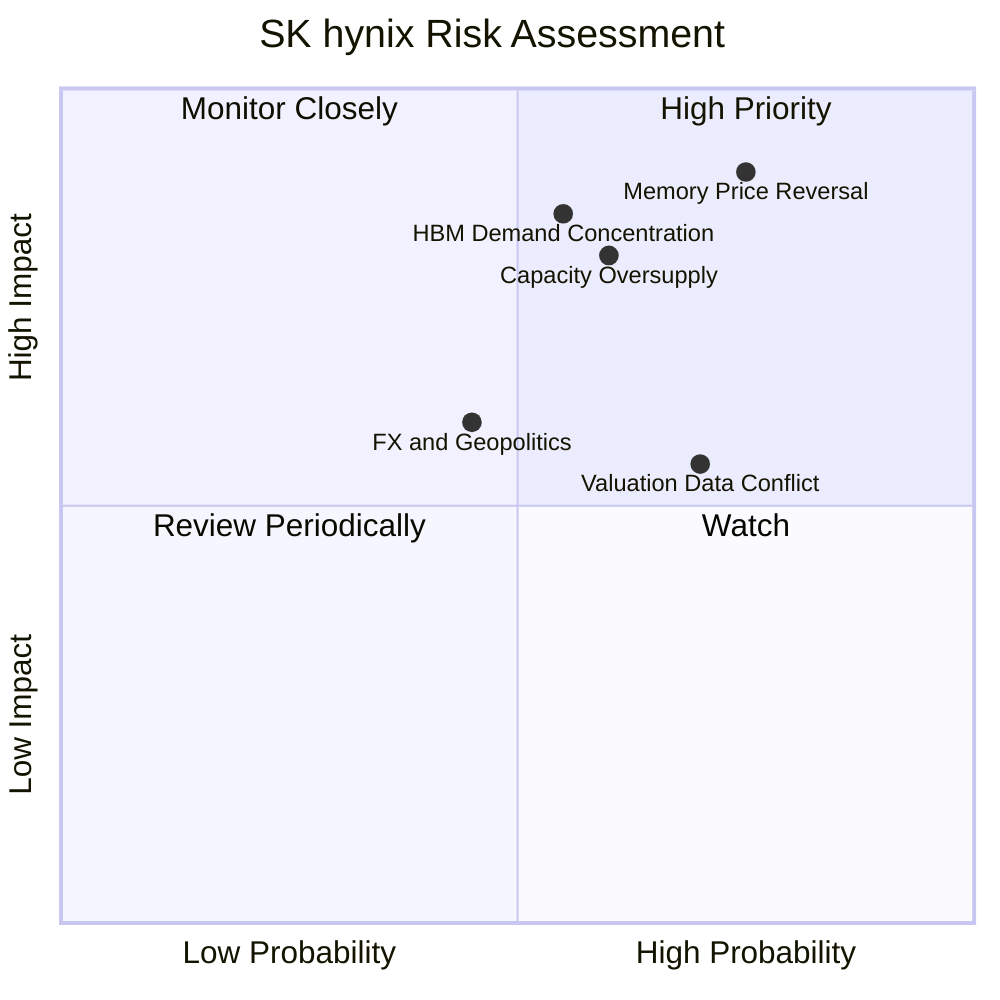

### 10.2 風險清單詳細分析

| # | 風險項目 | 發生機率 | 財務衝擊 | 風險評分 | 緩解措施 |
|---|----------|----------|----------|----------|----------|
| 1 | 🔴記憶體價格反轉 | 高（約45%估計） | 高；若營業利潤率由68%回落，盈餘與現金流大幅下降 | 🔴8.5/10 | 監控合約價、庫存、資本支出及供給增速 |
| 2 | 🔴HBM需求/客戶集中 | 中高（約35%估計） | 高；產品認證或客戶投資計畫延遲會影響成長斜率 | 🔴8.0/10 | 檢視客戶多元化、產品世代切換與良率 |
| 3 | 🟠供給過剩與擴產回報 | 中（約30%估計） | 高；Capex增加而利用率不足將壓低ROIC | 🟠7.5/10 | 比較新增產能、出貨與價格，追蹤Capex/營收 |
| 4 | 🟠估值與資料口徑風險 | 高（本資料包已存在） | 中高；股數4.824B/7.05B及營收口徑差異影響每股估值 | 🟠7.5/10 | 以正式年報/季報核對股數、財報與證券單位 |
| 5 | 🟡匯率、地緣政治及出口限制 | 中（約25%估計） | 中；供應鏈、設備取得及客戶需求可能受影響 | 🟡6.0/10 | 追蹤出口規則、設備供應與區域產能配置 |

---

## 11. 投資建議

### 11.1 最終綜合評級雷達圖

```
╔══════════════════════════════════════════════════════════════╗
║                  SKHY 最終評級雷達                           ║
╠══════════════════════════════════════════════════════════════╣
║ 基本面        7.5/10  ▓▓▓▓▓▓▓▓▓▓▓▓▓▓▓░░░░                    ║
║ 成長性        8.5/10  ▓▓▓▓▓▓▓▓▓▓▓▓▓▓▓▓▓░░                    ║
║ 獲利能力      8.0/10  ▓▓▓▓▓▓▓▓▓▓▓▓▓▓▓▓░░░                    ║
║ 財務健康      8.0/10  ▓▓▓▓▓▓▓▓▓▓▓▓▓▓▓▓░░░                    ║
║ 估值合理性    4.0/10  ▓▓▓▓▓▓▓▓░░░░░░░░░░░░                    ║
║ 風險控制      5.5/10  ▓▓▓▓▓▓▓▓▓▓▓░░░░░░░░                    ║
╠══════════════════════════════════════════════════════════════╣
║ 綜合評級：🟠減碼；MOS -15.57%，現價高於加權合理價值$114.03  ║
╚══════════════════════════════════════════════════════════════╝
```

### 11.2 目標價與隱含報酬率

| 情境 | 目標價 | 相對 $131.79 收盤價 | 權重/解讀 |
|------|--------|---------------------|-----------|
| 🔴悲觀 | $70.00 | -46.89% | 20%估計；周期反轉與利潤率快速正常化 |
| 🟡基準 | $153.00 | +16.09% | 55%估計；以Forward EPS及同業3.7x倍數估值 |
| 🟢樂觀 | $260.00 | +97.27% | 25%估計；HBM成長、利潤率與估值同步上行 |
| **機率加權目標價** | **$153.15** | **+16.21%** | \(70×20\%+153×55\%+260×25\%=153.15\) |

此情境加權目標價是相對估值及事件情境工具，與 8.8 的**加權合理價值 $114.03**用途不同；正式評級仍依 MOS 門檻判定為🟠減碼。

### 11.3 買入時機與觸發因素

```
╔══════════════════════════════════════════════════════════════════╗
║                  ✅ 買入觸發因素 Checklist                      ║
╠══════════════════════════════════════════════════════════════════╣
║ 立即建立/加碼需同時觀察：                                        ║
║  ✅ 股價回到MOS≥10%買入上限：約$102.63或以下                    ║
║  ✅ 營業利益率維持高位且客戶庫存未明顯上升                      ║
║  ✅ TTM FCF保持正值，Capex成長未超過營收成長                    ║
║                                                                  ║
║ 加碼觸發條件：                                                   ║
║  ☐ HBM出貨成長及新產品良率有正式財報支持                        ║
║  ☐ 中周期營業利益率穩定高於模型35%假設                          ║
║  ☐ 淨現金維持正值且FCF Yield不因股價上漲而過度壓縮              ║
║                                                                  ║
║ 減碼/退出觸發條件：                                              ║
║  ☐ 連續兩季營收YoY低於10%或營業利益率低於35%                   ║
║  ☐ FCF轉負且Capex維持高檔                                       ║
║  ☐ AI客戶延後採購、HBM供給快速擴張造成價格下跌                  ║
╚══════════════════════════════════════════════════════════════════╝
```

### 11.4 投資人適配度分析

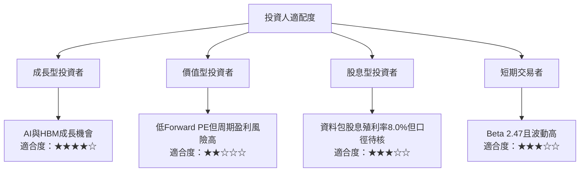

### 11.5 每季財報監控清單（Quarterly Watch List）

| 指標 | 最新基準 | 加碼觸發 | 減碼觸發 |
|------|----------|----------|----------|
| 營收 YoY | VERIFIED 最新單季 +327.9% | 成長維持且出貨結構改善 | 連續兩季低於10% |
| 營業利益率 | TTM 68.0%；最新季度74.5% | 中周期維持35%以上 | 低於35%或快速收縮 |
| HBM/伺服器DRAM | 產品拆分N/A | 出貨、認證及客戶多元化持續 | 客戶延遲、供應過剩 |
| Capex | TTM $27.36B | Capex支出轉化為收入與FCF | Capex上升但營收/FCF下滑 |
| FCF | TTM $67.80B | TTM FCF持續為正 | 轉負且連續兩季未改善 |
| FCF Yield | 7.30% | 價格回落、收益率提升且基本面穩定 | 股價上漲使收益率大幅壓縮 |
| 庫存/應收 | 最新明細口徑需核對 | 庫存增速不高於收入增速 | 庫存或應收連續快於營收 |
| 現金與債務 | 現金投資$85.82B、債務$11.85B | 維持淨現金 | 淨現金明顯下滑或債務急增 |
| 財報預期差 | EPS estimate/actual目前N/A | 正式資料連續超預期 | 連續低於市場預期 |

### 11.6 反面論證：什麼會證明論點錯誤（What Would Change My Mind）

```
╔══════════════════════════════════════════════════════════════════╗
║              ⚠️ 論點失效條件（Disconfirming Evidence）           ║
╠══════════════════════════════════════════════════════════════════╣
║ 本投資論點在以下情況成立時應重新檢視或退出：                    ║
║  ☐ 核心營收YoY連續兩季低於10%                                   ║
║  ☐ 營業利益率低於35%，或相對74.5%最新季度峰值大幅收縮           ║
║  ☐ TTM FCF轉負，或FCF/淨利長期低於50%                           ║
║  ☐ 以一致正式財報計算的ROIC低於WACC 17.33%                      ║
║  ☐ HBM新產品延遲、客戶認證流失，或新增產能無法達到合理利用率    ║
║  ☐ 淨現金由$73.97B大幅下滑，且資本支出沒有帶來相應現金流        ║
║  ☐ 正式股數與財報口徑核對後，估值仍顯著低於市場價格              ║
╚══════════════════════════════════════════════════════════════════╝
```

**最終建議：🟠減碼。** SK hynix 的高階記憶體能力、TTM FCF $67.80B 及淨現金約 $73.97B 為正面支撐；但市場價格 $131.79 高於加權合理價值 $114.03，安全邊際 MOS 為 **-15.57%**，依評級門檻屬減碼。若股價回落至約 **$102.63** 或以下、且財報持續證明 HBM 成長與中周期營業利潤率可維持，風險報酬比才較具吸引力。

> **免責聲明**：本報告為 AI 自動生成，僅供研究參考，不構成個別化投資建議。財務資料包存在來源、期間及股數口徑差異；模型中的缺漏項目已標示假設或 N/A。投資有風險，入市需謹慎。